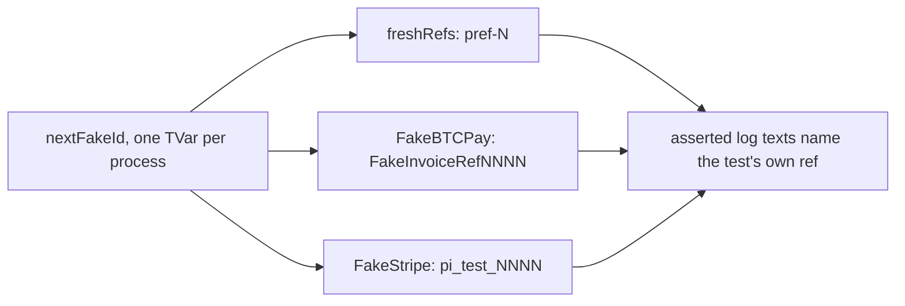
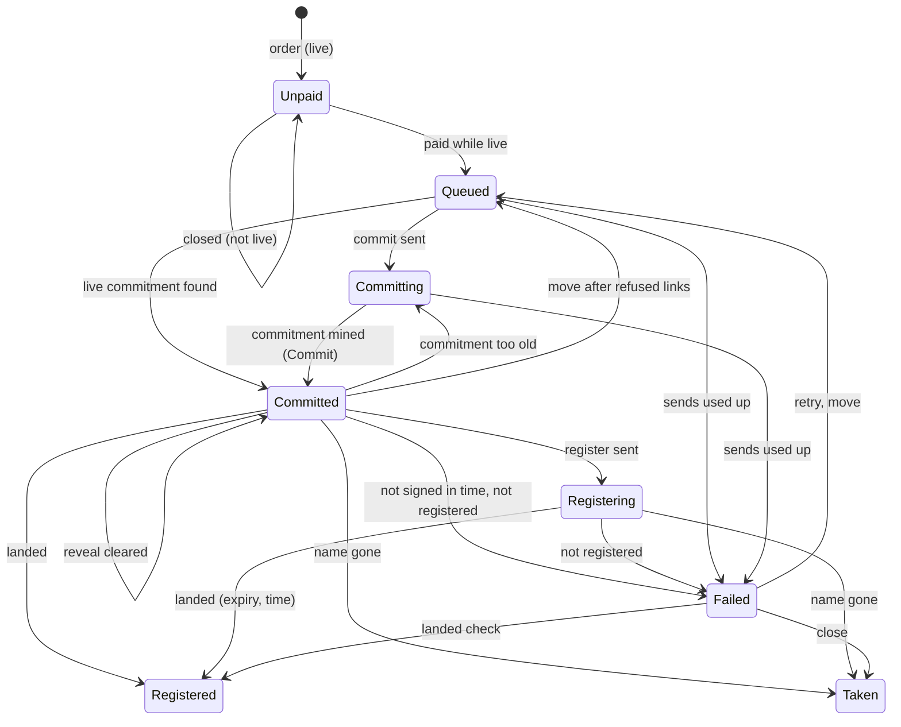

# Names service: fixes of the reviewed findings

Branch `ep/names-review-fixes`, from `names` at b13968b61, for a draft pull request to `names`. Decisions: the user's, 2026-11-16, on the review of https://github.com/simplex-chat/simplex-chat/pull/7703. Line references are at b13968b61.

Type rule, as approved:
- A new type where it is the argument or result of an exported function, stored or sent, or removes an invalid state that callers check today.
- A function used once is local to its caller; its result a tuple or a Bool named by its binding.
- A type that codifies states or transitions is kept, even in one module.
- A positional Bool of an exported function gets a type synonym; a newtype only where a mix-up is critical.
- Errors grouped by handling, with the reason as Text.
- Stock Show; parse or render for a log where logged.

## A6. Test races

The suite runs under `hspec . parallel`; `capturingStderr` sets the process-wide log level to note and redirects fd 2, so a capture contains the records of every test running meanwhile.

Rule: an asserted log text names an identifier only its test creates; a count or an absence is checked only over such text.

A6-1, process-unique provider refs:
- `FakeHttp.nextFakeId :: STM Int`, one counter for the process.
- `freshRefs`, `FakeBTCPay` and `FakeStripe` number their ids from it; `fsNextId` and the per-context counter go.
- Tests that wrote `pref-1` read the ref: `NamesWorkerTests.refundedWhole` and `testCloseFromBalance` from the order's invoice row, `testWriteRefusedAtBalance` from the cancel call.

A6-2, every asserted text names its test's identifier:

| Test | Assertion | Change |
|---|---|---|
| testLatePaymentAfterNewOrder | presence | the closed order's ref |
| testOneLateAlert | presence | the order's ref |
| testSweepGivesUpPastTheWindow | absence of "expired here only" | ref `p-gives-up`, absence of its line |
| testLoadedCount | presence of 2, then 0 names | 3 names, which no other test configures |
| testNodeChain | presence | with its error, `ChainUnavailable "HTTP 502"` |
| testCurrentTermsFetched | presence | with its error, `ChainReverted` |
| testRefundOpenHolder | the same refund line as testRefundRecorded | source `held` |
| testLiveOrderExistsHolder | the same line as testLiveOrderExists | holder `aheld` |
| testUnconfirmedThenSettled | the same line as testGrowingReports | order `unconfirmed` |
| testMoneyAfterPaid | absence of any "was paid" alert | of its own ref's |

Kept: the startup lines of `NamesCommunityTests` (name policy, terms links) and `testHandlerExceptionIsLogged`'s exception line, whose texts contain no identifier a test can make unique; the absence check of the latter counts only non-error lines, which no other test writes with that table name.

A6-3: `testDevKeysWarned` checks the absence of the warning for an empty index list, `trusting issuer dev_keys at indexes ;`, the only text the guard prevents; its presence check names indexes 9, 12, which no other test configures.

## A1. Orders, payments and the names database

Each finding is one commit, `store: <change>`, or `core: <change>` for src/.

### Types

A1-1, the order's phase with its data:
- `NamePhase` stays the stored tag, an SQL parameter and the metrics key.
- `NameRegistration.nrPhase :: OrderPhase` replaces nrPhase, nrLive, nrCommitTx, nrCommitBlock, nrRegisterTx, nrRegisterBlock, nrRevealAfter, nrRevealBefore, nrExpiresAt, nrRegisteredAt, nrFailedAt, nrError, nrLinksRefusedAt.
- `nrReveal` stays common to all phases.
- `type Live = Bool` in the unpaid phase; `FailReason` sum for the failed phase; transaction refs as tuples; `Commit` record shared by committed and registering.
- `toRegistration` decodes the columns once into the phase; retarget, requeue, lapse, landed, taken and failed construct the next phase.

A1-2, one payment sum, stored and hashed:
- `data OrderPayment = OPInvoice ServicePaymentMethod InvoiceId | OPDifference BalanceUse ServicePaymentMethod InvoiceId | OPBalance BalanceUse | OPCode CodeId`.
- `data BalanceUse = BalanceUse {buSource :: RegistrationId, buUsed :: cents}`.
- Replaces RegistrationPayment, nrBalanceSource and nrBalanceUsed; `createPaidRegistration` takes `Maybe BalanceUse`; OrderTerms' OTBalance contains the existing Spend.

A1-3, refusals per creator: `CodeInsertRefused = CIRLiveOrder | CIRCodeNotReservable`, `BalanceInsertRefused = BIRLiveOrder | BIRBalanceChanged`; resentOrder throws on an invariant break.

A1-4: `data HoldState = HSOpen UTCTime | HSFunded | HSOverdue UTCTime` in BalanceHold, decoded in toBalance.

A1-5: `LateFigures` (card or crypto) in LateCreditState, `CreditAmount` (card or crypto) in LateCredit, `type Units = Int64`; one dispatch in lateCreditOf.

A1-6: `data Received = RCard ... | RCrypto CryptoReceived`, `data Confirmation = Confirmed Units Cents | Uncreditable Uncreditable`.

A1-7: `Rate` with FromField and ToField over the stored text, in place of Maybe Text rates; a corrupt rate fails the row's decode.

A1-8: `data ProviderError = PETimeout Text | PEFailed Text`; isTimeout matches the constructor.

A1-9: aeson parsers (withObject, `.:`) run by `JT.parseEither` for the order, invoice order, code order, spend and find bodies; the log names the failing field; `type SignedOrderFields = (OrderFields, Word64, RecoverableSignature)`.

A1-10, A1-11 (core): `newtype NameLength` with `nameLength :: Int -> Maybe NameLength` in Badges/Code.hs; StrEncoding for NamePrepaidCode with an attoparsec grammar; prepaidCodeP is strP; the range checks at the six sites go.

A1-12: synonyms CodeId, RecordEditId, Commitment, OrderHash, CodeHash, BodyHash, TermsHash; setTermsText takes the text as Text.

A1-13: `AgreedTerms` parsed in parseOrderFields, encoded as today's text; the kind Bool is named `communityName`.

A1-14: cents as simplexmq's `USDCents` (escalated: its numeric and database instances belong in simplexmq).

A1-15: BTCPay invoice, payment and additional statuses as sums with an unknown case; giSpeedPolicy as Maybe SpeedPolicy.

### Duplication and control flow

- A1-17: Turns on Agent.Lock where its counting allows (escalated if simplexmq needs a change).
- A1-18: ExceptT at every site; firstRefusal goes.
- A1-19: maybeFirstRow' at the four sites.
- A1-20: orderHash over `smpEncode` of the fields; no order is stored before launch.
- A1-21: ToField and FromField for Address, LabelHash, RecoverableSignature and TxHash (simplexmq part escalated).
- A1-22: `enumTextDecode`; TextEncoding with field instances for ServicePaymentMethod, CryptoCurrency, InvoiceStatus, the edit state, the transaction kind, CodeState and LateWait.
- A1-23: `EONew` without the list.
- A1-24: one function for the signer, turn and existingOrder pipeline of the three order handlers; codeOrderHandler uses refused.
- A1-25: `paymentInvoice` at the five sites.
- A1-26: retargetOrder reads the move's price in its paid branch; moveChecked dispatches no more.
- A1-27: the move uses retry's shared check and its wire answers.
- A1-28: `ORBadRequest Text`, the same 400 answer.
- A1-29: dropped.
- A1-30: checkSpendBalance reads the holder from the balance it read.
- A1-31: revokePrepaidCode returns its PrepaidCode read with the result.
- A1-32: recordRefund reads again once after a refused update; a second refusal that passes the checks throws an error naming the race.
- A1-33: `CKGone` for a missing row.
- A1-34: `LateSupport = LSUncreditable Uncreditable | LSRateFloor | LSUnconfirmed`, stored text unchanged.
- A1-35: derived Show for RegistrationChanged.
- A1-36: nameSettled takes the money state at settlement as a sum.
- A1-37: one function per settlement outcome returns its publication and its log.
- A1-38: the creators return the refusal without the delete; placeOrder rolls back.
- A1-39: `''` agreed terms leave the comment and the view; one names migration.
- A1-40 (core): the owner code moves to the tests; NameCode collapses to NamePrepaidCode.
- A1-41: issueNameCode takes the parsed length and years, retries a taken hash up to 3 times, logging each.
- A1-42: a code order's code read throws an error naming the invariant when the row is missing.
- A1-43: `Landed` sum in checkLanded.
- A1-44: CORefused goes; an insert that changes nothing under the lock throws.
- A1-45: per-field read state in ViewReads, the error logged once.
- A1-46: addresses in JSON through Address's ToJSON.
- A1-47: one bounded HTTP call and one decode helper in Providers.hs.
- A1-48: Stripe charges and intent statuses parsed by FromJSON; the cancel returns the closed signal directly.
- A1-49: one unixSeconds in an existing shared module.
- A1-50: qOverdueInvoices only reads, with productJoins and providerRefColumn; the invoice is checked again before the Stripe cancel.
- A1-51: names queries with the `@` prefix through mkQuery.
- A1-52: the order hash computed once and passed to existingOrder and the creator.
- A1-53: one overdue fragment by alias.
