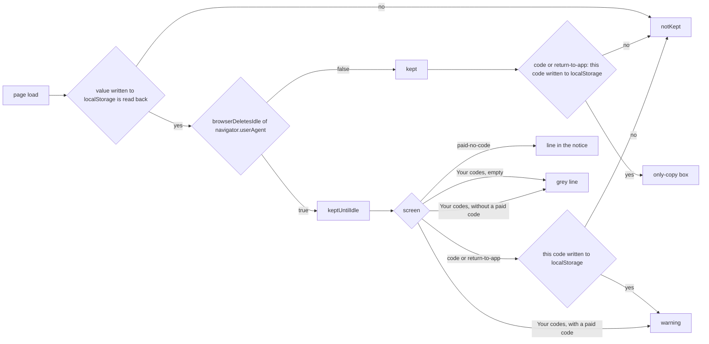

# Badges page: browsers that delete codes

## Decisions

- Warnings are added on the screens below.
- WebKit is recognised by its user agent: `AppleWebKit/` without `Chrome/` or `Android`.
- One value, `Retention`, is passed to the screens:
  - the code screen, in place of `savedLocally`
  - the return-to-app screen, in place of `savedLocally`
  - the paid-no-code screen
  - Your codes, in place of `keepsNewCodes`

```
notKept         a value written to localStorage at page load is not read back, or this code was not written
kept            a value written to localStorage at page load is read back, with a user agent other than WebKit's
keptUntilIdle   a value written to localStorage at page load is read back, with WebKit's user agent
```

- The period on the screens is 7 days, with U+00A0 in "7 days" and in "key press".
- On Your codes:
  - empty list, in every browser: "Codes stored in this browser are listed here."
  - listed codes, for `kept` and `keptUntilIdle`: "Codes are stored only in the browser they were bought in."
- "This code is not in this browser" replaces "This code is not on this device".
- "Forget everything in this browser" replaces "Forget everything on this device".
- At phone width, the Your codes list row:
  - code: `.75rem`
  - row gap: `6px`
  - row right padding: `4px`
  - Copy control padding: `0 8px`
- Line breaks:
  - `h1.tight`: `text-wrap: balance`
  - notice, warning and info lines: `text-wrap: pretty`
  - muted lines directly inside a panel (`.panel > p.muted`): `text-wrap: pretty`
  - both Your codes ledes: two `.half` spans

## Where the warning is shown

The period text: "after 7 days of browser use without a tap, click or key press on this site."

| Screen | Box | Title | Lines |
|---|---|---|---|
| Paid, code shown | warning under "This is the only copy." | This browser can delete the code | It may do so after the period. Redeem it now, or copy it and keep it outside this browser. |
| Paid, opened from the app, code hidden | warning above "Show code" | This browser can delete the code | It may do so after the period. If the app does not add the badge, show the code and keep a copy outside this browser. |
| Your codes, with a paid code | warning above the list | This browser can delete codes | It may do so after the period. Copy each code you have not redeemed and keep it outside this browser. |
| Your codes, without a paid code | grey line under the lede | | This browser can delete codes after the period. |
| Your codes, empty | grey line under the lede | | This browser can delete codes after the period. |
| Paid order opened without its code | notice | unchanged | If the code was bought in this browser, it may have been deleted after the period. |



## Tests

- `test/store.test.ts`, user agents of WebKit:
  - Safari on macOS and on iPad in desktop mode
  - Safari on iPhone
  - Chrome on iPhone
  - Firefox on iPhone
  - Edge on iPhone
  - an in-app web view on iPhone
  - GNOME Web on Linux
- `test/store.test.ts`, other user agents:
  - Chrome on Windows
  - Chrome on macOS
  - Chromium on Linux
  - Edge on Windows
  - Chrome on Android
  - an Android web view
  - Samsung Internet
  - Firefox on Windows
  - Firefox on Android
  - the Android stock browser
  - an empty user agent
- `test/screens.test.ts`: the five screens with and without the deletion warning, and the title and lines of each warning box.
- `test/main-safari-app.test.ts`: the paid ending opened from the app, and Your codes, in Safari on iPhone.
- `test/main-safari-code.test.ts`: the code screen in Safari on macOS.
- `test/main-chrome-code.test.ts`: the code screen and Your codes in Chrome on macOS, without the warning.
- `test/main-safari-lost.test.ts`: a paid order opened without its code in Safari on macOS.
- `test/main-safari-no-storage.test.ts`: Your codes in Safari on macOS with localStorage refused, without the warning.
