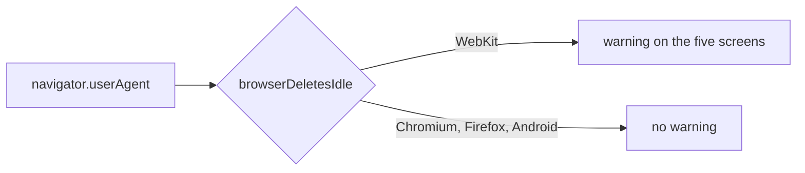

# Badges page: browsers that delete codes

## Problem

A bought code is stored only in the browser's localStorage. WebKit, the engine of Safari and of other browsers on iPhone and iPad, deletes a site's script-written storage after a number of days of browser use without a tap, click or key press on that site. A buyer who opened the page from the app later found no code on Your codes, which read "Nothing bought on this device".

| Browser | Stored codes are deleted when |
|---|---|
| Safari on macOS, iOS, iPadOS | 7 days of browser use without a tap, click or key press on the site, after a page of a classified tracker linked to the site with query parameters that Safari did not filter; 30 days otherwise, since WebKit 274398@main (February 2024), 7 days for every site before; only while tracking prevention is on |
| Other browsers on iOS and iPadOS | as Safari, while the app's tracking prevention is on, enabled by default in all WKWebView applications since iOS 14 |
| Chromium, Chrome, Edge | storage pressure, least recently used sites first; the data of all sites over the browser's limit; private window closed; data cleared |
| Firefox | storage pressure, least recently used sites first; the data of all sites over the browser's limit; private window closed; data cleared |

Sources:

- WebKit `ResourceLoadStatisticsStore.cpp`: `operatingDatesWindowShort { 7 }`, `operatingDatesWindowLong { 30 }`, `shouldRemoveAllButCookiesFor`, `logCrossSiteLoadWithLinkDecoration`
- https://webkit.org/tracking-prevention/
- https://webkit.org/blog/10882/app-bound-domains/
- https://developer.mozilla.org/en-US/docs/Web/API/Storage_API/Storage_quotas_and_eviction_criteria

## Decisions

- Warnings are added. Persistent storage is not requested.
- WebKit is recognised by its user agent: `AppleWebKit/` without `Chrome/`, `Chromium/` or `Android`.
- In those browsers, the screens state deletion after 7 days of browsing without a tap or click on the site.
- Your codes reads "Codes bought in this browser are listed here." when empty, and "The codes bought in this browser are stored here, and nowhere else." with codes, in every browser.
- Other texts and behaviour are unchanged in other browsers.

## Where the warning is shown

| Screen | Text |
|---|---|
| Paid, code shown, "This is the only copy." box | This browser can delete it after 7 days of browsing without a tap or click on this site. Redeem it now, or copy it and keep it outside this browser. |
| Paid, opened from the app, code hidden, warning box above "Show code" | Show and copy the code if the app does not add it. This browser can delete it after 7 days of browsing without a tap or click on this site. |
| Your codes, with a paid code, warning box | Redeem each code now, or copy it and keep it outside this browser. This browser can delete stored codes after 7 days of browsing without a tap or click on this site. |
| Your codes, empty | This browser can delete stored codes after 7 days of browsing without a tap or click on this site. |
| Paid order opened without its code ("This code is not on this device") | the same line, in the notice |

## Tests

- `test/store.test.ts`: the user agents of Safari on macOS and iPhone, Chrome, Firefox and Edge on iPhone, an iPhone web view, GNOME Web, and of Chrome, Edge, Chromium, Samsung Internet, an Android web view and Firefox on desktop and Android.
- `test/screens.test.ts`: the five screens with and without the warning.
- `test/main-app-safari.test.ts`: the paid ending opened from the app, and Your codes, in Safari on iPhone.
- `test/main-safari-code.test.ts`: the code screen in Safari on macOS.
- `test/main-chrome-code.test.ts`: the code screen in Chrome on macOS, without the warning.
- `test/main-safari-lost.test.ts`: a paid order opened without its code in Safari on macOS.
- Manual check with Playwright's WebKit (Safari 27.2 user agent), Chromium 156 and Firefox 159: the purchase flow against the mock service, with and without the app, and the order opened after its code was cleared.
