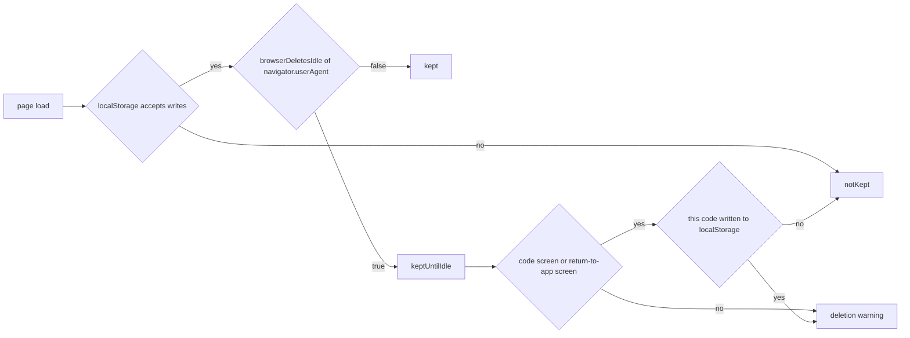

# Badges page: browsers that delete codes

## Decisions

- Warnings are added on the screens below.
- WebKit is recognised by its user agent: `AppleWebKit/` without `Chrome/` or `Android`.
- One value, `Retention`, is passed to the screens in place of two flags:
  - the code screen
  - the return-to-app screen
  - the paid-no-code screen
  - Your codes

```
notKept         localStorage refuses writes at page load, or this code was not written
kept            localStorage accepts writes, in a browser other than WebKit
keptUntilIdle   localStorage accepts writes, in WebKit
```

- The period on the screens is 7 days, with U+00A0 between "7" and "days".
- On Your codes, in every browser:
  - empty list: "Codes stored in this browser are listed here."
  - listed codes: "Codes are stored only in the browser they were bought in."
- "This code is not in this browser" replaces "This code is not on this device".
- "Forget everything in this browser" replaces "Forget everything on this device".
- At phone width, the Your codes list row:
  - code: `.75rem`
  - row gap: `6px`
  - row right padding: `8px`
  - Copy control padding: `0 8px`
- Line breaks:
  - `h1.tight`: `text-wrap: balance`
  - notice, warning and info lines: `text-wrap: pretty`
  - footnote under a panel: `text-wrap: pretty`
  - empty Your codes lede: two `.half` spans

## Where the warning is shown

| Screen | Box | Title | Lines |
|---|---|---|---|
| Paid, code shown | "This is the only copy." | unchanged | It can be deleted after 7 days of browser use without a tap or click on this site. Redeem it now, or copy it and keep it outside this browser. |
| Paid, opened from the app, code hidden | warning above "Show code" | This browser can delete the code | It can be deleted after 7 days of browser use without a tap or click on this site. If the app does not show the badge, show the code, copy it and keep it outside this browser. |
| Your codes, with a paid code | warning above the list | This browser can delete codes | They can be deleted after 7 days of browser use without a tap or click on this site. Copy each code you have not redeemed and keep it outside this browser. |
| Your codes, empty | grey line under the lede | | This browser can delete codes after 7 days of browser use without a tap or click on this site. |
| Paid order opened without its code | notice | unchanged | If the code was bought in this browser, the browser may have deleted it after 7 days of browser use without a tap or click on this site. |



## Tests

- `test/store.test.ts`, user agents:
  - Safari on macOS and iPhone
  - Chrome, Firefox and Edge on iPhone
  - an iPhone web view
  - GNOME Web
  - Chrome, Edge, Chromium, Samsung Internet and Firefox on desktop and Android
  - an Android web view
- `test/screens.test.ts`: the five screens with and without the deletion warning, and the title and lines of each warning box.
- `test/main-app-safari.test.ts`: the paid ending opened from the app, and Your codes, in Safari on iPhone.
- `test/main-safari-code.test.ts`: the code screen in Safari on macOS.
- `test/main-chrome-code.test.ts`: the code screen and Your codes in Chrome on macOS, without the warning.
- `test/main-safari-lost.test.ts`: a paid order opened without its code in Safari on macOS.
- `test/main-safari-no-storage.test.ts`: Your codes in Safari on macOS with localStorage refused, without the warning.
