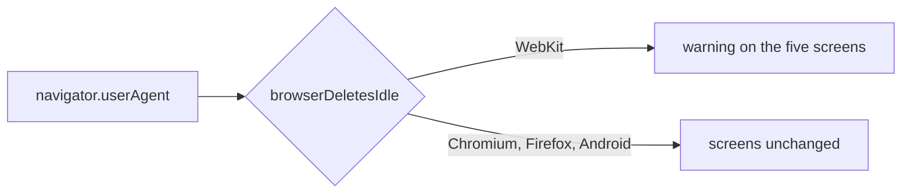

# Badges page: browsers that delete codes

## Problem

The badges page keeps a bought code only in the browser's localStorage. WebKit, the engine of Safari and of other browsers on iPhone and iPad, deletes a site's script-written storage after a number of days of browser use without a tap, click or key press on that site. A buyer who opened the page from the app and did not add the code lost it, and saw "Nothing bought on this device".

| Browser | Stored codes are deleted when |
|---|---|
| Safari on macOS, iOS, iPadOS | 7 days of browser use without a tap or click on the site, when a known tracker redirected to it with a decorated link; 30 days otherwise; only while tracking prevention is on |
| Other browsers on iOS and iPadOS | unconfirmed; they run WebKit |
| Chromium, Chrome, Edge | the disk is short of space, least recently used sites first; private window closed; data cleared |
| Firefox | the disk is short of space, least recently used sites first; private window closed; data cleared |

Sources:

- WebKit `ResourceLoadStatisticsStore.cpp`: `operatingDatesWindowShort { 7 }`, `operatingDatesWindowLong { 30 }`, `shouldRemoveAllButCookiesFor`, `logCrossSiteLoadWithLinkDecoration`
- https://webkit.org/tracking-prevention/
- https://developer.mozilla.org/en-US/docs/Web/API/Storage_API/Storage_quotas_and_eviction_criteria

`navigator.storage.persist()` exempts a site from the deletion when disk space is short, in Chromium and Firefox; the page does not request it, as Firefox asks the user.

## Decisions

- WebKit is recognised by its user agent: `AppleWebKit/` without `Chrome/`, `Chromium/` or `Android`.
- In those browsers the page says that the browser can delete the code after 7 days of browsing without a tap or click on the site, the earliest case.
- The page keeps its other texts and behaviour in other browsers.

## Where the warning is shown

| Screen | Text |
|---|---|
| Paid, code shown, "This is the only copy." box | This browser can delete it after 7 days of browsing without a tap or click on this site. Redeem it now, or copy it and keep it outside this browser. |
| Paid, opened from the app, code hidden, warning box above "Show code" | Show and copy the code if the app does not add it. This browser can delete it after 7 days of browsing without a tap or click on this site. |
| Your codes, with codes, warning box | Copy each code you have not redeemed. This browser can delete the codes stored here after 7 days of browsing without a tap or click on this site. |
| Your codes, empty | heading line "No codes stored in this browser", then the deletion line |
| Paid order opened without its code ("This code is not on this device") | the deletion line in the notice |

## Tests

- `test/store.test.ts`: the user agents of Safari, Chrome, Firefox and Edge on iPhone, an iPhone web view, GNOME Web, and of Chrome, Edge, Chromium, Samsung Internet, an Android web view and Firefox on desktop and Android.
- `test/screens.test.ts`: the five screens with and without the warning.
- `test/main-app-safari.test.ts`: the paid ending opened from the app, and Your codes, in Safari on iPhone.
- Playwright WebKit, Chromium and Firefox: the purchase flow against the mock service, with and without the app.
