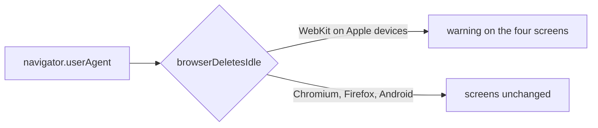

# Badges page: browsers that delete codes

## Problem

The badges page keeps a bought code only in the browser's localStorage. Safari, and every browser on iPhone and iPad, run WebKit, which deletes a site's script-written storage after 7 days of browser use without a click, tap or key press on that site. A buyer who opened the page from the app and did not add the code lost it, and saw "Nothing bought on this device".

| Browser | Deletes stored codes when |
|---|---|
| Safari on macOS, iOS, iPadOS | 7 days of browser use without a click, tap or key press on the site |
| Other browsers on iOS and iPadOS | unconfirmed; they run WebKit |
| Chromium, Chrome, Edge | the disk is short of space, least recently used sites first; private window closed; data cleared |
| Firefox | the disk is short of space, least recently used sites first; private window closed; data cleared |

`navigator.storage.persist()` changes none of these for this page: Safari grants it to home screen web apps, Chromium grants it by site engagement without a prompt, and Firefox asks the user.

## Decisions

- WebKit on Apple devices is recognised by its user agent: `AppleWebKit/` without `Chrome/`, `Chromium/` or `Android`.
- In those browsers, the page says that the browser deletes the code after 7 days of use without a visit.
- The page keeps its other texts and behaviour.

## Where the warning is shown

| Screen | Text |
|---|---|
| Paid, code shown, "This is the only copy." box | This browser deletes it after 7 days of use without a visit to this page. |
| Paid, opened from the app, code hidden | Copy the code if the app does not add it. This browser deletes it after 7 days of use without a visit to this page. |
| Your codes, with codes | This browser deletes the codes stored here after 7 days of use without a visit to this page. |
| Your codes, empty | the same line, under "Nothing bought on this device" |

## Tests

- `test/browser.test.ts`: the user agents of Safari, Chrome, Firefox and Edge on iPhone, Chrome, Edge, Chromium, Samsung Internet and Firefox on desktop and Android.
- `test/screens.test.ts`: the four screens with and without the warning.
- `test/main-app-safari.test.ts`: the paid ending opened from the app, and Your codes, in Safari on iPhone.
- Real Chromium 156 and Firefox 159 render Your codes without the warning.
