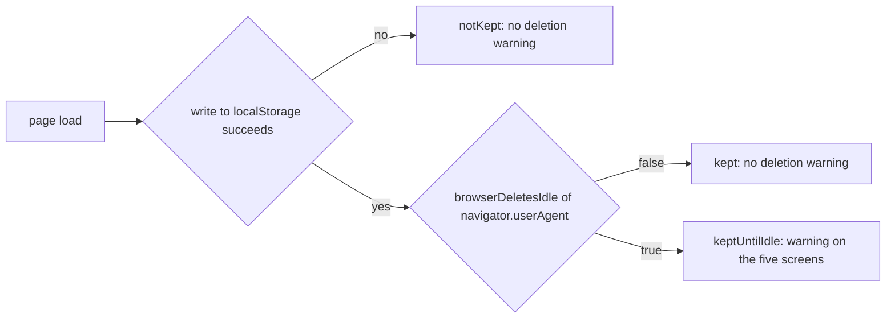

# Badges page: browsers that delete codes

## Problem

A bought code is stored only in the browser's localStorage. WebKit, the engine of Safari, other iPhone and iPad browsers, macOS app web views and GNOME Web, deletes a site's script-written storage after days of browser use without a tap, click or key press on that site. A buyer who opened the page from the app later found no code on Your codes, where "Nothing bought on this device" was shown.

| Browser | Stored codes are deleted after |
|---|---|
| Safari on macOS, iOS, iPadOS | 7 days of browser use without a tap, click or key press on the site, per webkit.org and MDN; in WebKit's source since 274398@main, 30 operating days, or 7 when the site was opened from a link with query parameters on a page of a classified tracker and Safari did not filter the parameters; the period in shipped Safari is unverified; only while tracking prevention is on |
| Other browsers on iOS and iPadOS, web views in macOS apps | as Safari, while the app's tracking prevention is on, enabled by default in all WKWebView applications since iOS 14 and macOS Big Sur |
| Chromium, Chrome, Edge | a private window is closed; the data is cleared; localStorage is excluded from Chromium's quota eviction |
| Firefox | the total size of all sites' data is over the browser's limit, least recently used sites first; a private window is closed; the data is cleared |

Sources:

- WebKit `ResourceLoadStatisticsStore.cpp`: `operatingDatesWindowShort { 7 }`, `operatingDatesWindowLong { 30 }`, `shouldRemoveAllButCookiesFor`, `logCrossSiteLoadWithLinkDecoration`
- https://webkit.org/tracking-prevention/
- https://webkit.org/blog/10882/app-bound-domains/
- https://developer.mozilla.org/en-US/docs/Web/API/Storage_API/Storage_quotas_and_eviction_criteria
- Chromium `storage/browser/quota/quota_client_type.h`: `QuotaClientType` without DOM storage
- Firefox `dom/quota/Client.h`: `Client::Type` with `LS`

## Decisions

- Warnings are added. Persistent storage is not requested.
- WebKit is recognised by its user agent: `AppleWebKit/` without `Chrome/` or `Android`.
- The code, return-to-app, paid-no-code and Your codes screens receive one value, `Retention`, in place of two flags:

```
notKept         a write to localStorage fails
kept            a write succeeds, in a browser other than WebKit
keptUntilIdle   a write succeeds, in WebKit
```

- For `keptUntilIdle`, deletion after 7 days of browsing without a tap or click on the site is stated on the screens.
- On Your codes, in every browser, "Codes stored in this browser are listed here." is shown when the list is empty, and "Codes are stored only in the browser they were bought in." when codes are listed.
- "This code is not in this browser" and "Forget everything in this browser" replace "This code is not on this device" and "Forget everything on this device".
- At phone width the code in the Your codes list is set at `.75rem`, so the 26 characters fit one line in a 360 px screen.

## Where the warning is shown

| Screen | Text |
|---|---|
| Paid, code shown, "This is the only copy." box | This browser can delete the code after 7 days of browsing without a tap or click on this site. Redeem it now, or copy it and keep it outside this browser. |
| Paid, opened from the app, code hidden, warning box above "Show code" | This browser can delete the code after 7 days of browsing without a tap or click on this site. If the badge is not added in the app, show the code and copy it. |
| Your codes, with a paid code, warning box | This browser can delete stored codes after 7 days of browsing without a tap or click on this site. Copy each code you have not redeemed, and keep it outside this browser. |
| Your codes, empty | This browser can delete stored codes after 7 days of browsing without a tap or click on this site. |
| Paid order opened without its code ("This code is not in this browser") | the same line, in the notice |



## Tests

- `test/store.test.ts`: the user agents of Safari on macOS and iPhone, Chrome, Firefox and Edge on iPhone, an iPhone web view, GNOME Web, and of Chrome, Edge, Chromium, Samsung Internet, an Android web view and Firefox on desktop and Android.
- `test/screens.test.ts`: the five screens with and without the deletion warning.
- `test/main-app-safari.test.ts`: the paid ending opened from the app, and Your codes, in Safari on iPhone.
- `test/main-safari-code.test.ts`: the code screen in Safari on macOS.
- `test/main-chrome-code.test.ts`: the code screen and Your codes in Chrome on macOS, without the warning.
- `test/main-safari-lost.test.ts`: a paid order opened without its code in Safari on macOS.
- `test/main-safari-no-storage.test.ts`: Your codes in Safari on macOS with localStorage refused, without the warning.
