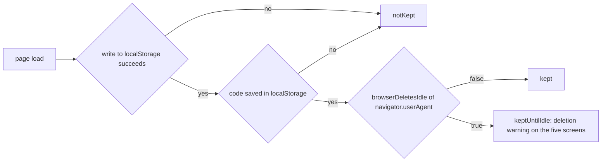

# Badges page: browsers that delete codes

## Problem

A bought code is stored only in the browser's localStorage. WebKit, the engine of Safari, other iPhone and iPad browsers, macOS app web views and GNOME Web, deletes a site's script-written storage after days of browser use without a tap, click or key press on that site. A buyer who opened the page from the app later found no code on Your codes, where "Nothing bought on this device" was shown.

## Decisions

- Warnings are added. Persistent storage is not requested.
- WebKit is recognised by its user agent: `AppleWebKit/` without `Chrome/` or `Android`.
- One value, `Retention`, is passed to the code, return-to-app, paid-no-code and Your codes screens, in place of two flags:

```
notKept         the code was not written to localStorage, or a write to localStorage fails
kept            the code is in localStorage, in a browser other than WebKit
keptUntilIdle   the code is in localStorage, in WebKit
```

- For `keptUntilIdle`, deletion after 7 days of browsing without a tap or click on the site is stated on the screens; "7 days" is kept on one line.
- On Your codes, in every browser, "Codes stored in this browser are listed here." is shown when the list is empty, and "Codes are stored only in the browser they were bought in." when codes are listed.
- "This code is not in this browser" and "Forget everything in this browser" replace "This code is not on this device" and "Forget everything on this device".
- At phone width the Your codes list row is narrowed: code at `.75rem`, row gap `6px`, row padding `10px 8px 10px 12px`, Copy control padding `0 8px`.

## Where the warning is shown

| Screen | Box | Title | Lines |
|---|---|---|---|
| Paid, code shown | "This is the only copy." | unchanged | This browser can delete the code after 7 days of browsing without a tap or click on this site. Redeem it now, or copy it and keep it outside this browser. |
| Paid, opened from the app, code hidden | warning above "Show code" | This browser can delete the code | It can be deleted after 7 days of browsing without a tap or click on this site. If the badge is not added in the app, show the code, copy it and keep it outside this browser. |
| Your codes, with a paid code | warning above the list | This browser can delete stored codes | They can be deleted after 7 days of browsing without a tap or click on this site. Copy each code you have not redeemed, and keep it outside this browser. |
| Your codes, empty | grey line under the lede | | This browser can delete stored codes after 7 days of browsing without a tap or click on this site. |
| Paid order opened without its code | notice | unchanged | the same line |



## Tests

- `test/store.test.ts`: the user agents of Safari on macOS and iPhone, Chrome, Firefox and Edge on iPhone, an iPhone web view, GNOME Web, and of Chrome, Edge, Chromium, Samsung Internet, an Android web view and Firefox on desktop and Android.
- `test/screens.test.ts`: the five screens with and without the deletion warning, and the title and lines of each warning box.
- `test/design.test.ts`: the phone-width list row declarations.
- `test/main-app-safari.test.ts`: the paid ending opened from the app, and Your codes, in Safari on iPhone.
- `test/main-safari-code.test.ts`: the code screen in Safari on macOS.
- `test/main-chrome-code.test.ts`: the code screen and Your codes in Chrome on macOS, without the warning.
- `test/main-safari-lost.test.ts`: a paid order opened without its code in Safari on macOS.
- `test/main-safari-no-storage.test.ts`: Your codes in Safari on macOS with localStorage refused, without the warning.
