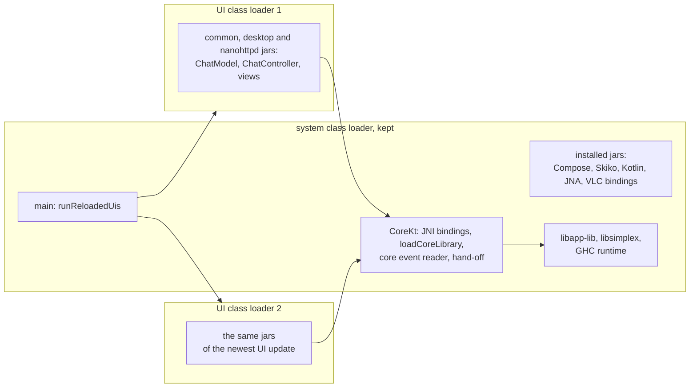
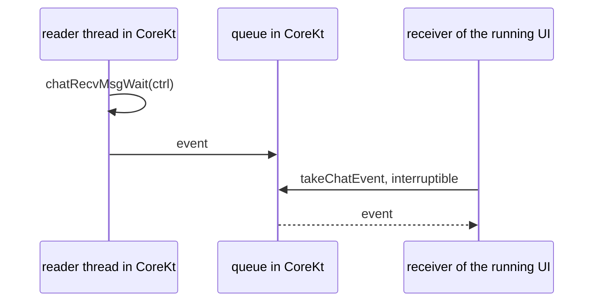

# Desktop: UI replaced without a restart

## Problem

A UI update from an internal release runs only after the app restarts (plans/2026-11-17-desktop-ui-updates.md), which stops the core: its connections, its file transfers and a connected mobile.

## Options

| Option | Cost |
|---|---|
| A. The system class loader keeps the installed jars, the core bindings and the native libraries; each UI loads in a class loader of its own; the core handle passes to the next UI | the UI state in memory is lost; each reload keeps the old UI's classes while anything references them |
| B. The chat model and controller move to a fixed module, and only the views reload | a split of the common module, which the views and the model reference throughout; model changes need a full update |
| C. The core runs in a process of its own, and the UI process restarts | an inter-process API in place of each JNI call, its authentication, and the process lifecycle |
| D. Classes redefined in place by JetBrains Runtime's enhanced redefinition | a different JDK in the packages; redefinition limited to compatible class changes; made for development |

The prototype is A.

## Parts



- `CoreBindings.kt` (JVM class `CoreKt`): the `external fun`s, `loadCoreLibrary`, the core event reader, the hand-off.
- `Core.kt` (JVM class `CoreInit`): the rest.
- InstalledLibraries hides the installed own jars from the UI class loaders, except `CoreKt`; it reads their entry names once and closes them.
- `loadCoreLibrary` calls `System.load` from `CoreKt`, so the native libraries belong to the system class loader; a second call is ignored, and so is a second `initHS`.
- The fixed part is CoreBindings.kt and UiUpdates.kt; both are in the core hash, so a UI update has the fixed part of the installed app.

## Core events



- One reader thread and one queue of one event per controller; a new controller gets a new queue and reader, and the old reader ends after its wait, its event left in the old queue.
- The reader waits until the queue has room, so pending events stay in the core's bounded queue, as before.
- The desktop receiver takes events with `runInterruptible`, so cancelling it ends the wait; Android reads the core as before.
- Events that arrive during a reload wait in the core for the next UI.

## Hand-off in CoreKt

| Field | Type | Set by | Read by |
|---|---|---|---|
| reloadedChatCtrl | ChatCtrl? | the old UI | the new UI's initChatController, which clears it |
| reloadedChatDbEncrypted | Boolean? | the old UI | the new UI's initChatController |
| reloadedInstanceLock | FileLock? | the old UI | the new UI's acquireSingleInstance, which clears it; the fixed loop, which then skips the check for another instance |
| uiReloadRequested | Boolean | the old UI | the fixed loop, which clears it before each UI |

## Reload

```mermaid
sequenceDiagram
  participant D as Developer tools or the update alert
  participant O as old UI
  participant F as fixed loop
  participant N as new UI
  D->>O: Reload
  O->>O: refused during a call, while the chat is not running, with a self-destruct passcode, or without installed jars
  O->>O: update checker, audio and video stopped
  O->>O: hand-off: ctrl, encryption; controller removed, receiver cancelled
  O->>O: single-instance lock handed off, watcher closed
  O->>O: windows closed, showApp returns
  O-->>F: main returns
  F->>F: newest valid UI update, else the installed own jars, in a new class loader
  F->>N: main(args)
  N->>N: single-instance lock taken over, watcher, platform, update checker
  N->>N: initChatController with the handed-off ctrl: no migration
  N->>N: startChat: the core running, the model loaded as at a start, receiver started
```

- The loop runs only in the system class loader, and only while the UI that returned asked for a reload.
- A UI that fails in a reload marks its UI update failed, and the process exits; the next start runs an older UI.
- With a self-destruct passcode, the controller starts only after the passcode is entered, and the handed-off one would serve the decoy profile, so the reload is refused.
- `simplex.ui_update` names the running UI update's directory; the installed own jars run with the property cleared, so they confirm and fail nothing.
- "Use the installed UI" marks the running UI update failed and reloads; the update alert offers "Reload now".

## Rule for UI code

UI code loads classes and resources through its own classes, never through the thread's context class loader: the event dispatch thread keeps the first UI's, and the coroutine threads the system class loader's.

## What breaks

- The UI state in memory: the open chat, scroll positions, drafts, modals; the new UI opens on the chat list.
- An event that the old receiver took before its cancellation is processed by the old UI only.
- Jobs and threads of the old UI run until they end; its commands fail without the controller.
- Each reload keeps the old UI's classes while a thread, a listener or Compose's global state references them; the log has the heap after each reload.
- The old UI's system notifications stay, with its actions.
- A reload before a UI update's confirmation marks the update failed.
- The launch arguments, a link among them, are handled again by each UI.
- The UI's temporary folder is emptied at each reload.
- spec/*.md reference Core.kt for the JNI declarations.

## Changes

| File | Change |
|---|---|
| CoreBindings.kt | JNI declarations from Core.kt, loadCoreLibrary, the core event reader, the hand-off |
| Core.kt | JVM class CoreInit; initChatController takes the handed-off ctrl and encryption |
| SimpleXAPI.kt | handOffForReload; the desktop receiver takes events from CoreKt; startChat loads a model that is not running, also when the core runs |
| DesktopApp.kt | reloadUi; showApp returns on a reload |
| SingleInstance.kt | the lock handed off and taken over |
| UiUpdates.kt | runReloadedUis, runUi, installedUiMain, uiMain; CoreKt visible to UI class loaders |
| AppUpdater.kt | "Reload now" for a staged UI update |
| Main.kt | startUi; runReloadedUis after it; loadCoreLibrary; "Use the installed UI" reloads |
| DeveloperView.kt, Platform.kt, strings.xml | "Reload UI" in the desktop developer options; "Reload now" |
| smoke-test.sh | reloads from the installed UI to a UI update, between UI updates, and to the installed own jars |
