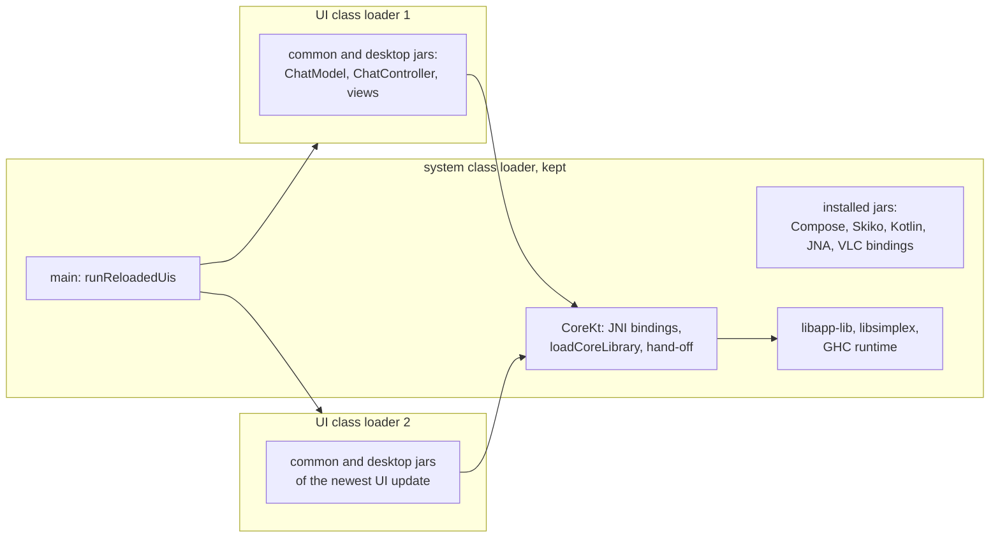

# Desktop: UI replaced without a restart

## Problem

A UI update from an internal release runs only after the app restarts (plans/2026-11-17-desktop-ui-updates.md), which stops the core: its connections, its file transfers and a connected mobile.

## Options

| Option | Cost |
|---|---|
| A. The system class loader keeps the installed jars, the core bindings and the native libraries; each UI loads in a class loader of its own; the core handle passes to the next UI | the UI state in memory is lost; each reload keeps the old UI's classes while anything references them |
| B. The chat model and controller move to a fixed module, and only the views reload | a split of the common module, which the views and the model reference throughout; model changes need a full update |
| C. The core runs in a process of its own, and the UI process restarts | an inter-process API in place of each JNI call, its authentication, and the process lifecycle |
| D. Classes redefined in place by JetBrains Runtime's enhanced redefinition | a different JDK in the packages; redefinition limited to compatible class changes; made for development |

The prototype is A.

## Parts



- `CoreBindings.kt` (JVM class `CoreKt`): the `external fun`s, `loadCoreLibrary`, the hand-off.
- `Core.kt` (JVM class `CoreInit`): the rest, unchanged.
- InstalledLibraries hides the installed UI jars from the UI class loaders, except `CoreKt`.
- `loadCoreLibrary` calls `System.load` from `CoreKt`, so the native libraries belong to the system class loader; a second call is ignored, and so is a second `initHS`.

## Hand-off in CoreKt

| Field | Type | Set by | Read by |
|---|---|---|---|
| reloadedChatCtrl | ChatCtrl? | the old UI | the new UI's initChatController, which clears it; the fixed loop |
| reloadedChatEvents | ConcurrentLinkedQueue&lt;String&gt; | the old receiver, for the event it got after its stop | the new receiver, before the core |
| reloadedReceiverStopped | CountDownLatch? | the old UI | the new receiver, which waits for it |

## Reload

```mermaid
sequenceDiagram
  participant D as Developer tools
  participant O as old UI
  participant F as fixed loop
  participant C as core
  participant N as new UI
  D->>O: Reload UI
  O->>O: update checker stopped
  O->>O: hand-off: ctrl, latch; controller removed, receiver cancelled
  O->>O: single-instance lock and watcher released
  O->>O: windows closed, showApp returns
  O-->>F: main returns
  F->>F: newest valid UI update, else the installed UI jars, in a new class loader
  F->>N: main(args)
  N->>N: single-instance lock, platform, update checker
  N->>C: initChatController with the handed-off ctrl: no migration
  N->>C: startChat: running, chats loaded, receiver started
  C-->>O: the next event to the old receiver
  O->>N: the event in reloadedChatEvents, latch counted down
  N->>C: the receiver reads the core
```

## What breaks

- The UI state in memory: the open chat, scroll positions, drafts, modals; the new UI opens on the chat list.
- A reload is refused during a call.
- The new receiver reads the core once the old one returns, after the next event or 300 s (MESSAGE_TIMEOUT).
- Jobs and threads of the old UI run until they end; its commands fail without the controller.
- Each reload keeps the old UI's classes while a thread, a listener or Compose's global state references them; the log has the heap after each reload.
- The old UI's system notifications stay, with its actions.
- A reload within 10 s of an unconfirmed UI update marks the update failed.
- The launch arguments, a link among them, are handled again by each UI.
- spec/*.md reference Core.kt for the JNI declarations.

## Base

The fixed part's interface is `CoreBindings.kt`; its hash joins the core hash (`--core-hash` in build-apps.yml), so that a UI update needs the same bindings.

## Changes

| File | Change |
|---|---|
| CoreBindings.kt | JNI declarations from Core.kt, loadCoreLibrary, the hand-off |
| Core.kt | JVM class CoreInit; initChatController takes the handed-off ctrl |
| SimpleXAPI.kt | handOffForReload; the receiver waits for the old one, hands off and takes over its event; startChat starts the receiver of a running core |
| DesktopApp.kt | reloadUi; showApp returns on a reload |
| SingleInstance.kt | releaseSingleInstance |
| AppUpdater.kt | runReloadedUis, uiMain, runUi; CoreKt visible to UI class loaders |
| Main.kt | startUi; runReloadedUis after it; loadCoreLibrary |
| DeveloperView.kt, Platform.kt, strings.xml | "Reload UI" in the desktop developer options |
| smoke-test.sh | two reloads, from a UI update, with the chat running |
