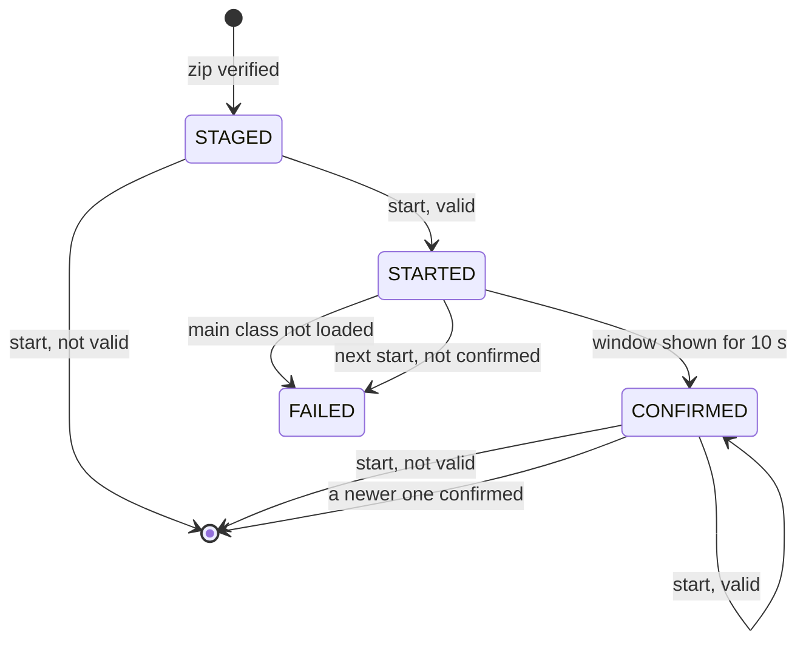
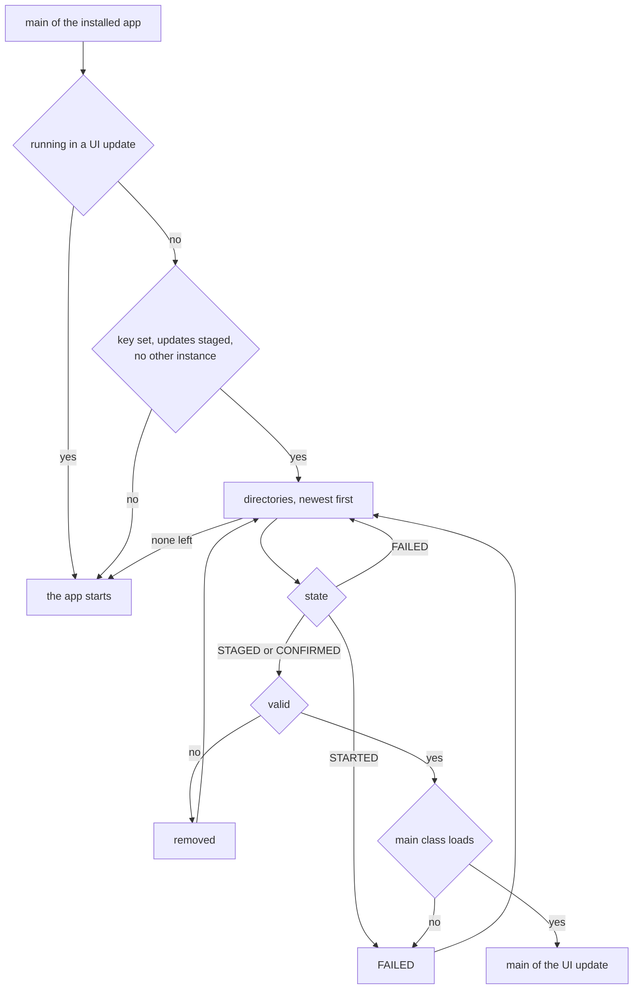
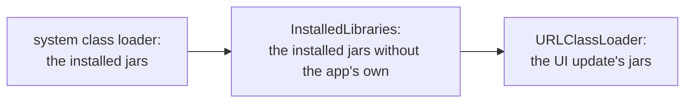
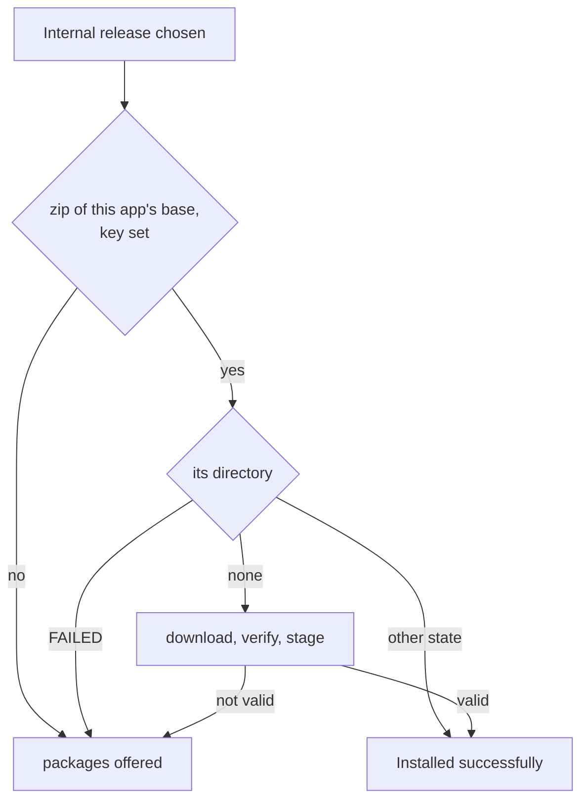

# Desktop: UI updates from internal releases

## Problem

Testers on the Internal update channel download and install a full package for each internal release, though most internal releases change only the UI.

## Behaviour

- An internal release has, for each desktop package, `simplex-desktop-ui-<base>.zip`: the app's own jars and `ui.json`, signed.
- An app on the Internal channel downloads the zip whose base equals its own, verifies it into its data folder and shows "Installed successfully" with "Please restart the app."
- Without such a zip, or when it fails verification, the app offers the packages, as before.
- At each start, the installed app verifies the staged UI updates again and runs the newest valid one.
- A UI update that fails to start is marked failed: the next valid one runs, else the installed UI.

## Base

| Part | Source |
|---|---|
| core hash | `lib/app/resources/core-hash` of the installed app, written by the build |
| dependencies | names of the classpath jars without the app's own jars, without the content hash in the name |

- base: SHA-256, hex, of the lines: the core hash, then the dependency names, sorted.
- The app's own jars: the jars with `chat/simplex/desktop/MainKt.class` or `chat/simplex/common/BuildConfigCommon.class`.
- A content hash: `-<16 to 32 hex digits>` before `.jar`.

## Zip

| File | Content |
|---|---|
| `ui.json` | the manifest |
| `ui.json.sig` | Ed25519 signature of `ui.json` |
| `*.jar` | the app's own jars |

`ui.json`:

| Field | Type |
|---|---|
| version_code | Int, desktop.version_code of the release |
| base | String |
| jars | jar name to SHA-256 hex |

- Signing key: the environment internal-release.
- Public key: `desktop.ui_update_key` in gradle.properties, base64 of the X.509 encoding, as `BuildConfigCommon.DESKTOP_UI_UPDATE_KEY`.
- An empty key turns UI updates off.

## Verification

A UI update is valid when:

- `ui.json.sig` verifies `ui.json` with the public key;
- `base` equals the installed app's base;
- `version_code` is greater than the running UI's build number;
- each listed jar has a plain file name and its SHA-256.

## Data folder

`<data>/ui_updates/<version_code>/`:

- `ui.json`
- `ui.json.sig`
- the listed jars
- `state`

## States

## Start

## Class loaders

- InstalledLibraries refuses each class and resource of the installed app's own jars.
- The UI update loads the core library itself, as the installed app does.

## Update check

## Changes

| File | Change |
|---|---|
| AppUpdater.kt | UI update download, verification, states, class loaders, start |
| Main.kt | startUiUpdate before the app starts |
| DesktopApp.kt | confirmUiUpdate 10 s after the window shows |
| SingleInstance.kt | otherInstanceRunning |
| common/build.gradle.kts, gradle.properties | DESKTOP_UI_UPDATE_KEY |
| AppUpdaterTest.kt | base, verification, states, staging |
| desktop-linux.yml, smoke-test.sh, ui-update.py | a throwaway key; the next build numbers' jars staged, run, failed and removed |
