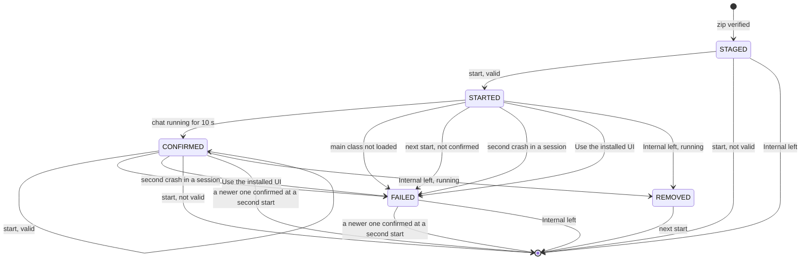
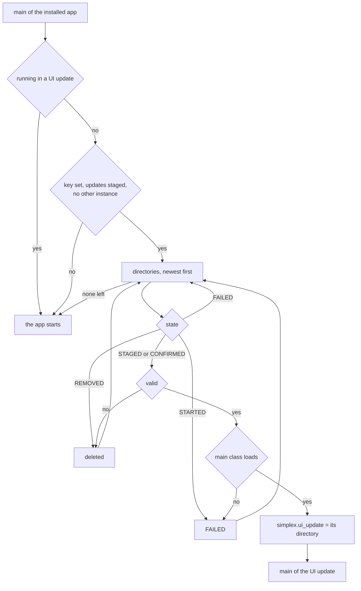
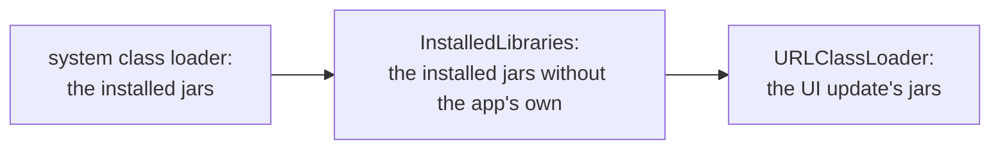
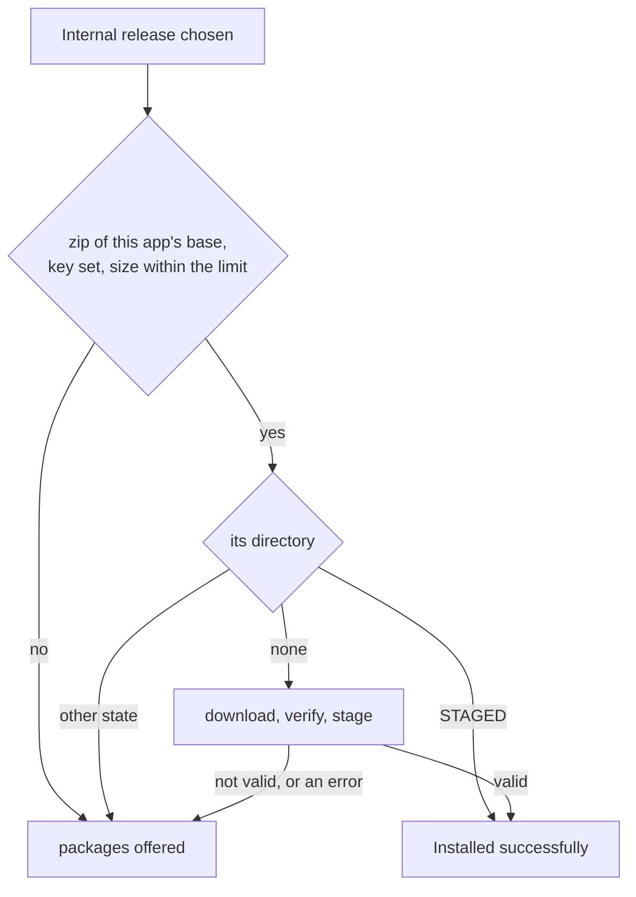

# Desktop: UI updates from internal releases

## Problem

Testers on the Internal update channel download and install a full package for each internal release, though most internal releases change only the UI.

## Behaviour

- An internal release has, for each desktop package, `simplex-desktop-ui-<base>.zip`: the app's own jars and `ui.json`, signed.
- An app on the Internal channel downloads the zip whose base equals its own, verifies it into its data folder and shows "Installed successfully" with "Please restart the app."
- Without such a zip, or when its download or verification fails, the app offers the packages, as before.
- At each start, the installed app verifies the staged UI updates again and runs the newest valid one.
- A UI update that fails to start, or crashes twice in one session, is marked failed: the next valid one runs, else the installed UI.
- Leaving Internal removes the UI updates.
- Developer tools' "Use the installed UI" marks the running UI update failed and removes the others; the installed UI runs after a restart.

## Base

| Line | Source |
|---|---|
| `core <hash>` | `core-hash` in the app's resources, written by the build tool |
| `jar <name>` | each classpath jar other than the app's own, without its content hash and `.jar`, sorted |
| `runtime <line>` | each non-blank line of `release` in the bundled runtime (`java.home`) |
| `option <option>` | each `java-options=` value of the launcher's cfg, except `-Djpackage.app-version=` |

- base: SHA-256, hex, of the lines, each followed by a newline.
- The app's own jars: the jars with `chat/simplex/desktop/MainKt.class`, `chat/simplex/common/BuildConfigCommon.class` or `org/nanohttpd/protocols/http/NanoHTTPD.class`.
- A content hash: `-<16 to 32 hex digits>` before `.jar`.
- Core hash: SHA-256 of the path and SHA-256 of each file of the core sources, computed by the build tool:
  - src/**
  - cabal.project
  - simplex-chat.cabal
  - PRIVACY.md
  - libsimplex.dll.def
  - cpp/desktop: CMakeLists.txt, include/**, simplex-api.c
  - UiUpdates.kt
  - CoreBindings.kt, once it exists
- The build tool writes `core-hash` and the zip only for a source with UiUpdates.kt.

## Zip

| File | Content |
|---|---|
| `ui.json` | the manifest |
| `ui.json.sig` | Ed25519 signature of `ui.json` |
| `*.jar` | the app's own jars |

`ui.json`:

| Field | Type |
|---|---|
| version_code | Int, desktop.version_code of the release |
| base | String |
| jars | jar name to SHA-256 hex |

- Signing key: `DESKTOP_UI_UPDATE_KEY` in the environment internal-release, used by publish.sh.
- Public key: `desktop.ui_update_key` in gradle.properties, base64 of the X.509 encoding, as `BuildConfigCommon.DESKTOP_UI_UPDATE_KEY`.
- An empty key turns UI updates off.

## Verification

A UI update is valid when:

- `ui.json.sig` verifies `ui.json` with the public key;
- `base` equals the installed app's base;
- `version_code` is greater than the build number of the installed app at start, and of the running UI at download;
- each listed jar has a plain file name and its SHA-256.

Limits:

| Item | Limit |
|---|---|
| zip | its asset size, at most 256 MB |
| `ui.json`, `ui.json.sig` | 64 KB each, read and verified before any jar is written |
| jars | the listed ones only, hashed while written, 256 MB in all |

## Data folder

`<data>/ui_updates/<version_code>/`:

- `ui.json`
- `ui.json.sig`
- the listed jars
- `state`

## States

- A UI confirms once per run: from STARTED it becomes CONFIRMED; from CONFIRMED the older UI updates are deleted.
- Removing writes REMOVED for a running UI update and for a folder that cannot be deleted.

## Start

- An error of the start falls back to the installed UI.
- The running UI reads its directory from the system property `simplex.ui_update`; the installed UI has none.

## Class loaders

- InstalledLibraries refuses each class and resource of the installed app's own jars.
- The UI update loads the core library itself, as the installed app does.

## Update check

## Threat model

| Party | Can | Cannot |
|---|---|---|
| A publisher of simplex-chat/simplex-chat-test without `DESKTOP_UI_UPDATE_KEY`: an account with write access to it, the holder of `SIMPLEX_CHAT_TEST_TOKEN` (the publish job after the environment's approval, or a leak) | publish packages, which the Internal channel offers and the app installs without a signature check, as before; withhold releases; publish an earlier signed zip again, which runs only where its build number is above the installed one and its base is the app's | make an app run other jars |
| The holder of `DESKTOP_UI_UPDATE_KEY` (the publish job after the approval, or a leak) | run any code in the app of each Internal tester after the next start, with the user's rights and the open database: messages read and sent as the user; on macOS with the signed app's camera and microphone permissions | reach apps on Stable, Beta or Disabled, or apps built with another key |
| A program running with the user's rights | delete or withhold the staged updates; replace a staged jar between its verification and the loading of its classes, which then run with the app's permissions | change a staged jar unnoticed before its verification at each start |

- Integrity: TLS to GitHub, and the Ed25519 signature checked at download and at each start before any class of the update loads.
- macOS notarization and the bundle signature cover the bundle only; the jars in the data folder are covered by the Ed25519 signature alone.
- A new public key is a full package update: an app with the old key ignores zips signed with the new one.

## Changes

| File | Change |
|---|---|
| UiUpdates.kt | verification, staging, states, class loaders, start, confirmation, removal |
| AppUpdater.kt | download of the zip, staging on Internal only, removal when the channel is not Internal |
| Main.kt | startUiUpdate before the app starts; "Use the installed UI" |
| DesktopApp.kt | confirmUiUpdate 10 s after the chat runs; a second crash marks the running UI update failed |
| DeveloperView.kt, Platform.kt, strings.xml | "Use the installed UI" while a UI update runs |
| SingleInstance.kt | otherInstanceRunning |
| common/build.gradle.kts, gradle.properties | DESKTOP_UI_UPDATE_KEY |
| AppUpdaterTest.kt | base, size limit, verification, states, staging |
| desktop-linux.yml, smoke-test.sh, ui-update.py | a throwaway key; the next build numbers' jars staged, run, failed, confirmed and removed |
