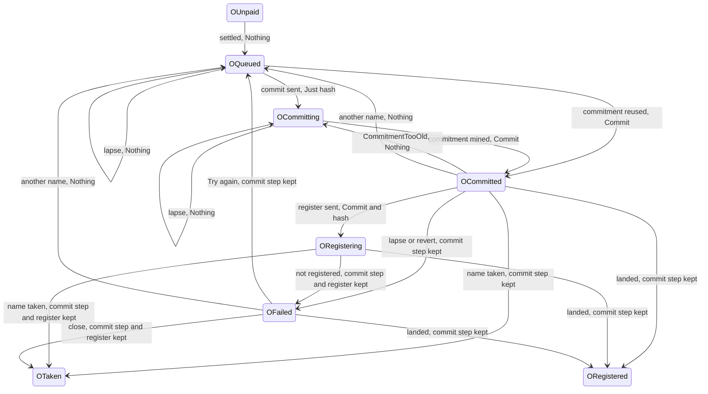

# Names service: the gaps of A1-1 and A1-7

Superseded where it differs: plans/2026-11-18-names-order-rules.md and apps/simplex-store-service/docs/names.md state the current rules and code.

Branch `ep/names-gaps-a6`, from `ep/names-fixes-a2` at 750589fef. Decisions: decisions-data.json `newRows` "A1-1:OrderPhase+Commit" and `changed` "A1-7:Rate"; the lead's rulings of 2026-11-17.

## A1-1: the phase holds its transactions

```haskell
data Commit = Commit {cmTx :: Maybe (TxHash, Word64), cmRevealAfter :: SystemSeconds, cmRevealBefore :: SystemSeconds}

data CommitStep = CSSent TxHash | CSCommitted Commit

data OrderPhase
  = OUnpaid Live
  | OQueued (Maybe CommitStep)
  | OCommitting (Maybe TxHash)
  | OCommitted Commit
  | ORegistering Commit TxHash
  | ORegistered (Maybe CommitStep) (Maybe (TxHash, Maybe Word64)) SystemSeconds UTCTime
  | OTaken (Maybe CommitStep) (Maybe TxHash)
  | OFailed (Maybe CommitStep) (Maybe TxHash) UTCTime FailReason
```

- nrCommitTx, nrCommitBlock, nrRegisterTx, nrRegisterBlock, nrRevealAfter and nrRevealBefore go; toRegistration decodes the columns once, by the phase.
- The reveal and the link refusal stay common fields.
- cmTx is Nothing when toCommitted finds no commit of ours that set the commitment.
- Failed, taken, registered and a requeue keep the commit step and the register transaction of the phase they leave; the view shows them as before.
- Retarget queues with none; the lapse queues or commits again with none.
- Judge's CommitmentTooOld commits again with none.



## A1-7: Rate

- Every site of the finding takes Rate: crRate, lfInvoiceRate, the CACrypto rates and invoiceFigures; Rate's FromField parses the stored text.
- WireNum (Providers/BTCPay.hs) stays: it is any number BTCPay sends, with its exact text: amounts, paid and due crypto, payment values and receivedDate timestamps, of any sign.
- Rate is a price above 0, parsed from a WireNum at its two reads; one type would drop Rate's proof or impose it on amounts and timestamps.
