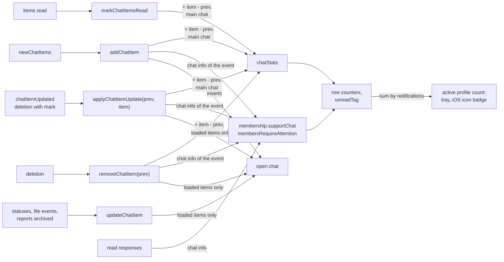
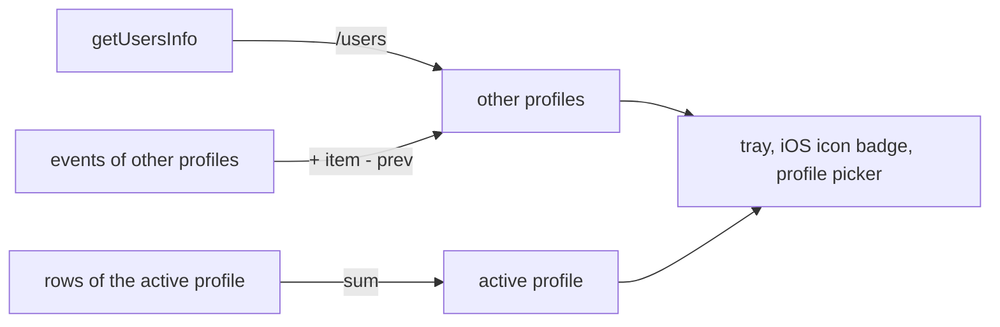

# Unread state and counts

Repository: simplex-chat/simplex-chat.
Branch: `ep/unread-counts`.
Base: master `4eeddce11` (#8219).

The user's words:

> simply send both the original and new item in the event, and let UI compute the diff with the counters it has

## Problems

| # | Problem |
|---|---|
| P1 | A status, deletion mark or file change of a message that is not loaded is shown at the bottom of the open chat. |
| P2 | After a chat is opened while messages arrive, its row count can be above or below its unread messages (Android, desktop). |
| P3 | Muted chats and non-mentions of mentions-only groups are counted in the active profile's count (desktop tray, iOS icon badge), and the count can be below 0. |
| P4 | The row's mention count is kept after its unread mention is deleted (Android, desktop). |
| P5 | The core counts member support chats in the profile count; the rows and the apps' count changes do not. |
| P6 | A chat outside the loaded list has no badge after a new message. |
| P7 | The main chat's count is shown on the scroll button of reports and "Chat with admins" (Android, desktop). |
| P11 | On a profile switch, every message of every profile is read to count the unread ones. |
| P13 | Groups flagged for their support chats are not in the Unread filter. |
| P17 | For a member pending admission, edits and deletions in "Chat with admins" are not shown in the group's row, and the badge of a deleted unread message is kept. |

## Causes

Paths: `ChatModel.kt`, `SimpleXAPI.kt`, `ChatItemsLoader.kt`, `ChatView.kt`, `ChatListNavLinkView.kt` in apps/multiplatform/common/src/commonMain/kotlin/chat/simplex/common; `ChatModel.swift`, `SimpleXAPI.swift`, `ChatView.swift` in apps/ios/Shared; `Profiles.hs`, `Messages.hs` in src/Simplex/Chat/Store.

| Cause | Problems | Code on master |
|---|---|---|
| Items inserted by update events | P1 | `upsertChatItem`: an item missing from the open chat is appended, and a missing chat is added with it (ChatModel.kt:671-700); on iOS the item is also made the open chat's preview (ChatModel.swift:773-798). Callers: statuses (SimpleXAPI.kt:3124, SimpleXAPI.swift:2745), deletion marks (SimpleXAPI.kt:3181, SimpleXAPI.swift:2790), file events in `chatItemSimpleUpdate` (SimpleXAPI.kt:3779, SimpleXAPI.swift:3228). `applyChatItemUpdate`: a missing chat is added, and the apps notify (ChatModel.kt:727, SimpleXAPI.kt:3865; ChatModel.swift:812, SimpleXAPI.swift:3247). |
| Profile count changed by another rule than the core's | P3 | Core: by `enable_ntfs` (Profiles.hs:176-204). Kotlin: +1 per unread item (ChatModel.kt:619-621), raw changes (724, 870, 943, 998). iOS: raw changes (ChatModel.swift:1191-1198); the mentions-only rule only on mark read and clear (1204-1209). Mute: no change (ChatListNavLinkView.kt:962-1001, ChatView.swift:3384-3407). |
| One counter changed on removal | P4 | Only `unreadCount` is lowered in `decreaseCounterInPrimaryContext` (ChatModel.kt:988-1005). |
| Scopes counted by different rules | P5, P17 | Core profile count: every scope (Profiles.hs:192-203); core rows: the main scope (Messages.hs:927-932). A pending member's support items are counted in the row by `addChatItem` (ChatModel.kt:598-624, ChatModel.swift:716-734), not by updates and removals (ChatModel.kt:704, 771; ChatModel.swift:802, 877). iOS: the group's row is lowered by the support chat items read (ChatModel.swift:1086, SimpleXAPI.swift:1933-1943). |
| Missing chat added with empty stats | P6 | ChatModel.kt:633-639, ChatModel.swift:737-743. |
| Open view's count from a stale read or another list | P2, P7 | The row's stats are replaced by the Initial page's, read before the load (ChatItemsLoader.kt:66-77). `PopChatCollector` is a nested class: `getChat` and `chats` in it are `ChatModel`'s, so a secondary context's list is replaced by the main list (ChatModel.kt:884-930); the scroll button count is read from the context's list (ChatView.kt:262-265). The iOS app reads `chatState.unreadTotal` (ChatView.swift:3079). |
| Support flag not in the filter | P13 | `unreadTag` (ChatModel.kt:1524, ChatModel.swift:1473). |
| All items of a profile read for its count | P11 | The plans search `chat_items` by `user_id` only (chat_query_plans.txt:454, 465). |
| New items applied out of order | P1, P4 | Kotlin: the model is changed for `newChatItems` in `withBGApi` (SimpleXAPI.kt:3094), so a later update or deletion of the item can be applied first. |

## Rule

An unread item is counted where it is shown in the chat list.

| Counter | Value |
|---|---|
| row unread | unread items of the main chat |
| | plus `membership.supportChat.unread` while the membership is pending |
| row mentions | unread items of the main chat with a mention of the user |
| | plus `membership.supportChat.mentions` while the membership is pending |
| profile | sum over rows, by the chat's notifications: |
| | all: row unread |
| | mentions: row mentions |
| | off: 0 |

Support chats of moderators and of current members are counted in no counter; their flag is shown in the row.

## Design

### Item changes

| Source | Call, both apps | Row counters | Preview | Open chat |
|---|---|---|---|---|
| `newChatItems` | `addChatItem(item)` | + item | the item | inserted |
| `chatItemUpdated` | `applyChatItemUpdate(prev, item)` | + item - prev | replaced if it is the item | replaced if loaded |
| deletion with `toChatItem`, event or response | `applyChatItemUpdate(deleted, marked)` | + marked - deleted | replaced if it is the item | replaced if loaded |
| deletion without it | `removeChatItem(deleted)` | - deleted | "deleted" if it is the item | removed if loaded |
| statuses, file events, reports archived | `updateChatItem(item)` | none | replaced if it is the item | replaced if loaded |
| items read | `markChatItemsRead` | - items read | none | marked |

- + item: 1 is added to row unread for an unread item of the main chat, and to row mentions for one with a mention of the user.
- Row counters are kept at 0 or above.
- Items of a member removed with messages are counted out by the same rule (`removeMemberItems`).
- `upsertChatItem` is removed.
- No item is added to the open chat and no chat to the list by an update or deletion, and no notification is shown for it (Q5).
- A missing chat is added by its new item, with the item counted (P6).
- The preview is taken from the scope shown in the row (`inMainChatList`) in each call (P17).
- The chat info of each item event and read response is applied to the row.
- An edit by the user is applied to both contexts, as deletions are (Kotlin `ComposeView`).
- Kotlin: the model changes of `newChatItems` are applied in the receiver's order; file auto-receive and the notification run in the background.

### Counters

- `Chat.unreadCount`, `Chat.unreadMentions`: the row counters of the rule, read by the row badge, `unreadTag` and "Mark read".
- `Chat.userUnreadCount`: the chat's part of the profile count.
- Active profile: the sum of `userUnreadCount` over the list.
  - Kotlin: `ChatModel.activeUserUnreadCount`, read by the desktop tray.
  - iOS: `totalUnreadCountForAllUsers()`, set as the icon badge after each change of a row, of the list or of another profile's count.
  - The stored count of the active profile is not changed.
- Other profiles: the core's count, changed per event by + item - prev with `isRcvNew`, `inMainChatList` and `ntfsEnabled`.
- `unreadTag`: row counters by notifications, `unreadChat`, or the support flag (`supportUnreadCount > 0`) unless notifications are off (P13, Q3).
- Unread tag counts are changed by `unreadTag` before and after each row change, `updateChatInfo` included; they are no longer changed in `updateChatSettings` (both apps).
- With "Mark read" on a pending member's group, the chat with admins is read too (`apiSupportChatRead`, the user's scope) (Q2).

### Open chat, Kotlin

- Initial page: the row's `reportsCount` is set from the page; its unread counters are kept (P2).
- `PopChatCollector`: an inner class of its `ChatsContext` (P7).
- Scroll button and item positions: `chatState.unreadTotal` of the view's context, as on iOS (P7, Q4).

### Core

- `getUsersInfo`, per profile:
  - contacts: unread items joined through each contact, by `enable_ntfs` (P11, Q6);
  - groups: unread items of the main chat joined through each group, by `enable_ntfs` (P5, P11);
  - pending memberships: `support_chat_items_unread`, or `support_chat_items_mentions` for mentions-only (Q2).
- The update event of a received edit has the group info with the support chat counters after the edit; `updateGroupCIUserMention` returns it.

## What users see

| | Before | After |
|---|---|---|
| P1 | A status, deletion mark or file change of an unloaded message is shown at the bottom of the open chat; on iOS the message is made the preview. An edit in a chat outside the loaded list adds the chat at the top with a notification. | The message is changed only where it is shown. No chat is added and no notification is shown (Q5). |
| P2 | After a chat is opened during incoming messages, its row count can differ from its unread messages. | The row count is kept on opening. |
| P3 | The tray and icon count is raised by muted chats and by non-mentions of mentions-only groups; a mute does not change it; it can be below 0. | The count is the sum of the rows by notifications. |
| P4 | The @ is kept after its unread mention is deleted. | The @ is removed. |
| P5 | Support chat messages are counted in the profile count after a restart, not during a session. | They are counted only in a pending member's row (Q1, Q2). |
| P6 | A chat outside the loaded list has no badge after a new message. | Messages received since are counted; older unread ones are counted at the next list load. |
| P7 | The main chat's count is shown in reports and "Chat with admins". | Their own count is shown (Q4). |
| P11 | Profile switch time grows with the number of messages. | Only unread items are read (Q6). |
| P13 | Groups with the support flag are not in the Unread filter. | They are listed unless notifications are off (Q3). |
| P17 | Admins' edits and deletions are not shown in a pending member's row; the badge of a deleted message is kept; the badge is lost after a restart. | The row is updated from the chat with admins, and its badge is kept after a restart (Q2). |
| iOS | The group's row count is lowered by reading its support chats. | The row count is kept. |

## Questions

| Q | Question | Built as | Other option |
|---|---|---|---|
| Q1 | Are member support chats counted in the profile count? | No; their flag is shown in the row | Yes, in every profile; mute and read changes of support chats then reach the apps only at a list load |
| Q2 | Are admins' messages counted in a pending member's row? | Yes, from the core's support counter; "Mark read" reads the chat with admins | No; the flag only |
| Q3 | Are groups with the support flag listed by the Unread filter? | Yes, unless notifications are off | No |
| Q4 | Which count is shown on the scroll button of reports and "Chat with admins"? | Their own unread count, as on iOS | None |
| Q5 | Is a chat outside the loaded list added, with a notification, by an edit or deletion? | No | Yes, as now |
| Q6 | How is the profile count read? | Joined through each chat on the existing indexes, without a migration | A new index of unread items, built at the first start after the update |

## Tests

### Recording

Events also recorded by `recordItemEvent` (tests/ChatTests/Utils.hs): `chatItemsDeleted`, `chatItemsStatusesUpdated`, `rcvFileStart`, `rcvFileComplete`. Recipients have `markRead = False`.

| Fixture | Core test | Recorded |
|---|---|---|
| counts/group-deleted | Groups.hs, "deleted unread items change the counters" | alice: a mention, a message, the message marked deleted, the mention removed |
| counts/statuses | Direct.hs, "sent item statuses" | bob, the sender: statuses of "hello" |
| counts/file-received | Files.hs, "received file events" | alice: a file message, file started, file completed |
| counts/pending-support | Groups.hs, "pending member counts admins' messages" | eve, pending review: an admin message, its edit with a mention, a second message, its deletion `/_get chats 1 pcc=on` `/_read chat items #1(_support) <id>` |
| counts/moderator-support | Groups.hs, "moderator receives support messages" | alice, the owner: a member's support message, a main chat message `/_read chat items #1(_support:<id>) <id>` |
| counts/muted | Direct.hs, "message in a muted chat" | alice: a message from a muted contact |
| counts/chat-page | Direct.hs, "chat page during new messages" | alice: two messages `/_get chat @2 initial=100` between them |

### Core

| Test | Checked |
|---|---|
| profile counts follow the rule | `/users` unread of: a muted contact 0, a mentions-only group its mentions, a member's support message to a moderator 0, admins' messages to a pending member counted |
| query plans | chat_query_plans.txt: both counts search `chat_items` by user, chat and status |

### Kotlin, desktop

`UnreadCountsTest`; notifications recorded through `ntfManager`, commands answered through `chatSendCmdRetry`.

| Test | Fixture | Checked |
|---|---|---|
| status of an unloaded item | counts/statuses | nothing inserted; the preview replaced only if it is the item |
| file event of an unloaded item | counts/file-received | nothing inserted |
| deletion mark of an unloaded item | counts/group-deleted | nothing inserted; counters unchanged |
| removed unread mention | counts/group-deleted | row 2 1, then 1 0 |
| new item and its removal | counts/group-deleted | the removal processed right after its item: the mention absent, row 1 0 |
| profile count by notifications | updates/group-mention, counts/muted | 0, 1, 0 for the mentions-only group; 0 for the muted contact; 1 after unmute |
| chat outside the list | counts/muted | added with row unread 1 |
| opening keeps the row count | counts/chat-page | row 2 after the page with 1 |
| pending member's row | counts/pending-support | badge 1 from the counter; the edit in the preview; the deletion in the badge and the preview; 0 after the read response; the badge in `ChatPreviewView` |
| moderator's support message | counts/moderator-support | row unread 0; profile count 0; the group in `ChatListView` with the Unread filter |
| support chat view | counts/moderator-support | the support chat's context keeps its own list after a pop; its unread count in `ChatView` of the support chat |
| counters follow previous and new item, changed | updates/group-mention | 1 0 0, 1 1 1, 1 0 0 |
| update of a chat not listed, changed | updates/direct-edit | no chat added, no notification |

### iOS

`UnreadCountsTests` in "SimpleX Unit Tests"; `setNtfBadgeCount` also recorded by `RecordingNtfManager`.

| Test | Fixture | Checked |
|---|---|---|
| status, file event and deletion mark of an unloaded item | counts/statuses, counts/file-received, counts/group-deleted | nothing inserted; the preview not replaced by an unloaded item |
| removed unread mention | counts/group-deleted | row 2 1, then 1 0 |
| profile count by notifications | updates/group-mention, counts/muted | badge 0, 1, 0; 0 for the muted contact |
| chat outside the list | counts/muted | added with row unread 1 |
| pending member's row | counts/pending-support | as in Kotlin, without the view |
| moderator's support message | counts/moderator-support | row unread 0; `unreadTag` true |
| reading a support chat keeps the group row | counts/moderator-support | row unread unchanged after the read |
| counters follow previous and new item, changed | updates/group-mention | 1 0 0, 1 1 1, 1 0 0 |
| update of a chat not listed, changed | updates/direct-edit | no chat added, no notification |

## Docs

- apps/multiplatform/spec/state.md, apps/ios/spec/state.md: the rule and the calls.
- apps/ios/spec/services/notifications.md: the icon badge.
- docs/guide/notifications.md: the tray count by chats' notifications.

## Known gaps

- A status that arrives before the send response adds its item is lost; the item has the response's status until the next status.
- Unloaded unread items of a member removed with messages stay counted until the next list load.
- A chat added from outside the loaded list has the messages received since counted.
