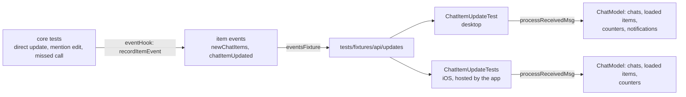

# App tests of item updates on core recordings

Repository: simplex-chat/simplex-chat.
Branch: `ep/update-prev-item` (#8219).
Base: master.

The user's words:

> to merge 8219, you need to add UI tests using mocked API responses, in the same way we did in merged PRs 8234 and 8241

## Composition

## Recording

`tests/ChatTests/Utils.hs`:

| Function | Mechanics |
|---|---|
| `recordItemEvent events evt` | appends `newChatItems` and `chatItemUpdated` to `events`, encoded as `chatRecvMsg` encodes them |
| `eventsFixture fixture events steps` | clears `events`, runs `steps`, writes `events` as one JSON array |
| `stableJSON` | `itemTs` replaced by 1970-01-01 `itemSharedMsgId` replaced by its key |

The recipient of each recording has `markRead = False`, so items stay unread, as in an app before the chat is opened.

| Fixture | Core test | Events of the recipient |
|---|---|---|
| updates/direct-edit | updated item event has the previous item | new "hello" "hello" edited to "hello there" new "how are you" "hello there" edited to "hello, alice" |
| updates/direct-recreated | the same test, after the recipient deletes the item locally | new "hello again", recreated from the update |
| updates/group-mention | should send updated item with mentions added and removed by edit, the recipient's group notifications set to mentions | new "hello" edited to mention the recipient edited without the mention |
| updates/missed-call | mark call invitation missed when the caller ends the call | new pending call the call updated to missed |

`updates/update-response`, written by `apiFixture` in "updated item event has the previous item": the sender's response to `/_update item @2 8 text hello there`, the edit to "hello there". The test runs the command after the sender's item has the status `snd_rcvd ok complete` in the database, so the item's status in the response is the same on every run.

## Tests

Each test lists the chat of the first event without items, unless the test is about a chat not in the list; it receives the events with `processReceivedMsg` and compares the model.

| Test | Fixture | Checked | Apps |
|---|---|---|---|
| edit replaces loaded item | direct-edit | the open chat has "hello there" in place of "hello"; the preview is "hello there" | both |
| update of item not loaded inserts nothing | direct-edit | the chat opened after "hello" has no loaded items after the edit; the preview changes only while the edited item is the last one | both |
| counters follow previous and new item | group-mention | unread, mentions and the profile's unread: 1 0 1, 1 1 1, 1 0 1 | both |
| mention edits in another profile change its unread count | group-mention | the other profile's unread: 1 after the mention, 0 after its removal; no notification | both |
| update of a chat not in the list adds it | direct-edit, the edit only | the preview is "hello there"; one notification | both |
| recreated item is counted | direct-recreated | the preview is "hello again"; 1 0 1; one notification | both |
| edit in another profile does not notify | direct-edit | one notification, of "hello"; the other profile's unread is 1 | both |
| missed call does not notify | missed-call | the preview is the missed call; no notification | both |
| missed call in another profile does not notify | missed-call | no notification; the other profile's unread is 1 | both |
| update response has the updated item | update-response | `apiUpdateChatItem` sends `/_update item @2 8 ` and returns item 8, "hello there" | both |
| event decodes to its fields | direct-edit | the update event has `chatItemUpdate` with the previous item | Kotlin |

Notifications: Kotlin replaces `ntfManager` and records `displayNotification`; iOS replaces `NtfManager.shared`, now a `var`, with a subclass that records `addNotification`.

## Missed calls

`chatItemUpdateNotify` notifies only in the active profile, when the update added the chat. Its missed call branch is removed: `notifyMessageReceived` displays nothing for `RcvCall`, whose `showNotification` is false, since #5328. The spec line of `notifyMessageReceived` states the same.

## iOS

- `singleFieldJSON` converts tagged objects except `MsgContent`, which the core encodes with `type` in both JSON forms, recognized by its tags.
- other types tagged with `type` in both forms are converted: `MsgChatLink`, `LinkContent`, `MsgScope`, `MsgReaction` and `ChatBotCommand`; a fixture with them needs a rule by position, as the tag `group` of `MsgChatLink` is also a tag of `ChatInfo`.
- `fixtureJSON`, `singleFieldJSON` and `waitFor` are at file scope of `NameAlertsTests.swift`, shared by both test classes.
- the debounced unread collector is awaited by `assertCounts`.
