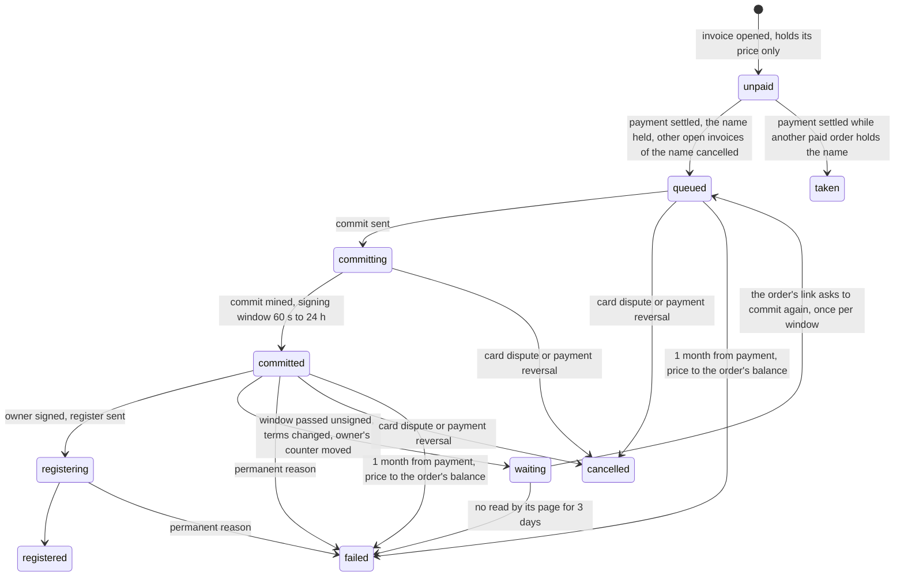

# Names orders: holds, failures and retries

Rules decided by the user on 2026-11-17 and 2026-11-18. Principle: a prompt, excellent service to people who pay, defended from people who try to exploit it: correct decisions, bounded retries, no retries of lost causes, every error tracked.

## 1. The order

1. Payment holds the name against every order through the service; an open invoice holds only its price.
2. When an order's payment is fully settled, the other open invoices of the same name are cancelled.
3. The name stays reserved for the buyer for 1 month from payment acceptance; moves to other links or another name are allowed within it.
4. An order not registered within that month fails permanently, the name returns to sale, and the price goes to the order's balance; refunds are manual.
5. A card dispute or a payment reversal cancels the order while its register has not been sent; for a registered order it alerts the operators, with the order's evidence for the answer to Stripe.
6. A prepaid-code order not registered within the month: its code is released and the order closed.
7. A prepaid code can reserve a name for 3 months from its issue.
8. The service learns the name only at the signing step, after the commit has aged.

## 2. Failures

1. Permanent: what the operators cannot fix without the owner signing again, or without a code change. Every code error is permanent.
2. Permanent reasons fail the order at once, keep its commit and register transactions, log, and report to the managed group:
   - invalid signature;
   - fields the service builds (duration too short, resolver, reverse record, name too short);
   - duration over the sponsored limit;
   - a stored signature refused after a change of the service's configuration.
3. Temporary reasons are retried, logged, and reported to the group at about the 5th failure, until the month from payment ends:
   - registrar allowance used up;
   - registrar key without funds;
   - fee or gas above the caps;
   - contract wiring;
   - a revert the service does not recognise;
   - a node or read failure.
4. Waiting for the owner, while the page or the owner can resolve it:
   - the signing window passed unsigned;
   - the terms changed on chain: the page asks the owner to accept them again and never signs changed terms silently;
   - the owner's counter moved.

   The order fails when its page has not read it for 3 days; the last read is stored at most once an hour.
5. The owner's signature of the registration is valid at most 1 week; within it, the service commits the same commitment again as often as needed and registers with the stored signature.
6. `CommitmentTooOld`: the service commits again, logs, and reports to the group.
7. Refused links: the buyer is told which link, contact or channel, and asked to replace or remove it; the name stays reserved; the operators are alerted in the log and the group.

## 3. Attempts and records

1. Up to 5 dry-run failures; once a dry run passes, up to 5 sent transactions failing for a permanent reason; temporary reasons have no count limit.
2. The two counts are kept apart.
3. Every failed attempt is stored with its reason and with whether a dry run or a sent transaction failed; the last reason is shown.

## 4. Alerts

1. Every paid order not registered within 3 hours of payment: log, the managed group, Prometheus. Badges: a later pull request.
2. A failing metrics listener is logged and reported to the group; the service goes on.
3. Alert rules on the registrar key's balance and on the fee cap.

## 5. Other

1. The service key is read by one parser that accepts both cases.
2. The production-build layout tests stay skipped.

## 6. Open

1. A stored terms acceptance that no longer verifies after a name policy change, and a signature past its week: wait for the owner, or fail.
2. The changes made in this pull request without the user's decision: reviewed by the user one by one.
