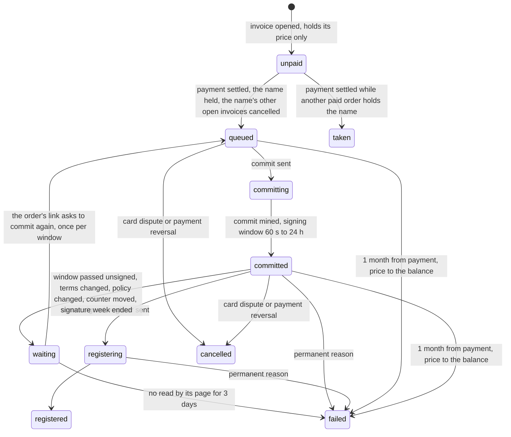

# Names service fixes (#8243): every change against `names`

Principle (the user): a prompt, excellent service to people who pay, defended from people who try to exploit it. Technically: correct decisions, bounded retries, no retries of lost causes, every error tracked and debuggable.

Status of each item:
- **built**: in #8243 (commit given);
- **to build**: decided, not built yet;
- **built, to change**: in #8243, to be changed as stated;
- **open**: the user's decision is still needed.

`names` is the base branch (service code of b13968b61, page 9a16ca996). Line references are to `names` unless a commit is named. The rules were decided by the user on 17–18 Nov, including "I agree with all recommendations".

## Contents

1. [Paid orders: the name delivered, or the money returned](#1-paid-orders-the-name-delivered-or-the-money-returned)
2. [Failures and retries: wait only for what can resolve](#2-failures-and-retries-wait-only-for-what-can-resolve)
3. [Prompt service: the operators learn first](#3-prompt-service-the-operators-learn-first)
4. [Defence against exploitation](#4-defence-against-exploitation)
5. [The page and the service: one typed interface](#5-the-page-and-the-service-one-typed-interface)
6. [Stored data](#6-stored-data)
7. [Operators: commands and configuration](#7-operators-commands-and-configuration)
8. [Tests and CI](#8-tests-and-ci)
9. [Internal structure, no behaviour change](#9-internal-structure-no-behaviour-change)
10. [Open](#10-open)

## 1. Paid orders: the name delivered, or the money returned

### 1.1 Payment holds the name — to build
- **names:** another buyer's order is refused only while an order of the name has its register in flight (`Names/Orders.hs:295-302`, `Names/Store.hs:864-869`); search shows the name as available otherwise (`Web/Names/Search.hs:59, 69-70`). Two buyers can pay for one name; the loser ends `taken`, its price kept as a balance (`Names/Worker.hs:352-356, 369-383`).
- **Change:** a paid order holds its name against every order through the service, from payment until it is registered, fails or is closed; an open invoice holds only its price. A payment that settles while another paid order holds the name ends its own order `taken` at settlement.
- **Why:** taking money from a second buyer for a name already paid for is unacceptable; opening an invoice costs nothing, so it cannot hold a name.

### 1.2 Other invoices of a paid name are cancelled — to build
- **names:** they stay open.
- **Change:** when an order's payment is fully settled, the name's other open invoices are cancelled at their providers (`pCancelInvoice`, `Providers.hs:237`). Money that still reaches one is late money, credited to that order's balance.

### 1.3 One month from payment — to build
- **names:** a failed order holds its place with no end; it is live, so only the same owner code is refused (`Names/Store.hs:760-772`).
- **Change:** the name stays reserved for the buyer for 1 month from payment acceptance, moves to other links or another name included. An order not registered by then fails permanently, the name returns to sale, and the price goes to the order's balance. Refunds are manual, from the balance.
- **Why:** a hold extends the name's registration period; a month is enough to resolve any case that can be resolved.

### 1.4 Card disputes and payment reversals — to build
- **names:** the service acts on three Stripe events only: succeeded, failed, cancelled (`Providers/Stripe.hs:104`); a dispute changes nothing and nobody is told.
- **Change:** a dispute or a reversal cancels the order while its register has not been sent. On a registered order it alerts the operators, with the order's evidence (payment, signed order, registration transaction) for the answer to Stripe.
- **Facts (Stripe docs):** disputes are usually possible within 120 days of payment; the amount and a fee you do not get back are taken at once; evidence is due in 7–21 days; the outcome takes 60–75 days; a refunded payment can still be disputed; Stripe sends `charge.dispute.created`, `.closed`, `.funds_withdrawn`, `.funds_reinstated`.

### 1.5 Prepaid-code orders — built, to change
- **names:** a code order failed for 30 days gives its code back; the order stays failed (`Names/Worker.hs:108-110, 564-579`).
- **#8243 (feb7d9639):** the sweep also takes orders lapsed unsigned, and closes each as `taken` when it releases the code.
- **Change:** a code order not registered within the month from reservation releases its code and is closed, freeing the name, as paid orders.

### 1.6 Prepaid codes expire — to build
- **names:** codes never expire: the column exists and is checked (`Names/Codes.hs:55` in #8243), but every code is issued without it. No code has been issued yet.
- **Change:** a code can reserve a name for 3 months from its issue.
- **Why:** some time pressure; it bounds how long an old price stays valid.

### 1.7 When the service learns the name — as now
- The service learns the name only at the signing step, after the commit has aged (`screens/order.ts:300`); until then it holds the name's hash and a copy sealed with the owner's key (`flow.ts:49, 67-69`).

## 2. Failures and retries: wait only for what can resolve

### 2.1 One rule per failure reason — to build
- **names:** four places decide: errors without a revert, and every commit error, are retried every 15 s with no end (`Names/Worker.hs:178, 237-243, 300, 315`); a register or relay revert goes to `judge`, which fails the order at once for any reason it does not name (`:336-362`); the service's own signature check fails it the same way (`:305-309`); 5 sends of one kind fail it (`:449-458`).
- **#8243 (feb7d9639):** a dry-run revert is retried while the commitment lives, then fails `registry_refused`; a mined revert sends the register again.
- **Change:** one function classifies every reason as temporary or permanent. Permanent is what the operators cannot fix without the owner signing again or without a code change; every code error is permanent.
  - Temporary: retried, logged, reported to the group at about the 5th failure, until the month from payment ends (1.3).
  - Permanent: the order fails at once, keeps its commit and register transactions, and is logged and reported to the group.
  - Waiting for the owner: what the owner's page resolves (2.2).
- **Why:** retrying a lost cause hides it; failing a fixable one loses a sale.

| Reason | Source | Class | names |
|---|---|---|---|
| node or read failure | — | temporary | retried |
| gas price over `max_fee_per_gas`, gas over `gas_limit_cap`, key without funds, signing failure | service | temporary, operator alert | retried |
| `InsufficientAllowance` | `SimplexSponsor.sol:122` | temporary, operator alert | retried, error log |
| `UnexpiredCommitmentExists` (commit) | `SimplexController.sol:394` | expected: the commitment is recorded; not counted | retried |
| `CommitmentTooNew` | `:509` | wait 1 s | same |
| `CommitmentTooOld` | `:517` | commit again; logged and reported | commit again |
| `CommitmentNotFound` | `:516` | temporary: landed check, then commit again | failed |
| `NameNotAvailable`, `NameReserved`, gone at confirmation depth | `:503`; `SimplexNamePolicy.sol:403` | taken | same |
| the same while the name reads free, or gone only above depth | — | temporary | retried |
| `InvalidNonce` | `SimplexSponsor.sol:140` | owner signs again | same |
| `TermsNotAccepted`, `TermsMismatch` | `SimplexNamePolicy.sol:449, 478-482` | owner accepts and signs again | same |
| `SignatureExpired` | `SimplexSponsor.sol:138` | owner signs again | failed |
| `InvalidSignature` | `:163-164` | permanent: code error | failed |
| `DurationTooLong` (not in the service's list) | `SimplexController.sol:484, 612-616` | permanent; a move stays offered | failed |
| `DurationTooShort`, `ResolverRequiredWhenDataSupplied`, `ReverseRecordNotSupported`, `NameTooShort` | `:377-388, 406` | permanent: code error | failed |
| `LabelTooLong` | `BaseRegistrarImplementation.sol:151-152` | permanent unless operators raise the limit | failed |
| `NotSponsor`, policy `NotController`, `NotProxy` | `SimplexController.sol:169`; `SimplexNamePolicy.sol:400-401` | temporary, operator alert: wiring | failed |
| `ReentrantCall` | `SimplexController.sol:183` | permanent: a contract bug | failed |
| `Error(string)`, unknown code, no data | `Names/Chain.hs:350-360, 638-639` (#8243) | temporary, operator alert | failed |
| errors of admin, public paid, transfer and subname functions (25 names) | contract settings and other paths | temporary, operator alert: unexpected on these paths | failed |

### 2.2 Waiting for the owner — built, to change
- **names:** an order whose signing window (60 s to 24 h after the commit; contracts' deploy script, `deploy/simplex/00_deploy_simplex_controller.ts:46-47`) passes unsigned fails "The name was not signed in time" (`Names/Worker.hs:257-259`); Try again commits again (`:426-500`).
- **#8243 (feb7d9639, page f8484e6):** the order waits; the page holding the owner code asks the service to commit again by itself; Try again is removed.
- **Change:** the order waits for the owner while the owner's page can resolve it: the window passed unsigned; the terms changed (the page asks again, never signs changed terms silently); the owner's counter moved; the name policy changed, so the stored acceptance no longer verifies; the signature's week ended. It fails when its page has not read it for 3 days; the last read is stored at most once an hour.
- **Why:** waiting helps only while someone can act; a buyer away for a weekend is covered by 3 days.

### 2.3 The owner's signature is valid one week — built, to change
- **names:** the deadline is the later of the window's end and the signing + 7 days (page `flow.ts:13, 89`).
- **#8243 (b2cba1d9c):** 2^53−1, valid until the owner's counter moves; made without the user's decision.
- **Change:** at most one week. Within it, the service commits the same commitment again as often as needed and registers with the stored signature: the register recomputes the commitment from the registration (`SimplexController.sol:505-520`), and the signature covers the registration without the secret (`SimplexSponsor.sol:70-72`).

### 2.4 Refused links — to build
- **names:** the service refuses a link that is not a short link of its key's kind, or a second link per key, with `invalid_link`, without saying which (`Names/Reveal.hs:107-116, 142-145`; `Names/Links.hs:32-47`); the order fails "not signed in time" at the window's end; the page offers another name or no links.
- **#8243 (feb7d9639):** fails `links_refused` at the window's end.
- **Change:** the buyer is told which link was refused, contact or channel, and asked to replace or remove it; the name stays reserved; the operators are alerted in the log and the group.

### 2.5 Counting attempts — to build
- **names:** only sent transactions count, 5 per kind; dry runs are not counted, so a dry run that always reverts is retried forever.
- **Change:** up to 5 dry-run failures; once a dry run passes, up to 5 sent transactions failing for a permanent reason; temporary reasons have no count limit; the two counts are kept apart. No extra cap on new commits per order.

### 2.6 A signature refused after a configuration change — to build
- A stored signature refused because the service's chain id or sponsor address changed is a code error: the order fails at once, visibly, logged and reported.

## 3. Prompt service: the operators learn first

### 3.1 The 3-hour alert — to build
- **names:** the queue alert fires after 20 minutes, but only for queued, committing, registering and committed with a stored signature (`README.md:912, 951`); an order waiting for its owner is not covered.
- **Change:** every paid order not registered within 3 hours of payment raises an alert in the log, the managed group and Prometheus. Badges: a later pull request.
- **Why:** a customer complained after a week once, when the browser's state needed to investigate was gone.

### 3.2 Failure reasons are stored — to build
- **names:** the transactions table keeps the signed transaction, hash, nonce, send time, mined block and status; no reason (`Migrations.hs:465-478`); dry runs leave no record.
- **Change:** every failed attempt is stored with its kind, whether a dry run or a sent transaction failed, its decoded reason and time; the order shows the last one.

### 3.3 Metrics never stop the service — built, to change
- **names:** a failing metrics listener left the service running (`Metrics.hs:266-267`).
- **#8243 (345827d68):** the whole service stops; made without the user's decision.
- **Change:** the failure is logged and reported to the group; the service goes on.

### 3.4 Alert rules — to build
- README alert rules on the registrar key's balance and on the fee cap, beside the existing ones (`README.md:951-958`).

## 4. Defence against exploitation

- **An open invoice holds no name** (1.1).
- **Gas spent on reverts is bounded** by the attempt counts (2.5).
- **Committing again by the order's link — built (feb7d9639):** only with the link, a 16-byte random id (`Store/Invoices.hs:682-683`); 5 requests a minute per client (`Web/Names.hs:43`); only for an order whose window passed unsigned, once per window. A commit costs at most 0.0003 ETH at the 5-gwei cap (`README.md` gas table), so at most about 30 commits, 0.009 ETH, per paid order within its month.

## 5. The page and the service: one typed interface

All built; the page (simplex.domains #19) changes in step. Answers are the service's types as derived JSON, so the page reads the service's own shapes.

| Change | Commit |
|---|---|
| Search answers one case per name state (available, registering, reserved, registered with the store resolver's records or "other") | 9ad5142e5 |
| Refusals of search, preview, terms, code check, records and rate limits as `{type: code, …}`; `edit_limit` is 409 with an ISO time | 4cfb6e0fc |
| The order view: one shape per phase, payment kind, balance hold, terms record, failure reason | 61b29dac9 |
| Order, code order, move and spend requests nested (`fields`, terms as a record); payment method stays the text the badge request sends | b28c5e517 |
| Find, link-edit and signing requests decoded by derived types | 61e1cabfd |
| Find answers an empty list for an owner with no orders, each order's phase as stored | adb66da69, e584c71cd |
| A closed order names the order that replaced it; a deleted closed order's link answers "This link does not work" | d13b47591 |
| One link per kind in a signing request; link edits name their record as contact or channel; the clear-records edit removed | 40b589d07, 01936d302, 15a6ed533 |
| `/api/config` answers chain, resolver, sponsor, TLD and term start once | f3f006944 |
| A link preview is the chat core's own link data | 093309ccc |
| Terms answer and a `terms_changed` refusal encoded from types | db5832168, f786d89c7 |
| A deleted order wakes its held reads: not found at once | 86933833d |

Open: the shape of the order and registration endpoints' refusals (10.1).

## 6. Stored data

All built.
- **Order phase:** one value per phase, decoded from the columns; a row that fits none is refused; a closed order (expired or cancelled) is its own phase; failure reasons are stored as tags (9834280c0).
- **32-byte hashes:** one type, stored as 32 bytes, written as `0x` lowercase hex (180aa71bb).
- **Transactions:** one state field, pending or settled (74fbaf54f).
- **Late credits:** the query computes the two values the code needs (06971f764).
- **Edit reverts:** the contract error's name stored by its tag (fb6c7dc9a).
- **Times:** one whole-second clock for every time names reads, in place of 25 truncations at writes; one time per order request (abb3ea57b).

## 7. Operators: commands and configuration

- **Console grammar (A4-10) — built (a3cfa6f72, 233e96cec):** `//issue supporter months 12` in place of `//issue supporter 12`; each command answers its own usage; `//revoke` answers `<code>: Revoked.`; `//issue name` refused without `[names]`. The user's "ok, to option 1" came after the commit.
- **Service key — built, to change:** `names` accepted any case (`Config.hs:754-759`); #8243 accepts only lowercase (1c0756338). Change: one parser accepting both cases.
- **One chain connection for console commands — built (887544d0f).**
- **Configuration — built:** strict numbers with bounded messages (232c74dac, 42288ddca); `credit_test_purchases` with `accept_unverified_store_receipts` refused at start (82f4cde80); a new `--execute` option (4163f2dd7).
- **Loop failures — built (531079306):** one helper in simplexmq `Util` logs "… failed; the next pass will run" at 11 sites, as the user approved for A3-7.
- **Code comments — to remove:** three commits added comments without approval (a8be4e150, a873e0686, b7a270beb).

## 8. Tests and CI

All built.
- The service's tests record the page's answers as fixtures; the page's contract tests read them (fc94f56f8).
- Signature, code and label test values in one fixture set, read by both sides (3f5098217).
- A `names-page` CI scope runs the page's tests and build (ce55a2fea).
- Two production-build layout tests stay skipped: they need the dev server's stand-in card form (3d635d2).

## 9. Internal structure, no behaviour change

All built, from the review findings the user approved (plans/2026-11-16-names-review-fixes.md): shared maps as `TMap`; one helper per repeated function; modules merged; derived JSON in place of hand-built objects; simplexmq encodings for signatures and addresses (simplexmq #2083). One more commit, typed tags decoded by their own cases (84ec60cde), was made after the agent was told to stop and is not pushed.

## 10. Open

1. **Refusal shape of the order and registration endpoints:** (a) as the endpoints already converted, flat snake_case `{"type": "order_exists"}`, data beside the code, no page change; (b) camelCase with nested code refusals, changing the page's codes.
2. **The provider reference column (A4-3), built (20f0f5a74):** moved from the badge invoices table into the shared invoices table; NOT NULL added (7fd04b00a) and removed (980e01f8d), because a rolled-back names migration leaves paid name invoices without one.
3. **Config `Show` (eead0c04e):** the stock `Show` of the chain configuration includes the RPC URL, which can hold a provider key; no log line shows a configuration.
