# Linux desktop integration

## Problems

1. Linux packages fail to start on some systems: [#6898](https://github.com/simplex-chat/simplex-chat/issues/6898), [#7381](https://github.com/simplex-chat/simplex-chat/issues/7381), [#6266](https://github.com/simplex-chat/simplex-chat/issues/6266), [#6638](https://github.com/simplex-chat/simplex-chat/issues/6638), [#6995](https://github.com/simplex-chat/simplex-chat/issues/6995), [#5000](https://github.com/simplex-chat/simplex-chat/issues/5000), [#7119](https://github.com/simplex-chat/simplex-chat/issues/7119), [#6372](https://github.com/simplex-chat/simplex-chat/issues/6372), [#6377](https://github.com/simplex-chat/simplex-chat/issues/6377), [#6540](https://github.com/simplex-chat/simplex-chat/issues/6540).
2. Video fails to load on aarch64 kernels with 16 KiB or 64 KiB pages: [#6494](https://github.com/simplex-chat/simplex-chat/issues/6494).
3. The app runs only through X11: it fails on Wayland-only systems and resizes wrongly on Sway: [#4171](https://github.com/simplex-chat/simplex-chat/issues/4171), [#6390](https://github.com/simplex-chat/simplex-chat/issues/6390), [#2889](https://github.com/simplex-chat/simplex-chat/issues/2889).
4. Notifications lack call buttons, the click to open the chat and withdrawal, and show "notify-send" as their source: [#6792](https://github.com/simplex-chat/simplex-chat/issues/6792), [#7116](https://github.com/simplex-chat/simplex-chat/issues/7116), [#3301](https://github.com/simplex-chat/simplex-chat/issues/3301).
5. The database passphrase and passcodes are stored in the settings file instead of the system keyring: [#4476](https://github.com/simplex-chat/simplex-chat/issues/4476), [#5801](https://github.com/simplex-chat/simplex-chat/issues/5801).
6. The tray icon is missing on GNOME and does not restore the window on KDE: [#7003](https://github.com/simplex-chat/simplex-chat/issues/7003).
7. Dark mode follows GTK theme names only, stays light inside Flatpak, and the app leaves `gsettings` processes running.
8. File dialogs are Swing dialogs that hide other drives, and the Flatpak requires full home access: [#4339](https://github.com/simplex-chat/simplex-chat/issues/4339), [#4412](https://github.com/simplex-chat/simplex-chat/issues/4412), [#7534](https://github.com/simplex-chat/simplex-chat/issues/7534).
9. Rendering lags without a GPU, the window freezes after inactivity, and keyboard input fails on non-Latin layouts and with dead keys: [#7215](https://github.com/simplex-chat/simplex-chat/issues/7215), [#6234](https://github.com/simplex-chat/simplex-chat/issues/6234), [#6467](https://github.com/simplex-chat/simplex-chat/issues/6467), [#7216](https://github.com/simplex-chat/simplex-chat/issues/7216), [#6042](https://github.com/simplex-chat/simplex-chat/issues/6042).
10. Docks show a second icon, and the deb's menu entry is named "simplex": [#5570](https://github.com/simplex-chat/simplex-chat/issues/5570).
11. AppImage portable mode is ignored, and AppImage updates are invisible to update tools: [#6030](https://github.com/simplex-chat/simplex-chat/issues/6030), [#7026](https://github.com/simplex-chat/simplex-chat/issues/7026).

Outside this change:

- [#7935](https://github.com/simplex-chat/simplex-chat/issues/7935): primary selection; Tao's clipboard covers CLIPBOARD only.
- [#4162](https://github.com/simplex-chat/simplex-chat/issues/4162): AppImage size.
- [#7330](https://github.com/simplex-chat/simplex-chat/issues/7330): remote control between incompatible versions.
- Sharp rendering at fractional scales under Wayland.

## Acceptance

- deb, AppImage and Flatpak start on GNOME, KDE and Sway, under Wayland and under X11.
- Under Wayland the window is a native Wayland surface rendered with EGL.
- A message notification shows the app's name and icon, opens its chat on click, is replaced by the chat's next message and is removed when the chat is read.
- A call notification has Accept and Reject buttons and is removed when the call ends.
- With a Secret Service present, `settings.properties` holds the passphrase and passcodes only as ciphertext.
- The tray icon appears on KDE, XFCE, Sway and GNOME with AppIndicator; a click restores the window on KDE, XFCE and Sway, and a double click on GNOME.
- Dark mode follows the desktop's colour scheme, also inside Flatpak, without child processes.
- File dialogs are the desktop's own dialogs.
- macOS and Windows keep the AWT window; their changes are the toolchain upgrade and the Windows notification back-end.
- Android builds and passes its unit tests and the `android-emu` run.
- Verification:
  - CI end-to-end: deb, AppImage and Flatpak, installed and run under headless sway (Wayland and XWayland) and Xvfb (X11), every check of section End-to-end tests passing;
  - manual: GNOME and KDE, from the end-to-end artifacts.

## Toolchain

| Component | From | To |
|---|---|---|
| Kotlin | 2.1.20 | 2.4.21 |
| Compose Multiplatform | 1.8.2 | 1.12.1 |
| kotlinx-coroutines | 1.8.0 | 1.11.0 |
| kotlinx-serialization-json | 1.6.3 | 1.12.0 |
| multiplatform-markdown-renderer | 0.34.0 | 0.34.0 |
| moko-resources | 0.27.1 | 0.27.1 |
| desktop JVM target | 11 | 17 |
| Android JVM target | 11 | 11 |
| Gradle | 8.12 | 8.12 |
| AGP | 8.10.1 | 8.10.1 |
| bundled JDK | Corretto 17.0.21 | Corretto 17.0.21 |

Code changes of the upgrade:

- `kotlinOptions` → `compilerOptions`:
  - `apps/multiplatform/build.gradle.kts`;
  - `android/build.gradle.kts`.
- `nativeCanvas` → `skiaCanvas` in `BarsBlur.desktop.kt`.
- `runComposeUiTest` → `androidx.compose.ui.test.v2.runComposeUiTest`.
- `compose.runtime`, `compose.foundation`, `compose.material` aliases → explicit coordinates.
- JVM targets set per Kotlin target from `kotlin.jvm.target` (Android) and `desktop.jvm.target` (desktop).
- compose-color-picker kept when it compiles and renders on Compose 1.12; otherwise replaced.

## Composition

Tao is used on Linux only. Nucleus types appear only in classes loaded on Linux.

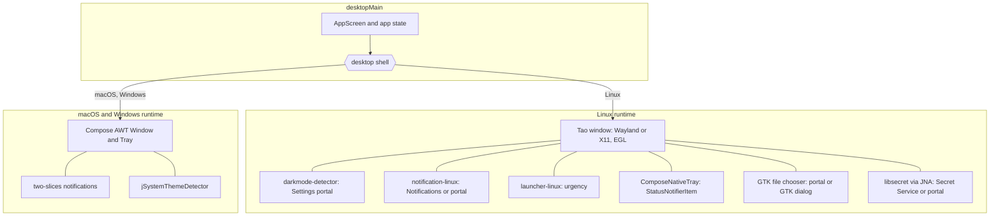

Sources:

| Dependency | Submodule | Fork | Pin |
|---|---|---|---|
| Nucleus | `apps/multiplatform/external/nucleus/upstream` | `sh-agents/Nucleus` | `dc2373192508cae9c9ee904e30491a358960c882` (v3.0.0-dev-202611161221) with fixes |
| ComposeNativeTray | `apps/multiplatform/external/composenativetray/upstream` | `sh-agents/ComposeNativeTray` | `8977f60c61767a048acffb85166ad95a453cb4dd` (v2.1.7) with fixes |

Nucleus modules, built by `apps/multiplatform/external/nucleus/build.gradle.kts`:

- `decorated-window-tao`
- `decorated-window-core`
- `core-runtime`
- `energy-manager`
- `freedesktop-icons`
- `darkmode-detector`
- `notification-common`
- `notification-linux`
- `launcher-linux`

Each module build includes:

- Kotlin sources;
- Java sources;
- resources, including `META-INF/services` and `META-INF/nucleus`;
- the `composeStubs` source set as `compileOnly`;
- its `compileOnly` dependencies.

Classpath:

- Nucleus and ComposeNativeTray jars: `compileOnly` in `desktopMain`.
- The same jars: `runtimeOnly` in `:desktop` when the build OS is Linux.

Fork fixes:

- Nucleus: `Dispatchers.Main` on Tao dispatches every block, as the Swing dispatcher does; `Dispatchers.Main.immediate` runs inline on the Tao thread.
- Nucleus: notification-linux signals accepted from the owner of the notification service name only.
- Nucleus: darkmode-detector change signals accepted from the portal's owner only.
- Nucleus: notification-linux avatar passed as a file path on the portal.
- ComposeNativeTray: the item activated by a click.
- ComposeNativeTray: registration by unique bus name inside Flatpak.
- ComposeNativeTray: tray icons are passed in memory.
- ComposeNativeTray: registration repeated after a watcher restart.
- ComposeNativeTray: the menu shown on `ContextMenu`.
- ComposeNativeTray: the token of `ProvideXdgActivationToken` passed to the window.

## Native build

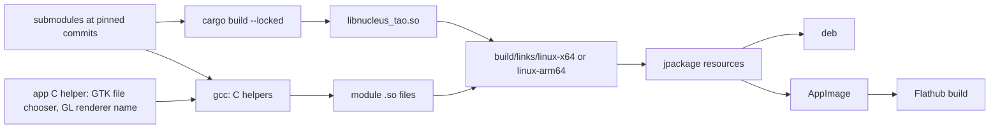

- Script: `scripts/desktop/build-native-linux.sh`, run after `build-lib-linux.sh`.
- Rust: `rustup-init` pinned by hash in `Dockerfile.build`; toolchain pinned in `apps/multiplatform/external/nucleus/rust-toolchain.toml`.
- Libraries built:
  - `libnucleus_tao.so` (Rust crate and the C helpers of `decorated-window-tao/src/main/native/linux`);
  - `decorated-window-core`: layout direction helper;
  - `energy-manager` helper;
  - `darkmode-detector` helper;
  - `notification-linux` helper;
  - `launcher-linux` helper;
  - ComposeNativeTray library;
  - the app's helper.
- `Dockerfile.build` adds the development packages:
  - GTK 3;
  - libdbus;
  - libsystemd;
  - EGL;
  - Wayland.
- The launcher sets `-Dnucleus.native.libraryPath=$APPDIR/resources`; libraries load from the installation.
- deb `Depends` lists the run-time libraries of the native modules; deb `Recommends` lists `libsecret-1-0`.

## Window shell

- On Linux, `main` starts `taoApplication` first. Inside it:
  1. the second-instance prompt, when the running instance does not answer;
  2. `initHaskell`, migrations, `initApp`, the keyring read;
  3. the main window and, with developer tools, the terminal window.
- macOS and Windows keep the current sequence with `application` and `Window`.
- System properties set before `taoApplication`, from `desktopInstallation()`:

| Installation | `nucleus.app.linux.desktop.entry.id` | `nucleus.app.linux.startup.wm.class` |
|---|---|---|
| deb | `simplex-simplex` | `simplex-simplex` |
| AppImage | `chat.simplex.app` | `chat.simplex.app` |
| Flatpak | `chat.simplex.simplex` | `chat.simplex.simplex` |

- Crash on Linux: the crash alert is shown, the same modals and chat state are reset as today, and the main window is recreated inside the same Tao loop, keyed by a crash counter.
- Window focus, visibility, position and size: from the Tao window state.
- `showWindow()` on Linux: raises the Tao window, with an activation token when one is present.
- A second launch writes its `XDG_ACTIVATION_TOKEN` into the signal file beside the link; the running instance offers the token to Tao before raising the window.
- `WindowActivation.kt`: AWT shell only.
- `SingleInstance.kt`, `SkiaBitmapVideoSurface.kt`: `SwingUtilities.invokeLater` → `Dispatchers.Main`.
- `VideoPlayer.desktop.kt`: `SwingUtilities.invokeAndWait` → `withContext(Dispatchers.Main)`.
- `NUCLEUS_TAO_LINUX_RENDERER=x11` forces XWayland.

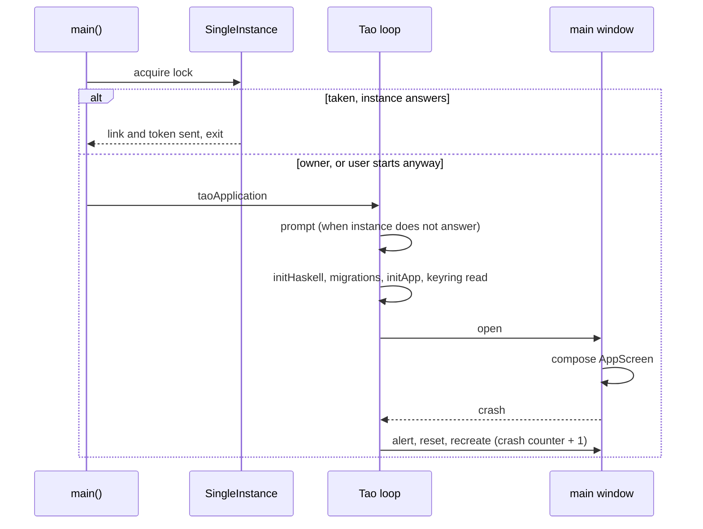

## AWT replacements on Linux

| Use | Replacement |
|---|---|
| `JFileChooser`, overwrite `JOptionPane` | `GtkFileChooserNative` through the app's C helper, on the Tao thread |
| `Desktop.open` (database folder) | `xdg-open` |
| `LocalUriHandler` | Tao URI handler |
| AWT clipboard image paste | `LocalClipboard` with Tao's PNG and file-list entries |
| `awtTransferable` drop | Tao file drop payload |
| `EmbeddedMediaPlayerComponent` | `newEmbeddedMediaPlayer()` with the existing `CallbackVideoSurface` |
| `java.awt.Window.getWindows()` in `CIVideoView.desktop.kt` | the app's window list |
| Compose `Tray` | ComposeNativeTray |
| `java.awt.SystemTray` probe | StatusNotifierWatcher presence |

- Java2D and ImageIO image processing stays; `java.desktop` stays in the runtime image.
- File dialog modes:
  - open one file, with the app's extension filters;
  - open several files;
  - save a file, with the suggested name and overwrite confirmation;
  - choose a folder.

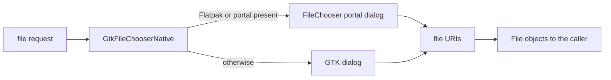

- Temporary files on Linux are kept in `$XDG_CACHE_HOME/simplex/tmp`, a directory restricted to the user.
- `coreTmpDir` stays `<dataDir>/tmp`.

## Notifications

- Linux: notification-linux.
- macOS: two-slices `NotificationCenterToaster`.
- Windows: two-slices `AWTToaster`.
- Notification state: an in-memory map from `(userId, chatId)` to the ID of its shown notification; call notifications keyed by `(userId, call, contactId)`.
- Each chat has at most one notification, replaced by the notification of the chat's next message.
- The matching notifications are closed in `cancelNotificationsForChat`, `cancelNotificationsForUser`, `cancelAllNotifications` and `cancelCallNotification`.
- `hasNotificationsForChat`: a notification of the chat is in the map.
- Hints:
  - `desktop-entry`: the installation's desktop entry ID;
  - `category`: `im.received` or `call.incoming`;
  - `urgency`: critical for calls;
  - avatar: `image-data` on the notification service, a file from the temporary directory on the portal.
- Notification text is shown as plain text: the body is escaped when the server lists `body-markup`; the title is sent unchanged.
- Button labels: string resources.
- On a click, the window is raised with the notification's activation token, then the chat is opened.
- Notification calls are made on a dedicated executor.
- On a new message in an unfocused window, the launcher entry's urgency is set.
- The unused private helpers in `NtfManager.desktop.kt` are removed.

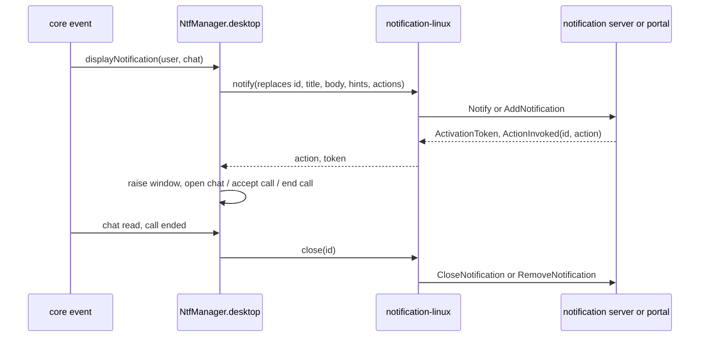

## Tray

- Linux: ComposeNativeTray when a StatusNotifierWatcher is registered; menu items Show and Quit; unread state as the icon.
- Tray callbacks run on `Dispatchers.Main`.
- The tray option follows watcher registration and loss.

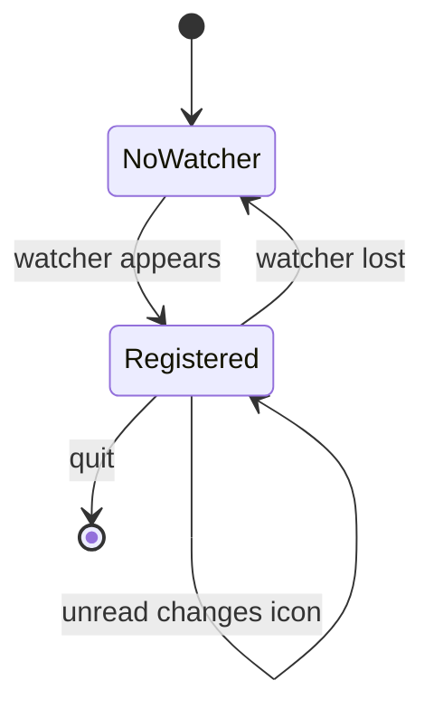

## Dark mode

- Linux: darkmode-detector, as a Compose state updated on `Dispatchers.Main`.
- Without a portal setting: the GTK theme name read once from GTK settings, else light.
- macOS and Windows: jSystemThemeDetector.
- The `gsettings` shutdown hook is removed.

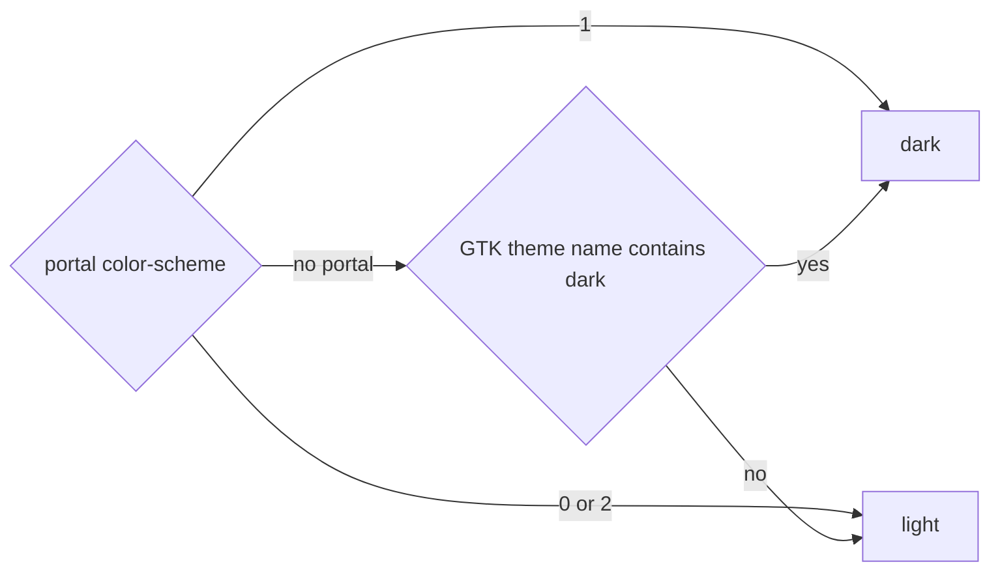

## Keyring

- Desktop `CryptorInterface` on Linux:
  - key: random AES-256-GCM key per alias;
  - key storage: Secret Service item through `libsecret-1.so.0` via JNA, behind a `SecretStore` interface;
  - stored in settings: ciphertext and IV, as on Android.
- Secret Service attributes:
  - `application`: `chat.simplex.app`
  - `alias`: `databasePassword`, `appPassword` or `selfDestructPassword`
- Settings files are restricted to the user.
- Keys are read once before the main window opens and kept in memory.
- Desktop footer strings show the Secret Service provider's name from `keyStorage()`.
- macOS and Windows keep the current cryptor.

Record kinds in settings:

| Kind | Condition |
|---|---|
| legacy | `data == iv` |
| encrypted | `data != iv` |

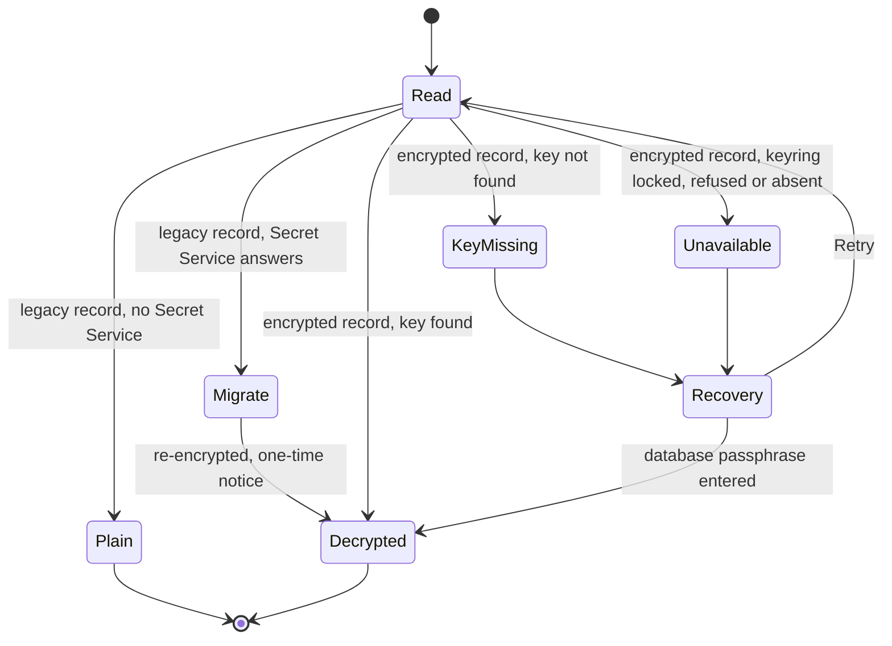

- Recovery screen: Retry, or entry of the database passphrase.
- In KeyMissing and Unavailable, the app passcode and self-destruct passcode read as unavailable values, never as absent ones.

## Rendering

- Renderer name: `glGetString(GL_RENDERER)` through the app's helper inside the Tao OpenGL context.
- On llvmpipe or softpipe with unchanged appearance settings: bar blur 0, bar alpha 1.
- The renderer name is logged at start.

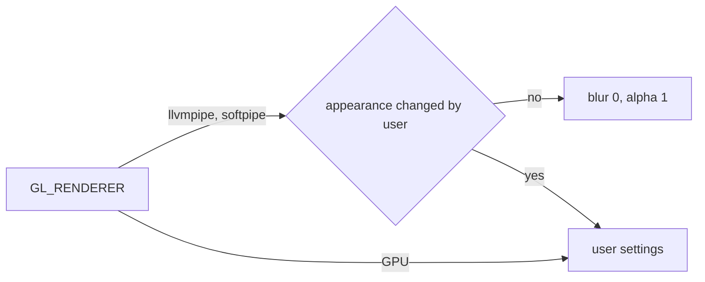

## Packaging

- `simplex.cfg`: the classpath lines → `app.classpath=$APPDIR/*`, in `make-deb-linux.sh` and `make-appimage-linux.sh`.
- `libHSzstd`: `ZSTD_*` symbols local to the core libraries (linker version script in `build-lib-linux.sh`).
- Fonts: `FONTCONFIG_FILE` set at start to an app configuration that includes the system configuration and rejects bitmap PCF fonts.
- aarch64 VLC libraries: segments aligned to 64 KiB.
- Desktop entries:

| Field | deb | AppImage | Flatpak |
|---|---|---|---|
| `Name` | SimpleX Chat | SimpleX Chat | SimpleX Chat |
| `Categories` | `Network;Chat;InstantMessaging;` | `Network;Chat;InstantMessaging;` | `Network;Chat;InstantMessaging;` |
| `StartupWMClass` | `simplex-simplex` | `chat.simplex.app` | `chat.simplex.simplex` |

- deb control: `Maintainer` set.
- AppStream: release list updated.
- AppImage: `appimagetool -u "gh-releases-zsync|simplex-chat|simplex-chat|latest|simplex-desktop-<arch>.AppImage.zsync"`; the `.zsync` file uploaded with the release.
- Data and config paths on Linux: `$HOME`, else `user.home`.
- Updater:

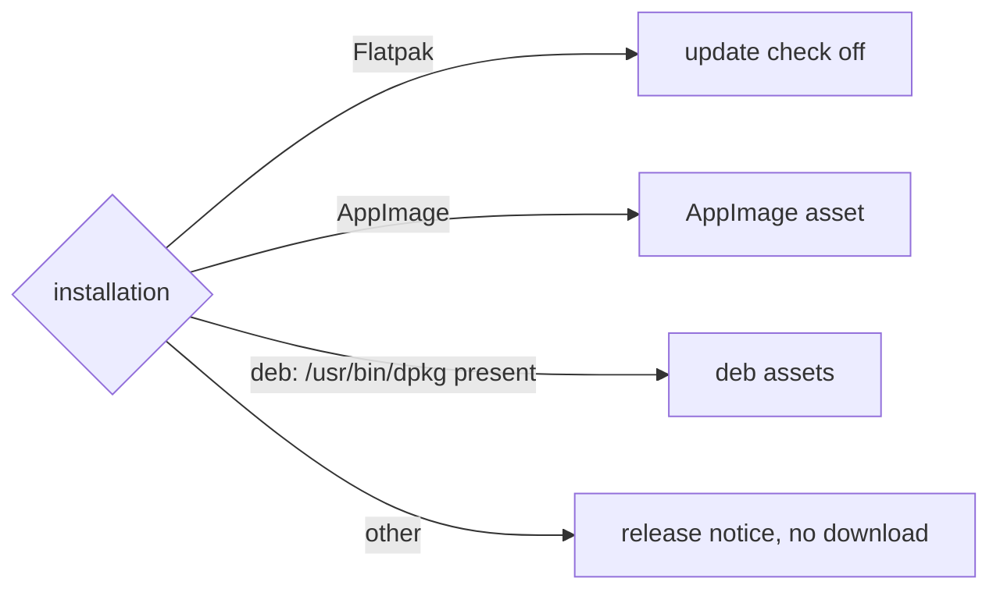

- Flathub manifest, in a later pull request to `flathub/chat.simplex.simplex`:
  - `--socket=wayland` and `--socket=fallback-x11` replace `--socket=x11`;
  - `--filesystem=home` removed;
  - the launcher's `pkill gsettings` trap removed.

## Tests

- desktopTest:
  - temporary directory selection;
  - settings writes;
  - cryptor states: legacy, migrate, decrypted, key missing, unavailable, recovery (in-memory `SecretStore`);
  - notification map: replacement, cancel by chat, by user, by call and all; escaping with and without `body-markup`; hints per installation;
  - focus loss → `AppLock.appWasHidden` under the Tao shell;
  - file chooser result URIs → `File`, including percent-encoded names;
  - dark-mode values 0, 1, 2 and the GTK fallback;
  - crash → window recreated;
  - tray activation → window shown;
  - `Dispatchers.Main` ordering: a block launched from the Tao thread runs after the current block;
  - desktop entry ID and WM class per installation;
  - `$HOME` resolution;
  - updater choice per installation;
  - rendering defaults per renderer name.
- CI:
  - `desktop-linux`: X11 smoke test under Xvfb with Tao on X11, typing paths into the GTK file dialog;
  - `-Dskiko.renderApi=SOFTWARE` removed from the harness;
  - Android unit tests and `android-emu` dispatched on the toolchain commit.

## End-to-end tests

Workflow `desktop-linux-e2e.yml` in `sh-agents/simplex-chat`, started by hand on the branch.

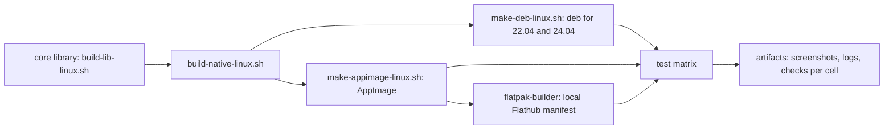

Matrix:

| Package | Systems |
|---|---|
| deb | Ubuntu 22.04, Ubuntu 24.04, Debian 12, Debian 13 |
| AppImage | Ubuntu 22.04, Ubuntu 24.04, Debian 12, Debian 13, Fedora, Arch |
| Flatpak | runner host, Ubuntu 24.04 |

Sessions per cell:

| Session | Display | Input and capture |
|---|---|---|
| Wayland | headless sway: `WLR_BACKENDS=headless`, `WLR_RENDERER=pixman`, Mesa llvmpipe for EGL | grim, wtype, `swaymsg seat` pointer |
| XWayland | headless sway, `NUCLEUS_TAO_LINUX_RENDERER=x11` | grim, xdotool |
| X11 | Xvfb with openbox | `import`, xdotool |

Session services started per cell:

- `dbus-daemon --session`;
- `xdg-desktop-portal` with `xdg-desktop-portal-gtk`;
- mako as the notification server (Wayland sessions), dunst (X11);
- swaybar with tray as the StatusNotifierWatcher host (Wayland sessions), a test watcher (X11);
- `gnome-keyring-daemon --unlock` with a test password.

Checks per cell:

| Check | Evidence |
|---|---|
| package installs (`apt install ./*.deb`), AppImage runs, Flatpak runs | exit codes, `app.log` |
| start, onboarding, chat list | OCR on screenshots |
| native Wayland surface | `swaymsg -t get_tree`: `shell` is `xdg_shell` (Wayland), `xwayland` (XWayland) |
| app ID | `app_id` or WM class equals the desktop entry ID of the package |
| GL renderer | renderer name in `app.log` |
| message notification | `makoctl history` / `dunstctl history`: app name, title, `desktop-entry` |
| notification click opens the chat | `makoctl invoke` / `dunstctl action`, then OCR of the chat title |
| call notification buttons, withdrawal on read | notification actions; history after reading |
| tray icon and activation | `busctl --user` call of `Activate` on the item; window shown |
| dark mode | `gsettings set org.gnome.desktop.interface color-scheme prefer-dark`; background colour on the screenshot; `pgrep gsettings` empty |
| keyring | `secret-tool search application chat.simplex.app` lists the keys; `settings.properties` holds ciphertext only |
| keyring absent | the cell without `gnome-keyring-daemon`: start without keyring, warning shown |
| file dialog | GTK or portal dialog; path typed; image previewed and sent |
| clipboard image paste, file drop | image pasted into the compose field; preview shown |
| video playback, voice recording | VLC playback frame on the screenshot; recording file length |
| link from a second launch | `simplex <link>` while running; link opened in the running window |
| crash recovery | a test hook throws in composition; alert shown, window recreated |
| dead keys and non-Latin layout | keymap switched with `swaymsg input` / `setxkbmap`; typed text by OCR |
| no child processes | `pgrep -P <app pid>` lists only VLC and the browser when started |
| temporary files | files under `$XDG_CACHE_HOME/simplex/tmp` |

- Test backend: `backend.sh` as in `desktop-linux`, for messages, calls and links between two app profiles.
- Each cell uploads its screenshots, OCR text, `app.log`, `checks.txt`, notification history and `swaymsg` tree.
- The job summary lists every check per cell.

## Commits

1. `docs: Linux desktop integration plan`
2. `android, desktop: update Kotlin to 2.4 and Compose to 1.12`
3. `desktop: fix start failures of Linux packages`
4. `desktop: build Linux native libraries from source`
5. `desktop: native Wayland window on Linux`
6. `desktop: native file dialogs, clipboard, drag and drop and video on Linux`
7. `desktop: notifications with actions on Linux`
8. `desktop: tray icon on all Linux desktops`
9. `desktop: follow the system dark mode on Linux`
10. `desktop: store passphrases in the system keyring on Linux`
11. `desktop: smooth rendering without a GPU on Linux`
12. `desktop: consistent Linux desktop entries and AppImage updates`
13. `ci: end-to-end tests of Linux packages under Wayland and X11`
14. `docs: Linux desktop specs and user guide`
