# Linux desktop integration

## Problems

1. Linux packages fail to start on some systems: [#6898](https://github.com/simplex-chat/simplex-chat/issues/6898), [#7381](https://github.com/simplex-chat/simplex-chat/issues/7381), [#6266](https://github.com/simplex-chat/simplex-chat/issues/6266), [#6638](https://github.com/simplex-chat/simplex-chat/issues/6638), [#6995](https://github.com/simplex-chat/simplex-chat/issues/6995), [#5000](https://github.com/simplex-chat/simplex-chat/issues/5000), [#7119](https://github.com/simplex-chat/simplex-chat/issues/7119), [#6372](https://github.com/simplex-chat/simplex-chat/issues/6372), [#6377](https://github.com/simplex-chat/simplex-chat/issues/6377), [#6540](https://github.com/simplex-chat/simplex-chat/issues/6540).
2. The app runs only through X11: it fails on Wayland-only systems and resizes wrongly on Sway: [#4171](https://github.com/simplex-chat/simplex-chat/issues/4171), [#6390](https://github.com/simplex-chat/simplex-chat/issues/6390), [#2889](https://github.com/simplex-chat/simplex-chat/issues/2889).
3. Notifications lack call buttons, the click to open the chat and withdrawal, and show "notify-send" as their source: [#6792](https://github.com/simplex-chat/simplex-chat/issues/6792), [#7116](https://github.com/simplex-chat/simplex-chat/issues/7116), [#3301](https://github.com/simplex-chat/simplex-chat/issues/3301).
4. The database passphrase and passcodes are stored in the settings file instead of the system keyring: [#4476](https://github.com/simplex-chat/simplex-chat/issues/4476), [#5801](https://github.com/simplex-chat/simplex-chat/issues/5801).
5. The tray icon is missing on GNOME and does not restore the window on KDE: [#7003](https://github.com/simplex-chat/simplex-chat/issues/7003).
6. Dark mode follows GTK theme names only, stays light inside Flatpak, and the app leaves `gsettings` processes running.
7. File dialogs are Swing dialogs that hide other drives, and the Flatpak requires full home access: [#4339](https://github.com/simplex-chat/simplex-chat/issues/4339), [#4412](https://github.com/simplex-chat/simplex-chat/issues/4412), [#7534](https://github.com/simplex-chat/simplex-chat/issues/7534).
8. Rendering lags without a GPU, the window freezes after inactivity, and keyboard input fails on non-Latin layouts and with dead keys: [#7215](https://github.com/simplex-chat/simplex-chat/issues/7215), [#6234](https://github.com/simplex-chat/simplex-chat/issues/6234), [#6467](https://github.com/simplex-chat/simplex-chat/issues/6467), [#7216](https://github.com/simplex-chat/simplex-chat/issues/7216), [#6042](https://github.com/simplex-chat/simplex-chat/issues/6042).
9. Docks show a second icon, and the deb's menu entry is named "simplex": [#5570](https://github.com/simplex-chat/simplex-chat/issues/5570).
10. AppImage portable mode is ignored, and AppImage updates are invisible to update tools: [#6030](https://github.com/simplex-chat/simplex-chat/issues/6030), [#7026](https://github.com/simplex-chat/simplex-chat/issues/7026).

Outside this change:

- [#7935](https://github.com/simplex-chat/simplex-chat/issues/7935): primary selection; Tao's clipboard covers CLIPBOARD only.
- [#4162](https://github.com/simplex-chat/simplex-chat/issues/4162): AppImage size.
- [#6494](https://github.com/simplex-chat/simplex-chat/issues/6494): aarch64 video on kernels with 16 KiB or 64 KiB pages, a rebuild of the simplex-chat/vlc bundle.
- [#7330](https://github.com/simplex-chat/simplex-chat/issues/7330): remote control between incompatible versions.
- Sharp rendering at fractional scales under Wayland.

## Acceptance

- deb, AppImage and Flatpak start on GNOME, KDE and Sway, under Wayland and under X11.
- Under Wayland the window is a native Wayland surface rendered with EGL.
- A message notification shows the app's name and icon, opens its chat on click, is replaced by the chat's next message and is removed when the chat is read.
- A call notification has Accept and Reject buttons and is removed when the call ends.
- With a Secret Service present, `settings.properties` holds the passphrase and passcodes only as ciphertext.
- The tray icon appears on KDE, XFCE, Sway and GNOME with AppIndicator; a click restores the window on KDE, XFCE and Sway, and a double click on GNOME.
- Dark mode follows the desktop's colour scheme, also inside Flatpak, without child processes.
- File dialogs are the desktop's own dialogs.
- macOS and Windows keep the AWT window; their changes are the toolchain upgrade and the Windows notification back-end.
- Android builds and passes its unit tests and the `android-emu` run.
- Verification:
  - CI end-to-end: deb, AppImage and Flatpak, installed and run under headless sway (Wayland and XWayland) and Xvfb (X11), every check of section End-to-end tests passing;
  - manual: GNOME and KDE, from the end-to-end artifacts.

## Toolchain

| Component | From | To |
|---|---|---|
| Kotlin | 2.1.20 | 2.4.21 |
| Compose Multiplatform | 1.8.2 | 1.12.1 |
| kotlinx-coroutines | 1.8.0 | 1.11.0 |
| kotlinx-serialization-json | 1.6.3 | 1.12.0 |
| multiplatform-markdown-renderer | 0.34.0 | 0.34.0 |
| moko-resources | 0.27.1 | 0.27.1 |
| desktop JVM target | 11 | 17 |
| Android JVM target | 11 | 11 |
| Gradle | 8.12 | 9.6.0 |
| AGP | 8.10.1 | 9.5.1 |
| Android compileSdk | 36 | 37 |
| Android targetSdk, minSdk | 36, 26 | 36, 26 |
| bundled JDK | Corretto 17.0.21 | Corretto 17.0.21 |

- Compose 1.12.1's Android artifacts require compileSdk 37 and AGP 9.1 or later; AGP 9.5 requires Gradle 9.6.
- AGP 9 opt-outs in `gradle.properties`, until the common module moves to the KMP Android library plugin with its NDK code in a separate module:
  - `android.newDsl=false`: `com.android.library` with `kotlin("multiplatform")` in `:common`;
  - `android.builtInKotlin=false`: `kotlin("android")` in `:android`;
  - `android.sourceset.disallowProvider=false`: a plugin of `:common` adds generated sources to the Android source set as a Provider.

Code changes of the upgrade:

- `kotlinOptions` → `compilerOptions`:
  - `apps/multiplatform/build.gradle.kts`;
  - `android/build.gradle.kts`.
- Java compile options set in the `android` blocks of `:android` and `:common`, replacing the root block on the legacy `BaseExtension`.
- The root block's rule resolving skiko 0.9.4.2 to 0.9.24 (plans/2026-11-13-linux-fallback-font-crash.md) removed with the block: Compose 1.12.1 requests another skiko version; `FallbackFontTest` checks the fallback fonts with it.
- Gradle 9: `Project.exec` → `providers.exec`, `buildDir` → `layout.buildDirectory`.
- `org.gradle.configureondemand=true`, desktop tasks named with `:desktop:`: desktop builds leave `:android` unconfigured, whose NDK 23.1 AGP 9 installs while configuring.
- `nativeCanvas` → `skiaCanvas` in `BarsBlur.desktop.kt`.
- `runComposeUiTest` → `androidx.compose.ui.test.v2.runComposeUiTest`.
- `compose.runtime`, `compose.foundation`, `compose.material` aliases → explicit coordinates.
- JVM targets set per Kotlin target from `kotlin.jvm.target` (Android) and `desktop.jvm.target` (desktop).
- compose-color-picker kept when it compiles and renders on Compose 1.12; otherwise replaced.

## Composition

Tao is used on Linux only. Nucleus types appear only in classes loaded on Linux.

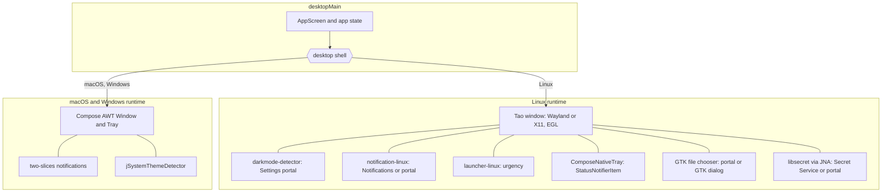

Sources:

| Dependency | Submodule | Fork | Pin |
|---|---|---|---|
| Nucleus | `apps/multiplatform/external/nucleus/upstream` | `sh-agents/Nucleus` | `bb34fbc628c5e46978928f56ef3d16e36565aaee`: v3.0.0-dev-202611161221 with fixes |
| ComposeNativeTray | `apps/multiplatform/external/composenativetray/upstream` | `sh-agents/ComposeNativeTray` | `05e381c2fcf477b4523dabf7ed9f6dae11d31866`: v2.1.7 with fixes |

Nucleus modules, built by `apps/multiplatform/external/nucleus/build.gradle.kts`:

- `decorated-window-tao`
- `decorated-window-core`
- `core-runtime`
- `energy-manager`
- `freedesktop-icons`
- `darkmode-detector`
- `notification-linux`
- `launcher-linux`

Each module build includes:

- Kotlin sources;
- Java sources;
- resources, including `META-INF/services` and `META-INF/nucleus`;
- the `composeStubs` source set as `compileOnly`;
- its `compileOnly` dependencies.

Classpath:

- Nucleus and ComposeNativeTray jars: `compileOnly` in `desktopMain`.
- The same jars: `runtimeOnly` in `:desktop` when the build OS is Linux.

Fork fixes:

- Nucleus: `Dispatchers.Main` on Tao dispatches every block, as the Swing dispatcher does; `Dispatchers.Main.immediate` runs inline on the Tao thread.
- Nucleus: notification-linux signals accepted from the owner of the notification service name only.
- Nucleus: darkmode-detector change signals accepted from the portal's owner only.
- Nucleus: Rust toolchain pinned in `decorated-window-tao/src/main/native/rust-toolchain.toml`; the crate built with `cargo build --locked`.
- ComposeNativeTray: the item activated by a click.
- ComposeNativeTray: registration by unique bus name inside Flatpak.
- ComposeNativeTray: registration repeated after a watcher restart.
- ComposeNativeTray: the token of `ProvideXdgActivationToken` offered to the window through Nucleus `ActivationToken`.

## Native build

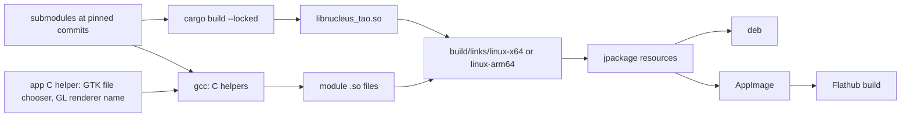

- Script: `scripts/desktop/build-native-linux.sh`, run after `build-lib-linux.sh`.
- Rust: `rustup-init` 1.29.3 pinned by hash in `Dockerfile.build`; Rust 1.100.0 pinned by the fork.
- Gradle projects `:external:nucleus` and `:external:composenativetray` compile the submodule sources; native outputs are excluded from their jars.
- The scripts `make-deb-linux.sh` and `make-appimage-linux.sh` run `build-native-linux.sh`.
- Libraries built:
  - `libnucleus_tao.so` (Rust crate and the C helpers of `decorated-window-tao/src/main/native/linux`);
  - `decorated-window-core`: layout direction helper;
  - `energy-manager` helper;
  - `darkmode-detector` helper;
  - `notification-linux` helper;
  - `launcher-linux` helper;
  - ComposeNativeTray library;
  - the app's helper.
- `Dockerfile.build` adds the development packages:
  - GTK 3;
  - libdbus;
  - libsystemd;
  - EGL;
  - Wayland.
- The launcher sets `-Dnucleus.native.libraryPath=$APPDIR/resources`; libraries load from the installation.
- deb `Depends` lists the run-time libraries of the native modules; deb `Recommends` lists `libsecret-1-0`.

## Window shell

- On Linux, `main` starts `taoApplication` first. Inside it:
  1. the second-instance prompt, when the running instance does not answer;
  2. `initHaskell`, migrations, `initApp`, the keyring read;
  3. the main window and, with developer tools, the terminal window.
- macOS and Windows keep the current sequence with `application` and `Window`.
- System properties set before `taoApplication`, from `desktopInstallation()`:

| Installation | `nucleus.app.linux.desktop.entry.id` | `nucleus.app.linux.startup.wm.class` |
|---|---|---|
| deb | `simplex-simplex` | `simplex-simplex` |
| AppImage | `chat.simplex.app` | `chat.simplex.app` |
| Flatpak | `chat.simplex.simplex` | `chat.simplex.simplex` |

- Crash on Linux: the crash alert is shown, the same modals and chat state are reset as today, and the main window is recreated inside the same Tao loop, keyed by a crash counter.
- Window focus, visibility, position and size: from the Tao window state.
- `showWindow()` on Linux: raises the Tao window, with an activation token when one is present.
- A second launch writes its `XDG_ACTIVATION_TOKEN` into the signal file beside the link; the running instance offers the token to Tao before raising the window.
- `WindowActivation.kt`: AWT shell only.
- `SingleInstance.kt`, `SkiaBitmapVideoSurface.kt`: `SwingUtilities.invokeLater` → `Dispatchers.Main`.
- `VideoPlayer.desktop.kt`: `SwingUtilities.invokeAndWait` → `withContext(Dispatchers.Main)`.
- `NUCLEUS_TAO_LINUX_RENDERER=x11` forces XWayland.

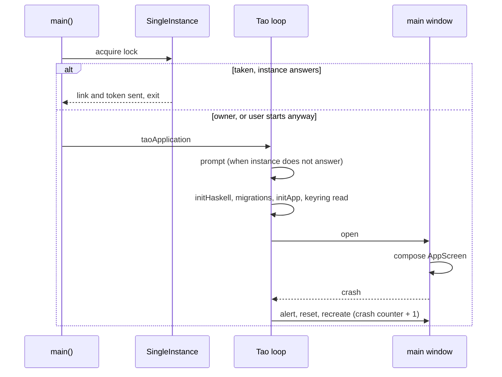

## AWT replacements on Linux

| Use | Replacement |
|---|---|
| `JFileChooser`, overwrite `JOptionPane` | `GtkFileChooserNative` through the app's C helper, on the Tao thread |
| `Desktop.open` (database folder) | `xdg-open` |
| `LocalUriHandler` | Tao URI handler |
| AWT clipboard image paste | `LocalClipboard` with Tao's PNG and file-list entries |
| `awtTransferable` drop | Tao file drop payload |
| `EmbeddedMediaPlayerComponent` | `newEmbeddedMediaPlayer()` with the existing `CallbackVideoSurface` |
| `java.awt.Window.getWindows()` in `CIVideoView.desktop.kt` | the app's window list |
| Compose `Tray` | ComposeNativeTray |
| `java.awt.SystemTray` probe | StatusNotifierWatcher presence |

- Java2D and ImageIO image processing stays; `java.desktop` stays in the runtime image.
- File dialog modes:
  - open one file, with the app's extension filters;
  - open several files;
  - save a file, with the suggested name and overwrite confirmation;
  - choose a folder.

- Portal choice, before the first dialog, unless `GTK_USE_PORTAL` is already set: the helper reads `org.freedesktop.portal.FileChooser` `version` on the session bus, timeout 2 s; an answer sets `GTK_USE_PORTAL=1`. The portal publishes the interface only when a back-end implements it.

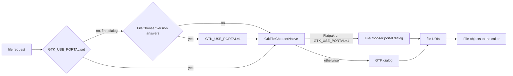

- Temporary files on Linux are kept in `$XDG_CACHE_HOME/simplex/tmp`, a directory restricted to the user.
- `coreTmpDir` stays `<dataDir>/tmp`.
- The call server on Linux serves only connections of the user's own processes: the owner of the client socket is read from `/proc/net/tcp` or `/proc/net/tcp6`.

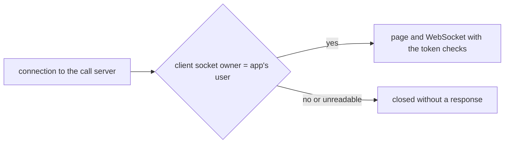

## Notifications

- Linux: notification-linux.
- macOS: two-slices `NotificationCenterToaster`.
- Windows: two-slices `AWTToaster`.
- Notification state: an in-memory map from `(userId, chatId)` to the ID of its shown notification; call notifications keyed by `(userId, call, contactId)`.
- Each chat has at most one notification, replaced by the notification of the chat's next message.
- The matching notifications are closed in `cancelNotificationsForChat`, `cancelNotificationsForUser`, `cancelAllNotifications` and `cancelCallNotification`.
- `hasNotificationsForChat`: a notification of the chat is in the map.
- Hints:
  - `desktop-entry`: the installation's desktop entry ID;
  - `category`: `im.received` or `call.incoming`;
  - `urgency`: critical for calls;
  - avatar: `image-data` on the notification service, a file from the temporary directory on the portal.
- Notification text is shown as plain text: the body is escaped when the server lists `body-markup`; the title is sent unchanged.
- Button labels: string resources.
- On a click, the window is raised with the notification's activation token, then the chat is opened.
- Notification calls are made on a dedicated executor.
- On a new message in an unfocused window, the launcher entry's urgency is set.
- The unused private helpers in `NtfManager.desktop.kt` are removed.

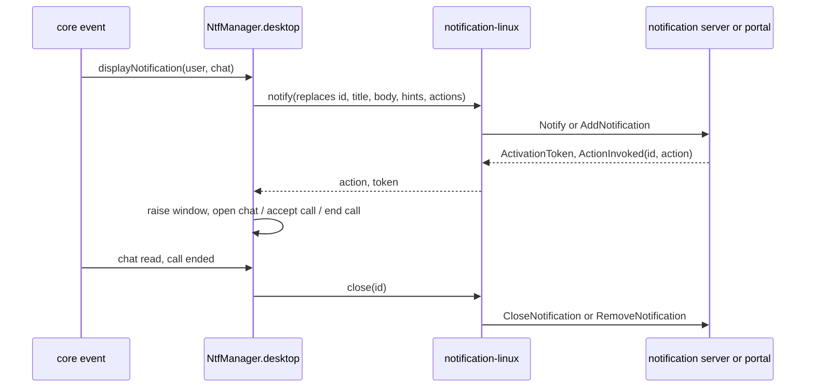

## Tray

- Linux: ComposeNativeTray `NativeTray`; menu items Show and Quit; unread state as the icon.
- Tray availability: `IsStatusNotifierHostRegistered` of the StatusNotifierWatcher, read once at start.
- Icon colour: panel darkness from ComposeNativeTray `isMenuBarInDarkMode`.
- Tray callbacks run on `Dispatchers.Main`.
- Tray icon files are written to the app's temporary directory and passed by path.
- The tray item re-registers when the watcher restarts (fork).
- Flatpak: the tray connects through the host's xdg-dbus-proxy; versions before 0.1.6 (Ubuntu 24.04, Linux Mint 22, Debian 12) reject sd-bus connections, and the tray is unavailable there.
- Flatpak: at the first hide to the tray, the app calls the Background portal's `RequestBackground` (`reason`, `autostart` false); an unset permission becomes yes without a dialog, so the portal's background monitor does not ask the user about the windowless app.

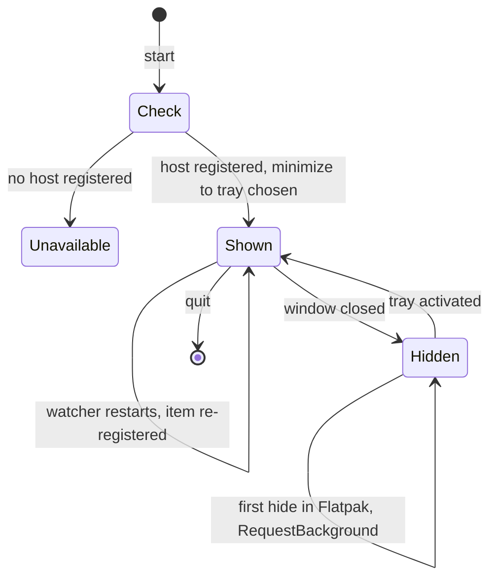

## Dark mode

- Linux: darkmode-detector; changes delivered on `Dispatchers.Main`.
- Fallback: GSettings `org.gnome.desktop.interface gtk-theme` through GIO in the app's helper, read once.
- macOS and Windows: jSystemThemeDetector.
- The `gsettings` shutdown hook is removed.

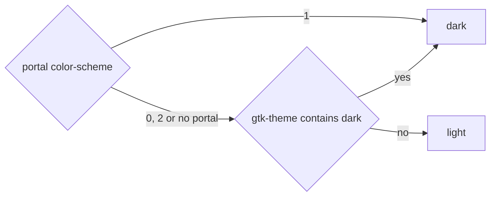

## Keyring

- Desktop `CryptorInterface` on Linux:
  - key: random AES-256-GCM key per alias;
  - key storage: Secret Service item through `libsecret-1.so.0`, opened with `dlopen` by the app's C helper, behind a `SecretStore` interface;
  - stored in settings: ciphertext and IV, as on Android.
- Secret Service schema `chat.simplex.app.Key`, attributes:
  - `application`: `chat.simplex.app`
  - `alias`: `databasePassword`, `appPassword` or `selfDestructPassword`
- Secret Service errors:
  - absent: helper or libsecret missing, a GIO error, `ServiceUnknown` or `NameHasNoOwner`;
  - failed: any other error, such as a dismissed unlock prompt.
- Without a stored key (absent or failed): the legacy record is written; the database footer reads "stored in settings as plaintext".
- The config directory is restricted to the user.
- Keys are cached in memory after the first read.
- Desktop footer: "encrypted with a key kept in the system keyring" when `keyStorage()` is set.
- macOS and Windows keep the current cryptor.

Record kinds in settings:

| Kind | Condition |
|---|---|
| legacy | `data == iv` |
| encrypted | `data != iv` |

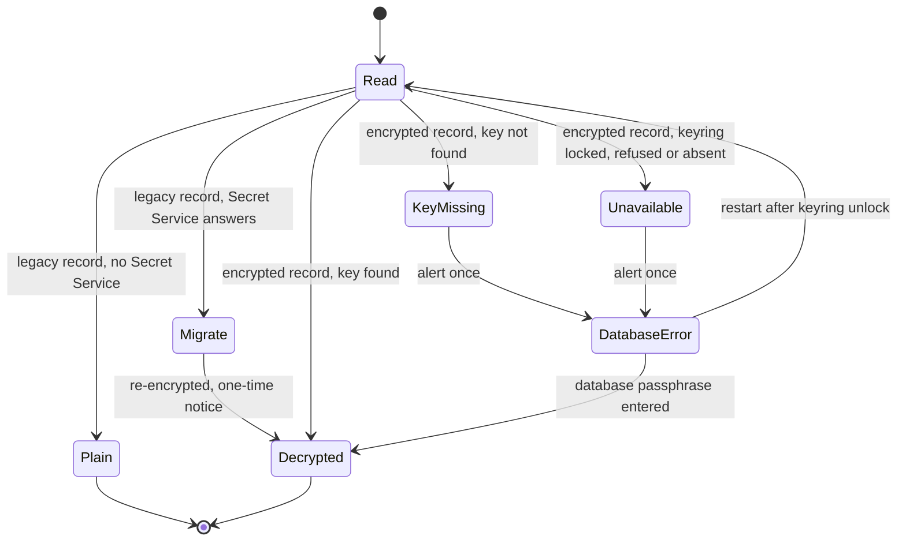

| Record | Unavailable | KeyMissing |
|---|---|---|
| database passphrase | database error screen | database error screen |
| app passcode | authentication error, app stays locked | lock turned off with the existing alert |
| self-destruct passcode | controller start waits for authentication | treated as unset |

- Unavailable is thrown as `KeyUnavailableException` by `KeyStoreItem.getChecked()`; `get()` returns null.

## Rendering

- Renderer name: `glGetString(GL_RENDERER)` in a short-lived surfaceless EGL context (`EGL_PLATFORM_SURFACELESS_MESA`) created by the app's helper on a background thread after the second frame; Tao's own context is current only on its render and swap threads. Without Mesa's surfaceless platform the name is unknown and the settings stay.
- On llvmpipe or softpipe with unchanged appearance settings: bar blur 0, bar alpha 1.
- The renderer name is logged at start.

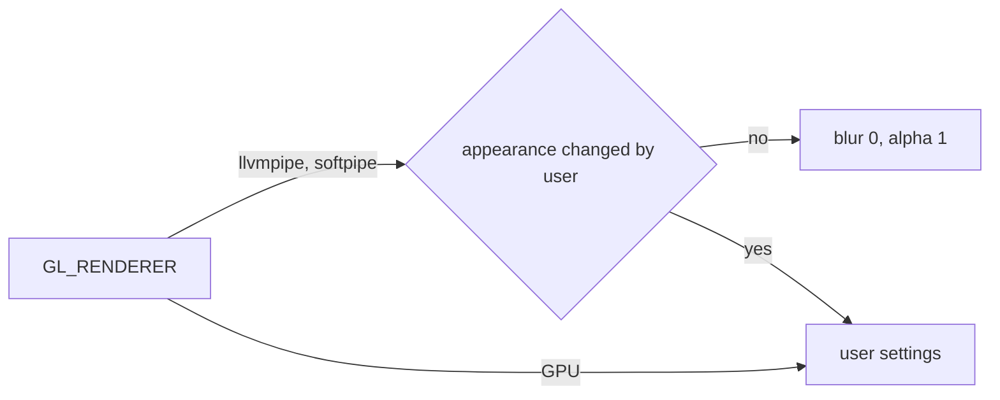

## Packaging

- `simplex.cfg`: the classpath lines → `app.classpath=$APPDIR/*`, in `make-deb-linux.sh` and `make-appimage-linux.sh`.
- `libHSzstd`: `ZSTD_*` symbols local to the core libraries (linker version script in `build-lib-linux.sh`).
- Fonts: `FONTCONFIG_FILE` set at start to an app configuration that includes the system configuration and rejects bitmap PCF fonts.
- VLC bundle download: SHA-256 pinned per architecture, `curl -f`, a private temporary directory.
- Desktop entries:

| Field | deb | AppImage | Flatpak |
|---|---|---|---|
| `Name` | SimpleX Chat | SimpleX Chat | SimpleX Chat |
| `Categories` | `Network;Chat;InstantMessaging;` | `Network;Chat;InstantMessaging;` | `Network;Chat;InstantMessaging;` |
| `StartupWMClass` | `simplex-simplex` | `chat.simplex.app` | `chat.simplex.simplex` |

- Window identity: `nucleus.app.linux.desktop.entry.id` and `nucleus.app.linux.startup.wm.class` set to the installation's entry ID before Tao starts; Flatpak's Wayland app ID is `FLATPAK_ID`.
- deb control: `Maintainer` set through `debMaintainer`.
- AppImage: built as `simplex-desktop-<arch>.AppImage` with `-u "gh-releases-zsync|simplex-chat|simplex-chat|latest|simplex-desktop-<arch>.AppImage.zsync"`; the `.zsync` file uploaded with the release.
- Data and config paths on Linux: `$HOME`, else `user.home`.
- Updater (unchanged):

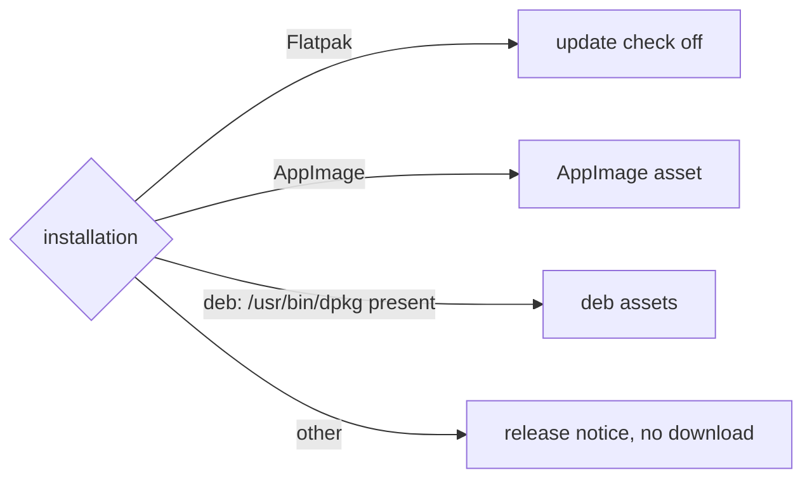

- Flatpak: `scripts/flatpak/chat.simplex.simplex.yml`, built in CI from the AppImage:
  - runtime `org.gnome.Platform//51` (GTK 3 and libsecret for Tao and the helper);
  - finish-args: `--device=dri`, `--share=ipc`, `--share=network`, `--socket=wayland`, `--socket=fallback-x11`, `--socket=pulseaudio`, `--talk-name=org.kde.StatusNotifierWatcher`;
  - no file system access: files through the FileChooser portal, opened through `xdg-open` (OpenURI portal);
  - command `simplex`, the jpackage launcher, without a wrapper;
  - desktop entry `StartupWMClass=chat.simplex.simplex`.
- Sandbox paths in the app:

| Need | Path in the sandbox |
|---|---|
| file pick and save | GTK FileChooser portal, used by GTK in Flatpak and wherever the portal offers a file chooser; GTK's own dialog elsewhere |
| open a file or folder | `xdg-open` → OpenURI portal |
| notifications | Notification portal, avatar as bytes |
| dark mode | Settings portal |
| keyring | libsecret → Secret portal, keyring file in the app's data |
| tray | StatusNotifierWatcher talk name |
| running hidden in the tray | Background portal, `RequestBackground` |
| links in the browser | `xdg-open` → OpenURI portal |

- Flathub manifest, in a later pull request to `flathub/chat.simplex.simplex`: the in-repo manifest with release URLs in place of the local AppImage, and the launcher's `pkill gsettings` trap removed.

## Tests

- desktopTest:
  - `LinuxCryptorTest`: legacy, encrypted, key reuse and caching, store absent, store failing, key missing, wrong key, malformed key, delete, separate aliases (in-memory `SecretStore`);
  - `LinuxNotificationsTest`: markup escaping, action keys, RGBA `image-data`, desktop entry ID per installation;
  - `LinuxFilesTest`: extension matching, chooser patterns, non-ASCII native paths, `$HOME` resolution;
  - `LinuxThemeTest`: GTK theme names;
  - `LinuxRenderingTest`: software and GPU renderer names;
  - `SingleInstanceTest`: activation token in the signal file;
  - `FontsTest`: the fontconfig file that rejects bitmap fonts;
  - `CallServerPeerTest`: `/proc/net` address format, the client row's owner, a loopback connection of the process user.
- CI:
  - `desktop-linux`: native libraries built on the runner; the X11 smoke test under Xvfb with Tao on X11, typing paths into the GTK file dialog;
  - `desktop-linux` with `e2e`: section End-to-end tests;
  - Android unit tests and `android-emu` dispatched on the toolchain commit.

## End-to-end tests

`desktop-linux.yml` with the input `e2e`, in `sh-agents/simplex-chat`, started by hand on the branch.

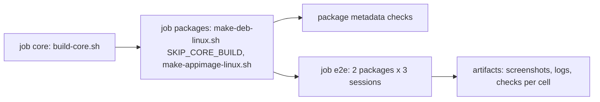

Matrix, Ubuntu 24.04 runner:

| Package | Sessions |
|---|---|
| deb, installed with apt | x11, wayland, xwayland |
| AppImage, `APPIMAGE_EXTRACT_AND_RUN=1` | x11, wayland, xwayland |
| Flatpak bundle, `flatpak install --user`, with xdg-desktop-portal (GTK, gnome-keyring Secret) | x11, wayland, xwayland |

Sessions (`UI_SESSION` of `ui`):

| Session | Display | Input and capture |
|---|---|---|
| wayland | headless sway: `WLR_BACKENDS=headless`, `WLR_RENDERER=pixman`, Mesa llvmpipe for EGL | grim, wtype for text, `wayland-input` (virtual pointer and keyboard held for the session: clicks, scrolls, keys with modifiers) |
| xwayland | headless sway with `xwayland force`, the app with `DISPLAY` of Xwayland and `GDK_BACKEND=x11` | grim, wtype, `wayland-input` |
| x11 | Xvfb with openbox | `import`, xdotool |

Session services per cell, inside `dbus-run-session`:

- `gnome-keyring-daemon --unlock --components=secrets`;
- `desktop-services.py`: StatusNotifierWatcher with `IsStatusNotifierHostRegistered` true, and `org.freedesktop.Notifications`; each call logged as a JSON line.

Package metadata checks (job packages):

| Check | Evidence |
|---|---|
| deb `Maintainer` | `dpkg-deb -I` |
| deb entry `Name=SimpleX Chat`, `StartupWMClass=simplex-simplex` | the entry inside the deb |
| AppImage update information and `.zsync` | the AppImage's `gh-releases-zsync` string, the `.zsync` file |

Checks per cell (`e2e.sh`):

| Check | Evidence |
|---|---|
| package installs and starts; onboarding, both toolbar layouts, images picked in the GTK dialog and sent | `smoke-test.sh` checks on OCR |
| native Wayland surface | `swaymsg -t get_tree`: `shell` is `xdg_shell` (wayland), `xwayland` (xwayland) |
| window identity | `app_id` or WM class equals the package's desktop entry ID |
| GL renderer | "OpenGL renderer:" in `app.log` |
| no `gsettings` process | `pgrep -x gsettings` |
| keyring | `settings.properties` holds the passphrase as ciphertext; `secret-tool lookup` finds the key; config directory mode 700 |
| keyring absent, then migration (deb, AppImage) | first start on a session bus without service activation: passphrase record with `data == iv`, "Secret Service is absent" in `app.log`; next start with gnome-keyring on that bus: "Passphrase protected", ciphertext record, `secret-tool lookup` finds the key, the database opens |
| tray | `RegisterStatusNotifierItem` in the services log |
| background permission (Flatpak) | after the window hides, `flatpak permission-show` lists `background` `yes`; the GNOME back-end serves only Background |
| dark mode | light window above 0.6 mean brightness; 0.25 darker after `color-scheme prefer-dark`; back within 0.05 after `default` |
| tray activation | window hidden after a close request, shown after `Activate` |
| message notifications | CLI peer's link pasted from the clipboard; notification replaced per chat, titled with the peer, `desktop-entry` hint, default action opens the chat, closed when the chat is opened from the list; launcher entry urgent |

Later iterations:

- call notifications;
- keyring absent and migration in the Flatpak;
- clipboard image paste, file drop, video, voice;
- second-launch links, crash recovery, dead keys and non-Latin layouts;
- Debian, Fedora and Arch containers.

## Commits

1. `docs: Linux desktop integration plan`
2. `android, desktop: update Kotlin to 2.4 and Compose to 1.12`
3. `desktop: fix start failures of Linux packages`
4. `desktop: build Linux native libraries from source`
5. `desktop: native Wayland window on Linux`
6. `desktop: native file dialogs, clipboard, drag and drop and video on Linux`
7. `desktop: notifications with actions on Linux`
8. `desktop: tray icon on Linux`
9. `desktop: follow the system dark mode on Linux without a helper process`
10. `desktop: keep the passphrase and passcodes encrypted with a key in the system keyring on Linux`
11. `desktop: flat bars with software rendering on Linux`
12. `desktop: one dock icon and named menu entries on Linux, AppImage portable home and update information`
13. `ci: build the Linux native libraries and use the GTK file dialog in the desktop smoke test`
14. `ci: deb and AppImage end to end under X11, Wayland and XWayland`
15. `docs: Linux window, notifications, dark mode and keyring`
