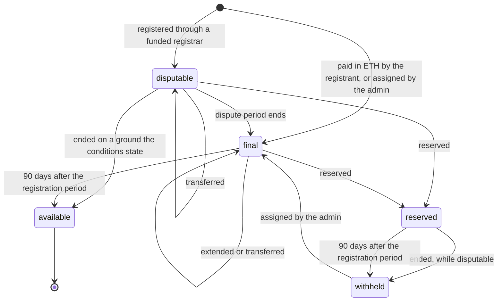

# Names Conditions: dispute period

Repository: simplex-chat/simplex-chat.
Branch: `ab/names-conditions-dispute`.
Base: master `44a193b54` (#8266).

Requirement: the Names Conditions describe the registry's dispute period, as the registry contracts implement it.

## Problem

A holder accepts docs/NAMES-CONDITIONS.md on chain. It states that changing the record of a name, creating subnames and transferring control require the holder's key, and that a name can be extended until 90 days after its period ends.

The registry contracts change on simplex-network/ens-contracts, branch `ab/dispute-period`:

- a registration through a registrar funded on the sponsor has a dispute period of 14 to 120 days, its end stored in the registry;
- before that end, the registry's guardian or admin can end the registration and its record;
- before that end, the name cannot be extended;
- a registration paid to the registry in ETH by the registrant's own transaction, or assigned by the registry's admin, is not subject to a dispute period.

The conditions would describe a registry that holders do not get.

## Registration states

| State | Entered by | What the registry allows |
|---|---|---|
| disputable | registration through a funded registrar | transfer; end by the guardian or admin; reservation |
| final | registration paid in ETH by the registrant; assignment by the admin; end of the dispute period | transfer; extension; reservation |
| reserved | reservation | transfer until the registration period ends; end by the guardian or admin while still disputable |
| withheld | end of the registration of a reserved name; 90 days after the registration period of a reserved name | assignment by the admin |
| available | end of the registration of an unreserved name; 90 days after the registration period of an unreserved name | registration |

## Changes

docs/NAMES-CONDITIONS.md:

| Place | Change |
|---|---|
| "SimpleX names" | "Reserved names" defined |
| your key | the next point as its exception |
| dispute period | new, second point |
| period and extension | after the dispute period, if any, unless reserved; "the period" named "the registration period" |
| refused extensions | new, last point |

The dispute period point states:

- which registrations have one, its length, and its end in the registry;
- what the registry allows before that end;
- the only grounds for ending a registration;
- registration again at once, unless the name is reserved;
- that a transfer leaves the period unchanged.

The other sections are unchanged. A separate change, for the registry's upgradeable contracts, edits the section "Registry"; the change merged second merges master.

## After the merge

The website publishes docs/*.md on each push to master (web.yml), so the text appears there at the merge; the merge is timed close to the governance batch. Holders accept the version linked on chain: the name policy's general and community terms links are set to this file at the merge commit of the later of this change and the change for the upgradeable contracts:

1. tagged `general-terms-vN` and `community-terms-vN`;
2. mirrored on git.simplex.chat;
3. set in the same governance batch as `setSponsor` of the sponsor that takes `disputeDays`, so that every registration with a dispute period is made under this version.
