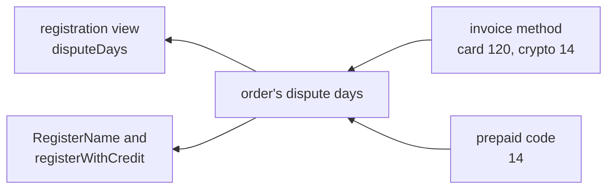
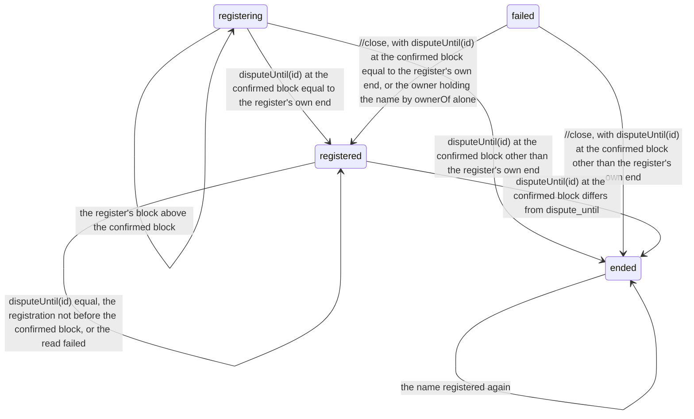

# Names: dispute days of sponsored registrations

Repository: simplex-chat/simplex-chat, apps/simplex-store-service.
Branch: `ab/names-dispute-days`.
Base: `names`.
Contracts: simplex-network/ens-contracts#51, the dispute period.

## Contract interface

```
SimplexSponsor.registerWithCredit(
  Registration registration,
  uint256 disputeDays,
  uint256 nonce,
  uint256 deadline,
  bytes sig
)

RegisterName(
  string label,
  address owner,
  uint256 duration,
  address resolver,
  bytes[] data,
  uint256 disputeDays,
  uint256 nonce,
  uint256 deadline
)
  domain    SimplexSponsor, version 1

SimplexController.registerSponsored
  14 <= disputeDays <= 120    else DisputeDaysOutOfRange

BaseRegistrarImplementation.disputeUntil(uint256 id)
  unix seconds, 0 for none
```

## Registration view

`GET /api/registration/:id`:

| Field | Value |
|---|---|
| `disputeDays` | integer, 14 to 120, every order |
| `disputeUntil` | unix seconds once registered; null before, for a registration without a dispute period, and once ended |
| `phase` | `{"type": "ended"}` for an order whose registration was ended by `unregister`; it has no `expiresAt` |

## Dispute days of an order

| Payment | Days |
|---|---|
| invoice by card | 120 |
| invoice by BTC, XMR or another BTCPay method | 14 |
| prepaid code | 14 |

The days are set when the order is made, by `methodDisputeDays` of its invoice's method or `codeDisputeDays`, and stored with its row. A selection of a name after a take keeps them. The page signs `RegisterName` with the order request, before the order exists, by its own table of the same days; the service verifies the signed days against the order's.



## Types

```
StoreService.Names.Registration
  DisputeDays           newtype over Int, 14 to 120
  mkDisputeDays         Int -> Maybe DisputeDays
  unDisputeDays         DisputeDays -> Int
  disputeSeconds        DisputeDays -> Int64
  minDisputeDays        14
  maxDisputeDays        120
  methodDisputeDays     ServicePaymentMethod -> DisputeDays
  codeDisputeDays       14
  registerNameType      the RegisterName type string
  RegisterIntent
    riDisputeDays       DisputeDays
  registerIntentDigest  domain, registration, dispute days, nonce, deadline

StoreService.Names.Store
  NamePhase
    PEnded              "ended"
  OrderPhase
    ORegistered         expiry, dispute end or none, registered at
    OEnded              expiry, dispute end, registered at
  NameRegistration
    nrDisputeDays       DisputeDays
  NewRegistration
    nrgDisputeDays      DisputeDays
  disputableRegistrations  DB.Connection -> SystemSeconds -> IO [RegistrationId]

StoreService.Names.Reveal
  intentOf, checkReveal, orderReveal    the order's DisputeDays

StoreService.Web.Names.Orders
  orderChecked          the order's DisputeDays

StoreService.Names.View
  PhaseView
    PVEnded             {"type": "ended"}
  RegistrationView
    vwDisputeDays       DisputeDays
    vwDisputeUntil      Maybe SystemSeconds, of ORegistered only

StoreService.Names.Orders
  Landing
    LEnded              Int64, the version written
  Landed
    LandedByReceipt     TxHash, its mined block

StoreService.Names.Worker
  Closed
    CLEnded             RegistrationId
  sweepEndedRegistrations  Worker -> IO ()
  runEndedSweep            Worker -> IO (), a names lane

StoreService.Names.Contracts
  disputeUntil          Contracts -> BlockTag -> LabelHash -> IO (Either ChainError (Maybe SystemSeconds))
  confirmedBlockNumber  Contracts -> IO (Either ChainError Word64)
  confirmedBlock        Contracts -> IO (Either ChainError Block)

StoreService.Names.Chain
  deepBlock             ChainClient -> Block -> IO (Either ChainError Block), moved from Records
```

## Schema

Migration `20261120_names_dispute_days`, SQLite and Postgres, after `20261013_names`.

```
name_registrations
  dispute_days      INTEGER NOT NULL DEFAULT 120
  dispute_until     INTEGER
```

Up, after the columns are added, `dispute_days` of each registration is set by its method: 120 for `card`, 14 for any other method and for a code order.

Down: `ended` registrations are set `registered`, then the two columns are dropped. After an up migration that follows it, `dispute_until` is NULL on every registration, so the sweep reads only registrations landed after it.

`dispute_until` is stored only with the phases `registered` and `ended`, and `ended` requires it; a row otherwise is refused as a phase whose columns fit none of its cases.

## Registration

```mermaid
sequenceDiagram
  participant P as Names page
  participant W as Web API
  participant D as Database
  participant K as Names worker
  participant S as SimplexSponsor
  participant R as BaseRegistrar
  P->>P: owner signs RegisterName with the payment's disputeDays
  P->>W: POST /api/invoice or /api/name/register, with the reveal
  W->>W: signer recovered over the payment's disputeDays, else bad_request
  W->>D: order created with its dispute days and reveal
  W-->>P: view: disputeDays
  K->>K: stored intent checked over the order's disputeDays
  K->>S: registerWithCredit(registration, disputeDays, nonce, deadline, sig)
  K->>R: disputeUntil(id) at the confirmed block, once it reaches the register's block; the register block's timestamp
  alt disputeUntil(id) is the register's own end
    K->>R: nameExpires(id) at the confirmed block
    K->>D: registered; expiry, and dispute end with 0 stored as NULL
  else another value
    K->>D: ended; expiry and dispute end the register's own
  end
  W-->>P: view: disputeUntil
```

## Ended registrations

```
sweepEndedRegistrations, every hour
  orders          phase registered, dispute_until after now - 7 days
  block           the confirmed block, read once per pass
  skipped         dispute_until - days * 86400 not before the block's timestamp
  read            registrar disputeUntil(id) at the block
  differs         phase ended, version + 1, published
  equal           unchanged
  read failed     the order read again at the next pass, the pass going on
  block unread    the pass stopped
  log             the pass's first failed read, once, with its registration id; a failed block read, with the pass stopped; each order set ended, at note, with the value read

checkLanded, by the worker's judge and //close, a register mined at block M
  M above the confirmed block     unread, a warning naming both blocks, checked again
  own end                         timestamp of M + days * 86400
  own expiry                      timestamp of M + duration
  disputeUntil(id) at the confirmed block differs from the own end    phase ended, the own expiry and own end stored, logged at note with the value read; LEnded
  otherwise                       phase registered, expiry and dispute end read at the confirmed block; LRegistered
  the owner holding the name, judged by ownerOf alone                  phase registered; LRegistered

//close, LEnded     nothing refunded, answered as ended

registration view of an ended order
  phase           {"type": "ended"}, no expiry
  disputeUntil    null
  stored values   kept
```



## Tests

| Test | Module |
|---|---|
| `REGISTER_TYPEHASH` of the type string | NamesSignatureTests |
| `RegisterName` digest with dispute days, also in the recorded vectors | NamesSignatureTests |
| `registerWithCredit` calldata, with and without records | NameRegistrationTests |
| an intent signed over other dispute days is refused | NameRegistrationTests |
| a reveal signed over other dispute days is refused; the page's signature, computed with viem | NamesRevealTests |
| the days of card, BTC and XMR invoices and of codes, in the row and the view; an order request signed over other days refused | NamesOrdersTests |
| the migration's days for each payment, equal to the days set at creation; an ended registration set registered by the down migration | NamesStoreTests |
| the phases `ended` and `registered` with a dispute end stored and read back; rows with a dispute end or days that fit no phase refused | NamesStoreTests |
| `disputeDays`, `disputeUntil` and `{"type": "ended"}` in the view; `disputeUntil` read when registered | NamesOrdersTests, NamesWorkerTests |
| an unregistered registration ended and kept ended, its times null in the view; orders the sweep leaves, a registration after the confirmed block included | NamesWorkerTests |
| an unregister ending an order only at the confirmation depth; a failed block read stopping the pass, and one order's failed read leaving the others read, each logged once | NamesWorkerTests |
| a register checked again while its block is above the confirmed block, with a warning naming both blocks; an order ended when its mined register is checked after an unregister, or after another registration of the name, keeping its register's own expiry and dispute end | NamesWorkerTests |
| `//close` of an order whose mined registration was ended, answered and logged as ended | NamesWorkerTests, GroupIntegrationTests |
| the `ended` orders gauge | MetricsTests |

Expected encodings: viem 2.57.5, eth-account 0.14.0 and Foundry's cast 1.10.0 agree, run in CI on the branch `ab/names-dispute-days-vectors`, deleted since, https://github.com/brenzi-agent/simplex-chat/actions/runs/44711063341.

## Deployment

This version runs against contracts with #51 applied.

The names site is built from `apps/simplex-domains`, pinned to the commit of simplex.domains `names` that signs `RegisterName` with `disputeDays` at the order, by its own table of the payment's days, and accepts the phase `{"type": "ended"}`. With the webapp pinned before, every order's reveal is refused with 400.
