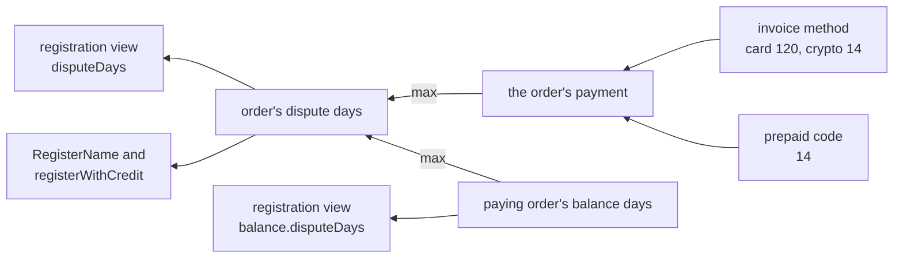
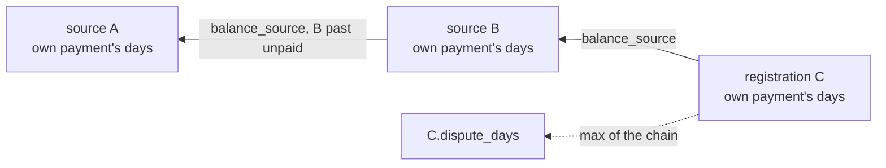
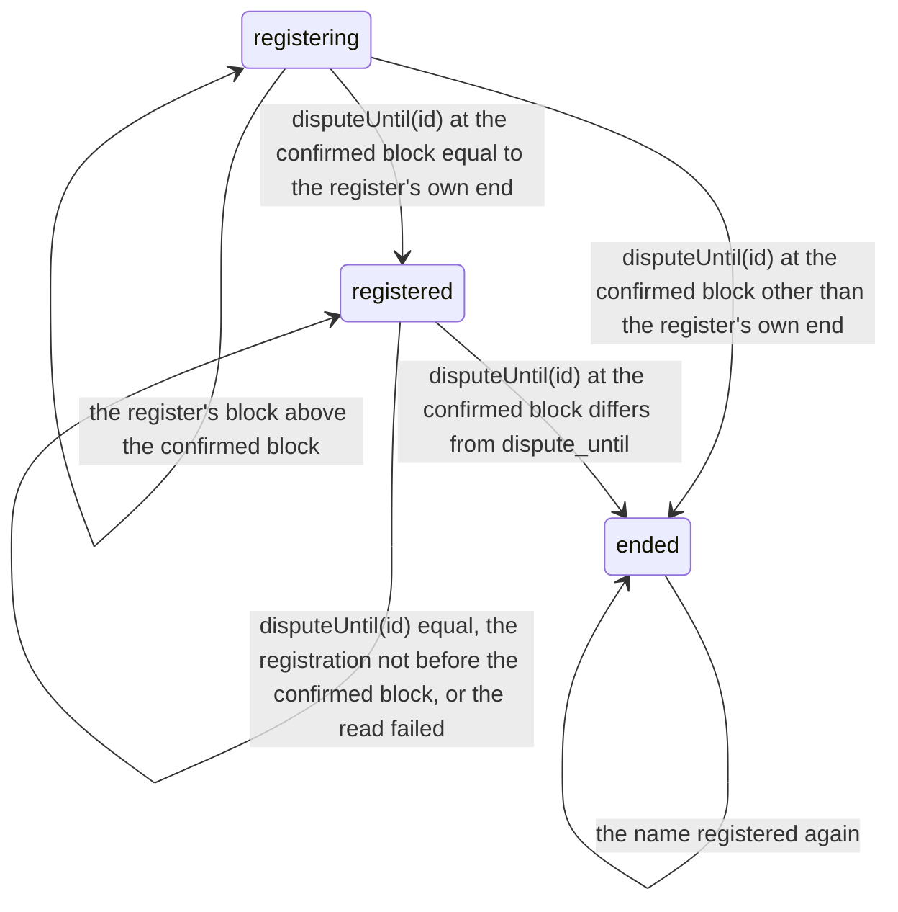

# Names: dispute days of sponsored registrations

Repository: simplex-chat/simplex-chat, apps/simplex-store-service.
Branch: `ab/names-dispute-days`.
Base: `names`.
Contracts: simplex-network/ens-contracts#51, the dispute period.

## Contract interface

```
SimplexSponsor.registerWithCredit(
  Registration registration,
  uint256 disputeDays,
  uint256 nonce,
  uint256 deadline,
  bytes sig
)

RegisterName(
  string label,
  address owner,
  uint256 duration,
  address resolver,
  bytes[] data,
  uint256 disputeDays,
  uint256 nonce,
  uint256 deadline
)
  domain    SimplexSponsor, version 1

SimplexController.registerSponsored
  14 <= disputeDays <= 120    else DisputeDaysOutOfRange

BaseRegistrarImplementation.disputeUntil(uint256 id)
  unix seconds, 0 for none
```

## Registration view

`GET /api/registration/:id`:

| Field | Value |
|---|---|
| `disputeDays` | integer, 14 to 120, every order |
| `disputeUntil` | unix seconds once registered; null before, for a registration without a dispute period, and once ended |
| `expiresAt` | null once ended |
| `phase` | the new value `ended` for an order whose registration was ended by `unregister` |
| `balance.disputeDays` | integer, 14 to 120: the days of an order paid from this balance alone |

The `balance` object is also the `balance` of a `409 balance_changed` answer.

## Dispute days of an order

| Payment | Days |
|---|---|
| invoice by card | 120 |
| invoice by BTC, XMR or another BTCPay method | 14 |
| prepaid code | 14 |
| another order's balance | the balance days of that order |
| invoice for the difference to another order's balance | the larger of the method's days and the balance days of that order |

Balance days of an order:

| Order | Balance days |
|---|---|
| closed unpaid | the days of its invoice's method |
| any other | its dispute days |

A balance's days are computed by `balanceDisputeDays` from its order's phase, method and days, when the balance is read by `getBalance`. An order's days are computed by `orderDisputeDays` from its terms and, for a balance, from the paying balance's days, before the order's row is written. The days are kept on a move to another name and on Try again.



## Types

```
StoreService.Names.Registration
  DisputeDays           newtype over Int, 14 to 120
  mkDisputeDays         Int -> Maybe DisputeDays
  unDisputeDays         DisputeDays -> Int
  disputeSeconds        DisputeDays -> Word64
  minDisputeDays        14
  maxDisputeDays        120
  cardDisputeDays       120
  cryptoDisputeDays     14
  codeDisputeDays       14
  registerNameType      the RegisterName type string
  RegisterIntent
    riDisputeDays       DisputeDays
  registerIntentDigest  domain, registration, dispute days, nonce, deadline

StoreService.Names.Store
  NameRegistration
    nrDisputeDays       DisputeDays
    nrDisputeUntil      Maybe Word64
  Balance
    blDisputeDays       DisputeDays
  methodDisputeDays     ServicePaymentMethod -> DisputeDays
  balanceDisputeDays    NamePhase -> Maybe ServicePaymentMethod -> DisputeDays -> DisputeDays
  orderDisputeDays      DB.Connection -> UTCTime -> OrderTerms -> IO DisputeDays
  NamePhase
    PEnded              "ended"
  disputableRegistrations  DB.Connection -> Word64 -> IO [RegistrationId]

StoreService.Names.Orders
  Landing
    LEnded              Int64, the version written

StoreService.Names.Worker
  Closed
    CLEnded             RegistrationId
  newWorker             OrdersEnv -> Sender -> IO Worker, block times read with blockTimeAt
  sweepEndedRegistrations  Worker -> IO ()
  runEndedSweep            Worker -> IO (), a names lane

StoreService.Names.Contracts
  disputeUntil          Contracts -> BlockTag -> LabelHash -> IO (Either ChainError (Maybe Word64))
  confirmedBlockNumber  Contracts -> IO (Either ChainError Word64)
  confirmedBlock        Contracts -> IO (Either ChainError Block)
  blockTimeAt           Contracts -> Word64 -> IO (Either ChainError Word64)

StoreService.Names.Chain
  deepBlock             ChainClient -> Block -> IO (Either ChainError Block), moved from Records
```

## Schema

Migration `20261120_names_dispute_days`, SQLite and Postgres.

```
name_registrations
  dispute_days      INTEGER NOT NULL DEFAULT 120
  dispute_until     INTEGER
```

Up, after the columns are added, `dispute_days` of each registration is set to the largest days along its funding chain. The chain starts at the registration and follows `balance_source` from it and from each source past `unpaid`. A link with method `card` takes 120, any other 14.

Down: `ended` registrations are set `registered`, then the two columns are dropped. After an up migration that follows it, `dispute_until` is NULL on every registration, so none of them is read by the sweep.



## Registration

```mermaid
sequenceDiagram
  participant P as Names page
  participant W as Web API
  participant D as Database
  participant K as Names worker
  participant S as SimplexSponsor
  participant R as BaseRegistrar
  W->>D: order created with its dispute days
  W-->>P: view: disputeDays
  P->>P: owner signs RegisterName with disputeDays
  P->>W: POST /api/registration/ID/reveal
  W->>W: signer recovered over the order's disputeDays, else bad_request
  W->>D: reveal stored
  K->>K: stored intent checked over the order's disputeDays
  K->>S: registerWithCredit(registration, disputeDays, nonce, deadline, sig)
  K->>R: disputeUntil(id) at the confirmed block, once it reaches the register's block; the register block's timestamp
  alt disputeUntil(id) is the register's own end
    K->>R: nameExpires(id) at the confirmed block
    K->>D: registered; expires_at, and dispute_until with 0 stored as NULL
  else another value
    K->>D: ended; dispute_until the register's own end, expires_at NULL
  end
  W-->>P: view: disputeUntil
```

## Ended registrations

```
sweepEndedRegistrations, every hour
  orders          phase registered, dispute_until after now - 7 days
  block           the confirmed block, read once per pass
  skipped         dispute_until - days * 86400 not before the block's timestamp
  read            registrar disputeUntil(id) at the block
  differs         phase ended, version + 1, published
  equal           unchanged
  read failed     the order read again at the next pass, the pass going on
  block unread    the pass stopped
  log             the pass's first failed read, once

checkLanded, a register mined at block M
  M above the confirmed block     unread, a warning naming both blocks, checked again
  own end                         timestamp of M + days * 86400
  disputeUntil(id) at the confirmed block differs from the own end    phase ended, dispute_until the own end, expires_at NULL; LEnded
  otherwise                       phase registered, expires_at and dispute_until read at the confirmed block; LRegistered
  the owner holding the name, judged by ownerOf alone                  phase registered; LRegistered

//close, LEnded     nothing refunded, answered and logged as ended

registration view of an ended order
  expiresAt       null
  disputeUntil    null
  stored values   kept
```



## Tests

| Test | Module |
|---|---|
| `REGISTER_TYPEHASH` of the type string | NamesSignatureTests |
| `RegisterName` digest with dispute days | NamesSignatureTests |
| `registerWithCredit` calldata, with and without records | NameRegistrationTests |
| an intent signed over other dispute days is refused | NameRegistrationTests |
| a reveal signed over other dispute days is refused; the page's signature, computed with viem | NamesRevealTests |
| the days of card, BTC and XMR invoices, codes, balance chains and difference orders | NamesStoreTests |
| the migration's days for each payment, equal to the days set at creation; an ended registration set registered by the down migration | NamesStoreTests |
| `disputeDays` and `disputeUntil` in the view; `disputeUntil` read when registered | NamesOrdersTests, NamesWorkerTests |
| a balance's `disputeDays`, the days of an order it pays for wholly | NamesStoreTests, NamesOrdersTests, NamesSpendTests |
| an unregistered registration ended and kept ended, its times null in the view; orders the sweep leaves, a registration after the confirmed block included | NamesWorkerTests |
| an unregister ending an order only at the confirmation depth; a failed block read stopping the pass, and one order's failed read leaving the others read, each logged once | NamesWorkerTests |
| a register checked again while its block is above the confirmed block, with a warning naming both blocks; an order ended when its mined register is checked with expiry 0, or after another registration of the name, keeping its register's own dispute end and a NULL expiry | NamesWorkerTests |
| `//close` of an order whose mined registration was ended, answered and logged as ended | NamesWorkerTests, GroupIntegrationTests |

Expected encodings: viem 2.57.5, eth-account 0.14.0 and Foundry's cast 1.10.0 agree, run in CI on the branch `ab/names-dispute-days-vectors`, deleted since, https://github.com/brenzi-agent/simplex-chat/actions/runs/44711063341. The same scripts reproduce the values pinned before this change.

The tests are committed with the interface, before the implementation. CI runs them on both commits: they fail on the first and pass on the second.

## Deployment

This version runs against contracts with #51 applied.

The names site is built from `apps/simplex-domains` at simplex.domains #23 (b8f54ab), whose webapp signs `RegisterName` with `disputeDays` and accepts the phase `ended`. With the webapp pinned before, every reveal is refused with 400, and the phase `ended` is rejected by the page's validators. The pin moves to #23's merge commit on simplex.domains `names` once #23 merges.
