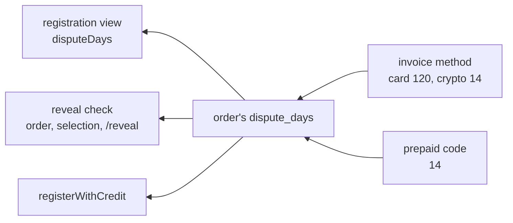
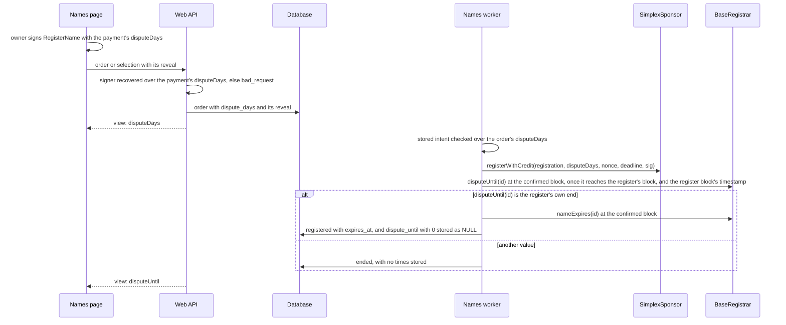
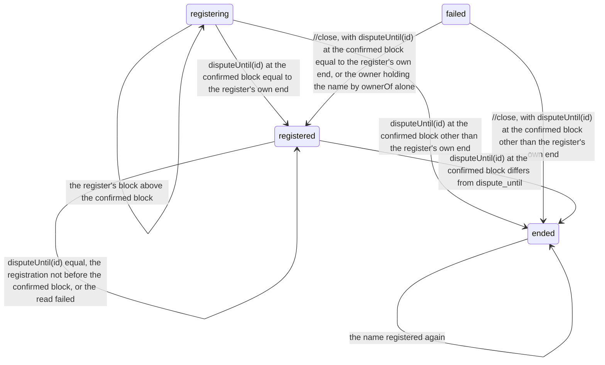

# Names: dispute days of sponsored registrations

Repository: simplex-chat/simplex-chat, apps/simplex-store-service.
Branch: `ep/names-dispute-days`, from `ab/names-dispute-days` with `names` merged.
Base: `names`.
Contracts: simplex-network/ens-contracts#51, the dispute period.

## Contract interface

```
SimplexSponsor.registerWithCredit(
  Registration registration,
  uint256 disputeDays,
  uint256 nonce,
  uint256 deadline,
  bytes sig
)

RegisterName(
  string label,
  address owner,
  uint256 duration,
  address resolver,
  bytes[] data,
  uint256 disputeDays,
  uint256 nonce,
  uint256 deadline
)
  domain    SimplexSponsor, version 1

SimplexController.registerSponsored
  14 <= disputeDays <= 120    else DisputeDaysOutOfRange

BaseRegistrarImplementation.disputeUntil(uint256 id)
  unix seconds, 0 for none
```

## Registration view

`GET /api/registration/:id`:

| Field | Value |
|---|---|
| `disputeDays` | integer, 14 to 120, every order |
| `phase` `registered` | `expiresAt`, and `disputeUntil` absent when the registrar answers 0 |
| `phase` `ended` | no other field |

## Dispute days of an order

| Payment | Days |
|---|---|
| invoice by card | 120 |
| invoice by BTC, XMR or another BTCPay method | 14 |
| prepaid code | 14 |
| a name selected for a taken order | the order's days |



## Types

```
StoreService.Names.Registration
  DisputeDays           newtype over Int, 14 to 120
  mkDisputeDays         Int -> Maybe DisputeDays
  unDisputeDays         DisputeDays -> Int
  disputeSeconds        DisputeDays -> Word64
  minDisputeDays        14
  maxDisputeDays        120
  methodDisputeDays     ServicePaymentMethod -> DisputeDays
  codeDisputeDays       14
  registerNameType      the RegisterName type string
  RegisterIntent
    riDisputeDays       DisputeDays
  registerIntentDigest  domain, registration, dispute days, nonce, deadline

StoreService.Names.Reveal
  intentOf              config, owner, duration, dispute days, reveal
  checkReveal           the dispute days after the order fields
  orderReveal           the dispute days after the order fields

StoreService.Names.Store
  NamePhase
    PEnded              "ended"
  OrderPhase
    ORegistered         expiry, Maybe dispute end, registered at
    OEnded              no fields
  NameRegistration
    nrDisputeDays       DisputeDays
  disputableRegistrations  DB.Connection -> SystemSeconds -> IO [RegistrationId]

StoreService.Names.Orders
  Landing
    LEnded              Int64, the version written

StoreService.Names.Worker
  Closed
    CLEnded             RegistrationId
  sweepEndedRegistrations  Worker -> IO Bool, True when the pass completed
  runEndedSweep            TVar UTCTime -> Worker -> IO (), a names lane

StoreService.Names.Contracts
  disputeUntil          Contracts -> BlockTag -> LabelHash -> IO (Either ChainError (Maybe SystemSeconds))

StoreService.Names.Records
  deepBlock             exported, read by the ended sweep; the register check computes the confirmed number from the latest block

StoreService.Metrics
  meEndedPassAt         TVar UTCTime
  simplex_store_names_ended_pass_timestamp_seconds
```

## Schema

In `20261013_names`, SQLite and Postgres, edited in place.

```
name_registrations
  dispute_days      INTEGER NOT NULL
  dispute_until     INTEGER, BIGINT on Postgres
```

| Phase | expires_at | dispute_until | registered_at |
|---|---|---|---|
| registered | set | set or NULL | set |
| ended | NULL | NULL | NULL |
| any other | NULL | NULL | NULL |

## Registration



## Ended registrations

```
sweepEndedRegistrations, at the start and then every hour
  orders          phase registered, dispute_until after now - 7 days
  block           the confirmed block, read once per pass
  skipped         dispute_until - days * 86400 not before the block's timestamp
  read            registrar disputeUntil(id) at the block
  differs         phase ended, version + 1, published
  equal           unchanged
  read failed     the order read again at the next pass, the pass going on
  block unread    the pass stopped, not completed
  completed       ended pass gauge set to the pass's start
  log             the pass's first failed read, once, with its registration id; a failed block read, with the pass stopped; each order set ended, at note, with the value read

checkLanded, a register mined at block M
  M above the confirmed block     unread, a warning naming both blocks, checked again
  own end                         timestamp of M + days * 86400
  disputeUntil(id) at the confirmed block differs from the own end    phase ended, no times stored, logged at note with the value read; LEnded
  otherwise                       phase registered, expires_at and dispute_until read at the confirmed block; LRegistered
  the owner holding the name, judged by ownerOf alone                  phase registered, expires_at and dispute_until read at the confirmed block; LRegistered

//close, LEnded     nothing refunded, answered as ended
```



## Tests

| Test | Module |
|---|---|
| `REGISTER_TYPEHASH` of the type string | NamesSignatureTests |
| `RegisterName` digest with dispute days; the page's vectors for 120 and 14 days | NamesSignatureTests |
| `registerWithCredit` calldata, with and without records | NameRegistrationTests |
| an intent signed over other dispute days is refused | NameRegistrationTests |
| a reveal signed over other dispute days is refused; the page's signature, computed with viem | NamesRevealTests |
| an order whose reveal is signed over the other method's days is refused | NamesOrdersTests |
| the days of card, BTC and XMR invoices and codes | NamesStoreTests |
| the registered and ended phases stored, read back and checked | NamesStoreTests |
| `disputeDays` and the phases' fields in the view | NamesOrdersTests, NamesWorkerTests |
| an unregistered registration ended and kept ended; orders the sweep leaves, a registration after the confirmed block included | NamesWorkerTests |
| an unregister ending an order only at the confirmation depth; a failed block read stopping the pass, and one order's failed read leaving the others read, each logged once | NamesWorkerTests |
| a register checked again while its block is above the confirmed block, with a warning naming both blocks; an order ended when its mined register is checked, or after another registration of the name | NamesWorkerTests |
| `//close` of an order whose mined registration was ended | NamesWorkerTests |
| the ended pass gauge, and a failing sweep keeping it | NamesWorkerTests, MetricsTests |

## Deployment

This version runs against contracts with #51 applied.

The names site is built from `apps/simplex-domains`, pinned to dfa590c, the merge commit of simplex.domains#29 on `names`, after #23, whose webapp signs `RegisterName` with `disputeDays` and accepts the phase `ended`.
