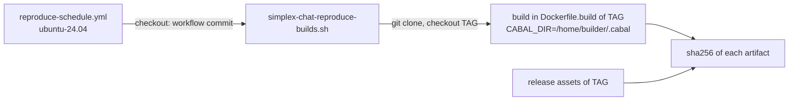

# Reproducible Linux builds of 7.1 releases

## Problem

For v7.1.2, v7.1.3 and v7.1.4, scripts/simplex-chat-reproduce-builds.sh reports a sha256 mismatch for every Linux artifact of the release:

- simplex-chat-ubuntu-22_04-x86_64 and simplex-chat-ubuntu-24_04-x86_64, with their .deb packages;
- simplex-desktop-ubuntu-22_04-x86_64.deb and simplex-desktop-ubuntu-24_04-x86_64.deb;
- simplex-desktop-x86_64.AppImage.

The scheduled workflow "Reproduce latest release" has failed on each run since 2026-09-30, for three causes:

| Runs | Latest release | Failure |
|---|---|---|
| 2026-09-30 to 2026-11-08 | v7.0.3 | the AppImage only differs |
| 2026-11-09 to 2026-11-15 | v7.1.2, then v7.1.3 | all seven artifacts differ |
| from 2026-11-16 | v7.1.3, then v7.1.4 | the AppImage is not built: `ubuntu-latest` is ubuntu-26.04, where FUSE inside the container fails (`fusermount3: mount failed: Permission denied`), so no hash is compared |

The mismatch of v7.1.4 is known from a local run of the script; the scheduled runs of v7.1.4 compared no hashes.

This change addresses the second and third causes. The first is outside it: the AppImage of v7.1.4 differs only as the second cause implies (see Cause).

## Cause

The binaries contain the absolute paths of the cabal store:

- the CLI: the five install paths of simplexmq in `.rodata`, from its `Paths_` module;
- the Haskell shared libraries of the desktop app: their RUNPATH.

| Build | cabal store |
|---|---|
| release, build.yml | `/home/builder/.cabal/store`, from `-e CABAL_DIR=/home/builder/.cabal` of `docker run` |
| reproduce script | `/home/builder/.local/state/cabal/store`, the XDG default of cabal 3.10 without `~/.cabal` |

Dockerfile.build of 7.1 installs ghcup without its bootstrap script, which wrote `/home/builder/.cabal/config` into the image before, so the script's builds moved to the XDG paths.

The differences in the v7.1.4 artifacts are consistent with these paths alone:

- CLI: `.rodata` is 0x40 bytes longer, five paths of 12 more bytes; the other sections have equal sizes;
- CLI .deb: only `usr/bin/simplex-chat` differs;
- desktop .deb and AppImage: only the Haskell libraries differ, and their strings differ only in the store path; the AppImage runtime differs only in `.digest_md5`.

## Change

1. scripts/simplex-chat-reproduce-builds.sh: `docker run` sets `CABAL_DIR=/home/builder/.cabal`, as build.yml does.
2. .github/workflows/reproduce-schedule.yml:
   - the checkout is the commit of the workflow run, not the release tag, so that the fixed script reproduces the releases made before the fix. #6485 set the tag; docs/REPRODUCE.md tells users to run the script of master against a tag, and the workflow now runs the script of its own branch against the tag. A release tagged on master is checked by the script of stable until master is merged into stable. The script builds the tag from its own clone, as before.
   - `runs-on: ubuntu-24.04`, the image of the runs that built the AppImage until 2026-11-15. `APPIMAGE_EXTRACT_AND_RUN=1` in the container would avoid FUSE on any runner; whether its AppImage equals the release's is unverified.
3. Dockerfile.build: `ENV CABAL_DIR="$HOME/.cabal"`, so that a build in the image of a later release uses the store path of releases also without `-e CABAL_DIR`, as a person running `docker run` by hand; `PATH` of the image already contains `$HOME/.cabal/bin`.

Scheduled runs use the workflow of the default branch, stable: the fix applies to them after master is merged into stable. Until then, a dispatch of the workflow on master runs it.

## Verification

"Reproduce latest release" is dispatched on the head of this branch in the fork. The change is verified when its step "Check if build has been reproduced" finds `_sha256sums` for v7.1.4.
