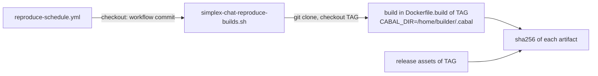

# Reproducible Linux builds of 7.1 releases

## Problem

From v7.1.2, scripts/simplex-chat-reproduce-builds.sh reports a sha256 mismatch for every Linux artifact of a release:

- simplex-chat-ubuntu-22_04-x86_64 and simplex-chat-ubuntu-24_04-x86_64, with their .deb packages;
- simplex-desktop-ubuntu-22_04-x86_64.deb and simplex-desktop-ubuntu-24_04-x86_64.deb;
- simplex-desktop-x86_64.AppImage.

The scheduled workflow "Reproduce latest release" fails on each run since 2026-09-30. For v7.0.3, only the AppImage differed.

## Cause

The binaries contain the absolute paths of the cabal store:

- the CLI: the five install paths of simplexmq in `.rodata`, from its `Paths_` module;
- the Haskell shared libraries of the desktop app: their RUNPATH.

| Build | cabal store |
|---|---|
| release, build.yml | `/home/builder/.cabal/store`, from `-e CABAL_DIR=/home/builder/.cabal` of `docker run` |
| reproduce script | `/home/builder/.local/state/cabal/store`, the XDG default of cabal 3.10 without `~/.cabal` |

Dockerfile.build of 7.1 installs ghcup without its bootstrap script, which left `~/.cabal` in the image before, so the script's builds moved to the XDG paths.

For v7.1.4, all other bytes of the artifacts depend on these paths: the sections of the CLI other than `.rodata` have equal sizes; the files of the AppImage and the desktop .deb differ only in the Haskell libraries, whose strings differ only in the store path; the AppImage runtime differs only in `.digest_md5`.

## Change

1. scripts/simplex-chat-reproduce-builds.sh: `docker run` sets `CABAL_DIR=/home/builder/.cabal`, as build.yml does.
2. .github/workflows/reproduce-schedule.yml: the checkout is the commit of the workflow run, not the release tag, so that the fixed script reproduces the releases made before the fix; the script builds the tag from its own clone, as before.
3. Dockerfile.build: `ENV CABAL_DIR="$HOME/.cabal"`, so that every build in the image of a later release uses the store path of releases, also without `-e CABAL_DIR`; `PATH` of the image already contains `$HOME/.cabal/bin`.

## Verification

"Reproduce latest release", dispatched on the fork branch, reproduces v7.1.4: the step "Check if build has been reproduced" finds `_sha256sums`.
