# Device link: desktop and phone linked once, connected from any network

Repository: simplex-chat/simplex-chat, with simplexmq.
Branch: `ep/device-link`.
Base: master `20ee7cb14`; simplexmq pinned at `d38bcf50` (cabal.project:23-24).

Citations: `mq:` is simplexmq `src/Simplex/` at `d38bcf50`; other paths are in this repository at the base.

## Decisions of the product owner

| # | Decision | Source |
|---|---|---|
| D1 | Main case: the phone next to the desktop, with a blocked direct LAN link; remote control from another network is supported and rare | ep-messages.md, item 171, answer 1 |
| D2 | A dedicated SMP connection per linked pair, so that later sessions need no QR | item 171, answer 12 |
| D3 | The device is a new entity or a Contact with a flag, decided by analysis | item 171, answer 12 |
| D4 | Signaling messages in the `x.` namespace, `x.rtc.*` with the call suffixes, built on the call types | item 171, answer 13; ep-messages-2.md, item 152 |
| D5 | The pairing QR is a one-time invitation with a new link path (`/d`), recognised without reading link data; link data contains the first offer; later handshakes use the duplex connection | item 171, answer 14 |
| D6 | Direct path with relay fallback; the local path through WebRTC host candidates, without a separate local mechanism unless experiments require one | item 171, answer 16 |
| D7 | Relay credentials static, as today | item 171, answer 17 |
| D8 | WebRTC in the app's existing JNI library, never in libsimplex or a browser | item 171, answers 4 and 10; item 3747 |
| D9 | simplex-chat opens the data channel and passes a stream to simplexmq; HTTP/2 over that stream | ep-messages-2.md, item 159; item 171, answer 11 |
| D10 | No new LAN pairings | item 31 ("I think no") |
| D11 | An existing LAN pairing keeps working with a deprecation notice; its upgrade requires a confirmation and a QR scan | items 31 and 35 |
| D12 | Pure LAN linking without internet is discontinued | item 33 |
| D13 | iOS keeps the app running in background with silent audio and a Live Activity, on branch `ep/ios-desktop-background` | items 37-45 |
| D14 | Either device starts a session (flow 1b); the phone accepts silently when the app is open and "Connect without asking" is on for that desktop, otherwise one tap | item 29 ("1b - is interesting"); the plan of item 45 with 1b, followed by item 51 |
| D15 | "Connect without asking" is off by default | item 29, "2a - yes" |
| D16 | A hidden agent user on each device owns the device connection | item 31, "4a - yes" |
| D17 | With a SOCKS proxy on, the local path is allowed, and the relay is reached through the proxy over TCP | item 31, "5a - yes" |

Items 29 and 31 answer the lettered options of message 26 of the agent.

## 1. Problems

1. A phone and a desktop on one Wi-Fi fail to link when the router isolates clients or the desktop firewall blocks the inbound port.
2. A phone on mobile data never links to a desktop on Wi-Fi.
3. Each session requires a new QR scan, or a multicast search within a 60-second window on both devices.
4. Every network change ends the session, and the session is restarted by hand.
5. The phone screen stays open during a session; on iOS, background suspends it.
6. Unlinking on one device leaves a stale link on the other.

Today, in code:

| Fact | Code |
|---|---|
| The phone dials the IPv4 address and port written in the QR | mq:RemoteControl/Client.hs:288-292, mq:RemoteControl/Invitation.hs:37-38 |
| The desktop listens on a TCP port, random unless set | mq:RemoteControl/Discovery.hs:80-93 |
| Later sessions use multicast for 60 s; the phone listens for 30 s | mq:RemoteControl/Client.hs:118-122, 384-386 |
| Suspension of the core stops the session | Commands.hs:637-641; apps/ios/Shared/SimpleXApp.swift:71-83 |
| Leaving the phone screen disconnects | apps/ios/Shared/Views/RemoteAccess/ConnectDesktopView.swift:105-108 |
| Unlink deletes the local record only | Remote.hs:335-344, 710-718 |
| The failure text assumes one LAN | strings.xml:2799 |

## 2. UX

Screens and copy follow the recovered UX spec (`link-ux-spec.md`), with D10-D15 applied. `<desktop>` and `<phone>` are the stored device names. Named values:

| Name | Value |
|---|---|
| QR_LIFETIME | 10 min |
| REQUEST_TTL | 2 min |
| NO_RESPONSE_HINT | 20 s |
| RECONNECT_WINDOW | 2 min |

Entry points stay as today: phone "Use from desktop", desktop "Link a mobile" and "Linked mobiles". The phone screen title changes from "Connect to desktop" (ConnectDesktopView.swift:163) to "Use from desktop". Opening or closing these screens neither starts nor stops a session.

### 2.1 First pairing

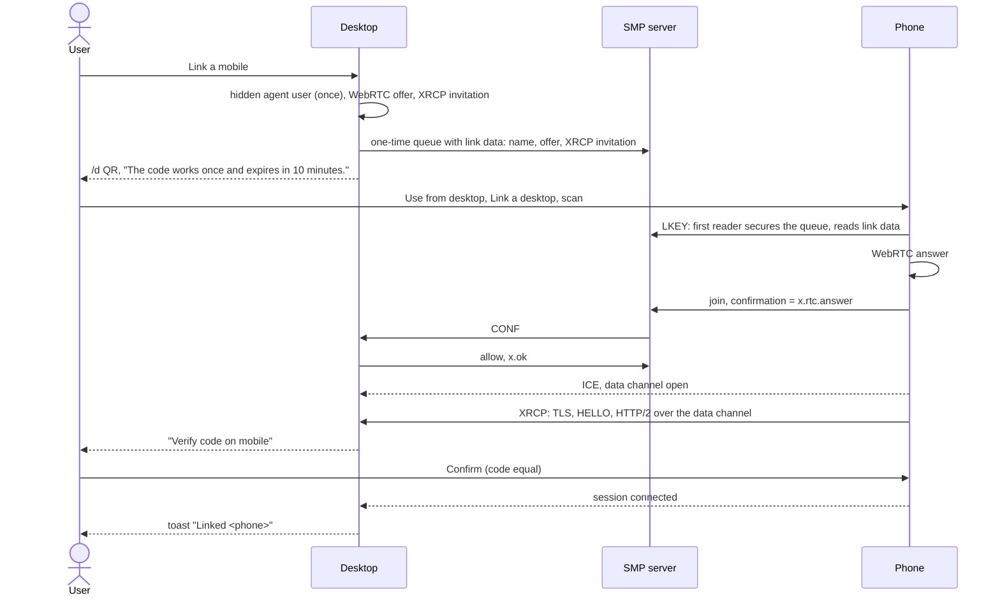

| Screen | Copy |
|---|---|
| Desktop D1 "Link a mobile" | section "This device name"; QR; "On your phone, open **Use from desktop**, tap **Link a desktop** and scan this code."; "The code works once and expires in 10 minutes. Your phone needs SimpleX Chat %s or later." |
| D1 after QR_LIFETIME | QR dimmed, "This code expired", button "Refresh" |
| D1 without SMP | "Can't create a link" / "Check your internet connection. Linking needs internet access on both devices." / "Try again" |
| Phone P1 without links | section "This device name"; row "Link a desktop"; footer "Link a desktop to use your chats from it. The desktop can be on any network." |
| Phone P0, iOS, before the first scan | "Allow local network access" / "When your phone and desktop are on the same network, SimpleX Chat connects them directly. iOS will ask for permission. If you don't allow it, the devices connect through the internet or a SimpleX relay." / "Continue" |
| Phone P2 scanner | title "Link a desktop"; header "Scan QR code from desktop" |
| P2: used or expired link | "This code can't be used" / "It was already used or has expired. Show a new code on the desktop and scan again." / "OK" |
| P2: `xrcp:/` QR of an unknown desktop | "Update the desktop app" / "This QR code is from an older version of SimpleX Chat for desktop. Update the desktop app to %s or later to link it." / "OK" |
| P2: offline | "No internet connection" / "Linking needs internet access on both devices." / "OK" |
| P3 connecting | "Linking desktop", desktop name "(new)", version line, "Cancel" |
| P3, desktop already linked | "Already linked" / "This desktop is already linked as <desktop>. Linking again replaces the existing link." / "Link again", "Cancel" |
| P4 and D2 verify | phone: "Verify connection", "Verify code with desktop", code, "Confirm", "Cancel"; desktop: "Verify connection", "Verify code on mobile", footer "Check that your phone shows the same code, then tap Confirm on the phone." |
| P4 cancelled | desktop alert "Linking cancelled" / "<phone> did not confirm the code. Show a new code to try again." / "OK" |
| After Confirm | desktop toast "Linked <phone>"; phone banner "Desktop linked. Next time, connect from either device without a QR code." |

Verification of the code is required at the first pairing only. "Connect without asking" is off for a new link (D15). The address, port, firewall and "Discoverable via local network" controls are removed from D1 (ConnectMobileView.kt, strings.xml:2826, 2834-2835).

A `/d` link outside the "Link a desktop" screen: section 4, Q1.

### 2.2 Later session, started from the desktop

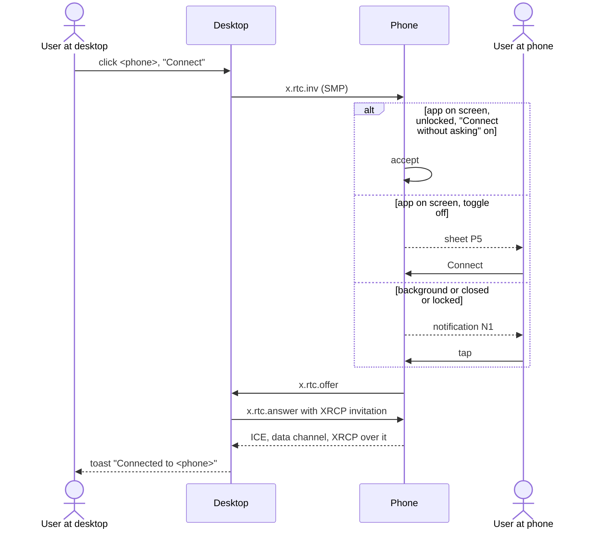

| Screen | Copy |
|---|---|
| Desktop D3 | "Connecting to <phone>", "Waiting for <phone> to accept…", "Cancel" |
| D3 after NO_RESPONSE_HINT | adds "Open SimpleX Chat on your phone. If it is closed, tap the notification." |
| D3 after REQUEST_TTL | "No response from <phone>" / "Your phone may be offline, or the app may be closed with notifications off." / "Try again", "Close" |
| Phone P5 | "<desktop> wants to connect" / "Your chats will be available on <desktop> until you disconnect. You can't use the app on this phone at the same time." / "Connect", "Not now" |
| Notification N1 | title "<desktop> wants to connect", body "Tap to use SimpleX Chat from this desktop.", action "Decline"; Android channel "Desktop connection requests" |
| Declined | desktop "<phone> did not accept" / "Try again", "Close" |
| N1 tapped after REQUEST_TTL | "Request expired" / "<desktop> asked to connect more than 2 minutes ago. Connect now?" / "Connect", "Cancel" |

A tap on N1 connects after SimpleX Lock, without a second confirmation (section 4, Q2). A request received after REQUEST_TTL produces neither a notification nor a sheet.

### 2.3 Later session, started from the phone

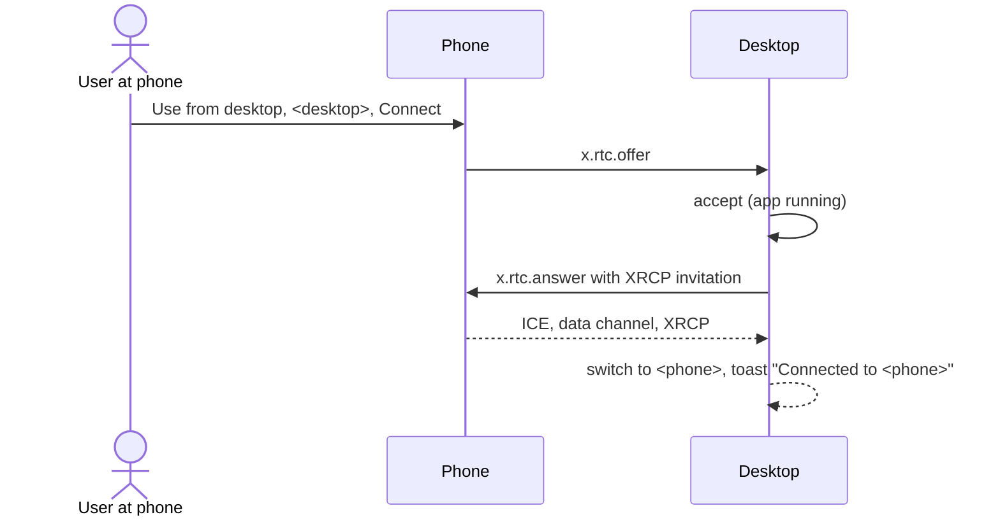

| Screen | Copy |
|---|---|
| Phone | "Connecting to <desktop>", "Cancel"; after NO_RESPONSE_HINT "Make sure SimpleX Chat is running on <desktop>." |
| After REQUEST_TTL | "No response from <desktop>" / "The desktop may be offline or the app may be closed." / "Try again", "OK" |

The desktop accepts without asking (section 4, Q3).

### 2.4 Connected, with the path label

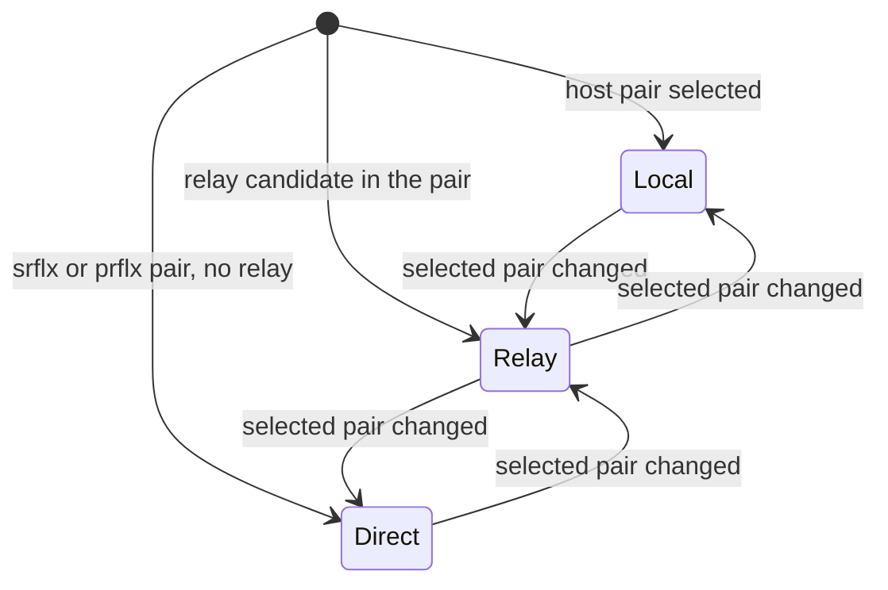

| Path | Label | Explanation |
|---|---|---|
| host or prflx pair, private addresses, Wi-Fi or Ethernet | "Local network" | "Your devices are connected directly over your local network." |
| other pair without relay | "Direct" | "Your devices are connected directly over the internet. Each device sees the other's IP address." |
| relay candidate in the pair | "Via relay" | "Your devices are connected through a SimpleX relay. The relay sees the IP addresses of both devices (or of your proxy) and the amount of traffic, not its content." |

| Place | Content |
|---|---|
| Phone P7 | "Connected to desktop", name, version; row "Connection" with the label; "Session code" only after a pairing or an upgrade; "Disconnect" |
| P7 footer, iOS | "SimpleX Chat keeps running in the background while the desktop is connected. Disconnect to stop." |
| P7 footer, Android | "SimpleX Chat keeps running while the desktop is connected. Disconnect to stop." |
| Android ongoing notification | "Connected to <desktop>", "<path label>. Tap to open.", action "Disconnect" |
| iOS Live Activity (D13) | "Connected to <desktop>", "<path label> · <elapsed time>"; Disconnect button on iOS 17+ |
| Desktop | path icon on the phone pill with tooltip; "Linked mobiles" subtitle "Connected · <path label>"; row "Connection" in "Connected to mobile" |
| Disconnect, either side | immediate, without confirmation; desktop toast "Mobile **<phone>** was disconnected"; phone notice "<desktop> disconnected" |

The Android foreground service runs for the whole session (today only while the screen is open, ConnectDesktopView.kt:61).

### 2.5 Reconnect

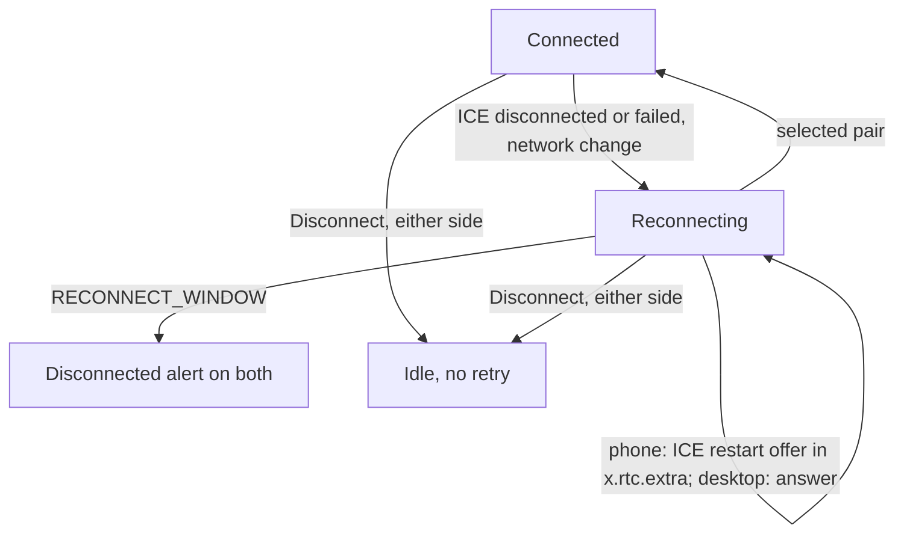

| Place | Copy |
|---|---|
| Phone P7 | row "Connection": "Reconnecting…" |
| Desktop | banner "Reconnecting to <phone>…" with "Disconnect"; composer disabled with placeholder "Reconnecting to <phone>…" |
| Failure | "Disconnected from <phone>" / "The connection was lost and could not be restored. Check that both devices have internet access." / "Connect again", "OK"; phone in background: "Disconnected from <desktop>" / "Open SimpleX Chat to connect again." |

### 2.6 Upgrade of a LAN link

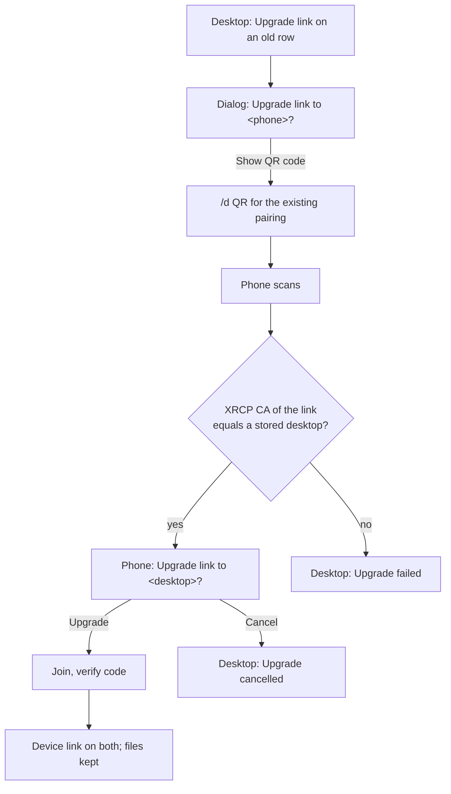

| Place | Copy |
|---|---|
| Phone P1, section "Old links" | subtitle "Local network only"; footer "Local network links are deprecated and will be removed in a future version. Upgrade each link to keep using that desktop."; action "Upgrade link" |
| Desktop "Linked mobiles" | subtitle "Old link · local network only"; actions "Connect", "Upgrade link", "Unlink" |
| P7 and "Connected to mobile" during an old-link session | footer "This desktop uses an old local network link, which will stop working in a future version." and "Upgrade link" |
| Desktop dialog | "Upgrade link to <phone>?" / "You will scan a new QR code with <phone>. After the upgrade, the devices can connect from any network, not only your local network." / "Show QR code", "Cancel" |
| Desktop QR | title "Upgrade link"; "On <phone>, open **Use from desktop**, tap **Upgrade link** next to this desktop, and scan this code." |
| Phone confirmation | "Upgrade link to <desktop>?" / "Today <desktop> can connect to this phone only when both are on the same local network. After the upgrade, <desktop> can ask to connect from any network, directly or through a SimpleX relay. Anyone who uses <desktop> could then reach your chats from anywhere. You will be asked each time, unless you turn on Connect without asking. The old link will be removed." / "Upgrade", "Cancel" |
| Cancelled | desktop "Upgrade cancelled" / "<phone> did not confirm the upgrade." / "OK" |
| Failed | desktop "Upgrade failed" / "<phone> has no link to this desktop. Use Link a mobile to link it again." / "OK" |
| Success | phone banner "Link upgraded." |

The upgrade keeps the XRCP pairing records (`remote_hosts`, `remote_controllers`), so the files folder of the phone on the desktop is kept. Old links keep today's LAN flow and multicast; the three phone settings "Verify connections", "Discover via local network" and "Connect automatically" (ConnectDesktopView.swift:374-377) are shown only in "Old links".

### 2.7 Unlink

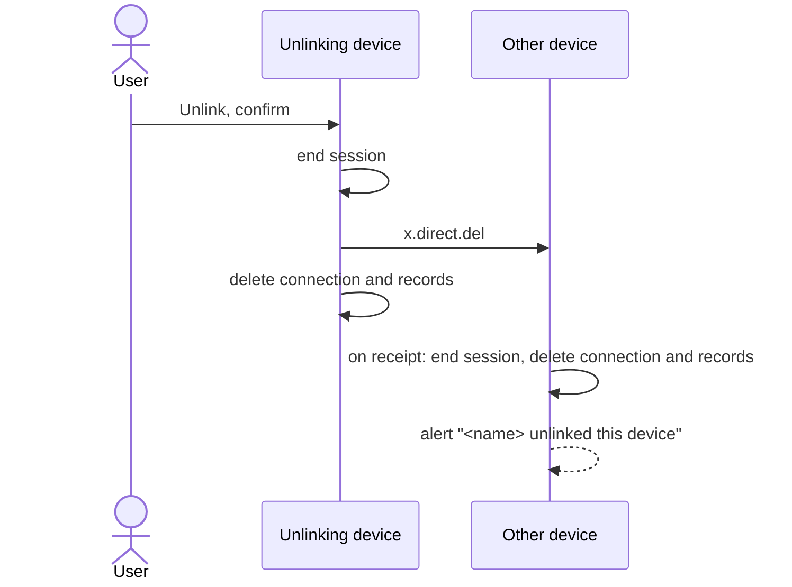

| Place | Copy |
|---|---|
| Phone | "Unlink <desktop>?" / "<desktop> will no longer be able to connect to this phone. The link is removed on both devices. To use it again, scan a new QR code." / "Unlink", "Cancel" |
| Desktop | "Unlink <phone>?" / "This desktop will no longer be able to connect to <phone>. The link is removed on both devices. Files received from <phone> on this desktop are deleted." / "Unlink", "Cancel" |
| Other device | "<name> unlinked this device" / "To use it again, link it with a new QR code." / "OK" |

Unlink is allowed during a session (today refused, Remote.hs:712). The desktop item "Delete" becomes "Unlink".

### 2.8 Several desktops

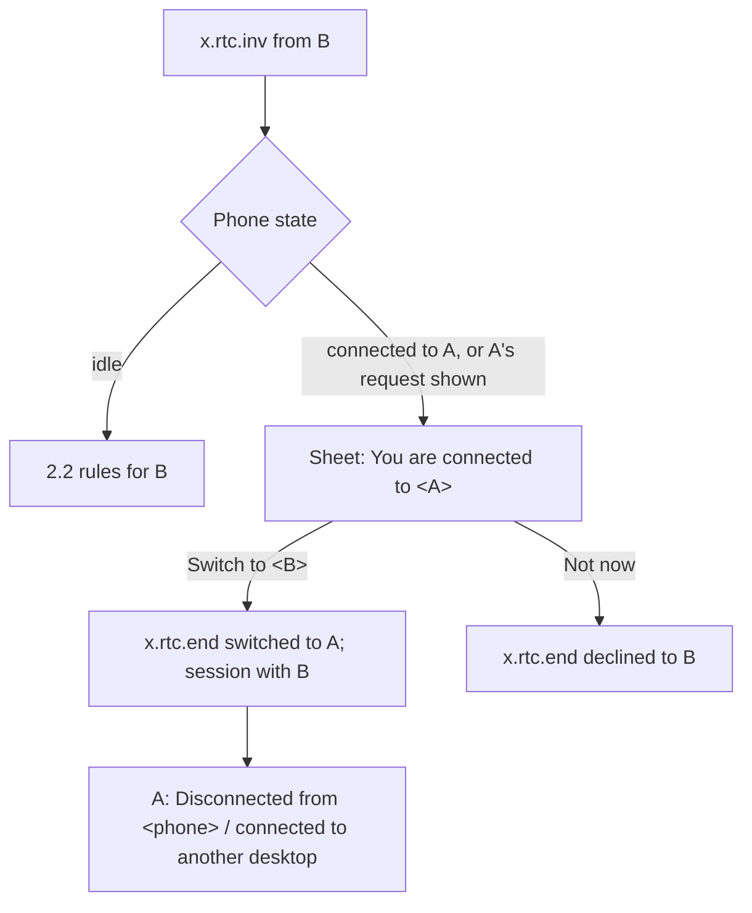

| Place | Copy |
|---|---|
| Phone sheet, never silent | "<B> wants to connect" / "You are connected to <A>. Connecting to <B> disconnects <A>." / "Switch to <B>", "Not now" |
| Desktop A | "Disconnected from <phone>" / "<phone> connected to another desktop." / "OK" |

The phone keeps one session at a time (Remote.hs:452-461). A second request received while one is pending waits and is shown after the first; it is dropped when it expires meanwhile.

### 2.9 Phone offline or app closed

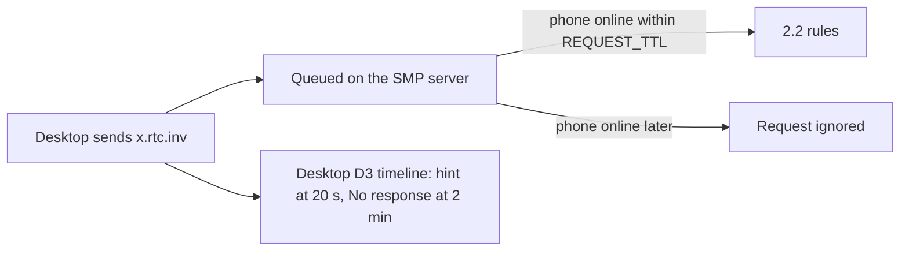

### 2.10 Per-device settings

| Device | Setting | Default |
|---|---|---|
| Phone, per desktop | "Connect without asking" | off |
| Phone, per desktop | "Name", footer "Only you see this name." | peer's name |
| Desktop, per phone | "Name", footer "Only you see this name." | peer's name |

Footer of "Connect without asking": "When SimpleX Chat is open on this phone, <desktop> connects without asking you. When the app is closed or in the background, you get a notification to tap." A local name is not replaced by the name received in a session.

## 3. Technical design

### 3.1 Composition

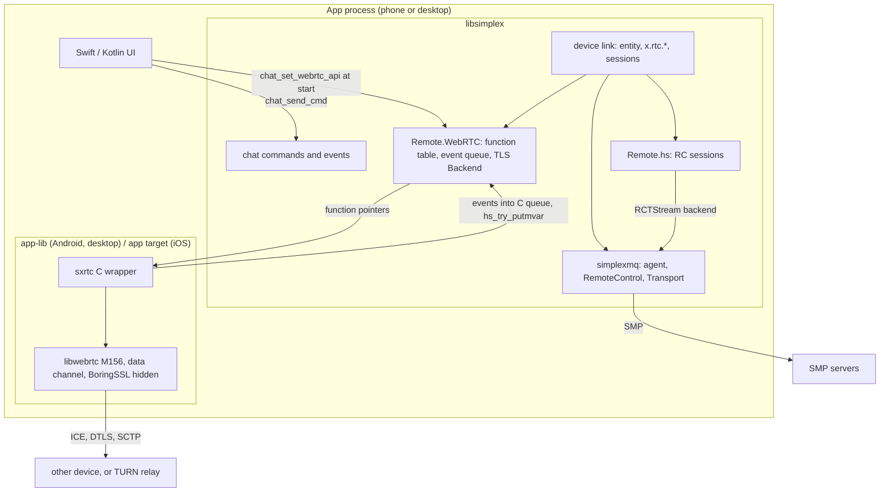

Layers over the data channel, top to bottom: remote protocol (Remote/Protocol.hs), HTTP/2 (mq:Messaging/Transport/HTTP2.hs:38-52, `cPut`/`cGet` only), XRCP HELLO with the hybrid KEM (mq:RemoteControl/Client.hs:215-237, 329-366), TLS with CA pinning, the stream adapter, the SCTP data channel, DTLS, ICE.

### 3.2 The device entity

Options:

| Option | Cost |
|---|---|
| A. Contact with a flag | requires a hidden chat user with its own contact, profile and display name (chat_schema.sql:38-65); filters in 5 chat-list queries (Store/Messages.hs:833-873), the contact list and member-contact queries (Store/Groups.hs:2995, 3029); guards in `processDirectMessage` for the profile sent on CONF (Subscriber.hs:512-520), probes, chat items, receipts and features; exclusion of the hidden user from every user list |
| B. Device entity with a `connections` row | `connections.user_id` is `NOT NULL REFERENCES users` (chat_schema.sql:370), so it requires the hidden chat user of A, or a rebuild of the `connections` table in SQLite; a new `ConnType` (Types.hs:2118-2141) and `ConnectionEntity` constructor (Protocol.hs:152-156) |
| C. Device entity with its own table, agent connection referenced directly | one table; a branch before the chat entity lookup in `processAgentMessage` (Subscriber.hs:146-154); a `NtfConn` alternative for the NSE (Controller.hs:1403-1411); signaling sent with the agent's `sendMessage` (mq:Messaging/Agent.hs:629), without the `messages` and `msg_deliveries` rows of `sendDirectMessage_` (Internal.hs:2392-2398) |

Choice: C. It is the only option compatible with D16 without a hidden chat user. Signaling messages are transient: they produce neither chat items nor delivery receipts, so the message tables are not used.

Schema (SQLite; Postgres mirrors it):

```sql
CREATE TABLE linked_devices(
  linked_device_id INTEGER PRIMARY KEY AUTOINCREMENT,
  device_role TEXT NOT NULL CHECK(device_role IN ('mobile', 'desktop')),
  link_status TEXT NOT NULL CHECK(link_status IN ('invited', 'joined', 'linked')),
  agent_user_id INTEGER NOT NULL,
  agent_conn_id BLOB NOT NULL UNIQUE,
  remote_host_id INTEGER REFERENCES remote_hosts ON DELETE CASCADE,
  remote_ctrl_id INTEGER REFERENCES remote_controllers ON DELETE CASCADE,
  short_link_inv BLOB,
  peer_chat_min_version INTEGER NOT NULL DEFAULT 1,
  peer_chat_max_version INTEGER NOT NULL DEFAULT 1,
  local_name TEXT,
  connect_without_asking INTEGER NOT NULL DEFAULT 0,
  created_at TEXT NOT NULL,
  updated_at TEXT NOT NULL,
  CHECK(link_status != 'linked' OR (device_role = 'mobile') = (remote_host_id IS NOT NULL)),
  CHECK(remote_host_id IS NULL OR remote_ctrl_id IS NULL)
) STRICT;
CREATE UNIQUE INDEX idx_linked_devices_remote_host_id ON linked_devices(remote_host_id);
CREATE UNIQUE INDEX idx_linked_devices_remote_ctrl_id ON linked_devices(remote_ctrl_id);
```

- `device_role`: the role of the peer; `mobile` rows are on a desktop, `desktop` rows on a phone.
- `invited`: desktop, QR shown. `joined`: phone, joined before the code is confirmed. `linked`: pairing confirmed.
- A `remote_hosts` or `remote_controllers` row without a `linked_devices` row is an old LAN link.

Types:

```haskell
data DeviceRole = DRMobile | DRDesktop

data LinkStatus = LSInvited | LSJoined | LSLinked

data LinkedDevice = LinkedDevice
  { linkedDeviceId :: LinkedDeviceId,
    deviceRole :: DeviceRole,
    linkStatus :: LinkStatus,
    agentConnId :: AgentConnId,
    pairing :: Maybe DevicePairing,
    peerChatVRange :: VersionRangeChat,
    localName :: Maybe Text,
    connectWithoutAsking :: Bool
  }

data DevicePairing = DPMobile RemoteHostId | DPDesktop RemoteCtrlId
```

Dispatch:

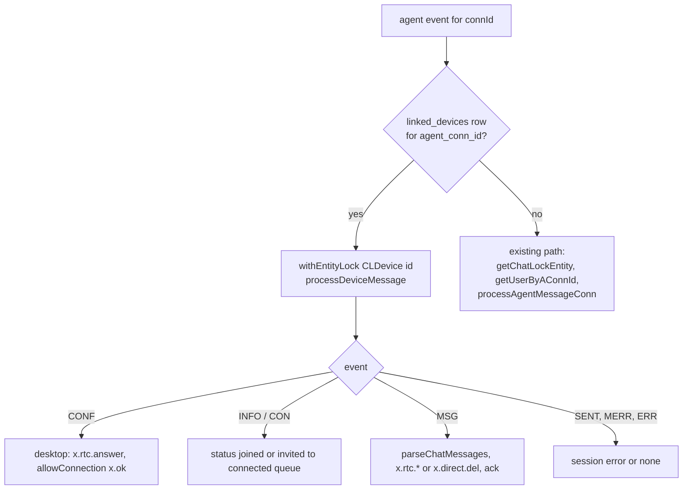

- `ChatLockEntity` gains `CLDevice Int64` (Store/Shared.hs:68-78).
- `syncConnections` and `ShowConnectionsDiff` add the hidden agent user ID and the device connection IDs to the lists passed to the agent (Commands.hs:263-269, 643-648); without them `syncConnections'` deletes that agent user (mq:Messaging/Agent.hs:1867-1871).
- `APIGetNtfConns` returns a device alternative of `NtfConn` for a device connection (Commands.hs:1701-1712).
- Sending: `encodeChatMessage maxEncodedMsgLengthPQ` (Protocol.hs:942-943), then `sendMessage` of the agent with `MsgFlags {notification = hasNotification tag}`.

### 3.3 The hidden agent user

- Created with `createUser` of the agent (mq:Messaging/Agent.hs:368) when the first `linked_devices` row is created, and deleted with `deleteUser` with the last row.
- No chat user references it. Its ID is stored in `agent_user_id` of each row.
- Servers at creation: those of the active chat user, chosen as in `CreateActiveUser` (Commands.hs:504-516); without a chat user, the random preset servers (Commands.hs:512-516). Later changes of the active user's servers are not copied.
- Subscribed with all other agent users by `subscribeAllConnections` (mq:Messaging/Agent.hs:1986-2008).
- Survives the deletion of any chat profile; a desktop without a profile links (Commands.hs:3742 has no `withUser`).

### 3.4 The `/d` link

simplexmq change:

```haskell
data InvitationConnType = ICTContact | ICTDevice

CSLInvitation :: ShortLinkScheme -> InvitationConnType -> SMPServer -> SMP.LinkId -> LinkKey -> ConnShortLink 'CMInvitation
```

| Encoding | Contact invitation | Device invitation |
|---|---|---|
| String | `/i#<linkId>/<key>` (mq:Messaging/Agent/Protocol.hs:1735) | `/d#<linkId>/<key>` |
| Binary | `I`, server, link ID, key (1791) | `D`, server, link ID, key |

- Parser: `contactTypeP` (1775-1778) gains `A.char 'd'`; the binary parser (1799-1807) gains `'D'`.
- The agent returns `ICTContact` (mq:Messaging/Agent.hs:1296, 1457); the chat sets `ICTDevice` after creation, as `setShortLinkType_` does for contact links (Types.hs:587-591).
- `CSLInvitation` patterns change at 12 sites in simplexmq and 4 in the chat (Markdown.hs:559, Commands.hs:4906, Internal.hs:1741, 2348).
- Server pages: `"d"` added to `smpLinkPages` (simplexmq apps/smp-server/SMPWeb.hs:24) and a `/d` branch in simplexmq apps/common/Web/static/link.html (511-515), copy in section 4, Q7. Pairing works without the page: the QR is scanned in the app.

Old clients:

| Client | `/d` link | Code |
|---|---|---|
| Old app, scanner of "Use from desktop" | parse error, "Bad desktop address" | mq:Messaging/Agent/Protocol.hs:1778; ConnectDesktopView.swift:136 |
| Old app, message text | the `https://` link is shown as a plain URL | Markdown.hs:508-512 |
| Old SMP server | the link page is absent; pairing is unaffected | SMPWeb.hs:24 |

The letter is outside the signed data. The chat therefore checks the decoded link data: `shortLinkDataP` (Internal.hs:1739-1754) requires device data for `ICTDevice` and rejects it for `ICTContact`, so a `/d` link rewritten to `/i`, or the reverse, fails with `CEInvalidConnReq` (Internal.hs:1737).

Link data and join message:

```haskell
data DeviceShortLinkData = DeviceShortLinkData
  { deviceName :: Text,
    appVersionRange :: AppVersionRange,
    sessionId :: CallId,
    offer :: WebRTCSession,
    rcInvitation :: RCSignedInvitation
  }
```

- Stored with `encodeShortLinkData` (Internal.hs:1765-1773) in the one-time invitation, read once by `LKEY` (mq:Messaging/Server.hs:1664; mq:Messaging/Agent.hs:1326-1342).
- `getShortLinkConnReq'` (Internal.hs:1730-1733) takes an agent user ID in place of `User`, so the phone reads the link as the hidden agent user.
- Budget: 13,784 bytes of padded user data (mq:Messaging/Crypto/ShortLink.hs:45-46). Offer sizes are measured in PR 2.
- The phone's confirmation contains `x.rtc.answer`, within 11,106 bytes with PQ (mq:Messaging/Agent/Protocol.hs:346-350). The desktop's `allowConnection` message is `x.ok`.
- The first offer is not trickled: candidates gathered within 750 ms are included; later candidates follow in `x.rtc.extra` after `CON`.
- `connectPlan` (Commands.hs:4546-4567) gains a device plan:

```haskell
data DeviceLinkPlan
  = DLPNew {deviceName :: Text}
  | DLPKnown {linkedDevice :: LinkedDevice}
  | DLPUpgrade {remoteCtrl :: RemoteCtrlInfo}
  | DLPIncompatible {appVersionRange :: AppVersionRange}
```

`DLPUpgrade` is chosen when the `ca` of the XRCP invitation equals `ctrl_fingerprint` of a stored desktop without a `linked_devices` row (Remote.hs:467).

### 3.5 Signaling messages

| Tag | Sender | Fields | Types |
|---|---|---|---|
| `x.rtc.inv` | desktop | `callId`, `sentAt` | `CallId` (Call.hs:146), `UTCTime` |
| `x.rtc.offer` | phone | `callId`, `offer` | `WebRTCSession` (Call.hs:226-230) |
| `x.rtc.answer` | desktop; phone in the first pairing | `callId`, `answer`, `rcInvitation` (desktop only) | `CallAnswer` (Call.hs:216-219), `RCSignedInvitation` |
| `x.rtc.extra` | both | `callId`, `extra` | `CallExtraInfo` (Call.hs:221-224): candidates, ICE restart offer or answer |
| `x.rtc.end` | both | `callId`, `reason` | `RtcEndReason` |
| `x.direct.del` | both | none | existing (Protocol.hs:475) |

```haskell
data RtcEndReason = RERDisconnected | RERDeclined | RERSwitched | RERExpired | RERFailed
```

- `hasNotification XRtcInv_ = True` (Protocol.hs:1339-1348), so the phone is woken.
- `rtcSession` and `rtcIceCandidates` are JSON of the SDP and of the candidate list, without LZ-string; messages are compressed by `compressToLimit` as in `deliverMessagesB` (Internal.hs:2644-2649).
- Old peers parse the tags as `XUnknown` (Protocol.hs:1260); device connections exist only between new clients.
- A request is accepted when both `sentAt` and the broker time are within REQUEST_TTL plus 60 s of the phone's clock.
- Calls are unchanged: `currentCalls`, the `calls` table and the NSE call path are not used (Controller.hs:326; chat_schema.sql:544-557).

### 3.6 Session state machine

One device session per linked device, in `deviceSessions :: TMap LinkedDeviceId (SessionSeq, DeviceSession)`, beside `remoteHostSessions` and `remoteCtrlSession` (Controller.hs:330-332).

```haskell
data DeviceSession
  = DSPairing {callId :: CallId, pc :: PeerConnId}
  | DSRequested {callId :: CallId, sentAt :: UTCTime}
  | DSRequestReceived {callId :: CallId, expiresAt :: UTCTime}
  | DSOffered {callId :: CallId, pc :: PeerConnId}
  | DSConnecting {callId :: CallId, pc :: PeerConnId, dc :: DataChannel}
  | DSConnected {callId :: CallId, pc :: PeerConnId, dc :: DataChannel, path :: DevicePath}
  | DSReconnecting {callId :: CallId, pc :: PeerConnId, dc :: DataChannel, since :: UTCTime}

data DevicePath = DPLocal | DPDirect | DPRelay
```

| From | Event | To | Side |
|---|---|---|---|
| none | `/d` link created | DSPairing | desktop |
| none | Connect | DSRequested | desktop |
| none | `x.rtc.inv` valid | DSRequestReceived | phone |
| DSRequestReceived | accept | DSOffered | phone |
| none | Connect | DSOffered | phone |
| none | `x.rtc.offer` | DSConnecting | desktop |
| DSRequested | `x.rtc.offer` | DSConnecting | desktop |
| DSOffered | `x.rtc.answer` | DSConnecting | phone |
| DSPairing | CONF with `x.rtc.answer` | DSConnecting | desktop |
| DSConnecting | data channel open, XRCP connected | DSConnected | both |
| DSConnected | selected pair changed | DSConnected | both |
| DSConnected | ICE disconnected or failed | DSReconnecting | both |
| DSReconnecting | selected pair | DSConnected | both |
| DSReconnecting | RECONNECT_WINDOW | none, `x.rtc.end failed` | both |
| any | Disconnect, `x.rtc.end`, decline, REQUEST_TTL, unlink | none | both |

```
on deviceConnect d:
  desktop: send x.rtc.inv; state DSRequested; timer REQUEST_TTL -> end expired
  phone:   pc <- pcCreate cfg; offer <- createOffer pc; send x.rtc.offer; state DSOffered

on x.rtc.inv d callId sentAt meta:
  unless valid(sentAt, brokerTs meta) -> drop
  if busy -> event request with busyWith
  else state DSRequestReceived; event CEvtDeviceSessionRequest {device, expiresAt, connectWithoutAsking}

on x.rtc.offer d callId offer:          -- desktop
  pc <- pcCreate cfg; setRemote pc offer; answer <- createAnswer pc
  inv <- rcConnectHost pairing (RCTStream (waitOpen dc))
  send x.rtc.answer callId answer inv; state DSConnecting

on x.rtc.answer d callId answer inv:    -- phone
  setRemote pc answer; on dataChannelOpen dc:
    rcConnectCtrl inv pairing (RCTStream (pure (backend dc)))
    confirm session code automatically when link_status = linked

on dataChannelOpen and XRCP connected: state DSConnected path
on iceState failed or disconnected:   state DSReconnecting; phone sends ICE restart in x.rtc.extra
on timeout or x.rtc.end or disconnect: close pc; cancel RC session; state none
```

The RC session states (`RemoteHostSession`, `RemoteCtrlSession`) and their events stay as today above the stream (Remote.hs:142-247, 463-503, 627-649). For a linked device the core confirms the session code after the first pairing, as the iOS app does today for a known desktop when "Verify connections" is off (ConnectDesktopView.swift:69-76).

### 3.7 simplexmq transport parameter

```haskell
data RCTransport
  = RCTLan {addrPrefs :: Maybe RCCtrlAddress, port :: Maybe Word16, multicast :: Bool}
  | RCTStream {backend :: IO TLS.Backend}

connectRCHost :: TVar ChaChaDRG -> RCHostPairing -> J.Value -> RCTransport -> ExceptT RCErrorType IO RCHostConnection
connectRCCtrl :: TVar ChaChaDRG -> RCVerifiedInvitation -> Maybe RCCtrlPairing -> J.Value -> RCTransport -> ExceptT RCErrorType IO RCCtrlConnection
```

| Site | Change |
|---|---|
| mq:Messaging/Transport.hs:353-356 `connectTLS` | `Socket` replaced by `T.HasBackend b => b`; `T.contextNew` accepts any `HasBackend`, with instances for `Socket`, `Handle` and `Backend` (tls 1.9.0 documentation, Network.TLS) |
| mq:Messaging/Transport/Client.hs | `runTLSTransportBackend`: `mkTLSClientParams` (288) and `connectTLS` over a `Backend`, as `runTLSTransportClient` does over a socket (166-184) |
| mq:Messaging/Transport/Server.hs | `runTransportServerBackend`: `connectTLS` and `getTransportConnection` over a `Backend`, as `runTransportServerSocket` does per accepted socket (175-183) |
| mq:RemoteControl/Client.hs:108-157 | `RCTStream`: TLS server over the backend with the same hooks (158-175), without `getLocalAddress` and multicast |
| mq:RemoteControl/Client.hs:276-292 | `RCTStream`: TLS client over the backend with the pinned CA |
| mq:RemoteControl/Invitation.hs:32-96 | `host` and `port` become `address :: Maybe (TransportHost, Word16)`; the string form without an address is `xrcp:/<ca>#/?…` |
| mq:Messaging/Agent.hs:867-874 | `rcConnectHost`, `rcConnectCtrl` take `RCTransport` |
| chat Remote.hs:151, 470-471 | pass `RCTLan` for old links |

The chat module `Simplex.Chat.Remote.WebRTC` builds the `Backend` from a data channel:

| Field | Implementation |
|---|---|
| `backendSend` | `dc_send` per TLS record, waiting while the buffered amount exceeds 1 MiB |
| `backendRecv n` | exactly `n` bytes from the channel's `TBQueue` of received messages |
| `backendFlush` | `pure ()` |
| `backendClose` | `dc_close` |

### 3.8 WebRTC stack and the function table

| Platform | libwebrtc and the C wrapper | Registration |
|---|---|---|
| Android | statically linked into `app-lib` (android/CMakeLists.txt:17), exports limited to `Java_*` and `JNI_OnLoad` | `chat_set_webrtc_api(&sxrtc_api)` in `initHS` after `hs_init_with_rtsopts` (android/simplex-api.c:37-48) |
| Linux, macOS, Windows | statically linked into desktop `app-lib` (desktop/CMakeLists.txt:47-76); Windows `app-lib` built with clang-cl | the same in desktop `initHS` (desktop/simplex-api.c:10-19) |
| iOS | wrapper in the app target over the WebRTC framework already linked from `simplex-chat/WebRTC` (project.pbxproj:2871-2926) | app delegate before `chat_migrate_init_key` |
| NSE, SE, CLI, Node, tests | not linked | table unset: `CEDeviceLinkUnavailable` |

C interface (`sxrtc.h`, in the wrapper and in libsimplex):

```c
typedef uint64_t sxrtc_id;
typedef struct {
  uint32_t type;
  sxrtc_id pc;
  int64_t value;
  uint8_t *data;
  size_t len;
} sxrtc_event;
typedef struct {
  uint32_t abi_version;
  sxrtc_id (*pc_create)(const char *config_json);
  int (*pc_create_offer)(sxrtc_id pc, int ice_restart);
  int (*pc_create_answer)(sxrtc_id pc);
  int (*pc_set_remote)(sxrtc_id pc, const char *sdp_json);
  int (*pc_add_candidates)(sxrtc_id pc, const char *candidates_json);
  int (*dc_send)(sxrtc_id pc, const uint8_t *buf, size_t len);
  void (*pc_close)(sxrtc_id pc);
  void (*events_arm)(int (*wake)(int, void *), void *stable_ptr);
  size_t (*events_poll)(sxrtc_event *out, size_t max);
  void (*free)(void *p);
} sxrtc_api;
void chat_set_webrtc_api(const sxrtc_api *api);
```

- Event types: local SDP, local candidate, ICE state, selected pair (path), data channel open, message, closed.
- `chat_set_webrtc_api` is a `foreign export` in Mobile.hs (115-177) storing the pointer in an `IORef`; it is listed in libsimplex.dll.def, the flake `-u` list (flake.nix:467-496) and SimpleX.h; iOS exports `_chat_*` (exported_symbols.txt:9); the iOS CI stubs are generated from SimpleX.h (scripts/ci/ios-stub-libs.sh:19-20).
- Wrapper threads only append events to a C queue and call `wake`, set to `hs_try_putmvar`; one Haskell thread drains the queue. Haskell is not called from WebRTC threads.
- Calls that wait for WebRTC threads are `safe` imports.

### 3.9 Network policy

| Setting | Without proxy | SOCKS proxy on, mode "always" |
|---|---|---|
| ICE transport policy | all | all |
| Host candidates | all non-loopback interfaces, IPv6 on | private addresses only: RFC 1918, RFC 6598, ULA |
| STUN | `stuns:stun.simplex.im:443` | none |
| TURN | `turns:turn.simplex.im:443?transport=tcp`, static credentials (D7; WebRTCClient.swift:90-92) | the same, TCP through the SOCKS proxy |
| UDP to public addresses | allowed | prohibited |
| Candidate signaling | trickled, first batch after 750 ms | the same |
| Path labels shown | Local network, Direct, Via relay | Local network, Via relay |

- SOCKS proxy mode "onion only" (mq:Messaging/Client.hs:286-290) is treated as without proxy, as for SMP servers.
- ICE servers configured by the user for calls are passed to the core and used for the link.
- The link policy is separate from the calls' "relay" setting (WebRTCClient.swift:161).
- SOCKS for TURN is implemented in the wrapper as a `PacketSocketFactory` for TCP sockets (06-c-api-media-boundary.md, "Proxy").

### 3.10 Core API

| Command | Response | Side |
|---|---|---|
| `APICreateDeviceLink (Maybe RemoteHostId)` | `CRDeviceLinkCreated {linkedDevice, link}`; `Just` for an upgrade | desktop |
| `APIConnectDeviceLink (ConnShortLink 'CMInvitation)` | `CRDeviceLinkJoining` | phone |
| `APIConnectDevice LinkedDeviceId` | `CRDeviceSessionStarting` | both |
| `APIAcceptDeviceSession LinkedDeviceId` | `CRDeviceSessionStarting` | phone |
| `APIRejectDeviceSession LinkedDeviceId` | `CRCmdOk` | phone |
| `APIDisconnectDevice LinkedDeviceId` | `CRCmdOk` | both |
| `APIDeleteDevice LinkedDeviceId` | `CRCmdOk` | both |
| `APISetDeviceSettings LinkedDeviceId DeviceSettings` | `CRLinkedDevice` | both |
| `APIListDevices` | `CRLinkedDevices` | both |

| Event | Content |
|---|---|
| `CEvtDeviceLinked` | linked device |
| `CEvtDeviceSessionRequest` | device, expiry, "Connect without asking", busy-with device |
| `CEvtDeviceSessionState` | device, state, path |
| `CEvtDeviceSessionEnded` | device, `RtcEndReason` |
| `CEvtDeviceUnlinked` | device |

The existing RC events are kept (Controller.hs:1084-1088). All commands are local: `allowRemoteCommand` returns `False` for them (Controller.hs:749-784). The plan of a `/d` link is `CPDeviceLink DeviceLinkPlan`.

### 3.11 Threat model

| Party | Can | Cannot | Measures |
|---|---|---|---|
| Holder of a photographed QR who reads it first | read the desktop's name, offer and addresses; join as a phone and show its own chats on the user's desktop | read the user's chats; use the link after the user's phone: the first `LKEY` secures the queue (mq:Messaging/Server.hs:1664) | the user's phone shows "This code can't be used"; QR_LIFETIME; code shown on the desktop |
| Sender of a `/d` link in a chat or a web page | ask the user to link the sender's desktop, which then controls all the phone's chats | link without the user's scan and confirmation | section 4, Q1; code verification |
| Malicious, compromised or unattended linked desktop | request sessions at any time; with the toggle on and the app open, connect without a tap; read and send as the user during a session | connect after unlink; connect to an old LAN link from another network | toggle off by default; REQUEST_TTL; one pending request; unlink from the phone |
| Malicious linked phone | show forged chats on the desktop | read the desktop's own profiles | as today |
| SMP server | see queue activity and timing of sessions, IP addresses of clients without a proxy; delay or drop signaling | read link data, offers, candidates or XRCP invitations (E2E, mq:Messaging/Crypto/ShortLink.hs:53-54); replay messages (double ratchet) | `sentAt` inside E2E and broker time both checked |
| TURN relay | see both public IP addresses or the proxy's, timing and volume; drop traffic | read or alter traffic: DTLS fingerprints are in E2E SDP; TLS with the pinned CA and the hybrid KEM inside (mq:RemoteControl/Client.hs:215-237) | relay used only when needed; proxy on: TCP through the proxy |
| STUN server | see the public IP address of each device | — | disabled with the proxy on |
| Other users of the relay | use the static credentials | — | as today (D7) |
| Local network observer | see encrypted UDP between the devices | read it | — |

## 4. Decisions still open

| Q | Question | Options | Recommendation |
|---|---|---|---|
| Q1 | A `/d` link opened outside "Link a desktop" (chat, paste, browser) | (a) alert "Open Use from desktop to link a desktop" without linking; (b) "Link a desktop?" alert that links | (a) |
| Q2 | Tap on notification N1 | (a) connects; (b) opens sheet P5 | (a) |
| Q3 | Desktop and phone-started sessions | (a) accepted without asking; (b) per-phone "Ask before connecting" | (a) |
| Q4 | Android in background with instant notifications and the toggle on | (a) notification, as iOS; (b) silent | (a) |
| Q5 | Release that removes old LAN links | a version for the notice text | the second stable release after this one |
| Q6 | REQUEST_TTL and RECONNECT_WINDOW | values | 2 min each |
| Q7 | Text of the server page for `/d` links | (a) "Open this link in SimpleX Chat on your phone, in Use from desktop"; (b) without a page | (a) |

## 5. Tests

Core scenario tests use `deviceTransport :: Maybe DeviceTransport` of `ChatConfig`: production reads the registered table; tests set an in-process loopback of two peers, with candidates and the path chosen by the test. SMP signaling, XRCP, TLS over the stream and HTTP/2 run unchanged.

| Suite and pattern | Tests |
|---|---|
| `/Device link/`, tests/DeviceLinkTests.hs (new, registered in tests/Test.hs) | pairing: link, plan, join, code, both lists, remote command |
| | session started by the desktop: request event with the toggle off and on, accept, connected |
| | session started by the phone |
| | request after REQUEST_TTL (config): ignored, desktop event `expired` |
| | decline; disconnect from each side; reasons |
| | unlink from each side, the other device offline, then online |
| | second desktop while connected: busy request, switch |
| | upgrade of a LAN link made by `startRemote` of RemoteTests.hs: files folder kept |
| | `/d` rewritten to `/i` and the reverse: plan error |
| | hidden agent user: last chat profile deleted on the phone, link kept; `/_show connections diff` empty |
| | reconnect: loopback paused for 40 s, then resumed; paused beyond RECONNECT_WINDOW |
| | path events: local, direct, relay |
| `/SimpleX chat protocol/` | `x.rtc.*` JSON; `DeviceShortLinkData` size with a 9 KB offer |
| `/Remote session/` | unchanged LAN tests with `RCTLan` |
| `/Schema dump/`, `/Postgres schema dump/`, `/Save query plans/` | migration `M20261121_linked_devices` |
| `/Bot API docs/` | new commands, responses, events and types |
| simplexmq `ShortLinkTests`, `ConnectionRequestTests` | `/d` string and binary encodings; old parser rejects `/d` |
| simplexmq `RemoteControl` | RC session over a `Backend` pair of pipes |

App fixtures (TESTS.md, "App fixtures"), recorded by the scenario tests into `tests/fixtures/api/device/`: link created, plans `DLPNew`, `DLPKnown`, `DLPUpgrade`, device list, request, session states, end, unlink. `eventsFixture` gains the device events, which `recordItemEvent` records today only for chat items.

| App test | Checked | Apps |
|---|---|---|
| request event replayed into `processReceivedMsg` | sheet P5 or notification N1 by toggle and foreground state; busy sheet | both |
| plan of a `/d` link in the New chat scanner | Q1 alert | both |
| plan `DLPUpgrade` | upgrade confirmation copy | both |
| session states | P7 row, desktop banner, path label | both |
| unlink event | row removed, alert | both |
| previews of D1, D3, P1, P5, P6, P7, upgrade dialogs | snapshots, desktop and iOS | both |

Native wrapper: two peer connections in one process over loopback and with an unreachable STUN server (17-lan-webrtc.md, section 4), in the wrapper's CI.

Real devices, by hand, from 17-lan-webrtc.md, "Real-device experiments": rows 1, 3, 6, 8 and 10 before beta.

| CI scope | Runs |
|---|---|
| core | build-linux and test-postgres with `ci-tests`: `/Device link/`, `/Remote session/`, `/SimpleX chat protocol/`, `/Schema dump/`, `/Bot API docs/` |
| kotlin | `:common:desktopTest` with fixtures and snapshots |
| ios | SimpleX Unit Tests with stubs; snapshots in ios-sim |
| simplexmq | its own CI |

## 6. Pull requests

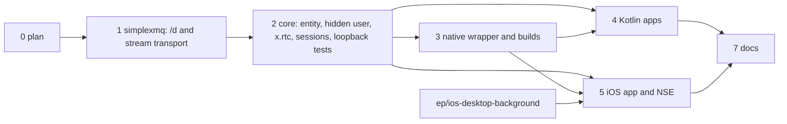

| PR | Scope | Content |
|---|---|---|
| 0 | docs | this plan, first commit of `ep/device-link` |
| 1 | simplexmq | `InvitationConnType` and `/d`; `connectTLS` over `HasBackend`; client and server over a `Backend`; `RCTransport`; invitation without address; `/d` server page; tests |
| 2 | core | migration, `LinkedDevice`, hidden agent user, dispatch, `syncConnections`, `NtfConn` alternative, `/d` pairing and plans, `x.rtc.*`, `deviceSessions`, `Remote.WebRTC` with the table and loopback, API and Bot API docs, scenario tests, fixtures |
| 3 | android, desktop, ios | `sxrtc` C wrapper over libwebrtc M156, CI builds per target, linking into `app-lib`, export lists checked for `EVP_`, `SSL_`, Windows clang-cl and `chat_free`, iOS wrapper over the WebRTC framework, registration |
| 4 | android, desktop | screens of section 2, notifications, foreground service for the session, settings removed and kept under "Old links", app tests and snapshots |
| 5 | ios | screens, NSE request notification, P0, Info.plist text, app tests and snapshots; background from `ep/ios-desktop-background` |
| 7 | docs | FAQ (docs/FAQ.md "My mobile app does not connect to desktop app"), guide page for linking |

Each PR adds its tests in the same PR. PR 3 is developed in parallel with PR 2 against the C header of section 3.8.
