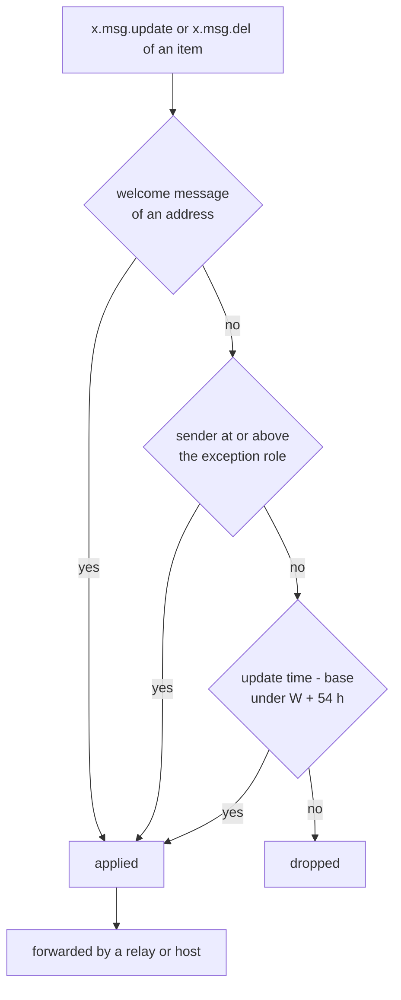

# Edit and delete window, with a role exception

Status: implemented on `ep/update-as-new`; the user's decisions of 2026-11-21 below are applied, E1-E3 decided as recommended. Code references: master `20ee7cb14`. Companion of `2026-11-21-update-as-new.md`, in the same 7.2 core pull request.

The user's words:

> maybe it should be one preference combining 2 things - for how long messages can be edited and deleted (with 24 hours as default) and role-based exception to that limit (also affecting deletions)

> we need to make it a preference and allow unlimited edits, dependent on role

Decisions of the user:
- The preference is hidden: the apps show it nowhere, and setting or changing it creates no chat item. It is set through the API only.
- Edits follow the deletion rules exactly. With W the window of the group, 24 h by default:
  - the core shows an item as editable and deletable within W;
  - the sender's core accepts an edit or a deletion up to W + 6 h;
  - receivers accept an edit or a deletion up to W + 6 h + 48 h, 78 h by default;
  - members at or above the exception role edit and delete without a limit.
- Groups without the preference apply the default limits, edits included: from 7.2, receivers in every group drop edits older than 78 h.
- Direct chats: receivers drop edits older than 78 h, as for deletions today.

## 1. What users see

- A bot or the plugin sets the preference with `/_group_profile`. In a group with the exception for owners, an owner edits, updates as new (`as_new=on`) and deletes its messages at any age, so a status message is never posted again.
- A member below the exception role edits and deletes within W, as within 24 h today. The apps show Edit and Delete for everyone by the core's `editable` and `deletable`, so an exempt member sees them on old messages too.
- A receiver of 7.2 ignores an edit older than 78 h, or older than W + 54 h in a group with the preference, unless the sender is exempt.

## 2. Preference

```
GroupFeature            GFEdits                      new; name text "Message editing"
JSON key                edits                        in groupPreferences of the group profile
EditsGroupPreference
  enable                GroupFeatureEnabled          on: members at or above role are exempt
  role                  Maybe GroupMemberRole        Nothing with on: every member is exempt
  duration              Maybe Int                    W in seconds; Nothing or a value below 1: 86400
default (omitted)       enable off, role Nothing, duration Nothing
```

```json
"groupPreferences": {"edits": {"enable": "on", "role": "owner", "duration": 86400}}
```

- The shape combines the role preferences (`{enable, role}`, as `VoiceGroupPreference`, Types/Preferences.hs:735) and the duration of `CommentsGroupPreference` (:769). `GroupFeatureI` with `groupPrefParam = duration`, `groupPrefRole = role`; `GroupFeatureRoleI`; `HasField "enable"` and `"role"`.
- Exemption: `groupFeatureMemberAllowed SGFEdits member gInfo` (Types.hs:684), with the member's current role.
- `FromJSON` with `omittedField` the default, as `CommentsGroupPreference` (:1291).
- `Types/Preferences.hs`: a case or a field next to those of `GFComments` in `GroupFeature` (:205), `SGroupFeature` (:221), `groupFeatureNameText` (:250), `groupFeatureInChannel` (:300), `groupFeatureInRegularGroup` (:321), `groupPrefSel` (:337), `toGroupFeature` (:353), `getGroupPreference` (:378), `GroupPreferences` (:396), `setGroupPreference_` (:451), `FullGroupPreferences` (:498), `mergeGroupPreferences` (:1099), `toGroupPreferences` (:1121), `defaultGroupPrefs` (:569), `groupParamText_` (:958).

Hidden:
```
feature items          GFEdits is excluded from allGroupFeatures (:280), as GFSessions and GFComments
                         createGroupFeatureChangedItems and the initial items (Internal.hs:3384, :3399) create none
                         CLI views (View.hs:2143, :2175) show none
apps                   decode the group profile ignoring the key: Kotlin ignoreUnknownKeys (SimpleXAPI.kt:6683), Swift Codable
apps saving prefs      the apps send groupPreferences without the key (Kotlin toGroupPreferences, SimpleXAPI.kt:6509)
                         APIUpdateGroupProfile, keepHiddenGroupPrefs: groupPreferences without "sessions",
                         "comments" or "edits" keep their current values (E3)
setting                /_group_profile #<groupId> <json> with "edits"; no CLI command
bot API                EditsGroupPreference in bots/api/TYPES.md and the TypeScript and Python types, generated by tests/APIDocs.hs
```

## 3. Limits

```
                          shown editable, deletable   sender's core accepts   receiver accepts
group, exempt sender      always                      always                  always
group                     age < W                     age < W + 6 h           age < W + 54 h
direct chat               age < 24 h                  age < 30 h              age < 78 h
note folder               always, as now              always                  -
moderation                -                           as now                  as now, without a limit
channel post deletion     -                           as now                  as now, without a limit (Subscriber.hs:2439)
```

```
age at the sender     now - base
age at a receiver     time of the update - base
time of the update    broker time of the update; fwdBrokerTs when forwarded by a relay or host
base                  sender: created_at of its item, its local send time; an update as new keeps it
                      receiver: COALESCE(item_original_ts, item_ts) of its item
                        broker time of x.msg.new, or fwdBrokerTs when forwarded, or the item time of history
                        an update as new sets item_original_ts once, so it keeps the window of the send
no limit              the welcome message of an address and of a business address, updated on acceptance
                        (Commands.hs:1500; Subscriber.hs:772, :1344), possibly days after the item:
                        the item with the shared message ID of welcomeSharedMsgId of the prepared contact or group
```

Storage, migration `M20261121_item_original_ts`, SQLite and Postgres, one `ADD COLUMN`, without an index:
```
chat_items
  item_original_ts    TEXT / TIMESTAMPTZ, nullable    set by setGroupChatItemAsNew: COALESCE(item_original_ts, item_ts)
```

Core:
```
Messages.hs
  mkCIMeta                   new parameter window :: Maybe NominalDiffTime     Nothing: exempt
                               deletable = deletable' content itemDeleted window createdAt currentTs
  deletable'                 sent content, not deleted, withinItemWindow window createdAt currentTs
  withinItemWindow           Nothing: True; Just w: ts - base < w
  userItemWindow             window of the user's items in a chat: directItemWindow, groupItemWindow of the membership role, Nothing
  directItemWindow           Just 24 h
  groupItemWindow            Nothing when groupFeatureMemberAllowed' SGFEdits role; else W
  sndItemEditable            deletable' with sndItemWindow, and not forwarded
  sndItemWindow              W + 6 h
  rcvItemWindow              W + 54 h
Store/Messages.hs
  toDirectChatItem           window directItemWindow
  toLocalChatItem            window Nothing
  toGroupChatItem            window from its caller; getGroupChatItem and its callers take GroupInfo in place of GroupId
  getChatItemOriginalTs      COALESCE(item_original_ts, item_ts)
Library/Internal.hs
  mkChatItem_                userItemWindow of the chat
Library/Commands.hs
  APIUpdateChatItem          editable check replaced by sndItemEditable (userItemWindow of the chat) currentTs
  assertDeletable            deletable' with sndItemWindow of userItemWindow of the chat
  delGroupChatItemsForMembers   moderation, unchanged
Library/Subscriber.hs
  rcvItemDeletable           withinItemWindow (rcvItemWindow window) base ts, and the item is deletable
  contactItemWindow          Nothing for the welcome message of the prepared contact; else directItemWindow
  groupRcvItemWindow         Nothing for the welcome message of the prepared group; else groupItemWindow of the sender's role
  messageUpdate              withinItemWindow (rcvItemWindow window) before the update; otherwise messageError "x.msg.update: edit too late"
  updateCI                   the same, from getChatItemOriginalTs; sender = the item's member; channel posts: owner role
  messageDelete              rcvItemDeletable
  groupMessageDelete         rcvItemDeletable, from getChatItemOriginalTs
```

Receiving an edit, read from the last row; `-` is unchanged:

```
update                                          result at a receiver of 7.2          forwarded by a relay of 7.2
edit, age < W + 54 h                            applied                              yes
edit, sender exempt                             applied                              yes
edit, welcome message of an address             applied                              yes
edit, age >= W + 54 h                           dropped, message error logged        no
deletion, the same conditions                   the same results                     the same
deletion of a deleted item                      dropped                              no
```



## 4. Compatibility

```
receiver before 7.2        edits of any age applied; deletions up to 78 h of item_ts (Subscriber.hs:2157)
                             exempt deletion older than 78 h: kept, with a message error, until the receiver upgrades
                             W above 24 h: a deletion between 78 h and W + 54 h is kept the same way
sender before 7.2          edits within 24 h, deletions within 30 h of its item time: within every receiver limit
                             an exempt member on an earlier release keeps these limits
relay before 7.2           forwards what it applies: edits of any age, deletions up to 78 h
owner before 7.2           a profile change from its core omits "edits": receivers of 7.2 keep the value only
                             when the owner's core keeps it; an earlier core sends the profile without the key: the default
bots before 7.2            their core edits within 24 h, so their edits reach receivers of 7.2;
                             a bot that edited messages older than 78 h through another core finds the edits dropped
apps before 7.2            the preference unseen; editable and deletable from their own core
```

## 5. Interaction with as_new

- An update as new is an edit: the sender's core and the receivers apply the limits of section 3 to it, from the base.
- The sender's `created_at` and the receivers' `item_original_ts` keep the base of the send across updates as new.
- The plugin creates its groups with `"edits": {"enable": "on", "role": "owner"}`, and updates its list with `as_new=on` and priority -1 at any age (a later pull request). Receivers on earlier releases apply the edits at any age, in place.

## 6. Tests

`tests/ProtocolTests.hs`: group preferences with `edits` encoded and decoded; without it decoded to the default.

`tests/ChatTests/Groups.hs`; items aged by SQL in one core: `item_ts` and `created_at` set back by the given hours.
```
test                                                  steps                                              fails on master because
exempt owner edits and deletes an old message         edits on for owners; alice's item aged 100 h        alice: "cannot update this item"
                                                       in every core; alice edits, then deletes
member edits within W + 6 h, update as new            bob's item aged 25 h in bob's core: update as new   bob: "cannot update this item" at 25 h
  keeps the window                                     accepted; created_at aged 31 h: "cannot update this item"
receiver drops an edit after 78 h                     bob's item aged 79 h in cath's core only;           cath applies the edit
                                                       bob edits; alice gets it, cath logs the error
receiver drops a deletion after W + 54 h              W = 1 h; bob's item aged 56 h in cath's core;        cath deletes it (78 h)
                                                       bob deletes for everyone
update as new keeps the window for receivers          bob updates as new; item_original_ts aged 79 h       as_new unparsed
                                                       in cath's core; bob edits: cath logs the error
hidden preference                                     /_group_profile with edits: no feature items         the key unparsed
                                                       for alice and bob; then a profile JSON without
                                                       edits keeps it (/_get chat)
```

`tests/ChatTests/Profiles.hs`: "business welcome message is updated after 78 hours": the prepared group's welcome item aged 80 h in bob's core; the address changes its welcome text and accepts: bob's item has the new text.

`tests/ChatTests/Direct.hs`: "receiver drops an edit after 78 h": bob's item aged 79 h in alice's core; bob's edit at bob's 1 h age: alice keeps the text. Fails on master: alice applies it.

## 7. Decisions

E1. Edits of the address welcome message by the address owner after acceptance are excluded from the limits.

E2. The exception uses the sender's role when the update is received, as other role preferences do.

E3. The rule that keeps "edits" when a profile update omits it also keeps the hidden `sessions` and `comments`, which the apps dropped the same way.
