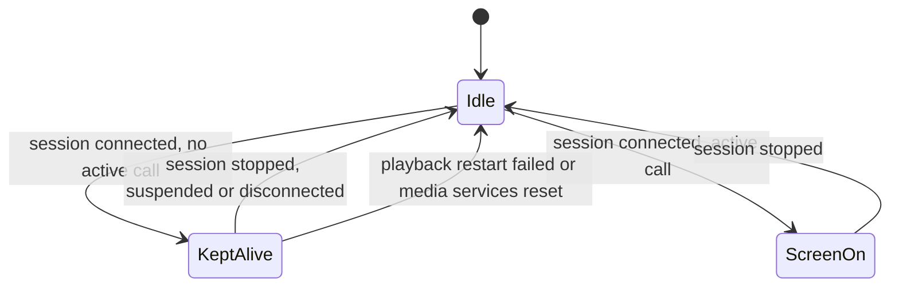
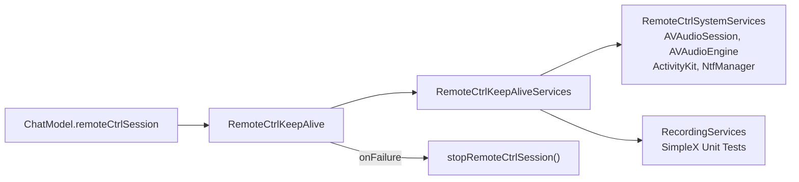

# iOS: desktop session stays connected in background

## Problem

A desktop session with the iOS app ends when the app moves to background or the phone locks. The phone must stay unlocked with the app open while the desktop is used.

## Change

While a verified desktop session is connected:

- the app plays silence in a mixable audio session, so that iOS keeps the app running in background;
- the chat is not suspended in background;
- an indicator shows the session and offers Disconnect.

When the session ends for any reason, playback stops, the saved audio session settings are restored, the indicator is removed, and the chat is suspended as usual in background.

### Session states

| State | Audio | Indicator | Screen | Background |
|---|---|---|---|---|
| Idle | session of the base | none | as on the base | chat suspended |
| KeptAlive | silence played | Live Activity or notification | locks normally | chat active |
| ScreenOn | the call's | none | kept on | as on the base |

### Keepalive

`RemoteCtrlKeepAlive` subscribes to `ChatModel.remoteCtrlSession` at launch and alone starts and stops the keepalive. The audio session, playback and indicator are behind the protocol `RemoteCtrlKeepAliveServices`, set in `RemoteCtrlKeepAlive.services`:

| Member | `RemoteCtrlSystemServices` |
|---|---|
| `startAudio(onFailure:) -> Bool` | audio session set, silence played, interruptions observed; `onFailure` called on a failed restart or a media services reset |
| `stopAudio()` | playback stopped, audio session settings restored |
| `showIndicator(_ desktopName: String?)` | Live Activity or notification |
| `endIndicator()` | Live Activities ended, notification removed |

Audio session while KeptAlive:

| Setting | Value |
|---|---|
| category | `.playback` |
| mode | `.default` |
| options | `.mixWithOthers` |
| prefersNoInterruptionsFromSystemAlerts | `true` |

- Silence: a zero-filled 4,096-frame mono buffer at 44,100 Hz, looped by `AVAudioPlayerNode` with `.loops`.
- The previous category, mode, options and `prefersNoInterruptionsFromSystemAlerts` are saved at start and restored at stop.

Interruptions:

| Notification | Action |
|---|---|
| interruption `.ended` | playback restarted |
| interruption `.began`, reason `.appWasSuspended` | playback restarted |
| `AVAudioEngineConfigurationChange` | engine rebuilt on the main queue |
| media services reset | desktop disconnected |
| playback restart failed | desktop disconnected |

### Indicator

| iOS | Live Activities | Indicator | Disconnect |
|---|---|---|---|
| 15.0–16.0 | — | local notification | notification action |
| 16.1–16.x | enabled | Live Activity | tap opens the desktop screen |
| 17+ | enabled | Live Activity | `DisconnectDesktopIntent` button |
| 16.1+ | disabled, failed, ended by the system after 8 h, or dismissed | local notification | notification action |

- Extension target `SimpleX Live Activity`, bundle id `chat.simplex.app.SimpleX-Live-Activity`, deployment target 16.1.
- `RemoteCtrlActivityAttributes`:
  - `desktopName: String?`, `nil` when notification previews are hidden
  - `connectedAt: Date`
- `ActivityKit` and `AppIntents` are linked weakly by the app.
- At launch, activities and the notification left by a terminated process are ended.

### Disconnect

- `stopRemoteCtrlSession()` and `clearRemoteCtrlSession()` in SimpleXAPI.swift are called by the desktop screen, the Live Activity intent, the notification action and the keepalive.
- `_suspendChat` calls `clearRemoteCtrlSession()`, because `APISuspendChat` stops the remote session in the core (`cancelActiveRemoteCtrl Nothing`) without the event `remoteCtrlStopped`.

### Desktop screen

- The sheet stays undismissable while connected (`interactiveDismissDisabled`, as on the base).
- `ChatListView.onAppear` presents the desktop sheet while connected.
- `ConnectDesktopView.onDisappear` stops the session only while the scene is active.
- Footer while KeptAlive: "The app keeps running in the background until you disconnect."

## Tests

App fixtures (docs/contributing/TESTS.md, "App fixtures"):

- `/sends session events to mobile app/` in tests/RemoteTests.hs records, on the mobile side:
  - `remote/session`, with `eventsFixture`:
    - event `remoteCtrlSessionCode`
    - response `remoteCtrlConnected` to `/verify remote ctrl`, with `recordResponse`
    - event `remoteCtrlStopped`, after the desktop stops the session
  - `remote/stop-response`, with `apiFixture`: the response to `/stop remote ctrl` in a session with the stored pairing.
  - `sessionCode` is replaced by `stableJSON`.
- `RemoteCtrlKeepAliveTests` in SimpleX Unit Tests passes the recorded events to `processReceivedMsg`, after a `.connecting` session as `ConnectDesktopView` creates it. `services` is a recorder; `sendSimpleXCmdStr` returns the recorded response to `/stop remote ctrl` and records each command:

| Case | Expected |
|---|---|
| connected event | keepalive started, indicator shown with the desktop name, screen not kept on |
| connected event, previews hidden | indicator shown without the name |
| connected event, active call | keepalive not started, screen kept on |
| stopped event | playback stopped, settings restored, indicator ended, local session loaded |
| chat suspended while connected | `/_app suspend` sent, session cleared, keepalive stopped |
| playback restart failure | `/stop remote ctrl` sent, session cleared, keepalive stopped |
| launch with an indicator left | indicator ended |

Checked on a device only:

- iOS keeps the app running while silence plays with the screen locked.
- Music from another app keeps playing and stays the Now Playing app.
- The Live Activity on iOS 16.1, 17 and 26, and the notification on iOS 15.

## Release

- An App ID and a provisioning profile for `chat.simplex.app.SimpleX-Live-Activity`.
- `scripts/ios/update-version.sh` updates 12 version lines, the new target included.
