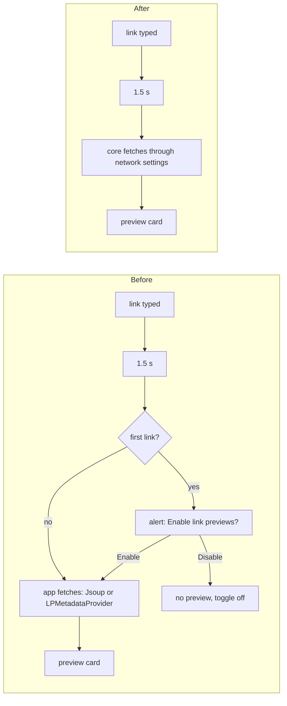
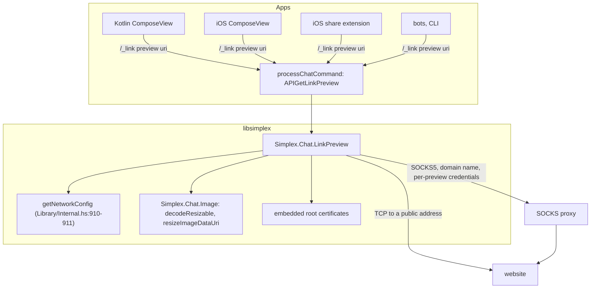
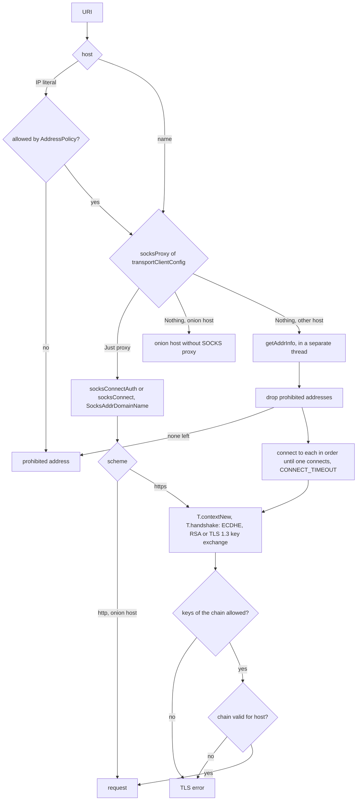
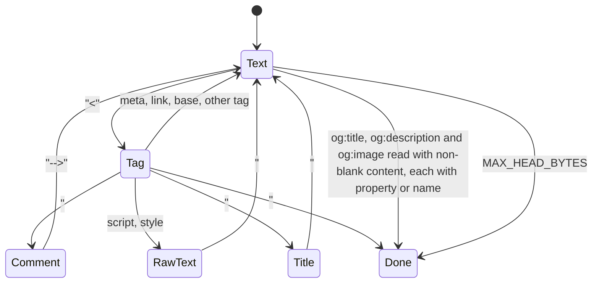
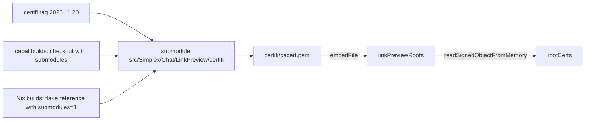
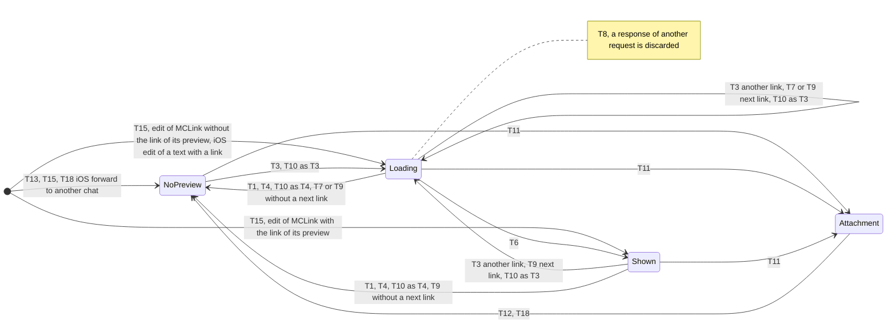
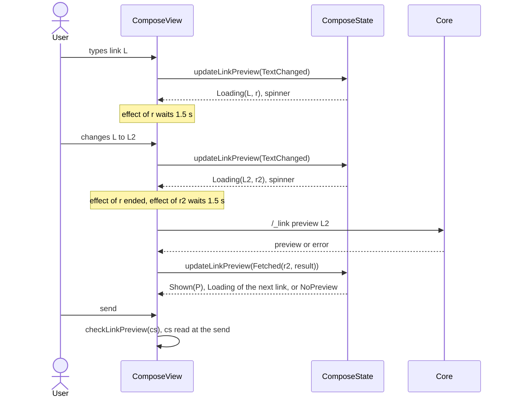
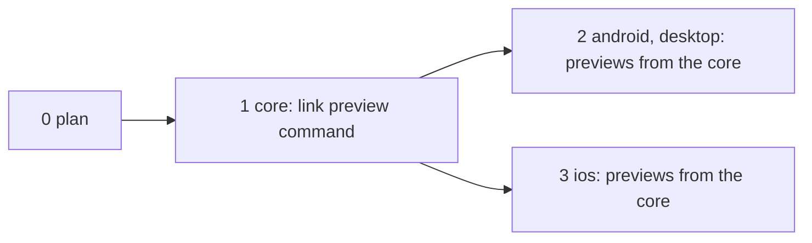

# Link previews generated by the core

Repository: simplex-chat/simplex-chat.
Branch: `ep/link-previews`.
Base: master `20ee7cb14`, at which the citations hold. Merge base: master `d234df773`, merged into the branch in `a5b30c9ec`. simplexmq pinned at `5d0e735f` (cabal.project:23-24).

Citations: `mq:` is simplexmq at `5d0e735f`; other paths are in this repository at the base. `Kt:` is `apps/multiplatform/common/src/commonMain/kotlin/chat/simplex/common/`.

## Decisions of the product owner

| # | Decision | Source |
|---|---|---|
| D1 | The core generates link previews for all platforms, through the core's network settings | ep: "this can now be done by moving previews to core - we already moved image processing to core" |
| D2 | The page is read as a stream and closed once the needed tags of the head are read | ep: "streaming html (or some ad hoc) parser that would stop loading the page as soon as it finds the correct meta tag in the head" |
| D3 | The preview warnings are removed | ep: "we can even remove annoying warnings"; the scope of removal is Q1 |
| D4 | The root bundle is `certifi/cacert.pem` of a git submodule of certifi, pinned to a release tag; an update moves the submodule to a later tag | ep, 2026-11-23: "ok, let's move to recommended submodule then" |

## 1. Problems

1. An iOS user with a SOCKS proxy (Tor) sends a link preview, and the website receives the user's IP address.
2. An Android or desktop user with a SOCKS proxy is told that DNS may still resolve the site locally.
3. The first link typed in any chat opens the alert "Enable link previews?", with "Enable" in red when no SOCKS proxy is set.
4. A link shared to SimpleX from another iOS app gets no preview until the user has answered that alert in the app.
5. One link gets a preview on Android and none on iOS, or the reverse, because each platform has its own rules.
6. On Android and desktop, a slow site delays the preview of the next link by the time-outs of its own fetch: 10 s for the page, 20 s to connect and 20 s to read the image.
7. Bots and the CLI cannot make link previews.
8. A preview never shows the page's description: both apps send it empty, and iOS does not show it.

Today, in code:

| Fact | Code |
|---|---|
| iOS fetches with `LPMetadataProvider`, created without a proxy; the SOCKS settings reach only the core | apps/ios/SimpleXChat/ImageUtils.swift:455-483; apps/ios/Shared/Views/UserSettings/NetworkAndServers/AdvancedNetworkSettings.swift:157, 175 |
| iOS requires `metadata.imageProvider` and `metadata.title` | ImageUtils.swift:461-472 |
| Android and desktop fetch with Jsoup over the app's SOCKS proxy; ISOLATE mode sets random credentials per preview | Kt:views/helpers/LinkPreviews.kt:57-91, 98-113 |
| Their rules: first `og:title`, else `<title>`; first `og:image`, else the first `link` with `icon` in `rel`; a path ending in `.jpg .png .ico .webp .gif` is the image itself, titled by its file name | LinkPreviews.kt:41-43, 92-119 |
| A relative image path is joined to `scheme://host` of the requested URL: the port and the final URL after redirects are lost, and `//cdn/...` becomes `https://host//cdn/...` | LinkPreviews.kt:231-242 |
| The image is decoded by the platform and resized by the core to 14000 bytes | LinkPreviews.kt:128; Kt:platform/Images.kt:64-65; ImageUtils.swift:140-142 |
| One mutex serializes all fetches: 10 s for the page, 20 s connect and 20 s read for the image | LinkPreviews.kt:48, 52, 100, 125-126 |
| The alert text: "Sending a link preview may reveal your IP address to the website."; with SOCKS: "DNS lookup may still happen locally via your DNS resolver." | Kt:…/moko-resources/base/strings.xml:3181-3185 |
| The alert is shown while `privacyLinkPreviewsShowAlert` is true | Kt:views/chat/ComposeView.kt:514-533, 1871-1903; apps/ios/Shared/Views/Chat/ComposeMessage/ComposeView.swift:1959-1975, 1995-2006 |
| The iOS share extension fetches only after the alert was answered | apps/ios/SimpleX SE/ShareModel.swift:484 |
| Previews are made only in app code | LinkPreviews.kt:50-149; ImageUtils.swift:455-489 |

## 2. UX



| Place | Before | After |
|---|---|---|
| Compose, first link | alert "Enable link previews?" | none (Q1 a) |
| Compose, any link | spinner, then card or nothing | spinner from the selection of the link, during the 1.5 s wait (ComposeView.kt:550; ComposeView.swift:1919) and the fetch, then card or nothing (section 3.14.1) |
| Compose, the preview of the first link failed | the failed link is requested again at the first keystroke after each failure, without the 1.5 s wait, and the next link only once the failed one is removed from the text (ComposeView.kt:497-507, 541-555; ComposeView.swift:1910-1927, 1981-1993) | the failed link is added to `cancelledLinks`, and the card of the next link is shown without a keystroke (section 3.14.1, T7) |
| Compose, the card of the first link closed with X | the card of the next link is shown after a keystroke (ComposeView.kt:1109-1120; ComposeView.swift:1945-1954) | the card of the next link is shown without a keystroke (section 3.14.1, T9) |
| Privacy settings | toggle "Send link previews", default on (SimpleXAPI.kt:130; apps/ios/SimpleXChat/AppGroup.swift:98) | the same toggle; footer per Q1 |
| iOS share extension | preview only after the alert was answered | preview when the toggle is on |
| iOS with SOCKS | site sees the IP address | site sees the proxy's exit |
| Android and desktop with SOCKS | DNS may resolve locally | the host name is resolved by the proxy |
| Desktop controlling a phone | desktop fetches | desktop fetches (section 3.12) |
| Same link, two platforms | different rules | one rule set (section 3.8) |
| `http://` link | fetched over HTTP on Android and desktop | fetched as `https://`; an `.onion` host over HTTP through the SOCKS proxy (Q2) |
| WebP, GIF or ICO image | decoded on Android and desktop | Q4 |
| Page without `og:image` | Android and desktop: the site icon at full width; iOS: no preview | no preview |
| Description | never sent | `og:description`, else `<meta name="description">`; shown in the chat item on all platforms, in at most 2 lines |
| Failed preview | no card, no alert | the same; with the developer option "Show link preview errors" on, an alert with the raw error |
| Developer options | — | new toggle "Show link preview errors", off by default, shown only with "Show developer options" on |

The user guide section "Send Link Previews" (docs/guide/app-settings.md:219-227) is rewritten in the app stages.

## 3. Technical design

### 3.1 HTTP client options

| Option | Cost |
|---|---|
| A. Own HTTP/1.1 client over `network`, `socks` and `tls`, already in simplex-chat.cabal:397, 404, 408 | about 300 lines and their tests; no new packages in the mobile builds |
| B. `http-client` with `http-client-tls` | new packages in all six mobile builds (flake.nix:230-231, 355-356, 433-434, 564-565 set `client_library`, under which simplexmq omits them: mq:simplexmq.cabal:432-438), with GHC 8.10.7 for armv7a (flake.nix:11-13); SOCKS with credentials still needs our own connection function; its TLS settings load system roots, which are missing on iOS (section 3.6) |
| C. The HTTP/2 client of simplexmq (mq:Messaging/Transport/HTTP2/Client.hs:119-122) | sites without `h2` in ALPN still need HTTP/1.1, so C adds to A |
| D. Fetch in the apps through the proxy | three implementations; iOS lacks SOCKS in `LPMetadataProvider`; contradicts D1 |

Choice: A.

### 3.2 Composition



### 3.3 Sequence

```mermaid
sequenceDiagram
  participant A as App
  participant C as Core
  participant P as SOCKS proxy
  participant S as Site
  A->>C: /_link preview https://site/page
  C->>C: parse URI; credentials and PREVIEW_DEADLINE by the proxy setting
  C->>P: CONNECT site:443 (domain name, credentials)
  P->>S: TCP
  C->>S: TLS, validated against the root store; none for an http onion host
  C->>S: GET /page
  S-->>C: 200, headers, head chunks
  C->>C: scan chunks until the stop condition
  C->>S: close
  C->>P: CONNECT image host (same credentials)
  C->>S: GET image
  S-->>C: 200, headers
  C->>C: Content-Length above MAX_IMAGE_BYTES: a failure before the body
  S-->>C: image bytes, at most MAX_IMAGE_BYTES
  C->>C: decode, resize to IMAGE_DATA_SIZE
  C-->>A: CRLinkPreview
```

### 3.4 Named values

| Name | Value |
|---|---|
| PREVIEW_DEADLINE | 15 s for the whole preview; 30 s when a SOCKS proxy is set in the network config, in either SOCKS mode (section 3.6, Q6) |
| CONNECT_TIMEOUT | `tcpConnectTimeout` of the network config, interactive (mq:Messaging/Client.hs:323, 434) |
| READ_TIMEOUT | `tcpTimeout` of the network config, interactive, per read (mq:Messaging/Client.hs:325, 435) |
| MAX_REDIRECTS | 5 |
| MAX_HEADER_BYTES | 32 KiB of status line and headers |
| MAX_HEADERS | 100 |
| MAX_HEAD_BYTES | 1 MiB of HTML body (Q6) |
| MAX_IMAGE_BYTES | 2 MiB of the `og:image` file (Q6) |
| MAX_IMAGE_LINK_BYTES | 10 MiB of the JPEG or PNG file of an image link (section 3.7, Q6.1) |
| MAX_TITLE_LENGTH | 300 characters |
| MAX_DESCRIPTION_LENGTH | 200 characters |
| MAX_RSA_MODULUS_BITS | 16384 bits of the modulus of an RSA key in the server's certificate chain (section 3.6) |
| MAX_RSA_EXPONENT_BITS | 33 bits of the public exponent of an RSA key in the server's certificate chain (section 3.6) |
| IMAGE_DATA_SIZE | `maxImagePreviewSize`, 14000 (Library/Commands.hs:179-180), less the JSON bytes of the title and the description (section 3.10) |

### 3.5 Types

```haskell
data LinkPreviewConfig = LinkPreviewConfig
  { rootCerts :: XS.CertificateStore,
    addressPolicy :: AddressPolicy,
    previewDeadline :: Int,
    socksPreviewDeadline :: Int
  }

data AddressPolicy = APPublic | APPublicAndLoopback

data HeadTags = HeadTags
  { ogTitle :: Maybe ByteString,
    ogDescription :: Maybe ByteString,
    ogImage :: Maybe ByteString,
    titleText :: Maybe ByteString,
    nameDescription :: Maybe ByteString,
    metaCharset :: Maybe ByteString
  }

data Page = HtmlPage PageMeta | ImagePage ByteString

data PageMeta = PageMeta {pageTitle :: Text, pageDescription :: Text, pageImage :: Uri}

data UriScheme = USHttp | USHttps

data Uri = Uri
  { uriScheme :: UriScheme,
    uriHost :: TransportHost,
    uriPort :: Maybe Int,
    uriPath :: ByteString,
    uriQuery :: Maybe ByteString
  }
```

- The card shows what the existing `LinkPreview` holds (Protocol.hs:246): `title`, `description`, `image`, `uri`. `HeadTags` holds the raw values of the first tag of each kind, a monoid of first values; `PageMeta` holds the decoded values, and `pageImage` is the URL that the core fetches and resizes into `ImageData`.
- `USHttp` is produced only for `.onion` hosts (section 3.7); `uriPort` is `Nothing` for the default port of the scheme.
- MAX_REDIRECTS, MAX_HEADER_BYTES, MAX_HEADERS, MAX_HEAD_BYTES, MAX_IMAGE_BYTES, MAX_IMAGE_LINK_BYTES, MAX_TITLE_LENGTH, MAX_DESCRIPTION_LENGTH, MAX_RSA_MODULUS_BITS and MAX_RSA_EXPONENT_BITS are constants of the module; the tests change only the roots, the address policy and the deadlines.
- Card in the apps: compose shows image, title and link (LinkPreviews.kt:152-191; ComposeLinkView.swift:43-52); the chat item shows image, title, description when not empty, and link on Kotlin (LinkPreviews.kt:203-226); iOS shows image and title only (CILinkView.swift:22, 36).
- Description: both apps send `""` today (LinkPreviews.kt:129-134, commented out "TODO add once supported in iOS"; ImageUtils.swift:471). The core fills it, Kotlin shows it in at most 2 lines in place of 12 (LinkPreviews.kt:224), and stage 3 adds it to CILinkView as Kotlin shows it.
- `image` is required in `LinkPreview`, so a page without an image has no preview, as today on both platforms (LinkPreviews.kt:121-139; ImageUtils.swift:461-479).
- `content = Nothing`, as both apps send it (LinkPreviews.kt:134; ImageUtils.swift:471).
- `LinkPreviewConfig` is a field of `ChatConfig`; `rootCerts` is parsed once from the embedded bundle; `APPublicAndLoopback` is used by tests only.
- Failures: `ExceptT String IO`, as `decodeResizable` returns `Either String` (Image.hs:69). The apps show no alert for a failed preview (ComposeView.kt:503-505; ComposeView.swift:1986-1989), so failures carry no type: the message is raw text for developers (section 3.12).

### 3.6 Connection



- Proxy selection: `socksProxy` of `transportClientConfig netCfg NRMInteractive host True Nothing` (mq:Messaging/Client.hs:445-453), so `SMOnion` mode and an unset proxy behave as for SMP servers. PREVIEW_DEADLINE is selected by `socksProxy` of the network config alone, for every host and in either SOCKS mode (section 3.11).
- SOCKS credentials, one set per preview, used for the page, its redirects and the image:

  | `SocksAuth` (mq:Messaging/Transport/Client.hs:245-249) | Credentials |
  |---|---|
  | `SocksIsolateByAuth` | random 16-byte username in base64, empty password, from the controller's `random` |
  | `SocksAuthUsername` | the configured username and password |
  | `SocksAuthNull` | none |

- DNS: with a proxy, the host name is sent to the proxy as `SocksAddrDomainName`, as for SMP (mq:Messaging/Transport/Client.hs:191-195), and the device resolves nothing. Without a proxy, `getAddrInfo` resolves names and parses IP literals with the system resolver, and its `AddrInfo` opens the socket, as in `connectTCPClient` (mq:Messaging/Transport/Client.hs:197-206). `getAddrInfo` is called in a separate thread, and the calling thread waits for its result, so that the wait ends at CONNECT_TIMEOUT or PREVIEW_DEADLINE: the exception of a timeout is raised in a thread in the safe foreign call `getaddrinfo` only after the call returns (network 3.1.4.0, Network/Socket/Info.hsc:301; base, `throwTo`).
- Prohibited addresses: loopback, 0.0.0.0/8 and `::`, private (RFC 1918, ULA), link-local, shared (RFC 6598), multicast, broadcast, and IPv4-mapped IPv6 forms of these. `APPublicAndLoopback` also allows loopback. The check runs on resolved addresses without a proxy and on IP literals with one.
- An onion host without a proxy fails without a DNS query. With a proxy, an `http` URI of an onion host is fetched over plain HTTP, as Tor encrypts and authenticates the connection to the onion service (Q2).
- TLS: `T.defaultParamsClient host ""` with `sharedCAStore = rootCerts`, SNI on for host names, and `defaultSupportedParamsHTTPS` (mq:Messaging/Transport.hs:399-417) with `P256` and `P384` added to `supportedGroups`, which up to TLS 1.2 also limit the curves of ECDSA server keys (tls 1.9.0 Network/TLS/Parameters.hs, `supportedGroups`). CONNECT_TIMEOUT applies to the TCP or SOCKS connection and, again, to the TLS handshake.
- Key exchange: `supportedCiphers` without the DHE suites; the ECDHE and RSA suites of TLS 1.2 and the suites of TLS 1.3 are kept.
- Certificate chain: `onServerCertificate` accepts a chain whose certificates all have one of these keys, then validates it with `validateDefault`, whose hostname check applies:

  | Key | Allowed |
  |---|---|
  | RSA | modulus positive, of at most MAX_RSA_MODULUS_BITS<br>public exponent positive, of at most MAX_RSA_EXPONENT_BITS |
  | EC | any curve |
  | Ed25519, Ed448 | any key |

  A chain with another key, DSA included, is refused with `InvalidSignature SignatureUnimplemented`.
- The SimpleX transport (`runTLSTransportClient`) is not used: it connects through its own `connectTCPClient` (mq:Messaging/Transport/Client.hs:172-174), so resolved addresses cannot be checked, and its `getLn` reads a line without a length limit (mq:Messaging/Transport.hs:447-449; mq:Messaging/Transport/Buffer.hs:78-88).
- Root certificates: Q3. Today the core loads no root store in client builds: `crypton-x509-system` is a dependency only without `client_library` (mq:simplexmq.cabal:432-435), and on iOS its `System.X509` reads the Unix paths, which are absent there (crypton-x509-system 1.6.7: modules `System.X509.MacOS` only under `os(OSX)`; `System.X509.Unix` paths `/etc/ssl/certs/`, `/system/etc/security/cacerts/`, `/usr/local/share/certs/`, `/etc/ssl/cert.pem`).

### 3.7 HTTP/1.1

Request, with the fragment removed:

```
GET <path>[?<query>] HTTP/1.1
Host: <host>[:<port>]
User-Agent: <UA>
Accept: text/html,application/xhtml+xml,image/png,image/jpeg;q=0.9,*/*;q=0.1
Accept-Encoding: identity
Connection: close
```

- UA: `Mozilla/5.0 (Windows NT 10.0; Win64; x64; rv:160.0) Gecko/20100101 Firefox/160.0`, the string of Firefox 160 on Windows, for all users (Q7); for host `x.com`, the string of LinkPreviews.kt:108, as today.
- Cookies, `Referer` and `Accept-Language` are not sent.
- `Host` omits the default port of the scheme, also when the link states it.
- Response head: at most MAX_HEADER_BYTES and MAX_HEADERS, else a failure. Interim 1xx responses other than 101 are skipped (RFC 9110, 15.2); their bytes and headers count towards the same limits.
- Body framing: `Transfer-Encoding: chunked`, `Content-Length`, or until close. The reader of the body stops at the budget, also inside a chunk; a chunk-size line has at most 7 hex digits and 1024 bytes.
- `Content-Encoding` other than `identity`: a failure.
- Reads: `T.recvData` with READ_TIMEOUT each; the budget counts body bytes after decoding of chunks.
- Close: the socket is closed in `bracket`, also on timeout and on the stop condition, without `T.bye`, so that each close completes in bounded time and the whole preview, its closes included, is limited by PREVIEW_DEADLINE.

Redirects:

| Status | Action |
|---|---|
| 301, 302, 303, 307, 308 with `Location` | `Location` resolved against the current URI (RFC 3986, 5.2), then fetched |
| other 3xx, 4xx, 5xx | a failure with the status |
| 2xx | content by `Content-Type` |

- A redirect to a scheme other than `https`, except `http` to an onion host: a failure.
- More than MAX_REDIRECTS: a failure.
- URIs are parsed by RFC 3986, appendix B, and resolved by RFC 3986, 5.2, in this module, over the raw bytes of the link, so that the request target keeps the link's bytes. `uri-bytestring` 0.3.3.1 is not used for it: it exports no base-URI resolution, decodes paths with `+` as space (URI/ByteString/Internal.hs:590), splits and re-encodes queries (Internal.hs:260-268, 609-635) and serializes IPv6 hosts without brackets (Internal.hs:286, 496).
- Bytes outside 0x21-0x7E in the path and the query are percent-encoded in the request line.
- An `http` link or `og:image` URL is fetched as `https`, except on an onion host (Q2); a relative reference keeps the scheme of its base. An `og:image` response is decoded by its JPEG or PNG signature, whatever its `Content-Type`.

Content by type:

| `Content-Type` | Content |
|---|---|
| `text/html`, `application/xhtml+xml` | `PageMeta` from the head scanner |
| `image/jpeg`, `image/png` | the image itself, at most MAX_IMAGE_LINK_BYTES (Q6.1), titled by the last path segment of the requested URI, or by its host when the segment is empty, without description (LinkPreviews.kt:93-95) |
| other | a failure with the type |

### 3.8 Head scanner and metadata rules



- The scanner is an incremental `attoparsec` parser fed with body chunks; tag and attribute names are compared case-insensitively; attribute values are unquoted, single- or double-quoted.
- Law: the scan of a body equals the scan of any split of it into chunks. A QuickCheck property tests it.
- Fields, first tag of each kind; `og:` tags are read with `property` or `name` alike (Q5); an `og:` tag with empty or whitespace `content` is skipped, so it fills no field and does not count towards the stop:

  | Field | Tags, in priority |
  |---|---|
  | `title` | `<meta property="og:title" content>` or `<meta name="og:title" content>`<br>`<title>` text |
  | `description` | `<meta property="og:description" content>` or `<meta name="og:description" content>`<br>`<meta name="description" content>` |
  | `image` | `<meta property="og:image" content>` or `<meta name="og:image" content>` |

- `<meta charset>` and `<meta http-equiv="content-type" content>` are read for decoding only (section 3.9).
- Values: whitespace trimmed and collapsed; named entities `amp lt gt quot apos nbsp` and numeric references decoded, in time linear in the value's length; in the preview, `title` cut to MAX_TITLE_LENGTH and `description` to MAX_DESCRIPTION_LENGTH characters.
- No `title`: a failure. No `image`, or the image fails: a failure.
- `image` is resolved against the final URI of the page.
- Site icons (`<link rel="icon">`), which Kotlin uses when `og:image` is absent (LinkPreviews.kt:42, 117-118), are not read: the chat item shows the image at full width (LinkPreviews.kt:206-219), where a small square icon is upscaled; iOS requires the page image and uses no icon (ImageUtils.swift:462).
- Tags after `</head>` or `<body` are not read; Jsoup reads the whole document (LinkPreviews.kt:114).

### 3.9 Character sets

1. `charset` of `Content-Type`.
2. Else the `<meta>` charset of the head.
3. Else UTF-8.

| Charset | Decoding |
|---|---|
| `utf-8`, `utf8`, `us-ascii` | `decodeUtf8'`; invalid bytes: a failure |
| `iso-8859-1`, `windows-1252` | `windows-1252` table for 0x80-0x9F, Latin-1 otherwise |
| other | a failure with the charset |

Tags are scanned as bytes, as both supported families are supersets of ASCII; only the field values are decoded.

### 3.10 Image

- Bytes: at most MAX_IMAGE_BYTES of an `og:image` file and MAX_IMAGE_LINK_BYTES of the file of an image link, else a failure. An image whose `Content-Length` exceeds its limit is refused before its body is read.
- `imagePreview` (Library/Commands.hs:232-238) is split: its decode and resize steps become `imageDataPreview :: Int64 -> ByteString -> IO (Either String ImageData)`, with the size limit of the data URI as its first argument, used by `imagePreview` with `maxImagePreviewSize` and by the link preview.
- Size: the JSON of a sent message is at most `maxEncodedMsgLength`, 15602 bytes (Protocol.hs:930-931, checked by `encodeChatMessage`, Protocol.hs:987-994), and the image takes up to 14000 of them. The image limit of a link preview is `maxImagePreviewSize` less the JSON bytes of its title and description, so a preview takes no more of the message than an image with an empty title and description, as the apps send today.
- Decoding limits of `decodeResizable`: JPEG scaled by halvings to at most 4320 per side, at most 2^28 pixels and `maxDecodeMemoryMB`; PNG decoded by spng within half of `maxDecodeMemoryMB` (src/Simplex/Chat/Image.hs:69-93, 309-323).
- Formats: JPEG and PNG (Image.hs:74-77); others: Q4.

### 3.11 Timeouts, concurrency, cancellation

- The whole preview runs in `timeout PREVIEW_DEADLINE`; expiry: a failure. Sockets are closed by `bracket`.
- Commands run in the calling thread of `chat_send_cmd` (Library/Commands.hs:434-458); the preview command takes no `chatLock`, so previews run concurrently with each other and with other commands.
- A fetch for a link that the user has since edited runs to its end or to PREVIEW_DEADLINE; the apps discard its result, as today (ComposeView.kt:500-506; ComposeView.swift:1984-1991).
- The Kotlin mutex is removed with the Jsoup code (LinkPreviews.kt:48), so a slow site no longer delays the next preview.

```
getLinkPreview cfg netCfg uriText:
  uri   <- parseUri uriText; https, or http for an onion host (Q2)
  creds <- previewCredentials netCfg
  deadline = socksPreviewDeadline when socksProxy of netCfg is set, else previewDeadline
  timeout deadline:
    (finalUri, resp) <- fetchFollowing creds uri
    case contentType resp of
      image -> preview (lastSegment uri) "" (bytes resp)
      html  ->
        PageMeta {title, description, image} <- scanHead resp
        title' <- maybe (throwError "no title") pure title
        imgUri <- maybe (throwError "no image") (pure . resolve finalUri) image
        preview title' (fromMaybe "" description) . bytes =<< fetchFollowing creds imgUri

preview title description imageBytes:
  title'       = take MAX_TITLE_LENGTH title
  description' = take MAX_DESCRIPTION_LENGTH description
  img <- imageDataPreview (maxImagePreviewSize - jsonBytes title' - jsonBytes description') imageBytes
  pure LinkPreview {uri = uriText, title = title', description = description', image = img, content = Nothing}

fetchFollowing creds uri, n:
  resp <- withConnection creds uri (sendRequest uri)
  case status resp of
    redirect, n < maxRedirects -> fetchFollowing creds (resolve uri location) (n + 1)
    redirect                   -> throwError "too many redirects"
    2xx                        -> (uri, readContent resp)
    s                          -> throwError ("HTTP " <> show s)
```

The returned `uri` is the string the app sent, because the apps send `MCLink` only when it equals the link in the text (ComposeView.kt:656-658; ComposeView.swift:1262-1267).

### 3.12 Core API

| Item | Value |
|---|---|
| Command | `APIGetLinkPreview {uri :: Text}` |
| Syntax | `/_link preview <uri>`, the rest of the line |
| Response | `CRLinkPreview {linkPreview :: LinkPreview}` |
| Error | `CELinkPreview {message :: String}` in `ChatErrorType` (Controller.hs:1545), raw text, as `CEInternalError {message :: String}` (Controller.hs:1625) |
| Apps on error | no card, no alert, as today; the raw message in an alert only when "Show developer options" and the new "Show link preview errors" are both on, as Kotlin gates agent `INTERNAL` errors by `developerTools` and `showInternalErrors` (SimpleXAPI.kt:3690) |
| New preference | Kotlin `showLinkPreviewErrors`, key `ShowLinkPreviewErrors`, beside `showInternalErrors` (SimpleXAPI.kt:157, 456); iOS `DEFAULT_SHOW_LINK_PREVIEW_ERRORS`; default off |
| Toggle | Kotlin DeveloperView.kt, after "Show slow API calls" (line 62); iOS DeveloperView.swift, section "Developer options" (lines 56-69) |
| User | not required |
| `allowRemoteCommand` | `False` (Controller.hs:749-788), so a desktop that controls a phone fetches itself, as today |
| CLI view | one line: `link preview: <title>` |
| Bot API docs | "Message commands" (bots/src/API/Docs/Commands.hs:95-111): description "Get link preview of a web page.", responses `CRLinkPreview`, `CRChatCmdError`, error `CELinkPreview`, network `UNInteractive` |
| Generated | bots/api/*.md, TypeScript and Python types (TESTS.md, "Checks against committed files") |

### 3.13 Dependencies and mobile builds

| Package | In simplex-chat.cabal | In the mobile builds |
|---|---|---|
| `tls` | 408 | yes |
| `socks` (fork, cabal.project:28-29) | 404 | yes |
| `network` | 397 | yes |
| `attoparsec` | 375 | yes |
| `http-types` | 389 | yes |
| `uri-bytestring` | 411 | yes |
| `file-embed` | 387 | yes |
| `data-default` | 383; added to the test suite | yes |
| `crypton-x509-store` | added | yes, through simplexmq (mq:simplexmq.cabal:395) |
| `crypton-x509-validation` | added | yes, through simplexmq (mq:simplexmq.cabal:396) |
| `iproute` | added | yes, through simplexmq (mq:simplexmq.cabal:405) |
| `warp-tls` | added to the test suite | not built for the mobile targets; in the plan of other builds through simplexmq (mq:simplexmq.cabal:432, 447) |

- `pem` is a dependency of `crypton-x509-store`, whose `readSignedObjectFromMemory` (1.6.9, Data/X509/Memory.hs) parses the embedded bundle.

- Every package above is built for the mobile targets today.
- Root bundle: `certifi/cacert.pem` of the submodule `src/Simplex/Chat/LinkPreview/certifi`, https://github.com/certifi/python-certifi at tag 2026.11.20, certifi's extract of the Mozilla roots under MPL-2.0, embedded with `embedFile` as `DisplayP3-v4.icc` is (Image.hs:211-212) (Q3, D4). A library release moves the submodule to the latest certifi tag (docs/contributing/RELEASES.md, "Library release").
- Builds with the submodule: the checkout of each job that compiles the core or names a core artifact by `hashFiles('src/**')` has `submodules: recursive`; the flake references of scripts/ci/android/build-core.sh and scripts/android/build-android.sh have `?submodules=1`, as submodules are left out of a flake's source without it (Nix 2.22, pinned there).
- GHC 8.10.7: field puns and qualified selectors, no `OverloadedRecordDot` (docs/CONTRIBUTING.md, "Differences between GHC 8.10.7 and GHC 9.6.3").
- The command goes through `chat_send_cmd`; C exports are unchanged.



### 3.14 Apps

Kotlin (android, desktop):

| Site | Change |
|---|---|
| Kt:views/helpers/LinkPreviews.kt:33-149, 231-261 | `getLinkPreview`, Jsoup, proxy, `Authenticator`, mutex and `normalizeImageUri` removed; the fetch effect of Kt:views/chat/ComposeView.kt calls `apiGetLinkPreview(url)` (section 3.14.1) |
| Kt:views/helpers/LinkPreviews.kt:224 | description in at most 2 lines, in place of 12 |
| apps/multiplatform/common/build.gradle.kts:74 | `org.jsoup:jsoup` removed |
| Kt:model/SimpleXAPI.kt | `CC.ApiGetLinkPreview`, `CR.CRLinkPreview`, `ChatErrorType.CELinkPreview`, `apiGetLinkPreview` with `rh = null`; on error, the raw message in an alert only under `developerTools` and `showLinkPreviewErrors` (section 3.12); preference `showLinkPreviewErrors` |
| Kt:views/usersettings/DeveloperView.kt:62; base strings.xml | toggle "Show link preview errors" |
| Kt:views/chat/ComposeView.kt:508-539, 1871-1903 | alert branch and `showLinkPreviewsConfirmAlert` removed (Q1 a); the link preview state of section 3.14.1 |
| Kt:model/SimpleXAPI.kt:132, 303, 426 | `privacyLinkPreviewsShowAlert`, its hint entry and key removed (Q1 a) |
| Kt:views/usersettings/PrivacySettings.kt:70 | `onChange` removed (Q1 a) |
| base strings.xml:3181-3185 and every locale | `link_previews_alert_*` removed; translations follow, as no locale has keys absent from base |

iOS:

| Site | Change |
|---|---|
| apps/ios/SimpleXChat/ImageUtils.swift:13, 455-489 | `getLinkPreview` and `import LinkPresentation` removed |
| apps/ios/Shared/Model/AppAPITypes.swift, SimpleXAPI.swift; SimpleXChat/APITypes.swift | `ChatCommand.apiGetLinkPreview`, `ChatResponse2.linkPreview`, `ChatErrorType.linkPreview`; `apiGetLinkPreview`, sent from a global dispatch queue; on error, the raw message in an alert only under "Show developer options" and "Show link preview errors" (section 3.12) |
| apps/ios/Shared/Views/UserSettings/DeveloperView.swift:56-69 | toggle "Show link preview errors", default `DEFAULT_SHOW_LINK_PREVIEW_ERRORS` off |
| apps/ios/Shared/Views/Chat/ChatItem/CILinkView.swift:36 | description under the title when not empty, in at most 2 lines, as Kotlin (LinkPreviews.kt:223-225) |
| apps/ios/Shared/Views/Chat/ComposeMessage/ComposeView.swift:414, 1956-2006 | `linkPreviewsShowAlert`, alert and `DEFAULT_PRIVACY_LINK_PREVIEWS` write in the alert path removed (Q1 a); the link preview state of section 3.14.1 |
| apps/ios/Shared/Views/UserSettings/PrivacySettings.swift:83 | the alert default write removed (Q1 a) |
| apps/ios/SimpleXChat/AppGroup.swift:30, 99, 231; Shared/Views/UserSettings/SettingsView.swift:179-181 | the alert group default and its hint entry removed (Q1 a) |
| apps/ios/SimpleX SE/ShareAPI.swift, ShareModel.swift:484 | `SEChatCommand.apiGetLinkPreview`, `SEChatResponse.linkPreview`; the alert condition removed; the network config is already set before content is prepared (ShareModel.swift:197, before :126) |
| apps/ios/spec/client/compose.md:300-324 | "fetched by the core" |
| localizations | by the export and import of apps/ios/README.md, "Localization" |

Why removal of the alert is safe under Q1 a:

| Alert claim | After |
|---|---|
| "may reveal your IP address to the website" | true without a proxy; false with one, on all platforms |
| "DNS lookup may still happen locally" | false: the proxy receives the host name |
| choice Enable/Disable | the toggle in Privacy settings is kept |

The recipient never fetches: received previews are drawn from `linkPreview.image` (LinkPreviews.kt:204; ImageUtils.swift:428-443), and the core does not fetch on receipt.

#### 3.14.1 Compose link preview state

Line numbers are at `30b84f617` of this branch. "Kt" with a number is a line of Kt:views/chat/ComposeView.kt, "iOS" with a number a line of apps/ios/Shared/Views/Chat/ComposeMessage/ComposeView.swift. Other files: SendMsgView.kt, ChatView.kt and CommandsMenuView.kt in Kt:views/chat/; ChatItemView.kt in Kt:views/chat/item/; ChatView.swift in apps/ios/Shared/Views/Chat/.

The link preview of the message in compose is a part of its `ComposeState` on both platforms. `updateLinkPreview` is its only transition. When `ComposeState` or its `preview` is replaced, a pending request is discarded by T8, without a call at that site.

State:

```
ComposeState
  preview :: ComposePreview
  cancelledLinks :: Set String          -- not requested again in this message
  loadingRequest :: Maybe Request       -- derived from preview

ComposePreview
  NoPreview
  CLinkPreview
    status :: LinkPreviewStatus
  ChatLinkPreview                       -- unchanged
  MediaPreview                          -- unchanged
  VoicePreview                          -- unchanged
  FilePreview                           -- unchanged

LinkPreviewStatus
  Loading
    uri :: String
    request :: Request
  Shown
    linkPreview :: LinkPreview

LinkPreviewEvent
  TextChanged
  Fetched
    request :: Request
    linkPreview :: Maybe LinkPreview    -- Nothing on failure
  Cancelled
  ChatChanged

Request
  Kotlin :: Long
  iOS :: Int64
```

| Kotlin, ComposeView.kt | iOS, ComposeView.swift |
|---|---|
| `ComposePreview.CLinkPreview(status)`, in place of `CLinkPreview(linkPreview: LinkPreview?)` (60) | `ComposePreview.linkPreview(status:)`, in place of `linkPreview(linkPreview: LinkPreview?)` (13) |
| `LinkPreviewStatus.Loading(uri)`; `request`, `@Transient`, set by `nextLinkRequest()` when the status is created | `LinkPreviewStatus.loading(uri:request:)` |
| `LinkPreviewStatus.Shown(linkPreview)` | `LinkPreviewStatus.shown(linkPreview:)` |
| `ComposeState.cancelledLinks: Set<String> = emptySet()` | `ComposeState.cancelledLinks: Set<String> = []`, a parameter of `init` (58-74); `copy` (103-121) returns it unchanged, without a parameter |
| `ComposeState.updateLinkPreview(event, previewsOn)` | `ComposeState.updateLinkPreview(_:previewsOn:)` |
| `ComposeState.getMessageLinks`, moved from `ComposeView` (469-479) | `ComposeState.getMessageLinks`, moved from `ComposeView` (1933-1942) |
| `ComposeState.isSimplexLink`, moved from `ComposeView` (466-467) | `ComposeState.isSimplexLink`, moved from `ComposeView` (1944-1946) |
| `nextLinkRequest()`, in the companion of `ComposeState` | `ComposeState.nextLinkRequest()`, static |
| `previewsOn`: `appPrefs.privacyLinkPreviews` | `previewsOn`: `useLinkPreviews` (413) |
| `ComposeState.linkPreview`: the preview of `Shown` (191-196) | `ComposeState.linkPreview`: the preview of `Shown` (205-210) |
| `ComposeState.loadingLink`: the `Loading` status; `loadingRequest` is its `request` | `ComposeState.loadingRequest`: the request of `loading` |
| `ComposeState.edit(editingItem, useLinkPreviews, previewsOn)`, in place of the constructor `ComposeState(editingItem, liveMessage, useLinkPreviews)` (119), which is private | `ComposeState(editingItem:previewsOn:)`, in place of `init(editingItem:)` (76) |
| `ComposeState.linksBeforePreview(item)`, private, used by `edit` and by `ChatChanged` | `ComposeState.linksBeforePreview(_:)`, private static, used by `init(editingItem:previewsOn:)` and by `.chatChanged` |
| — | `ComposeState.forwardingItems(_:fromChatInfo:)`, in place of the state built by ChatItemForwardingView.swift:101-105 |

Removed from `ComposeView`:

| Removed | Kotlin | iOS |
|---|---|---|
| `cancelledLinks` | 463 | 392 |
| `linkUrl` | 481 | 388 |
| `prevLinkUrl` | 484 | 390 |
| `pendingLinkUrl` | 485 | 391 |
| `fetchAndUpdateLinkPreview` | 494-511 | — |
| `loadLinkPreview` | 513-520 | 1960-1981 |
| `showLinkPreview` | 522-537 | 1912-1930 |
| `resetLinkPreview` | 539-544 | 1983-1988 |
| calls of `resetLinkPreview` | 565<br>1066<br>1071<br>1422<br>1502<br>1506 | 602<br>607<br>615<br>721<br>1079<br>1083<br>1889 |
| `.onChange(of: composeState.linkPreviewAllowed)` | — | 614-616 |
| 0.5 s timer after a failure | — | 1971-1975 |

Shown and sent:

| `preview` | Compose | Sent as |
|---|---|---|
| `NoPreview` | text | `MCText` |
| `CLinkPreview(Loading(L, r))` | spinner card of L with X, from the selection of L | `MCText` |
| `CLinkPreview(Shown(P))` | card of P with X | `MCLink(P)` when `P.uri` is the selected link of the sent text |
| `ChatLinkPreview`<br>`MediaPreview`<br>`VoicePreview`<br>`FilePreview` | the attachment | the attachment |

`ComposeLinkView` is unchanged and is passed `null` for `Loading`, as for `CLinkPreview(null)` today. The selected link is `getMessageLinks(parsedMessage).first`: the first link of the text outside `cancelledLinks` and outside SimpleX links. `hasSimplexLink` is computed from `getMessageLinks`, as on the base branch.

Transition:

```
updateLinkPreview(event, previewsOn):
  case event of
    Fetched(r, _) | loadingRequest /= Just r -> self
    Fetched(_, Just p)                       -> self {preview = CLinkPreview(Shown(p))}
    _ -> let s = self {cancelledLinks = cancelledAfter(event)}
         in s {preview = s.selectedPreview(previewsOn)}

cancelledAfter(event):
  TextChanged -> {} for an empty text, else cancelledLinks
  ChatChanged -> linksBeforePreview(item) in an Edit of item, else {}
  Cancelled   -> cancelledLinks + previewLink
  Fetched     -> cancelledLinks + previewLink

selectedPreview(previewsOn):
  link = getMessageLinks(parsedMessage).first
  attachment preview                                     -> preview
  link absent, or not (linkPreviewAllowed && previewsOn) -> NoPreview
  link == previewLink                                    -> preview
  link L                                                 -> CLinkPreview(Loading(L, nextLinkRequest()))

previewLink     -- uri of Loading, linkPreview.uri of Shown
loadingRequest  -- request of Loading

linksBeforePreview(item):
  item of MCLink(P), P.uri in its links -> the links of the item's text before P.uri
  otherwise                             -> {}
```

- `updateLinkPreview` returns a copy of its state with `preview` and `cancelledLinks` set: Kotlin `copy`, Swift `var s = self`. Other fields, `inProgress` included, are unchanged.
- `nextLinkRequest()` increments one counter of the app process. Every transition runs on the main thread, so the number of a new request differs from every earlier number.
- `cancelledLinks`: L is added by T7 and T9; the set is emptied by T1, T10, T13 and T15, except in an Edit, where T10 and T15 set it to `linksBeforePreview` of the edited item, computed from the item's text, also after the text of the compose is changed; Kotlin excludes SimpleX links.

Fetch effect, in `ComposeView`: Kotlin `LaunchedEffect(loadingLink?.request)`, with `loadingLink = composeState.value.loadingLink`; iOS `.task(id: composeState.loadingRequest)`.

```
loadingRequest absent     -> return
Loading(L, r) = preview
wait 1.5 s                -- ends when the key changes
p = apiGetLinkPreview(L)  -- null on failure
composeState = composeState.updateLinkPreview(Fetched(r, p), previewsOn)   -- main thread
```

- The failure alert is shown by `apiGetLinkPreview`, as section 3.12 states (Kt:model/SimpleXAPI.kt:1349-1358; apps/ios/Shared/Model/SimpleXAPI.swift:527-542).
- The response to a request of a cancelled Kotlin effect is dropped in `sendCmd` (`interruptIfCancelled`, SimpleXAPI.kt:999); an iOS response after a cancellation is discarded by T8.

Transitions; r is the current request, r' a new one, L the selected link, M the next selected link:

| # | Event | Site | Before | Fetch | After |
|---|---|---|---|---|---|
| T1 | TextChanged, empty text | Kt `onMessageChange` (1043-1076), for every text, a short emoji included<br>Kt `DeleteTextButton` (SendMsgView.kt:315-322), through `onMessageChange(ComposeMessage())`<br>iOS `.onChange(of: composeState.message)` (577-613) | any | r discarded | `cancelledLinks` = {}<br>link status: `NoPreview`<br>attachment unchanged |
| T2 | TextChanged, L = `previewLink` | as T1 | `Loading(L, r)`<br>`Shown(P)`, `P.uri` = L | r kept | unchanged |
| T3 | TextChanged, L ≠ `previewLink` | as T1 | `NoPreview`<br>`Loading(K, r)`<br>`Shown(P)` | wait of r ended; r' requested after 1.5 s | `Loading(L, r')` |
| T4 | TextChanged, L absent, or "Send link previews" off | as T1 | `Loading(K, r)`<br>`Shown(P)` | r discarded | `NoPreview` |
| T5 | TextChanged | as T1 | attachment | — | attachment<br>`cancelledLinks` unchanged, except T1 |
| T6 | Fetched(r, P) | fetch effect | `Loading(L, r)` | — | `Shown(P)` |
| T7 | Fetched(r, failure) | fetch effect | `Loading(L, r)` | r' requested after 1.5 s | `cancelledLinks` + L<br>`Loading(M, r')`, else `NoPreview` |
| T8 | Fetched(r, any) | fetch effect | any state other than `Loading(_, r)` | response discarded | unchanged |
| T9 | Cancelled | X of the card: Kt `cancelLinkPreview` (1091-1102); iOS `cancelLinkPreview` (1948-1957) | `Loading(L, r)`<br>`Shown(P)`, `P.uri` = L | r discarded; r' requested after 1.5 s | `cancelledLinks` + L<br>`Loading(M, r')`, else `NoPreview` |
| T10 | ChatChanged | draft saved: Kt 1026, 1412, 1449, 1462; iOS `saveCurrentDraft` (1898-1901)<br>another chat opened: Kt end of `KeyChangeEffect`, in place of `resetLinkPreview()` (1422); iOS `.onChange(of: chatModel.chatId)` of `ComposeView`, new | any | as T2-T4 | `cancelledLinks` = {}; in an Edit, `linksBeforePreview` of the edited item, as T15<br>status as T2-T4: an Edit keeps `Shown(P)` while `P.uri` is selected |
| T11 | attachment shown: media, voice, file, chat link | the writes of `preview` today | any | r discarded by T8 | attachment<br>`cancelledLinks` unchanged |
| T12 | attachment removed | the writes of `NoPreview` today | attachment | — | `NoPreview`; the link is selected by the next TextChanged |
| T13 | message sent | `clearState()` after a successful send: Kt 665, 685, 730, 1010; iOS 1184, 1223, 1243, 1586 | any | r discarded by T8 | new `ComposeState`: `NoPreview`, `cancelledLinks` = {} |
| T14 | send failed | Kt: the captured cs restored (1012, 1024), or saved as a draft (1026, T10)<br>iOS: `clearState` (1586) | any | `Loading(L, r)` of cs requested by its effect | Kt: cs<br>iOS: new `ComposeState` |
| T15 | Edit<br>Reply while editing<br>report<br>bot command | Kt ChatItemView.kt:416, 472, 1027, 1033; `editPrevMessage` (1176); CommandsMenuView.kt:156, 158<br>iOS ChatView.swift:2321, 2539, 2696, 2895, 2897 | any | r discarded by T8<br>an Edit with `Loading(L, r')`: r' requested after 1.5 s, as T3; Kt: `MCLink(P)` whose text has a link and lacks `P.uri`; iOS: every Edit without an attachment whose selected link is not the link of its card | new `ComposeState`: `NoPreview`, `cancelledLinks` = {}<br>Edit of `MCLink(P)`: `cancelledLinks` = the links of the text before `P.uri` (Kt: SimpleX links excluded), {} when the text lacks `P.uri`; the status as T2-T4: `Shown(P)` for `P.uri` in the text with "Send link previews" on<br>iOS, every Edit: the status as T2-T5<br>report outside an edit (Kt 1033; iOS 2897): `preview` = `NoPreview` |
| T16 | state restored: draft, draft after a forward, Android configuration change | Kt ChatView.kt:149-158; `KeyChangeEffect` (1392, 1403, 1417); 1017; `rememberSaveable`<br>iOS ChatView.swift:796-799; ComposeView.swift:1587-1591 | — | `Loading(L, r)` of the restored state requested by its effect | the restored state |
| T17 | live message update | `sendLiveMessage`, `updateLiveMessage`, then `clearState(live)` (Kt 562; iOS 1886) | any | r kept | unchanged |
| T18 | forward | Kt `SharedContent.Forward` of `LaunchedEffect(chatModel.sharedContent.value)` (1630-1633), on the state of the chat opened for it: its draft (T16) or a new `ComposeState`<br>iOS, to the same chat: `ComposeState.forwardingItems`, in place of ChatItemForwardingView.swift:101-105<br>iOS, to another chat: `ComposeState(forwardingItems:fromChatInfo:)` (95-101), from ChatItemForwardingView.swift:107 | `NoPreview`<br>`Loading(L, r)`<br>`Shown(P)`<br>attachment | r kept<br>iOS, another chat: r discarded by T8 | `contextItem` = `ForwardingItems`; text and `cancelledLinks` kept<br>link status unchanged<br>attachment: `NoPreview`; the link is selected by the next TextChanged, as T12<br>iOS, another chat: new `ComposeState`: `NoPreview`, `cancelledLinks` = {} |





Send and edit:

```
checkLinkPreview(cs):
  cs.preview == CLinkPreview(Shown(p))
    && cs.getMessageLinks(parse(cs text)).first == p.uri -> MCLink(cs text, p)
  otherwise                                              -> MCText(cs text)
```

| Send | State passed to `checkLinkPreview` |
|---|---|
| new message, Kt `sendMessageAsync` (891) | `cs`, read by `sendMessage` before its coroutine starts (1037-1041) |
| new message, iOS `sendMessageAsync` (1546) | `cs`, read at its start (1516) |
| edit and live update, `updateMsgContent` (Kt 790-793; iOS 1646-1651) | `cs` of the send |
| message committed by a chat switch, Kt `KeyChangeEffect` (1387) | `cs`, read before the switch |
| comment of a forward (Kt 868; iOS 1528) | Kt: `composeState.value`<br>iOS: `cs` |
| connect sends (Kt 659, 673, 714; iOS 1179, 1218, 1235) | `composeState`, read once by the send |

The send lambdas only call `sendMessage` (Kt 1500-1507; iOS 1077-1084). The share extension requests one preview when the shared content is prepared (apps/ios/SimpleX SE/ShareModel.swift:482-488); that request is outside this state.

Visible changes:

- The spinner card is shown from the selection of a link, during the 1.5 s wait. The card of a replaced link is replaced by the spinner at once, and the link is requested again when the user restores it.
- After a failure or X, the next link of the message is selected without a keystroke.
- An edit keeps the card of a message sent with the card of a link other than its first, also after a draft save and a chat switch, and the links before that link are not requested in the edit until its text is cleared (T1, T10, T15).
- iOS: a forward to the same chat keeps the spinner of a loading link, and its card is shown after the response, as on Kotlin (T18).
- iOS: the spinner of a failed link is removed at once, as on Kotlin.

Findings of the review:

| Finding | Defect | Prevented by | Test |
|---|---|---|---|
| F1 | send after a failed first link: `MCText` under the card of the second link (Kt 1500-1507; iOS 1077-1084, with the Task of 1508-1511) | send: `checkLinkPreview(cs)` reads `cs.cancelledLinks`; the send lambdas only call `sendMessage`; T13 | Kt, iOS: the request of the first link fails, the card of the second link is shown, the message is sent as `MCLink` with that card |
| F2 | Kt: the user restores the link of the card, and the result of the replaced link is applied (529-532) | T3, T8 | Kt: card of L; x typed after L and deleted within 1.5 s: Lx not requested, card of L shown |
| F3 | Kt: Edit chosen during a fetch, and the card of the edited message replaced by the result of the discarded text (ChatItemView.kt:472) | T15, T8 | Kt: Edit chosen during a fetch: the card of the edited message after the response |
| F4 | desktop: the text emptied by the delete-text button outside `onMessageChange` (SendMsgView.kt:317) | T1 | Kt: delete-text button, the failed link typed again: requested again |
| F5 | Kt: `cancelledLinks` emptied by a keystroke while an attachment is shown (1070-1071) | T5, T11 | Kt: failed link; file attached; text typed; file removed; text typed: one request |
| F6 | the spinner of a restored draft or failed message without a fetch (1412-1422, 787, 1012) | T14, T16 | Kt: chat switched during a fetch and opened again: card shown |
| F7 | Kt: two requests of a link changed and restored within 1.5 s (496, 513-519) | T3: the wait of r ends at r' | Kt: link typed, changed and restored within 1.5 s: one request |
| F8 | iOS: `cancelledLinks` emptied when an attachment is shown (606-607, 614-616) | T5, T11 | iOS: failed link; file attached and removed; space typed: one request |
| F9 | iOS: the user restores the link of the card, and the result of the replaced link is applied (1915-1925) | T3, T8 | iOS: as F2 |
| F10 | iOS: the attachment replaced by a result written between the attachment write and the next view update (1961-1968) | T8, checked at the write; T5: the spinner is written only by T3 | iOS: `testComposeKeepsAttachmentChosenWhileLinkPreviewLoads` |
| F11 | iOS: `inProgress` set to false by a result written through `copy` (103-121, 1968, 1973) | T6, T7: a copy of the state with `preview` and `cancelledLinks` set; the 0.5 s timer removed | iOS: `inProgress` set during a fetch, still set after the response |
| F12 | untested: a failed link requested again after a send | T13 | Kt, iOS: failed link; message sent; link typed again: requested again; the recording of tests/ChatTests/LinkPreviews.hs adds a response to the send command of the test chat |
| F13 | iOS: another chat opened in the same `ChatView`, with `cancelledLinks` of the previous message (ChatView.swift:368-379) | T10 | iOS: `chatModel.chatId` changed in the same `ComposeView`; the failed link typed again: requested again |
| F14 | untested on Kotlin: a link replaced during its fetch | T3, T8 | Kt: A requested and held; B typed and its card shown; A released: card of B kept |
| F15 | Kt, iOS: Edit of a message sent with the card of its second link: `Shown(P)` with `cancelledLinks` = {}; the save sends `MCText`, and a text change requests the first link (Kt ChatItemView.kt:472, `editPrevMessage`; iOS ChatView.swift:2696) | T15: the links before `P.uri` in `cancelledLinks`, then T2-T4 | Kt: the recorded note opened in edit by the up arrow and saved: `MCLink` of its preview; a space typed: no request, the same card, saved as `MCLink` of that preview; text changes and events of the edit as of the message it was sent from; the preview of a link absent from the text: the link of the text loading; laws on the edit states<br>iOS: the recorded note in edit: its card and `MCLink`, without a request, also after its text is changed to the link of the card; text changes as of the message it was sent from; the preview of a link absent from the text: the link of the text loading |
| F16 | Kt, iOS: an Edit of a message sent with the card of its second link, then a chat switch or a draft save: `cancelledLinks` = {}; on return the first link is requested, and a save sends `MCText` while a link loads, or the card of the first link when its request succeeds (Kt `KeyChangeEffect(chatModel.chatId.value)` and the draft saves of T10; iOS `saveCurrentDraft`, `.onChange(of: chatModel.chatId)`) | T10: in an Edit, `cancelledLinks` = `linksBeforePreview` of the edited item | Kt: the recorded note opened in edit by the up arrow; another chat opened and the note folder opened again: the same card, no request, saved as `MCLink` of its preview; `ChatChanged` on the edit, also after a text change: the card and `cancelledLinks` kept; X of the card, then `ChatChanged`: the link of the card loading<br>iOS: the recorded note in edit; its draft saved and restored: the same card, no request, `MCLink` of its preview; `.chatChanged` on the edit, also after a text change: the card and `cancelledLinks` kept; X of the card, then `.chatChanged`: the link of the card loading |
| F17 | iOS: a forward to the same chat with an attachment and a link selects the link at once (`ComposeState.forwardingItems` applies `.textChanged`); Kotlin selects it at the next keystroke, as T12 states | T18: the attachment replaced by `NoPreview` without TextChanged; the link status and its request kept | iOS: a forward to the same chat keeps a loading link with its request and a card; with an attachment: `NoPreview`, no request until the next text change, then the card of the link |

Laws, tested in desktopTest and SimpleX Unit Tests on the recorded markdown:

| Law |
|---|
| `s.updateLinkPreview(Fetched(r, x), previewsOn) == s` when `s.loadingRequest != r` |
| `TextChanged` applied twice equals `TextChanged` applied once |
| after any event of T1-T10 and T15, `checkLinkPreview(s)` is `MCLink(P)` exactly when `s.preview` is `CLinkPreview(Shown(P))` |

### 3.15 Threat model

| Party | Can | Cannot | Measures |
|---|---|---|---|
| Website of the link | see the request time, a fixed UA, the IP address without a proxy or the proxy's exit with one; serve any title and image to the sender | read cookies or other sites' data; learn the recipient | no cookies, `Referer`, `Accept-Language`; per-preview SOCKS credentials |
| Website, huge or endless page | make the core read bytes | read beyond MAX_HEAD_BYTES, MAX_IMAGE_BYTES or MAX_IMAGE_LINK_BYTES | stop condition; budgets; an image refused by its `Content-Length`; close |
| Website, slow response | hold a connection | beyond READ_TIMEOUT per read and PREVIEW_DEADLINE, its close included | `timeout`; `bracket`; the socket closed without `T.bye` (section 3.7) |
| Website, slow answers of its DNS server, without a proxy | delay the name resolution | delay a connection beyond CONNECT_TIMEOUT or the preview beyond PREVIEW_DEADLINE | `getAddrInfo` in a separate thread (section 3.6) |
| Website, compressed body | send gzip | make the core inflate it | `Accept-Encoding: identity`; other encodings rejected |
| Website, redirect | send the core to other hosts | to `http` other than an onion host, to prohibited addresses, beyond MAX_REDIRECTS | section 3.7; address check per hop |
| Website, long title or description | send long text | make the message too large to send | MAX_TITLE_LENGTH, MAX_DESCRIPTION_LENGTH; image limit reduced by their size (section 3.10) |
| Onion service, plain HTTP | serve the page and image | be reached without Tor | `http` only for onion hosts, only through the SOCKS proxy (section 3.6) |
| Website, DNS name of a local address | point the core to the LAN without a proxy | connect: addresses are checked after resolution, and the checked address is the one connected | section 3.6 |
| Website, image bomb | send large dimensions | exceed the decoding limits | `decodeResizable` limits; MAX_IMAGE_BYTES, MAX_IMAGE_LINK_BYTES |
| Website, TLS handshake | choose its certificate chain and, in TLS 1.2, the key exchange | make the core compute with a DHE group of its own or with RSA keys above MAX_RSA_MODULUS_BITS or MAX_RSA_EXPONENT_BITS | DHE suites not offered; the keys of the chain checked before its validation (section 3.6) |
| Network observer, proxy, exit | see the host name (SNI), timing, sizes | read or alter content | TLS validated against the root store |
| A local non-Tor SOCKS proxy | resolve a name to a LAN address and connect | — | residual: only IP literals are checked with a proxy |
| Recipient of the message | see the preview the sender made | make the sender or the recipient fetch | the recipient never fetches |

## 4. Questions

| Q | Question | Options | Recommendation |
|---|---|---|---|
| Q1 | The alert "Enable link previews?" | (a) removed on all platforms; the toggle keeps its default (on); Privacy settings footer "Without a SOCKS proxy, the website sees your IP address."; (b) shown only when no SOCKS proxy is set; (c) kept | (a) |
| Q2 | `http://` links | (a) fetched as `https://` on the same host, without plain HTTP; (b) plain HTTP as on Android and desktop today | (a) |
| Q3 | Root certificates | (a) the Mozilla bundle embedded in the core, from a submodule of certifi moved to the latest tag each release (D4); (b) the system store where `crypton-x509-system` reads one, the bundle on iOS; (c) roots passed by each app | (a) |
| Q4 | `og:image` other than JPEG and PNG | (a) no preview; WebP with the WebP PR named in plans/2026-10-23-core-image-resizing.md:369; (b) the first GIF frame added now (JuicyPixels) | (a) |
| Q5 | Tags of the title, description and image | (a) `og:` tags with `property=` or `name=`, the first of each kind (3.8); (b) with `property=` only; (c) as (a), and the images of twitter, `image_src`, `itemprop` and JSON-LD tags | (a) |
| Q6 | Limits | (a) PREVIEW_DEADLINE 15 s, and 30 s, the CONNECT_TIMEOUT of the apps' `proxyDefaults` (4.1), when a SOCKS proxy is set; MAX_HEAD_BYTES 1 MiB; MAX_IMAGE_BYTES 2 MiB; (b) 30 s, 1 MiB, 5 MiB | (a) |
| Q6.1 | The byte limit of the file of an image link, a link to a JPEG or PNG file (3.7, 3.10); Android and desktop make its preview today without a byte limit (LinkPreviews.kt:93-96, 124-128). The measurement fetched only `og:image` files; the one original above 2 MiB that it recorded is the JSON-LD PNG of a Substack post, 2,330,025 B | (a) MAX_IMAGE_BYTES, 2 MiB, as for `og:image`: a link to a larger file gets no preview; (b) MAX_IMAGE_LINK_BYTES, 10 MiB, within the decoding limits of `decodeResizable` (3.10); a file of 10 MiB is received within PREVIEW_DEADLINE only at 5.6 Mbit/s or more, 2.8 Mbit/s or more with a SOCKS proxy | (b): the file of an image link is usually a full photo |
| Q7 | UA | (a) Firefox 160 on Windows (3.7); (b) Chrome 158 on Windows, `Chrome/158.0.0.0`; (c) Chrome 79, `Chrome/79.0.3945.130` | (a) |

Decided by ep:
- 2026-11-22, the defects of the compose preview state fixed: "ok to fix";
- 2026-11-22, Q2 (a), with `http` links of `.onion` hosts fetched over plain HTTP, only through the SOCKS proxy: "ok";
- 2026-11-22, a failed first link lets the next link's preview be sent: "ok"; a failed link is not retried in the same message, only after clear, send or chat switch: "yes";
- 2026-11-22, the title cut to 300 characters: "ok";
- 2026-11-22, Q4: "I think we need to add webp support, for images too"; WebP is decoded in simplex-chat/simplex-chat#8315, and `image/webp` is accepted here in whichever of the two pull requests is merged second;
- 2026-11-23, Q3 (a) (D4);
- 2026-11-23, the description shown in at most 2 lines: "I'd limit to 2 lines".

Recommended, built and awaiting ep:
- one explicit preview state per compose, changed by one transition function (3.14.1);
- Q1 (a), the scope of D3;
- Q5 (a);
- Q6 (a), after ep's "too large I think for preview" on 30 s, 1 MiB and 5 MiB;
- Q6.1 (b);
- Q7 (a);
- the description cut to 200 characters, and the image limit reduced by the JSON bytes of the title and the description (3.10);
- concurrent fetches without a cancel command (3.11);
- the desktop fetches while it controls a phone (3.12);
- one browser UA with the `x.com` exception (3.7).

Without a proxy, `.onion` links get no preview.

### 4.1 Measurement for Q5, Q6 and Q7

71 pages: news in 11 languages, social networks, code hosting, documentation, shops, blogs, maps, app stores, simplex.chat and plain sites. They were fetched on 2026-11-22 from a datacenter in Stockholm, with the request of section 3.7 and the Chrome 79 UA; 54 were usable. A page is lost by a limit when its preview fails under the limit and succeeds without it, by the rules of Q5 (a).

Tags, of 54 usable pages:

| Tags read | Pages with an image |
|---|---|
| `og:image` with `property=` | 43 |
| Q5 (a) | 44: developer.mozilla.org added, with `<meta name="og:image">` |
| Q5 (c), without JSON-LD | 44 |
| Q5 (c) | 45: lite.cnn.com added, with a JSON-LD image of 4000x2667 and 1,294,463 B |

- edition.cnn.com has `og:description` with `name=` only: under Q5 (a), the scan stops at 255,321 bytes in place of MAX_HEAD_BYTES.
- The first JSON-LD image is the publisher's logo on 3 of 21 pages, and the original file on others: 414,306 B on edition.cnn.com, beside its `og:image` of 43,885 B.

Limits, under Q5 (a):

| Limit | Base | Value | Pages lost |
|---|---|---|---|
| MAX_HEAD_BYTES | 44 pages with `og:image`, by the offset after their title and image tags | 128 KiB | 5:<br>edition.cnn.com<br>www.france24.com<br>www.youtube.com<br>youtu.be<br>play.google.com |
| | | 256 KiB to 768 KiB | 3:<br>www.youtube.com, 854,449 B<br>youtu.be, 847,811 B<br>play.google.com, 931,373 B |
| | | 1 MiB | 0, with 117,203 B above the largest offset |
| MAX_IMAGE_BYTES | 42 `og:image` files fetched; links to image files: Q6.1 | 512 KiB | 3:<br>mastodon.social, 1,347,906 B<br>en.wikipedia.org, 576,798 B<br>ru.wikipedia.org, 576,798 B |
| | | 1 MiB | 1: mastodon.social |
| | | 2 MiB | 0; the largest image is 64% of the limit |
| PREVIEW_DEADLINE, measured | 38 previews | 2 s | 1: www.yna.co.kr, 3.8 s |
| | | 5 s | 0 |
| PREVIEW_DEADLINE, estimated at 1 Mbit/s | 38 previews | 10 s | 2:<br>mastodon.social, 12.9 s<br>youtu.be, 10.4 s |
| | | 15 s | 0 |

- The estimate: the bytes of the page head to the stop, of the response head and of the image, at 1 Mbit/s, plus 1 s per connection.
- With a SOCKS proxy, the Kotlin apps set CONNECT_TIMEOUT to 30 s and READ_TIMEOUT to 20 s by default (Kt:model/SimpleXAPI.kt:330-334, 5408-5412), and the iOS app sets them with "Set timeouts for proxy/VPN" (apps/ios/Shared/Views/UserSettings/NetworkAndServers/AdvancedNetworkSettings.swift:254-256; apps/ios/SimpleXChat/APITypes.swift:286-288). PREVIEW_DEADLINE is 30 s when a SOCKS proxy is set, equal to this CONNECT_TIMEOUT.

UA, of the same 71 pages, on 2026-11-23: the status and `og:image` in the first MiB, by curl over HTTP/1.1 with the headers of section 3.7. Each page that differed was requested 3 to 7 times with each UA, with one result every time, except www.amazon.com.

| UA | Gained | Lost |
|---|---|---|
| Firefox 160 | codeberg.org: 403 "Access denied, old Chrome version." with Chrome 79<br>maps.apple.com: a redirect to /unsupported with Chrome 79 | open.spotify.com: a page of 169,739 B without `og:` tags, in place of 7,801 B with them |
| Chrome 158 | codeberg.org<br>maps.apple.com | open.spotify.com<br>www.france24.com: 403 |

- www.amazon.com is counted for no UA: it returned 503 to Chrome 79 on 2026-11-22, in the measurement above, and to Chrome 158 on 2026-11-23, and a page with `og:image` to Chrome 79 and Firefox 160 on 2026-11-23.
- www.france24.com is the one page whose result differs between Q7 (a) and (b): 403 to Chrome 158 every time, a page with `og:image` to Firefox 160.

## 5. Tests

Core, unit, `tests/LinkPreviewTests.hs` (new, registered in tests/Test.hs), pattern `/Link preview/`:

| Case | Checked |
|---|---|
| head scanner | `og:title`, `og:description`, `og:image`, `<title>`, `<meta name="description">`, priority of `og:`, the first `og:` tag of each kind with `property=` or `name=`, quotes, entities, comments, `<meta>` inside `<script>` ignored, stop at `</head>`, at `<body` and after the three `og:` tags with either attribute; `og:` tags with empty or whitespace content skipped |
| chunk law | QuickCheck: scan of a body equals scan of any chunk split |
| page limits | an endless head read to exactly MAX_HEAD_BYTES; MAX_IMAGE_BYTES of 2 MiB and MAX_IMAGE_LINK_BYTES of 10 MiB, an image of each limit accepted, one byte more refused; an image with `Content-Length` above the limit refused before a byte of its body is read; an endless image read to the limit and one byte; PREVIEW_DEADLINE of 15 s without a SOCKS proxy and of 30 s with one, in `SMAlways` and `SMOnion` modes; 200000 entity references decoded |
| reference resolution | RFC 3986 5.4.1 and 5.4.2 examples; `//cdn/...`; port kept; default port and trailing dot of the host removed |
| onion schemes | `http` kept for onion hosts, in links, relative references and redirects; other `http` links fetched as `https`; redirect from an onion page to `http` of another host refused |
| address policy | each prohibited range, its IPv4-mapped form, public addresses |
| certificate keys | RSA keys of MAX_RSA_MODULUS_BITS and MAX_RSA_EXPONENT_BITS, EC P-256, Ed25519 and Ed448 keys allowed; RSA keys one bit above either limit or with a negative exponent, and DSA keys refused |
| HTTP framing | chunked, `Content-Length`, close; header limits; oversized chunk; 1xx responses skipped within the head limits, 101 final |
| request | headers, with the UA of Q7; fragment removed; `x.com` UA; `Host` without the default port |
| charsets | UTF-8, `windows-1252`, unsupported |

Core, scenario, `tests/ChatTests/LinkPreviews.hs` (new, in ChatTests.hs), pattern `/SimpleX chat client/link preview tests/`. A local HTTPS server (`warp-tls` added to the test suite; `wai` and `warp` at simplex-chat.cabal:863-864) uses tests/fixtures/tls/link-preview/server.crt (names `localhost` and `link-preview.test`, issued by tests/fixtures/tls/link-preview/ca.crt); the client has `rootCerts = [ca.crt]` and `APPublicAndLoopback`. A local HTTP server serves the same pages for onion links. A test SOCKS5 server in the module records the address type and credentials of each request and connects any host to the requested port on 127.0.0.1. The fixture uses `link-preview.test` through the SOCKS5 server, because the core's markdown marks a link only when its host contains a dot (Markdown.hs:873-882), and the app tests parse the typed link through the recorded markdown.

| Test | Checked |
|---|---|
| og page | title, description and PNG image in the response |
| `og:` tags with `name=` | title, description and PNG image of a page with `<meta name="og:...">`, `<title>` and `<meta name="description">` |
| relative `og:image` | resolved against the final URI after a redirect |
| image URL | `image/png` response titled by the file name, empty description |
| image limits | tests/fixtures/test.jpg padded with zero bytes after its end: a link to a file of MAX_IMAGE_BYTES + 1 bytes gets a preview; the same file as `og:image`, a link to a file of MAX_IMAGE_LINK_BYTES + 1 bytes, and a link to tests/fixtures/test.jpg with `Content-Length` MAX_IMAGE_LINK_BYTES + 1: `CELinkPreview` "image too large" |
| no `og:image`, icon present | `CELinkPreview`, no request for the icon |
| redirects | 5 followed; 6, to `https://10.0.0.1` without a connection, and to `http`: `CELinkPreview` |
| `APPublic` | `localhost` without a proxy and `127.0.0.1` through the SOCKS5 server: `CELinkPreview` "prohibited address", without a request to the server or the proxy |
| `http` links | `http://localhost` fetched from the HTTPS server; an onion link without a proxy: `CELinkPreview` |
| onion through SOCKS | page and image of `http://linkpreview.onion` over plain HTTP through the SOCKS5 server, as domain address type; `http://localhost` through it from the HTTPS server |
| long non-Latin text | title of 400 Cyrillic and description of 600 CJK characters: cut to 300 and 200, image within the reduced limit, and the preview sent in a message to a contact |
| endless body after the og tags, sent slowly | response before PREVIEW_DEADLINE; the server sees the connection closed after sending less than MAX_HEAD_BYTES |
| head beyond MAX_HEAD_BYTES | the server sees the connection closed |
| slow server, gzip, certificate of another CA, oversized image dimensions | `CELinkPreview`; slow server with a test deadline of 2 s |
| server that stops reading | a TLS 1.3 server, with `RecvBuffer` 1024 and `MaxSegment` 512 on its listening socket, that requests key updates (`TLS.updateKey ctx TwoWay`) and reads nothing; a test deadline of 2 s: "timeout" within 10 s, with the preview in its own thread |
| TLS 1.2 with a P-256 key | a preview from a server limited to TLS 1.2, with tests/fixtures/tls/link-preview/server-p256.crt issued by ca.crt; the handshake fails without `P256` in `supportedGroups` (section 3.6); P-384 is left untested, as a server of tls 1.9.0 signs with P-256 keys only (Network/TLS/Handshake/Key.hs, `isDigitalSignaturePair`) |
| TLS 1.2 key exchange | servers limited to TLS 1.2, with tests/fixtures/tls/link-preview/server-rsa.crt issued by ca.crt: a preview with only an ECDHE suite and with only an RSA suite; with only the DHE suites and a group of its own, the prime of `ffdhe2048` with the generator 5: `CELinkPreview` with the server's alert to the client's hello, and no request |
| certificate chain keys | a server with tests/fixtures/tls/link-preview/server-intermediate.crt, issued by intermediate-rsa.crt, an intermediate CA with an RSA public exponent of 34 bits issued by ca.crt: `CELinkPreview` "certificate rejected: [InvalidSignature SignatureUnimplemented]", and no request |
| SOCKS deadline | a page delayed 5 s, with the SOCKS deadline 2 s and the other 10 s: a preview without a proxy; "timeout" through the SOCKS5 server, which receives the request |
| SOCKS, isolate | domain address type; two previews with two usernames; page and image with one |
| SOCKS, username | the configured credentials |
| fixture | `apiFixture "previews/link_preview"` of the recordings below, through the SOCKS5 server; `LINK_URL` replaces `https://link-preview.test:<port>` |

Recordings of tests/fixtures/api/previews/link_preview.json and the app tests that use them; Kt: LinkPreviewTest.kt and LinkPreviewStateTest.kt, iOS: LinkPreviewTests.swift:

| Recording | Response or text | Used by |
|---|---|---|
| command `/_link preview LINK_URL/page` | `CRLinkPreview`: title "Link preview title", description "Link preview description", a PNG image | Kt, iOS: the API test and the compose tests of a card<br>iOS: the share extension test |
| command `/_link preview LINK_URL/no-image` | `CELinkPreview` "no image" | Kt, iOS: the error and alert tests; the compose tests of a failed link<br>iOS: the share extension test |
| command `/_create *1 json` of a note: `MCLink` of `LINK_URL/no-image LINK_URL/page` with the preview of `LINK_URL/page` | `newChatItems` with the note | Kt, iOS: F1 and F12, the response to the send of that text to the note folder<br>Kt: F3, F15, F16 and the laws, the note opened in edit<br>iOS: F15 and F16, the note opened in edit; T15, the note opened in edit as `MCText`: its first link loading |
| markdown `LINK_URL/page`<br>markdown `LINK_URL/no-image` | one link | Kt, iOS: the tests of a text with one link |
| markdown `LINK_URL/no-image LINK_URL/page` | two links | Kt, iOS: F1, F12, F15, F16, T7, T9 and the laws<br>iOS: F17 |
| markdown `LINK_URL/no-image LINK_URL/page ` | two links and a space | Kt, iOS: T2, F15, F16 and the laws<br>iOS: F1 and F17 |
| markdown `LINK_URL/no-image\n\n\n` | a link and three line breaks | Kt: F4 |
| markdown `text without a link` | a text without a link | Kt, iOS: T4, F15 and the laws<br>iOS: F8 |

The fixture image is a PNG, so the recording does not depend on the JPEG encoder of the runner.

Checks against committed files: `/Bot API docs/`.

App tests on tests/fixtures/api/previews/link_preview.json:

| Test | Checked | Apps |
|---|---|---|
| `LinkPreviewTest.kt`, `LinkPreviewTests.swift` | `getLinkPreview("LINK_URL/page")` sends `/_link preview LINK_URL/page` and returns the recorded preview | both |
| same | the recorded error returns no preview and no alert, also with only "Show developer options" on; with both toggles on, an alert with the raw message | both |
| `CILinkView` preview, `PreviewChatItemLinkView` | a description longer than 2 lines cut to 2 lines with an ellipsis under the title (snapshots) | both |
| SE | `apiGetLinkPreview` of the share extension decodes the recorded response | iOS |
| compose, `LinkPreviewTests.swift` | the recorded card without an alert; a failed link not requested again until a new compose; the result of a replaced link discarded; an attachment kept when a pending link responds | iOS |
| compose state, `LinkPreviewTest.kt`, `LinkPreviewStateTest.kt`, `LinkPreviewTests.swift` | the laws and the tests of section 3.14.1 | both |

The iOS test file is added to project.pbxproj (TESTS.md, "iOS app"). Compose flows: a case in `claude-test.md` of desktop-linux and android-emu and `device-test-plan.md` of ios-sim: type a link, see a card, without an alert. The cases fetch a page of github.com over the runner's network, so claude-scope keeps `backend: no`.

| CI scope | Runs |
|---|---|
| core | `ci-tests`: `/Link preview/`, `/SimpleX chat client/link preview tests/`, `/Image resize/`, `/Bot API docs/` |
| kotlin | `:common:desktopTest` |
| ios | SimpleX Unit Tests |
| packages | generated types compiled |

## 6. Pull request

One pull request, #8297 from `ep/link-previews`, built in stages.



| Stage | Scope | Content |
|---|---|---|
| 0 | docs | this plan, first commit of `ep/link-previews` |
| 1 | core | `Simplex.Chat.LinkPreview`, `LinkPreviewConfig` in `ChatConfig`, root bundle submodule, `imageDataPreview`, command, response, error, view, API docs, unit and scenario tests, fixture |
| 2 | android, desktop | `apiGetLinkPreview`; Jsoup removed; alert, preference and strings per Q1; app tests |
| 3 | ios | app and share extension commands; `LPMetadataProvider` removed; description in `CILinkView`; alert and defaults per Q1; app tests; spec; guide |

Each stage adds its tests. Stages 2 and 3 are developed in parallel on the fixture of stage 1, on `ep/link-previews-kotlin` and `ep/link-previews-ios`, and merged into `ep/link-previews`.
