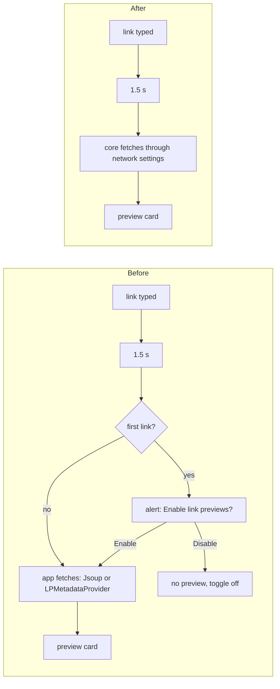
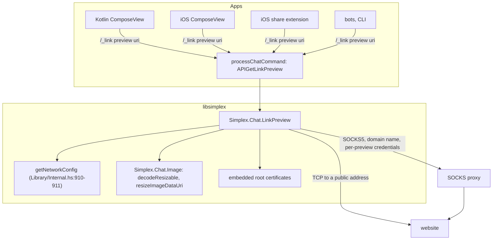
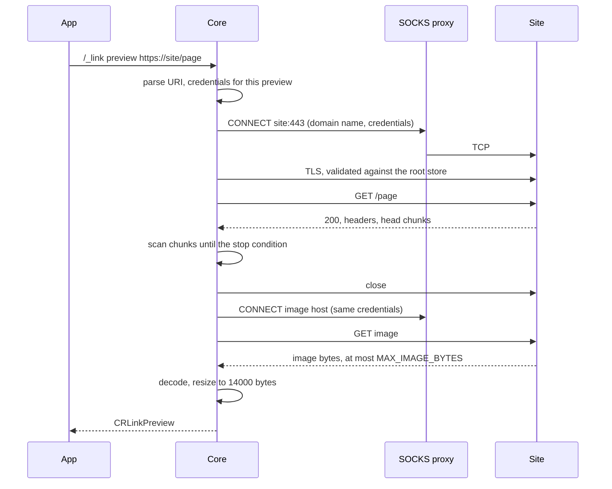
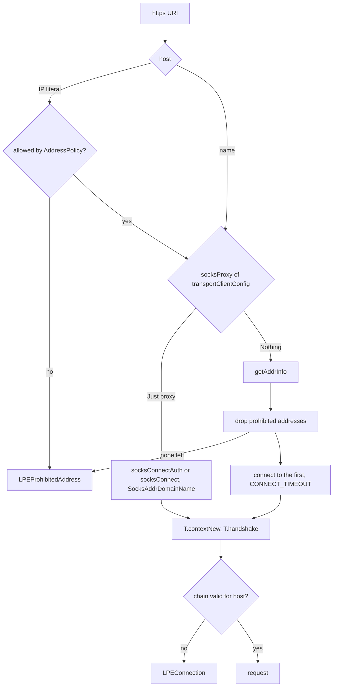
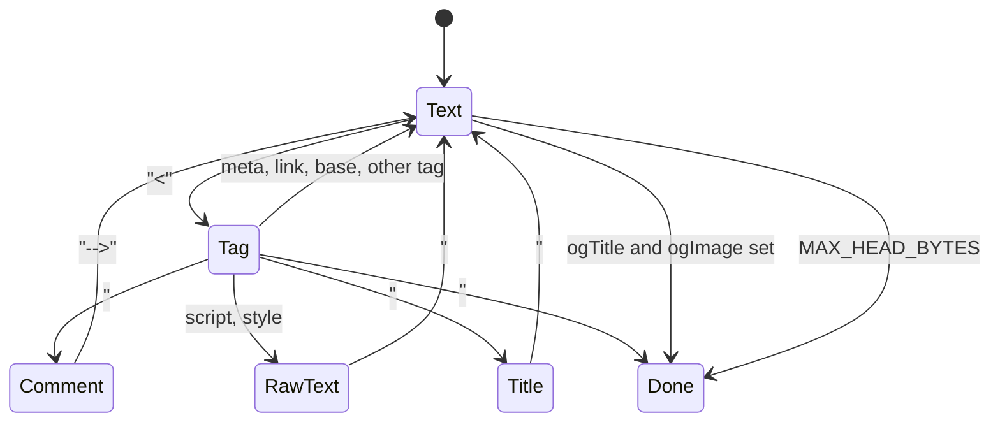
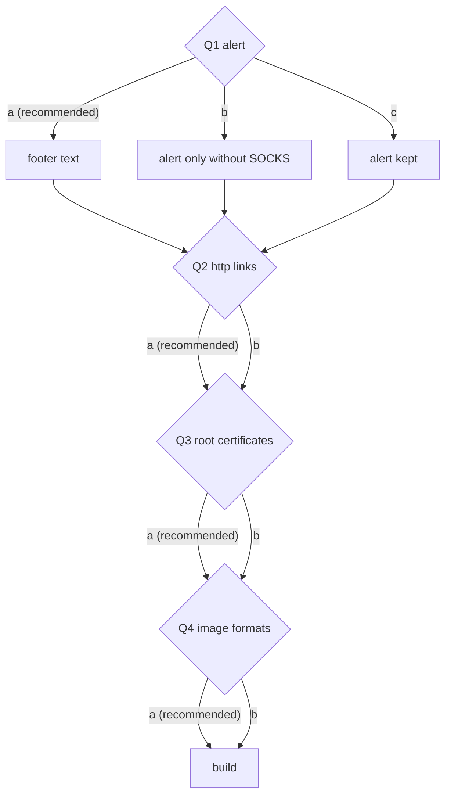
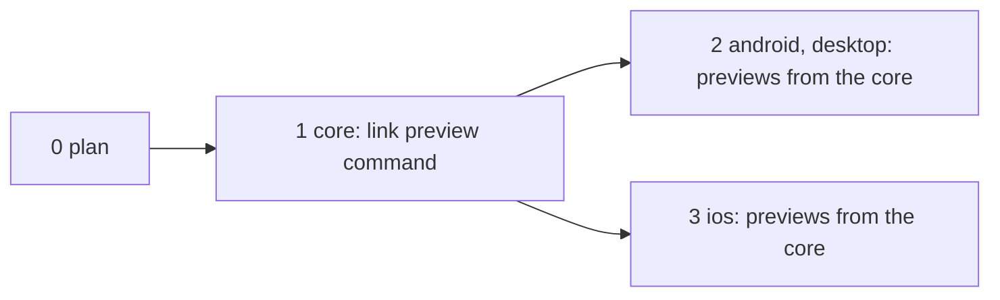

# Link previews generated by the core

Repository: simplex-chat/simplex-chat.
Branch: `ep/link-previews`.
Base: master `20ee7cb14`; simplexmq pinned at `d38bcf50` (cabal.project:23-24).

Citations: `mq:` is simplexmq at `d38bcf50`; other paths are in this repository at the base. `Kt:` is `apps/multiplatform/common/src/commonMain/kotlin/chat/simplex/common/`.

## Decisions of the product owner

| # | Decision | Source |
|---|---|---|
| D1 | The core generates link previews for all platforms, through the core's network settings | ep: "link previews generated by the Haskell core instead of the apps" |
| D2 | The page is read as a stream and closed once the needed tags of the head are read | ep: "streaming html (or some ad hoc) parser that would stop loading the page as soon as it finds the correct meta tag in the head" |
| D3 | The preview warnings are removed | ep: "we can even remove annoying warnings"; the scope of removal is Q1 |

## 1. Problems

1. An iOS user with a SOCKS proxy (Tor) sends a link preview, and the website receives the user's IP address.
2. An Android or desktop user with a SOCKS proxy is told that DNS may still resolve the site locally.
3. The first link typed in any chat opens the alert "Enable link previews?", with "Enable" in red when no SOCKS proxy is set.
4. A link shared to SimpleX from another iOS app gets no preview until the user has answered that alert in the app.
5. One link gets a preview on Android and none on iOS, or the reverse, because each platform has its own rules.
6. On Android and desktop, a slow site delays the preview of the next link by the time-outs of its own fetch: 10 s for the page, 20 s to connect and 20 s to read the image.
7. Bots and the CLI cannot make link previews.

Today, in code:

| Fact | Code |
|---|---|
| iOS fetches with `LPMetadataProvider`, created without a proxy; the SOCKS settings reach only the core | apps/ios/SimpleXChat/ImageUtils.swift:455-483; apps/ios/Shared/Views/UserSettings/NetworkAndServers/AdvancedNetworkSettings.swift:157, 175 |
| iOS requires `metadata.imageProvider` and `metadata.title` | ImageUtils.swift:461-472 |
| Android and desktop fetch with Jsoup over the app's SOCKS proxy; ISOLATE mode sets random credentials per preview | Kt:views/helpers/LinkPreviews.kt:57-91, 98-113 |
| Their rules: first `og:title`, else `<title>`; first `og:image`, else the first `link` with `icon` in `rel`; a path ending in `.jpg .png .ico .webp .gif` is the image itself, titled by its file name | LinkPreviews.kt:41-43, 92-119 |
| A relative image path is joined to `scheme://host` of the requested URL: the port and the final URL after redirects are lost, and `//cdn/...` becomes `https://host//cdn/...` | LinkPreviews.kt:231-242 |
| The image is decoded by the platform and resized by the core to 14000 bytes | LinkPreviews.kt:128; Kt:platform/Images.kt:64-65; ImageUtils.swift:140-142 |
| One mutex serializes all fetches: 10 s for the page, 20 s connect and 20 s read for the image | LinkPreviews.kt:48, 52, 100, 125-126 |
| The alert text: "Sending a link preview may reveal your IP address to the website."; with SOCKS: "DNS lookup may still happen locally via your DNS resolver." | Kt:…/moko-resources/base/strings.xml:3181-3185 |
| The alert is shown while `privacyLinkPreviewsShowAlert` is true | Kt:views/chat/ComposeView.kt:514-533, 1871-1903; apps/ios/Shared/Views/Chat/ComposeMessage/ComposeView.swift:1959-1975, 1995-2006 |
| The iOS share extension fetches only after the alert was answered | apps/ios/SimpleX SE/ShareModel.swift:484 |
| Previews are made only in app code | LinkPreviews.kt:50-149; ImageUtils.swift:455-489 |

## 2. UX



| Place | Before | After |
|---|---|---|
| Compose, first link | alert "Enable link previews?" | none (Q1 a) |
| Compose, any link | spinner, then card or nothing | the same; 1.5 s wait kept (ComposeView.kt:550; ComposeView.swift:1919) |
| Privacy settings | toggle "Send link previews", default on (SimpleXAPI.kt:130; apps/ios/SimpleXChat/AppGroup.swift:98) | the same toggle; footer per Q1 |
| iOS share extension | preview only after the alert was answered | preview when the toggle is on |
| iOS with SOCKS | site sees the IP address | site sees the proxy's exit |
| Android and desktop with SOCKS | DNS may resolve locally | the host name is resolved by the proxy |
| Desktop controlling a phone | desktop fetches | desktop fetches (section 3.12) |
| Same link, two platforms | different rules | one rule set (section 3.8) |
| `http://` link | fetched over HTTP on Android and desktop | Q2 |
| WebP, GIF or ICO image | decoded on Android and desktop | Q4 |

The user guide section "Send Link Previews" (docs/guide/app-settings.md:219-227) is rewritten in the app PRs.

## 3. Technical design

### 3.1 HTTP client options

| Option | Cost |
|---|---|
| A. Own HTTP/1.1 client over `network`, `socks` and `tls`, already in simplex-chat.cabal:397, 404, 408 | about 300 lines and their tests; no new packages in the mobile builds |
| B. `http-client` with `http-client-tls` | new packages in all six mobile builds (flake.nix:230-231, 355-356, 433-434, 564-565 set `client_library`, under which simplexmq omits them: mq:simplexmq.cabal:432-438), with GHC 8.10.7 for armv7a (flake.nix:11-13); SOCKS with credentials still needs our own connection function; its TLS settings load system roots, which are missing on iOS (section 3.6) |
| C. The HTTP/2 client of simplexmq (mq:Messaging/Transport/HTTP2/Client.hs:119-122) | sites without `h2` in ALPN still need HTTP/1.1, so C adds to A |
| D. Fetch in the apps through the proxy | three implementations; iOS lacks SOCKS in `LPMetadataProvider`; contradicts D1 |

Choice: A.

### 3.2 Composition



### 3.3 Sequence



### 3.4 Named values

| Name | Value |
|---|---|
| PREVIEW_DEADLINE | 30 s for the whole preview |
| CONNECT_TIMEOUT | `tcpConnectTimeout` of the network config, interactive (mq:Messaging/Client.hs:323, 434) |
| READ_TIMEOUT | `tcpTimeout` of the network config, interactive, per read (mq:Messaging/Client.hs:325, 435) |
| MAX_REDIRECTS | 5 |
| MAX_HEADER_BYTES | 32 KiB of status line and headers |
| MAX_HEADERS | 100 |
| MAX_HEAD_BYTES | 1 MiB of HTML body |
| MAX_IMAGE_BYTES | 5 MiB |
| IMAGE_DATA_SIZE | `maxImagePreviewSize`, 14000 (Library/Commands.hs:179-180) |

### 3.5 Types

```haskell
data LinkPreviewConfig = LinkPreviewConfig
  { rootCerts :: XS.CertificateStore,
    addressPolicy :: AddressPolicy,
    previewDeadline :: Int,
    maxRedirects :: Int,
    maxHeadBytes :: Int,
    maxImageBytes :: Int
  }

data AddressPolicy = APPublic | APPublicAndLoopback

data LinkPreviewError
  = LPEInvalidUri
  | LPEProhibitedAddress
  | LPEConnection {connectionError :: Text}
  | LPEHttpStatus {status :: Int}
  | LPETooManyRedirects
  | LPEUnsupportedContent {contentType :: Text}
  | LPEUnsupportedEncoding {contentEncoding :: Text}
  | LPEUnsupportedCharset {charset :: Text}
  | LPENoTitle
  | LPENoImage
  | LPEImage {imageError :: Text}
  | LPETimeout

data PageMeta = PageMeta
  { ogTitle :: First Text,
    title :: First Text,
    ogImage :: First Text,
    icon :: First Text,
    charset :: First Text
  }

data PageContent
  = PCPage PageMeta
  | PCImage ByteString

data HttpResponse = HttpResponse
  { status :: Status,
    headers :: ResponseHeaders,
    readBody :: IO ByteString
  }
```

- `LinkPreviewConfig` is a field of `ChatConfig`; `rootCerts` is parsed once from the embedded bundle; `APPublicAndLoopback` is used by tests only.
- `PageMeta` is a `Monoid` by fields: the first value of each field is kept, as the apps keep the first tag (LinkPreviews.kt:116-118). Laws: associativity and identity of `First`.
- `PageMeta` fields hold raw bytes decoded once, after `charset` is known (section 3.9).
- `Status` and `ResponseHeaders` are of `http-types` (simplex-chat.cabal:389).
- The response is the existing `LinkPreview` (Protocol.hs:246), with `description = ""` and `content = Nothing`, as both apps send it (LinkPreviews.kt:134; ImageUtils.swift:471).

### 3.6 Connection



- Proxy selection: `socksProxy` of `transportClientConfig netCfg NRMInteractive host True Nothing` (mq:Messaging/Client.hs:445-453), so `SMOnion` mode and an unset proxy behave as for SMP servers.
- SOCKS credentials, one set per preview, used for the page, its redirects and the image:

  | `SocksAuth` (mq:Messaging/Transport/Client.hs:245-249) | Credentials |
  |---|---|
  | `SocksIsolateByAuth` | random 16-byte username in base64, empty password, from the controller's `random` |
  | `SocksAuthUsername` | the configured username and password |
  | `SocksAuthNull` | none |

- DNS: with a proxy, the host name is sent to the proxy as `SocksAddrDomainName`, as for SMP (mq:Messaging/Transport/Client.hs:191-195), and the device resolves nothing. Without a proxy, `getAddrInfo` uses the system resolver, as `connectTCPClient` does (mq:Messaging/Transport/Client.hs:197-206).
- Prohibited addresses: loopback, unspecified, private (RFC 1918, ULA), link-local, shared (RFC 6598), multicast, broadcast, and IPv4-mapped IPv6 forms of these. `APPublicAndLoopback` also allows loopback. The check runs on resolved addresses without a proxy and on IP literals with one.
- TLS: `T.defaultParamsClient host ""` with `sharedCAStore = rootCerts`, SNI on, and `defaultSupportedParamsHTTPS` (mq:Messaging/Transport.hs:399-417) with `P256` added to `supportedGroups`. The hostname check of `validateDefault` applies.
- The SimpleX transport (`runTLSTransportClient`) is not used: it connects through its own `connectTCPClient` (mq:Messaging/Transport/Client.hs:172-174), so resolved addresses cannot be checked, and its `getLn` reads a line without a length limit (mq:Messaging/Transport.hs:447-449; mq:Messaging/Transport/Buffer.hs:78-88).
- Root certificates: Q3. Today the core loads no root store in client builds: `crypton-x509-system` is a dependency only without `client_library` (mq:simplexmq.cabal:432-435), and on iOS its `System.X509` reads the Unix paths, which are absent there (crypton-x509-system 1.6.7: modules `System.X509.MacOS` only under `os(OSX)`; `System.X509.Unix` paths `/etc/ssl/certs/`, `/system/etc/security/cacerts/`, `/usr/local/share/certs/`, `/etc/ssl/cert.pem`).

### 3.7 HTTP/1.1

Request, with the fragment removed:

```
GET <path>[?<query>] HTTP/1.1
Host: <host>[:<port>]
User-Agent: <UA>
Accept: text/html,application/xhtml+xml,image/png,image/jpeg;q=0.9,*/*;q=0.1
Accept-Encoding: identity
Connection: close
```

- UA: one fixed browser string for all users; for host `x.com`, the string of LinkPreviews.kt:108, as today.
- Cookies, `Referer` and `Accept-Language` are not sent.
- Response head: at most MAX_HEADER_BYTES and MAX_HEADERS, else `LPEConnection`.
- Body framing: `Transfer-Encoding: chunked`, `Content-Length`, or until close. Chunk sizes above the remaining budget end the fetch.
- `Content-Encoding` other than `identity`: `LPEUnsupportedEncoding`.
- Reads: `T.recvData` with READ_TIMEOUT each; the budget counts body bytes after decoding of chunks.
- Close: `T.bye`, then `T.contextClose`, in `bracket`, also on timeout and on the stop condition.

Redirects:

| Status | Action |
|---|---|
| 301, 302, 303, 307, 308 with `Location` | `Location` resolved against the current URI (RFC 3986, 5.2), then fetched |
| other 3xx, 4xx, 5xx | `LPEHttpStatus` |
| 2xx | content by `Content-Type` |

- A redirect to a scheme other than `https`: `LPEInvalidUri`.
- More than MAX_REDIRECTS: `LPETooManyRedirects`.
- Reference resolution is a function of this module over `uri-bytestring` types (simplex-chat.cabal:411): `uri-bytestring` 0.3.3.1 exports `toAbsolute`, which takes a scheme, and no base-URI resolution.

Content by type:

| `Content-Type` | Content |
|---|---|
| `text/html`, `application/xhtml+xml` | `PCPage` from the head scanner |
| `image/jpeg`, `image/png` | `PCImage`, titled by the last path segment of the requested URI (LinkPreviews.kt:93-95) |
| other | `LPEUnsupportedContent` |

### 3.8 Head scanner and metadata rules



- The scanner is an incremental `attoparsec` parser fed with body chunks; tag and attribute names are compared case-insensitively; attribute values are unquoted, single- or double-quoted.
- Law: the scan of a body equals the scan of any split of it into chunks. A QuickCheck property tests it.
- Tags read, with the same selectors as LinkPreviews.kt:41-42, 115-118:

  | Tag | Field |
  |---|---|
  | `<meta property="og:title" content>` | `ogTitle` |
  | `<meta property="og:image" content>` | `ogImage` |
  | `<title>` text | `title` |
  | `<link rel href>`, `rel` starting with `icon`, `apple-touch-icon` or `shortcut icon` | `icon` |
  | `<meta charset>`, `<meta http-equiv="content-type" content>` | `charset` |

- Values: whitespace trimmed and collapsed; named entities `amp lt gt quot apos nbsp` and numeric references decoded.
- Title: `ogTitle`, else `title`, else `LPENoTitle`.
- Image candidates in order: `ogImage`, then `icon`; each resolved against the final URI of the page; the first that is fetched and resized is used; none: `LPENoImage`, as both apps return no preview without an image (LinkPreviews.kt:121-139; ImageUtils.swift:461-479).
- Tags after `</head>` or `<body` are not read; Jsoup reads the whole document (LinkPreviews.kt:114).

### 3.9 Character sets

1. `charset` of `Content-Type`.
2. Else the `charset` field of `PageMeta`.
3. Else UTF-8.

| Charset | Decoding |
|---|---|
| `utf-8`, `us-ascii` | `decodeUtf8'`; invalid bytes: `LPEUnsupportedCharset` |
| `iso-8859-1`, `windows-1252` | `windows-1252` table for 0x80-0x9F, Latin-1 otherwise |
| other | `LPEUnsupportedCharset` |

Tags are scanned as bytes, as both supported families are supersets of ASCII; only the field values are decoded.

### 3.10 Image

- Bytes: at most MAX_IMAGE_BYTES, else the candidate fails.
- `imagePreview` (Library/Commands.hs:232-238) is split: its decode and resize steps become `imageDataPreview :: ByteString -> IO (Either String ImageData)`, used by `imagePreview` and by the link preview.
- Decoding limits of `decodeResizable`: JPEG scaled by halvings to at most 4320 per side, at most 2^28 pixels and `maxDecodeMemoryMB`; PNG decoded by spng within half of `maxDecodeMemoryMB` (src/Simplex/Chat/Image.hs:69-93, 309-323).
- Formats: JPEG and PNG (Image.hs:74-77); others: Q4.

### 3.11 Timeouts, concurrency, cancellation

- The whole preview runs in `timeout PREVIEW_DEADLINE`; expiry: `LPETimeout`. Sockets and TLS contexts are released by `bracket`.
- Commands run in the calling thread of `chat_send_cmd` (Library/Commands.hs:434-458); the preview command takes no `chatLock`, so previews run concurrently with each other and with other commands.
- A fetch for a link that the user has since edited runs to its end or to PREVIEW_DEADLINE; the apps discard its result, as today (ComposeView.kt:500-506; ComposeView.swift:1984-1991).
- The Kotlin mutex is removed with the Jsoup code (LinkPreviews.kt:48), so a slow site no longer delays the next preview.

```
getLinkPreview cfg netCfg uriText:
  uri   <- parseUri uriText; require https (Q2)
  creds <- previewCredentials netCfg
  timeout previewDeadline:
    (finalUri, content) <- fetchFollowing creds uri
    case content of
      PCImage bytes -> preview uriText (lastSegment uri) bytes
      PCPage meta   ->
        title <- pageTitle meta
        image <- firstImage [resolve finalUri c | c <- imageCandidates meta]
        pure LinkPreview {uri = uriText, title, description = "", image, content = Nothing}

fetchFollowing creds uri, n:
  resp <- withConnection creds uri (sendRequest uri)
  case status resp of
    redirect, n < maxRedirects -> fetchFollowing creds (resolve uri location) (n + 1)
    redirect                   -> LPETooManyRedirects
    2xx                        -> (uri, readContent resp)
    s                          -> LPEHttpStatus s
```

The returned `uri` is the string the app sent, because the apps send `MCLink` only when it equals the link in the text (ComposeView.kt:656-658; ComposeView.swift:1262-1267).

### 3.12 Core API

| Item | Value |
|---|---|
| Command | `APIGetLinkPreview {uri :: Text}` |
| Syntax | `/_link preview <uri>`, the rest of the line |
| Response | `CRLinkPreview {linkPreview :: LinkPreview}` |
| Error | `CELinkPreview {linkPreviewError :: LinkPreviewError}` in `ChatErrorType` (Controller.hs:1545) |
| User | not required |
| `allowRemoteCommand` | `False` (Controller.hs:749-788), so a desktop that controls a phone fetches itself, as today |
| CLI view | one line: `link preview: <title>` |
| Bot API docs | "Message commands" (bots/src/API/Docs/Commands.hs:95-111): description "Get link preview of a web page.", responses `CRLinkPreview`, `CRChatCmdError`, error `CELinkPreview`, network `UNInteractive`; `LinkPreviewError` in Docs/Types.hs |
| Generated | bots/api/*.md, TypeScript and Python types (TESTS.md, "Checks against committed files") |

### 3.13 Dependencies and mobile builds

| Package | In simplex-chat.cabal | In the mobile builds |
|---|---|---|
| `tls` | 408 | yes |
| `socks` (fork, cabal.project:28-29) | 404 | yes |
| `network` | 397 | yes |
| `attoparsec` | 375 | yes |
| `http-types` | 389 | yes |
| `uri-bytestring` | 411 | yes |
| `file-embed` | 387 | yes |
| `crypton-x509-store` | added | yes, through simplexmq (mq:simplexmq.cabal:395) |
| `crypton-x509-validation` | added | yes, through simplexmq (mq:simplexmq.cabal:396) |
| `iproute` | added | yes, through simplexmq (mq:simplexmq.cabal:405) |
| `pem` | added | yes, through `crypton-x509-store` 1.6.9 (`pem >= 0.1 && < 0.3`) |

- Every package above is built for the mobile targets today.
- Root bundle: `src/Simplex/Chat/LinkPreview/roots.pem`, embedded with `embedFile` as `DisplayP3-v4.icc` is (Image.hs:211-212), with a script that refreshes it and checks its SHA-256 (Q3).
- GHC 8.10.7: field puns and qualified selectors, no `OverloadedRecordDot` (docs/CONTRIBUTING.md, "Differences between GHC 8.10.7 and GHC 9.6.3").
- The command goes through `chat_send_cmd`; C exports are unchanged.

### 3.14 Apps

Kotlin (android, desktop):

| Site | Change |
|---|---|
| Kt:views/helpers/LinkPreviews.kt:33-149, 231-261 | `getLinkPreview(url)` calls `apiGetLinkPreview(url)`; Jsoup, proxy, `Authenticator`, mutex and `normalizeImageUri` removed |
| apps/multiplatform/common/build.gradle.kts:74 | `org.jsoup:jsoup` removed |
| Kt:model/SimpleXAPI.kt | `CC.ApiGetLinkPreview`, `CR.LinkPreview`, `apiGetLinkPreview` with `rh = null` and without an error alert |
| Kt:views/chat/ComposeView.kt:508-539, 1871-1903 | alert branch and `showLinkPreviewsConfirmAlert` removed (Q1 a) |
| Kt:model/SimpleXAPI.kt:132, 303, 426 | `privacyLinkPreviewsShowAlert`, its hint entry and key removed (Q1 a) |
| Kt:views/usersettings/PrivacySettings.kt:70 | `onChange` removed (Q1 a) |
| base strings.xml:3181-3185 and every locale | `link_previews_alert_*` removed; translations follow, as no locale has keys absent from base |

iOS:

| Site | Change |
|---|---|
| apps/ios/SimpleXChat/ImageUtils.swift:13, 455-489 | `getLinkPreview` and `import LinkPresentation` removed |
| apps/ios/Shared/Model/AppAPITypes.swift, SimpleXAPI.swift | `apiGetLinkPreview` command, response case, function |
| apps/ios/Shared/Views/Chat/ComposeMessage/ComposeView.swift:414, 1956-2006 | `linkPreviewsShowAlert`, alert and `DEFAULT_PRIVACY_LINK_PREVIEWS` write in the alert path removed; `fetchLinkPreview` awaits `apiGetLinkPreview` (Q1 a) |
| apps/ios/Shared/Views/UserSettings/PrivacySettings.swift:83 | the alert default write removed (Q1 a) |
| apps/ios/SimpleXChat/AppGroup.swift:30, 99, 231; Shared/Views/UserSettings/SettingsView.swift:179-181 | the alert group default and its hint entry removed (Q1 a) |
| apps/ios/SimpleX SE/ShareAPI.swift, ShareModel.swift:484 | `SEChatCommand.apiGetLinkPreview`; the alert condition removed; network config is set before content is prepared (ShareModel.swift:96-127, 197) |
| apps/ios/spec/client/compose.md:300-324 | "fetched by the core" |
| localizations | by the export and import of apps/ios/README.md, "Localization" |

Why removal of the alert is safe under Q1 a:

| Alert claim | After |
|---|---|
| "may reveal your IP address to the website" | true without a proxy; false with one, on all platforms |
| "DNS lookup may still happen locally" | false: the proxy receives the host name |
| choice Enable/Disable | the toggle in Privacy settings is kept |

The recipient never fetches: received previews are drawn from `linkPreview.image` (LinkPreviews.kt:204; ImageUtils.swift:428-443), and the core does not fetch on receipt.

### 3.15 Threat model

| Party | Can | Cannot | Measures |
|---|---|---|---|
| Website of the link | see the request time, a fixed UA, the IP address without a proxy or the proxy's exit with one; serve any title and image to the sender | read cookies or other sites' data; learn the recipient | no cookies, `Referer`, `Accept-Language`; per-preview SOCKS credentials |
| Website, huge or endless page | make the core read bytes | read beyond MAX_HEAD_BYTES or MAX_IMAGE_BYTES | stop condition; budgets; close |
| Website, slow response | hold a connection | beyond READ_TIMEOUT per read and PREVIEW_DEADLINE | `timeout`; `bracket` |
| Website, compressed body | send gzip | make the core inflate it | `Accept-Encoding: identity`; other encodings rejected |
| Website, redirect | send the core to other hosts | to `http`, to prohibited addresses, beyond MAX_REDIRECTS | section 3.7; address check per hop |
| Website, DNS name of a local address | point the core to the LAN without a proxy | connect: addresses are checked after resolution, and the checked address is the one connected | section 3.6 |
| Website, image bomb | send large dimensions | exceed the decoding limits | `decodeResizable` limits; MAX_IMAGE_BYTES |
| Network observer, proxy, exit | see the host name (SNI), timing, sizes | read or alter content | TLS validated against the root store |
| A local non-Tor SOCKS proxy | resolve a name to a LAN address and connect | — | residual: only IP literals are checked with a proxy |
| Recipient of the message | see the preview the sender made | make the sender or the recipient fetch | the recipient never fetches |

## 4. Decisions open



| Q | Question | Options | Recommendation |
|---|---|---|---|
| Q1 | The alert "Enable link previews?" | (a) removed on all platforms; the toggle keeps its default (on); Privacy settings footer "Without a SOCKS proxy, the website sees your IP address."; (b) shown only when no SOCKS proxy is set; (c) kept | (a) |
| Q2 | `http://` links | (a) fetched as `https://` on the same host, without plain HTTP; (b) plain HTTP as on Android and desktop today | (a) |
| Q3 | Root certificates | (a) the Mozilla bundle embedded in the core, refreshed by a script each release; (b) the system store where `crypton-x509-system` reads one, the bundle on iOS; (c) roots passed by each app | (a) |
| Q4 | Images other than JPEG and PNG | (a) skipped, the next candidate tried; WebP with the WebP PR named in plans/2026-10-23-core-image-resizing.md:369; (b) GIF first frame (JuicyPixels) and PNG entries of ICO added now | (a) |

Decided as details: concurrent fetches without a cancel command (3.11); the desktop fetches while it controls a phone (3.12); one browser UA with the `x.com` exception (3.7).

## 5. Tests

Core, unit, `tests/LinkPreviewTests.hs` (new, registered in tests/Test.hs), pattern `/Link preview/`:

| Case | Checked |
|---|---|
| head scanner | `og:*`, `<title>`, icons, quotes, entities, comments, `<meta>` inside `<script>` ignored, stop at `</head>` and `<body` |
| chunk law | QuickCheck: scan of a body equals scan of any chunk split |
| `PageMeta` | `Monoid` laws |
| reference resolution | RFC 3986 5.4.1 and 5.4.2 examples; `//cdn/...`; port kept |
| address policy | each prohibited range, its IPv4-mapped form, public addresses |
| HTTP framing | chunked, `Content-Length`, close; header limits; oversized chunk |
| request | headers; fragment removed; `x.com` UA |
| charsets | UTF-8, `windows-1252`, unsupported |

Core, scenario, `tests/ChatTests/LinkPreviews.hs` (new, in ChatTests.hs), pattern `/SimpleX chat client/link preview tests/`. A local HTTPS server (`warp-tls` added to the test suite; `wai` and `warp` at simplex-chat.cabal:863-864) uses tests/fixtures/tls/server.crt (CN `localhost`, issued by tests/fixtures/tls/ca.crt); the client has `rootCerts = [ca.crt]` and `APPublicAndLoopback`. A test SOCKS5 server in the module records the address type and credentials of each request and connects to the HTTPS server.

| Test | Checked |
|---|---|
| og page | title and PNG image in the response |
| title and relative icon | icon resolved against the final URI after a redirect |
| image URL | `image/png` response titled by the file name |
| no image | `LPENoImage` |
| redirects | 5 followed; 6: `LPETooManyRedirects`; to `https://10.0.0.1`: `LPEProhibitedAddress` without a connection; to `http`: `LPEInvalidUri` |
| endless body after the og tags | response before PREVIEW_DEADLINE; bytes sent by the server below MAX_HEAD_BYTES plus one TLS record |
| head beyond MAX_HEAD_BYTES | the server sees the connection closed |
| slow server | `LPETimeout` with a test deadline of 2 s |
| gzip | `LPEUnsupportedEncoding` |
| certificate of another CA | `LPEConnection` |
| oversized image dimensions | `LPEImage` |
| SOCKS, isolate | domain address type; two previews with two usernames; page and image with one |
| SOCKS, username | the configured credentials |
| fixture | `apiFixture "previews/link_preview"` of a success and a failure, placeholder `LINK_URL` for the server URL |

The fixture image is a PNG, so the recording does not depend on the JPEG encoder of the runner.

Checks against committed files: `/Bot API docs/`.

App tests on tests/fixtures/api/previews/link_preview.json:

| Test | Checked | Apps |
|---|---|---|
| `LinkPreviewTest.kt`, `LinkPreviewTests.swift` | `getLinkPreview("LINK_URL")` sends `/_link preview LINK_URL` and returns the recorded preview | both |
| same | the recorded error returns no preview and no alert | both |
| SE | `apiGetLinkPreview` of the share extension decodes the recorded response | iOS |

The iOS test file is added to project.pbxproj (TESTS.md, "iOS app"). Compose flows: a case in `claude-test.md` of desktop-linux and android-emu and `device-test-plan.md` of ios-sim, with `backend: yes`: type a link, see a card, without an alert.

| CI scope | Runs |
|---|---|
| core | `ci-tests`: `/Link preview/`, `/SimpleX chat client/link preview tests/`, `/Image resize/`, `/Bot API docs/` |
| kotlin | `:common:desktopTest` |
| ios | SimpleX Unit Tests |
| packages | generated types compiled |

## 6. Pull requests



| PR | Scope | Content |
|---|---|---|
| 0 | docs | this plan, first commit of `ep/link-previews` |
| 1 | core | `Simplex.Chat.LinkPreview`, `LinkPreviewConfig` in `ChatConfig`, root bundle and its script, `imageDataPreview`, command, response, error, view, API docs, unit and scenario tests, fixture |
| 2 | android, desktop | `apiGetLinkPreview`; Jsoup removed; alert, preference and strings per Q1; app tests; guide |
| 3 | ios | app and share extension commands; `LPMetadataProvider` removed; alert and defaults per Q1; app tests; spec; guide |

Each PR adds its tests in the same PR. PRs 2 and 3 are developed in parallel on the fixture of PR 1.
