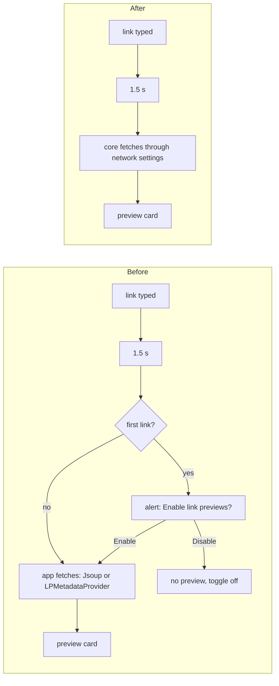
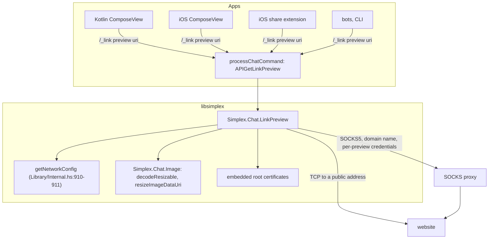
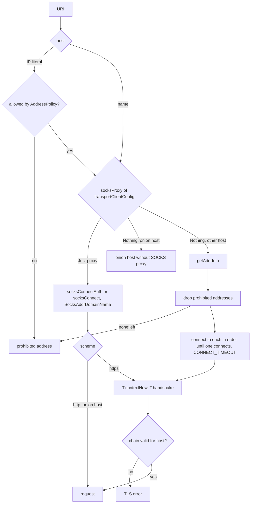
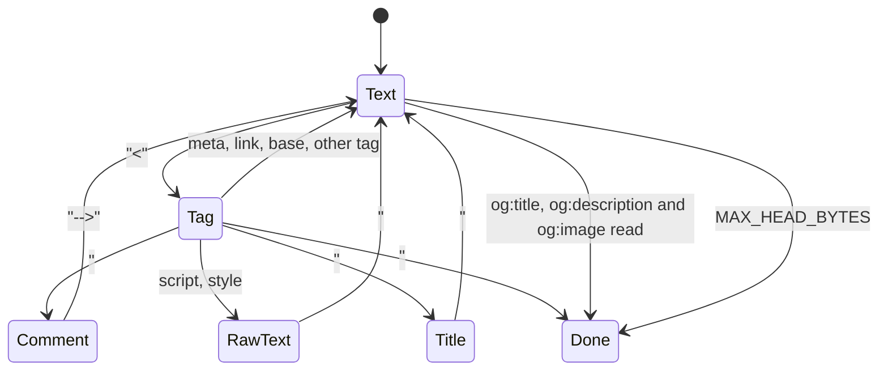
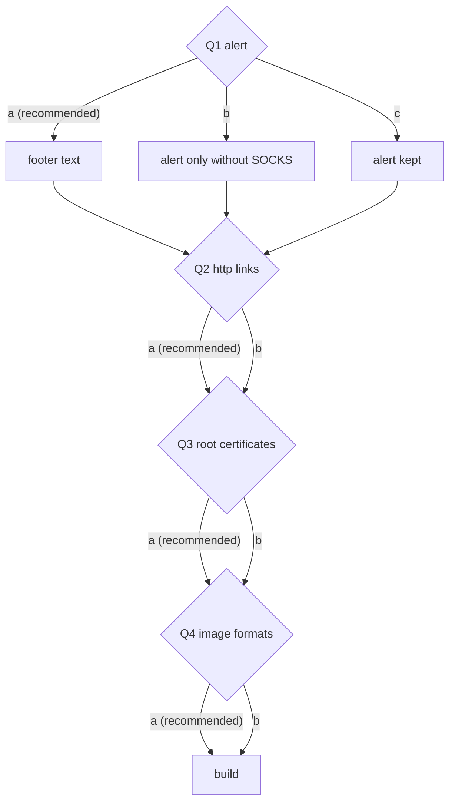
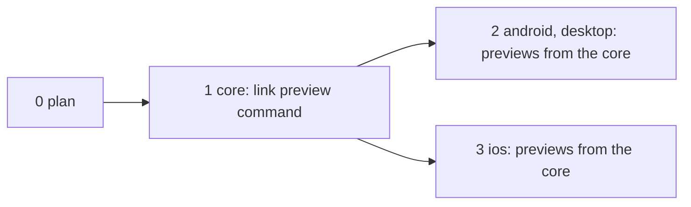

# Link previews generated by the core

Repository: simplex-chat/simplex-chat.
Branch: `ep/link-previews`.
Base: master `20ee7cb14`; simplexmq pinned at `d38bcf50` (cabal.project:23-24).

Citations: `mq:` is simplexmq at `d38bcf50`; other paths are in this repository at the base. `Kt:` is `apps/multiplatform/common/src/commonMain/kotlin/chat/simplex/common/`.

## Decisions of the product owner

| # | Decision | Source |
|---|---|---|
| D1 | The core generates link previews for all platforms, through the core's network settings | ep: "link previews generated by the Haskell core instead of the apps" |
| D2 | The page is read as a stream and closed once the needed tags of the head are read | ep: "streaming html (or some ad hoc) parser that would stop loading the page as soon as it finds the correct meta tag in the head" |
| D3 | The preview warnings are removed | ep: "we can even remove annoying warnings"; the scope of removal is Q1 |

## 1. Problems

1. An iOS user with a SOCKS proxy (Tor) sends a link preview, and the website receives the user's IP address.
2. An Android or desktop user with a SOCKS proxy is told that DNS may still resolve the site locally.
3. The first link typed in any chat opens the alert "Enable link previews?", with "Enable" in red when no SOCKS proxy is set.
4. A link shared to SimpleX from another iOS app gets no preview until the user has answered that alert in the app.
5. One link gets a preview on Android and none on iOS, or the reverse, because each platform has its own rules.
6. On Android and desktop, a slow site delays the preview of the next link by the time-outs of its own fetch: 10 s for the page, 20 s to connect and 20 s to read the image.
7. Bots and the CLI cannot make link previews.
8. A preview never shows the page's description: both apps send it empty, and iOS does not show it.

Today, in code:

| Fact | Code |
|---|---|
| iOS fetches with `LPMetadataProvider`, created without a proxy; the SOCKS settings reach only the core | apps/ios/SimpleXChat/ImageUtils.swift:455-483; apps/ios/Shared/Views/UserSettings/NetworkAndServers/AdvancedNetworkSettings.swift:157, 175 |
| iOS requires `metadata.imageProvider` and `metadata.title` | ImageUtils.swift:461-472 |
| Android and desktop fetch with Jsoup over the app's SOCKS proxy; ISOLATE mode sets random credentials per preview | Kt:views/helpers/LinkPreviews.kt:57-91, 98-113 |
| Their rules: first `og:title`, else `<title>`; first `og:image`, else the first `link` with `icon` in `rel`; a path ending in `.jpg .png .ico .webp .gif` is the image itself, titled by its file name | LinkPreviews.kt:41-43, 92-119 |
| A relative image path is joined to `scheme://host` of the requested URL: the port and the final URL after redirects are lost, and `//cdn/...` becomes `https://host//cdn/...` | LinkPreviews.kt:231-242 |
| The image is decoded by the platform and resized by the core to 14000 bytes | LinkPreviews.kt:128; Kt:platform/Images.kt:64-65; ImageUtils.swift:140-142 |
| One mutex serializes all fetches: 10 s for the page, 20 s connect and 20 s read for the image | LinkPreviews.kt:48, 52, 100, 125-126 |
| The alert text: "Sending a link preview may reveal your IP address to the website."; with SOCKS: "DNS lookup may still happen locally via your DNS resolver." | Kt:…/moko-resources/base/strings.xml:3181-3185 |
| The alert is shown while `privacyLinkPreviewsShowAlert` is true | Kt:views/chat/ComposeView.kt:514-533, 1871-1903; apps/ios/Shared/Views/Chat/ComposeMessage/ComposeView.swift:1959-1975, 1995-2006 |
| The iOS share extension fetches only after the alert was answered | apps/ios/SimpleX SE/ShareModel.swift:484 |
| Previews are made only in app code | LinkPreviews.kt:50-149; ImageUtils.swift:455-489 |

## 2. UX



| Place | Before | After |
|---|---|---|
| Compose, first link | alert "Enable link previews?" | none (Q1 a) |
| Compose, any link | spinner, then card or nothing | the same; 1.5 s wait kept (ComposeView.kt:550; ComposeView.swift:1919) |
| Privacy settings | toggle "Send link previews", default on (SimpleXAPI.kt:130; apps/ios/SimpleXChat/AppGroup.swift:98) | the same toggle; footer per Q1 |
| iOS share extension | preview only after the alert was answered | preview when the toggle is on |
| iOS with SOCKS | site sees the IP address | site sees the proxy's exit |
| Android and desktop with SOCKS | DNS may resolve locally | the host name is resolved by the proxy |
| Desktop controlling a phone | desktop fetches | desktop fetches (section 3.12) |
| Same link, two platforms | different rules | one rule set (section 3.8) |
| `http://` link | fetched over HTTP on Android and desktop | fetched as `https://`; an `.onion` host over HTTP through the SOCKS proxy (Q2) |
| WebP, GIF or ICO image | decoded on Android and desktop | Q4 |
| Page without `og:image` | Android and desktop: the site icon at full width; iOS: no preview | no preview |
| Description | never sent | `og:description`, else `<meta name="description">`; shown in the chat item on all platforms |
| Failed preview | no card, no alert | the same; with the developer option "Show link preview errors" on, an alert with the raw error |
| Developer options | — | new toggle "Show link preview errors", off by default, shown only with "Show developer options" on |

The user guide section "Send Link Previews" (docs/guide/app-settings.md:219-227) is rewritten in the app PRs.

## 3. Technical design

### 3.1 HTTP client options

| Option | Cost |
|---|---|
| A. Own HTTP/1.1 client over `network`, `socks` and `tls`, already in simplex-chat.cabal:397, 404, 408 | about 300 lines and their tests; no new packages in the mobile builds |
| B. `http-client` with `http-client-tls` | new packages in all six mobile builds (flake.nix:230-231, 355-356, 433-434, 564-565 set `client_library`, under which simplexmq omits them: mq:simplexmq.cabal:432-438), with GHC 8.10.7 for armv7a (flake.nix:11-13); SOCKS with credentials still needs our own connection function; its TLS settings load system roots, which are missing on iOS (section 3.6) |
| C. The HTTP/2 client of simplexmq (mq:Messaging/Transport/HTTP2/Client.hs:119-122) | sites without `h2` in ALPN still need HTTP/1.1, so C adds to A |
| D. Fetch in the apps through the proxy | three implementations; iOS lacks SOCKS in `LPMetadataProvider`; contradicts D1 |

Choice: A.

### 3.2 Composition



### 3.3 Sequence

```mermaid
sequenceDiagram
  participant A as App
  participant C as Core
  participant P as SOCKS proxy
  participant S as Site
  A->>C: /_link preview https://site/page
  C->>C: parse URI, credentials for this preview
  C->>P: CONNECT site:443 (domain name, credentials)
  P->>S: TCP
  C->>S: TLS, validated against the root store; none for an http onion host
  C->>S: GET /page
  S-->>C: 200, headers, head chunks
  C->>C: scan chunks until the stop condition
  C->>S: close
  C->>P: CONNECT image host (same credentials)
  C->>S: GET image
  S-->>C: image bytes, at most MAX_IMAGE_BYTES
  C->>C: decode, resize to IMAGE_DATA_SIZE
  C-->>A: CRLinkPreview
```

### 3.4 Named values

| Name | Value |
|---|---|
| PREVIEW_DEADLINE | 30 s for the whole preview |
| CONNECT_TIMEOUT | `tcpConnectTimeout` of the network config, interactive (mq:Messaging/Client.hs:323, 434) |
| READ_TIMEOUT | `tcpTimeout` of the network config, interactive, per read (mq:Messaging/Client.hs:325, 435) |
| MAX_REDIRECTS | 5 |
| MAX_HEADER_BYTES | 32 KiB of status line and headers |
| MAX_HEADERS | 100 |
| MAX_HEAD_BYTES | 1 MiB of HTML body |
| MAX_IMAGE_BYTES | 5 MiB |
| MAX_TITLE_LENGTH | 300 characters |
| MAX_DESCRIPTION_LENGTH | 500 characters |
| IMAGE_DATA_SIZE | `maxImagePreviewSize`, 14000 (Library/Commands.hs:179-180), less the JSON bytes of the title and the description (section 3.10) |

### 3.5 Types

```haskell
data LinkPreviewConfig = LinkPreviewConfig
  { rootCerts :: XS.CertificateStore,
    addressPolicy :: AddressPolicy,
    previewDeadline :: Int
  }

data AddressPolicy = APPublic | APPublicAndLoopback

data HeadTags = HeadTags
  { ogTitle :: Maybe ByteString,
    ogDescription :: Maybe ByteString,
    ogImage :: Maybe ByteString,
    titleText :: Maybe ByteString,
    nameDescription :: Maybe ByteString,
    metaCharset :: Maybe ByteString
  }

data Page = HtmlPage PageMeta | ImagePage ByteString

data PageMeta = PageMeta {pageTitle :: Text, pageDescription :: Text, pageImage :: Uri}

data UriScheme = USHttp | USHttps

data Uri = Uri
  { uriScheme :: UriScheme,
    uriHost :: TransportHost,
    uriPort :: Maybe Int,
    uriPath :: ByteString,
    uriQuery :: Maybe ByteString
  }
```

- The card shows what the existing `LinkPreview` holds (Protocol.hs:246): `title`, `description`, `image`, `uri`. `HeadTags` holds the raw values of the first tag of each kind, a monoid of first values; `PageMeta` holds the decoded values, and `pageImage` is the URL that the core fetches and resizes into `ImageData`.
- `USHttp` is produced only for `.onion` hosts (section 3.7); `uriPort` is `Nothing` for the default port of the scheme.
- MAX_REDIRECTS, MAX_HEADER_BYTES, MAX_HEADERS, MAX_HEAD_BYTES, MAX_IMAGE_BYTES, MAX_TITLE_LENGTH and MAX_DESCRIPTION_LENGTH are constants of the module; the tests change only the roots, the address policy and the deadline.
- Card in the apps: compose shows image, title and link (LinkPreviews.kt:152-191; ComposeLinkView.swift:43-52); the chat item shows image, title, description when not empty, and link on Kotlin (LinkPreviews.kt:203-226); iOS shows image and title only (CILinkView.swift:22, 36).
- Description: both apps send `""` today (LinkPreviews.kt:129-134, commented out "TODO add once supported in iOS"; ImageUtils.swift:471). The core fills it, Kotlin shows it with no change, and PR 3 adds it to CILinkView as Kotlin shows it.
- `image` is required in `LinkPreview`, so a page without an image has no preview, as today on both platforms (LinkPreviews.kt:121-139; ImageUtils.swift:461-479).
- `content = Nothing`, as both apps send it (LinkPreviews.kt:134; ImageUtils.swift:471).
- `LinkPreviewConfig` is a field of `ChatConfig`; `rootCerts` is parsed once from the embedded bundle; `APPublicAndLoopback` is used by tests only.
- Failures: `ExceptT String IO`, as `decodeResizable` returns `Either String` (Image.hs:69). The apps show no alert for a failed preview (ComposeView.kt:503-505; ComposeView.swift:1986-1989), so failures carry no type: the message is raw text for developers (section 3.12).

### 3.6 Connection



- Proxy selection: `socksProxy` of `transportClientConfig netCfg NRMInteractive host True Nothing` (mq:Messaging/Client.hs:445-453), so `SMOnion` mode and an unset proxy behave as for SMP servers.
- SOCKS credentials, one set per preview, used for the page, its redirects and the image:

  | `SocksAuth` (mq:Messaging/Transport/Client.hs:245-249) | Credentials |
  |---|---|
  | `SocksIsolateByAuth` | random 16-byte username in base64, empty password, from the controller's `random` |
  | `SocksAuthUsername` | the configured username and password |
  | `SocksAuthNull` | none |

- DNS: with a proxy, the host name is sent to the proxy as `SocksAddrDomainName`, as for SMP (mq:Messaging/Transport/Client.hs:191-195), and the device resolves nothing. Without a proxy, `getAddrInfo` resolves names and parses IP literals with the system resolver, and its `AddrInfo` opens the socket, as in `connectTCPClient` (mq:Messaging/Transport/Client.hs:197-206).
- Prohibited addresses: loopback, 0.0.0.0/8 and `::`, private (RFC 1918, ULA), link-local, shared (RFC 6598), multicast, broadcast, and IPv4-mapped IPv6 forms of these. `APPublicAndLoopback` also allows loopback. The check runs on resolved addresses without a proxy and on IP literals with one.
- An onion host without a proxy fails without a DNS query. With a proxy, an `http` URI of an onion host is fetched over plain HTTP, as Tor encrypts and authenticates the connection to the onion service (Q2).
- TLS: `T.defaultParamsClient host ""` with `sharedCAStore = rootCerts`, SNI on for host names, and `defaultSupportedParamsHTTPS` (mq:Messaging/Transport.hs:399-417) with `P256` and `P384` added to `supportedGroups`, which up to TLS 1.2 also limit the curves of ECDSA server keys (tls 1.9.0 Network/TLS/Parameters.hs, `supportedGroups`). The hostname check of `validateDefault` applies. CONNECT_TIMEOUT applies to the TCP or SOCKS connection and, again, to the TLS handshake.
- The SimpleX transport (`runTLSTransportClient`) is not used: it connects through its own `connectTCPClient` (mq:Messaging/Transport/Client.hs:172-174), so resolved addresses cannot be checked, and its `getLn` reads a line without a length limit (mq:Messaging/Transport.hs:447-449; mq:Messaging/Transport/Buffer.hs:78-88).
- Root certificates: Q3. Today the core loads no root store in client builds: `crypton-x509-system` is a dependency only without `client_library` (mq:simplexmq.cabal:432-435), and on iOS its `System.X509` reads the Unix paths, which are absent there (crypton-x509-system 1.6.7: modules `System.X509.MacOS` only under `os(OSX)`; `System.X509.Unix` paths `/etc/ssl/certs/`, `/system/etc/security/cacerts/`, `/usr/local/share/certs/`, `/etc/ssl/cert.pem`).

### 3.7 HTTP/1.1

Request, with the fragment removed:

```
GET <path>[?<query>] HTTP/1.1
Host: <host>[:<port>]
User-Agent: <UA>
Accept: text/html,application/xhtml+xml,image/png,image/jpeg;q=0.9,*/*;q=0.1
Accept-Encoding: identity
Connection: close
```

- UA: one fixed browser string for all users; for host `x.com`, the string of LinkPreviews.kt:108, as today.
- Cookies, `Referer` and `Accept-Language` are not sent.
- `Host` omits the default port of the scheme, also when the link states it.
- Response head: at most MAX_HEADER_BYTES and MAX_HEADERS, else a failure. Interim 1xx responses other than 101 are skipped (RFC 9110, 15.2); their bytes and headers count towards the same limits.
- Body framing: `Transfer-Encoding: chunked`, `Content-Length`, or until close. The reader of the body stops at the budget, also inside a chunk; a chunk-size line has at most 7 hex digits and 1024 bytes.
- `Content-Encoding` other than `identity`: a failure.
- Reads: `T.recvData` with READ_TIMEOUT each; the budget counts body bytes after decoding of chunks.
- Close: `T.bye`, then `T.contextClose`, in `bracket`, also on timeout and on the stop condition.

Redirects:

| Status | Action |
|---|---|
| 301, 302, 303, 307, 308 with `Location` | `Location` resolved against the current URI (RFC 3986, 5.2), then fetched |
| other 3xx, 4xx, 5xx | a failure with the status |
| 2xx | content by `Content-Type` |

- A redirect to a scheme other than `https`, except `http` to an onion host: a failure.
- More than MAX_REDIRECTS: a failure.
- URIs are parsed by RFC 3986, appendix B, and resolved by RFC 3986, 5.2, in this module, over the raw bytes of the link, so that the request target keeps the link's bytes. `uri-bytestring` 0.3.3.1 is not used for it: it exports no base-URI resolution, decodes paths with `+` as space (URI/ByteString/Internal.hs:590), splits and re-encodes queries (Internal.hs:260-268, 609-635) and serializes IPv6 hosts without brackets (Internal.hs:286, 496).
- Bytes outside 0x21-0x7E in the path and the query are percent-encoded in the request line.
- An `http` link or `og:image` URL is fetched as `https`, except on an onion host (Q2); a relative reference keeps the scheme of its base. An `og:image` response is decoded by its JPEG or PNG signature, whatever its `Content-Type`.

Content by type:

| `Content-Type` | Content |
|---|---|
| `text/html`, `application/xhtml+xml` | `PageMeta` from the head scanner |
| `image/jpeg`, `image/png` | the image itself, titled by the last path segment of the requested URI, or by its host when the segment is empty, without description (LinkPreviews.kt:93-95) |
| other | a failure with the type |

### 3.8 Head scanner and metadata rules



- The scanner is an incremental `attoparsec` parser fed with body chunks; tag and attribute names are compared case-insensitively; attribute values are unquoted, single- or double-quoted.
- Law: the scan of a body equals the scan of any split of it into chunks. A QuickCheck property tests it.
- Fields, first tag of each kind:

  | Field | Tags, in priority |
  |---|---|
  | `title` | `<meta property="og:title" content>`, else `<title>` text |
  | `description` | `<meta property="og:description" content>`, else `<meta name="description" content>` |
  | `image` | `<meta property="og:image" content>` |

- `<meta charset>` and `<meta http-equiv="content-type" content>` are read for decoding only (section 3.9).
- Values: whitespace trimmed and collapsed; named entities `amp lt gt quot apos nbsp` and numeric references decoded, in time linear in the value's length; in the preview, `title` cut to MAX_TITLE_LENGTH and `description` to MAX_DESCRIPTION_LENGTH characters.
- No `title`: a failure. No `image`, or the image fails: a failure.
- `image` is resolved against the final URI of the page.
- Site icons (`<link rel="icon">`), which Kotlin uses when `og:image` is absent (LinkPreviews.kt:42, 117-118), are not read: the chat item shows the image at full width (LinkPreviews.kt:206-219), where a small square icon is upscaled; iOS requires the page image and uses no icon (ImageUtils.swift:462).
- Tags after `</head>` or `<body` are not read; Jsoup reads the whole document (LinkPreviews.kt:114).

### 3.9 Character sets

1. `charset` of `Content-Type`.
2. Else the `<meta>` charset of the head.
3. Else UTF-8.

| Charset | Decoding |
|---|---|
| `utf-8`, `utf8`, `us-ascii` | `decodeUtf8'`; invalid bytes: a failure |
| `iso-8859-1`, `windows-1252` | `windows-1252` table for 0x80-0x9F, Latin-1 otherwise |
| other | a failure with the charset |

Tags are scanned as bytes, as both supported families are supersets of ASCII; only the field values are decoded.

### 3.10 Image

- Bytes: at most MAX_IMAGE_BYTES, else a failure.
- `imagePreview` (Library/Commands.hs:232-238) is split: its decode and resize steps become `imageDataPreview :: Int64 -> ByteString -> IO (Either String ImageData)`, with the size limit of the data URI as its first argument, used by `imagePreview` with `maxImagePreviewSize` and by the link preview.
- Size: the JSON of a sent message is at most `maxEncodedMsgLength`, 15602 bytes (Protocol.hs:930-931, checked by `encodeChatMessage`, Protocol.hs:987-994), and the image takes up to 14000 of them. The image limit of a link preview is `maxImagePreviewSize` less the JSON bytes of its title and description, so a preview takes no more of the message than an image with an empty title and description, as the apps send today.
- Decoding limits of `decodeResizable`: JPEG scaled by halvings to at most 4320 per side, at most 2^28 pixels and `maxDecodeMemoryMB`; PNG decoded by spng within half of `maxDecodeMemoryMB` (src/Simplex/Chat/Image.hs:69-93, 309-323).
- Formats: JPEG and PNG (Image.hs:74-77); others: Q4.

### 3.11 Timeouts, concurrency, cancellation

- The whole preview runs in `timeout PREVIEW_DEADLINE`; expiry: a failure. Sockets and TLS contexts are released by `bracket`.
- Commands run in the calling thread of `chat_send_cmd` (Library/Commands.hs:434-458); the preview command takes no `chatLock`, so previews run concurrently with each other and with other commands.
- A fetch for a link that the user has since edited runs to its end or to PREVIEW_DEADLINE; the apps discard its result, as today (ComposeView.kt:500-506; ComposeView.swift:1984-1991).
- The Kotlin mutex is removed with the Jsoup code (LinkPreviews.kt:48), so a slow site no longer delays the next preview.

```
getLinkPreview cfg netCfg uriText:
  uri   <- parseUri uriText; https, or http for an onion host (Q2)
  creds <- previewCredentials netCfg
  timeout previewDeadline:
    (finalUri, resp) <- fetchFollowing creds uri
    case contentType resp of
      image -> preview (lastSegment uri) "" (bytes resp)
      html  ->
        PageMeta {title, description, image} <- scanHead resp
        title' <- maybe (throwError "no title") pure title
        imgUri <- maybe (throwError "no image") (pure . resolve finalUri) image
        preview title' (fromMaybe "" description) . bytes =<< fetchFollowing creds imgUri

preview title description imageBytes:
  title'       = take MAX_TITLE_LENGTH title
  description' = take MAX_DESCRIPTION_LENGTH description
  img <- imageDataPreview (maxImagePreviewSize - jsonBytes title' - jsonBytes description') imageBytes
  pure LinkPreview {uri = uriText, title = title', description = description', image = img, content = Nothing}

fetchFollowing creds uri, n:
  resp <- withConnection creds uri (sendRequest uri)
  case status resp of
    redirect, n < maxRedirects -> fetchFollowing creds (resolve uri location) (n + 1)
    redirect                   -> throwError "too many redirects"
    2xx                        -> (uri, readContent resp)
    s                          -> throwError ("HTTP " <> show s)
```

The returned `uri` is the string the app sent, because the apps send `MCLink` only when it equals the link in the text (ComposeView.kt:656-658; ComposeView.swift:1262-1267).

### 3.12 Core API

| Item | Value |
|---|---|
| Command | `APIGetLinkPreview {uri :: Text}` |
| Syntax | `/_link preview <uri>`, the rest of the line |
| Response | `CRLinkPreview {linkPreview :: LinkPreview}` |
| Error | `CELinkPreview {message :: String}` in `ChatErrorType` (Controller.hs:1545), raw text, as `CEInternalError {message :: String}` (Controller.hs:1625) |
| Apps on error | no card, no alert, as today; the raw message in an alert only when "Show developer options" and the new "Show link preview errors" are both on, as Kotlin gates agent `INTERNAL` errors by `developerTools` and `showInternalErrors` (SimpleXAPI.kt:3690) |
| New preference | Kotlin `showLinkPreviewErrors`, key `ShowLinkPreviewErrors`, beside `showInternalErrors` (SimpleXAPI.kt:157, 456); iOS `DEFAULT_SHOW_LINK_PREVIEW_ERRORS`; default off |
| Toggle | Kotlin DeveloperView.kt, after "Show slow API calls" (line 62); iOS DeveloperView.swift, section "Developer options" (lines 56-69) |
| User | not required |
| `allowRemoteCommand` | `False` (Controller.hs:749-788), so a desktop that controls a phone fetches itself, as today |
| CLI view | one line: `link preview: <title>` |
| Bot API docs | "Message commands" (bots/src/API/Docs/Commands.hs:95-111): description "Get link preview of a web page.", responses `CRLinkPreview`, `CRChatCmdError`, error `CELinkPreview`, network `UNInteractive` |
| Generated | bots/api/*.md, TypeScript and Python types (TESTS.md, "Checks against committed files") |

### 3.13 Dependencies and mobile builds

| Package | In simplex-chat.cabal | In the mobile builds |
|---|---|---|
| `tls` | 408 | yes |
| `socks` (fork, cabal.project:28-29) | 404 | yes |
| `network` | 397 | yes |
| `attoparsec` | 375 | yes |
| `http-types` | 389 | yes |
| `uri-bytestring` | 411 | yes |
| `file-embed` | 387 | yes |
| `crypton-x509-store` | added | yes, through simplexmq (mq:simplexmq.cabal:395) |
| `iproute` | added | yes, through simplexmq (mq:simplexmq.cabal:405) |
| `warp-tls` | added to the test suite | not built for the mobile targets; in the plan of other builds through simplexmq (mq:simplexmq.cabal:432, 447) |

- `crypton-x509-validation` and `pem` are not direct dependencies: `tls` validates the chain, and `readSignedObjectFromMemory` of `crypton-x509-store` 1.6.9 (Data/X509/Memory.hs) parses the embedded bundle.

- Every package above is built for the mobile targets today.
- Root bundle: `src/Simplex/Chat/LinkPreview/roots.pem`, curl's extract of the Mozilla roots, embedded with `embedFile` as `DisplayP3-v4.icc` is (Image.hs:211-212); scripts/update-link-preview-roots.sh refreshes it and checks its SHA-256 against the published one (Q3).
- GHC 8.10.7: field puns and qualified selectors, no `OverloadedRecordDot` (docs/CONTRIBUTING.md, "Differences between GHC 8.10.7 and GHC 9.6.3").
- The command goes through `chat_send_cmd`; C exports are unchanged.

### 3.14 Apps

Kotlin (android, desktop):

| Site | Change |
|---|---|
| Kt:views/helpers/LinkPreviews.kt:33-149, 231-261 | `getLinkPreview(url)` calls `apiGetLinkPreview(url)`; Jsoup, proxy, `Authenticator`, mutex and `normalizeImageUri` removed |
| apps/multiplatform/common/build.gradle.kts:74 | `org.jsoup:jsoup` removed |
| Kt:model/SimpleXAPI.kt | `CC.ApiGetLinkPreview`, `CR.LinkPreview`, `apiGetLinkPreview` with `rh = null`; on error, the raw message in an alert only under `developerTools` and `showLinkPreviewErrors` (section 3.12); preference `showLinkPreviewErrors` |
| Kt:views/usersettings/DeveloperView.kt:62; base strings.xml | toggle "Show link preview errors" |
| Kt:views/chat/ComposeView.kt:508-539, 1871-1903 | alert branch and `showLinkPreviewsConfirmAlert` removed (Q1 a) |
| Kt:model/SimpleXAPI.kt:132, 303, 426 | `privacyLinkPreviewsShowAlert`, its hint entry and key removed (Q1 a) |
| Kt:views/usersettings/PrivacySettings.kt:70 | `onChange` removed (Q1 a) |
| base strings.xml:3181-3185 and every locale | `link_previews_alert_*` removed; translations follow, as no locale has keys absent from base |

iOS:

| Site | Change |
|---|---|
| apps/ios/SimpleXChat/ImageUtils.swift:13, 455-489 | `getLinkPreview` and `import LinkPresentation` removed |
| apps/ios/Shared/Model/AppAPITypes.swift, SimpleXAPI.swift | `apiGetLinkPreview` command, response case, function; on error, the raw message in an alert only under "Show developer options" and "Show link preview errors" (section 3.12) |
| apps/ios/Shared/Views/UserSettings/DeveloperView.swift:56-69 | toggle "Show link preview errors", default `DEFAULT_SHOW_LINK_PREVIEW_ERRORS` off |
| apps/ios/Shared/Views/Chat/ChatItem/CILinkView.swift:36 | description under the title when not empty, as Kotlin (LinkPreviews.kt:223-225) |
| apps/ios/Shared/Views/Chat/ComposeMessage/ComposeView.swift:414, 1956-2006 | `linkPreviewsShowAlert`, alert and `DEFAULT_PRIVACY_LINK_PREVIEWS` write in the alert path removed; `fetchLinkPreview` awaits `apiGetLinkPreview` (Q1 a) |
| apps/ios/Shared/Views/UserSettings/PrivacySettings.swift:83 | the alert default write removed (Q1 a) |
| apps/ios/SimpleXChat/AppGroup.swift:30, 99, 231; Shared/Views/UserSettings/SettingsView.swift:179-181 | the alert group default and its hint entry removed (Q1 a) |
| apps/ios/SimpleX SE/ShareAPI.swift, ShareModel.swift:484 | `SEChatCommand.apiGetLinkPreview`; the alert condition removed; network config is set before content is prepared (ShareModel.swift:96-127, 197) |
| apps/ios/spec/client/compose.md:300-324 | "fetched by the core" |
| localizations | by the export and import of apps/ios/README.md, "Localization" |

Why removal of the alert is safe under Q1 a:

| Alert claim | After |
|---|---|
| "may reveal your IP address to the website" | true without a proxy; false with one, on all platforms |
| "DNS lookup may still happen locally" | false: the proxy receives the host name |
| choice Enable/Disable | the toggle in Privacy settings is kept |

The recipient never fetches: received previews are drawn from `linkPreview.image` (LinkPreviews.kt:204; ImageUtils.swift:428-443), and the core does not fetch on receipt.

### 3.15 Threat model

| Party | Can | Cannot | Measures |
|---|---|---|---|
| Website of the link | see the request time, a fixed UA, the IP address without a proxy or the proxy's exit with one; serve any title and image to the sender | read cookies or other sites' data; learn the recipient | no cookies, `Referer`, `Accept-Language`; per-preview SOCKS credentials |
| Website, huge or endless page | make the core read bytes | read beyond MAX_HEAD_BYTES or MAX_IMAGE_BYTES | stop condition; budgets; close |
| Website, slow response | hold a connection | beyond READ_TIMEOUT per read and PREVIEW_DEADLINE | `timeout`; `bracket` |
| Website, compressed body | send gzip | make the core inflate it | `Accept-Encoding: identity`; other encodings rejected |
| Website, redirect | send the core to other hosts | to `http` other than an onion host, to prohibited addresses, beyond MAX_REDIRECTS | section 3.7; address check per hop |
| Website, long title or description | send long text | make the message too large to send | MAX_TITLE_LENGTH, MAX_DESCRIPTION_LENGTH; image limit reduced by their size (section 3.10) |
| Onion service, plain HTTP | serve the page and image | be reached without Tor | `http` only for onion hosts, only through the SOCKS proxy (section 3.6) |
| Website, DNS name of a local address | point the core to the LAN without a proxy | connect: addresses are checked after resolution, and the checked address is the one connected | section 3.6 |
| Website, image bomb | send large dimensions | exceed the decoding limits | `decodeResizable` limits; MAX_IMAGE_BYTES |
| Network observer, proxy, exit | see the host name (SNI), timing, sizes | read or alter content | TLS validated against the root store |
| A local non-Tor SOCKS proxy | resolve a name to a LAN address and connect | — | residual: only IP literals are checked with a proxy |
| Recipient of the message | see the preview the sender made | make the sender or the recipient fetch | the recipient never fetches |

## 4. Decisions open



| Q | Question | Options | Recommendation |
|---|---|---|---|
| Q1 | The alert "Enable link previews?" | (a) removed on all platforms; the toggle keeps its default (on); Privacy settings footer "Without a SOCKS proxy, the website sees your IP address."; (b) shown only when no SOCKS proxy is set; (c) kept | (a) |
| Q2 | `http://` links | (a) fetched as `https://` on the same host, without plain HTTP; (b) plain HTTP as on Android and desktop today | (a) |
| Q3 | Root certificates | (a) the Mozilla bundle embedded in the core, refreshed by a script each release; (b) the system store where `crypton-x509-system` reads one, the bundle on iOS; (c) roots passed by each app | (a) |
| Q4 | `og:image` other than JPEG and PNG | (a) no preview; WebP with the WebP PR named in plans/2026-10-23-core-image-resizing.md:369; (b) the first GIF frame added now (JuicyPixels) | (a) |

Decided: Q1 (a), Q2 (a), Q3 (a), Q4 (a). With Q2, `http` links of `.onion` hosts are fetched over plain HTTP, only through the SOCKS proxy; without a proxy they get no preview. Message size: the title is cut to 300 characters, the description to 500, and the image limit is reduced by their JSON bytes (3.10).

Decided as details: concurrent fetches without a cancel command (3.11); the desktop fetches while it controls a phone (3.12); one browser UA with the `x.com` exception (3.7).

## 5. Tests

Core, unit, `tests/LinkPreviewTests.hs` (new, registered in tests/Test.hs), pattern `/Link preview/`:

| Case | Checked |
|---|---|
| head scanner | `og:title`, `og:description`, `og:image`, `<title>`, `<meta name="description">`, priority of `og:`, quotes, entities, comments, `<meta>` inside `<script>` ignored, stop at `</head>`, at `<body` and after the three `og:` tags |
| chunk law | QuickCheck: scan of a body equals scan of any chunk split |
| page limits | an endless head read to exactly MAX_HEAD_BYTES; an image of MAX_IMAGE_BYTES accepted, one byte more refused; 200000 entity references decoded |
| reference resolution | RFC 3986 5.4.1 and 5.4.2 examples; `//cdn/...`; port kept; default port and trailing dot of the host removed |
| onion schemes | `http` kept for onion hosts, in links, relative references and redirects; other `http` links fetched as `https`; redirect from an onion page to `http` of another host refused |
| address policy | each prohibited range, its IPv4-mapped form, public addresses |
| HTTP framing | chunked, `Content-Length`, close; header limits; oversized chunk; 1xx responses skipped within the head limits, 101 final |
| request | headers; fragment removed; `x.com` UA; `Host` without the default port |
| charsets | UTF-8, `windows-1252`, unsupported |

Core, scenario, `tests/ChatTests/LinkPreviews.hs` (new, in ChatTests.hs), pattern `/SimpleX chat client/link preview tests/`. A local HTTPS server (`warp-tls` added to the test suite; `wai` and `warp` at simplex-chat.cabal:863-864) uses tests/fixtures/tls/link-preview/server.crt (names `localhost` and `link-preview.test`, issued by tests/fixtures/tls/link-preview/ca.crt); the client has `rootCerts = [ca.crt]` and `APPublicAndLoopback`. A local HTTP server serves the same pages for onion links. A test SOCKS5 server in the module records the address type and credentials of each request and connects any host to the requested port on 127.0.0.1. The fixture uses `link-preview.test` through the SOCKS5 server, because the core's markdown marks a link only when its host contains a dot (Markdown.hs:873-882), and the app tests parse the typed link through the recorded markdown.

| Test | Checked |
|---|---|
| og page | title, description and PNG image in the response |
| relative `og:image` | resolved against the final URI after a redirect |
| image URL | `image/png` response titled by the file name, empty description |
| no `og:image`, icon present | `CELinkPreview`, no request for the icon |
| redirects | 5 followed; 6, to `https://10.0.0.1` without a connection, and to `http`: `CELinkPreview` |
| `APPublic` | `localhost` without a proxy and `127.0.0.1` through the SOCKS5 server: `CELinkPreview` "prohibited address", without a request to the server or the proxy |
| `http` links | `http://localhost` fetched from the HTTPS server; an onion link without a proxy: `CELinkPreview` |
| onion through SOCKS | page and image of `http://linkpreview.onion` over plain HTTP through the SOCKS5 server, as domain address type; `http://localhost` through it from the HTTPS server |
| long non-Latin text | title of 400 Cyrillic and description of 600 CJK characters: cut to 300 and 500, image within the reduced limit, and the preview sent in a message to a contact |
| endless body after the og tags, sent slowly | response before PREVIEW_DEADLINE; the server sees the connection closed after sending less than MAX_HEAD_BYTES |
| head beyond MAX_HEAD_BYTES | the server sees the connection closed |
| slow server, gzip, certificate of another CA, oversized image dimensions | `CELinkPreview`; slow server with a test deadline of 2 s |
| SOCKS, isolate | domain address type; two previews with two usernames; page and image with one |
| SOCKS, username | the configured credentials |
| fixture | `apiFixture "previews/link_preview"` of the markdown and the preview of `LINK_URL/page` (success) and `LINK_URL/no-image` (error "no image"); `LINK_URL` replaces `https://link-preview.test:<port>` |

The fixture image is a PNG, so the recording does not depend on the JPEG encoder of the runner.

Checks against committed files: `/Bot API docs/`.

App tests on tests/fixtures/api/previews/link_preview.json:

| Test | Checked | Apps |
|---|---|---|
| `LinkPreviewTest.kt`, `LinkPreviewTests.swift` | `getLinkPreview("LINK_URL/page")` sends `/_link preview LINK_URL/page` and returns the recorded preview | both |
| same | the recorded error returns no preview and no alert, also with only "Show developer options" on; with both toggles on, an alert with the raw message | both |
| `CILinkView` preview | description shown under the title (snapshot) | iOS |
| SE | `apiGetLinkPreview` of the share extension decodes the recorded response | iOS |

The iOS test file is added to project.pbxproj (TESTS.md, "iOS app"). Compose flows: a case in `claude-test.md` of desktop-linux and android-emu and `device-test-plan.md` of ios-sim, with `backend: yes`: type a link, see a card, without an alert.

| CI scope | Runs |
|---|---|
| core | `ci-tests`: `/Link preview/`, `/SimpleX chat client/link preview tests/`, `/Image resize/`, `/Bot API docs/` |
| kotlin | `:common:desktopTest` |
| ios | SimpleX Unit Tests |
| packages | generated types compiled |

## 6. Pull requests



| PR | Scope | Content |
|---|---|---|
| 0 | docs | this plan, first commit of `ep/link-previews` |
| 1 | core | `Simplex.Chat.LinkPreview`, `LinkPreviewConfig` in `ChatConfig`, root bundle and its script, `imageDataPreview`, command, response, error, view, API docs, unit and scenario tests, fixture |
| 2 | android, desktop | `apiGetLinkPreview`; Jsoup removed; alert, preference and strings per Q1; app tests; guide |
| 3 | ios | app and share extension commands; `LPMetadataProvider` removed; description in `CILinkView`; alert and defaults per Q1; app tests; spec; guide |

Each PR adds its tests in the same PR. PRs 2 and 3 are developed in parallel on the fixture of PR 1.
