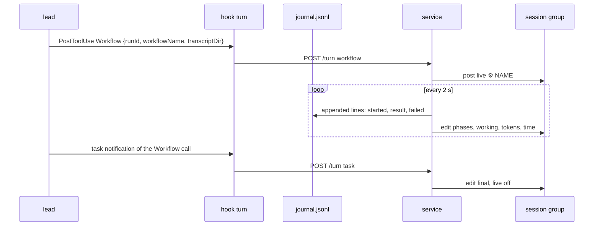
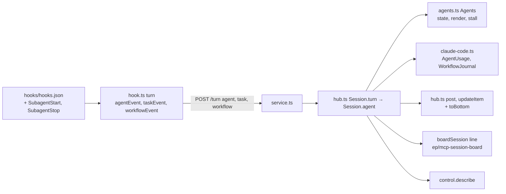

# SimpleX MCP: subagents and workflows live in the session group

Status: renders approved by the user on 2026-11-21; implemented in #8294 on `ep/mcp-session-board`, with the user's answers:
```
Q1  A: no step lines of the lead's Agent and Workflow
Q2  A: 2 min between tool calls, 10 min while one runs
Q3  none: the short description shows no agent counts; agents show in their live messages and in the
    agents line of the session's message in the Main group
Q4  the bottom area is tracked: live agent and workflow messages keep their order and are moved down
    only when another message follows them, with to_bottom once the core has it; until then edits
    keep messages in place, and the tracking lands with the core option
Q5  A
Q6  A: the note of a task with a live message is not posted
Q7  A: a resumed agent gets a new message
```
Differences from the decisions below: `start` sends the agent's `transcript` path, not its folder; a message 23 hours old ends with ⏹️; session-group profile updates wait at least one minute after the last one that changed the profile. Code references: master `20ee7cb14`, `packages/simplex-chat-mcp`. Claude Code references: version 2.1.311, its binary `/usr/local/bin/claude` at the byte offsets given, the hooks reference `https://code.claude.com/docs/en/hooks.md` (read 2026-11-21, cited by line of that file), and the transcripts of this machine.

## 1. Goal

The user, 2026-11-21:

> I don't see subagents in the chat and what they are doing. I can only see it in terminal

> I am more interested in subagents progress on tasks that I can see in terminal, and I can also see them stalling, but I don't see it in the chat.

Outcome:
- Each subagent of a session has one message in the session's group, edited as it works, and final when it ends.
- Each workflow has one message with its phases, edited as its agents work.
- The session group's short description and the session's message in the Main group show the counts while agents work.

## 2. What users see

Approved renders (2026-11-21).

Subagent, working:
```
🤖 Explore · find the suspend callers
14 steps · 38.2k tokens · 1:05 · now: 📖 Read SuspendChat.swift
```
Stalled:
```
🤖 Explore · find the suspend callers
14 steps · 38.2k tokens · 3:15 · ⚠️ no step for 2:10 · last: 💻 cabal build
```
Ended:
```
🤖 Explore · find the suspend callers · ✅ 2:40 · 22 steps · 61.5k tokens
Found 6 callers of suspendChat; the two in AppDelegate run on the main thread.
```
`❌` for a failure, `⏹️` for a stop.

Workflow:
```
⚙️ review-changes · Review 4/4 ✅ · Verify 3/8 · 2 working · 412k tokens · 6:30
```
Ended (Q5 A):
```
⚙️ review-changes · ✅ 6:30 · Review 4/4 · Verify 8/8 · 412k tokens
```
Its agents get no messages of their own.

Session group, short description while agents work:
```
alice@example.com · claude-opus-4-7 · effort high · 2 agents working · 1 stalled
```
Main group, the session's message (`ep/mcp-session-board`), a line after the details:
```
🤖 2 agents working · 1 stalled 2:10 · ⚙️ review-changes Verify 3/8
```

Lines:
```
part                 text                                                           source
TYPE                 agent_type of SubagentStart                                     hook input
DESCRIPTION          description of the agent's record                               subagents/agent-ID.meta.json
N steps              tool calls of the agent, SubagentHandback left out               PreToolUse with agent_id
X tokens             input + cache creation + cache read + output tokens of the       the agent's transcript; at the end the
                     agent's latest request, as the terminal                           task notification or the Agent result
M:SS                 time since SubagentStart, in 5 s steps; H:MM:SS from 1 hour       the service's clock
now: STEP            the agent's open tool call, as step lines name it               PreToolUse without its PostToolUse
last: STEP           the last tool call, when none is open                           PostToolUse, PostToolUseFailure
⚠️ no step for M:SS   time since the agent's last hook event, past the threshold       decision 19
result line          first line of the report or the final answer                    SubagentHandback, SubagentStop
PHASE d/t            agents of the phase ended / started, ✅ when d = t and a later     the workflow's journal.jsonl
                     phase started or the workflow ended
K working            agents started and not ended                                    the workflow's journal.jsonl
```

## 3. Questions for the user

```
Q1  the lead's own step lines "🤖 Agent: …" and "🔧 Workflow"
      A  not posted: the agent's or the workflow's message replaces them (recommended: one message per agent)
      B  posted as today, beside the messages
Q2  the stall threshold
      A  2 min between tool calls, 10 min while a tool call runs (recommended, decision 19)
      B  2 min in both cases
Q3  the short description
      A  while any agent or workflow works, also after the turn, changed at most every 30 s (recommended: background agents outlive the turn; each change adds an "updated group profile" item, fact 13)
      B  only while a turn runs
Q4  move to the bottom, once the core has it (2026-11-21-update-to-bottom.md)
      A  an edit moves the message when an item other than an agent's or workflow's live message follows it (recommended: live messages stay together at the bottom without swapping)
      B  every edit moves the message
Q5  a workflow's ended message
      A  ⚙️ review-changes · ✅ 6:30 · Review 4/4 · Verify 8/8 · 412k tokens (recommended: the ended subagent form)
      B  the working form with ✅ appended
Q6  the note of a task notification for an agent or a workflow that has a message
      A  not posted: the message shows the end (recommended)
      B  posted as today
Q7  an agent resumed with SendMessage after its end
      A  a new message; the old one stays final (recommended: the old message records the first run)
      B  the old message edited again
```

## 4. Decisions

Facts:
1. Plugin hooks run inside subagents: "When a subagent calls a tool, tool events such as `PreToolUse` and `PostToolUse` fire the same configured hooks as in the main conversation, and the input carries the `agent_id` and `agent_type`" (hooks.md:255). `agent_id` is "Present only when the hook fires from within a subagent ... Absent for the main thread" (binary 241050879, the SDK schema of hook inputs).
2. The plugin drops them: `stepOf` returns undefined when `agent_id` is set (hook.ts:439), and `eventFields` sends nothing without a step (hook.ts:210-211). hooks.json registers neither SubagentStart nor SubagentStop (hooks/hooks.json:2-12).
3. SubagentStart has `agent_id` and `agent_type` (hooks.md:2669); Claude Code builds it as `{...common, hook_event_name: "SubagentStart", agent_id, agent_type}` (binary 251822050) in the agent runner (binary 256639407), for Agent subagents and for workflow agents, which run in the same runner with `transcriptSubdir: "workflows/RUN"` (binary 262633027). It fires again when a subagent is resumed (hooks.md:2659). For the `web-fetch` subagent only hooks of managed settings run (hooks.md:2665).
4. SubagentStop has `agent_id`, `agent_type`, `agent_transcript_path` and `last_assistant_message`; "`transcript_path` is the main session's transcript, while `agent_transcript_path` is the subagent's own transcript stored in a nested `subagents/` folder" (hooks.md:2709). It also fires for internal agents such as prompt suggestions (hooks.md:2711). The path is `agent-ID.jsonl` in the agent's subfolder (binary 244546157, `am`).
5. Each agent has a record `agent-ID.meta.json` beside its transcript, with `agentType`, `description`, `toolUseId` (the lead's Agent call), `spawnDepth`, `requestShape`, and for teammates `name`, `taskKind`, `teamName` (binary 248815448; this machine: `subagents/agent-a056a6621326e5bb4.meta.json`). It is written after SubagentStart starts (binary 256652127, after 256639407). A workflow agent's record is `subagents/workflows/RUN/agent-ID.meta.json` with `agentType: "workflow-subagent"`, `description` (the label) and `workflowPhase`; 474 of 474 records of this machine.
6. The terminal shows a running agent's tokens as input + cache creation + cache read + output of the latest request (`_S` and `vF`, binary 273458000-273460500; `bM` and `F2t`, binary 244394184), and its end as `Done (N tool uses · X tokens · DURATION)` (binary 273463295).
7. An agent's transcript gives the same figures: for agent `abb7c6a9b3a0ae44c` of `-code-web/c4d3c64b…`, the last assistant `usage` sums to 112,485 and its tool calls without SubagentHandback count 27; its task notification has `<subagent_tokens>112485</subagent_tokens><tool_uses>27</tool_uses><duration_ms>165352</duration_ms>`.
8. "The transcript file is written asynchronously and may lag the in-memory conversation" (hooks.md:757).
9. The Agent tool's PostToolUse `tool_response`: foreground `status: "completed"` with `agentId`, `totalTokens`, `totalToolUseCount`, `totalDurationMs`; background `status: "async_launched"` with `agentId` (hooks.md:1968-1984). On this machine all 201 Agent results of the `-code-web` transcripts are `async_launched`.
10. A background agent's end reaches the lead as a task notification `<task-id>AGENT_ID</task-id><tool-use-id>…</tool-use-id><status>completed</status>…<usage>…</usage>`, once per stop (`-code-web/c4d3c64b…`). The plugin turns it into a note today (`taskNote`, hook.ts:403-411).
11. The Workflow tool returns at once: `toolUseResult` `{status: "async_launched", taskId, taskType: "local_workflow", workflowName, runId, summary, transcriptDir, scriptPath}` (this machine, `toolu_01DBsaNfemr86Aobbsy1aqrT`). Its end is a task notification with `<tool-use-id>` of the Workflow call, `<status>` and `<summary>Dynamic workflow "…" completed</summary>` (binary 258848776, `DTr`; this machine, task `w3tnei5uf`).
12. A workflow's `TRANSCRIPT_DIR/journal.jsonl` has the lines `{"type":"launched"}`, `{"type":"started", key, agentId, label, phase}`, `{"type":"result", key, agentId, result}` and `{"type":"failed", key, agentId}`; 966 lines of 63 runs on this machine. `started` is appended when the agent's ID is known, without waiting (binary 262616562); an agent replayed from the cache of a resumed run gets no `started` line (the same place, `cached: !0`).
13. The terminal groups a workflow's agents by phase from the agents present, so a phase without a started agent is not shown (binary 274204400, `ae`).
14. A change of a group's short description creates an `updated group profile` item for every member (`sameGroupProfileInfo`, Internal.hs:3391-3392; Commands.hs:4268, Subscriber.hs:3873).
15. Gaps between consecutive tool events in 873 subagent transcripts of this machine: from a tool result to the next tool call (the model's turn) p50 3.3 s, p99 91.4 s, 1,346 of 185,195 over 120 s; from a tool call to its result p99 106 s, p99.9 600.4 s, 166 of 136,227 over 600 s. Bash's maximum timeout is 600,000 ms (the Bash tool's description).
16. A core of an earlier release refuses an unknown command parameter as `commandError` (`execChatCommand`, Commands.hs:436-437; `chatCmdError`, Controller.hs:1790-1791). The update option is `/_update item … to_bottom=on` (2026-11-21-update-to-bottom.md, section 4).
17. hook.ts sends `effort` and `answer` from every event it forwards (hook.ts:181); a subagent's PreToolUse has `effort` with the subagent's level (hooks.md:761) and its SubagentStop has `last_assistant_message`.

Choices:
18. Hooks: SubagentStart and SubagentStop run `hook turn`, async. For an event with `agent_id`, `turn` sends neither `answer` nor `effort` (fact 17).
19. Stall: an agent is stalled when its last hook event is older than 2 min while no tool call of it is open, or 10 min while one is open (Q2 A). 2 min is above the 99th percentile of the model's turns (91 s); 10 min is Bash's maximum timeout, and 0.12 % of tool runs exceed it (fact 15).
20. The hook makes one `agent` event per subagent hook:
    - SubagentStart: reads the record of fact 5 at `FOLDER/subagents/agent-ID.meta.json`, `FOLDER` the hook's `transcript_path` without `.jsonl`, every 100 ms for up to 2 s; sends `start` with `type`, `description`, `toolUse` and `folder`. A record found under `FOLDER/subagents/workflows/*/`, a record with `taskKind`, and no record within 2 s send nothing.
    - PreToolUse, PostToolUse, PostToolUseFailure with `agent_id`: `step` with the tool use's ID, its text as `stepText` makes it, without the small-print markup, and `end`. SubagentHandback sends `report`, the first line of `tool_input.message`, and no step.
    - SubagentStop: `stop` with the first line of `last_assistant_message`.
21. The hook makes one `task` event of the lead's results:
    - PostToolUse of Agent with `status: "completed"`: `{toolUse, status: "completed", tokens, steps, ms}` from `totalTokens`, `totalToolUseCount`, `totalDurationMs` (fact 9).
    - PostToolUseFailure of Agent: `{toolUse, status}`, `killed` with `is_interrupt`, else `failed`.
    - A task notification: `{toolUse, status, tokens, steps, ms}` from `<tool-use-id>`, `<status>` and `<usage>`; the note is sent as today.
22. The hook sends `workflow` `{toolUse, run, name, folder}` at the lead's PostToolUse of Workflow from `tool_use_id`, `runId`, `workflowName` and `transcriptDir` (fact 11).
23. The lead's step lines of Agent and Workflow are not sent (Q1 A).
24. Service, subagent: `start` posts the live message and records the agent by ID; `step`, `report` and `stop` of an unknown ID are dropped, which leaves out workflow agents, teammates and internal agents. A `task` whose `toolUse` is a recorded agent's or workflow's ends it and its note is dropped (Q6 A).
25. Ends: `stop` ends the agent with ✅ and its result line, the report first; a later `task` of the same agent sets the status and the exact figures and edits the message once more. A `start` of an ended ID posts a new message (Q7 A). The hub's stop and the session's last detach end live agents with ⏹️.
26. Tokens: every 2 s, at the hub's board tick (`Hub.showSessions`, hub.ts:1103), the service reads the last 256 KiB of each working agent's transcript, `FOLDER/subagents/agent-ID.jsonl`, and takes the last `assistant` entry with `message.usage` and a model other than `<synthetic>`; a read without one keeps the last value (fact 8).
27. Workflow: `workflow` posts its live message. Every 2 s the service reads the journal's appended bytes, from the end of the last complete line read, and keeps per `key` the last of `started`, `result`, `failed`, with its `agentId` and `phase`. Phases are ordered by their first `started`; an agent without a phase is counted under its name-less phase, shown as `d/t`. Tokens are the sum of the last usage of its agents' transcripts, `TRANSCRIPT_DIR/agent-ID.jsonl`, read for agents that are working, and once when they end. The workflow ends at the `task` of its Workflow call.
28. Text and edits: each live message is posted with priority -1 and `live`, as step lines are (`Session.step`, hub.ts:592-611). It is edited when its text changes, at most every 5 s; elapsed times are shown in 5 s steps, so an idle agent's message changes at most every 5 s. The end edit is sent at once with `live` off.
29. Move: when the core accepts `to_bottom=on`, an edit moves the message when an item other than a live agent or workflow message follows it in the group (Q4 A). The first `commandError` to such an edit marks the core without the option for the hub's lifetime, and the edit is sent again without it (fact 16).
30. Counts: `N agents working` counts working subagents and the working agents of workflows; `K stalled` counts stalled subagents. The short description appends ` · N agents working · K stalled`, zero parts left out, while any agent or workflow works, changed at most every 30 s (Q3 A). The Main group line, in `boardSession` of `ep/mcp-session-board`: `🤖 N agents working · K stalled M:SS · ⚙️ NAME PHASE d/t`, M:SS of the longest stall, one `⚙️` part per working workflow with its current phase.
31. Expiry: a live message older than 23 hours is finalized as it stands, as step lines are (`liveLineMs`, `expireLive`, hub.ts:51, :882).
32. The protocol version stays 1: `agent`, `task` and `workflow` are optional fields of `POST /turn`.

## 5. Design

Where the subagent's state is kept:
```
option                                       cost
S. the service, from hook events (chosen)    one optional field per hook request; tokens from a 256 KiB tail every 2 s per working agent
T. the service, from transcripts only        a read of every agent transcript every 2 s; no steps of an agent that has not written yet;
                                             the open tool call and the stall time need the hooks anyway
H. the hook computes the message text        each hook process reads the transcript and the record; concurrent hooks race on one message
```

Where a workflow's progress is read:
```
option                                       cost
J. journal.jsonl, appended bytes (chosen)    one read of new bytes every 2 s per working workflow
A. workflow agents' hook events              phase and label only in the record; ends of cached agents missing; one record read per agent
```

Event flow:
```mermaid
sequenceDiagram
  participant L as lead
  participant A as subagent
  participant K as hook turn
  participant F as session folder
  participant S as service
  participant G as session group
  participant M as Main group
  L->>K: PreToolUse Agent (no step line, Q1 A)
  A->>K: SubagentStart agent_id, agent_type
  K->>F: read subagents/agent-ID.meta.json
  K->>S: POST /turn agent.start {type, description, toolUse, folder}
  S->>G: post live 🤖 TYPE · DESCRIPTION
  loop each tool call of A
    A->>K: PreToolUse / PostToolUse with agent_id
    K->>S: POST /turn agent.step
    S->>S: steps, now, last event time
  end
  loop every 2 s
    S->>F: tail of agent-ID.jsonl: tokens
    S->>G: edit when the text changed, at most every 5 s
    S->>M: session message line; short description at most every 30 s
  end
  A->>K: SubagentStop last_assistant_message
  K->>S: POST /turn agent.stop
  S->>G: edit final, live off: ✅ M:SS · N steps · X tokens + result line
  L->>K: task notification or Agent PostToolUse
  K->>S: POST /turn task {toolUse, status, tokens, steps, ms}
  S->>G: edit final with the exact figures, status ❌ or ⏹️ when so
```

Workflow flow:


Subagent message states:

```mermaid
stateDiagram-v2
  [*] --> working: agent.start
  working --> working: agent.step, tokens, 5 s tick
  working --> stalled: no event 2 min, no open call; 10 min with an open call
  stalled --> working: agent.step
  working --> ended: agent.stop ✅, task ✅ ❌ ⏹️
  stalled --> ended: agent.stop, task
  working --> ended: hub stop, last detach ⏹️; 23 h
  stalled --> ended: hub stop, last detach ⏹️; 23 h
  ended --> ended: task: status and exact figures
  ended --> [*]
```


```
state     text                                                                   live
working   🤖 TYPE · DESCRIPTION / N steps · X tokens · M:SS · now: STEP             on
stalled   🤖 TYPE · DESCRIPTION / N steps · X tokens · M:SS · ⚠️ no step for M:SS · last: STEP   on
ended     🤖 TYPE · DESCRIPTION · ✅ M:SS · N steps · X tokens / RESULT             off
```

Workflow message states:

```mermaid
stateDiagram-v2
  [*] --> working: workflow
  working --> working: journal lines, tokens, 5 s tick
  working --> ended: task of the Workflow call ✅ ❌ ⏹️
  working --> ended: hub stop, last detach ⏹️; 23 h
  ended --> [*]
```


Service tick, `Session.readAgents`, called from `Session.readRecord`:
```
for each working agent:      tokens = lastUsage(tail of agent transcript) ?? tokens
for each working workflow:   journal += appended lines; tokens of its working agents
for each live message:       text = render(state, now); changed and 5 s since the last edit: edit
counts changed, 30 s since:  control.describe(details + counts)
```

Composition:


Changes:
```
file                 function or type              change
hooks/hooks.json     SubagentStart, SubagentStop   + command hook "hook turn", async
src/hook.ts          TurnInput                     + agent_type, agent_transcript_path, tool_response
                     eventFields                   agent_id: agentEvent; Agent and Workflow of the lead: taskEvent, workflowEvent;
                                                   SubagentStart, SubagentStop
                     turn                          no answer and effort with agent_id
                     agentEvent                    new: decision 20, the record read of fact 5
                     taskEvent                     new: decision 21; taskNote unchanged
                     stepOf                        Agent and Workflow of the lead: no step (Q1 A)
src/protocol.ts      TurnRequest                   + agent?: AgentEvent, task?: TaskEnd, workflow?: WorkflowRun
                     AgentEvent                    new: {id} and one of start {type, description, toolUse?, folder},
                                                   step {id, text, end?}, report, stop
                     TaskEnd, WorkflowRun          new
src/agents.ts        Agents                        new: the session's agents and workflows, their states, texts, counts, stall
src/claude-code.ts   AgentUsage, WorkflowJournal   new: last usage of a transcript tail; appended journal lines
src/hub.ts           Session.turn                  agent, task, workflow to Session.agent
                     Session.readRecord            + readAgents
                     Session.updateItem            + toBottom, with the fallback of decision 29
                     Session.endLive               + end of live agents
                     boardSession, details         + the counts of decision 30
src/messages.ts      clock                         new: M:SS and H:MM:SS
```

Types:
```
AgentEvent
  id         string                      agent_id
  start?     {type, description, toolUse?, folder}
  step?      {id, text, end?}
  report?    string
  stop?      string
TaskEnd
  toolUse    string
  status     "completed" | "failed" | "killed" | "stopped"
  tokens?    number
  steps?     number
  ms?        number
WorkflowRun
  toolUse    string
  run        string
  name       string
  folder     string
```
`AgentEvent` carries exactly one of `start`, `step`, `report`, `stop`; the hook builds one per input.

```
Agent (agents.ts)
  id, type, description, toolUse?, folder
  startedAt, lastEventAt
  steps        number
  open         Map<tool use ID, text>
  last?        string
  tokens?      number
  result?      string
  end?         {status, at, tokens?, steps?, ms?}
  item         Promise<number | undefined>
  sent         string
  sentAt       number
Workflow (agents.ts)
  toolUse, run, name, folder, startedAt
  journal      Map<key, {state: "started" | "result" | "failed", agentId, phase?}>
  phases       string[]               order of first started
  tokens       Map<agentId, number>
  end?         {status, at}
  item, sent, sentAt
```

## 6. Overlaps

```
branch                         shared code                                        how conflicts are avoided
ep/mcp-session-board           Session.readRecord, boardSession, details,         this work stacks on it: the agents line is one more entry of
(in progress)                  describe; Session.transcript; claude-code.ts       boardSession's lines; the counts append to details() for the
                                                                                  short description only; readAgents runs inside readRecord;
                                                                                  AgentUsage and WorkflowJournal join claude-code.ts. The branch
                                                                                  states the agents line is left to this work.
ep/mcp-unblock (plan)          hooks/hooks.json; TurnInput; TurnRequest;           new hook lines and fields only, each on its own line; agent
                               Session.turn; cards with agent_id                   cards (its decision 34) stay cards; a subagent waiting on a
                                                                                  card shows as stalled with "last: STEP" until the decision
ep/mcp-teammate-profiles       hooks/hooks.json SubagentStop; stepOf with          teammates (record with taskKind, or name once #8209 lands) are
#8209, ep/mcp-teammate-steps   agent_id; TurnInput agent_type,                    theirs: decision 20 sends no start for them, so their steps stay
(open)                         agent_transcript_path, tool_response;               with teammates.step; one SubagentStop line in hooks.json; one
                               no answer and effort for agent_id                   agent_id guard in turn; whichever lands second merges these lines
ep/update-to-bottom (plan)     Session.updateItem                                  used behind decision 29 once the simplex-chat package has it
```

Merge order recommended: `ep/mcp-session-board`, then this work rebased onto master with `git rebase --onto`.

## 7. What the renders cannot show

```
case                                       why
the web-fetch subagent                     its SubagentStart and SubagentStop run only from managed settings (fact 3)
named teammates                            shown by their own profiles (#8209)
internal agents: prompt suggestions, /btw  no record; SubagentStop only (fact 4)
"now:" while the model writes              no hook event between tool calls; the line shows "last: STEP"
tokens a few seconds late                  the transcript lags the conversation (fact 8); the end shows the exact figures
workflow agents replayed from the cache    no started line in a resumed run (fact 12); their phase counts start at the live agents
workflow tokens                            the sum of each agent's latest request; the terminal's workflow figure is summed from its
                                           own progress events and can differ
a message's place without to_bottom        an edit keeps the message where it was posted; later messages push it up
the short description at each change       each change adds an "updated group profile" item (fact 14); hence 30 s
agents across a service restart            the state is in memory; their messages stay at their last edit
```

## 8. Acceptance and tests

```
#   criterion                                                                       checked by
1   SubagentStart with a record sends start; a workflow agent, a teammate and       unit: hook
    no record send nothing
2   a subagent's tool hooks send agent steps without effort and answer;             unit: hook
    SubagentHandback sends report; SubagentStop sends stop
3   Agent results and task notifications send task with the figures; the            unit: hook
    note stays; Workflow's result sends workflow; no step lines of Agent, Workflow
4   last usage of a transcript tail; synthetic entries and a partial last line      unit: claude-code
    skipped
5   journal: phases in order, retries by key, appended bytes only                   unit: claude-code
6   texts of working, stalled at 2 and 10 min, ended; workflow text; 38.2k, 412k;   unit: agents
    1:05 and 1:00:05
7   one live message per agent: posted at start, edited at most every 5 s,          unit: sessions
    final at stop, figures at task, ⏹️ at endLive; note of its task dropped
8   to_bottom sent when another item follows; commandError falls back to edits      unit: sessions
9   short description and the board line follow the counts, at most every 30 s      unit: sessions
10  a real session: a background Explore agent, a foreground agent, a two-phase     TESTING
    workflow; their messages against the terminal; the inputs of facts 3, 4, 9
    and 11 recorded as fixtures
```

Unit tests use recorded inputs: the hook inputs recorded in check 10, the journal and transcript lines of facts 7 and 12, and core responses of the existing `test/unit/fixtures.ts`.

## 9. Docs to change

- README.md: the session group shows subagents and workflows.
- REFERENCE.md, "The session group": the messages, their states, the stall thresholds; the short description; the Main group line.
- spec/api.md: `POST /turn` `agent`, `task`, `workflow`; the hooks; the texts.
- spec/architecture.md: `agentEvent`, `taskEvent`, `Agents`, `AgentUsage`, `WorkflowJournal`, `Session.readAgents`, `updateItem` with `toBottom`.
- spec/flows.md: the subagent flow and the workflow flow of section 5.
- TESTING.md: check 10.
