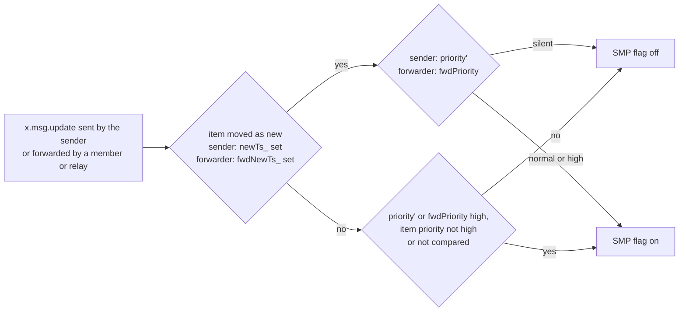
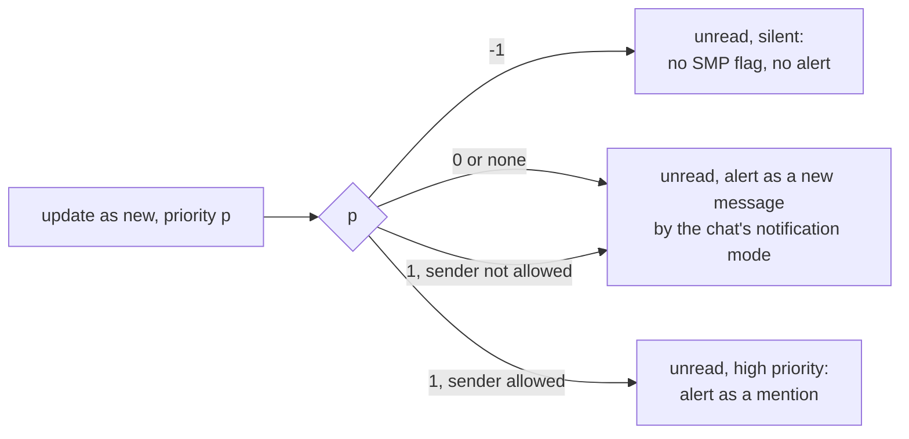
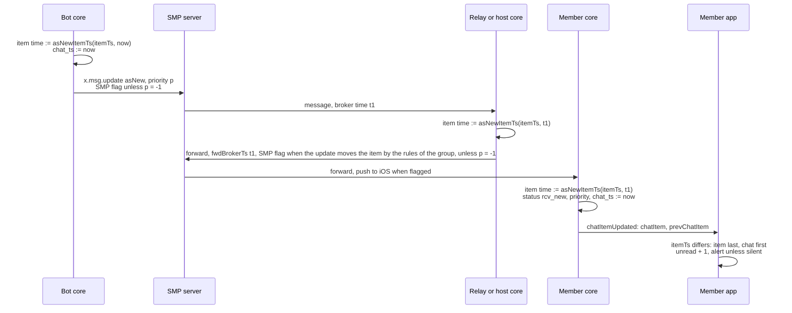
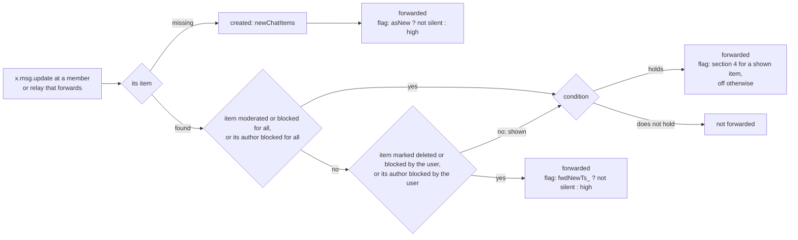
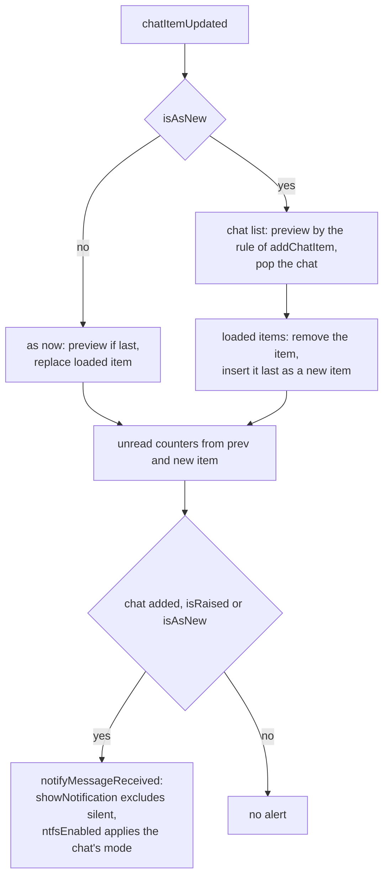
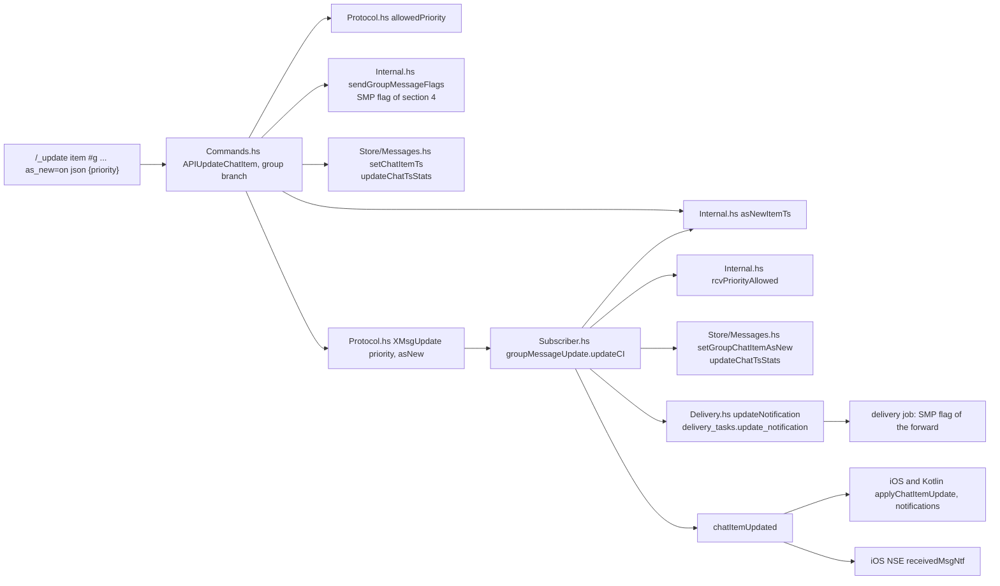
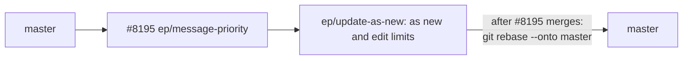

# Group updates that show a message as new

Status: implemented on `ep/update-as-new`; U1-U4 and P1 decided by the user on 2026-11-21. One 7.2 core pull request with `2026-11-21-edit-window-preference.md`, stacked on message priority (#8195, `ep/message-priority` at `4f7535458`). Code references: master `20ee7cb14`; priority code by name, from `ep/message-priority`.

The user's words:

> the challenge is that edit doesn't push the message to the bottom. This is a common problem that we cannot make updates that also update message time - I think we need to make it a hidden protocol option, finally, it seems rather simple, and you recent update improvement should help it. So update protocol message gets a flag to move the message to the bottom. This way, on every update, the message would jump to the bottom. Many bots would benefit from it, as currently we have to delete and recreate, and this pattern used in quite a few bots - the downside is jumping view and the loss of history. ... My bet is that update that updates time (also based on server time) is simple - this way sender cannot manipulate it. And we won't expose it in UI anyway.

> adding notification makes asNew precise, and it's simply atomic update that deletes and creates new item while preserving history and showing edited icon

## 1. What users see

Before:
- A bot keeps a status message current by edits. Later messages move it up the chat.
- To keep it last, a bot deletes it for everyone and posts it again: each repost alerts, a deleted item is left in place when full deletion is off, and the edit history of the message is lost. The Claude Code plugin replaces its list of sessions every 23 hours this way ([main-group.ts:174](../packages/simplex-chat-mcp/src/main-group.ts#L174)); the support bot reposts each card on every change ([cards.ts:257-287](../apps/simplex-support-bot/src/cards.ts#L257-L287)).

After, in groups and channels:
- A bot updates a message with `as_new=on`. For every member the item becomes a new message: it is shown last, with the time of the update, unread, and the group moves to the top of the chat list.
- It alerts as a new message would, by the group's notification setting (U1). With priority -1 it alerts nobody; with priority 1 it alerts as a mention, when the group's priority preference allows the sender (#8195).
- The item keeps its ID, reactions, replies to it and its edit history, and shows the edited mark when its text changed.
- Only the sender of a message updates it as new, as an edit, within the limits of `2026-11-21-edit-window-preference.md` (U2).
- In direct chats and note folders the flag is ignored: the update is a plain edit.
- The apps have no control for it (U4).
- An app or a core of an earlier release applies the update as an edit in place.

## 2. Protocol

```
x.msg.update params
  msgId          base64url          as now
  content        msgContent         as now
  mentions       object             optional, as now
  ttl            integer            optional, as now
  live           boolean            optional, as now
  scope          msgScope           optional, as now
  asGroup        boolean            optional, as now
  priority       integer            optional, #8195: 1 raises the item; with asNew: the priority of the new message
  asNew          boolean            optional, new; sent only as true, only to groups
```

```
Protocol.hs
  XMsgUpdate                asNew :: Maybe Bool          new last field, after priority of #8195
  appJsonToCM, XMsgUpdate_  asNew <- opt "asNew"
  chatToAppMessage          "asNew" .=? asNew
  eventHasNotification      unchanged, #8195: off for every x.msg.update; the flag of an update is set by section 4
  positional uses           Library/Commands.hs, Library/Subscriber.hs, tests/ProtocolTests.hs, tests/ChatTests/Groups.hs,
                            the sites of the priority field of #8195
```

- SMP notification flag of an update as new that moves the item: priority -1, unset; 0 or absent, set; 1, set. An update that leaves the item in place has the flag of #8195: set only for a change to high priority.
- The chat protocol version is unchanged. Parsers of earlier releases read optional parameters with `.:?` (`opt`, Protocol.hs:1422) and skip unknown keys.
- In a signed update `asNew` is covered by the signature.
- `docs/protocol/simplex-chat.md` (:185) and `docs/protocol/simplex-chat.schema.json` (:474): `asNew` with its receiver rule.

## 3. Time of an item updated as new

Each receiver sets the time from its own time source; the message contains only the flag.

```
time source       received directly          broker time of the message (metaBrokerTs, Subscriber.hs:1036)
                  forwarded by a host/relay  fwdBrokerTs of the forward (Subscriber.hs:4029), as for new items
                  sender's own copy          local time of the command
new item time     end of the second of the time source: floor(t) + 0.999 s
applied           only when later than the item's time
```

```haskell
asNewItemTs :: ChatItemTs -> UTCTime -> Maybe ChatItemTs
asNewItemTs itemTs t
  | ts > itemTs = Just ts
  | otherwise = Nothing
  where
    ts = addUTCTime 0.999 (roundDownToSecond t)
```

- `asNewItemTs` is in `Library/Internal.hs`, next to `roundDownToSecond` (:3090).
- Group items are ordered by `item_ts, chat_item_id` (`getChatItemIDs`, Store/Messages.hs:1541); direct chats and note folders by `created_at, chat_item_id` (:1570, :1576), where a new `item_ts` changes no position.
- Broker times have whole seconds: SMP encodes `systemSeconds` (simplexmq `Encoding.hs:146`). This code creates items with whole seconds: received items with the broker time (Internal.hs:3118), sent, internal and local items with `roundDownToSecond` (Internal.hs:3082, :3427, :3483; Commands.hs:2729). An item updated as new is therefore placed after every item of its second and earlier; an item created later in the same second is placed before it.
- SQLite stores `item_ts` as `YYYY-MM-DD HH:MM:SS[.fff]` (sqlcipher-simple `utcTimeToBuilder`), ordered as text; Postgres as `timestamptz`.
- Among items created by this code, a fractional second in `itemTs` marks an item updated as new.

## 4. Priority of an item updated as new

An update as new has the priority of the update, by the rule of every update of #8195. Only the notification differs: an update as new is notified as a new message.

```
every update, with or without asNew (#8195)
  sender's item       allowedPriority highAllowed of UpdatedMessage.priority; absent: normal; support scopes included
  receiver's item     deleted: its priority; otherwise allowedPriority (rcvPriorityAllowed memberBlocked cd) of the update's priority
  userMention         mention or reply of the updated content || high (updateGroupCIUserMention, #8219)

                      update in place (#8195)                  update as new, the item moved (newTs_ set)
  SMP flag            on for a change to high only             off for silent only
  forward SMP flag    the same, by fwdPriority and fwdNewTs_ of the rules of the group (section 6);
                      on for high when the item is missing or not compared
  apps notify         when raised (isRaised)                   when shown as new (isAsNew), unless silent
```

```
SMP flag            newTs_ set: priority' /= MPSilent; otherwise priority' == MPHigh && priority /= MPHigh (#8195)
sender              Commands.hs, group branch: MsgFlags of sendGroupMessageFlags (#8195)
forwarder           Subscriber.hs, updateCI: DeliveryTaskContext.updateNotification
                      fwdNewTs_ set: fwdPriority /= MPSilent; otherwise fwdPriority == MPHigh && fwdPrevPriority /= Just MPHigh (section 6)
                    an item created for a missing message: asNew in the main scope from an author not blocked for all:
                      fwdPriority /= MPSilent; otherwise fwdPriority == MPHigh
delivery task       Delivery.hs: priorityRaised of #8195 renamed updateNotification, in DeliveryTaskContext and MessageDeliveryTask
                    delivery_tasks.priority_raised of #8195 renamed update_notification, in M20261113_item_priority
                    taskHasNotification: updateNotification || msgHasNotification, as in #8195
```



- `highAllowed` is `groupFeatureUserAllowed SGFMsgPriority gInfo` of #8195; a silent priority is allowed to every member.
- API: `/_update item #1 5 as_new=on json {"msgContent": {"type": "text", "text": "..."}, "mentions": {}, "priority": -1}`, with `UpdatedMessage.priority` of #8195.



## 5. Core: sending

`APIUpdateChatItem` (Controller.hs:428), new field `asNew :: Bool` after `liveMessage`:

```
/_update item <chatRef> <chatItemId>[ live=on][ as_new=on] json <updatedMessage>
parser (Commands.hs:6872)   <*> (" as_new=" *> onOffP <|> pure False), after liveMessageP
positional uses             Commands.hs:2747, :2751                        False
                            apps/simplex-badge-service/src/BadgeService/Group.hs:345   False
```

Group branch of the handler (Commands.hs:850); the direct (:825) and note folder (:886) branches ignore `asNew`:

```
newTs_     if asNew && isNothing scope && isNothing itemScopeInfo then asNewItemTs (chatItemTs' ci) currentTs else Nothing
priority'  allowedPriority (groupFeatureUserAllowed SGFMsgPriority gInfo) priority_   -- #8195
condition  changed || itemLive == Just True || priority' /= priority || isJust newTs_
event      XMsgUpdate ... priority' (justTrue (isJust newTs_))
SMP flag   section 4, passed to sendGroupMessageFlags
edited     changed && itemLive /= Just True                           -- as in #8195
store      updateGroupChatItem with meta.priority = priority', updateGroupCIMentions, then for newTs_:
             updateChatTsStats db cxt user cd currentTs Nothing and setChatItemTs db ci'' newTs
response   CRChatItemUpdated with the item at its new time
```

- `newTs_` requires the main scope: an update as new in a member support scope is an edit in place.
- The edit limits of `2026-11-21-edit-window-preference.md` apply. The sender's core measures them from `created_at` of its item, which `setChatItemTs` keeps, so an update as new keeps the limits of the original send.

## 6. Core: receiving



`updateCI` of `groupMessageUpdate` (Subscriber.hs:2417), new parameter `asNew_ :: Maybe Bool`, passed from `XMsgUpdate` at :1099 and :4105. `messageUpdate` of direct chats (:598) ignores the field.

```
newTs_     = if asNew_ == Just True
                && main scope                      -- member support scope: in place
                && isNothing itemDeleted           -- deleted, moderated, blocked: in place
                && not (memberBlocked sender)      -- as for mentions
             then asNewItemTs (chatItemTs' ci) brokerTs
             else Nothing
priority'  if isJust itemDeleted then priority else allowedPriority (rcvPriorityAllowed memberBlocked cd) priority_   -- #8195
condition  changed || itemLive == Just True || priority' /= priority || isJust newTs_
           otherwise chatItemNotChanged
edited     changed && itemLive /= Just True                                  -- as in #8195
store      updateGroupChatItem with meta.priority = priority', updateGroupCIMentions, updateGroupCIUserMention, then for newTs_:
             updateChatTsStats db cxt user cd now Nothing
             setGroupChatItemAsNew db ci'' newTs
event      CEvtChatItemUpdated: the item at its new time with status rcv_new, the previous item; the chat info returned by updateChatTsStats
delivery   by the rules of the group, below: an update as new that moves the item is forwarded also without a change of text
```

A member or relay that forwards decides by the rules of the group, not by its own copy of the item (decided by the user in the review of #8314):

```
shown               isNothing itemDeleted && not (memberBlocked sender)
hiddenForAll        itemDeleted is CIModerated or CIBlockedByAdmin, or blockedByAdmin sender
fwdNewTs_           if asNew_ == Just True && main scope && not hiddenForAll then asNewItemTs (chatItemTs' ci) brokerTs else Nothing
fwdPriority         if hiddenForAll then priority else allowedPriority (rcvPriorityAllowed blockedByAdmin cd) priority_
fwdPrevPriority     if shown || hiddenForAll then Just priority else Nothing      -- Nothing: the item is not compared
delivery            Just context when the condition holds, or when fwdPrevPriority /= Just fwdPriority || isJust fwdNewTs_
updateNotification  if isJust fwdNewTs_ then fwdPriority /= MPSilent else fwdPriority == MPHigh && fwdPrevPriority /= Just MPHigh
item missing        created by saveRcvChatItem' with the priority of the update, event newChatItems; delivery: Just context
                    content prohibited by the group: a rejected item, no delivery
                    fwdPriority = allowedPriority (rcvPriorityAllowed blockedByAdmin cd) priority_
                    updateNotification: if asNew_ == Just True && main scope && not (blockedByAdmin sender)
                                        then fwdPriority /= MPSilent else fwdPriority == MPHigh
```



`Store/Messages.hs`, new:
```
setGroupChatItemAsNew :: DB.Connection -> ChatItem 'CTGroup 'MDRcv -> UTCTime -> IO (ChatItem 'CTGroup 'MDRcv)
  UPDATE chat_items
  SET item_original_ts = COALESCE(item_original_ts, item_ts), item_ts = ?, item_status = ?, item_viewed = 0
  WHERE chat_item_id = ?
  item_status = rcv_new; returns the item with meta.itemTs and meta.itemStatus set
setChatItemTs :: DB.Connection -> ChatItem c d -> UTCTime -> IO (ChatItem c d)
  UPDATE chat_items SET item_ts = ? WHERE chat_item_id = ?
getChatItemOriginalTs :: DB.Connection -> ChatItemId -> ExceptT StoreError IO UTCTime
  SELECT COALESCE(item_original_ts, item_ts) FROM chat_items WHERE chat_item_id = ?
```
`item_priority` and `user_mention` are written by `updateGroupChatItem_` of #8195. `item_original_ts` is the column of `2026-11-21-edit-window-preference.md`, added by migration `M20261113_item_priority` of #8195, one migration for both features, after `delivery_tasks.update_notification` (section 4); the down migration drops them in reverse order. The new queries are added to `tests/chat_query_plans.txt` by the query plan test.

State of a received group item, read from the last row; `-` is unchanged:

```
event                                    item_ts             chat_ts  item_status  item_viewed  priority  versions
x.msg.new at t0                          t0                  now      rcv_new      0            0         -
read                                     t0                  -        rcv_read     1            -         -
x.msg.update, text changed               t0                  -        rcv_read     1            -         +1
x.msg.update asNew p=0 at t1, changed    floor(t1) + 0.999   now      rcv_new      0            0         +1
read                                     -                   -        rcv_read     1            -         -
x.msg.update asNew p=-1 at t2, same      floor(t2) + 0.999   now      rcv_new      0            -1        -
x.msg.update asNew, not later            -                   -        -            -            -         as an update without asNew
```

- An update of an item missing on the receiver creates the item at the time source, unread, as now (Subscriber.hs:2331): it is last already. The event is newChatItems, so the apps show it as a new item and alert as for a new message, unless it is silent (`showNotification`, iOS `ChatTypes.swift`, Kotlin `ChatModel.kt`); a forwarder forwards an update as new of a missing item with the SMP flag of a new message, unless it is silent (decided by the user in the review of #8314).

## 7. Effects in groups

```
area                        effect of an update as new                               change
chat view order             item last: ORDER BY item_ts, chat_item_id (Store/Messages.hs:2476-2501)   none
pagination, navigation      before/after/around by item_ts (:2487, :2500, :1801-1828)                none
chat preview                last item by item_ts (:918)                              none
chat list order             chat_ts (:887)                                           updateChatTsStats
unread counts               +1 when the item was read: counted by item_status (:928); silent and high counters of #8195 by priority   setGroupChatItemAsNew
member support counters     as for a new item                                        updateChatTsStats stats
first unread, opening       item_viewed = 0: not the opening pivot (:1744); the first unread when no earlier one (:1735)   setGroupChatItemAsNew
notifications               as a new message, by priority (section 4)                Protocol.hs, apps, NSE, terminal
history for new members     ORDER BY item_ts (:3795); forwarded with fwdBrokerTs = itemTs in whole seconds (Internal.hs:1550)   none
channel web preview         ORDER BY item_ts (:3815); x.msg.update marks the content changed (Subscriber.hs:1139)   none
replies to the item         resolved by shared_msg_id (:702-748)                     none
forward of the item         a new item with the content                              none
expiration by chat TTL      item_ts <= cutoff AND created_at <= cutoff (:3662): kept a TTL after the update   none
disappearing messages       deleteAt of an item read before the update continues     none
edit and delete limits      sender from created_at, receivers from item_original_ts, kept across updates as new   2026-11-21-edit-window-preference.md
item info                   "sent at" shows the time of the update; versions keep the earlier texts and times   none
terminal view               viewItemUpdate (View.hs:870) as for an edit                none
```

- Bots: each update as new is a new unread message for every member, alerting by default. A bot that updates a status message often sends it with priority -1: the message stays last and unread, without alerts, and adds at most one unread item per member at a time.
- Abuse: an update as new alerts as a post does, and leaves at most one unread item per message; posting is unrestricted as well. Moderators block the member (updates are then applied in place), remove the member or delete the message.

## 8. Relays, hosts and channels

```
relay or host of this release     applies the update as new to its copy when it is shown; forwards it by the rules of the group with its SMP flag (section 6),
                                  an update without a change of text included
relay or host before              signed update: forwarded as received bytes, asNew kept (Protocol.hs:1597)
                                  unsigned update: encoded again from the parsed message, asNew dropped: an edit in place
                                  an update as new without a change of text: not forwarded (condition :2400 of this master)
subscriber                        time source fwdBrokerTs of the relay; every subscriber of one relay gets the same time
```

## 9. Apps and the notification extension

The apps detect an update as new when `chatItem.meta.itemTs != prevChatItem.meta.itemTs` in `chatItemUpdated`: `isAsNew(from:)` next to `isRaised(from:)` of #8195 (iOS `ChatTypes.swift`, Kotlin `ChatModel.kt`). Every other emitter of the event (Internal.hs:712, :857, :890; Subscriber.hs:421, :440, :729, :1232, :1581, :1610, :2055, :2133, :2411; Commands.hs:4969) keeps `itemTs`. The unread counters already follow the previous and the new item (#8219, with the silent and high counters of #8195).



```
iOS       Shared/Model/ChatModel.swift
            applyChatItemUpdate (:800)      moved branch
            addChatItem (:701)              its group preview rule (:716-729) used by both
            removal                         reversedChatItems.remove and chatState.itemsRemoved, as removeChatItem (:875)
            insertion                       _upsertChatItem (:837)
            pop                             popChatCollector.throttlePopChat (:736)
          Shared/Model/SimpleXAPI.swift
            chatItemUpdate (:3241)          notify = isRaised || isAsNew, in both profiles, as #8195 for isRaised
          SimpleX NSE/NotificationService.swift
            receivedMsgNtf, chatItemUpdated case of #8195
                                            AChatItemUpdate.showNotification (SimpleXChat/ChatTypes.swift):
                                            isRaised || isAsNew, with ntfsEnabled and showNotification: messageReceived
                                            otherwise noNtf: an edit and a silent update as new show nothing
Kotlin    common/src/commonMain/kotlin/chat/simplex/common/model/ChatModel.kt
            applyChatItemUpdate (:702)      moved branch, in the primary and the secondary context
            addChatItem (:582)              its preview rule (:598-613) used by both
            removal                         chatItems.removeAllAndNotify, as removeChatItem (:769)
            insertion                       addToChatItems (:560, :564), before TEMP_LIVE_CHAT_ITEM_ID as addChatItem
            pop                             popChatCollector.throttlePopChat (:631)
          common/src/commonMain/kotlin/chat/simplex/common/model/SimpleXAPI.kt
            chatItemUpdateNotify (:3847)    raised || asNew, in both profiles, as #8195 for raised
Terminal  src/Simplex/Chat/Terminal/Output.hs
            chatEventNotification           msgNtf for an update as new, as #8195 for a raise
specs     apps/ios/spec/state.md, apps/ios/spec/services/notifications.md,
          apps/multiplatform/spec/state.md, apps/multiplatform/spec/services/notifications.md
```

- iOS push: the SMP flag of an update as new wakes the notification extension as a new message does. An update without `asNew` and without a raise has no flag; when the extension receives it during another push, it shows nothing.
- An older app with a newer core, as with remote desktop: the update is shown as an edit in place, counted unread, without an alert, until the chat is opened again.
- An older iOS app receives the push of an update as new; its extension handles `chatItemUpdated` as no notification, as for a raise of #8195.

## 10. API and libraries

```
bots/src/API/Docs/Commands.hs:104   OnOffParam "as_new" "asNew" (Just False) after live
                                    description: "Update message. In groups, as_new=on makes the message new: last in the chat, unread and notified by its priority, with the time of the update set by each member; ignored in other chats."
generated by tests/APIDocs.hs       bots/api/COMMANDS.md
                                    packages/simplex-chat-client/types/typescript/src/commands.ts
                                    packages/simplex-chat-python/src/simplex_chat/types
packages/simplex-chat-nodejs/src/api.ts:488             apiUpdateChatItem: new asNew = false, with the priority parameter of #8195
packages/simplex-chat-python/src/simplex_chat/api.py:241  api_update_chat_item: new as_new=False, with the priority parameter of #8195
```

- A core of an earlier release refuses `as_new=on` as a command syntax error.
- The plugin and the support bot adopt the option in later pull requests, after a `simplex-chat` package with this core is published: the plugin's list with `as_new=on` and priority -1.

## 11. Composition



## 12. Merge order



The branch is stacked on `ep/message-priority` from its first code commit, and its pull request is merged after #8195 (P1).

## 13. Tests

Core, each failing on master and on `ep/message-priority`: the parser refuses `as_new=on`.

```
tests/ProtocolTests.hs     x.msg.update with "asNew":true and with "asNew":true, "priority":-1 encoded and decoded;
                             without them decoded to Nothing
                           "x.msg.update priority sets no notification flag" of #8195, with asNew absent
tests/ChatTests/Groups.hs  "update as new shows the item last and unread"
                             bob: "status"; alice: /_read chat items #1 <status>; cath: "hi"
                             bob: /_update item #1 <status> as_new=on text status 2, sent without a pause after "hi"
                             alice, bob, cath: /_get chat #1 count=2 -> "hi", "status 2"
                             alice: item_status of "status 2" is rcv_new (SQL, as in testDirectMessageUpdatePrevItem)
                             recorded: eventsFixture "updates/group-as-new", alice with markRead = False
                           "silent update as new": priority -1: last, rcv_new, item_priority -1
                             recorded: eventsFixture "updates/group-as-new-silent"
                           "high priority update as new without a change of text": admin with priority 1:
                             item_priority 1, user mention, not marked edited; a member below the priority role: item_priority 0
                           "update as new of a blocked member is applied in place": cath blocks bob; in place for cath
                           "forward update as new with notification flag of a new message": alice forwards bob's update
                             as new without a change of text to cath; msg_flags from bob to alice and of the forward: T;
                             a second later, the same update with priority -1: F
                           "forward high priority message and its raise" of #8195: an edit that repeats high: F
                           "should update channel message as new": last and unread for a subscriber
tests/ChatTests/Direct.hs  "update as new is ignored in a direct chat": bob "status", alice "hi", bob as_new=on;
                             both: /_get chat @2 -> "status 2", "hi"
tests/ChatTests/Utils.hs   stableJSON (:1043): itemTs is 1970-01-01T00:00:00Z plus the fraction of the recorded second
                             existing fixtures are unchanged: their itemTs have whole seconds
```

Apps, on `tests/fixtures/api/updates/group-as-new.json` and `group-as-new-silent.json` (new "status", new "hi", "status" read before the update and updated as new as "status 2"):

```
test                                              checked                                                      apps
item updated as new is last                       "status", "hi" -> "hi", "status 2"; preview "status 2"         both
item not loaded is inserted last                  chat opened after "hi": "hi" -> "hi", "status 2"              both
update as new alerts as a new message             "status" marked read in the model (markChatItemsRead);        both
                                                    unread 1 -> 2; notifications "status", "hi", "status 2"
silent update as new alerts nobody                the silent fixture: unread 1 -> 2; notifications "status", "hi"   both
another profile alerts and counts it              the other profile's unread 2 -> 3; notification "status 2"    both
NSE shows an update as new, not an edit           AChatItemUpdate.showNotification: true for group-as-new;      iOS
                                                    false for the edits of updates/direct-edit and for group-as-new-silent
```

Kotlin: `common/src/desktopTest/kotlin/chat/simplex/app/ChatItemUpdateTest.kt`. iOS: `SimpleX Unit Tests/ChatItemUpdateTests.swift`.

## 14. Options

```
option                                                     cost
A. asNew in x.msg.update, receiver time (recommended)      one optional field, one command parameter, two UPDATEs, one app branch per platform, NSE case
B. new event x.msg.move                                    a new tag with its codecs, parser, encoder, isForwardedGroupMsg, signableContent and handlers; an edit with a move is 2 messages; earlier releases report "unsupported message"
C. receiver creates a new row for the item                 new chat_item_id: reactions, versions, mentions, files and delivery statuses moved; app item identity lost
D. new ordering column                                     migration, 8 Postgres indexes with item_ts replaced, 26 uses of item_ts in Store/Messages.hs reviewed
E. time set by the sender                                  the sender places the item at any time
F. delete and post again, as now                           an alert per repost, deleted items left, edit history lost
```

```
merge order                                         cost
stacked on #8195, merged after it (recommended)     waits for #8195; priority composed in one change
before #8195, without priority                      every update as new alerts until #8195; bots that update often alert on each change;
                                                      #8195 then changes eventHasNotification, the NSE case and the app notification rule again
```

```
time of A                              consequence
whole second of the time source        an update in the second of a later item leaves the item above it
end of the second (recommended)        an item created later in the same second is placed above the item
```

## 15. Questions

U1. Decided: an update as new is a new message: last, unread, alerted by the group's notification setting and its priority, with the chat at the top of the list; name `asNew`.

U2. Decided: only the sender updates a message as new, as an edit; receivers apply an update as new of a blocked member or of a deleted item in place.

U3. Decided: the edit and delete limits with their role exception are a group preference, in the same core pull request (`2026-11-21-edit-window-preference.md`).

U4. Decided: the apps have no control for it; the option is documented in the protocol docs and the bot API with its clients.

P1. Decided: this pull request is stacked on #8195 and merged after it, so that an update as new carries its priority from the first release.
