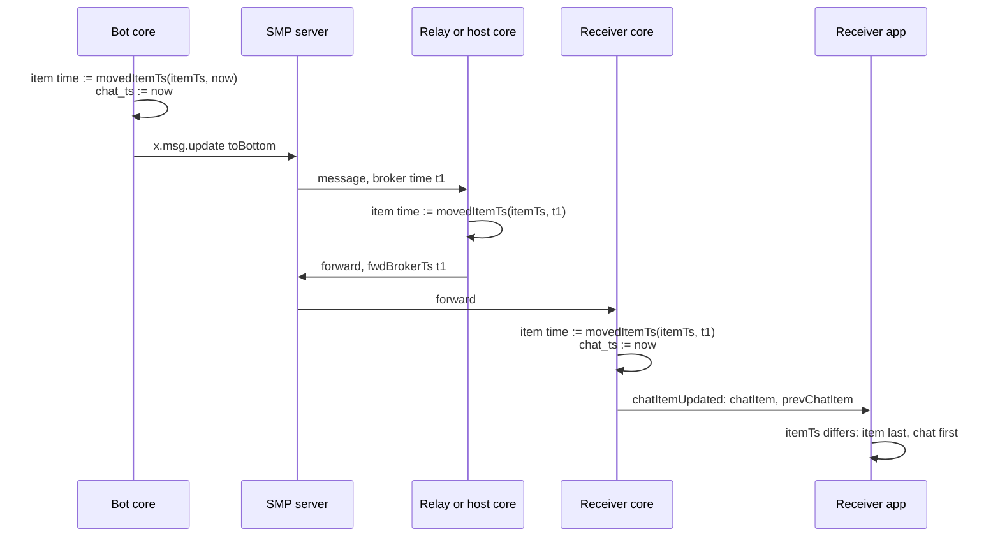
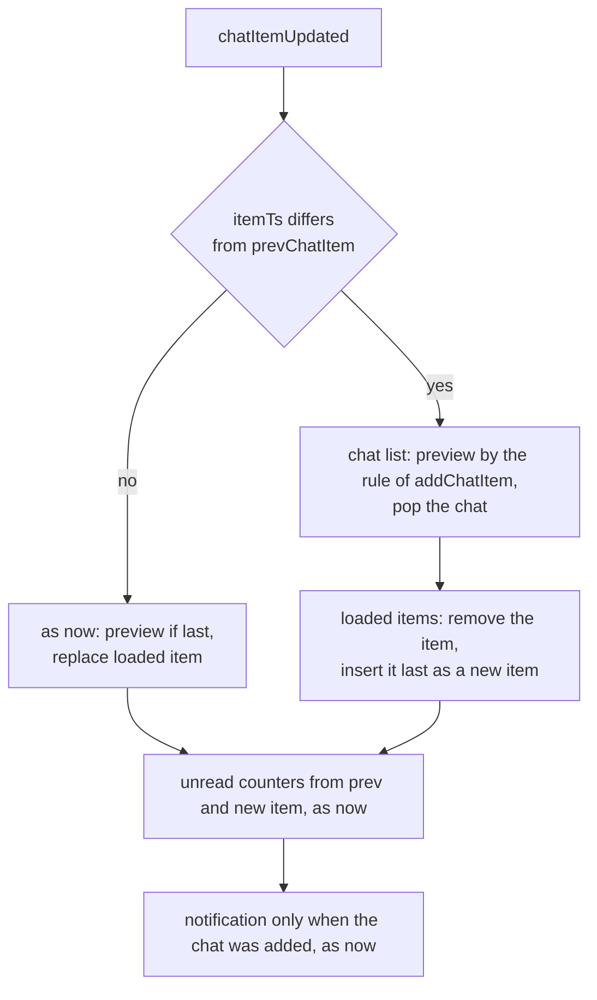
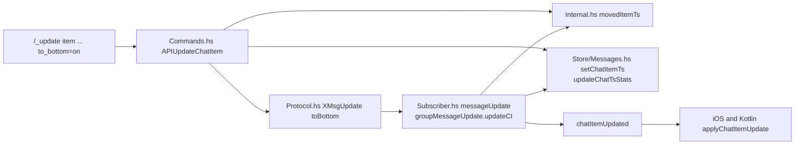

# Updates that move a message to the bottom

Status: proposed; questions U1, U2 and U4 open, and the recommended answers are planned below; U3 decided. Code references: master `20ee7cb14`.

The user's words:

> the challenge is that edit doesn't push the message to the bottom. This is a common problem that we cannot make updates that also update message time - I think we need to make it a hidden protocol option, finally, it seems rather simple, and you recent update improvement should help it. So update protocol message gets a flag to move the message to the bottom. This way, on every update, the message would jump to the bottom. Many bots would benefit from it, as currently we have to delete and recreate, and this pattern used in quite a few bots - the downside is jumping view and the loss of history. ... My bet is that update that updates time (also based on server time) is simple - this way sender cannot manipulate it. And we won't expose it in UI anyway.

## 1. What users see

Before:
- A bot keeps a status message current by edits. Later messages move it up the chat.
- To keep it last, a bot deletes it for everyone and posts it again: each repost alerts, a deleted item is left in place when full deletion is off, and the edit history of the message is lost. The Claude Code plugin replaces its list of sessions every 23 hours this way ([main-group.ts:174](../packages/simplex-chat-mcp/src/main-group.ts#L174)); the support bot reposts each card on every change ([cards.ts:257-287](../apps/simplex-support-bot/src/cards.ts#L257-L287)).

After:
- A bot updates a message with `to_bottom=on`. In every chat of the message, the item is shown last, with the time of the update, and the chat is shown at the top of the chat list (U1).
- The update alerts nobody and leaves the item read or unread as it was (U1).
- The item keeps its ID, reactions, replies to it and its edit history.
- The apps have no control for it.
- An app or a core of an earlier release applies the update as an edit in place.

## 2. Protocol

```
x.msg.update params
  msgId          base64url          as now
  content        msgContent         as now
  mentions       object             optional, as now
  ttl            integer            optional, as now
  live           boolean            optional, as now
  scope          msgScope           optional, as now
  asGroup        boolean            optional, as now
  toBottom       boolean            optional, new; sent only as true
```

```
Protocol.hs
  XMsgUpdate (:464)         toBottom :: Maybe Bool       new last field
  appJsonToCM (:1427)       XMsgUpdate_: toBottom <- opt "toBottom"
  chatToAppMessage (:1520)  "toBottom" .=? toBottom
  positional uses           Library/Commands.hs:837, :871, :1500
                            Library/Subscriber.hs:590, :772, :1091, :1344, :4068
                            tests/ProtocolTests.hs:305
                            tests/ChatTests/Groups.hs:14079
```

- The chat protocol version is unchanged. Parsers of earlier releases read optional parameters with `.:?` (`opt`, Protocol.hs:1422) and skip unknown keys.
- In a signed update `toBottom` is covered by the signature.
- `hasNotification` (Protocol.hs:1339) is unchanged: the update is sent without the notification flag.
- `docs/protocol/simplex-chat.md` (:185) and `docs/protocol/simplex-chat.schema.json` (:474): `toBottom` with its receiver rule (U4).

## 3. Time of a moved item

Each receiver sets the time from its own time source; the message contains only the flag.

```
time source       received directly          broker time of the message (metaBrokerTs, Subscriber.hs:1036, :2115)
                  forwarded by a host/relay  fwdBrokerTs of the forward (Subscriber.hs:4029), as for new items
                  sender's own copy          local time of the command
new item time     end of the second of the time source: floor(t) + 0.999 s
applied           only when later than the item's time
```

```haskell
movedItemTs :: ChatItemTs -> UTCTime -> Maybe ChatItemTs
movedItemTs itemTs t
  | ts > itemTs = Just ts
  | otherwise = Nothing
  where
    ts = addUTCTime 0.999 (roundDownToSecond t)
```

- `movedItemTs` is in `Library/Internal.hs`, next to `roundDownToSecond` (:3090).
- Broker times have whole seconds: SMP encodes `systemSeconds` (simplexmq `Encoding.hs:146`). This code creates items with whole seconds: received items with the broker time (Internal.hs:3118), sent, internal and local items with `roundDownToSecond` (Internal.hs:3082, :3427, :3483; Commands.hs:2729). Items are ordered by `item_ts, chat_item_id`. A moved item is therefore placed after every item of its second and earlier; an item created later in the same second is placed before it.
- SQLite stores `item_ts` as `YYYY-MM-DD HH:MM:SS[.fff]` (sqlcipher-simple `utcTimeToBuilder`), ordered as text; Postgres as `timestamptz`.
- Among items created by this code, a fractional second in `itemTs` marks a moved item.

## 4. Core: sending

`APIUpdateChatItem` (Controller.hs:428), new field `toBottom :: Bool` after `liveMessage`:

```
/_update item <chatRef> <chatItemId>[ live=on][ to_bottom=on] json <updatedMessage>
parser (Commands.hs:6872)   <*> (" to_bottom=" *> onOffP <|> pure False), after liveMessageP
positional uses             Commands.hs:2747, :2751                        False
                            apps/simplex-badge-service/src/BadgeService/Group.hs:345   False
```

Handler (Commands.hs:824), the same in the direct (:825), group (:850) and note folder (:886) branches:

```
move_      = if toBottom then movedItemTs (chatItemTs' ci) currentTs else Nothing
condition  changed || itemLive == Just True || isJust move_          -- :835, :866; note folder :891
event      XMsgUpdate ... (justTrue toBottom)                        -- :837, :871; note folders send nothing
edited     changed && itemLive /= Just True                          -- :843, :878; the present value in the present cases
store      after updateDirectChatItem' / updateGroupChatItem / updateLocalChatItem':
             forM_ move_ $ \ts -> setChatItemTs db ci' ts and updateChatTsStats db cxt user cd currentTs Nothing
response   CRChatItemUpdated with the moved item
```

- A move is an edit for the limits of `2026-11-21-edit-window-preference.md`. `setChatItemTs` also sets `item_original_ts = COALESCE(item_original_ts, item_ts)`, and the limits are measured from it, so a move keeps the windows of the original send.

## 5. Core: receiving



`messageUpdate` (Subscriber.hs:2096) and `updateCI` of `groupMessageUpdate` (Subscriber.hs:2398), new parameter `toBottom :: Maybe Bool`, passed from `XMsgUpdate` at :590, :1091 and :4068:

```
move_      = if toBottom == Just True
                && isNothing itemDeleted           -- deleted, moderated, blocked by admin: in place
                && not (memberBlocked sender)      -- groups only, as for mentions (:2345)
             then movedItemTs (chatItemTs' ci) brokerTs
             else Nothing
condition  changed || itemLive == Just True || isJust move_                  -- :2124, :2400
edited     changed && itemLive /= Just True                                  -- :2131, :2406
store      after the item update: forM_ move_ (setChatItemTs and updateChatTsStats with Nothing stats)
event      CEvtChatItemUpdated with the moved item and the previous item; the chat info returned by updateChatTsStats
delivery   as now: Just context whenever the condition holds, so a move without a change of text is forwarded
```

State of a received item, read from the last row; `-` is unchanged:

```
event                                  item_ts               chat_ts      item_status   versions
x.msg.new at t0                        t0                    now          rcv_new       -
read                                   t0                    -            rcv_read      -
x.msg.update, text changed             t0                    -            rcv_read      +1
x.msg.update toBottom at t1, changed   floor(t1) + 0.999     now          rcv_read      +1
x.msg.update toBottom at t1, same      floor(t1) + 0.999     now          rcv_read      -
x.msg.update toBottom, not later       -                     -            -             as an edit
```

- An update of an item missing on the receiver creates the item at the time source, as now (Subscriber.hs:2097, :2331): it is last already.
- `Store/Messages.hs`, new:
  ```
  setChatItemTs :: DB.Connection -> ChatItem c d -> ChatItemTs -> IO (ChatItem c d)
    UPDATE chat_items SET item_ts = ? WHERE chat_item_id = ?
    returns the item with meta.itemTs set
  ```
  The new query is added to `tests/chat_query_plans.txt` by the query plan test.

## 6. Effects

```
area                        effect of a move                                         change
chat view order             item last: ORDER BY item_ts, chat_item_id (Store/Messages.hs:2476-2501)   none
pagination, navigation      before/after/around by item_ts (:2487, :2500, :1801-1828)                none
chat preview                last item by item_ts (:918)                              none
chat list order             chat_ts (:887)                                           updateChatTsStats (U1)
unread counts               item_status unchanged                                    none
first unread, max viewed    by item_ts (:1735, :1744): a moved read item can become the opening pivot   none
notifications               x.msg.update without the SMP flag; the apps notify for an update only when it adds the chat   none
history for new members     ORDER BY item_ts (:3795); forwarded with fwdBrokerTs = itemTs in whole seconds (Internal.hs:1550)   none
channel web preview         ORDER BY item_ts (:3815); x.msg.update marks the content changed (Subscriber.hs:1139)   none
replies to a moved item     resolved by shared_msg_id (:702-748)                     none
forward of a moved item     a new item with the content                              none
expiration by chat TTL      item_ts <= cutoff AND created_at <= cutoff (:3662): kept a TTL after the move   none
disappearing messages       deleteAt unchanged                                       none
edit and delete limits      from item_original_ts, kept across moves                 2026-11-21-edit-window-preference.md
item info                   "sent at" shows the move time; versions keep the earlier texts and times   none
terminal view               viewItemUpdate (View.hs:870) as for an edit                none
```

Abuse: a member who moves a message repeatedly sends one message per move, without alerts and new items; posting new messages is unrestricted as well. Moderators block the member (moves are then applied in place), remove the member or delete the message (U2).

## 7. Relays, hosts and channels

```
relay or host of this release     applies the move to its copy; forwards the update, a move without a change of text included
relay or host before              signed update: forwarded as received bytes, toBottom kept (Protocol.hs:1597)
                                  unsigned update: encoded again from the parsed message, toBottom dropped: an edit in place
                                  a move without a change of text: not forwarded (condition :2400 of this master)
subscriber                        time source fwdBrokerTs of the relay; every subscriber of one relay gets the same time
```

## 8. Apps

The apps apply a move when `chatItem.meta.itemTs != prevChatItem.meta.itemTs` in `chatItemUpdated`. Every other emitter of the event (Internal.hs:712, :857, :890; Subscriber.hs:421, :440, :1232, :1581, :1610, :2055, :2411; Commands.hs:4969) keeps `itemTs`.



```
iOS       Shared/Model/ChatModel.swift
            applyChatItemUpdate (:800)      moved branch
            addChatItem (:701)              its group preview rule (:716-729) used by both
            removal                         reversedChatItems.remove and chatState.itemsRemoved, as removeChatItem (:875)
            insertion                       _upsertChatItem (:837)
            pop                             popChatCollector.throttlePopChat (:736)
Kotlin    common/src/commonMain/kotlin/chat/simplex/common/model/ChatModel.kt
            applyChatItemUpdate (:702)      moved branch, in the primary and the secondary context
            addChatItem (:582)              its preview rule (:598-613) used by both
            removal                         chatItems.removeAllAndNotify, as removeChatItem (:769)
            insertion                       addToChatItems (:560, :564), before TEMP_LIVE_CHAT_ITEM_ID as addChatItem
            pop                             popChatCollector.throttlePopChat (:631)
specs     apps/ios/spec/state.md, apps/multiplatform/spec/state.md: applyChatItemUpdate
```

- Notifications are unchanged: `chatItemUpdate` (SimpleXAPI.swift:3241) and `chatItemUpdateNotify` (SimpleXAPI.kt:3847) notify only for an added chat; the NSE handles `newChatItems` only.
- An older app with a newer core, as with remote desktop: the move is shown as an edit in place until the chat is opened again.

## 9. API and libraries

```
bots/src/API/Docs/Commands.hs:104   OnOffParam "to_bottom" "toBottom" (Just False) after live
                                    description: "Update message. to_bottom=on moves the message to the bottom of the chat, with the time of the update set by each receiver."
generated by tests/APIDocs.hs       bots/api/COMMANDS.md
                                    packages/simplex-chat-client/types/typescript/src/commands.ts
                                    packages/simplex-chat-python/src/simplex_chat/types
packages/simplex-chat-nodejs/src/api.ts:488             apiUpdateChatItem(..., liveMessage = false, toBottom = false)
packages/simplex-chat-python/src/simplex_chat/api.py:241  api_update_chat_item(..., live_message=False, to_bottom=False)
```

- A core of an earlier release refuses `to_bottom=on` as a command syntax error.
- The plugin and the support bot adopt the option in later pull requests, after a `simplex-chat` package with this core is published.

## 10. Composition



## 11. Tests

Core, each failing on master: the parser refuses `to_bottom=on`.

```
tests/ProtocolTests.hs     x.msg.update with "toBottom":true encoded and decoded; without it decoded to Nothing
tests/ChatTests/Direct.hs  "update to bottom moves the item below later items"
                             bob: "status"; alice: "hi"; bob: /_update item @2 <status> to_bottom=on text status 2
                             sent without a pause, so the move usually falls in the second of "hi"
                             alice and bob: /_get chat @2 count=2 -> "hi", "status 2"
                             recorded: eventsFixture "updates/direct-move", alice with markRead = False
                           "update to bottom without a change of text": not marked edited; last for both
tests/ChatTests/Groups.hs  "update to bottom in a group": alice, bob, cath; bob moves his message; last for all three
                           "update to bottom of a blocked member": cath blocks bob; bob's update applied in place for cath
tests/ChatTests/ChatRelays.hs
                           "owner moves a channel post": last for a subscriber
tests/ChatTests/Utils.hs   stableJSON (:1043): itemTs is 1970-01-01T00:00:00Z plus the fraction of the recorded second
                             existing fixtures are unchanged: their itemTs have whole seconds
```

Apps, on `tests/fixtures/api/updates/direct-move.json` (new "status", new "hi", "status" moved as "status 2"):

```
test                                              checked                                                  apps
moved item is last in the loaded items            "status", "hi" -> "hi", "status 2"; preview "status 2"     both
move of an item not loaded inserts it last        chat opened after "hi": "hi" -> "hi", "status 2"          both
move changes no counters and alerts nobody        unread 2 before and after; notifications of the 2 new items only   both
```

Kotlin: `common/src/desktopTest/kotlin/chat/simplex/app/ChatItemUpdateTest.kt`. iOS: `SimpleX Unit Tests/ChatItemUpdateTests.swift`.

## 12. Options

```
option                                                     cost
A. toBottom in x.msg.update, receiver time (recommended)   one optional field, one command parameter, one UPDATE, one app branch per platform
B. new event x.msg.move                                    a new tag with its codecs, parser, encoder, isForwardedGroupMsg, signableContent and handlers; an edit with a move is 2 messages; earlier releases report "unsupported message"
C. receiver creates a new row for the moved item           new chat_item_id: reactions, versions, mentions, files and delivery statuses moved; app item identity lost
D. new ordering column                                     migration, 8 Postgres indexes with item_ts replaced, 26 uses of item_ts in Store/Messages.hs reviewed
E. time set by the sender                                  the sender places the item at any time
F. delete and post again, as now                           an alert per repost, deleted items left, edit history lost
```

Time of A:
```
whole second of the time source        a move in the second of a later item leaves the moved item above it
end of the second (recommended)        an item created later in the same second is placed above the moved item
```

## 13. Questions

U1. What users see after a move: the item is last, alerts nobody, keeps its read state, and its chat moves to the top of the chat list as for a new message. Recommended: yes. Alternative: the chat keeps its place in the list while its preview shows the moved item.

U2. Who may move: the sender of the message, in every chat type where it may edit; receivers apply a move of a blocked member or of a deleted item in place. Recommended: yes. Alternative: a group preference with a role, as planned for message priority (`2026-10-13-message-priority.md`, section 3).

U3. Decided by the user on 2026-11-21: the edit and delete limits and their role exception are a group preference, planned in `2026-11-21-edit-window-preference.md`; the limits are measured from the original send across moves.

U4. "Hidden": the apps have no control for it; the option is documented in the protocol docs and the bot API with its clients. Recommended: yes. Alternative: undocumented, and the TypeScript and Python clients without it.
