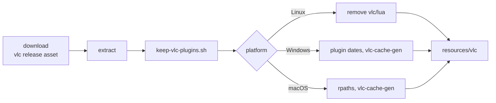
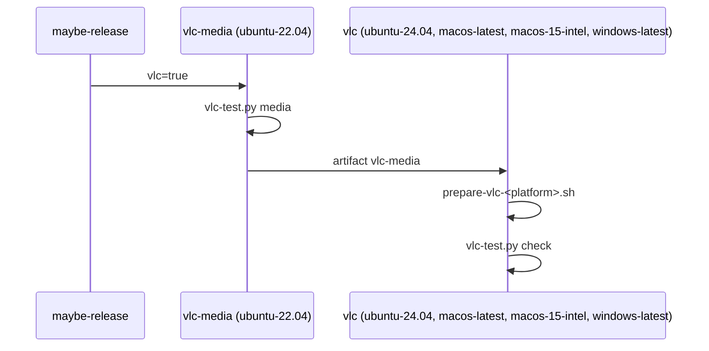

# Desktop: restrict media playback to local files

## Behaviour

The desktop apps play voice messages, videos and call sounds, make video previews and record voice messages with the VLC libraries bundled by `scripts/desktop/prepare-vlc-*.sh`. After the change, the bundled VLC contains only the modules that open local files, read and decode the formats that the apps send, convert and output the decoded media, and record voice messages. All other modules are removed from the bundles of Linux, Windows and macOS.

## Allowlist

`scripts/desktop/vlc-plugins.txt` lists the kept modules, one name per line: the plugin file name without `lib` and `_plugin.<extension>`. One list applies to every platform; a listed module absent from a platform's download is skipped.

| Group | Modules | Used for |
|---|---|---|
| Input | `filesystem` | local files |
| Stream filters | `cache_read` `skiptags` | buffered reads of local files ID3 and APE tags before MP3 data |
| Containers | `mp4` `mkv` `avi` `ps` `ts` `es` `mpgv` | MP4, MOV, M4A, 3GP Matroska, WebM AVI MPEG program stream (.mpg, .mpeg) MPEG transport stream in .mpg files MP3, AAC ADTS and AC-3 streams MPEG video streams |
| Packetizers | `packetizer_copy` `packetizer_h264` `packetizer_hevc` `packetizer_av1` `packetizer_mpeg4video` `packetizer_mpegvideo` `packetizer_vc1` `packetizer_mpeg4audio` `packetizer_mpegaudio` `packetizer_a52` `packetizer_dts` `packetizer_mlp` `packetizer_flac` | framing of the streams of the containers above |
| Decoders | `avcodec` `faad` `dav1d` `opus` `vorbis` `flac` `araw` `lpcm` | H.264, HEVC, MPEG-4, H.263, MPEG-1/2, VP8, VP9, MP3, MP2, AC-3, DTS, AMR; AAC encoder of voice messages AAC AV1 Opus Vorbis FLAC PCM, microphone input LPCM in MPEG program streams |
| Hardware decoding | Linux: `vaapi`, `vaapi_drm`, `vaapi_filters`, `vdpau_avcodec`, `vdpau_chroma`, `vdpau_deinterlace`, `vdpau_display`, `glconv_vaapi_x11`, `glconv_vaapi_drm`, `glconv_vdpau` Windows: `d3d11va`, `dxva2`, `direct3d11_filters`, `direct3d9_filters`, `glinterop_dxva2` macOS: `videotoolbox`, `cvpx` | decoding on the GPU in the player of the main window |
| Video conversion | `chain`, `swscale`, `scale`, `transform`, `deinterlace`, every `i4*`, `yuy2_*`, `grey_yuv`, `rv32`, `yuvp` module | pixel formats, sizes, rotation of videos recorded on phones, interlaced MPEG-2 |
| Video output | `vmem` Linux: `xcb_window`, `xcb_x11`, `xcb_xv`, `gl`, `glx`, `egl_x11` Windows: `drawable`, `direct3d11`, `direct3d9`, `directdraw`, `gl`, `glwin32`, `wgl`, `wingdi` | previews and the macOS player (frames to the app) player embedded in the window on Linux and Windows |
| Screen saver | Linux: `dbus_screensaver` Windows: `winhibit` | screen saver kept off while a video plays |
| Audio conversion | `audio_format`, `soxr`, `samplerate`, `speex_resampler`, `ugly_resampler`, `simple_channel_mixer`, `trivial_channel_mixer`, `remap`, `scaletempo`, `float_mixer`, `integer_mixer` | sample formats, rates, channels and volume |
| Audio output | Linux: `pulse`, `alsa` Windows: `mmdevice`, `wasapi`, `directsound`, `waveout` macOS: `auhal` | playback |
| Voice recording | Linux: `pulsesrc`; Windows: `dshow`; macOS: `avaudiocapture` `stream_out_transcode`, `stream_out_standard`, `mux_mp4`, `access_output_file` | microphone (`pulse://`, `dshow://`, `qtsound://` of `RecAndPlay.desktop.kt`) `#transcode{acodec=mp4a…}:std{access=file,mux=mp4}` |
| Logging | `console_logger` | libVLC messages on stderr |

Kept per platform: 90 of 382 modules on Linux x86_64, 84 of 376 on Linux aarch64, 88 of 363 on Windows, 67 of 336 on macOS aarch64, 73 of 342 on macOS x86_64.

## Formats

| Played | Containers | Codecs |
|---|---|---|
| unchanged | MP4, MOV, M4A, 3GP, Matroska, WebM, AVI, MPEG-PS, MPEG-TS, MP3 | H.264, HEVC, AV1, VP8, VP9, MPEG-4, H.263, MPEG-1/2, VC-1; AAC, MP3, MP2, AC-3, DTS, TrueHD, Opus, Vorbis, FLAC, AMR, PCM |
| no longer | Ogg, ASF/WMV, FLV, RealMedia, NUT, WAV, AIFF, raw H.264/HEVC/VC-1/Dirac streams, DV, disc images, tracker, MIDI, SID, game music, playlists | subtitle tracks are not shown |

MP3 and MP2 are decoded by `avcodec` in place of `mpg123`.

## Packaging

`scripts/desktop/keep-vlc-plugins.sh <plugins dir>` removes each file of the directory that is not a plugin of the allowlist, then the empty directories.

## Tests

`scripts/ci/vlc-test.py`:

| Command | Does |
|---|---|
| `media <dir>` | makes 2-second test files with FFmpeg: the formats of the table above that the apps send, and a video rotated by 90° |
| `check <vlc dir> <media dir>` | fails on a plugin outside the allowlist, on another file in the plugins directory and on Lua scripts; then, with the bundled libVLC, for each test file and the app's call sounds: parses it, plays its video into frame callbacks in RV32 as the previews do, and records its audio with the voice message chain into M4A, whose AAC track is parsed |

CI, build.yml, when `maybe-release.outputs.vlc` is true (`BUILD_CHANGES["vlc"]` in packages_release.py):

desktop-linux: the app job runs `prepare-vlc-linux.sh`, so the tested and uploaded app contains the bundle.
