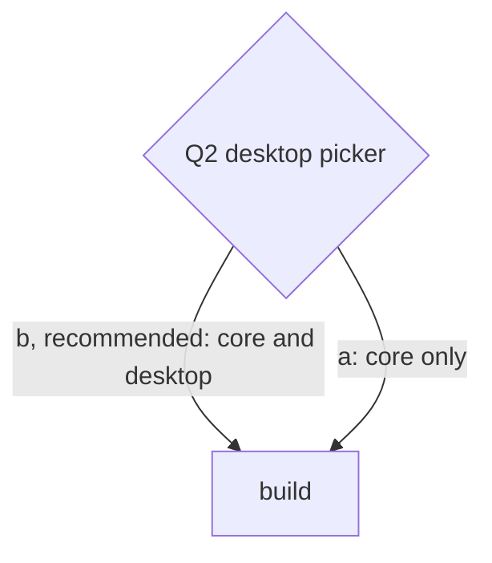
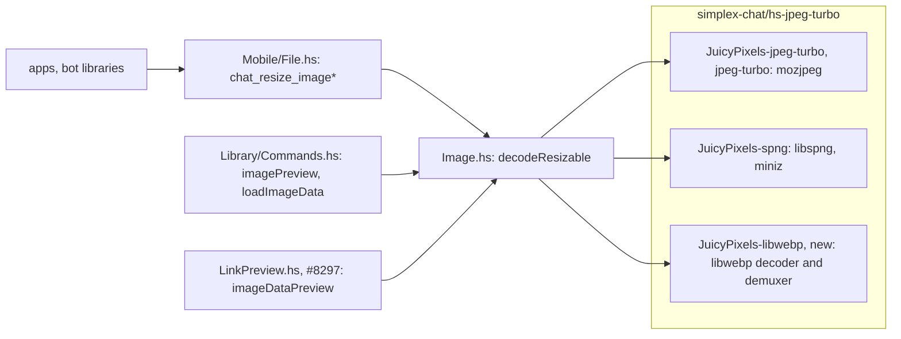
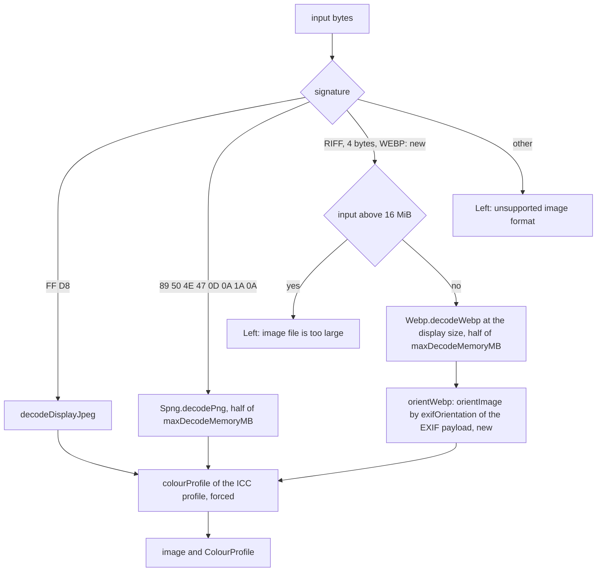
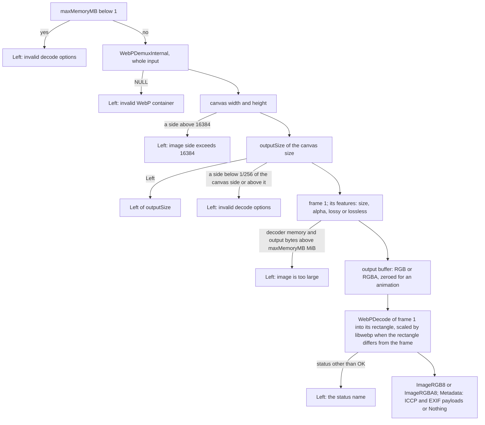
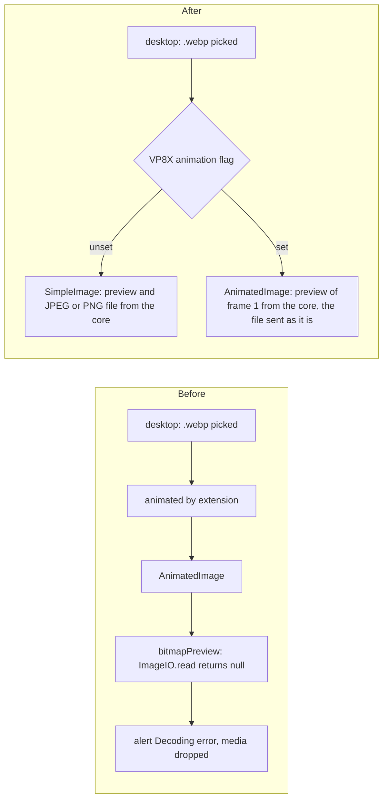
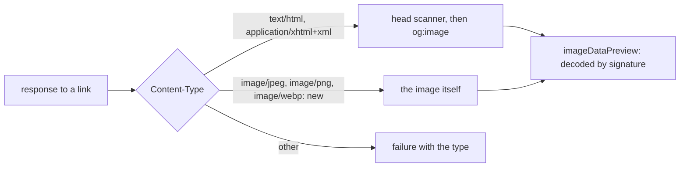

# WebP images decoded by the core

A desktop user who picks a WebP image gets the alert "Decoding error", and the image is dropped from the message.
Link previews made by the core (#8297) fail for a page with a WebP `og:image` and for a link to a WebP image; the apps preview both today.
Bots get an error from `resizeImage` for WebP input; CLI users get one from `/set profile image file` and `--user-image-file` for a `.webp` file.
On Android 9 and later and on iOS, a picked WebP image is decoded by the platform after the core returns `""`; on Android 8.0 and 8.1, every picked `.webp` is sent as its file, with the preview decoded by the platform.

WebP input is decoded in the core by libwebp 1.6.0: still images, the first frame of animations, alpha and the ICC profile; the EXIF orientation is applied as for JPEG. Encoding WebP is out of scope.
libwebp's decoder and demuxer are compiled by cabal in `JuicyPixels-libwebp`, a new package of simplex-chat/hs-jpeg-turbo.
`decodeResizable` passes WebP input of at most 16 MiB to it; libwebp decodes the image at the display size in one pass, as JPEG input is decoded, within half of `maxDecodeMemoryMB`. Output formats and colour profiles are unchanged.
The C functions are unchanged; the apps and the bots call them as now.

References are to branch `ep/core-webp` at the commit of this plan, based on master `8f5dfa3d4`.
Haskell paths without a directory are in `src/Simplex/Chat/`.
Kotlin paths start at `apps/multiplatform/common/src/`: `common/` is `commonMain/kotlin/chat/simplex/common/`, `desktop/` is `desktopMain/kotlin/chat/simplex/common/`, `android/` is `androidMain/kotlin/chat/simplex/common/`.
libwebp paths are at `v1.6.0`; a file name without a directory is in `src/dec`, `src/demux`, `src/dsp`, `src/utils` or `src/webp`.
Other sources:

| Name | Source |
|---|---|
| hs-jpeg-turbo | simplex-chat/hs-jpeg-turbo master `c1b5080`; pinned at `d0a4d95` (cabal.project:76-80) |
| libwebp release | `v1.6.0`, commit `4fa21912`, 7 Jul 2025 |
| libwebp main | `f054d0c3`, 21 Nov 2026 (chromium.googlesource.com/webm/libwebp, mirrored at github.com/webmproject/libwebp) |
| libwebp test data | chromium.googlesource.com/webm/libwebp-test-data at `06ddd96e` |
| link previews | branch `ep/link-previews` of evgeny-simplex/simplex-chat at `3771cd6a`, simplex-chat/simplex-chat#8297 |
| SwiftyGif | kirualex/SwiftyGif at `5e861933`, pinned in apps/ios/SimpleX.xcodeproj/project.pbxproj:2883-2890 |
| Android | android.googlesource.com, tag `android-9.0.0_r1`: platform/external/skia and platform/frameworks/base |

## Acceptance

| Who | Before | After |
|---|---|---|
| desktop user, still WebP | alert "Decoding error", image dropped | compose preview; sent as `IMG_*.jpg` or `IMG_*.png` (Q2 b) |
| desktop user, animated WebP | alert "Decoding error", image dropped | compose preview of frame 1; the file sent as it is (Q2 b) |
| Android 9 and later (SDK 28+) user, still WebP | preview and image from the platform decode, upright by the EXIF orientation; log line `core returned no image` | preview and image from the core, upright by the EXIF orientation; the log line is absent |
| Android 8.0 and 8.1 (SDK 26–27) user, WebP | animated by its extension (android/platform/Images.android.kt:102-107): the file sent as it is, preview from `BitmapFactory` (Utils.android.kt:290) | the file sent as it is, preview from the core (D11) |
| iOS user, WebP file from the photo picker | preview and image from `UIImage`, after `""` from the core | preview and image from the core, upright by the EXIF orientation |
| user who types a link to a page with a WebP `og:image` (#8297) | preview fails | preview with the image |
| bot on the Node or Python library | `resizeImage` error | JPEG or PNG, with the next pinned core release |
| CLI user, `/set profile image file x.webp` | `unsupported image extension` | profile image set |
| user who picks a WebP image above 4320 pixels per side | as in the rows above | decoded by the core at the display size, as JPEG |
| user who picks a WebP file above 16 MiB, or a lossless or transparent WebP image above the limits of "Decoding" (about 11 to 16 million pixels) | as in the rows above | as on master: the platform decode on Android 9 and later and on iOS, the alert "Decoding error" on desktop |

Evidence at review:
- the groups `/Image resize/` and `/Mobile API Tests/`, the test `/SimpleX chat client/profile tests/user profiles/set profile image from file/` and desktopTest pass in the reduced build; in desktopTest, a picked animated WebP image gets the core's recorded preview (Tests, "Apps");
- the test "should apply EXIF orientation of WebP" fails at `2c4ca02`, the commit before the fix, with sides 1000×307 for the expected 307×1000 ([run](https://github.com/simplex-chat/simplex-chat/actions/runs/45287298996));
- the tests of display sizes and of the input limit fail at the commit with the tests alone, before the change (Tests);
- hs-jpeg-turbo CI, the full matrix and the armv7 job ([run](https://github.com/evgeny-simplex/hs-jpeg-turbo/actions/runs/45462191522) of `1691888`, a dispatch with the input `full`):
  - the package built and its tests passed with GHC 8.10.7 and 9.6.3 on Linux x86-64, with GHC 9.6.3 on Linux aarch64, macOS aarch64 and x86-64, and Windows;
  - the conformance files decoded to the md5 of libwebp's test data;
  - two tall images: the lossless one decoded to its source pixels by the package tests and by the armv7, aarch64 and sanitizer builds; the alpha of the lossy one equal to its source in the package tests, its outputs identical in the three builds; both decoded at half size to the averages of the full decode; the line coverage of libwebp's scaling functions in the job summary;
  - the armv7 and aarch64 outputs identical at full size, and within 5 in a sample with sides of at most 64;
  - the sanitizer run clean on truncated and changed copies of all these files, at both sizes;
  - the decoder size per platform in the job summaries, in "Binary size";
- the memory of libwebp `v1.6.0` decoding, at full size and at the display size, at the limits of "Decoding", with the largest Huffman tables that a 64 MiB allocation holds and with 16 MiB of chunks, measured in CI (Security);
- the desktop-linux smoke test picks, previews and sends `webp/lossy.webp` and `webp/animated.webp`; desktop-linux, android-emu with the input `armv7a` and ios-sim run once at the head of the pull request, with the links and results in its description.

## Decode paths today

Core:

| Path | Input | WebP input today |
|---|---|---|
| `decodeResizable` (Image.hs:69-77) | bytes | `Left "unsupported image format"` (:77) |
| `cChatResizeImage`, `cChatResizeImageUri`, file and descriptor variants (Mobile/File.hs:153-169, 204-207), exported at Mobile.hs:167-177 | buffer, path, descriptor | `""` |
| `imagePreview` (Library/Commands.hs:232-238), for `/img` (:3578-3586) | file | refused by extension (:204-205, :3582) |
| `loadImageData` (Library/Commands.hs:208-224), for `/set profile image file` (:3699-3702) and `--user-image-file` (Core.hs:227-228) | file | refused by extension (:209-211) |
| `imageDataPreview` (Image.hs:229-232 at `3771cd6a`), for link previews (LinkPreview.hs:119, 125) | fetched bytes, at most 5 MiB (:88-89) | `Left`; a page of type `image/webp` refused (:505) |

Apps, with the platform decode after `""` from the core:

| App | Path | WebP input today |
|---|---|---|
| iOS | picker, `.imageFile`: `resizeImageFileToStrSize`, then `resizeImageToStrSize` of the `UIImage` (Shared/Views/Chat/ComposeMessage/ComposeView.swift:315-320); sending: `saveImageFile`, then `saveImage` (:1609-1614) | `""`, then `UIImage` encoded as JPEG or PNG for the core (SimpleXChat/ImageUtils.swift:132-158) |
| iOS | animated: `setGifFromData` throws without `kCGImagePropertyGIFDictionary` (SwiftyGif UIImage+SwiftyGif.swift:170-177), so `loadFromURL` returns `.simpleImage` (ComposeView.swift:336-353) | the first frame, as above |
| iOS | file type from the picker: `public.jpeg` when offered for items other than PNG and GIF, otherwise the file itself (Shared/Views/Helpers/ImagePicker.swift:92-95) | the WebP file, when `public.jpeg` is absent |
| iOS share extension | `downsampleImage`, then `saveImage` of the `UIImage` (SimpleX SE/ShareModel.swift:442-447, 525-534) | platform decode |
| Android | still, SDK 28 and later: `SimpleImage`, preview `resizeImageFileToStrSize(uri) ?: bitmapPreview()` (common/views/chat/ComposeView.kt:382); sending: `resizeImageFromUri` (common/views/helpers/Utils.kt:218-227) | `""`, log line, then `ImageDecoder` |
| Android | animated: `AnimatedImageDrawable` on SDK 28 and later; below SDK 28, every `.gif` and `.webp` by its extension (android/platform/Images.android.kt:102-107) | the file sent as it is (Utils.kt:229-254); preview from the bitmap (ComposeView.kt:375) |
| desktop | `.webp` is animated by extension (desktop/platform/Images.desktop.kt:175-178) | `bitmapPreview`: `ImageIO.read` returns null, `toComposeImageBitmap` throws, alert "Decoding error", media dropped (desktop/views/helpers/Utils.desktop.kt:163-175; ComposeView.kt:370-376, 397-399; apps/multiplatform/product/gaps.md:231) |

Link previews of the apps on master, replaced by #8297: Android and desktop decode the image with `loadImageBitmap`, WebP included (common/views/helpers/LinkPreviews.kt:43, 92-96, 124-128); iOS with `LPMetadataProvider` and `UIImage` (SimpleXChat/ImageUtils.swift:455-489).

## Decisions

| ID | Decision | Options, recommended first |
|---|---|---|
| D1 | **Binding in hs-jpeg-turbo.** New package `JuicyPixels-libwebp`, module `Codec.Picture.Webp`, in simplex-chat/hs-jpeg-turbo; libwebp a submodule at `JuicyPixels-libwebp/cbits/libwebp`. The name `JuicyPixels-webp` is the package name of (e). | (a) package in hs-jpeg-turbo: one cabal package; CI, nix hash line, `subdir` list and Windows removal glob `hs-jpeg-t*` reused. (b) new repository: created by the user; CI copied; one more `source-repository-package` and nix hash line. (c) cbits in simplex-chat: a submodule in every simplex-chat checkout (CI, nix, Docker, reproducible Android build) and 49 C files in simplex-chat.cabal. (d) Hackage `webp` 0.1.2.0: GPL-3; system libwebp through pkg-config, while the iOS and Android builds link bundled C sources only; c2hs; animated input unsupported. (e) iko-soy/JuicyPixels-webp, package `JuicyPixels-webp`, module `Codec.Picture.WebP`: pure Haskell, GitHub only, repository created 6 Feb 2026, about 11,650 lines to review (its STATUS.md). |
| D2 | **One decode function.** `decodeWebp :: DecodeOptions -> ByteString -> IO (Either String (DynamicImage, Metadata))`, `data DecodeOptions = DecodeOptions {maxMemoryMB :: Int, outputSize :: (Int, Int) -> Either String (Int, Int)}`, `data Metadata = Metadata {iccProfile, exif :: Maybe ByteString}`: the image at the size that `outputSize` returns for the canvas size, and the payloads of the `ICCP` and `EXIF` chunks, from one pass of the demuxer, as the image and the ICC profile from `Spng.decodePng` (Spng.hsc:36-45). | (a) one function. (b) a header function, then decoding at a given size, as `readJpegHeader` and `decodeJpeg`: two passes over the container. |
| D3 | **First frame of an animation through the demuxer.** Frame 1 of `WebPDemuxGetFrame`, decoded by `WebPDecode` into a zeroed canvas at the frame offset: the pixels of `WebPAnimDecoderGetNext` for frame 1 (anim_decode.c:202-203, 347-384). | (a) demuxer and decoder: one canvas. (b) `WebPAnimDecoder`: two canvases allocated at creation (anim_decode.c:137-143), then a copy out. (c) `Left` for animations: link previews of animated images fail. |
| D4 | **RGB for opaque still images, RGBA otherwise.** Table in "Decoding". The output format is chosen by `imageFormat` (Image.hs:51-67), unchanged. | (a) RGB or RGBA by the frame's alpha. (b) RGBA always: a third more memory for opaque images. |
| D5 | **ICC profile and EXIF orientation as for JPEG.** The payload of the first `ICCP` chunk is passed to `colourProfile` (Image.hs:181-185): `CPDisplayP3` or `CPNone` (plan 2026-10-23, D25). The payload of the first `EXIF` chunk is passed to `exifOrientation` (Image.hs:107-129), and the image is turned by `orientImage` (:154-166), as JPEG input (plan 2026-10-23, D6). The payload is read as TIFF data from its first byte, tag `0x0112` of IFD0, as by the WebP codec of Android's `ImageDecoder` (Android: SkWebpCodec.cpp:102-108, SkJpegCodec.cpp:63-103, ImageDecoder.cpp:110-111), which decodes still WebP images picked on SDK 28 and later on master (Utils.android.kt:278-283, Utils.kt:218-227). `XMP ` chunks are ignored. | (a) EXIF orientation applied. (b) EXIF ignored, as by dwebp (imageio/tiffdec.c:239, imageio/image_enc.c:412): a still WebP with orientation 6, picked on Android SDK 28 and later, sent upright on master, sent turned by 90 degrees. |
| D6 | **Decoded at the display size in one pass (b), product owner: decode and scale down in one pass, as JPEG is.** The canvas sides halved while a side exceeds 4320, as `displaySize` (Image.hs:90-96); libwebp's rescaler scales frame 1 to that size while it is decoded. Limits within half of `maxDecodeMemoryMB` in "Decoding". | (a) full size, halved by `fitImage`, as PNG: the canvas at full size, up to 768 MiB for 16384×16384 RGB. (b) libwebp scaled decoding to the display size: the output at most 4320×4320; the internal buffers of lossless frames and of alpha at full size at `v1.6.0` (vp8l_dec.c:1556-1574). |
| D7 | **Decoder and demuxer sources only, SIMD by compiler macros.** 49 C files; list in "hs-jpeg-turbo". | (a) SSE2, NEON or C paths, selected by the macros of `src/dsp/cpu.h:47-137`. (b) internal libraries for SSE4.1, AVX2 and armv7 NEON with their flags, as jpeg-turbo's `neon` (jpeg-turbo.cabal:214-215): three more stanzas, for one decode per picked image. |
| D8 | **App fallbacks kept; iOS unchanged.** The platform path is kept for formats other than JPEG, PNG and WebP: HEIC on Android (Images.android.kt:99-100, ComposeView.kt:382), pasted and camera images on iOS (`.simpleImage`, ComposeView.swift:1596-1597), other types picked on iOS (ImagePicker.swift:92-95). Each app ships with its core; the fallbacks are kept for those formats. | (a) all kept. (b) Android and iOS fallbacks removed: HEIC, pasted and camera images fail. |
| D9 | **CLI profile images from WebP; `/img` unchanged.** `loadImageData` accepts `.webp`; `/img` keeps `.jpg .jpeg .png .gif` (Library/Commands.hs:204-205), because a WebP file is sent as it is and desktop shows a received WebP file only as its preview (product/gaps.md:231). Bot libraries are unchanged and accept WebP with the next pinned core release (packages/simplex-chat-nodejs/src/release.ts:3 `core-7.1.4.0`, packages/simplex-chat-python/src/simplex_chat/_version.py:8 `core-7.1.3.0`). | (a) profile images only. (b) `/img` too: WebP files that desktop recipients open only as previews. |
| D10 | **Link previews in the second merge.** In whichever of #8297 and this pull request is merged second, `image/webp` is added to the image types of `pageContent` (LinkPreview.hs:505) and to `Accept` (:388), with two cases in `/SimpleX chat client/link preview tests/` (tests/ChatTests/LinkPreviews.hs). `og:image` responses are decoded by signature (plans/2026-11-21-link-previews-core.md:274 on `ep/link-previews`). | (a) in the second merge. (b) a commit on `ep/link-previews` now: its tests fail until WebP decoding is in master. |
| D11 | **Desktop picker (Q2 b).** Desktop: `.webp` is animated only with the animation flag of its `VP8X` chunk; the preview of an `AnimatedImage` with the WebP signature is made by the core first, on Android and desktop; the preview of a GIF is made from the bitmap alone, as now. Details in "Apps". | Q2. |
| D12 | **Licence notices.** libwebp's BSD-3-Clause `COPYING` and its `PATENTS` grant; details in "Licence notices". | |
| D13 | **Security: limits, libwebp `v1.6.0` pinned, conformance and sanitizer runs in CI.** Threat model and measures in "Security". | |
| D14 | **Binary size measured in CI.** Method in "Binary size"; figures in the pull request before review. | |

## Open questions

| Q | Question | Options | Recommendation |
|---|---|---|---|
| Q2 | Desktop picker in this pull request | (a) core only: desktop keeps the alert for every WebP image. (b) core and desktop picker (D11): about 20 lines of Kotlin, desktopTest cases and WebP cases in the desktop-linux smoke test. | (b) |

Implemented with Q1 decided and Q2 (b), pending its answer.

### Q1: libwebp commit

Decided (a), the release `v1.6.0` (`4fa21912`, 7 Jul 2025), by the product owner: main is unreleased, and its diff after `v1.6.0` would need an audit (146 commits to the 49 C files of D7 up to main `f054d0c3`; 807 lines added and 385 removed in src/dec/vp8l_dec.c).

At `v1.6.0`, the lossless decoder allocates its pixel buffer for the whole frame, 4 bytes per pixel (`AllocateInternalBuffers32b`, vp8l_dec.c:1556-1574), also for lossless-coded alpha (:1644-1653), and the Huffman tables of a lossless stream in one allocation for all its groups (:478-487). The limits of "Decoding" keep decoding within `maxDecodeMemoryMB` at this version.

## Decoding

Composition:

`decodeResizable` (Image.hs:70-83):

- WebP input: bytes 0-3 `RIFF` and bytes 8-11 `WEBP`; at most `maxWebpFileMB` (16) MiB (Image.hs:79, 324-325).
- ``Webp.decodeWebp (Webp.DecodeOptions (maxDecodeMemoryMB `div` 2) webpDisplaySize)``, within half of `maxDecodeMemoryMB`, as `Spng.decodePng` (Image.hs:77, 80).
- `webpDisplaySize`: the size of `displaySize` (Image.hs:93-99) for the canvas, the sides halved while a side exceeds 4320, each rounded by `scaledSide`, as for JPEG input; `image does not fit` where `displaySize` returns `Nothing` (Image.hs:83).
- `orientWebp`: the image turned by `orientImage` with `exifOrientation` of the `EXIF` payload, as JPEG input with the APP1 `Exif` segment (Image.hs:89); the `ICCP` payload passed on.
- The profile is passed to `colourProfile` and forced with `$!` (Image.hs:73), so the `ColourProfile` references no part of the input.
- `fitImage` receives the image at its largest size, as for JPEG input, and scales it only for smaller sizes (Image.hs:228-246).

`decodeWebp`:

Pixels (D4):

| Input | libwebp mode | Constructor |
|---|---|---|
| still image, frame without alpha | `MODE_RGB` | `ImageRGB8` |
| still image, frame with alpha | `MODE_RGBA` | `ImageRGBA8` |
| animation | `MODE_RGBA` | `ImageRGBA8`, transparent outside frame 1 |

- Frame size, alpha and format: `WebPGetFeatures` of frame 1 (decode.h:415-444), the call that `WebPDecode` makes first (webp_dec.c:822-831).
- Animation: the animation flag `0x02` of the format flags (mux_types.h:34); the background colour is ignored, as by `WebPAnimDecoder`, which zeroes the canvas of a key frame (anim_decode.c:355-357).
- Rectangle of frame 1 on an output canvas of W'×H' for a canvas of W×H: columns ⌊x·W'/W⌋ to ⌈(x+w)·W'/W⌉, rows likewise (`scaledSpan`); a frame of the canvas size fills the output, and every frame covers at least one pixel.
- Scaling: `use_scaling` with the rectangle's size (decode.h:448-466); libwebp's rescaler averages the pixels of each output pixel's area, colour premultiplied by alpha for lossless frames (vp8l_dec.c:629-651), the planes of lossy frames separately (io_dec.c:392-416, 480-494).
- Output sides at least 1/256 of the canvas sides: the rescaler sums each output row in 32 bits, up to 255 × the frame width × the rows per output row (rescaler.c:89, rescaler_utils.c:139-143), read as signed by the Neon rescaler (rescaler_neon.c:40-41); with frames of at most 16384 columns and at most 256 rows per output row, the sums stay below 2^31. `displaySize` halves each side at most twice for a side of 16384.
- Decoder memory of a frame of a format other than lossy and lossless, which libwebp does not return for a frame: counted as lossy with alpha, the most.

Limits (D6), at libwebp `v1.6.0`:
- canvas sides at most 16384, the value of `maxImageSide` (Image.hs:315-316), read from the demuxer and checked before the output is allocated; frames are at most 16384 per side by format (format_constants.h:29), canvases up to 2^24 per side and below 2^32 pixels (demux.c:560-564, format_constants.h:83)
- output: the display size, at most 4320 per side, 3 or 4 bytes per pixel
- WebP input at most 16 MiB in `decodeResizable`, checked before the demuxer: the demuxer stores a 24-byte record (12 bytes on 32-bit targets) for each chunk of an unknown type after `VP8X` (`ParseVP8XChunks`, demux.c:516-530; `StoreChunk`, :365-374), at most one per 8 bytes of input; input of the path and descriptor functions at most `maxDecodeMemoryMB` MiB for JPEG and PNG (Mobile/File.hs:179-190), unchanged; link preview images at most 5 MiB (LinkPreview.hs:88-89 on `ep/link-previews`), unchanged
- decoder memory and output bytes at most `maxMemoryMB` MiB, half of `maxDecodeMemoryMB` (256 MiB in mobile builds, 512 MiB in desktop builds), checked by `decodeWebp` before the output is allocated and before `WebPDecode`; decoder memory by the features of frame 1 (`decoderMemory`), N the frame's pixels:

  | Frame | Decoder memory | Allocations at `v1.6.0` |
  |---|---|---|
  | every frame | 4 MiB | per-row buffers, at most 4.0 MB at 16384 columns: macroblock rows of the lossy decoder, 1,994 bytes per 16 columns (frame_dec.c:693-730); the 17 rows of the lossless row cache, 68 bytes per column (vp8l_dec.c:1556-1574); rescaler, 36 bytes per output column (io_dec.c:496-528, vp8l_dec.c:571-603); structures |
  | lossy, opaque | nothing more | |
  | lossless | 4.75·N + 132 MiB more | pixel buffer, 4 bytes per pixel of the frame (vp8l_dec.c:1556-1574); predictor, cross-colour and Huffman images, each ⌈W/4⌉·⌈H/4⌉ pixels at 4 bytes at the finest precision (:1361-1370, 392-399, 1521-1528), 0.75·N and at most 72 KB more, within the per-row allowance; Huffman tables: one allocation of at most 64 MiB, one more of its size when it is filled exactly (vp8l_dec.c:478-487, huffman_utils.c:222-252), and 568 bytes per group (huffman_utils.h:82-93), at most 2·64 + 4 MiB |
  | lossy with alpha | 6.75·N + 132 MiB more | the alpha plane twice, 1 byte per pixel each (frame_dec.c:711-716, alpha_dec.c:145-160); the alpha stream as a lossless frame (vp8l_dec.c:1617-1664) |

- each libwebp allocation at most 64 MiB: `-DWEBP_MAX_ALLOCABLE_MEMORY=67108864` (src/utils/utils.h:34-41, src/utils/utils.c:173-176); this bounds the Huffman tables, whose size is set by the stream; the pixel buffer of a lossless frame or of lossless-coded alpha, 4 bytes per pixel and 17 rows, is libwebp's largest allocation, so such frames above about 16.7 million pixels fail with `out of memory`
- the other half of `maxDecodeMemoryMB`: the demuxer's records of a 16 MiB file and one copy of the output: the turned copy of `orientImage` for EXIF orientations 2 to 8 and the premultiplied copy of `scaleRGBA8` (Image.hs:347-355), at most 4320×4320×4 bytes, 71.2 MiB
- `use_threads` 0; `WEBP_USE_THREAD` defined, for the locked DSP initialisation on targets other than Windows (src/dsp/cpu.h:192-213)

Frames refused by these limits, by `decoderMemory`, the output bytes and the 64 MiB allocation:

| Frame | Mobile, 256 MiB | Desktop, 512 MiB |
|---|---|---|
| lossy, opaque | none | none |
| lossless, sides at most 4320 | above 14.4 million pixels with alpha, 16.2 million without | above 16.7 million pixels |
| lossless, a side above 4320 | above 16.7 million pixels | above 16.7 million pixels |
| lossy with alpha, sides at most 4320 | above 11.7 million pixels | above 16.7 million pixels, with alpha decoded at 4 bytes per pixel (vp8l_dec.c:1644-1653) |
| lossy with alpha, a side above 4320 | above 16.2 million pixels | above 16.7 million pixels with alpha decoded at 4 bytes per pixel, 50.9 million otherwise |

Measured in CI: "Security", "Memory".

Errors:

| Condition | `Left` |
|---|---|
| WebP input above 16 MiB (`decodeResizable`) | `image file is too large` |
| `maxMemoryMB` below 1 | `invalid decode options` |
| `WebPDemuxInternal` returns NULL: truncated input, wrong `RIFF` size, invalid chunks | `invalid WebP container` |
| a canvas side above 16384 | `image side exceeds 16384` |
| `outputSize` returns `Left`: from `decodeResizable`, `displaySize` without a size | `image does not fit` |
| `outputSize` returns a side below 1/256 of the canvas side or above it | `invalid decode options` |
| decoder memory and output bytes above `maxMemoryMB` MiB | `image is too large` |
| `WebPGetFeatures` or `WebPDecode` status (decode.h:236-243) | `out of memory`, `invalid parameter`, `bitstream error`, `unsupported feature`, `output aborted` (`VP8_STATUS_USER_ABORT`, "Output aborted." of the decoder, vp8_dec.c:676), `not enough data`; `VP8_STATUS_SUSPENDED`, a status of incremental decoding (vp8_dec.c:100-101; the alpha decoder's is mapped to `bitstream error`, frame_dec.c:466-470): `decoding status 5` |

Output formats, `ColourProfile` and the C functions are unchanged.

## hs-jpeg-turbo: JuicyPixels-libwebp

Branch `ep/webp` of evgeny-simplex/hs-jpeg-turbo from master `c1b5080`; simplex-chat/hs-jpeg-turbo#3.

Package `JuicyPixels-libwebp`:
- `cabal-version: 3.0`, version `0.1.0.0`
- synopsis "JuicyPixels wrappers for libwebp"
- description "WebP decoding of JuicyPixels images with libwebp."
- `license: BSD-3-Clause`
- `license-files`:
  - `LICENSE`, with "Copyright 2026 SimpleX Chat Ltd"
  - `cbits/libwebp/COPYING`
  - `cbits/libwebp/PATENTS`
- `cc-options`:
  - `-DWEBP_USE_THREAD`
  - `-DWEBP_MAX_ALLOCABLE_MEMORY=67108864`
- `include-dirs: cbits/libwebp`; `HAVE_CONFIG_H` undefined
- `extra-source-files`: `CHANGELOG.md` and `cbits/libwebp/src/**/*.h`
- `build-depends`:
  - `JuicyPixels`
  - `base`
  - `bytestring`
  - `transformers`
  - `vector`
- module `Codec.Picture.Webp` (`.hsc`), exports `DecodeOptions (..)`, `Metadata (..)` and `decodeWebp`; FFI to:
  - `WebPDemuxInternal`
  - `WebPDemuxGetI`
  - `WebPDemuxGetFrame`
  - `WebPDemuxReleaseIterator`
  - `WebPDemuxGetChunk`
  - `WebPDemuxReleaseChunkIterator`
  - `WebPDemuxDelete`
  - `WebPInitDecoderConfigInternal`
  - `WebPGetFeaturesInternal`
  - `WebPDecode`
- the demuxer and the iterators released with `bracket` on every path
- the output a pinned vector that becomes the image data without a copy, as in `Spng.decodePng` (Spng.hsc:56-63)
- `decoderMemory`: the decoder memory of "Decoding", with `WEBP_MAX_ALLOCABLE_MEMORY` of `cc-options` read by hsc2hs; `scaledSpan`: the rectangle of frame 1 on the output
- the `ICCP` and `EXIF` payloads slices of the input bytes

C sources (D7), as `dec_srcs`, `demux_srcs`, `dsp_dec_srcs` and `utils_dec_srcs` of libwebp's Android.mk:47-106 and 162-172, without MIPS, MSA and `src/demux/anim_decode.c`, whose `WebPAnimDecoder` functions `decodeWebp` does not call; 23,011 lines at `v1.6.0`:

| Directory | Files |
|---|---|
| `src/dec` | `alpha_dec.c` `buffer_dec.c` `frame_dec.c` `idec_dec.c` `io_dec.c` `quant_dec.c` `tree_dec.c` `vp8_dec.c` `vp8l_dec.c` `webp_dec.c` |
| `src/demux` | `demux.c` |
| `src/dsp` | `alpha_processing.c` `alpha_processing_neon.c` `alpha_processing_sse2.c` `alpha_processing_sse41.c` `cpu.c` `dec.c` `dec_clip_tables.c` `dec_neon.c` `dec_sse2.c` `dec_sse41.c` `filters.c` `filters_neon.c` `filters_sse2.c` `lossless.c` `lossless_neon.c` `lossless_sse2.c` `lossless_sse41.c` `rescaler.c` `rescaler_neon.c` `rescaler_sse2.c` `upsampling.c` `upsampling_neon.c` `upsampling_sse2.c` `upsampling_sse41.c` `yuv.c` `yuv_neon.c` `yuv_sse2.c` `yuv_sse41.c` |
| `src/utils` | `bit_reader_utils.c` `color_cache_utils.c` `filters_utils.c` `huffman_utils.c` `palette.c` `quant_levels_dec_utils.c` `random_utils.c` `rescaler_utils.c` `thread_utils.c` `utils.c` |

- Excluded:
  - `src/enc`
  - `src/mux`
  - `sharpyuv`
  - `src/dsp/lossless_avx2.c`
  - the encoder files of `src/dsp` and `src/utils`
  - `examples`
  - `imageio`
- SIMD by compiler macros (src/dsp/cpu.h:47-137): SSE2 on x86-64; NEON on aarch64, and on armv7 when the toolchain defines `__ARM_NEON__`; the C code paths otherwise. Without `-msse4.1`, the SSE4.1 files compile to init stubs (src/dsp/dec_sse41.c:45-49), which are called only with `WEBP_HAVE_SSE41` (src/dsp/lossless.c:655-660).

Repository files:
- `.gitmodules`: `JuicyPixels-libwebp/cbits/libwebp`, `https://github.com/webmproject/libwebp`, at `v1.6.0` (Q1)
- `cabal.project`, `stack.yaml`, `stack.ghc-8107.yaml`: the package added
- `.github/workflows/build.yml`:
  - before `cabal test`, in the shared steps: libwebp-test-data cloned at `06ddd96e` into `$RUNNER_TEMP`; `.github/scripts/webp-encode.c`, compiled with all C files of the submodule, writes the tall images into the same directory; `WEBP_TEST_DATA` set
  - armv7 job: `bash .github/scripts/webp-check.sh` after `png-check.sh`
  - each matrix job: the size of `libHSJuicyPixels-libwebp-*.a` in the job summary
  - `workflow_dispatch` input `full`: the jobs `build-full` and `armv7` also on a dispatch
- `.github/scripts/webp-encode.c`, the tall images with their source pixels:
  - 1024×4096 RGBA; the left half noise, the right half gradients, alpha in 16×16 blocks of 32 levels, repeated every 960 rows
  - `tall-lossless.webp`: lossless, `exact`, quality 80; its stream with the predictor and cross-colour transforms and a 4-bit colour cache, as the CI log prints; `tall-lossless.pam`: the source pixels
  - `tall-lossy-alpha.webp`: lossy at method 0, the alpha plane lossless without filtering, coded with the colour-indexing transform alone and without colour cache, as the CI log prints, which the decoder reads with 1 byte per pixel (vp8l_dec.c:1644-1648); `tall-lossy-alpha.pgm`: the source alpha
- `.github/scripts/webp.c`: decodes as `decodeWebp` does, the canvas halved while a side exceeds a given maximum, frame 1 scaled to its rectangle
- `.github/scripts/webp-check.sh`, as `png-check.sh` (sources and `cc-options` read from the cabal file):
  - each conformance file decoded by `.github/scripts/webp.c` at full size, and written as PAM or PPM
  - armv7 with `-mfpu=vfpv3-d16` (C code paths) and aarch64 (NEON): outputs identical and equal to `libwebp_tests.md5`
  - the tall images decoded at full size by the armv7, aarch64 and sanitizer builds: outputs identical; `tall-lossless.webp` equal to its source pixels
  - the conformance files and the tall images decoded with sides of at most 64: aarch64 and sanitizer outputs identical; armv7 and aarch64 outputs within 5 in a sample, colour premultiplied by alpha, as the Neon rescaler drops the lowest bit of its scale factor (`MULT_FIX`, rescaler_neon.c:36-42), so that its rescaled samples differ by at most 1 from the C rescaler's, at most 4 in a colour sample after the conversion from YUV (yuv.h:69-78)
  - aarch64, built by clang 18 with `-fsanitize=address,undefined`: the conformance files and the tall images, at full size and with sides of at most 64, each also truncated at 64 lengths and with 64 single-byte changes; a truncated copy has its `RIFF` size and the size of its last chunk set to the remaining length, so that the cut bitstream reaches the decoder, as `WebPDemuxInternal` refuses input shorter than its `RIFF` size (src/demux/demux.c:740-741); every run exits with 0 or a decoder status; GCC instruments the Neon additions of its `arm_neon.h` as `signed char` arithmetic
  - `size` of the armv7 and aarch64 objects in the job summary
- `.github/scripts/coverage.sh`: the hpc report of `Codec.Picture.Webp`; the gcov line coverage of the scaling functions `AllocateAndInitRescaler`, `EmitRescaledRowsRGBA`, `InitRGBRescaler`, `EmitRescaledRGB` and `EmitRescaledAlphaRGB` in the package tests

Package tests, `JuicyPixels-libwebp/test/WebpTest.hs` (tasty, as `SpngTest.hs`):
- conformance: every `.webp` with a `.pam` or `.ppm` entry in `libwebp_tests.md5` of `$WEBP_TEST_DATA`, 96 files; the decoded image, written as dwebp writes PAM for RGBA and PPM for RGB (imageio/image_enc.c:223-250), has the listed md5 (`cryptohash-md5`); the group fails when `WEBP_TEST_DATA` is unset
- sources: `tall-lossless.webp` decoded to the pixels of `tall-lossless.pam`; the alpha of `tall-lossy-alpha.webp` equal to `tall-lossy-alpha.pgm`
- scaled sources: both tall images decoded at 512×2048, each sample within 2 of the average of its 2×2 pixels in the full decode, colour premultiplied by alpha; for `tall-lossy-alpha.webp`, the alpha
- animation: a container assembled in the test from two still frames of the conformance files (`VP8X` with the animation flag, `ANIM`, two `ANMF` with offsets) is decoded as frame 1 at its offset on a transparent canvas
- scaled animation: a 31×13 frame at (2, 0) on a 37×13 canvas decoded at 19×7 fills columns 1 to 16, transparent elsewhere
- metadata: the payloads of the `ICCP` and `EXIF` chunks of a `VP8X` container are returned; with the chunks and the ICC and EXIF flags of `VP8X` unset, or without the chunks, `Nothing`, as the demuxer stores the chunks only with their flags (src/demux/demux.c:503-510)
- limits, each decoded within the stated memory and refused within 1 MiB less: a 512×512 canvas of a lossy frame, 5 MiB; `tall-lossless.webp`, 171 MiB, and decoded at 512×2048, 159 MiB; `tall-lossy-alpha.webp`, 179 MiB; `tall-lossless.webp` decoded at 4×16, 1/256 of its sides, and refused at 3×16 and 4×15; a canvas side of 16385, `maxMemoryMB` 0, an `outputSize` of `Left` and output sizes outside the canvas refused
- malformed input, refused: empty input, `RIFF` without `WEBP`, truncations, a `RIFF` size beyond the input

## Apps (Q2 b)

- `readFileHeader(uri, size)` in common/platform/Images.kt: the first `size` bytes of the file, read through `URI.inputStream` (common/platform/Files.kt:192); `null` for a shorter file or a read error. `isWebpFile(uri)`: the first 12 bytes match `ImageFileType.WEBP` (Images.kt:32-41).
- `isAnimImage` of desktop (desktop/platform/Images.desktop.kt:175-178): true for `.gif`, and for `.webp` when `readFileHeader(uri, 21)` returns `RIFF`, 4 bytes, `WEBP`, `VP8X`, 4 bytes, and a byte with bit `0x02`.
- `processPickedMedia`, `AnimatedImage` branch (common/views/chat/ComposeView.kt:375): `preview = if (isWebpFile(uri)) resizeImageFileToStrSize(uri, maxDataSize = 14000) ?: bitmapPreview() else bitmapPreview()`, on Android and desktop. The preview of a GIF is made by `bitmapPreview` alone, as on master.
- Sending is unchanged: `SimpleImage` through `saveImage` or `desktopSaveImageInTmp` (Utils.kt:174-216), `AnimatedImage` as the file (ComposeView.kt:922-924).
- Specs: `apps/multiplatform/spec/client/compose.md:318`, step 2 of `processPickedMedia`; `apps/multiplatform/product/gaps.md:231`, the clause on picked WebP images.
- User guide: the image steps of `docs/guide/send-messages.md:34-50` stay true and unchanged.

## Link previews, after both merges (D10)

- `pageContent` (LinkPreview.hs:505): `["image/jpeg", "image/png", "image/webp"]`.
- `Accept` (LinkPreview.hs:388): `text/html,application/xhtml+xml,image/png,image/webp,image/jpeg;q=0.9,*/*;q=0.1`.
- Cases in `/SimpleX chat client/link preview tests/` (tests/ChatTests/LinkPreviews.hs at `3771cd6a`, the fetch tests with a local HTTPS server; `/Link preview/` holds the unit tests without servers):
  - a route `/image.webp` with `Content-Type: image/webp` beside `/image.png` (:340-341, :364);
  - a direct link to `/image.webp`, as `testImagePreview` (:141-148): a preview titled `image.webp`;
  - a page whose `og:image` is `/image.webp`, as `testPagePreview` (:121-130): a preview with the image.

## Builds

| Build | Change |
|---|---|
| `cabal.project:76-80` | tag of the hs-jpeg-turbo commit; `subdir: JuicyPixels-jpeg-turbo JuicyPixels-libwebp JuicyPixels-spng jpeg-turbo` |
| `scripts/nix/sha256map.nix:12` | hash of that commit, computed with submodules |
| `simplex-chat.cabal:391-394` | `JuicyPixels-libwebp ==0.1.*` in the library |
| nix: Android aarch64 and armv7a, iOS, iOS simulator, macOS (flake.nix) | unchanged; the package is built by haskell.nix as `JuicyPixels-spng` is; its licence, BSD-3-Clause, is accepted as declared (flake.nix:73-75 overrides `JuicyPixels-spng` only) |
| Android armv7a, GHC 8.10.7 (flake.nix:11-13, :344-346) | `JuicyPixels-libwebp` built and its tests passed with GHC 8.10.7 on ubuntu-22.04 in hs-jpeg-turbo CI ([run](https://github.com/evgeny-simplex/hs-jpeg-turbo/actions/runs/45462191522)); the core built for armv7a, `JuicyPixels-libwebp` included, by android-emu with the input `armv7a` at the head of the pull request (its description); built only, without tests |
| Windows (`.github/workflows/build.yml:1652-1655, 1778, 1820-1822`; `scripts/desktop/build-lib-windows.sh:43`) | unchanged: the libwebp submodule is removed with the others by the glob `dist-newstyle/src/hs-jpeg-t*` |
| reproducible Android build | unchanged: the script builds the core with nix (`scripts/simplex-chat-reproduce-builds-android.sh:193`, `scripts/android/build-android.sh:123`), and nix fetches hs-jpeg-turbo with its submodules, libwebp included, by the hash of `scripts/nix/sha256map.nix:12` (flake.nix:52), as for mozjpeg and libspng |

Until the pull request in simplex-chat/hs-jpeg-turbo is merged, `cabal.project`, `sha256map.nix` and the `JuicyPixels-libwebp` row of docs/dependencies/HASKELL.md reference the commit of evgeny-simplex/hs-jpeg-turbo. After the merge, one commit changes them to the squash commit of simplex-chat/hs-jpeg-turbo:
- `cabal.project`: `location` and `tag`;
- `scripts/nix/sha256map.nix`: the URL, the commit and its hash, computed with submodules;
- docs/dependencies/HASKELL.md: the links of the rows of `JuicyPixels-jpeg-turbo` (:26), `JuicyPixels-libwebp` (:27), `JuicyPixels-spng` (:28) and `jpeg-turbo` (:146), which name `d0a4d95` or the fork commit until then.

## Licence notices

- `docs/dependencies/README.md`, after libspng:
  `[libwebp](https://chromium.googlesource.com/webm/libwebp): WebP decoding of resized images ([BSD-3-clause](./licences/apps/libwebp/COPYING) and [patent grant](./licences/apps/libwebp/PATENTS))`
- `docs/dependencies/licences/apps/libwebp/COPYING` and `PATENTS`: copies from the pinned commit.
- `docs/dependencies/HASKELL.md`:
  - direct dependency, after `JuicyPixels-jpeg-turbo` (:26): `JuicyPixels-libwebp` 0.1.0.0, the hs-jpeg-turbo commit of `cabal.project` ("Builds"), `BSD-3-Clause`, "JuicyPixels wrappers for libwebp"
  - `JuicyPixels-libwebp` added to the dependents of `JuicyPixels` (:25), `bytestring` (:11), `vector` (:55) and `transformers` (:167)
- `docs/dependencies/licences/haskell/JuicyPixels-libwebp-0.1.0.0/LICENSE`, with "Copyright 2026 SimpleX Chat Ltd".
- `docs/dependencies/README.md`, after the list: the WebP test images in `tests/fixtures/webp` are made from the repository's own test images and from images of one colour (Tests, "Fixtures"), under the licence of this repository.

## Security

Threat model:

| Who | Supplies | Through |
|---|---|---|
| website owner | a crafted WebP image | link previews (#8297), for every user who types a link to the site |
| contact | a crafted WebP file | a received file that the user picks and sends again |
| bot operator | own input | `resizeImage` of the bot libraries |

- Received images are displayed by the apps' platform decoders. The core decodes images picked in the apps, sent with `/img`, set as profile images and fetched for link previews (callers of `decodeResizable`: Mobile/File.hs:206, Library/Commands.hs:223, :237, LinkPreview.hs via Image.hs:229-232).
- Measures:
  - the limits of "Decoding": WebP input at most 16 MiB; the decoder memory of frame 1 and the output within half of `maxDecodeMemoryMB`; each libwebp allocation at most 64 MiB
  - libwebp pinned at the release `v1.6.0` by submodule commit (Q1)
  - conformance, armv7 and sanitizer runs in hs-jpeg-turbo CI, at full size and scaled
  - libwebp's fuzzers, run upstream on OSS-Fuzz (tests/fuzzer, tests/fuzzer/oss-fuzz/build.sh)
- WebP is decoded in the chat process, as JPEG by mozjpeg and PNG by libspng; the `EXIF` payload is read by `exifOrientation` in Haskell, as the APP1 segment of JPEG input.

### Memory

Measured in CI ([run](https://github.com/evgeny-simplex/hs-jpeg-turbo/actions/runs/45467468343) of `bc63bbb`, `.github/scripts/measure-memory.sh` of branch `ep/webp-measure`, with the binding's `1691888`): `.github/scripts/webp.c` decodes as `decodeWebp` does, built with the 49 C files of the package and its `cc-options`; "full" decodes at full size, "display" halves the canvas while a side exceeds 4320, as `displaySize`. Heap: the high-water mark of libwebp's allocations (`PRINT_MEM_INFO`, src/utils/utils.c:24-26, 54-165), the demuxer's records included; output: the image that `decodeWebp` returns; process: the maximum resident set, the input and the output included. Images at the limits of "Decoding" for mobile builds, encoded by libwebp in the same run (`measure-encode.c`), and written bit by bit (`measure-craft.c`): lossless streams with the predictor and cross-colour transforms and the Huffman image at the finest precision, a 16th of the pixels each, and with 5,679 Huffman groups, the most whose tables fit one 64 MiB allocation; with 16 MiB of empty chunks of an unknown type after `VP8X`, the WebP input limit.

MiB; output, heap and process at full size, then at the display size where it differs:

| Image | Decoder memory | Full: output | heap | process | Display: output | heap | process |
|---|---|---|---|---|---|---|---|
| lossy, 16383×8191 | 4.0 | 383.9 | 2.0 | 389.7 | 24.0 | 1.7 | 29.8 |
| lossless, opaque, 4320×3758 | 209.5 | 46.4 | 62.3 | 110.4 | | | |
| lossless, alpha, 4320×3328 | 201.1 | 54.8 | 55.2 | 111.8 | | | |
| lossless, alpha, 4322×3864 | 211.7 | 63.7 | 64.1 | 129.5 | 15.9 | 64.1 | 81.7 |
| lossy, alpha at 4 bytes per pixel, 4320×2709 | 211.3 | 44.6 | 67.8 | 102.7 | | | |
| lossy, alpha at 4 bytes per pixel, 4322×3746 | 240.2 | 61.8 | 93.5 | 141.5 | 15.4 | 93.4 | 95.4 |
| lossless, Huffman groups, 4320×3328 | 201.1 | 54.8 | 132.5 | 154.5 | | | |
| lossless, Huffman groups, 4322×3864 | 211.7 | 63.7 | 143.0 | 174.2 | 15.9 | 143.1 | 126.5 |
| lossy, alpha with Huffman groups, 4320×2709 | 211.3 | 44.6 | 143.2 | 143.1 | | | |
| lossy, alpha with Huffman groups, 4322×3746 | 240.2 | 61.8 | 172.1 | 185.5 | 15.4 | 172.1 | 139.5 |
| 16 MiB, 2,097,144 empty chunks, lossless 16×16 | 136.0 | 0.0 | | 81.8 | | | |
| 16 MiB, 1,831,195 empty chunks, lossless with Huffman groups, 4322×3864 | 211.7 | 63.7 | | 244.0 | 15.9 | | 196.4 |
| 16 MiB, 1,833,630 empty chunks, lossy, alpha with Huffman groups, 4322×3746 | 240.2 | 61.8 | | 255.4 | 15.4 | | 209.3 |

- The heap stays below the decoder memory that `decodeWebp` checks in every case: at most 172.1 of 240.2 MiB.
- `decodeWebp` accepts these frames in mobile builds where the decoder memory and the output stay within 256 MiB: every image at the display size; at full size, lossless and transparent images with a side above 4320 exceed it (240.2 + 61.8 MiB).
- The demuxer's records of 16 MiB of 8-byte chunks: 81.8 MiB of process with the 16 MiB input, 32 bytes per 24-byte record with glibc's allocator.
- The whole decode beside the input in mobile builds: at most 256 MiB of decoder memory and output, the demuxer's records of a 16 MiB file, about 64 MiB, and one copy of the output (orientation or premultiplication), at most 71.2 MiB: 391 MiB of `maxDecodeMemoryMB`'s 512; measured at most 239.4 MiB at full size and 193.3 MiB at the display size (the process less the 16 MiB input).

## Binary size

Measured in CI and reported in the pull request before review:
- hs-jpeg-turbo, [run](https://github.com/evgeny-simplex/hs-jpeg-turbo/actions/runs/45462191522) of `1691888`, libwebp `v1.6.0`: `size` of the 49 decoder objects for armv7 and aarch64 (webp-check.sh); size of `libHSJuicyPixels-libwebp-*.a` on each matrix OS; the full matrix runs for a pull request ready for review and for a dispatch with the input `full` (hs-jpeg-turbo build.yml, job `build-full`).

  | Build | Bytes | text | data | bss |
  |---|---|---|---|---|
  | 49 objects, armv7 C code paths, GCC 13 `-O2` | | 105,665 | 144 | 1,000 |
  | 49 objects, aarch64 Neon, GCC 13 `-O2` | | 176,087 | 296 | 2,032 |
  | `.a`, Linux x86-64, GHC 9.6.3 | 532,860 | 262,552 | 3,728 | 2,120 |
  | `.a`, Linux x86-64, GHC 8.10.7 | 541,752 | 265,950 | 3,920 | 2,152 |
  | `.a`, Linux aarch64, GHC 9.6.3 | 511,480 | 205,983 | 3,856 | 1,992 |
  | `.a`, macOS aarch64, GHC 9.6.3 | 493,400 | | | |
  | `.a`, macOS x86-64, GHC 9.6.3 | 614,904 | | | |
  | `.a`, Windows x86-64, GHC 9.6.3 | 492,860 | | | |

- simplex-chat `libsimplex.so` of android-emu (`ls -la` in build-core.sh), for aarch64 and armv7a, at the head of the pull request and at master: in the description of the pull request.

## Tests

`tests/ImageTests.hs`, group "Image resize" (tests/Test.hs:98), new group "WebP decoding":
- decoding, each with `CPNone`, the samples written as dwebp writes PAM or PPM with the md5 of the output of dwebp 1.6.0 (Fixtures), and its data URI with limit 14000:

  | Fixture | Image | md5 | Data URI |
  |---|---|---|---|
  | `lossy.webp`, lossy | `ImageRGB8` 128×128 | `33817498…` of the PPM | `data:image/jpg;base64,` |
  | `lossless-alpha.webp`, lossless with alpha | `ImageRGBA8` 1000×307 | `16ddf590…` of the PAM | `data:image/png;base64,` |
  | `lossy-alpha.webp`, lossy with an `ALPH` chunk | `ImageRGBA8` 1000×307 | `ea2f149f…` of the PAM | `data:image/png;base64,` |

- animation, containers assembled in the test (`VP8X` with the animation flag, `ANIM`, two `ANMF`), decoded as `ImageRGBA8` of the canvas size with frame 1 at its offset and transparent pixels elsewhere:
  - `lossy.webp` at (0, 0) and at (32, 0) on 160×128, equal to the fixture `animated.webp`: the left 128 columns with the samples of `lossy.webp` and alpha 255
  - `lossless-alpha.webp` at (34, 16) and `lossy.webp` at (0, 0) on 1034×323: the samples of `lossless-alpha.webp` at the offset
- colour profile: a `VP8X` container with an `ICCP` chunk of `p3Profile` and the `VP8 ` chunk of `lossy.webp` is decoded with `CPDisplayP3`, and its JPEG and PNG image data with limit 261120 read back as `CPDisplayP3`; with rX 3/65536 above Display P3, `CPNone`
- EXIF orientation: a `VP8X` container with the `VP8L` chunk of `lossless-alpha.webp` and an `EXIF` chunk of orientation 6, the little-endian TIFF data of `orientationTiff`, which `testJpegOrientation` also uses, is decoded as `ImageRGBA8` 307×1000, the pixels of `lossless-alpha.webp` turned by 90 degrees clockwise; the test fails without `orientWebp`
- chunks without their flags: a `VP8X` container with the alpha flag only, an `ICCP` chunk of `p3Profile`, the `VP8L` chunk of `lossless-alpha.webp` and the `EXIF` chunk of orientation 6 is decoded upright with `CPNone`, as the demuxer stores these chunks only with their flags (src/demux/demux.c:503-510)
- display size, as the JPEG test of display sizes: each image decoded by `decodeResizable` at the size of `displaySize`, every sample within 2 of its colour, the tolerance of the scaled-decoding test of JuicyPixels-jpeg-turbo (`unit_scales`, JuicyPixels-jpeg-turbo/test/JPTest.hs:117-128, with the same colour); an animation canvas of 16384×16384 with `lossy.webp` as frame 1 decoded at 4096×4096:

  | Fixture | Decoded size | Colour |
  |---|---|---|
  | `lossy-8641x16.webp`, lossy | 4320×8 | (200, 100, 50) |
  | `lossless-alpha-16383x16.webp`, lossless with alpha | 4096×4 | (200, 100, 50, 128) |
  | `lossy-alpha-4321x16.webp`, lossy with an `ALPH` chunk | 2160×8 | (200, 100, 50, 128) |

- refusals, `Left`:
  - an animation canvas of 16385×128, frame 1 inside it: `image side exceeds 16384`
  - `lossless-alpha-9000x9000.webp`, its decoder memory and output above half of `maxDecodeMemoryMB` in every build: `image is too large`
  - `lossy.webp` in a `VP8X` container with an unknown chunk, 16 MiB and 2 bytes: `image file is too large`; the same container of 16 MiB is decoded
  - `lossy.webp` cut at half its length and by its last byte, and with the `RIFF` size increased by 1: `invalid WebP container`
  - `RIFF`, 4 bytes, `WAVE`: `unsupported image format`

`tests/MobileTests.hs`, "Images" (:103-110), cases added to the existing tests:
- `cChatResizeImageUri` on `lossy.webp`, limit 14000: `data:image/jpg;base64,`
- `cChatResizeImageFile` with `png = -1`, limit 100000, on `lossless-alpha.webp`: the PNG signature
- `cChatResizeImageFileUri` on `animated.webp`, limit 14000: `data:image/png;base64,`, recorded by `writeFixture` in `tests/fixtures/api/images/resize-file-uri.json`, keyed by `webp/animated.webp`, for desktopTest

`tests/ChatTests/Profiles.hs`, "set profile image from file" (:76, :1250-1255): `/set profile image file ./tests/fixtures/webp/lossy.webp` sets a `data:image/jpg;base64,` image of at most 12500 characters. Pattern `/SimpleX chat client/profile tests/user profiles/set profile image from file/`, added to the `ci-tests` block with the code.

Fixtures, `tests/fixtures/webp/`, made from the repository's own test images and from images of one colour by cwebp of the libwebp 1.6.0 release archive for Linux x86-64 (sha256 `1c5ffab7…`, signature of the WebP release key `6B0E6B70976DE303EDF2F601F9C3D6BDB8232B5D` verified), in CI (`.github/scripts/measure-fixtures.sh` of branch `ep/webp-measure`: the first three in [run](https://github.com/evgeny-simplex/hs-jpeg-turbo/actions/runs/45103156185), the images of one colour in [run](https://github.com/evgeny-simplex/hs-jpeg-turbo/actions/runs/45467468343), which also wrote the first three byte for byte); the md5 sums are of dwebp 1.6.0's output in the first run; dwebp 1.6.0 scales the images of one colour to their display sizes with samples within 1 of their colours, in the second. `animated.webp` is assembled from `lossy.webp`, and `testWebpAnimation` checks it against `webpAnimation`. In libwebp-test-data at `06ddd96e`, the only licence notice is "This file distributed under the same terms as libwebp" in each of the three `test_*.sh` scripts, which covers those scripts; its images are therefore used in hs-jpeg-turbo CI only, cloned at run time.

| Fixture | Command | Source, master `8f5dfa3d4` |
|---|---|---|
| `lossy.webp` | `cwebp -q 75 -crop 80 152 128 128` | tests/fixtures/test.jpg |
| `lossless-alpha.webp` | `cwebp -lossless -exact -crop 315 80 1000 307`; decoded, equal to the crop of the source pixels | tests/fixtures/logo-large-rgba.png |
| `lossy-alpha.webp` | `cwebp -q 75 -crop 315 80 1000 307` | tests/fixtures/logo-large-rgba.png |
| `animated.webp` | two `ANMF` frames of the `VP8 ` chunk of `lossy.webp`, at (0, 0) and (32, 0) on 160×128, as `webpAnimation` of ImageTests.hs assembles them | tests/fixtures/webp/lossy.webp |
| `lossy-8641x16.webp` | `cwebp -q 100` | 8641×16 of (200, 100, 50), PPM |
| `lossless-alpha-16383x16.webp` | `cwebp -lossless` | 16383×16 of (200, 100, 50, 128), PAM |
| `lossy-alpha-4321x16.webp` | `cwebp -q 100` | 4321×16 of (200, 100, 50, 128), PAM |
| `lossless-alpha-9000x9000.webp` | `cwebp -lossless -z 0` | 9000×9000 of (200, 100, 50, 128), PAM |

Apps (Q2 b):
- desktopTest, `ImageFileTypeTest`:
  - desktop `isAnimImage` on temporary files: a `VP8X` header with the animation flag, true; without it, false; a simple `VP8 ` file, false; `.gif`, true;
  - `isWebpFile` on temporary files: a WebP header in a `.gif` file, true; a GIF in a `.webp` file, false; 11 bytes of a WebP header, false;
  - `processPickedMedia` (ComposeView.kt:375), with the seams `chatResizeImageFileUri` and `chatResizeImageUri` of common/platform/Core.kt, as `chatParseUri`: `animated.webp`, an `AnimatedImage` with the recorded data URI of the core as its preview, requested once for its path with limit 14000; a `.gif`, an `AnimatedImage` with the preview from the bitmap, without a request for its file.
- desktop-linux, `send_images` (scripts/ci/desktop-linux/smoke-test.sh:395-403): `webp/lossy.webp` sent as `.jpg`, and `webp/animated.webp` sent as `.webp`; each with the compose preview and the unchanged count of `core returned no image`; `send_image` takes a shot label besides the extension; README: `scripts/ci/desktop-linux/README.md:27`.
- android-emu and ios-sim: their smoke tests, unchanged, with the core of the branch: the Android app with its core for arm64 and, with the input `armv7a`, the core for armv7a built; the iOS app in the simulator.
- Each workflow runs once at the head of the pull request, with the app uploaded.

Link previews (D10): cases in `/SimpleX chat client/link preview tests/` in the second merge ("Link previews, after both merges").

## Mechanics

hs-jpeg-turbo, branch `ep/webp`: the files of "hs-jpeg-turbo: JuicyPixels-libwebp".

simplex-chat, branch `ep/core-webp`:
- `Image.hs`:
  - `import qualified Codec.Picture.Webp as Webp`
  - `decodeResizable` (:70-83): the WebP branch before `otherwise`, with the 16 MiB check and `decodeWebp` at the display size; `orientWebp` and `webpDisplaySize`
  - `maxWebpFileMB` (:324-325)
  - `exifOrientation` (:113-135): the TIFF data as its argument; `decodeDisplayJpeg` (:89) passes `exifTiff segments`
- `Library/Commands.hs`:
  - `loadImageData` (:209-211): `.webp` accepted; error text `(only .png, .jpg, .jpeg, .webp)`
  - comment (:207): `.webp` named
- `Controller.hs:671`, comment: `.webp` named.
- `Options.hs:493`, help: `.png/.jpg/.jpeg/.webp`.
- `docs/CHAT-RELAY.md`:
  - `--user-image-file` (:110): `.png`, `.jpg`, `.jpeg` or `.webp`
  - Docker picture (:172): `.png`/`.jpg`/`.jpeg`/`.webp`
- `cabal.project`, `scripts/nix/sha256map.nix`, `simplex-chat.cabal`: "Builds".
- `docs/dependencies`: "Licence notices".
- Tests and fixtures: "Tests".
- Apps (Q2 b):
  - `common/platform/Images.kt`: `isWebpFile`, `readFileHeader`
  - `desktop/platform/Images.desktop.kt:175-178`
  - `common/views/chat/ComposeView.kt:375`
  - `common/platform/Core.kt`: the seams `chatResizeImageUri` and `chatResizeImageFileUri`; `apps/multiplatform/spec/architecture.md`, rows 20 and 22
  - `apps/multiplatform/common/src/desktopTest/kotlin/chat/simplex/app/ImageFileTypeTest.kt`
  - specs of "Apps"
- desktop-linux smoke test and README: "Tests", "Apps".
- `docs/contributing/TESTS.md`, "App fixtures", and `scripts/ci/README.md`, "core": the recording of `images/resize-file-uri` and the image seams.

Commits, without the updates of this plan:
1. `docs: plan of WebP images decoded by the core`
2. `core: decode WebP images`: binding pin, `decodeResizable`, profile images, licences, core tests and fixtures
3. `desktop: attach WebP images` (Q2 b): desktop picker, preview line, desktopTest, specs
4. `tests: rename the little-endian helper of the WebP tests`
5. `android, desktop: make animated GIF previews without the core`: the preview line called the core only for WebP files, `isWebpFile`, desktopTest, spec
6. `tests: make the WebP fixtures from the repository's own test images`: fixtures, core tests, docs/dependencies
7. `core: pin JuicyPixels-webp with tests of the lossless decoder's window`: binding pin
8. `tests: check the EXIF orientation of picked WebP images`: the test alone, run before the fix
9. `core: apply the EXIF orientation of WebP images`: binding pin, `decodeResizable`, `exifOrientation`
10. `tests: remove the WebP descriptor case that passes without WebP decoding`
11. `docs: name WebP pictures in the Docker setup of the chat relay`
12. `tests: build the VP8X chunk of the WebP tests in one helper`
13. `tests: write the files of the desktop image header tests in one helper`
14. `core: pin the WebP binding renamed to JuicyPixels-libwebp`: binding pin, `simplex-chat.cabal`, docs/dependencies
15. `tests: ignore WebP ICCP and EXIF chunks without their VP8X flags`
16. `tests: record the core preview of an animated WebP fixture`: `animated.webp`, its check and its recording
17. `android, desktop: test the previews of picked animated images`: the image seams, desktopTest, the architecture spec, TESTS.md, CI guide
18. `ci: send WebP images in the desktop smoke test`
19. `tests: commit the recorded preview of the animated WebP fixture`: the file that CI writes
20. `docs: correct the recording and smoke test references of the WebP plan`: the `writeFixture` row of TESTS.md
21. `tests: check WebP decoding at the display size and the WebP input limit`: the tests alone with their fixtures, run before the change
22. `core: decode WebP at the display size with libwebp 1.6.0`: binding pin, `decodeResizable`, docs/dependencies

## Out of scope

- WebP encoding.
- Display of received WebP files on desktop (product/gaps.md:231; Images.desktop.kt:31-35).
- Animation of WebP on iOS: an animated WebP is sent as its first frame, as today (SwiftyGif UIImage+SwiftyGif.swift:170-177).
- `/img` with WebP files (D9).
- GIF, HEIC and other formats in the core.
