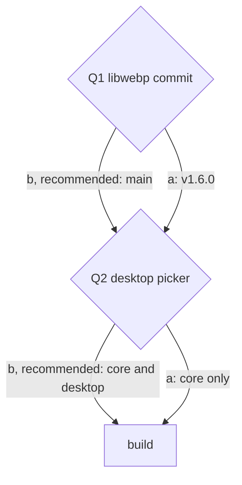
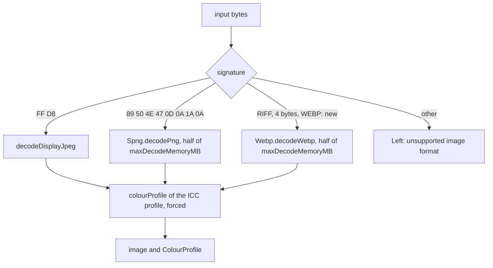
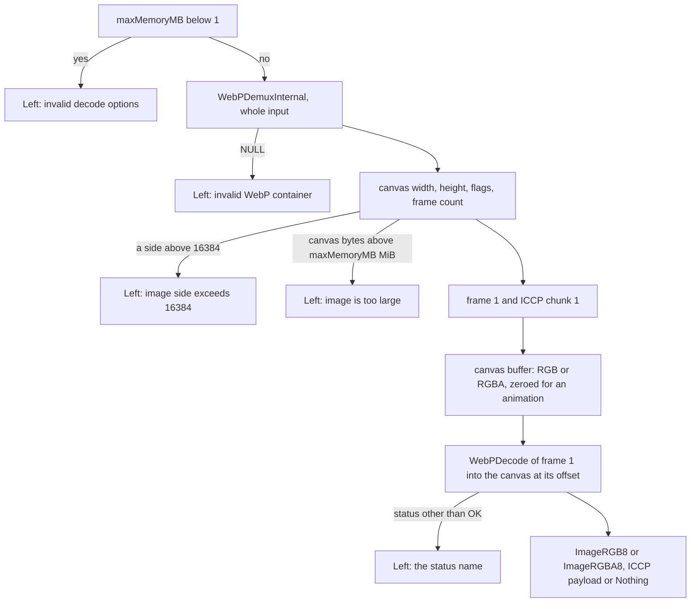
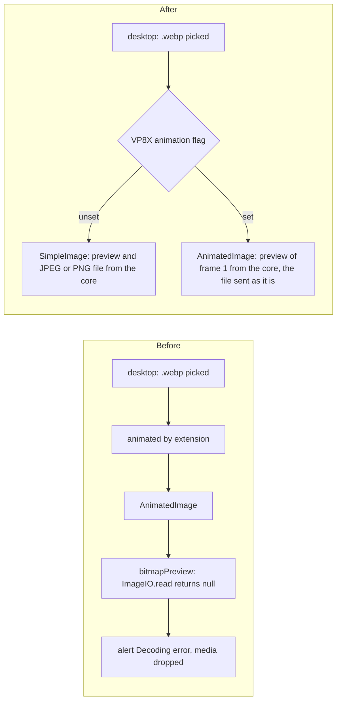
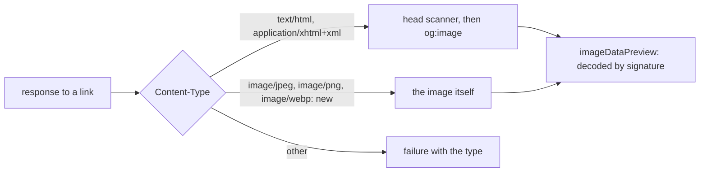

# WebP images decoded by the core

A desktop user who picks a WebP image gets the alert "Decoding error", and the image is dropped from the message.
Link previews made by the core (#8297) fail for a page with a WebP `og:image` and for a link to a WebP image; the apps preview both today.
Bots get an error from `resizeImage` for WebP input; CLI users get one from `/set profile image file` and `--user-image-file` for a `.webp` file.
On Android and iOS, a picked WebP image is decoded by the platform after the core returns `""`.

WebP input is decoded in the core by libwebp: still images, the first frame of animations, alpha and the ICC profile. Encoding WebP is out of scope.
libwebp's decoder and demuxer are compiled by cabal in `JuicyPixels-webp`, a new package of simplex-chat/hs-jpeg-turbo.
`decodeResizable` passes WebP input to it within half of `maxDecodeMemoryMB`, as PNG input. Resizing, output formats and colour profiles are unchanged.
The C functions are unchanged; the apps and the bots call them as now.

References are to branch `ep/core-webp` at the commit of this plan, based on master `8f5dfa3d4`.
Haskell paths without a directory are in `src/Simplex/Chat/`.
Kotlin paths start at `apps/multiplatform/common/src/`: `common/` is `commonMain/kotlin/chat/simplex/common/`, `desktop/` is `desktopMain/kotlin/chat/simplex/common/`, `android/` is `androidMain/kotlin/chat/simplex/common/`.
libwebp paths are at `v1.6.0`; a file name without a directory is in `src/dec`, `src/demux`, `src/dsp`, `src/utils` or `src/webp`.
Other sources:

| Name | Source |
|---|---|
| hs-jpeg-turbo | simplex-chat/hs-jpeg-turbo master `c1b5080`; pinned at `d0a4d95` (cabal.project:76-80) |
| libwebp release | `v1.6.0`, commit `4fa21912`, 7 Jul 2025 |
| libwebp main | `f054d0c3`, 21 Nov 2026 (chromium.googlesource.com/webm/libwebp, mirrored at github.com/webmproject/libwebp) |
| libwebp test data | chromium.googlesource.com/webm/libwebp-test-data at `06ddd96e` |
| link previews | branch `ep/link-previews` of evgeny-simplex/simplex-chat at `30b84f61`, simplex-chat/simplex-chat#8297 |
| SwiftyGif | kirualex/SwiftyGif at `5e861933`, pinned in apps/ios/SimpleX.xcodeproj/project.pbxproj:2883-2890 |

## Acceptance

| Who | Before | After |
|---|---|---|
| desktop user, still WebP | alert "Decoding error", image dropped | compose preview; sent as `IMG_*.jpg` or `IMG_*.png` (Q2 b) |
| desktop user, animated WebP | alert "Decoding error", image dropped | compose preview of frame 1; the file sent as it is (Q2 b) |
| Android user, still WebP | preview and image from the platform decode; log line `core returned no image` | preview and image from the core; the log line is absent |
| iOS user, WebP file from the photo picker | preview and image from `UIImage`, after `""` from the core | preview and image from the core |
| user who types a link to a page with a WebP `og:image` (#8297) | preview fails | preview with the image |
| bot on the Node or Python library | `resizeImage` error | JPEG or PNG, with the next pinned core release |
| CLI user, `/set profile image file x.webp` | `unsupported image extension` | profile image set |

Evidence at review:
- the groups `/Image resize/` and `/Mobile API Tests/` pass in the reduced build;
- hs-jpeg-turbo CI: the conformance files decoded to the md5 of libwebp's test data, the armv7 and aarch64 outputs identical, the sanitizer run clean, the decoder size per platform in the job summary;
- pending: desktop-linux, android-emu and ios-sim smoke tests pick, preview and send the WebP fixtures.

## Decode paths today

Core:

| Path | Input | WebP input today |
|---|---|---|
| `decodeResizable` (Image.hs:69-77) | bytes | `Left "unsupported image format"` (:77) |
| `cChatResizeImage`, `cChatResizeImageUri`, file and descriptor variants (Mobile/File.hs:153-169, 204-207), exported at Mobile.hs:167-177 | buffer, path, descriptor | `""` |
| `imagePreview` (Library/Commands.hs:232-238), for `/img` (:3578-3586) | file | refused by extension (:204-205, :3582) |
| `loadImageData` (Library/Commands.hs:208-224), for `/set profile image file` (:3699-3702) and `--user-image-file` (Core.hs:227-228) | file | refused by extension (:209-211) |
| `imageDataPreview` (Image.hs:229-232 at `30b84f61`), for link previews (LinkPreview.hs:119, 125) | fetched bytes, at most 5 MiB (:88-89) | `Left`; a page of type `image/webp` refused (:505) |

Apps, with the platform decode after `""` from the core:

| App | Path | WebP input today |
|---|---|---|
| iOS | picker, `.imageFile`: `resizeImageFileToStrSize`, then `resizeImageToStrSize` of the `UIImage` (Shared/Views/Chat/ComposeMessage/ComposeView.swift:315-320); sending: `saveImageFile`, then `saveImage` (:1609-1614) | `""`, then `UIImage` encoded as JPEG or PNG for the core (SimpleXChat/ImageUtils.swift:132-158) |
| iOS | animated: `setGifFromData` throws without `kCGImagePropertyGIFDictionary` (SwiftyGif UIImage+SwiftyGif.swift:170-177), so `loadFromURL` returns `.simpleImage` (ComposeView.swift:336-353) | the first frame, as above |
| iOS | file type from the picker: `public.jpeg` when offered for items other than PNG and GIF, otherwise the file itself (Shared/Views/Helpers/ImagePicker.swift:92-95) | the WebP file, when `public.jpeg` is absent |
| iOS share extension | `downsampleImage`, then `saveImage` of the `UIImage` (SimpleX SE/ShareModel.swift:442-447, 525-534) | platform decode |
| Android | still: `SimpleImage`, preview `resizeImageFileToStrSize(uri) ?: bitmapPreview()` (common/views/chat/ComposeView.kt:382); sending: `resizeImageFromUri` (common/views/helpers/Utils.kt:218-227) | `""`, log line, then `ImageDecoder` |
| Android | animated: `AnimatedImageDrawable` (android/platform/Images.android.kt:102-107) | the file sent as it is (Utils.kt:229-254); preview from the bitmap (ComposeView.kt:375) |
| desktop | `.webp` is animated by extension (desktop/platform/Images.desktop.kt:175-178) | `bitmapPreview`: `ImageIO.read` returns null, `toComposeImageBitmap` throws, alert "Decoding error", media dropped (desktop/views/helpers/Utils.desktop.kt:163-175; ComposeView.kt:370-376, 397-399; apps/multiplatform/product/gaps.md:231) |

Link previews of the apps on master, replaced by #8297: Android and desktop decode the image with `loadImageBitmap`, WebP included (common/views/helpers/LinkPreviews.kt:43, 92-96, 124-128); iOS with `LPMetadataProvider` and `UIImage` (SimpleXChat/ImageUtils.swift:455-489).

## Decisions

| ID | Decision | Options, recommended first |
|---|---|---|
| D1 | **Binding in hs-jpeg-turbo.** New package `JuicyPixels-webp`, module `Codec.Picture.Webp`, in simplex-chat/hs-jpeg-turbo; libwebp a submodule at `JuicyPixels-webp/cbits/libwebp`. | (a) package in hs-jpeg-turbo: one cabal package; CI, nix hash line, `subdir` list and Windows removal glob `hs-jpeg-t*` reused. (b) new repository: created by the user; CI copied; one more `source-repository-package` and nix hash line. (c) cbits in simplex-chat: a submodule in every simplex-chat checkout (CI, nix, Docker, reproducible Android build) and 50 C files in simplex-chat.cabal. (d) Hackage `webp` 0.1.2.0: GPL-3; system libwebp through pkg-config, while the iOS and Android builds link bundled C sources only; c2hs; `error` on animated input; the decoded pointer used unchecked (`decodeAbsBS`). (e) iko-soy/JuicyPixels-webp: pure Haskell, GitHub only, repository created 6 Feb 2026, about 11,650 lines to review (its STATUS.md). |
| D2 | **One decode function.** `decodeWebp :: DecodeOptions -> ByteString -> IO (Either String (DynamicImage, Maybe ByteString))`, `newtype DecodeOptions = DecodeOptions {maxMemoryMB :: Int}`: the image and the ICC profile from one pass of the demuxer, the shape of `Spng.decodePng` (Spng.hsc:36-45). | (a) one function. (b) header, decode and profile functions: three passes over the container; the header function used by tests only. |
| D3 | **First frame of an animation through the demuxer.** Frame 1 of `WebPDemuxGetFrame`, decoded by `WebPDecode` into a zeroed canvas at the frame offset: the pixels of `WebPAnimDecoderGetNext` for frame 1 (anim_decode.c:202-203, 347-384). | (a) demuxer and decoder: one canvas. (b) `WebPAnimDecoder`: two canvases allocated at creation (anim_decode.c:137-143), then a copy out. (c) `Left` for animations: link previews of animated images fail. |
| D4 | **RGB for opaque still images, RGBA otherwise.** Table in "Decoding". The output format is chosen by `imageFormat` (Image.hs:51-67), unchanged. | (a) RGB or RGBA by the frame's alpha. (b) RGBA always: a third more memory for opaque images. |
| D5 | **ICC profile as for JPEG and PNG; EXIF ignored.** The first `ICCP` chunk is passed to `colourProfile` (Image.hs:181-185): `CPDisplayP3` or `CPNone` (plan 2026-10-23, D25). `EXIF` and `XMP ` chunks are ignored, as by libwebp and dwebp: orientation is referenced in libwebp only by TIFF constants (imageio/tiffdec.c:239, imageio/image_enc.c:412). | (a) EXIF ignored. (b) EXIF orientation applied as for JPEG: `exifOrientation` (Image.hs:107-129) extended to the `EXIF` chunk; the WebP container specification refers to the Exif format only (doc/webp-container-spec.txt:688-711). |
| D6 | **Full-size decode within half of `maxDecodeMemoryMB`.** Limits in "Decoding". | (a) full size, halved by `fitImage`, as PNG. (b) libwebp scaled decoding to the display size: a smaller output for lossy images, the same internal frame for lossless ones (vp8l_dec.c:1556-1574), libwebp's rescaler before Catmull-Rom. |
| D7 | **Decoder and demuxer sources only, SIMD by compiler macros.** 50 C files; list in "hs-jpeg-turbo". | (a) SSE2, NEON or C paths, selected by the macros of `src/dsp/cpu.h:47-137`. (b) internal libraries for SSE4.1, AVX2 and armv7 NEON with their flags, as jpeg-turbo's `neon` (jpeg-turbo.cabal:214-215): three more stanzas, for one decode per picked image. |
| D8 | **App fallbacks kept; iOS unchanged.** The platform path is kept for formats other than JPEG, PNG and WebP: HEIC on Android (Images.android.kt:99-100, ComposeView.kt:382), pasted and camera images on iOS (`.simpleImage`, ComposeView.swift:1596-1597), other types picked on iOS (ImagePicker.swift:92-95). Each app ships with its core; the fallbacks are kept for those formats. | (a) all kept. (b) Android and iOS fallbacks removed: HEIC, pasted and camera images fail. |
| D9 | **CLI profile images from WebP; `/img` unchanged.** `loadImageData` accepts `.webp`; `/img` keeps `.jpg .jpeg .png .gif` (Library/Commands.hs:204-205), because a WebP file is sent as it is and desktop shows a received WebP file only as its preview (product/gaps.md:231). Bot libraries are unchanged and accept WebP with the next pinned core release (packages/simplex-chat-nodejs/src/release.ts:3 `core-7.1.4.0`, packages/simplex-chat-python/src/simplex_chat/_version.py:8 `core-7.1.3.0`). | (a) profile images only. (b) `/img` too: WebP files that desktop recipients open only as previews. |
| D10 | **Link previews in the second merge.** In whichever of #8297 and this pull request is merged second, `image/webp` is added to the image types of `pageContent` (LinkPreview.hs:505) and to `Accept` (:388), with two cases in `/Link preview/`. `og:image` responses are decoded by signature (plans/2026-11-21-link-previews-core.md:274 on `ep/link-previews`). | (a) in the second merge. (b) a commit on `ep/link-previews` now: its tests fail until WebP decoding is in master. |
| D11 | **Desktop picker (Q2 b).** Desktop: `.webp` is animated only with the animation flag of its `VP8X` chunk; the preview of an `AnimatedImage` is made by the core first, on Android and desktop. Details in "Apps". | Q2. |
| D12 | **Licence notices.** libwebp's BSD-3-Clause `COPYING` and its `PATENTS` grant; details in "Licence notices". | |
| D13 | **Security: limits, pinned libwebp, conformance and sanitizer runs in CI.** Threat model and measures in "Security". | |
| D14 | **Binary size measured in CI.** Method in "Binary size"; figures in the pull request before review. | |

## Open questions

| Q | Question | Options | Recommendation |
|---|---|---|---|
| Q1 | libwebp commit of the submodule | (a) `v1.6.0` (`4fa21912`, 7 Jul 2025): the latest release, later than 1.3.2, the release with the lossless decoder fix of CVE-2023-4863 (NEWS). (b) main `f054d0c3` (21 Nov 2026), or the main head at the implementation commit: 109 commits to the files of the decoder and the demuxer after `v1.6.0`, unreleased; among them `5755839` (memory of Huffman tables limited), `0ff181e` (truncated Huffman streams refused before allocation), `ace1fa5` (32-bit offset overflows prevented), `d29e00a` (canvas fill overflow prevented), `54f23b0` (DSP initialisation locked on Windows). Precedent: mozjpeg master (plan 2026-10-23, D2). | (b) |
| Q2 | Desktop picker in this pull request | (a) core only: desktop keeps the alert for every WebP image. (b) core and desktop picker (D11): about 10 lines of Kotlin, a desktopTest case and WebP cases in the desktop-linux smoke test. | (b) |

Implemented with the recommended options: Q1 (b), libwebp main `f054d0c3`; Q2 (b).

## Decoding

Composition:

`decodeResizable` (Image.hs:69-77):

- WebP input: bytes 0-3 `RIFF` and bytes 8-11 `WEBP`.
- ``Webp.decodeWebp (Webp.DecodeOptions $ maxDecodeMemoryMB `div` 2)``, as `Spng.decodePng` (Image.hs:76).
- The profile is passed to `colourProfile` and forced with `$!` (Image.hs:72), so the result references no part of the input.

`decodeWebp`:

Pixels (D4):

| Input | libwebp mode | Constructor |
|---|---|---|
| still image, frame without alpha | `MODE_RGB` | `ImageRGB8` |
| still image, frame with alpha | `MODE_RGBA` | `ImageRGBA8` |
| animation | `MODE_RGBA` | `ImageRGBA8`, transparent outside frame 1 |

- Frame alpha: `has_alpha` of the frame iterator (demux.h:157).
- Animation: the animation flag `0x02` of the format flags (mux_types.h:34); the background colour is ignored, as by `WebPAnimDecoder`, which zeroes the canvas of a key frame (anim_decode.c:355-357).

Limits (D6):
- canvas sides at most 16384, the value of `maxImageSide` (Image.hs:309-310), checked from the demuxer before allocation; frames are at most 16384 per side by format (format_constants.h:29), canvases up to 2^24 (:82)
- canvas bytes, 3 or 4 per pixel, at most `maxMemoryMB` MiB, checked before allocation
- `maxMemoryMB` from `decodeResizable`: half of `maxDecodeMemoryMB`, so that the premultiplied copy of `scaleRGBA8` (Image.hs:338-346) also fits; at `f054d0c3` the pixel buffer of the lossless decoder contains a window of rows, not a second frame (`GetWindowRows`, src/dec/vp8l_dec.c:1217-1239)
- each libwebp allocation at most 512 MiB: `-DWEBP_MAX_ALLOCABLE_MEMORY=536870912` (src/utils/utils.h:34-41, src/utils/utils.c:173-176); the default is 16 GiB on 64-bit targets
- input of the path and descriptor functions at most `maxDecodeMemoryMB` MiB (Mobile/File.hs:179-190), unchanged
- link preview images at most 5 MiB (LinkPreview.hs:88-89), unchanged
- the image at full size, halved to at most 4320 per side by `fitImage` (Image.hs:225), as PNG
- `use_threads` 0; `WEBP_USE_THREAD` defined, for the locked DSP initialisation: at `v1.6.0` on targets other than Windows (src/dsp/cpu.h:192-204), at main on Windows as well (`54f23b0`)

Errors:

| Condition | `Left` |
|---|---|
| `maxMemoryMB` below 1 | `invalid decode options` |
| `WebPDemuxInternal` returns NULL: truncated input, wrong `RIFF` size, invalid chunks | `invalid WebP container` |
| a canvas side above 16384 | `image side exceeds 16384` |
| canvas bytes above `maxMemoryMB` MiB | `image is too large` |
| `WebPDecode` status (decode.h:236-243) | `out of memory`, `invalid parameter`, `bitstream error`, `unsupported feature`, `not enough data` |

Resizing, output formats, `ColourProfile` and the C functions are unchanged.

## hs-jpeg-turbo: JuicyPixels-webp

Branch `ep/webp` of evgeny-simplex/hs-jpeg-turbo from master `c1b5080`; simplex-chat/hs-jpeg-turbo#3.

Package `JuicyPixels-webp`:
- `cabal-version: 3.0`, version `0.1.0.0`
- synopsis "JuicyPixels wrappers for libwebp"
- description "WebP decoding of JuicyPixels images with libwebp."
- `license: BSD-3-Clause`
- `license-files`:
  - `LICENSE`, with "Copyright 2026 SimpleX Chat Ltd"
  - `cbits/libwebp/COPYING`
  - `cbits/libwebp/PATENTS`
- `cc-options`:
  - `-DWEBP_USE_THREAD`
  - `-DWEBP_MAX_ALLOCABLE_MEMORY=536870912`
- `include-dirs: cbits/libwebp`; `HAVE_CONFIG_H` undefined
- `extra-source-files`: `CHANGELOG.md` and `cbits/libwebp/src/**/*.h`
- `build-depends`:
  - `JuicyPixels`
  - `base`
  - `bytestring`
  - `transformers`
  - `vector`
- module `Codec.Picture.Webp` (`.hsc`), exports `DecodeOptions (..)` and `decodeWebp`; FFI to:
  - `WebPDemuxInternal`
  - `WebPDemuxGetI`
  - `WebPDemuxGetFrame`
  - `WebPDemuxReleaseIterator`
  - `WebPDemuxGetChunk`
  - `WebPDemuxReleaseChunkIterator`
  - `WebPDemuxDelete`
  - `WebPInitDecoderConfigInternal`
  - `WebPDecode`
- the demuxer and the iterators released with `bracket` on every path
- the canvas a pinned vector that becomes the image data without a copy, as in `Spng.decodePng` (Spng.hsc:56-63)
- the ICCP payload a slice of the input bytes

C sources (D7), as `dec_srcs`, `demux_srcs`, `dsp_dec_srcs` and `utils_dec_srcs` of libwebp's Android.mk:47-106 and 162-172, without MIPS and MSA; 23,492 lines at `v1.6.0`:

| Directory | Files |
|---|---|
| `src/dec` | `alpha_dec.c` `buffer_dec.c` `frame_dec.c` `idec_dec.c` `io_dec.c` `quant_dec.c` `tree_dec.c` `vp8_dec.c` `vp8l_dec.c` `webp_dec.c` |
| `src/demux` | `anim_decode.c` `demux.c` |
| `src/dsp` | `alpha_processing.c` `alpha_processing_neon.c` `alpha_processing_sse2.c` `alpha_processing_sse41.c` `cpu.c` `dec.c` `dec_clip_tables.c` `dec_neon.c` `dec_sse2.c` `dec_sse41.c` `filters.c` `filters_neon.c` `filters_sse2.c` `lossless.c` `lossless_neon.c` `lossless_sse2.c` `lossless_sse41.c` `rescaler.c` `rescaler_neon.c` `rescaler_sse2.c` `upsampling.c` `upsampling_neon.c` `upsampling_sse2.c` `upsampling_sse41.c` `yuv.c` `yuv_neon.c` `yuv_sse2.c` `yuv_sse41.c` |
| `src/utils` | `bit_reader_utils.c` `color_cache_utils.c` `filters_utils.c` `huffman_utils.c` `palette.c` `quant_levels_dec_utils.c` `random_utils.c` `rescaler_utils.c` `thread_utils.c` `utils.c` |

- Excluded:
  - `src/enc`
  - `src/mux`
  - `sharpyuv`
  - `src/dsp/lossless_avx2.c`
  - the encoder files of `src/dsp` and `src/utils`
  - `examples`
  - `imageio`
- SIMD by compiler macros (src/dsp/cpu.h:47-137): SSE2 on x86-64; NEON on aarch64, and on armv7 when the toolchain defines `__ARM_NEON__`; the C code paths otherwise. Without `-msse4.1`, the SSE4.1 files compile to init stubs (src/dsp/dec_sse41.c:45-49), which are called only with `WEBP_HAVE_SSE41` (src/dsp/lossless.c:655-660).

Repository files:
- `.gitmodules`: `JuicyPixels-webp/cbits/libwebp`, `https://github.com/webmproject/libwebp`, at the commit of Q1
- `cabal.project`, `stack.yaml`, `stack.ghc-8107.yaml`: the package added
- `.github/workflows/build.yml`:
  - before `cabal test`, in the shared steps: libwebp-test-data cloned at `06ddd96e` into `$RUNNER_TEMP`, `WEBP_TEST_DATA` set
  - armv7 job: `bash .github/scripts/webp-check.sh` after `png-check.sh`
  - each matrix job: the size of `libHSJuicyPixels-webp-*.a` in the job summary
- `.github/scripts/webp-check.sh`, as `png-check.sh` (sources and `cc-options` read from the cabal file):
  - each conformance file decoded by `.github/scripts/webp.c` as by `decodeWebp`, and written as PAM or PPM
  - armv7 with `-mfpu=vfpv3-d16` (C code paths) and aarch64 (NEON): outputs identical and equal to `libwebp_tests.md5`
  - aarch64, built by clang 18 with `-fsanitize=address,undefined`: the conformance files, each also truncated at 64 lengths and with 64 single-byte changes; every run exits with 0 or a decoder status; GCC instruments the Neon additions of its `arm_neon.h` as `signed char` arithmetic
  - `size` of the armv7 and aarch64 objects in the job summary
- `.github/scripts/coverage.sh`: the hpc report of `Codec.Picture.Webp`

Package tests, `JuicyPixels-webp/test/WebpTest.hs` (tasty, as `SpngTest.hs`):
- conformance: every `.webp` with a `.pam` or `.ppm` entry in `libwebp_tests.md5` of `$WEBP_TEST_DATA`, 96 files; the decoded image, written as dwebp writes PAM for RGBA and PPM for RGB (imageio/image_enc.c:223-250), has the listed md5 (`cryptohash-md5`); the group fails when `WEBP_TEST_DATA` is unset
- animation: a container assembled in the test from two still frames of the conformance files (`VP8X` with the animation flag, `ANIM`, two `ANMF` with offsets) is decoded as frame 1 at its offset on a transparent canvas
- ICC profile: the payload of the `ICCP` chunk of a `VP8X` container is returned; without the chunk, `Nothing`
- limits: with `maxMemoryMB` 1, a 512×512 RGBA canvas is decoded and a 513×512 one refused; a canvas side of 16385 and `maxMemoryMB` 0 are refused
- malformed input, refused: empty input, `RIFF` without `WEBP`, truncations, a `RIFF` size beyond the input

## Apps (Q2 b)

- `isAnimImage` of desktop (desktop/platform/Images.desktop.kt:175-178): true for `.gif`, and for `.webp` when the first 21 bytes are `RIFF`, 4 bytes, `WEBP`, `VP8X`, 4 bytes, and a byte with bit `0x02`.
- `processPickedMedia`, `AnimatedImage` branch (common/views/chat/ComposeView.kt:375): `preview = resizeImageFileToStrSize(uri, maxDataSize = 14000) ?: bitmapPreview()`, on Android and desktop; for GIF, `""` from the core, then `bitmapPreview`, as now.
- Sending is unchanged: `SimpleImage` through `saveImage` or `desktopSaveImageInTmp` (Utils.kt:174-216), `AnimatedImage` as the file (ComposeView.kt:922-924).
- Specs: `apps/multiplatform/spec/client/compose.md:318`, step 2 of `processPickedMedia`; `apps/multiplatform/product/gaps.md:231`, the clause on picked WebP images.
- User guide: the image steps of `docs/guide/send-messages.md:34-50` stay true and unchanged.

## Link previews, after both merges (D10)

- `pageContent` (LinkPreview.hs:505): `["image/jpeg", "image/png", "image/webp"]`.
- `Accept` (LinkPreview.hs:388): `text/html,application/xhtml+xml,image/png,image/webp,image/jpeg;q=0.9,*/*;q=0.1`.
- `/Link preview/` cases: a WebP image URL; a page with a WebP `og:image`.

## Builds

| Build | Change |
|---|---|
| `cabal.project:76-80` | tag of the hs-jpeg-turbo commit; `subdir: JuicyPixels-jpeg-turbo JuicyPixels-spng JuicyPixels-webp jpeg-turbo` |
| `scripts/nix/sha256map.nix:12` | hash of that commit, computed with submodules |
| `simplex-chat.cabal:391-394` | `JuicyPixels-webp ==0.1.*` in the library |
| nix: Android aarch64 and armv7a, iOS, iOS simulator, macOS (flake.nix) | unchanged; the package is built by haskell.nix as `JuicyPixels-spng` is; its licence, BSD-3-Clause, is accepted as declared (flake.nix:73-75 overrides `JuicyPixels-spng` only) |
| Android armv7a, GHC 8.10.7 (flake.nix:11-13, :344-346) | compatibility checked by the hs-jpeg-turbo job on ubuntu-22.04 with GHC 8.10.7; the core built once by android-emu with the input `armv7a` |
| Windows (`.github/workflows/build.yml:1652-1655, 1778, 1820-1822`; `scripts/desktop/build-lib-windows.sh:43`) | unchanged: the libwebp submodule is removed with the others by the glob `dist-newstyle/src/hs-jpeg-t*` |
| reproducible Android build | unchanged: submodules are updated after checkout (`scripts/simplex-chat-reproduce-builds-android.sh:103`) |

Until the pull request in simplex-chat/hs-jpeg-turbo is merged, `cabal.project` references the commit of evgeny-simplex/hs-jpeg-turbo; after the merge, the squash commit, with `sha256map.nix` updated.

## Licence notices

- `docs/dependencies/README.md`, after libspng:
  `[libwebp](https://chromium.googlesource.com/webm/libwebp): WebP decoding of resized images ([BSD-3-clause](./licences/apps/libwebp/COPYING) and [patent grant](./licences/apps/libwebp/PATENTS))`
- `docs/dependencies/licences/apps/libwebp/COPYING` and `PATENTS`: copies from the pinned commit.
- `docs/dependencies/HASKELL.md`:
  - direct dependency, after `JuicyPixels-stbir` (:28): `JuicyPixels-webp` 0.1.0.0, simplex-chat/hs-jpeg-turbo at the pinned commit, `BSD-3-Clause`, "JuicyPixels wrappers for libwebp"
  - `JuicyPixels-webp` added to the dependents of `JuicyPixels` (:25), `bytestring` (:11) and `vector` (:55)
- `docs/dependencies/licences/haskell/JuicyPixels-webp-0.1.0.0/LICENSE`, with "Copyright 2026 SimpleX Chat Ltd".

## Security

Threat model:

| Who | Supplies | Through |
|---|---|---|
| website owner | a crafted WebP image | link previews (#8297), for every user who types a link to the site |
| contact | a crafted WebP file | a received file that the user picks and sends again |
| bot operator | own input | `resizeImage` of the bot libraries |

- Received images are displayed by the apps' platform decoders. The core decodes images picked in the apps, sent with `/img`, set as profile images and fetched for link previews (callers of `decodeResizable`: Mobile/File.hs:206, Library/Commands.hs:223, :237, LinkPreview.hs via Image.hs:229-232).
- Measures:
  - the limits of "Decoding"
  - libwebp pinned by submodule commit (Q1)
  - conformance, armv7 and sanitizer runs in hs-jpeg-turbo CI
  - libwebp's fuzzers, run upstream on OSS-Fuzz (tests/fuzzer, tests/fuzzer/oss-fuzz/build.sh)
- WebP is decoded in the chat process, as JPEG by mozjpeg and PNG by libspng.

## Binary size

Measured in CI and reported in the pull request before review:
- hs-jpeg-turbo: `size` of the decoder objects for armv7 and aarch64 (webp-check.sh); size of `libHSJuicyPixels-webp-*.a` on each matrix OS: Linux x86-64 with GHC 9.6.3 and 8.10.7, Linux aarch64, macOS aarch64 and x86-64, Windows; the full matrix runs for a pull request ready for review (hs-jpeg-turbo build.yml, job `build-full`).
- simplex-chat: `libsimplex.so` of android-emu with the input `armv7a`, aarch64 and armv7a, on this branch and on master.

## Tests

`tests/ImageTests.hs`, group "Image resize" (tests/Test.hs:98), new group "WebP decoding":
- decoding, each with `CPNone`, the samples written as dwebp writes PAM or PPM with the md5 of `libwebp_tests.md5`, and its data URI with limit 14000:

  | Fixture | Image | md5 | Data URI |
  |---|---|---|---|
  | `test.webp`, lossy | `ImageRGB8` 128×128 | `ebdd46e0…` of the PPM | `data:image/jpg;base64,` |
  | `lossless1.webp`, lossless with alpha | `ImageRGBA8` 1000×307 | `fd52591b…` of the PAM | `data:image/png;base64,` |
  | `lossy_alpha1.webp`, lossy with an `ALPH` chunk | `ImageRGBA8` 1000×307 | `c5c77aff…` of the PAM | `data:image/png;base64,` |

- animation, containers assembled in the test (`VP8X` with the animation flag, `ANIM`, two `ANMF`), decoded as `ImageRGBA8` of the canvas size with frame 1 at its offset and transparent pixels elsewhere:
  - `test.webp` at (0, 0) and at (32, 0) on 160×128: the left 128 columns with the samples of `test.webp` and alpha 255
  - `lossless1.webp` at (34, 16) and `test.webp` at (0, 0) on 1034×323: the samples of `lossless1.webp` at the offset
- colour profile: a `VP8X` container with an `ICCP` chunk of `p3Profile` and the `VP8 ` chunk of `test.webp` is decoded with `CPDisplayP3`, and its JPEG and PNG image data with limit 261120 read back as `CPDisplayP3`; with rX 3/65536 above Display P3, `CPNone`
- refusals, `Left`:
  - an animation canvas of 16385×128, frame 1 inside it: `image side exceeds 16384`
  - an animation canvas of 16384×16384, 1 GiB as RGBA, above the limit of every build: `image is too large`
  - `test.webp` cut at half its length and by its last byte, and with the `RIFF` size increased by 1: `invalid WebP container`
  - `RIFF`, 4 bytes, `WAVE`: `unsupported image format`

`tests/MobileTests.hs`, "Images" (:103-110), cases added to the existing tests:
- `cChatResizeImageUri` on `test.webp`, limit 14000: `data:image/jpg;base64,`
- `cChatResizeImageFile` with `png = -1`, limit 100000, on `lossless1.webp`: the PNG signature
- `cChatResizeImageFdUri` on `lossless1.webp` cut at half its length: `""`; the descriptor closed afterwards

`tests/ChatTests/Profiles.hs`, "set profile image from file" (:76, :1250-1255): `/set profile image file ./tests/fixtures/webp/test.webp` sets a `data:image/jpg;base64,` image of at most 12500 characters. Pattern `/SimpleX chat client/profile tests/user profiles/set profile image from file/`, added to the `ci-tests` block with the code.

Fixtures, `tests/fixtures/webp/`: `test.webp`, `lossless1.webp` and `lossy_alpha1.webp` of libwebp-test-data at `06ddd96e`, with libwebp's `COPYING`, the licence of that repository's files.

Apps (Q2 b):
- desktopTest: desktop `isAnimImage` on temporary files: a `VP8X` header with the animation flag, true; without it, false; a simple `VP8 ` file, false; `.gif`, true.
- Pending, with the runs of the app workflows on the branch:
  - desktop-linux, `send_images` (scripts/ci/desktop-linux/smoke-test.sh:373-379): `webp/test.webp` sent as `.jpg`, and an animated container assembled from the fixtures sent as `.webp`; each with the compose preview and the unchanged count of `core returned no image`; `send_image` takes a shot label besides the extension.
  - android-emu: `test.webp` added in its own folder and sent as `.jpg`, with the unchanged count of `core returned no image`.
  - ios-sim: `test.webp` added to the photo library and sent; the sent file 128x128; the log lines of the app's own resizing absent.
  - Each workflow run once on the branch, with the app uploaded; READMEs: `scripts/ci/desktop-linux/README.md:27`, `scripts/ci/android/README.md:32`, `scripts/ci/ios-sim/README.md:3`.

Link previews (D10): `/Link preview/` cases in the second merge.

## Mechanics

hs-jpeg-turbo, branch `ep/webp`: the files of "hs-jpeg-turbo: JuicyPixels-webp".

simplex-chat, branch `ep/core-webp`:
- `Image.hs`:
  - `import qualified Codec.Picture.Webp as Webp`
  - `decodeResizable` (:69-77): the WebP branch before `otherwise`
- `Library/Commands.hs`:
  - `loadImageData` (:209-211): `.webp` accepted; error text `(only .png, .jpg, .jpeg, .webp)`
  - comment (:207): `.webp` named
- `Controller.hs:671`, comment: `.webp` named.
- `Options.hs:493`, help: `.png/.jpg/.jpeg/.webp`.
- `docs/CHAT-RELAY.md:110`: `.png`, `.jpg`, `.jpeg` or `.webp`.
- `cabal.project`, `scripts/nix/sha256map.nix`, `simplex-chat.cabal`: "Builds".
- `docs/dependencies`: "Licence notices".
- Tests and fixtures: "Tests".
- Apps (Q2 b):
  - `desktop/platform/Images.desktop.kt:175-178`
  - `common/views/chat/ComposeView.kt:375`
  - `apps/multiplatform/common/src/desktopTest/kotlin/chat/simplex/app/ImageFileTypeTest.kt`
  - specs of "Apps"
  - pending: smoke tests and READMEs of "Tests"

Commits:
1. `docs: plan of WebP images decoded by the core`
2. `core: decode WebP images`: binding pin, `decodeResizable`, profile images, licences, core tests and fixtures, this plan updated
3. `desktop: attach WebP images` (Q2 b): desktop picker, preview line, desktopTest, specs
4. pending: `ci: send WebP images in the app smoke tests`

## Out of scope

- WebP encoding.
- Display of received WebP files on desktop (product/gaps.md:231; Images.desktop.kt:31-35).
- Animation of WebP on iOS: an animated WebP is sent as its first frame, as today (SwiftyGif UIImage+SwiftyGif.swift:170-177).
- `/img` with WebP files (D9).
- GIF, HEIC and other formats in the core.
