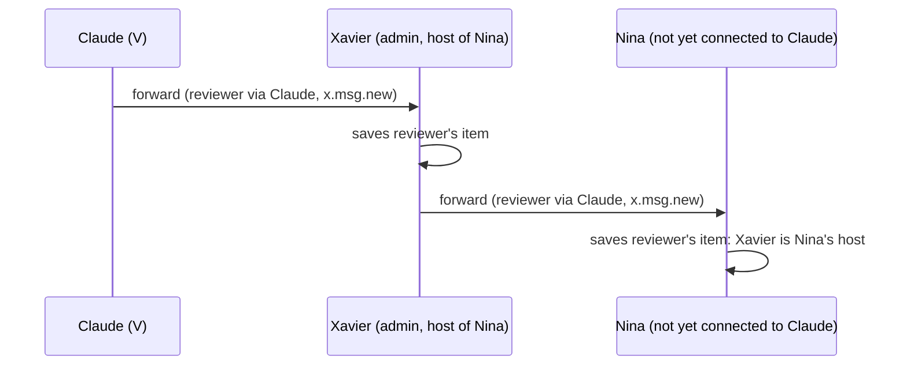
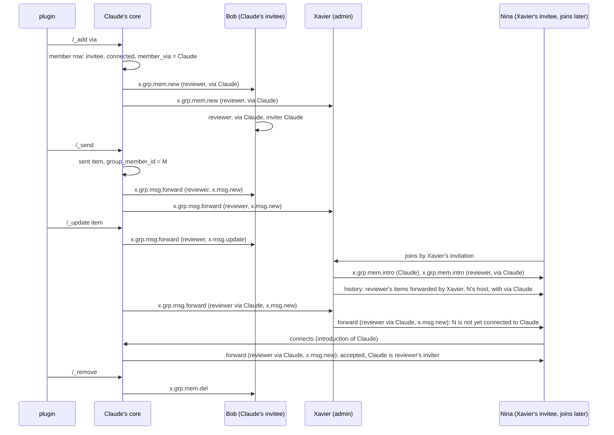
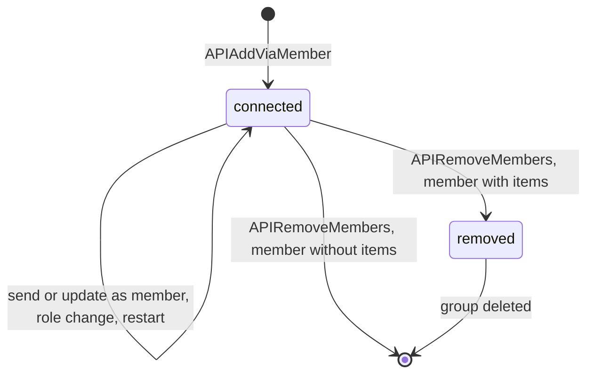
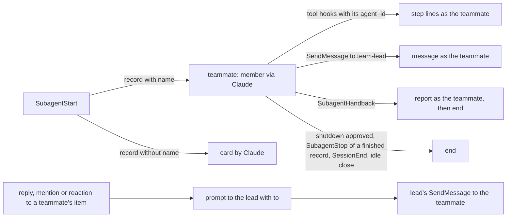

# Members via another member: teammates as group members without connections

Status: plan only. Code references: master `dbd3fd7ca`, by file and line. Nothing of this plan is in the release of 2026-11-23. Decided by the maintainer on 2026-11-22:
- design A only: a member is in the group only via another member, not directly; the representation is permanent, stored and shown on every member's side;
- the MemberInfo field `via` names the member it is via; x.grp.mem.new with `via` may be forwarded;
- receivers accept forwards of a member's messages from whoever they accept forwards today; `via` does not restrict forwarders;
- later joiners get x.grp.mem.intro with `via`, without a "joined" or "added" item;
- `SendAs` is parameterized; the parser accepts `(as_group=on)` as today;
- one pull request with the three plugin stages; reactions as a member are excluded;
- chat version 23; Q1 A and Q4 A;
- a member via V has any role up to V's role, as the author of a commit made by its committer; introductions put each member via another member after that member;
- a teammate ends by the existing removal: "Claude removed reviewer" (Q3 A);
- the host of a member forwards the messages of a member via V to it until it connects to V (Q5 B);
- with "sign messages" on, V signs the messages of its members via V with its own key, and receivers verify them with the key of the member recorded as `via` (Q6, new option D);
- each forward of a message of a member via V has `via`, set by whoever forwards it: V, the host of the recipient, and group history;
- how apps show `via` waits for renders (Q2): "Alice via Claude" on each message where the sender is shown, with distinct styling; the chat item and member JSON have the fields the apps need.

Q2 is open. Facts about Claude Code are those recorded in `plans/2026-11-14-mcp-teammate-profiles.md` (branch `ep/mcp-teammate-profiles`, facts 1 to 9, F1 and F2).

Terms: "a member via V" is a member whose messages are sent only by V, as forwards; V is "the member it is via". In this plan V is Claude and the member via V is a teammate.

## 1. Goal

The maintainer, 2026-11-22: "claude sends "new member" message with a flag "no connection needed", intro protocol doesn't run, all messages are "forwarded" from these members without ever creating them. Claude is host anyway, it can do it anyway, so we're not changing threat model, we're simply creating an API for it." And: "We already have "send as group", so we may as well have "send as member"."

Outcome:
- Claude's core adds each named teammate of a session to the session group as a member via Claude, with its own profile; the introduction protocol ends at the announcement.
- The teammate's messages, reports and tool steps are sent by Claude's core as forwards attributed to that member; its step lines are edited in place under its profile.
- A person replies to, mentions or reacts to a teammate's message, and the lead forwards it to that teammate.
- The teammate leaves the group when it ends.

## 2. What users see

```
moment                              today (master)                          after
the lead starts teammate reviewer   Claude's step line: 🤖 Agent: TASK       Claude added reviewer (agent avatar, TASK as bio)
reviewer runs a tool                nothing                                 reviewer's step line in small print, edited until done
reviewer sends to the lead          Claude: ✉️ Message from reviewer: …      reviewer: the whole message
the lead sends to reviewer          Claude's step line: 🔧 SendMessage       Claude: @reviewer and the message
a person replies to, mentions or    a prompt to the lead                    a prompt to the lead with to=reviewer; the lead
reacts to reviewer's message                                                forwards it; reviewer's answer is shown under reviewer
reviewer's final report             Claude: 📋 Report from subagent …        reviewer: the report
reviewer ends, or the session ends  nothing                                 Claude removed reviewer
an unnamed subagent                 Claude's 🤖 card in small print          unchanged
member list and member info         people, Claude, User                    also reviewer, "via Claude" (Q2; renders before UI)
a person who joins later            -                                       reviewer listed via Claude, history under reviewer
```

## 3. Design

Options:
```
option                                   cost per teammate
A. members via Claude (this plan)        one member record on the host and one x.grp.mem.new to each member; each post is one message per member, as Claude's own posts
B. teammate users in Claude's core       one user, one contact, one group join, and one connection with every member; every command names or switches the user; per-session ownership of users
C. one more core per session (#8209)     as B, plus a second database and agent per session (teammates.ts of ep/mcp-teammate-steps: apiCreateActiveUser, APIAddContact, apiConnect, apiAddMember, apiJoinGroup)
```

B and C, the costs that exclude them: each teammate joins as a full member, so the introduction protocol connects it with every member (x.grp.mem.intro per member, Internal.hs:1242-1295; the joiner creates a connection per intro, Subscriber.hs:3358-3369; the existing member joins it, Subscriber.hs:3388-3423). The maintainer rejected C as bad design; B requires the ownership of users per session, which the maintainer called messy.

## 4. Protocol

New chat version 23, `memberViaVersion` (Protocol.hs:97-150): members via another member.

### 4.1 MemberInfo.via

```
MemberInfo (Types.hs:1123-1130)
  memberId     unchanged
  memberRole   unchanged
  v            unchanged; for a member via V, the chat version range of V's core
  profile      unchanged
  memberKey    unchanged; omitted for a member via V
  via          new, optional: the member ID of V
```

Encoded by the derived JSON instance (Types.hs:2414); clients before version 23 ignore the field. The positional MemberInfo patterns (7 sites) get the field.

### 4.2 Creation: x.grp.mem.new with via

V sends `x.grp.mem.new` with `via` = V's own member ID to its current members, once, when it creates the member.

The receiver (xGrpMemNew, Subscriber.hs:3254-3335):
- checks V's role as for any announcer: admin or higher, and not lower than the member's role (checkHostRole, Subscriber.hs:3256 and 3715-3717);
- version 23: checks `via` = the announcer's member ID, else rejects the event;
- creates the member with category post, V as its inviter (createNewGroupMember, Store/Groups.hs:2498), `member_via` = V's member ID, and status connected (version 23) or announced (older clients, Subscriber.hs:3313-3315);
- saves the item "Claude added reviewer" (Subscriber.hs:3320-3330).

A member that receives x.grp.mem.new creates a connection for the announced member only on x.grp.mem.fwd (Subscriber.hs:3388-3423). The host sends x.grp.mem.fwd only on x.grp.mem.inv (Subscriber.hs:3379-3386), which is sent only by the joining member's own client (Subscriber.hs:3372-3377). For a member via V, the introduction therefore ends at the announcement.

Forwarding of the announcement, unchanged: an admin that receives x.grp.mem.new from V forwards it to its members that are introduced to V and not yet connected (xGrpMemNew returns DJSGroup, Subscriber.hs:3316-3319; delivery job by V's relation vector, Subscriber.hs:4476-4494). Such a member processes it attributed to V (Subscriber.hs:4083), so `via` = the author's member ID holds.

### 4.3 Later joiners: x.grp.mem.intro with via

The joiner's host introduces a member via V in the batch of introductions (memberIntroEvt, Internal.hs:1291-1295, used by introduceMember, 1260-1289, for introduceToAll, introduceToRemaining and introduceToModerators):
- joiners of version 23: x.grp.mem.intro with `via`;
- older joiners: the member is not introduced; such a joiner creates it as an unknown member at its first forward or history item, accepted from any admin (Subscriber.hs:4040-4052 and 4064).

The receiver of x.grp.mem.intro with `via` (xGrpMemIntro, Subscriber.hs:3337-3370):
- checks the sender as today: the receiver's host, admin or higher;
- checks V: a member of the group, admin or higher, not lower than the member's role; else rejects the event;
- creates the member with category pre, V as its inviter, `member_via` = V's member ID, status connected; creates no connection and sends no x.grp.mem.inv;
- saves no chat item, as for any introduction today.

V is introduced before the member via V in the same batch: the members via another member follow all other members in the batch (introduceMember). A member via V cannot itself be V: receivers reject x.grp.mem.new from a member via another member, and x.grp.mem.intro whose `via` is a member via another member.

History is sent after the introductions on the same connection (Subscriber.hs:988-992; APIAcceptMember, Commands.hs:2980-2981 and 3004-3005); items of a member via V are forwarded attributed to it (4.5).

### 4.4 Messages

A message sent as a member via V is one forward from V to each member with a ready connection:
```
x.grp.msg.forward    sent by V to members before version 23, to members of JSON batches, and as pending messages
  memberId           the member's member ID
  memberName         its display name, shortened (memberShortenedName, Internal.hs:1569-1570)
  via                new, optional: the member ID of V; ignored by clients before version 23
  msgTs              V's send time
  msg                the member's message
    msgId            the item's shared message ID
    event            x.msg.new | x.msg.update
msgId                omitted from the outer message

binary forward element   sent by V to members of version 23 and binary batches
  ">"
  fwdSender          "V" memberId memberName viaMemberId (new tag; parsers before version 23 reject it)
  brokerTs           V's send time
  "/" signatures     when the message is signed (4.6)
  msg                the member's message, as above
```

The JSON event is parsed by every client since chat version 4, 2023-11-18 (Protocol.hs:75, 1488-1494). The stored message (messages.msg_body) is the JSON event; the binary element is kept with the sent message (SndMessage.fwdElement_) and used for members of version 23 in binary mode (sendGroupSignedMessages_ routes other members to JSON).

Every forward of a message of a member via V has `via`:
```
forwarder                     when                                            header to version 23   header to older
V                             sends or updates as the member                  via                    JSON with via
host of the recipient (Q5 B)  receives it from V, recipient not connected to V  "V" tag                "M" tag
any member sending history    item of a member via V                          "V" tag                "M" tag
```

The receiver of a forward with `via` (xGrpMsgForward):
- an unknown member created from the forward, or an unknown member without `via`, records `via` (setMemberVia);
- the recorded `via` of a known member wins: a forward with a different `via` is ignored with a log, as a forward from an unexpected forwarder;
- the key for signature verification is the key of the member recorded as `via` (memberSignerKey, withVerifiedMsgKey).

The receiver, with unchanged rules:
- saves the outer message from V and passes the inner one to xGrpMsgForward (Subscriber.hs:1065-1069, 1083, 1136);
- accepts V as forwarder: admin or higher (isMemberGrpFwdRelay, Subscriber.hs:3833-3836, checked at 4038);
- accepts the author when V is the receiver's host or the author's inviter (expectedForwarder, Subscriber.hs:4060-4064); V is the inviter in every record of 4.2 and 4.3;
- accepts the unsigned inner message: `signatureOptional = not (useRelays' gInfo) || not (requiresSignature tag)` (withVerifiedMsg, Subscriber.hs:4115-4118);
- saves the item as received from the member, forwarded by V, at msgTs (processForwardedMsg, Subscriber.hs:4066-4078); deduplicates it by the inner msgId (saveGroupFwdRcvMsg, Internal.hs:3013-3036).

Members without a ready connection to V get nothing from V, as for any x.grp.msg.forward (Internal.hs:2926). Their host, when it is an admin, forwards each x.msg.new and x.msg.update of a member via V that it receives from V and accepts to its members introduced to V and not yet connected to V (MRIntroduced in V's relation vector), one forward element per member (forwardViaMemberMsg, sendFwdMemberMessageFlags), with the notification flag of a delivery task of that message; the header is chosen by the version of each member, so delivery tasks are not used.



Signing: members via V need no keys. With "sign messages" on, V signs the member's message with V's own key; the binding is the member ID of the member via V and V's key (groupMsgSigning for an x.grp.msg.forward with via), so the signature cannot be used for a message of V or of another member. The stored chat item keeps this signature, and history forwards it.

Notifications: the push notification flag of the agent message is set from the inner event (hasNotification of x.msg.new, Protocol.hs:1339-1348), as for delivery jobs (Subscriber.hs:4269). Delivery receipts are not sent for x.grp.msg.forward (hasDeliveryReceipt, Protocol.hs:1355-1360; checkSendRcpt, Subscriber.hs:1154-1164), so V's items stay "sent".

### 4.5 Updates, history, end

- Update: the same envelope with x.msg.update (Protocol.hs:464); the receiver applies it to the member's item, live flag included (Subscriber.hs:4076-4077 → groupMessageUpdate, 2334-2425).
- History: V forwards items sent as a member via V attributed to that member, with `via` (sendHistory → memberFwdSenderTo); another admin forwards them as items received from that member, with `via`; signed items are forwarded with their signature.
- End: `x.grp.mem.del` from V, by the existing removal (APIRemoveMembers, Commands.hs:3172-3282; xGrpMemDel, Subscriber.hs:3759-3826): "Claude removed reviewer".
- History items of removed members via V are attributed to their member ID; a joining member creates them as unknown members, as for departed people today (testGroupHistoryUnknownMember, tests/ChatTests/Groups.hs:7235-7300), and records `via` from the forward.

### 4.6 Scope

- Groups without relays only. In channels only relays forward (isMemberGrpFwdRelay, Subscriber.hs:3835), so the owner cannot post as a member; the API refuses members via the user in channels. Relays forwarding x.grp.mem.new with `via` is outside this plan.
- Groups with "sign messages" on: V signs the messages of members via V (4.4); receivers show them as verified. Members before version 23 get them unsigned in JSON and show them as signature missing (toMsgVerified, Types/Shared.hs:169-172).

### 4.7 Older clients

- Clients before version 23: from x.grp.mem.new, a member with status announced, V as inviter, shown "connecting" (ChatTypes.swift:3743 and 3763; ChatModel.kt:3306 and 3324), messages accepted; as later joiners, an unknown member with a name only.
- An admin before version 23 introduces a member via V to its joiners with x.grp.mem.intro without `via` (shouldIntroduce, Internal.hs:1254-1258); the joiner records it without an inviter (createIntroReMember, Store/Groups.hs:2688-2701) and creates a connection that is never joined; V's forwards for it fail expectedForwarder there. Session members are invited by Claude or join by Claude's group link (hub.ts:769, 1356, 1455; control.ts:610). Q5.

### 4.8 Threat model

A host in a group without relays can today:
1. announce a member with any member ID, any profile and a role up to its own (Subscriber.hs:3256, 3301-3311), whether or not a client of that member exists;
2. forward to the members it invited content attributed to any member, and to every member content attributed to a member it announced or to an unknown member ID, which receivers then create (Subscriber.hs:4040-4064);
3. send that content unsigned (Subscriber.hs:4115-4118).

Members via V are a composition of 1 to 3; receivers' acceptance rules are unchanged. On the wire, no party gets a new capability: x.grp.mem.intro with `via` is accepted only from the joiner's host, as any introduction; the record it creates names V as inviter, so V's forwards for that member are accepted by the inviter rule, and the joiner's host's forwards by the host rule, as today. With the API, the user posts as members via the user through a supported command; posting as any other member is refused (6.3), so connected members cannot be posted as. Receivers store and show `via`. Q1.



## 5. Persistence and views

### 5.1 Member record

`group_members` gets one column, `member_via` (BLOB in SQLite, BYTEA in Postgres), the member ID of the member it is via. GroupMember gets `memberVia :: Maybe MemberId`. The column is added to groupMemberQuery and the 8 member column lists (Store/Shared.hs:782, 812, 859; Store/Messages.hs:734, 3142, 3151, 3158; Store/Connections.hs:172, 178), as `member_security_code` was (M20260714_member_security_code). The categories are unchanged (GroupMemberCategory, Types.hs:1404-1436), so older cores parse every row.

```
group_members, on V's side (created by APIAddViaMember)
  member_id                   12 random bytes (createWithRandomId', Store/Shared.hs:641-642)
  member_role                 the API's role, up to the user's role
  member_category             invitee
  member_status               connected
  member_via                  the user's member ID
  invited_by                  the user's contact (IBUser), as for invitees (Store/Groups.hs:1456)
  invited_by_group_member_id  the user's membership, as for invitees (Store/Groups.hs:1412)
  contact_id                  NULL
  contact_profile_id          a new contact_profiles row with the API's profile (createNewMemberProfile_, Store/Groups.hs:2505-2514)
  local_display_name          the profile's display name, made unique for the user (withLocalDisplayName)
  peer_chat_min_version       V's chat version range at creation
  peer_chat_max_version       V's chat version range at creation
  member_pub_key              NULL
connections                   (not created)

group_members, on another member's side
  member_category             post (4.2) or pre (4.3)
  member_status               connected (version 23), announced (older, 4.2)
  member_via                  V's member ID
  invited_by_group_member_id  V's record
  peer_chat_min_version       MemberInfo.v
  peer_chat_max_version       MemberInfo.v
connections                   (not created)
```

### 5.2 Items sent as a member via the user

```
chat_items, on V's side
  item_sent              1
  group_member_id        the member via V (NULL for every other sent item: idsRow, Store/Messages.hs:631)
  shared_msg_id          the inner msgId of 4.4
  show_group_as_sender   0
  include_in_history     1 (main scope)
```

Existing queries by group_member_id then select these items:
- quotes in replies of others resolve to them (getGroupChatItemQuote_, Store/Messages.hs:721-748), so a reply's quotedItem has the item ID and the direction groupRcv of the member;
- reactions and moderation by others find them (getGroupMemberCIBySharedMsgId, Store/Messages.hs:3092-3110);
- the user's own items exclude them (`group_member_id IS NULL`, Store/Messages.hs:226, 712, 2939, 3008, 3102);
- the member record is kept on removal while it has items (checkGroupMemberHasItems in deleteOrUpdateMemberRecordIO, Internal.hs:2254-2265).

Reading: for sent items, toGroupChatItem discards the member row today (Store/Messages.hs:2405-2409); with this change it sets `CIMeta.sentAsMember` from that row.

### 5.3 Ownership

```
owner          recorded in
user           member_via = the user's member ID in that group
session        the session group: groups.custom_data.simplexMcpSession (hub.ts:1446-1453, 1632-1634)
teammate       the member's profile display name within the session group
```

The core records only which member a member is via. The plugin keeps a map from teammate name to group member ID per session, rebuilt from APIListMembers (current members via the user) when the session is loaded (Hub.session, hub.ts:1341-1359).

### 5.4 Lifetime



- Restart of V's core: rows and items persist in the database, the core's only state of these members; the plugin re-adopts current members via the user by name (5.3).
- Teammate end (7.1): the plugin removes the member; a later teammate with the same name gets a new member.
- Sessions that do not attach within the idle-close interval after a service start (10 minutes, service.ts:20 and 473-484) remove their members.

### 5.5 Code paths for a member without a connection

```
path                               file:line                       change
memberSendAction                   Internal.hs:2899-2936           a member with memberVia -> Nothing, before the category dispatch (both sides)
sends as a member, unready members Internal.hs:2917-2936           treated as x.grp.msg.forward (2926): Nothing
recipients                         Internal.hs:1999-2008           unchanged: current members, members via V filtered by memberSendAction
introductions                      Internal.hs:1291-1295           memberIntroEvt: x.grp.mem.intro with via to joiners of version 23, after the other members; skipped for older joiners
memberInfo                         Internal.hs:1356-1366           via = memberVia
x.grp.mem.new                      Subscriber.hs:3254-3335         via = announcer check; announcer not via another member; member_via; status connected
x.grp.mem.intro                    Subscriber.hs:3337-3370         via branch of 4.3: record without connection; V not via another member
x.grp.mem.inv, x.grp.mem.fwd       Subscriber.hs:3379-3423         rejected for a member with memberVia
x.grp.msg.forward                  Subscriber.hs:4074-4125         via in the header: recorded for unknown members, conflict ignored, key of V; host forwards to its members not connected to V
sends as a member                  Internal.hs:2424-2442           SndMessage.fwdElement_: binary element with "V" header and V's signature
signing                            Internal.hs:2451-2470           groupMsgSigning: binding of the member via V for its forwards
history                            Internal.hs:1466-1469           a sent item with sentAsMember is forwarded attributed to it, with via
quote by the user                  Internal.hs:235-242             quoteData: an item sent as member M -> CIQGroupRcv M, sent = False, memberId M
item author                        Messages.hs:374-380             chatItemMember: CIGroupSnd with sentAsMember M -> M
forwarding by admins               Subscriber.hs:4476-4503         unchanged: readyMemberConn excludes members via V
role change                        Commands.hs:3033-3122           unchanged: x.grp.mem.role from the user
removal                            Commands.hs:3241-3279           unchanged
broadcast delete of its item       Commands.hs:928-940             refused for items sent as a member
member list text                   View.hs:1463-1467               "via <name>" or "via you" in place of the category text
announcement text                  View.hs:1403                    "added NAME to the group (via V)" in place of "(connecting...)"
```

### 5.6 Views and counts

```
view                               member via V
APIListMembers                     listed with memberVia (both sides)
groupSummary.currentMembers        counted: the trigger counts by status (chat_schema.sql:1594-1625)
delivery receipts limit            counted toward 20 current members (smallGroupsRcptsMemLimit, Subscriber.hs:114-115, 1156-1161)
V's chat items                     sent items with sentAsMember
unread counts                      unchanged: V's items are sent items
V's item delivery statuses         per member: sent (4.4: receipts are not sent)
apps                               memberVia decoded later with the UI of Q2; the optional field is ignored by the current decoders
```

### 5.7 Migration

`M20261122_member_via` (SQLite and Postgres; chat_schema.sql updated).

Up:
```sql
ALTER TABLE group_members ADD COLUMN member_via BLOB;
```

Down, so that an older core reads and processes the rows as it would have created them:
```sql
-- members via the user: an older core cannot send as them
UPDATE group_members SET member_status = 'removed'
WHERE member_via IS NOT NULL
  AND member_via IN (SELECT u.member_id FROM group_members u WHERE u.group_id = group_members.group_id AND u.member_category = 'user');
-- members via another member: as an older core records them from x.grp.mem.new
UPDATE group_members SET member_status = 'announced'
WHERE member_via IS NOT NULL AND member_status = 'connected';
-- sent items: an older core assumes NULL (Store/Messages.hs:712)
UPDATE chat_items SET group_member_id = NULL WHERE item_sent = 1 AND group_member_id IS NOT NULL;
ALTER TABLE group_members DROP COLUMN member_via;
```

## 6. API

### 6.1 Types

```haskell
-- Types.hs:1123-1130, MemberInfo; proposed comment: "member via which the member is in the group"
via :: Maybe MemberId

-- Types.hs, GroupMember; proposed comment: "member via which this member is in the group: its messages are forwarded by that member"
memberVia :: Maybe MemberId

-- Messages.hs, replaces the ShowGroupAsSender (Bool, Messages.hs:547) parameters of the send and save chain
data SendAs m = SAUser | SAGroup | SAMember m
  deriving (Eq, Show, Functor, Foldable, Traversable)

-- Controller.hs:1145-1148
data SendRef
  = SRDirect ContactId
  | SRGroup GroupId (Maybe GroupChatScope) (SendAs GroupMemberId)

-- Controller.hs, new command and response
APIAddViaMember {groupId :: GroupId, memberRole :: GroupMemberRole, profile :: Profile}
CRViaMemberAdded {user :: User, groupInfo :: GroupInfo, member :: GroupMember}

-- Messages.hs:523-547, CIMeta: showGroupAsSender stays for the apps' JSON
sentAsMember :: Maybe GroupMember
```

- The command handler traverses `SendAs GroupMemberId` into `SendAs GroupMember`, checking 6.3.
- `SendAs GroupMember` replaces the Bool parameter of sendGroupContentMessages, sendGroupContentMessages_ (Commands.hs:5044-5116), sendGroupMessages, sendGroupSignedMessages, sendGroupProfileUpdate (Internal.hs:2761-2794), prepareGroupMsg (Internal.hs:214-233, asGroup only for SAGroup), saveSndChatItems, createNewSndChatItem, createNewChatItem_ (group_member_id for SAMember), mkChatItem_ and mkCIMeta, which sets both CIMeta fields.
- sendAsGroup' (Messages.hs:122-125) returns `SendAs a`; APIForwardChatItems keeps its Bool (Controller.hs:436).
- createSndMessages (Internal.hs:2404-2415) encodes the event of an SAMember send inside x.grp.msg.forward (4.4), with the generated shared message ID in the inner message; XGrpMsgForward contains a `ChatMessage 'Json` (Protocol.hs:506), so only Json events are wrapped.

### 6.2 Commands

```
/_add via #<groupId> <role> json <profile>               APIAddViaMember -> CRViaMemberAdded
/_send #<groupId>(as_member=<groupMemberId>) [live=on] json [...]
/_send #<groupId>(as_group=on) json [...]                 unchanged syntax, SAGroup
/_update item #<groupId> <itemId> [live=on] json {...}    unchanged syntax; the sender is the item's
/_remove #<groupId> <groupMemberId>                       unchanged syntax
```

Parser (Commands.hs:7366-7370):
```haskell
sendRefP = (A.char '@' $> SRDirect <*> A.decimal) <|> (A.char '#' $> SRGroup <*> A.decimal <*> optional gcScopeP <*> sendAsP)
sendAsP = ("(as_group=" *> (bool SAUser SAGroup <$> onOffP) <* A.char ')') <|> ("(as_member=" *> (SAMember <$> A.decimal) <* A.char ')') <|> pure SAUser
```

### 6.3 Checks

```
command               condition                                        error
APIAddViaMember       group with relays                                 "members via another member are not supported in channels"
APIAddViaMember       user role below admin or below the member's role  CEGroupUserRole (assertUserGroupRole gInfo (max GRAdmin role), as APIAddMember, Commands.hs:2887)
APIAddViaMember       incognito membership                              CEGroupIncognitoCantInvite (as Commands.hs:2873)
send as member        member of another group or unknown                SEGroupMemberNotFound
send as member        memberVia other than the user's member ID         "member is not via you"
send as member        member not current                                CEGroupMemberNotActive
send as member        member role observer                              "member is not allowed to send messages" (receivers' memberCanSend, Subscriber.hs:1771-1773)
send as member        chat scope set                                    "cannot send as member in support scope" (as as_group, Commands.hs:782)
send as member        a file, or a quoted item                          "files and quotes cannot be sent as member"
send as member        group with relays                                 as APIAddViaMember
update of its item    member not current                                CEGroupMemberNotActive
delete of its item    broadcast or history mode                         CEInvalidChatItemDelete
```

### 6.4 Operations of the plugin stages

```
operation                       stage      core
add a member via the user       1          APIAddViaMember (new)
send as member                  1, 2       APISendMessages with SAMember; live=on for step lines
update its item                 2          APIUpdateChatItem: the item's sentAsMember selects the envelope (Commands.hs:850-885)
remove                          1          APIRemoveMembers
replies, mentions, reactions    3          existing resolution (5.2); CIMention by member ID (Store/Groups.hs:1182-1185)
```

Excluded: reactions as a member (the plugin's tools are connect, send, receive, download, list, leave and reply, tools.ts:161, and the plugin calls no reaction API); deletes as a member (the plugin finalizes lines by update, hub.ts:1155-1161); renaming (x.info as the member).

### 6.5 Bot API docs and clients

Generated by tests/APIDocs.hs: bots/api/COMMANDS.md, TYPES.md, packages/simplex-chat-client/types/typescript/src, packages/simplex-chat-python/src/simplex_chat/types.
- APIAddViaMember and CRViaMemberAdded documented (bots/src/API/Docs/Commands.hs, Responses.hs).
- SendRef documented as a record of chatType, chatId, chatScope and sendAs (bots/src/API/TypeInfo.hs:189 maps it to ChatRef today), with syntax `<chatType><chatId>[<chatScope>][<sendAs>]`.
- SendAs: `Choice` syntax, as ChatDeleteMode (bots/src/API/Docs/Types.hs:238): group `(as_group=on)`, member `(as_member=<groupMemberId>)`.
- GroupMember gets memberVia; CIMeta gets sentAsMember.
- simplex-chat-nodejs: apiSendMessages accepts the SendRef with sendAs (api.ts:448-462); new apiAddViaMember.

## 7. Plugin

One pull request with three stages. Unnamed subagents keep their cards (agents.ts; hub.ts:430-455).



### 7.1 Stage 1: profiles, messages, reports, end

```
Claude Code event                                   service                                      core
SubagentStart, record with name (fact 3, F1)        Teammates.start(agent ID, name, description)  /_add via #G member json PROFILE
teammate's PostToolUse SendMessage to team-lead     post as the teammate                          /_send #G(as_member=M) json [...]
teammate's SubagentHandback (F2)                    report as the teammate, then end              /_send #G(as_member=M) json [...]
lead's copy of a teammate's message or report       dropped for a started teammate                -
lead's SendMessage to a teammate                    Claude: @NAME TEXT, mention of M              /_send #G json [{mentions: {NAME: M}}]
approved shutdown, SubagentStop of a finished       end                                           /_remove #G M
record (F1, F2), SessionEnd, idle close
member not created, or 20 teammates                 Claude's notes, as on master                   -
```

- hook.ts: agentStart (hook.ts:610-623) reads `name` of the record; a record with a name becomes a teammate start, a record without one a card (today records with taskKind are skipped, hook.ts:616). agentStep (hook.ts:626-630) reports a successful PostToolUse of SendMessage to team-lead as the agent's message. SessionEnd is registered (hooks/hooks.json).
- protocol.ts: AgentStart gets `name`; AgentEvent gets `{message: string}`.
- teammates.ts: one class over Claude's ChatApi: start, post, step, end, adopt; it replaces the core, the users, the contacts and the join of ep/mcp-teammate-steps.
- profile: display name validName(name) (messages.ts), peer type agent, shortDescr the record's description, at most 160 characters.
- message size: posts as a member add 200 bytes to messageEnvelope (tools.ts:175, fitsMessage 1730-1733) for the x.grp.msg.forward envelope.

### 7.2 Stage 2: step lines

- The teammate's tool hooks (agent_id, F1) become steps of its teammate (onAgents, hub.ts:390-402, routes by agent ID).
- A step is a small-print line sent as the teammate with live=on and finalized by an update with live=off, with outcome and duration, as Claude's steps (stepOf, hook.ts:600-607; finalize, hub.ts:1155-1161); lines older than 23 hours are finalized (liveLineMs).

### 7.3 Stage 3: addressing

- A message that replies to an item of a teammate (quotedItem with direction groupRcv of a member via Claude, 5.2), mentions a teammate (CIMention with its group member ID) or reacts to its item gets `to: NAME` in the prompt (AttachLine, protocol.ts:180-185; deliver, hub.ts:797-815) and the channel meta `to` (session.ts:236).
- Channel instructions (session.ts:25) add: "A message with to is for that teammate: forward it unchanged with SendMessage."
- itemSender (messages.ts:320-333) names the member for sent items with sentAsMember, so history (receive with history, tools.ts:1379-1383) and replies name the teammate.

### 7.4 Removed from the plugin

The separate core, its folder `ROOT/_sessions/ID/agents`, the per-teammate users, contacts and invitations, removeStale by contact custom data, and isOwnProfile for teammates of ep/mcp-teammate-steps; items sent as a member are sent items, and Session.onMessage handles received items only (hub.ts:495-501).

## 8. Acceptance and tests

Each core test fails on master, where the commands do not parse; each plugin test fails on master, where the teammate routes are absent.

Core, tests/ChatTests/Groups.hs, `describe "members via another member"`, groups of alice, bob and cath (createGroup3):
- `testViaMemberMessages`: `/_add via #1 member json {...reviewer...}`; bob and cath see `#team: alice added reviewer to the group (via alice)`; `/_send #1(as_member=M) text hi` → `#team reviewer> hi [>>]` for bob and cath; `/ms team` of bob lists reviewer via alice.
- `testViaMemberLiveUpdate`: send as member with live=on, two updates, the last with live=off → bob's item from reviewer has the final text and itemLive false.
- `testViaMemberLaterJoiner`: dan joins by alice's invitation after the message → dan's output has no "added" or "unknown member" line for reviewer, has `#team reviewer> hi [>>]` from history, and `/ms team` lists reviewer via alice.
- `testViaMemberOtherAdmin`: cath is bob's invitee, not connected to alice → bob forwards reviewer's message to cath.
- `testViaMemberIntroOrder`: bob adds assistant (admin) via bob; dan joins by alice's invitation → dan records assistant via bob.
- `testViaMemberPrevVersionJoiner`: dan with chat version range up to 22 joins → reviewer is not introduced; dan creates it as an unknown member from history.
- `testViaMemberRemove`: `/_remove #1 M` → bob and cath see "alice removed reviewer".
- `testViaMemberRefused`: bob (admin) adds an owner via bob → refused; send as bob's group member ID → "member is not via you"; cath (member) adds → refused; in a channel → refused.
- `testViaMemberSigned`: "sign messages" on → bob shows reviewer's message signed; a forward signed by another key → bad signature.
- `testViaMemberSignedHistory`: reviewer removed; dan joins → dan creates reviewer from history with via alice and shows the item signed.
- `testViaMemberRestart`: alice restarts → reviewer listed via alice; send as member works.
- Migrations: tests/MigrationTests up and down with the schema dump; down of a database with members via the user and via another member.
- API docs: tests/APIDocs.hs regenerates the files of 6.5.

Plugin:
- unit, teammates.test.ts: start, post, step (send with live=on, update), end and adopt make the commands of 7.1 and 7.2.
- unit, hook.test.ts: SubagentStart with a named record → teammate start; without a name → card; SendMessage to team-lead → message.
- unit, sessions.test.ts: a reply, a mention and a reaction to an item of a teammate → prompt with `to`.
- end-to-end, service.test.ts: a teammate's message and step line are received by a second core as reviewer's forwarded items; its end is shown.

CI: scope mcp runs with the branch's libsimplex (SIMPLEX_LIBS_DIR) and the branch's simplex-chat and @simplex-chat/types packages when core sources change (scripts/ci/scope-tests.sh:17-24; scripts/ci/README.md "mcp", lines 152-162 state the published packages today).

By hand (TESTING): the previous app releases of iOS and Android in a session group show reviewer's messages and the announcement.

## 9. Questions for the maintainer

Decided on 2026-11-22: Q1 A, Q3 A, Q4 A, Q5 B, Q6 D (V signs; added below). Q2 waits for renders.

Q1. Threat model: receivers' acceptance rules are unchanged; on the wire, no party gets a new capability; the API posts only as members via the user (4.8).
- A, recommended: confirm.
- B: restrict further, for example to agent profiles.

Q2. How apps show `via` (renders for approval before the UI is built).
- A, recommended: member list: "via Claude" in place of the connection status; member info: a row "Via: Claude", and the connection and verification rows omitted.
- B: member info only.

Q3. What users see when a teammate ends.
- A: "Claude removed reviewer": the existing removal, no code.
- B, recommended: "reviewer left": removal of a member via the user sends x.grp.leave as the member (4.5). About 15 lines.
- C: it stays a member until the group is deleted.

Q4. How a person's message is delivered to a teammate: Claude Code delivers messages to a teammate only through its team's mailbox (facts 6 and 7).
- A, recommended: through the lead, with `to` (7.3).
- B: the service writes into the mailbox file, which Claude Code writes under its own lock and schema checks.

Q5. Members invited by another admin get the member via Claude in their introductions (4.3) and accept Claude's forwards by the inviter rule (4.4). Two cases remain: their messages sent while they are not yet connected to Claude, and introductions by admins before version 23 (4.7).
- A, recommended: accept both in this pull request; session members are invited by Claude.
- B: their host also forwards a member's messages to its invitees not yet connected to the member it is via, as it forwards that member's own messages today (delivery task with V's relation vector and the member as fwdSender; a delivery_tasks column). About 30 lines.

Q6. Groups with "sign messages" on.
- A, recommended: members via another member are refused there (6.3).
- B: posted unsigned and shown as "signature missing".
- C: V keeps a key per member and signs as it; key storage on V's side.
- D, decided: V signs with its own key; receivers verify with the key of the member recorded as `via` (4.4).

## 10. Changes by file

```
file                                                  change
src/Simplex/Chat/Protocol.hs                          memberViaVersion 23
src/Simplex/Chat/Types.hs                             MemberInfo.via; GroupMember.memberVia
src/Simplex/Chat/Messages.hs                          SendAs; CIMeta.sentAsMember; mkCIMeta; chatItemMember; sendAsGroup'
src/Simplex/Chat/Controller.hs                        SendRef; APIAddViaMember; CRViaMemberAdded
src/Simplex/Chat/Library/Commands.hs                  command, checks, send and update as member, delete refusal, parsers
src/Simplex/Chat/Library/Internal.hs                  memberSendAction, memberIntroEvt, memberInfo, sendHistory, quoteData, createSndMessages, send chain
src/Simplex/Chat/Library/Subscriber.hs                xGrpMemNew, xGrpMemIntro, xGrpMemInv and xGrpMemFwd for members via V
src/Simplex/Chat/Store/Groups.hs                      createViaMember; member_via in member creation
src/Simplex/Chat/Store/{Shared,Messages,Connections}.hs   member_via in the member column lists; createNewChatItem_ group_member_id; toGroupChatItem sentAsMember
src/Simplex/Chat/Store/{SQLite,Postgres}/Migrations   M20261122_member_via; chat_schema.sql
src/Simplex/Chat/View.hs                              "via <name>"; CRViaMemberAdded
bots/src/API/{TypeInfo.hs,Docs/*.hs}                  6.5
bots/api/*, packages/simplex-chat-client, packages/simplex-chat-python, packages/simplex-chat-nodejs/src/api.ts   generated, apiAddViaMember
docs/protocol/simplex-chat.md                         members via another member
tests/ChatTests/Groups.hs, ChatRelays.hs, MigrationTests   section 8
packages/simplex-chat-mcp: src/teammates.ts (new), hook.ts, hub.ts, protocol.ts, session.ts, messages.ts, service.ts, tools.ts, hooks/hooks.json, test/, spec/, README.md, REFERENCE.md, TESTING.md
scripts/ci/scope-tests.sh, scripts/ci/README.md       mcp with the branch's core
```

Apps: unchanged in this pull request; the display of `via` follows Q2 with its renders.

## 11. Estimate

About 500 changed lines of Haskell and 350 of core tests; about 450 lines of the plugin and 500 of its tests; generated docs; 3 reduced builds.

## 12. Implementation compared with this plan

Accepted by the maintainer, 2026-11-22.

```
area                       implementation
send chain (6.1)           sendGroupMessages keeps the Bool showGroupAsSender; a pending profile update may be sent with a message sent as a member
MemberInfo.v (5.5)         x.grp.mem.new of a member via V omits v: memberInfo takes v from the connection
bot API (6.5)              SendRef is documented as before; nodejs and python helpers for sendAs and apiAddViaMember are absent
send and update as member  require the user to be admin; files and quotes as a member are refused
receivers                  refuse via in channels, an x.grp.mem.intro whose via is the receiver, and x.grp.mem.fwd of a member via another member
restrictions               restrictions of x.grp.mem.intro are stored for a member via another member
moderation                 deletion of an item sent as a member, by a moderator, is attributed to the member via V on V's side
adding                     no chat item on V's side, as APIAddMember creates none in the group (only the invitation item in the direct chat)
forwarding by the host     per member (sendFwdMemberMessageFlags), without delivery tasks and a delivery_tasks column: a delivery job has one body for all its recipients, and the "V" header is sent only to recipients of version 23 (4.4)
```

## 13. State: core done, plugin next

The core part is on `ep/members-via`; the plugin stages (section 7) use these commands.

```
operation                  command                                                                                         response
add a teammate             /_add via #<groupId> <role> json <profile>                                                      viaMemberAdded: member.groupMemberId = M
post as the teammate       /_send #<groupId>(as_member=<M>)[ live=on][ ttl=<seconds>][ sign=on] json [<composedMessage>]   newChatItems: sent items, meta.sentAsMember = the member M
edit its item              /_update item #<groupId> <itemId>[ live=on][ as_new=on] json <updatedMessage>                   chatItemUpdated: sent as M, the item's meta.sentAsMember
end the teammate           /_remove #<groupId> <M>                                                                         userDeletedMembers; members see "<user> removed <name>"
re-adopt after a restart   /_members #<groupId>                                                                            groupMembers: members with memberVia = membership.memberId, status connected
```

```
parameter          value
role               observer | author | member | moderator | admin | owner, up to the user's role
profile            {"displayName": "<name>", "fullName": "", "shortDescr": "<task>", "peerType": "agent"}
composedMessage    {"msgContent": {...}, "mentions": {...}, "priority": <n>}; filePath and quotedItemId refused
updatedMessage     {"msgContent": {...}, "mentions": {...}, "priority": <n>}
```

- Errors: section 6.3.
- With "sign messages" on, the core signs each message as the member with the user's key; `sign=on` is not needed.
- Excluded: deletes as the member (broadcast delete of its item: CEInvalidChatItemDelete) and reactions as the member (APIChatItemReaction reacts as the user).
- Replies to and mentions of a teammate (stage 3): a received item's quotedItem has the item ID of the item sent as M and direction groupRcv of M; mentions have M's group member ID (5.2). Core tests do not cover them (testViaMemberReply of section 8 is not written).
- Display of `via` in the apps (Q2) is not built.
