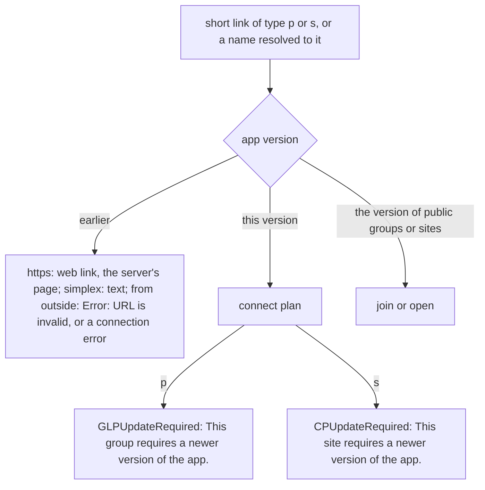
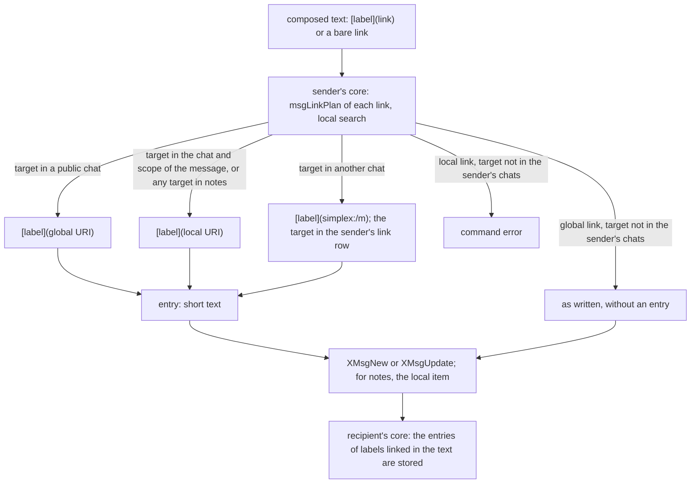
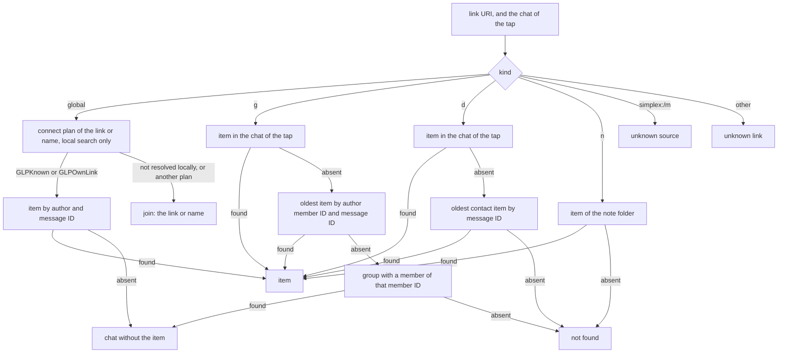
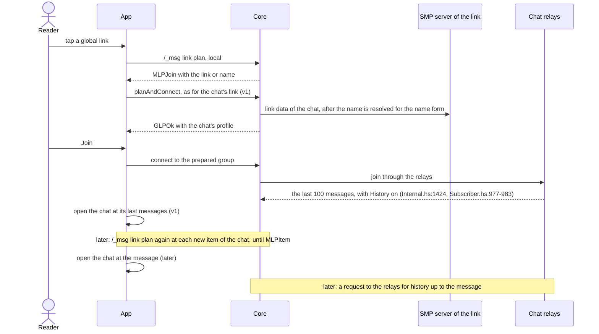
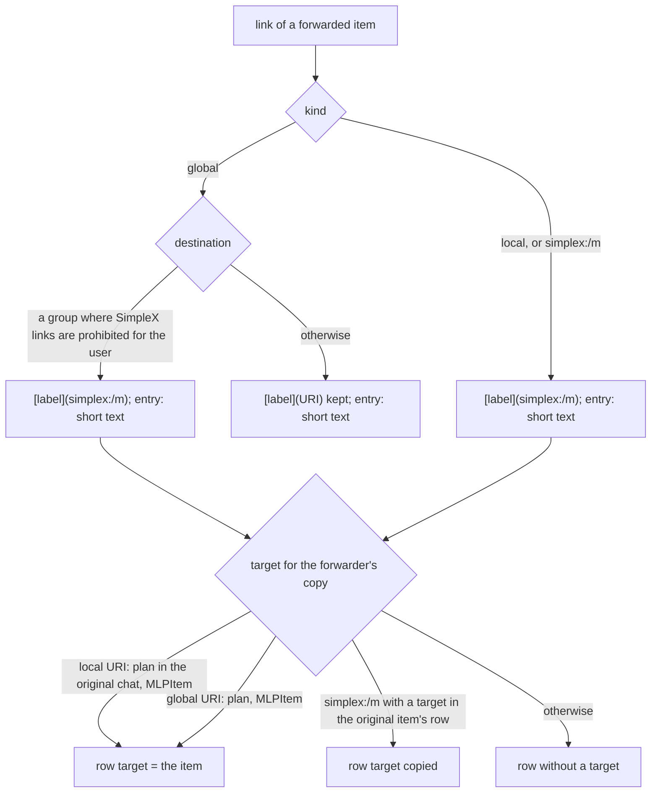
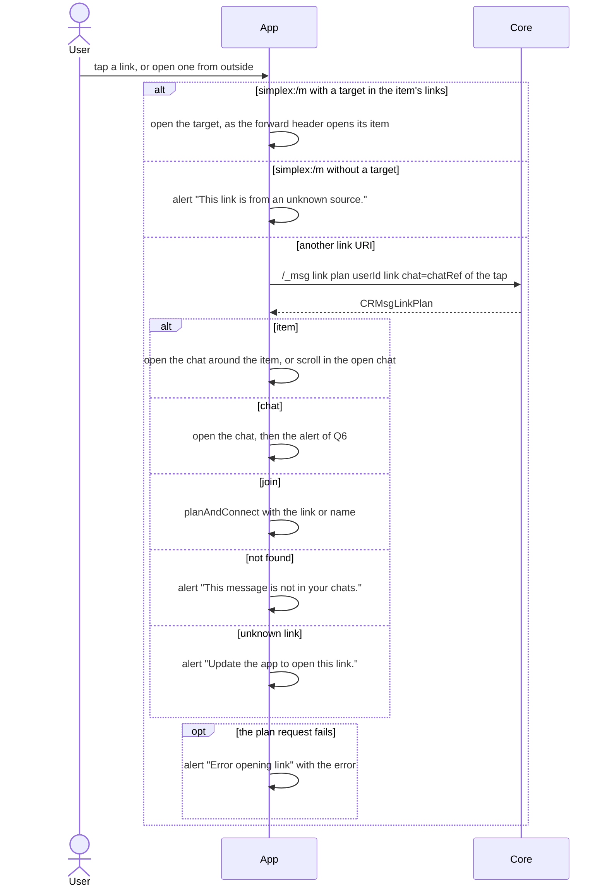
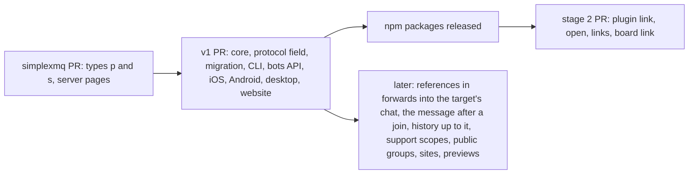

# Message references: links to messages across chats

## Problem

A person or an agent can point to a message only inside its chat, by a quote, or by forwarding a copy. From a short line, such as one of a list of open questions, the reader can neither open the message the line is about nor see its beginning. A reader who is not in a public channel cannot be sent to one of its posts. Agents can neither produce nor follow such a pointer.

In v1, links are supported to messages of the same chat, such as a list of questions in a session's group linked to the questions in that group; the sender's own links to messages of other chats and to notes; and links to posts of public chats, which anyone can open.

## Acceptance

| # | After the change | Before |
|---|---|---|
| A1 | at "Copy link" in the menu of a message in a contact, group, channel or notes chat, the app puts its link on the clipboard | the menu offers Copy of the text only |
| A2 | a link in a message is shown as its label with the short text of the linked message | global links: a channel link; local links: plain text |
| A3 | at a tap, the app opens the chat at the message for a reader who can open it, runs the connection flow of a public chat for a reader who is not in it, and shows an alert otherwise | global links: the connection flow |
| A4 | a link opened from a web page or another app is handled as in A3 | global links: the connection flow; local links: "Error: URL is invalid" (iOS), a connection error (Android, desktop) |
| A5 | every link is written in the text as `[label](URI)`; a link to the same chat has its reference in the URI; a link to another chat is sent as `[label](simplex:/m)`, and its target is kept in the sender's copy; short texts are sent in the message's link map | — |
| A6 | in a forward, labels and short texts are kept, local links are written as `[label](simplex:/m)`, and global links can still be opened; the forwarder opens each link from the forwarder's own copy | the text is forwarded unchanged |
| A7 | apps of earlier versions show local links as text and open a global channel link as the channel | — |
| A8 | short links of types `p` (public groups) and `s` (sites) are parsed, and the app asks for an update to open them | an unknown type: a web link or text; from outside: "Error: URL is invalid" or a connection error |
| A9 | the plugin's `link` returns the link of a message; `send` takes it in the text as `[label](link)`; the links of received messages are listed with short texts; `open` returns the message of a link, or the public chat to connect to | — |

## Options

| Option | Cost |
|---|---|
| A. URI in the message text, parsed by the core's markdown | parser, a `Format` constructor, commands, app rendering; the text, with its IDs, is copied and forwarded as is by earlier clients; recipients see no beginning of the message |
| B. A bare `[label]` in the text and a link map with references, as mentions (Protocol.hs:694-697, 833-855) | protocol fields, a table, resolution at send and receive; a bare `[label]` is written by people for optional texts |
| C. A message content type with one link and a preview, as `MCChat` (Protocol.hs:752) | protocol type, card UI, one link per message |

A is chosen for every link, with a link map for the short texts. B is rejected in the maintainer's words: "people do use them for optional texts. So let's just always use hyperlink". The references are written in the URIs; the map consists of the short texts and is the part of the message read by the core and validated against the text.

## Kinds of links and what is sent

| Kind | Target | Sent text | Sender's copy | Recipients |
|---|---|---|---|---|
| global | a message of a public chat served by relays (a channel now, a public group later), outside member support scopes | `[label](URI)`: the chat's short link with `m` and `a`, or its name | as sent | open it: members by the local search, others by joining |
| local, same chat | a message of the chat and scope of the linking message | `[label](simplex:/m#g/<msgId>?a=<author>)` or `[label](simplex:/m#d/<msgId>)` | as sent | open it |
| local, other chat | a message of another chat that is not public, or a note | `[label](simplex:/m)` | as sent, with the target in its link row (Q2b) | a link from an unknown source |
| any, in notes | any message | — | `[label](URI)` of the target, of any kind: notes are local | — |

A link to a message in the sender's chats is sent with a map entry of its short text.

- A business chat is a group (Types.hs:524), so the group rule is applied to its links. A member support scope (Messages.hs:119) is a chat of its own for this rule, also in a public chat: its items are given local links.
- The same chat is decided by the sender's core for each new or edited message: the chat and scope that the message is sent to. Forwards are described below.
- The sender's copy has the sent text, and the target of each link to another chat is stored in its link row. An item's text is sent again in group history (`processContentItem`, Internal.hs:1535-1559) and in quotes of the item (`quoteContent`, Commands.hs:5028-5035), so the stored text is the sent text.
- A link to a message of a public chat is always global, also inside that chat, so that it can be opened from a forward out of the chat.

Schemes (Q1, decided): `simplex:` is the scheme of URIs in the SimpleX network: connection links, SimpleX names (simplexmq SimplexName.hs:113), files (simplexmq FileTransfer/Description.hs:283) and message links. `simplexchat:` is the scheme of app-specific deep links, such as badge links (plans/2026-09-24-badge-buy-in-browser.md:43). The comments that state another rule (ContentView.swift:506, ChatListView.kt:816) are changed to these roles.

## Link URIs

A link is a URI on the clipboard, in a composed text, in a sent text and when opened from outside the app.

```
msg-link     = global-link | local-link
global-link  = short link of type c (channel) or p (public group), https or simplex: form, with m and a added to its query
             | "simplex:" ["/"] "name#" public-name "?" query
local-link   = "simplex:" ["/"] "m" [ "#" kind "/" id [ "?" query ] ]
kind         = "g"   p2p group or business chat; id = msg-id
             | "d"   contact; id = msg-id
             | "n"   notes; id = the item's database ID, decimal
public-name  = the domain of SimplexNameInfo with NTPublicGroup (simplexmq SimplexName.hs:110-132)
msg-id       = SharedMsgId bytes, base64url without padding
query        = query string, values percent-encoded, unknown names ignored
  m          = msg-id                                           global links: required
  a          = author MemberId, base64url without padding       kind g: required; global links: absent for messages sent as the chat
  f          = note folder ID, decimal                          kind n: required
  h, p, c    = the server parameters of a short link, as now
```

`simplex:/m` without a fragment is the URI of a link from an unknown source: a link whose reference was removed, shown by its label and short text.

Examples, as generated, with `/` after `simplex:` (Q10):

```
https://smp18.simplex.im/c#3tR8_b50RNZQtPkDs0Z3IxdfsszHxdyZYWQ4KHOyifg?m=Z21RRHdMR1NzSmlyNDBYeA
https://smp18.simplex.im/p#3tR8_b50RNZQtPkDs0Z3IxdfsszHxdyZYWQ4KHOyifg?m=Z21RRHdMR1NzSmlyNDBYeA&a=UWRoR05KMk16UG1hSGRpag
simplex:/c#3tR8_b50RNZQtPkDs0Z3IxdfsszHxdyZYWQ4KHOyifg?h=smp18.simplex.im&m=Z21RRHdMR1NzSmlyNDBYeA
simplex:/name#privacy.simplex?m=Z21RRHdMR1NzSmlyNDBYeA
simplex:/m#g/Z21RRHdMR1NzSmlyNDBYeA?a=UWRoR05KMk16UG1hSGRpag
simplex:/m#d/Z21RRHdMR1NzSmlyNDBYeA
simplex:/m#n/48213?f=1
simplex:/m
```

- Message IDs are 12 random bytes in base64, 16 bytes in all (Store/Messages.hs:241-260, Store/Shared.hs:641-642, 660-661); history welcome messages have 24 random bytes (Internal.hs:1444). Every member stores a group message with the author's member ID and the same message ID, relayed messages included (Subscriber.hs:4066-4071), and a message of a group is found by the author's member ID and the message ID (Store/Messages.hs:3092-3109).
- Note items are created without a message ID (`createLocalChatItems`, Internal.hs:3480-3486; `createNewChatItem_`, Store/Messages.hs:594-595), so a note link consists of the item's database ID and its folder ID.
- A global link is produced for a chat with a `PublicGroupProfile` (Types.hs:910-916), from its `groupLink`, which is stored in its https form on the server host (Commands.hs:4902-4903). A short link of type `g` with `m` is parsed as the group's link, as now.
- Only `h`, `p` and `c` of the query are read by the short-link parser (simplexmq Agent/Protocol.hs:1779-1786), so `m` and `a` are reserved there for message links, and a global link of type `c` is parsed by earlier cores as the chat's link. Apps of earlier versions open it as the chat, in messages and from outside: SMP servers serve the paths `/c` and `/g` in their app association files and link pages (simplexmq apps/common/Web/static/.well-known/apple-app-site-association, apps/smp-server/SMPWeb.hs:23-24), and iOS opens `*.simplex.im` links in the app (SimpleX (iOS).entitlements:12).
- The query of the fragment is kept in the app URI built by the link page of SMP servers (simplexmq apps/common/Web/static/media/contact.js:23-33), so the app receives a global link opened in a browser with `m`.
- The name form has the URI prefix accepted by the SimpleX name parser (simplexmq SimplexName.hs:113) and a name accepted by connect (Types.hs:1915-1920). Earlier cores show it as text, and it is refused by their connect, as the domain is parsed from the word up to a space and refused at `?` (simplexmq SimplexName.hs:101-108, 120-124).
- `simplex:/m…` is refused as a connection link: `m` is neither a short-link type letter (simplexmq Agent/Protocol.hs:1775-1778, 1809-1815) nor a full-link mode (Agent/Protocol.hs:1308).
- The author is set by the rule of `chatItemMember` (Messages.hs:374-380), as in forwards (Commands.hs:1158).
- A `simplex:/m#` link of an unknown kind is parsed as `MLUnsupported` with its text, so the format is unchanged for a later kind.

## Scheme path

By Q10 (decided), `/` after `simplex:` is optional in parsing. The existing parsers are changed in separate PRs, simplex-chat/simplexmq#2092 and simplex-chat/simplex-chat#8306:

| Parser | Source |
|---|---|
| short links | `authorityP <* A.char '/'`, simplexmq Agent/Protocol.hs:1758, 1771-1774 |
| names | `optional "simplex:/name"`, simplexmq SimplexName.hs:113 |
| markdown | `isUri`, the prefix `simplex:/`, Markdown.hs:533 |
| website | `simplexAddressRegexp`, website/src/js/simplex-lib.jsc:303 |
| iOS links from outside | `url.path` compared with `/c` and the other paths, ContentView.swift:467-478 |

Both forms are accepted by the message link parser of this plan. Links are generated with `/` until enough clients parse both forms, and without it later.

## Short link types p and s

Today:

- The type letters `A`, `C`, `G` and `R` are parsed by `ctTypeP` (simplexmq Agent/Protocol.hs:1809-1815); another letter is refused with "unknown short link type" (Agent/Protocol.hs:1775-1778).
- In the markdown of earlier cores, the https form is then parsed as a web link by `parseUri`, which is limited to the http and https schemes (Markdown.hs:461-467, 506-512, 873-882), and the `simplex:` form as text. The https form is opened in a browser as the server's page; SMP servers serve pages for the paths of `smpLinkPages` (SMPWeb.hs:23-24).
- From outside, the iOS app accepts the paths `/contact`, `/invitation`, `/a`, `/c`, `/g` and `/i` and shows "Error: URL is invalid" for another path (ContentView.swift:476-486); the Android app is given https links of these paths only (AndroidManifest.xml:116-127), and a `simplex:` link is passed to `planAndConnect` (ChatListView.kt:808-812), where its plan is refused.
- The update handling for channels: a relay link of a group whose type is not a channel is given `GLPUpdateRequired` (Commands.hs:4685, 4715-4717), shown as "App update required" and "This group requires a newer version of the app. Please update the app to join.", with the group's profile when its link data has one (NewChatView.swift:1697-1724; ConnectPlan.kt:444-472; strings.xml:229-230).

Change, in this version, for links of both types written by later versions:

| Part | Change |
|---|---|
| simplexmq `ContactConnType` | `CCTPublicGroup` (`P`) and `CCTSite` (`S`), in `ctTypeP` and `ctTypeChar` (Agent/Protocol.hs:1666, 1809-1824) |
| simplexmq SMP servers | `p` and `s` in `smpLinkPages` (SMPWeb.hs:24); `/p`, `/p/*`, `/s`, `/s/*` in the app association file (apps/common/Web/static/.well-known/apple-app-site-association) |
| core markdown | `XLPublicGroup` and `XLSite` in `SimplexLinkType` (Markdown.hs:120), mapped in `simplexUriFormat` (Markdown.hs:563-567) |
| core link data | `shortLinkDataP` (Internal.hs:1739-1746): `p`: group data, when it parses; `s`: none |
| core connect plan | `p`: `groupShortLinkPlan`, with `GLPUpdateRequired` for every link of type `p` (Commands.hs:4652-4654, 4684-4685); `s`: the link is fetched, and the plan is `CPUpdateRequired` |
| apps | `publicGroup` and `site` in `SimplexLinkType` (ChatTypes.swift:6042-6058; ChatModel.kt:5525-5539), shown as "SimpleX public group link" and "SimpleX site link"; the paths `/p` and `/s` for links from outside (ContentView.swift:476; AndroidManifest.xml:116-127); `CPUpdateRequired` shown as "App update required" and "This site requires a newer version of the app. Please update the app to open it." |
| website | `p` and `s` in `simplexShortLinkTypes` (simplex-lib.jsc:305) and in the app association file (website/src/.well-known/apple-app-site-association/index.json) |

Global message links of public groups have type `p`.



## Names

SimpleX names have two types: `#name` (`NTPublicGroup`) and `@name` (`NTContact`) (simplexmq SimplexName.hs:57-64). A `#name` is resolved to the first link of type `c` in the name record's `simplexChannel` (`resolveNameLink` and `firstNameLink`, Commands.hs:4776-4782, 5290-5295; simplexmq Names/Record.hs:46-60).

By Q11 (decided), `#name` is the name of any public entity: a channel, a public group or a site. The first link of type `c`, `p` or `s` in `simplexChannel` is taken, and the plan is chosen by its type, in place of `CCTChannel` for every `#name` (Commands.hs:4575, 4594-4595, 4659-4662, 4779-4782). The name form of a message link is the same for each type.

## Link map

The short texts of a message's links are sent as a map from label to entry, as mentions are (Protocol.hs:694-697, 833-855): in `XMsgNew`, a field `links` of `MsgContainer` (Protocol.hs:692-708), whose JSON is the event's params (Protocol.hs:1425, 1516-1518); in `XMsgUpdate`, a field `links` beside `mentions` (Protocol.hs:464, 1427-1435, 1520). An empty map is omitted, as `MsgMentions` (Protocol.hs:844-851).

One message, sent in a group, with a link to a question in the same group, a link to a message of another chat, and a link to a channel post:

```json
{
  "v": "1-16",
  "msgId": "b2xRZ1h6Zk1wN2pLM2RzVw==",
  "event": "x.msg.new",
  "params": {
    "content": {
      "type": "text",
      "text": "Before the release: [Approve the deploy plan?](simplex:/m#g/UXhQdlR3WmNrTjhyRDFtYQ?a=UWRoR05KMk16UG1hSGRpag), [the draft](simplex:/m) and [Release notes 7.2](https://smp18.simplex.im/c#3tR8_b50RNZQtPkDs0Z3IxdfsszHxdyZYWQ4KHOyifg?m=Z21RRHdMR1NzSmlyNDBYeA)"
    },
    "links": {
      "Approve the deploy plan?": {"text": "Approve the deploy plan?"},
      "the draft": {"text": "Draft of the 7.2 announcement"},
      "Release notes 7.2": {"text": "SimpleX Chat 7.2: message links and faster groups"}
    }
  }
}
```

```haskell
-- Protocol.hs
newtype MsgLinks = MsgLinks (Map LinkLabel MsgLinkEntry) -- JSON as MsgMentions (Protocol.hs:844-851)

data MsgLinkEntry = MsgLinkEntry {text :: Text}

type LinkLabel = Text
```

- An entry is kept by the recipient only when its label is the label of a message link in the text, by the rule of `uniqueMsgMentions` (Internal.hs:346-357).
- At most 20 links are sent in a message and 30 are kept from a received message. The message is limited as now by `maxEncodedMsgLength` (Protocol.hs:930-931): a message over it is refused at send with `SELargeMsg` (Store/Messages.hs:245).
- Unknown fields are ignored by aeson, and an absent field is parsed as empty (plans/2026-08-22-forward-link.md, section "Protocol"), so earlier clients receive the text and ignore the map; the chat protocol version is unchanged. Their forwards are built from the content only (`mcForward`, Protocol.hs:741-742), and their copies consist of the text.

Short text, `ciLinkText :: ChatItem c d -> Text` and `shortLinkText :: Text -> Text`, Messages.hs, beside `parsedMsgContent` (Messages.hs:633-637):

1. the text of the content, or the file name when the text is empty, as in quotes (Internal.hs:396-400);
2. its first line, after the markdown is removed: the shown text of each segment, the label of a link, `…` for a secret;
3. bidi controls removed and spaces trimmed, as in the plugin's quote lines (messages.ts:233-248);
4. at most 80 characters; a longer line is cut to 79 characters, with `…` appended.

The short text is taken by the sender's core when the message is sent, from the sender's copy of the target, and again when the message is edited. After a later edit or deletion of the target, the short text is unchanged; at a tap, the app opens the target as it is then, or shows the alert of Q6 when it is gone. A received short text is cut to 80 characters.

## Send and receive



At send, the content of `APISendMessages` (Commands.hs:775-788), for contacts and groups, of `APIUpdateChatItem` (Commands.hs:824-899), and of `APICreateChatItems` (Commands.hs:813), for notes, is passed through `composedLinks`, before `composedMessageReq` and `composedMessageReqMentions` (Commands.hs:5396-5402) for a new message:

```
composedLinks user chat scope text:
  each MessageLink segment of the parsed text, written as [label](link) or bare:
    label = the written label, or the target's short text for a bare link
    case msgLinkPlan user (Just chat) link:
      MLPItem item, in a public chat outside its support scopes  -> [label](itemMsgLink item); entry {text}
      MLPItem item, in the chat and scope of the message         -> [label](itemMsgLink item); entry {text}
      MLPItem item, the message in notes                         -> [label](itemMsgLink item); entry {text}
      MLPItem item, elsewhere                                    -> [label](simplex:/m); entry {text}; row target = item
      MLPUnknownSource, an edit, the item has a row of the label -> as written; the row kept
      MLPUnknownSource, otherwise                                -> as written; no entry
      MLPChat or MLPJoin of a global link                        -> as written; no entry
      otherwise                                                  -> command error "message link: not in your chats"
  entry text = ciLinkText item
  two different links with one label -> command error, as SEInvalidMention (Internal.hs:327-336)
  21 links or more -> command error
```

The rewritten content and the links are added to `ComposedMessageReq` (Commands.hs:5391), beside its `CIMention`s; the map is put into `MsgContainer` by `prepareMsgs` of contacts (Commands.hs:5020-5037) and by `prepareGroupMsg` (Internal.hs:214-233), and the rows are stored by `createItem` (Internal.hs:3079-3088) and `createLocalChatItems` (Internal.hs:3467-3486), beside `createGroupCIMentions`. In `sendHistory`, an item is encoded again from its content and mentions (Internal.hs:1543-1558); the item's links are added there, beside its mentions.

At receipt, in `saveRcvChatItem'` (Internal.hs:3103-3124), beside the mentions:

```
rcvLinks links ft:
  entries whose label is the label of a message link in ft, at most 30; texts cut to 80 characters
  rows inserted into chat_item_links: label, short text
```

Database, a migration for SQLite and Postgres, as `chat_item_mentions` (chat_schema.sql:774-780, 1358-1369):

```
chat_item_links
  chat_item_link_id     INTEGER PRIMARY KEY
  chat_item_id          INTEGER NOT NULL REFERENCES chat_items ON DELETE CASCADE
  label                 TEXT NOT NULL
  link_text             TEXT NOT NULL
  target_chat_item_id   INTEGER REFERENCES chat_items ON DELETE SET NULL   -- the sender's or forwarder's copy of a link sent as simplex:/m
UNIQUE (chat_item_id, label)
INDEX idx_chat_item_links_target_chat_item_id (target_chat_item_id)
```

## Types

Types.hs, the URI of a link:

```haskell
data MsgLink
  = MLPublicGroup
      { publicChat :: ContactNameOrLink, -- Types.hs:1891: a CCTChannel or CCTPublicGroup link, or an NTPublicGroup name
        memberId :: Maybe MemberId,
        msgId :: SharedMsgId
      }
  | MLGroup
      { memberId :: MemberId,
        msgId :: SharedMsgId
      }
  | MLDirect {msgId :: SharedMsgId}
  | MLNote
      { noteFolderId :: NoteFolderId,
        chatItemId :: ChatItemId
      }
  | MLUnknownSource
  | MLUnsupported {linkText :: Text}

data MsgLinkType = MLTPublicGroup | MLTGroup | MLTDirect | MLTNote | MLTUnknownSource | MLTUnsupported

instance StrEncoding MsgLink    -- the URIs above; the https or simplex: scheme of the CTLink link is kept (SLSServer, SLSSimplex)
-- JSON: the link string, by strToJSON and strParseJSON
```

Messages.hs:

```haskell
data ChatItem c d = ChatItem
  { ...,
    mentions :: Map MemberName CIMention,
    links :: Map LinkLabel CILink, -- as mentions (Messages.hs:262-264)
    ...
  }

data CILink = CILink
  { text :: Text,
    target :: Maybe CILinkTarget -- only in the sender's or forwarder's copy of a link sent as simplex:/m
  }

data CILinkTarget = CILinkTarget
  { chatType :: ChatType,
    chatId :: Int64,
    chatItemId :: ChatItemId
  }

itemMsgLink :: ChatInfo c -> ChatItem c d -> Either String MsgLink
itemMsgLink cInfo ci@ChatItem {meta = CIMeta {itemId, itemSharedMsgId}} = case (cInfo, itemSharedMsgId) of
  (DirectChat _, Just msgId) -> Right $ MLDirect msgId
  (GroupChat g@GroupInfo {groupProfile = GroupProfile {publicGroup}} scope, Just msgId) -> case (publicGroup, scope) of
    (Just PublicGroupProfile {groupLink}, Nothing) -> Right $ MLPublicGroup (CTLink groupLink) (memberId' <$> chatItemMember g ci) msgId
    _ -> maybe (Left "message has no author") (Right . (`MLGroup` msgId) . memberId') $ chatItemMember g ci
  (LocalChat NoteFolder {noteFolderId}, _) -> Right $ MLNote noteFolderId itemId
  _ -> Left "message has no link"
```

## Who sees what

| Party | Local link, same chat | Local link, other chat | Global link |
|---|---|---|---|
| sender | the label and the short text, in the compose preview before sending (Q20) and in the sent message; opens it | the label and the short text; opens it from the sender's own copy | the label and the short text; opens it |
| recipient in the chat | the label and the short text; opens it | the label and the short text; a link from an unknown source | the label and the short text; opens it as a member, or joins the chat |
| forwarder | the label and the short text; opens it from the forwarder's own copy, by its target in the original chat | the label and the short text; opens it from the forwarder's own copy when the forwarded message is the forwarder's own, whose row has the target; otherwise a link from an unknown source | the label and the short text; opens it, or joins the chat; where it is reduced to `simplex:/m`, opens it from the forwarder's own copy when the target is in the forwarder's chats |
| recipient of a forward | the label and the short text; a link from an unknown source | the same | the label and the short text; opens it, or joins the chat |
| earlier client | the text `[label](simplex:/m#…)`, IDs included | the text `[label](simplex:/m)` | the chat's link |

Privacy:

- The reference of a local link, the message ID and, in a group, the author's member ID, is written in a sent text only for a target in the chat and scope of the message, whose members have the target. A link to another chat is sent as `simplex:/m`, and new clients remove references in forwards.
- Earlier clients copy and forward the text as it is, references included. This is accepted by the threat model, in the maintainer's words: "It's chatham house rule, and we don't change threat model - anybody can say X said Y in chat Z, which is more than is shared here".
- The short text is received by everyone who receives the linking message and by everyone it is forwarded to by new clients; as the default label (Q4), it is also in the text, so it is in copies and forwards of earlier clients. The sender sees it in the compose preview before sending (Q20). For a link to another chat, it is text of that chat shown to the audience of this one (Q9).
- A note link consists of database IDs of the user's device; it is written in notes and on the clipboard, and sent as `simplex:/m` to other chats.
- Access to a message is not given by its link: only a reader who has the message can open it.
- The core resolves a link from the local database and sends no request. For a public chat that the reader is not in, its link data is then fetched from its server by the connection flow, as for its link; `m` and `a` are not sent.
- When a global link in its https form is opened in a browser, the server's link page is requested; the fragment, with `m` and `a`, is not sent to the server (simplexmq apps/common/Web/static/link.html:150).
- The core searches only the user given by the app: the user of the chat where the link is tapped, or the active user for a link opened from outside the app. Other profiles, hidden ones included, are not searched.
- A link tapped in a chat is searched first in that chat. For a link opened from outside, the oldest matching item is opened: a copy planted by a peer who read the link is created later than the original in the reader's database.

## Plan of a link URI

A link URI is resolved by the plan: at send, at a tap, for a link opened from outside or pasted in search, and for the plugin's `open`.



```haskell
-- Controller.hs
data MsgLinkPlan
  = MLPItem {chatItem :: AChatItem, linkText :: Text} -- the short text, for the compose preview
  | MLPChat {chatInfo :: AChatInfo}
  | MLPJoin {connTarget :: AConnectTarget} -- Types.hs:1898-1899, JSON as a string
  | MLPNotFound
  | MLPUnknownSource
  | MLPUnknownLink

-- Internal.hs
msgLinkPlan :: User -> Maybe ChatRef -> MsgLink -> CM MsgLinkPlan
```

```
msgLinkPlan user chat_ link:
  MLPublicGroup target author msgId:
    connectPlan user (ACTarget SCMContact (CTShortContact target)) PRMNever Nothing Nothing
      CPGroupLink (GLPKnown g ..) or CPGroupLink (GLPOwnLink g):
        groupItemId g author msgId
          Just itemId -> MLPItem (item of g and itemId)
          Nothing     -> MLPChat g
      CENotResolvedLocally, or another plan -> MLPJoin target
  MLGroup author msgId:
    chat_ is a group g, groupItemId g (Just author) msgId = Just itemId -> MLPItem (item of g and itemId)
    otherwise getGroupItemIdByAuthor author msgId
      Just (gId, itemId) -> MLPItem (item of gId and itemId)
      Nothing -> getGroupIdByMemberId author
        Just gId -> MLPChat (group gId)
        Nothing  -> MLPNotFound
  MLDirect msgId:
    chat_ is a contact ctId, getDirectChatItemIdBySharedMsgId_ ctId msgId = Right itemId -> MLPItem (item of ctId and itemId)
    otherwise getDirectItemIdByMsgId msgId
      Just (ctId, itemId) -> MLPItem (item of ctId and itemId)
      Nothing             -> MLPNotFound
  MLNote folderId itemId:
    getLocalChatItem user folderId itemId (Store/Messages.hs:3229)
      Right _ -> MLPItem (item of folderId and itemId)
      Left _  -> MLPNotFound
  MLUnknownSource -> MLPUnknownSource
  MLUnsupported _ -> MLPUnknownLink
item of chat and itemId = getAChatItem (Store/Messages.hs:3376-3393), with the scope of getGroupChatScopeForItem_ (Store/Messages.hs:1510), and its ciLinkText
```

- With `PRMNever`, the connect plan is limited to the local search (Controller.hs:728-732): a public chat is found by its link (Commands.hs:4718-4722) or by its verified name (Store/Groups.hs:1116-1134), and the link's entity ID is checked against the chat's identity when the link data is fetched (Commands.hs:4688-4695); otherwise the plan is refused with `CENotResolvedLocally` (Commands.hs:4674-4676).
- `groupItemId` is the item lookup of `forwardLinkCIFF` (Internal.hs:285-292: `getGroupMemberViaMemberId_`, then `getGroupChatItemBySharedMsgId_` in the member's scope) moved into one function, used by both.
- `getGroupItemIdByAuthor`, Store/Messages.hs: the join of `getGroupMemberCIBySharedMsgId` (Store/Messages.hs:3092-3109) without the group, `WHERE m.user_id = ? AND m.member_id = ? AND i.shared_msg_id = ?`, `ORDER BY i.chat_item_id ASC LIMIT 1`. Own items, stored with `group_member_id` NULL, are matched by the own membership row.
- `getDirectItemIdByMsgId`, Store/Messages.hs: `WHERE user_id = ? AND contact_id IS NOT NULL AND shared_msg_id = ?`, `ORDER BY chat_item_id ASC LIMIT 1`. The user's entries of `idx_chat_items_direct_shared_msg_id` (chat_schema.sql:1031-1035) are scanned; its time on a database with 1 million contact items is measured before review. For a tap in a chat, the indexed lookup in that chat is used first.
- A deleted or moderated item is returned as an item. For an item removed by deletion or by the chat's time to live, the plan is `MLPChat` for a group or a public chat, and `MLPNotFound` for a contact or a note.
- The database is only read by the plan.

A reader who is not in the public chat:



## Markdown

Markdown.hs:

```haskell
data Format
  = ...
  | MessageLink {showText :: Maybe Text, linkType :: MsgLinkType, msgLink :: MsgLink}
```

| Form | Result |
|---|---|
| `[label](link)` | `MessageLink (Just label)` |
| `<link>` | `MessageLink Nothing` |
| bare link | `MessageLink Nothing` |
| `[label]` | text, as now |
| a short link without `m` | `SimplexLink`, as now; with `XLPublicGroup` or `XLSite` for types `p` and `s` |
| a known form with an invalid field | text, or the chat's link, as now |

- `linkType` is set by the parser from `msgLink`, as `linkType` of `SimplexLink` (Markdown.hs:546-567).
- In `linkMD` and `hyperLinkFormat` (Markdown.hs:461-467, 506-518), `MsgLink` is tried before `AConnectionLink`.
- `sowLinkP` (Markdown.hs:450-456): with a message link, the label is any text up to `]` without `[` or a line break. The punctuation rule of web hyperlinks (Markdown.hs:453-454) is not applied. A label with a link in its own markdown (`isLink`) is refused: the label is left as text and the link is parsed bare, as for spoofed web links (MarkdownTests.hs:344-348).
- A label written by the core from a short text with a link in it, such as a URL or a file name `report.pdf`, which is parsed as a domain (`isDomain`, Markdown.hs:563-571), is also refused by this rule: the message is displayed as `[report.pdf](`, a bare link and `)`, and no short text is stored by recipients. The rule for such labels is left to the decision Q21.
- A bare link is parsed whole first, then without its trailing punctuation (`linkEndLength`, Markdown.hs:519-532), so a final `-` of an ID is kept.
- The source text is returned by `markdownText`, as for `SimplexLink` (Markdown.hs:978).
- `MessageLink` is included in `isLink`, so `hasLink` is set for the item (Internal.hs:3159-3167). `MessageLink` with `MLPublicGroup` is included in `isSimplexLink` (Markdown.hs:315-318), so the group preference is applied at send (Commands.hs:5076), edit (Commands.hs:854) and receive (Subscriber.hs:2260, 2336, 2357), and in member profiles (Internal.hs:1376-1385), as earlier cores apply it to the chat's link. Local links are not SimpleX links, as nobody is connected by them.

## Core API

| Command | Syntax | Response |
|---|---|---|
| `APIGetChatItemLink {chatRef, chatItemId}` | `/_get item link <chatRef> <chatItemId>` | `CRChatItemLink {user, msgLink}` |
| `ShowChatItemLink {chatName, msg}` | `/item link <chatName> <text>`, as `/item info` (Commands.hs:3567-3570, 7109) | the same |
| `APIMsgLinkPlan {userId, msgLink, chatRef}` | `/_msg link plan <userId> <msgLink>[ chat=<chatRef>]`, options as in `/_connect plan` (Commands.hs:7071) | `CRMsgLinkPlan {user, msgLinkPlan}` |

- Links are written in the text of `APISendMessages`, `APIUpdateChatItem` and `APICreateChatItems` as `[label](link)` or bare, and rewritten by the core (Q7). `ComposedMessage` and `UpdatedMessage` (Controller.hs:1379-1391) are unchanged: unlike a mention's display name, a link in the text is unambiguous. In an edit, the item's rows whose label is still linked in the new text are kept, so the app sends the edited text as it is shown.
- `APIGetChatItemLink`: `getAChatItem`, then `itemMsgLink`; `Left` is returned as a command error. Items without a message ID in a contact or group, such as group events, are refused.
- CLI views, View.hs: the link is printed for `CRChatItemLink`; for `CRMsgLinkPlan`, the chat and the item line, or `message link: not in your chats`, `message link: the message is not in CHAT`, `message link: connect with TARGET`, `message link: unknown source`, `message link: unknown link type`. A received item with links is followed by one line per link: `[label]: SHORT TEXT`. `CPUpdateRequired` is printed as `this site requires a newer version of the app`.
- Bots API: `APIGetChatItemLink` and `APIMsgLinkPlan` in the category "Message commands" (bots/src/API/Docs/Commands.hs:95-111), the types `MsgLink` (string), `MsgLinkType`, `MsgLinkPlan`, `CILink`, `CILinkTarget`, the field `links` of `ChatItem`, the format `MessageLink`, `CPUpdateRequired` and the two `SimplexLinkType` values; bots/api/*.md and the TypeScript and Python types are generated again.

## Forwards and edits



- In v1, every local link of a forward is written as `[label](simplex:/m)`, also into the chat of its target and into notes. In a later stage, the reference is kept in a forward into the chat and scope of the target, by the rule of new messages; v1 recipients open it, so the format is unchanged.
- In the forwarder's copy of the forward, the target of each link whose URI is removed is kept, so that the forwarder opens the link from that copy, as the original message is opened from the forward header today (`CIForwardedFrom`, FramedItemView.swift:117-123). The target is the item of the link's plan with the original chat as the chat of the tap (`fromChatRef` of `APIForwardChatItems`, Controller.hs:436), or the target of the original item's row for a `simplex:/m` link. It is stored in `target_chat_item_id` of the forwarded item's row; recipients receive `[label](simplex:/m)` and the short text only.
- In each destination branch of `APIForwardChatItems` (Commands.hs:1109-1130), the result of `prepareForward` (Commands.hs:1134-1257) is mapped by `forwardedLinks`, after the mention names (Commands.hs:1161-1166) and the owner signature (Commands.hs:1186-1190) are set: the content and the links of each `ComposedMessageReq` are changed, and its texts are computed again by `msgContentTexts` (Internal.hs:368-369). The destination group is read by `getGroupInfoKeys` (Commands.hs:1122) before the mapping.
- A forward is never refused for its message links: a global link is reduced to `[label](simplex:/m)` where SimpleX links are prohibited for the user (`groupFeatureMemberAllowed SGFSimplexLinks`, as in Internal.hs:431).
- Mentions are kept only in forwards to the same group (Commands.hs:1164); labels and short texts are kept in every forward.
- Edits: the new map consists of the links written in the new text and the item's rows whose label is still linked in it; the short texts of targets in the sender's chats are taken again by the sender's core. The new map is sent in `XMsgUpdate`, and the item's links are replaced by it, as mentions are replaced by `updateGroupCIMentions` (Store/Messages.hs:2826-2840; Commands.hs:868-880; Subscriber.hs:2415-2418).
- Quotes: a quote has the content only (Protocol.hs:633): the quoted text with its links as sent, without their short texts.

## Apps



| Part | iOS | Android and desktop |
|---|---|---|
| `Format`, `MsgLinkType`, `CILink`, `SimplexLinkType` | SimpleXChat/ChatTypes.swift:3959-3987, 6008-6027, 6042-6058 | ChatModel.kt:3605-3611, 5382-5412, 5525-5539 |
| commands, `MsgLinkPlan`, `CPUpdateRequired` | Shared/Model/AppAPITypes.swift, Shared/Model/SimpleXAPI.swift; NewChatView.swift:1697-1724 | model/SimpleXAPI.kt; ConnectPlan.kt:444-472 |
| rendering and tap | MsgContentView.swift:300-313, 645-692: an attribute key for message links, and the short text from the item's `links` | TextItemView.kt:354, 394-416, 489-504: the annotation `MESSAGE_LINK` |
| open at the item | `ItemsModel.loadOpenChatNoWait(chatId, itemId)` (ChatModel.swift:143-157), as the forward header (FramedItemView.swift:117-123) | `openChat(null, rhId, chatType, apiId, itemId)` (ChatListNavLinkView.kt:212-236), as FramedItemView.kt:362-370 |
| link from outside | `connectViaUrl_` (ContentView.swift:463-488): a URL that the core parses as a message link is passed to the plan before the path switch; `/p` and `/s` are added to the path list | `connectIfOpenedViaUri` (ChatListView.kt:800-814): the same check before `planAndConnect`; `/p` and `/s` in AndroidManifest.xml:116-127 |
| compose, waiting for the decision Q20 | a pasted link is shown as `[short text]` with the short text from the plan, and the link is kept in the compose state, as mentions are kept (ComposeView.swift:56-137); the text is sent with `[label](link)`; an edit loads the item's links the same way | the same in the Compose view |
| Copy link | the item menu (ChatView.swift:2447-2507), after Copy, without a confirmation | `MsgContentItemDropdownMenu` (ChatItemView.kt:394-451), after Copy, with "Copied to clipboard" |
| Copy link refused by the core, waiting for the decision Q19-2 | built: the error in the app log only (ChatView.swift:3252-3258) | built: the alert "Error loading details" with the error (SimpleXAPI.kt:1324-1329) |
| link pasted in search | `strConnectTarget` (NewChatView.swift:860-872), then the plan | `strConnectTarget` (NewChatView.kt:834), then the plan |

- A link is shown as `label (short text)` in the link style, the short text in italics (Q3, Q4, Q19); a label equal to the short text is shown once. A link from an unknown source, without a target in the item's links, is muted (Q19): the link colour at 70% opacity, waiting for the decision Q19-1. At Copy of a message's text, the app puts the text with its links on the clipboard; at "Copy link", the message's own link: global for a public chat, `simplex:/m#…` otherwise. At long-press on a link, the app opens the item menu, as now (ChatItemView.kt:129).
- The decision from a link and its `MsgLinkPlan` to an action is one pure function in each app, tested on recorded core responses.
- `simplex:` is registered on iOS (SimpleX--iOS--Info.plist:40-43), Android (AndroidManifest.xml:75) and desktop (plans/2026-09-28-desktop-deep-links.md, section "`simplex:` connection links"); https links on preset servers are opened in the app on iOS (SimpleX (iOS).entitlements:12) and Android (AndroidManifest.xml:86-127).
- `minRemoteCtrlVersion` and `minRemoteHostVersion` (Remote.hs:77-82) are set to the release version, as for block markdown (plans/2026-10-13-block-markdown.md:691), because an earlier desktop cannot decode the new `Format`, `ChatItem` and `SimplexLinkType` values.
- A `messageLink` case is added to the website renderer (website/src/js/simplex-lib.jsc:234-294): a global link is rendered as a link, whose href is `platformSimplexUri` of a short-link form (simplex-lib.jsc:307-329), with `m` and `a` kept, or the name form as it is; a local link is shown as its label.
- Message links are described in spec/client/navigation.md of both apps.

## Earlier versions

| Link | Earlier core | Earlier app at a tap |
|---|---|---|
| `[label](simplex:/m#g/…?a=…)`, `[label](simplex:/m#d/…)`, `[label](simplex:/m)` | text as written, IDs included: the URI is refused by `hyperLinkFormat` and `linkMD`, as `parseUri` is limited to http and https (Markdown.hs:359, 461-467, 498-512, 873-882) | — |
| `[label](https://host/c#key?m=…)` | the channel's link, with the label when it has no punctuation (Markdown.hs:450-456) | the channel's connection flow |
| `[label](https://host/p#key?m=…)` | a web link | "Open link?" (CILinkView.swift:52-89) or "Open web link?" (TextItemView.kt:683-727), then the server's page in a browser |
| `[label](simplex:/name#privacy.simplex?m=…)` | text | — |
| `simplex:/m#…` opened from outside | — | "Error: URL is invalid" (ContentView.swift:476-486), or a connection error (ChatListView.kt:808-812) |
| a link of type `p` or `s`, in this version | parsed | "App update required" |

## Plugin

| Tool | Input | Output |
|---|---|---|
| `link` | `item`, and `chat`: `@N` or `#N`; without `chat` in the plugin, the item of the session's group | `{link}`: global for a public chat, `simplex:/m#…` otherwise |
| `send`, `reply` | `text` with links as `[label](link)` | as now; a link that is not in the agent's chats: `text: message link LINK is not in your chats.` |
| `open` | `link` | `status`: `found` with `message`; `chat` with the chat fields; `join` with `target`, the link or name for `connect`; `none`; `update` |

- Message object (messages.ts:23-35), a field `links` when the message has links: an array of `{label, text, link}`, with `chat` and `item` of the target when it is a message of a chat that the session owns. In `text` of the message, its links are written as `[label](link)`. A channel prompt from the session's group is given `meta.links`, the same array as a JSON string (spec/api.md:1036).
- The size check of `send` (spec/api.md:201) adds the JSON of the link map.
- `link` and `open` only read, as `receive`, so neither waits for approval.
- After `connect` to the public chat of a `join`, `open` of the same link returns `found` once the message is received with the chat's history.
- `open` returns `none` for `simplex:/m` and for a chat that the session does not own (spec/api.md:686), so chats of other sessions are kept hidden. A message of the session's group is returned with `item` and without `chat`, as the channel's prompts (spec/api.md:1036).
- `connect` with a global link connects to its chat, as earlier cores parse it. `connect` with a `simplex:/m` link returns `TARGET is a message link; open returns its message.` in place of `Not a SimpleX link or name: TARGET` (spec/api.md:132).
- One sentence is added to the instructions (tools.ts:495-506): `A message link references one message: link returns the link of a message, which you write in a text as [label](link); links lists the links of a received message with their short texts; open returns the message of a link, or the public chat to connect to.`
- The session's group is the desk of v1: Claude writes, in its live message there, links to the questions and cards of the same group, which its members open.

Agents can use such links under three conditions, each stated by the design:

1. Every link is taken from a `link` result, a `links` field or a received text.
2. The agent writes it as `[label](link)`; the core sends the label, the short text and, for the same chat, the reference.
3. The agent follows it with `open`, or with the `chat` and `item` of its `links` entry.

| Evidence | Source |
|---|---|
| agents already write Markdown, and `[text](url)` in their posts is parsed by the core | Claude's text is posted to the session group (spec/api.md:911); Markdown.hs:450-456 |
| opaque `simplex:/` links are copied by agents between results and calls | `connect` takes them (tools.ts:284) |
| an ID cannot be produced from memory, as it is random | Store/Shared.hs:660-661 |
| a damaged link is refused at send, parsed as the chat's link, or resolved as `none` | the send and the plan above |
| `connect` with a global link connects to its chat; with a local link, it returns the error above | Agent/Protocol.hs:1779-1786 |

## Design and stages

| Part | Stage |
|---|---|
| simplexmq: short link types `p` and `s`; SMP server link pages and app association paths | v1, a simplexmq PR before the core PR |
| global links of types `c` and `p` and in the name form, parsed, encoded, resolved; joining by the connection flow, which opens the chat at its last messages | v1 |
| local links in the text: the reference for a target in the same chat and scope, `simplex:/m` for other chats with the target in the sender's link row (Q2b), every reference in notes; note links | v1 |
| short texts of every link, in the map | v1 |
| forwards: labels and short texts kept, local links as `simplex:/m`, global links kept; link targets in the forwarder's copy | v1 |
| edits: a new map with new short texts | v1 |
| link URIs for "Copy link", links from outside and composed texts; the plan; `/_get item link` | v1 |
| connect plan of types `p` and `s`: the update alerts; `#name` resolved to a link of type `c`, `p` or `s` (Q11) | v1 |
| apps: rendering, tap, Copy link, links from outside, search paste, the update alert of sites; website; remote versions; the comments of the scheme roles | v1 |
| apps: the compose preview of pasted links | v1, waiting for the decision Q20 |
| apps: the alert of a Copy link refused by the core | v1, waiting for the decision Q19-2 |
| core: labels written from short texts with links | v1, waiting for the decision Q21 |
| plugin: `link`, `open`, the `links` field, the `connect` error, instructions | stage 2, after the release of the npm packages simplex-chat and @simplex-chat/types (packages/simplex-chat-mcp/package.json:31-33) |
| the board link of Q8 | stage 2 |
| the reference of a link kept in a forward into the chat and scope of its target | later |
| after a join from a link, the app opens the chat at the message when it is received | later |
| a request to the relays for history up to a message | later |
| links between member support scopes and their group | later |
| public groups served by relays, joined by links of type `p`; sites by links of type `s` | later, with their releases |
| the app opens the original message from the forward header of `CIFFGroupLink` by the same flow (FramedItemView.swift:120-121) | later |
| a preview of the referenced message at long-press | later |



Every v1 format is final: every URI form and map field is defined in v1; in a later stage, a reference is written where `simplex:/m` is written in v1, and v1 recipients open it; the global form is keyed by the chat's link or name of either group type; unknown query parameters are ignored, and a `simplex:/m#` link of a new kind is parsed as `MLUnsupported`.

## Tests

Each test, except the compatibility tests, is written to fail on master; the compatibility tests are written to pass on master, as a record of how earlier cores parse a global link and a message with a map.

| File | Test |
|---|---|
| tests/MarkdownTests.hs | `[Should I merge?](simplex:/m#g/…?a=…)` → `MessageLink (Just "Should I merge?") MLTGroup …`; `[the draft](simplex:/m)` → `MLTUnknownSource`; `simplex:/m#n/12?f=1` → `MLTNote`; `see [the plan] now` → text |
| | the https, `simplex:` and name forms of a global link → `MessageLink … MLTPublicGroup …`, for links of types `c` and `p`; the same short link without `m` → `SimplexLink`, with `XLPublicGroup` for `p` and `XLSite` for `s` |
| | compatibility: `strDecode` of a global link of type `c` as `AConnectionLink` → the chat's link |
| | `see simplex:/m#d/ID.` → text, a bare link and `.`; a final `-` of an ID is kept; `simplex:/m#x/…` → `MLUnsupported` |
| | `[https://example.com](simplex:/m#d/…)` → the label as text and a bare link |
| | `strDecode . strEncode` → each `MsgLink` variant in each form; `simplex:m#d/…` and `simplex:name#…?m=…` → the links of the forms with `/`, and `strEncode` → the forms with `/` |
| | `shortLinkText`: the first line without markdown, a secret as `…`, the label of a link, 80 characters with `…` |
| simplexmq tests | short links of types `p` and `s` are encoded and parsed |
| tests/ProtocolTests.hs | `x.msg.new` and `x.msg.update` with `links` are encoded and parsed; compatibility: a container without `links` is parsed with an empty map, as `x.msg.new forward with channel link` (ProtocolTests.hs:273-277) |
| tests/ChatTests/Groups.hs | in `#team`, alice sends `see [q](link of bob's message in #team)`; bob and cath receive the link with its reference and the short text, and their plan of it with `chat=#team` is the item |
| | alice sends in `#club` a link to bob's message in `#team`; cath, in both groups, receives `[q](simplex:/m)` with the short text; alice's copy has the target (Q2b), and cath's plan of `simplex:/m` is an unknown source |
| | cath joins `#team` with history on: the history item has the link and its short text |
| | a channel post: a subscriber gets the item by the https form; a non-member gets `join` with the chat's link, receives a link to the post with its short text from a contact, joins by the link, and then gets the item; the plans of the chat's link with types `p` and `s` are the update alerts |
| | bob edits the target after alice's link is sent: bob's short text is unchanged; alice deletes the target: her plan is the chat |
| | a link that is not in the sender's chats is refused at send; 21 links are refused |
| | after an edit that changes a label, the item's links are replaced for every member; after an edit, the target of a kept `simplex:/m` label is kept |
| | `#team` with SimpleX links off: a global link in the name form is refused, and a local link is sent |
| tests/ChatTests/Names.hs | a channel joined by its name: a subscriber gets the item by the name form; a non-member gets `join` with the name; the plan of `#name` whose record has a link of type `p` is `GLPUpdateRequired`, and of type `s`, `CPUpdateRequired` |
| tests/ChatTests/Direct.hs | alice links to her earlier message to bob in their chat: bob's plan of the link is the item; a link from that chat to a group message is received by bob as `simplex:/m` |
| tests/ChatTests/Local.hs | the URIs of a note's links to a group message and a contact message are kept, and their plans are the items; the link of a note is in the `n` form, and its plan is the note |
| | a bare link to a note with a file and without text is labeled with the file name, `report_2026.pdf`; a file name parsed as a domain is left to the decision Q21 |
| tests/ChatTests/Forward.hs | cath forwards alice's message in `#team` with a link to bob's message in `#team` to alice: alice receives `[q](simplex:/m)` with the short text; cath's copy has the target, bob's message |
| | alice forwards her own message in `#club` with a link to bob's message in `#team` to cath: alice's copy has the target copied from the original item's row |
| | cath, a channel subscriber, forwards her note with a link to a channel post: to dan, the global link is kept with the short text; into `#club` with SimpleX links off, it is `[r](simplex:/m)` with the short text, and cath's copy has the post as its target |
| app tests on recorded core responses | `Format.messageLink` and `ChatItem.links` are decoded; each kind of link and `MsgLinkPlan` variant → its action; `CPUpdateRequired` → its alert |
| | Q19: a link is shown as `label (short text)`; the recipient's link from an unknown source is muted, the sender's link with a target is not; a failed plan request shows "Error opening link" |
| | Q19, desktop: in the opened menu of a message, Copy link follows Copy, and a click on it puts the recorded link on the clipboard and shows "Copied to clipboard" |
| | Q19, iOS: Copy link puts the recorded link on the clipboard without an alert |
| | waiting for the decision Q20: the compose preview of a pasted link |
| ios-sim smoke test | Q19, iOS: in the menu of a sent message, Copy link follows Copy, and a tap on it puts the message's link on the clipboard |
| snapshot previews | a received message with a link to the same chat and a link from an unknown source: `ChatItemView.PreviewChatItemViewMessageLinks` (desktop), `FramedItemView_MessageLinks` (iOS) |
| plugin unit and e2e tests | `link` of a message in the session's group, then a live message with `[label](link)`, then `links` of the message for a member and `open`; `open` for a chat of another session returns `none`; `connect` with a `simplex:/m` link returns its error |

## Decisions

Decided by the maintainer:

| ID | Decision |
|---|---|
| Q1 | `simplex:` for every message link; `simplexchat:` for app-specific deep links |
| — | every link in a text is a hyperlink `[label](URI)`; local links have the reference in the URI; in a forward, local links are written as `[label](simplex:/m)` |
| — | the threat model is unchanged: "It's chatham house rule, and we don't change threat model - anybody can say X said Y in chat Z, which is more than is shared here" |
| — | short link types `p` (public groups) and `s` (sites) are added now; global links of public groups use `p` |
| — | in the forwarder's copy, the targets of the links whose URIs are removed in the forward are kept; in the maintainer's words, "when I forwarded something, I need to be able to go back, as I can now with forwarded messages" |
| Q2 | b: in v1, links in the same chat, global links, and the sender's links to other private chats, opened from the sender's own copy |
| Q3 | a: the short text is the first line, markdown removed, 80 characters, `…` when cut |
| Q4 | a: the label of a pasted link is its short text |
| Q5 | a: at "Copy link" of a message in a public chat, the https form on its link's server host is copied |
| Q6 | a: for a known chat whose message is gone, the app opens the chat and shows an alert that the message is deleted or not received yet |
| Q7 | a: agents and bots write links in the text as `[label](link)`, rewritten by the core |
| Q8 | a, in stage 2: on the board, "waiting for you" of the session is linked to the oldest pending card of the session |
| Q9 | accepted: the short text is received by everyone who receives the message and by everyone it is forwarded to |
| Q10 | b now, c later: `/` after `simplex:` is optional in parsing now, in separate PRs for the parsers, simplex-chat/simplexmq#2092 and simplex-chat/simplex-chat#8306; links are generated with `/` until enough clients parse both forms, then without it; in the maintainer's words, "it looks nicer. Do that now then" |
| Q11 | a: `#name` for any public entity (a channel, a public group or a site), whose kind is given by the type of the resolved link; in the maintainer's words, "Group is a proto-site" |
| Q19 | from the renders: links are shown as `label (short text)`; links from an unknown source are muted slightly; "Copy link" follows "Copy" in the message menu, on iOS without a confirmation; a new error text "Error opening link" |
