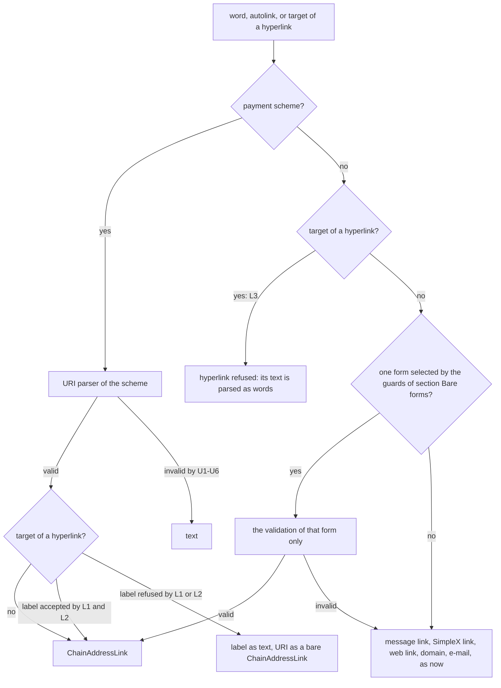
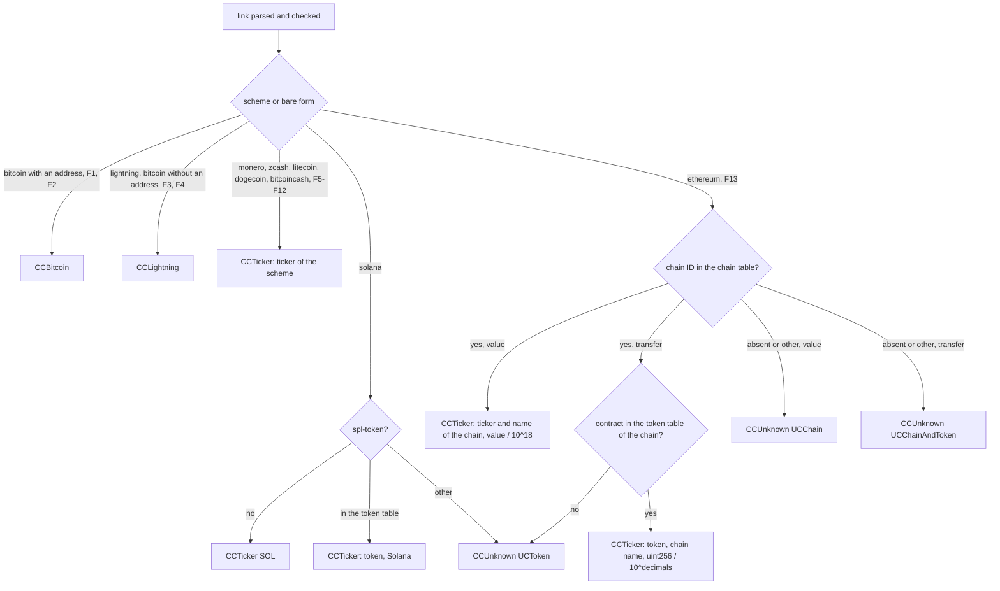
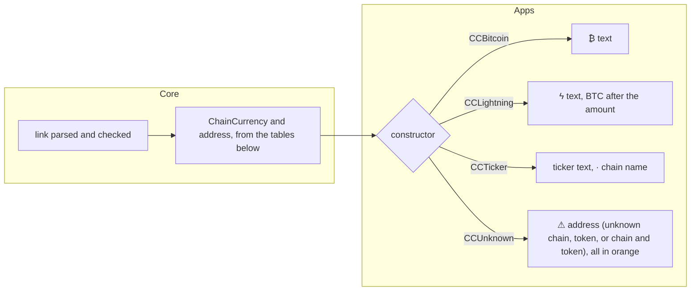
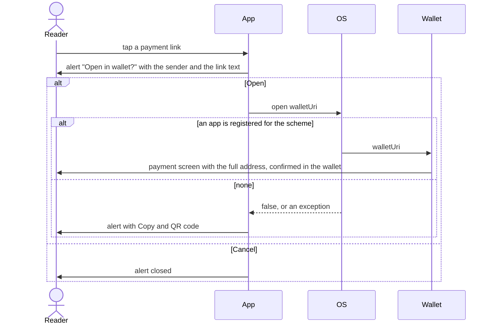
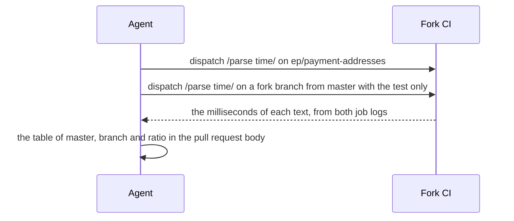
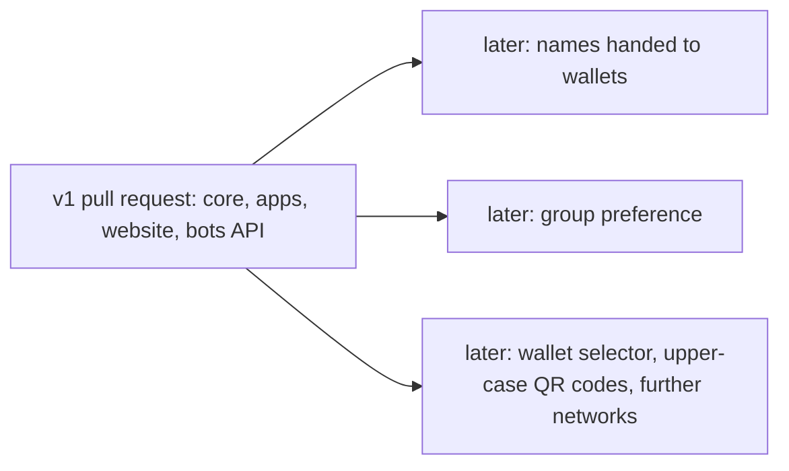

# Payment addresses in messages

Date: 2026-11-22, revised 2026-11-26. References are to master at 8f5dfa3d4; those of section Bare forms are to master at 94e9d08f5. Haskell paths without a directory are in `src/Simplex/Chat/`. Sources are listed at the end as [S1]–[S39], read on 2026-11-22 and 2026-11-26.

## Problem

A payment address or request in a message is plain text. A reader copies it into a wallet by hand, and the app shows neither its network nor the result of its checksum.

- `[address](bitcoin:address)`, the form of docs/DONATIONS.md:21-23, is shown as text with its brackets: only http and https targets are accepted by `hyperLinkFormat` (Markdown.hs:461-467, 873-882).
- A bare address, such as those of README.md:151-158, is shown as text (Markdown.hs:506-518).
- A Lightning Address `user@domain` is shown as an e-mail link, and a mail app is opened at a tap (Markdown.hs:514, 544; MsgContentView.swift:699-704; TextItemView.kt:424-430).

## Acceptance

| # | After the change | Before |
|---|---|---|
| A1 | a URI of the schemes of section Syntax, `[label](URI)`, `<URI>`, and a bare address or invoice whose format has a checksum, are shown as payment links | text |
| A2 | at a tap, the app shows the alert `Open in wallet?` with the sender, the link text and the shortened address; the wallet is opened only from Open | — |
| A3 | at Open, the app hands a normalised URI to the OS; when no app opens it, an alert offers Copy and the QR code | — |
| A4 | an address with a wrong checksum, a testnet address, a wallet-restore URI (`monero-wallet:`), an EIP-681 call other than `transfer`, and a request to several recipients are shown as text | text |
| A5 | a hyperlink whose label contains a payment address other than its target is refused: the label is shown as text, the target as a bare payment link | text |
| A6 | the core and the apps send no request for a payment link: previews, DNS, ENS, LNURL and exchange rates are not requested | — |
| A7 | earlier apps show the text as now; the message protocol and the database are unchanged | — |
| A8 | a bare word is validated at most once, by the form that its prefix, case and length select; a word that no form selects is text without a checksum computed; the parse time of section Timing is reported | — |
| A9 | a link whose chain or token is outside the tables of section Link text, and an EVM link without a chain ID, are shown in orange as ⚠, the shortened address and `(unknown chain)`, `(unknown token)` or `(unknown chain and token)`, without an amount | — |

## Options

| Option | Cost |
|---|---|
| A. The core parses payment URIs and checksum-valid addresses into one `Format` constructor, `ChainAddressLink`, with the currency resolved from the core's tables; the apps render its fields | a core module of codecs, parsers and tables, a `Format` constructor with its JSON, the bots API types, one renderer and one alert in each app |
| B. The core accepts payment schemes as `HyperLink` targets; each app parses the URI for its link text | URI and checksum parsers written in Swift and in Kotlin, a third parser for bare addresses, results that can differ between platforms, a string only for bots |
| C. A message content type with a structured request, as `MCChat` (Protocol.hs:752) | a protocol type, a compose UI, a card UI, fallback text for earlier clients; addresses in texts, profile descriptions and channel posts are still shown as text |

A is chosen: the text is parsed once, where `formattedText` is produced (Messages.hs:633-640), and every text that the apps render with markdown is covered.

## Research

### Payment URI standards

| Scheme | Specification | Status, date | Payee | Amount | Other fields |
|---|---|---|---|---|---|
| `bitcoin:` | BIP-21 [S1], replaced by BIP-321 [S2] | BIP-21 Closed, assigned 2012-01-29; BIP-321 Complete, assigned 2024-11-15 | address; in BIP-321 optional when the query has a payment instruction | `amount`, decimal BTC, period separator | `label`, `message`; instructions `lightning` (BOLT 11), `lno` (BOLT 12), `sp`, `pay`; a URI with a `req-` key unknown to the client is invalid; scheme and keys are case-insensitive |
| `lightning:` | BOLT 11 [S4] | living specification | BOLT 11 invoice, HRP `lnbc` on mainnet | in the HRP, with the multipliers `m`, `u`, `n`, `p` | `d` description, `x` expiry (3600 s by default); "use 'lightning:' as a prefix before the BOLT-11 encoding (note: not 'lightning://')" |
| BOLT 12 offer | BOLT 12 [S5] | living specification | `lno1…` | `offer_amount` | "There is no checksum, unlike bech32m"; all lower or all upper case; `+` continuation; a URI scheme is left undefined |
| LNURL | LUD-01 [S6], LUD-17 [S7], a draft | — | bech32 `lnurl1…` of an https or onion URL; LUD-17: `lnurlp://` | — | LUD-01 is used "as a fallback inside of other URI schemes, with the key 'lightning'" |
| Lightning Address | LUD-16 [S8] | — | `user@domain`, user of `a-z0-9-_.` | — | resolved by GET `https://domain/.well-known/lnurlp/user`; a `lightning:` form is left undefined |
| `₿user@domain` | BIP-353 [S3] | Complete, assigned 2024-02-10 | DNSSEC TXT record at `user.user._bitcoin-payment.domain` with a `bitcoin:` URI | in that URI | "wallets SHOULD prefix it with ₿"; resolution over Tor or a VPN for privacy |
| `ethereum:` | EIP-681 [S9] | Final, created 2017-08-01 | `[pay-]0x…` or an ENS name, `@chain_id` | `value` in wei, scientific notation such as `2.014e18`, integer result | ERC-20: `0xtoken/transfer?address=0xpayee&uint256=n`; any function call can be encoded; without `chain_id` "the client's current network setting remains effective" |
| EIP-55 | EIP-55 [S10] | Final, created 2016-01-14 | the case of the hex letters, by Keccak-256 of the lower-case address | — | a mistyped address is accepted with probability 0.0247% |
| `solana:` | Solana Pay [S11] | SPEC.md at 25589fd3 (2025-05-05) | base58 public key; `solana:<https URL>` is a transaction request fetched by the wallet | `amount` in SOL or token units, at most 9 decimals for SOL | `spl-token`, `reference`, `label`, `message`, `memo` ("recorded by validators") |
| `monero:` | monero docs/URI_SCHEME.md [S12] | master | 95-character address; several separated by `;` | `tx_amount`, decimal | `recipient_name`, `tx_description`; `tx_payment_id` deprecated; `monero-wallet:` with `spend_key`, `view_key` and `seed` is defined in the same document |
| `zcash:` | ZIP-321 [S13] | Active, created 2020-08-28 | transparent, Sapling and Unified addresses | `amount`, at most 8 decimals | `memo`, base64url, at most 512 bytes, invalid with a transparent address; `label`, `message`; several payments by `paramindex`; the `req-` rule of BIP-321 |
| `litecoin:`, `dogecoin:` | the BIP-21 form of Litecoin Core and Dogecoin Core [S14] | master | address | `amount` | `label`, `message`; `dogecoin://` is rewritten as `dogecoin:` by Dogecoin Core |
| `bitcoincash:` | CashAddr [S15] | — | the prefix is part of the address and of its 40-bit checksum, and "may be omitted" when shown | `amount` | mixed case "must be rejected" |
| CAIP-10 | CAIP-10 [S16] | Final, created 2020-03-13 | `chain_id:account_address`, such as `eip155:1:0x…` | — | account identifiers, not a URI scheme |

### Wallets and operating systems

| Platform | Several apps for a scheme | No app for a scheme | Notes |
|---|---|---|---|
| iOS | "the app the system targets is undefined" [S17] | the completion handler of `open(_:options:completionHandler:)` is called with `false` [S18] | `canOpenURL` requires the scheme in `LSApplicationQueriesSchemes`, at most 50 entries, 25 from iOS 27; `open` is not constrained by it [S19]. Of the URL keys, only `CFBundleURLTypes` is declared (SimpleX--iOS--Info.plist:33-55) |
| Android | a chooser dialog, unless the user chose a default [S20] | `ActivityNotFoundException` [S20] | "scheme matching in the Android framework is case-sensitive, unlike the formal RFC" [S21]. Errors of `openUri` are caught in `safeOpenUri` (TextItemView.kt:729-738) |
| desktop | on Linux the last `xdg-mime default`, on Windows the default-app settings (plans/2026-09-28-desktop-deep-links-report.md:56) | errors of `openUri` are caught in `safeOpenUri`, as on Android | Electrum registers `x-scheme-handler/bitcoin` and `x-scheme-handler/lightning` [S22] |

Files that register each scheme, by GitHub code search of public repositories [S23]:

| Scheme | Android manifests | iOS Info.plist files | Open-source wallets among them |
|---|---|---|---|
| `bitcoin` | 234 | 519, many of them in forks of Bitcoin Core | Phoenix, BlueWallet, Zeus, Blockstream Green, Muun, Bitkit, Samourai, Mycelium, Nunchuk, Sparrow, Unstoppable, Cake Wallet [S24] |
| `lightning` | 108 | 100 | Phoenix, BlueWallet, Zeus, Blockstream Green, Muun, Bitkit, BitBox, Blixt |
| `ethereum` | 95 | 107 | MetaMask Mobile, Rainbow, AlphaWallet, WallETH, OneKey, Unstoppable, Tangem, Cake Wallet |
| `monero` | 36 | 19 | Monerujo, MyMonero, Feather, monero-gui, Unstoppable, Cake Wallet |
| `zcash` | 18 | 26 | Zashi, Zingo, YWallet, Edge, Unstoppable |
| `solana` | 20 | 9 | Unstoppable, BitPay, the Solana Mobile sample |
| `litecoin` | 47 | not searched | Litewallet, BitPay, Edge, Cake Wallet |
| `dogecoin` | 28 | not searched | BitPay, Cake Wallet |
| `bitcoincash` | 40 | not searched | Paytaca, BitPay, Edge, Cake Wallet |

- Apps other than wallets register the schemes too: all nine are registered by the Nostr client Amethyst.
- Cake Wallet registers `polygon`, `base`, `arbitrum` and `tron` beside `ethereum`, `solana-wallet` in place of `solana`, and `monero-wallet` [S24].
- Bitcoin Core compares the keys `label`, `message` and `amount` as written, so `AMOUNT=1` is ignored, and trims a final `/` that "may have been added by the OS" (src/qt/guiutil.cpp:157-197) [S14].

### Address formats

| Network | Bare form | Check | Probability that a random word of the form is accepted |
|---|---|---|---|
| Bitcoin | `bc1…` bech32 (v0) and bech32m (v1 and later); `1…`, `3…` Base58Check, versions 0x00, 0x05 | 30-bit BCH code [S25]; 32-bit double SHA-256 | 2^-30; 2^-32 |
| Lightning | `lnbc…` invoice; `lnurl1…` | bech32 without the 90-character limit [S4] | 2^-30 |
| Ethereum and other EVM chains | `0x` and 40 hex digits | the EIP-55 case of the letters; an address in one case is unchecked | 2^-k for k letters, 15 on average |
| Monero | 95 characters, network byte 18 (`4…`) or 42 (`8…`); 106 characters, byte 19 | first 4 bytes of Keccak-256 [S26] | 2^-32 |
| Zcash | `t1`, `t3` Base58Check with 2-byte versions; `zs1` bech32; `u1` bech32m | as Bitcoin | 2^-32; 2^-30 |
| Litecoin | `ltc1…`; `L…` (48), `M…` (50); `3…` (5, also the Bitcoin version) [S14] | as Bitcoin | 2^-32; 2^-30 |
| Dogecoin | `D…` (30); `9…`, `A…` (22) [S14] | Base58Check | 2^-32 |
| Bitcoin Cash | `q…`, `p…`, with or without `bitcoincash:` | 40-bit BCH code over prefix and payload [S15] | 2^-40 |
| Solana | 32 to 44 base58 characters of a 32-byte key | unchecked | the word `ThereAreMany32ByteKeysHereButNoneAreChecked` is decoded as 32 bytes |

Each donation address of README.md:151-158 was checked by these rules before this plan was written: BTC bech32 v0, XMR network byte 42, BCH CashAddr, ETH EIP-55, ZEC `t1` (version 0x1CB8) and `u1` (bech32m, 106 characters), DOGE version 30, SOL 32 bytes. The tests of section Tests repeat these checks.

### Messaging apps

| App | Detected in message text | Source |
|---|---|---|
| Telegram | entity types made by the server: URLs, mentions, hashtags, cashtags, bot commands, e-mail, bank card numbers | [S27] |
| Element (Matrix) | `bitcoin:` URIs are linkified, as a permitted scheme beside `geo:`, `magnet:`, `tel:` and others; `lightning:`, `ethereum:`, `monero:` and bare addresses are text | [S28] |
| Signal Android | e-mail addresses, phone numbers and web URLs; payments are in-app, with MobileCoin | [S29] |
| Session Android | `scheme://` URLs and `www.` links, by autolink-java; `bitcoin:` URIs are text | [S30] |
| Briar Android | web URLs | [S31] |
| WhatsApp, Status | not checked | — |

### Risks

| Risk | Evidence | Mitigation in this plan |
|---|---|---|
| address substitution in the clipboard | Android/Clipper.C, found on Google Play in February 2019, replaced Bitcoin and Ethereum addresses copied by users [S32] | Open is the only action of the alert; the URI is passed to the wallet without the clipboard |
| look-alike addresses | "approximately 270 million attack attempts targeting 17 million victims" on Ethereum and BSC, July 2022 to June 2024; wallets show "the first and last few characters" [S33] | the alert names the sender of the link |
| a label that differs from its target | `[bc1qGOOD](bitcoin:bc1qEVIL)` is accepted by the punctuation rule of `sowLinkP` (Markdown.hs:453-454) | rule L2 of section Syntax |
| an address changed by an edit | messages are edited after they are read (`itemEdited`, Messages.hs:532) | the edited mark of the item; the earlier versions are in the item info (Messages.hs:1388-1410) |
| a request forwarded by a person other than the payee | `itemForwarded` (Messages.hs:530) | `<name> forwarded:` in the alert |
| token approvals and contract calls | any function call can be encoded in EIP-681 [S9] | only `transfer` with `address` and `uint256` is parsed; other calls are text |
| a wallet restored with the keys of another party | `monero-wallet:` with `spend_key`, `view_key` or `seed` [S12], registered by Cake Wallet [S24] | the scheme is text |
| a payment on a wrong EVM chain | without `chain_id`, the current network of the wallet is used [S9]; one address is given for Ethereum and Arbitrum One (README.md:154) | the orange warning `(unknown chain)` without an amount, section Link text (Q6) |
| requests by the wallet to third parties | LNURL and Solana transaction request URLs are fetched by the wallet [S6], [S11] | the wallet is opened only from Open; `solana:https…` is text |
| injection in descriptions, labels and messages | "Payment descriptions are user-defined and provide a potential avenue for injection attacks" [S4] | the apps render them as plain attributed text; in the website renderer, they are escaped by `escapeHtml` (website/src/js/simplex-lib.jsc:225-301) |
| invisible characters in the label or message | format characters are shown as `[U+XXXX]` in web links (CILinkView.swift:104-121) | the message of the link is not shown; in the label of the link text, the same markers |

## Syntax

### Recognised forms

A payment link is one of:

1. a URI of a scheme below, written bare, in `<…>`, or as the target of `[label](…)`; the scheme and the parameter keys are matched in any case;
2. a bare address or invoice whose format has a checksum, on mainnet.

```
bitcoin:
  payee         bech32 bc1 v0
                bech32m bc1 v1 and later
                Base58Check version 0x00
                Base58Check version 0x05
                empty, when lightning or lno is present
  parameters    amount
                label
                message
                lightning: BOLT 11 invoice
                lno: BOLT 12 offer
lightning:
  payee         BOLT 11 invoice lnbc
                BOLT 12 offer lno1
                LUD-01 LNURL lnurl1
  read          invoice amount in the HRP
  checked       the decoded LNURL is an https URL, or an http URL of an onion host
ethereum:
  payee         [pay-]0x and 40 hex digits, EIP-55 when in mixed case
  parameters    @chain_id
                value
  token         0x token contract, then /transfer
  parameters    address
                uint256
monero:
  payee         95 characters, network byte 18
                95 characters, network byte 42
                106 characters, network byte 19
  parameters    tx_amount
                recipient_name
                tx_description
zcash:
  payee         t1
                t3
                zs1
                u1
  parameters    amount
                label
                message
                memo
solana:
  payee         base58 of 32 bytes
  parameters    amount
                spl-token
                label
                message
                memo
litecoin:
  payee         ltc1
                Base58Check version 48
                Base58Check version 50
                Base58Check version 5
  parameters    amount
                label
                message
dogecoin:
  payee         Base58Check version 30
                Base58Check version 22
  parameters    amount
                label
                message
bitcoincash:
  payee         CashAddr q
                CashAddr p
  parameters    amount
                label
                message
```

Examples:

```
bc1q2gy6f02nn6vvcxs0pnu29tpnpyz0qf66505d4u
bitcoin:bc1q2gy6f02nn6vvcxs0pnu29tpnpyz0qf66505d4u?amount=0.001&label=SimpleX
[Donate](monero:8A3ZWAXrrQddvnT1fPrtbK86ZAoM4nai3Gjg1LEow3JWcryJtovMnHYZnxTJpCLmAbfWbnPMeTzPmMBjAhyd4xoM89hYq1c)
ethereum:0xD7047Fe3Eecb2f2FF78d839dD927Be27Bc12c86a@42161?value=1e16
ethereum:0xdAC17F958D2ee523a2206206994597C13D831ec7@1/transfer?address=0xD7047Fe3Eecb2f2FF78d839dD927Be27Bc12c86a&uint256=5000000
lightning:lnbc2500u1pvjluezsp5zyg3…fna3rh
solana:7JCf5m3TiHmYKZVr6jCu1KeZVtb9Y1jRMQDU69p5ARnu?amount=0.5
<zcash:u16rnvkflumf5uw9frngc2lymvmzgdr2mmc9unyu0l44unwfmdcpfm0axujd2w34ct3ye709azxsqge45705lpvvqu264ltzvfay55ygyq?amount=0.1>
```

### Bare forms

A bare word is recognised by a sequence of guards and one validation: the guards select at most one form, and only the checksum of that form is computed.

```
G0    the word without its final punctuation
        14 or more characters
        ASCII letters and digits only
G1    the first form whose prefix, case and length hold

form  prefix                     case      length       network        validation
F1    bc1                        one case  14-90        Bitcoin        bech32 v0, bech32m v1-16
F2    1, 3                       -         25-36        Bitcoin        Base58Check, version 0x00 or 0x05
F3    lnbc                       one case  37 or more   Lightning      BOLT 11 bech32, HRP amount
F4    lnurl1                     one case  any          Lightning      bech32 of an https or onion URL
F5    4, 8                       -         95, 106      Monero         Keccak-256 check, network byte 18, 42 or 19
F6    t1, t3                     -         25-36        Zcash          Base58Check, version 0x1CB8 or 0x1CBD
F7    zs1                        one case  78           Zcash          bech32, 43 bytes
F8    u1                         one case  any          Zcash          bech32m
F9    ltc1                       one case  14-90        Litecoin       bech32 v0, bech32m v1-16
F10   L, M                       -         25-36        Litecoin       Base58Check, version 48 or 50
F11   D, 9, A                    -         25-36        Dogecoin       Base58Check, version 30 or 22
F12   q, p                       one case  42           Bitcoin Cash   CashAddr with the prefix bitcoincash
F13   0x and 40 hex digits       mixed     42           EVM            EIP-55
none                                                                   text, without a validation
```

- A prefix of a one-case form is matched in lower or upper case, as bech32 and CashAddr require; a mixed-case word is not tried.
- F3, F4 and F9 precede F10, so `LNBC…`, `LNURL1…` and `LTC1…` are never decoded as Base58; F3 starts at 37 characters, one more than the longest Base58 form, so a Litecoin address that starts with `LNBC` is decoded by F10.
- `3…` is Bitcoin only (F2); `litecoin:` URIs accept version 5 as well (section Syntax).
- An EVM address in one case matches no form and is text, as now (rule B1).
- A URI is not a bare word: its scheme selects the network, and the prefixes and lengths of this table select one address form of that network.


### Rules

```
U1  a URI is text when
      its payee is rejected by its check
      its network is a testnet
      a known key other than lightning and lno is repeated
      a req- key is unknown
      its amount has more decimals than the coin:
        BTC 8
        LTC 8
        DOGE 8
        BCH 8
        ZEC 8
        XMR 12
        SOL 9, without spl-token
      an EIP-681 value or uint256 is not an integer
U2  unknown keys without req- are kept in the wallet URI and not shown
U3  ethereum: function calls other than transfer are text
    ethereum: transfer with a value is text
    ethereum: ENS names are text
U4  monero: with ";" is text: several recipients
    zcash: with a paramindex is text: several payments
U5  zcash: memo with a transparent address is text, as ZIP-321 requires
U6  solana: with an https link, a transaction request, is text
L1  [label](URI): the punctuation rule of web hyperlinks is applied (Markdown.hs:453-454)
L2  [label](URI): each alphanumeric run of the label that is an address of the nine forms,
    with or without a checksum, equals the payee, an alternative or the token,
    or the hyperlink is refused: the label is text, the URI a bare payment link;
    an autolink <URI>, whose label is its URI, is not checked
L3  a hyperlink target without a scheme is not a payment link:
      [label](address) is the text [label]( , a bare payment link, and )
      <address> is text
B1  bare forms without a checksum are text:
      Solana
      an EVM address in one case
      BOLT 12 offers
B2  a Lightning Address user@domain is an e-mail link, as now
B3  code spans and code blocks are text, as for links
```



## Types

`ChainAddress.hs`, module `Simplex.Chat.ChainAddress`, renamed from `Payments.hs`. No type, constructor, field, module or JSON tag contains "payment" or "pay" (item 11737).

```haskell
data ChainAddress = ChainAddress
  { currency :: ChainCurrency,
    address :: Text,
    label :: Maybe Text,
    message :: Maybe Text,
    walletUri :: Text
  }

data ChainCurrency
  = CCBitcoin {amount :: Maybe Text}
  | CCLightning {amount :: Maybe Text}
  | CCTicker {ticker :: Text, chainName :: Maybe Text, amount :: Maybe Text}
  | CCUnknown {unknown :: UnknownCurrency}

data UnknownCurrency = UCChain | UCToken | UCChainAndToken

instance StrEncoding ChainAddress

bareAddressForm :: ByteString -> Bool

hyperlinkAddress :: Text -> Text -> Maybe (Either String (Maybe Text, ChainAddress))
```

```
ChainAddress
  currency            what the link text names, resolved by the core from the tables of section Link text
  address             the payee: an address, or the Lightning invoice, offer or LNURL
  label               label or recipient_name, without one that contains an address of the link
  message             message, tx_description, a Solana memo, or a UTF-8 Zcash memo
  walletUri           section Wallet URI
ChainCurrency
  CCBitcoin           ₿, the amount in BTC
  CCLightning         ϟ, the amount of the invoice in BTC
  CCTicker            the ticker, the chain name, the amount in units of the ticker
  CCUnknown           a chain or token outside the tables, without an amount
strDecode             a URI, or a bare word by section Bare forms
strEncode             walletUri; strDecode . strEncode = Right
bareAddressForm       G0 and G1 of section Bare forms, without a validation
hyperlinkAddress t l  Nothing: l is not a chain address URI
                      Left: refused by L2 or L3
                      Right: the text to show, Nothing when t == l
```

Markdown.hs:

```haskell
data Format
  = ...
  | ChainAddressLink {showText :: Maybe Text, chainAddress :: ChainAddress}
```

The core resolves each link into `ChainCurrency` and `address`:

```
link                                            currency                                    address
bitcoin: with an address; F1, F2                CCBitcoin                                   the address
lightning:; bitcoin: without an address; F3, F4 CCLightning, the amount of the invoice      the invoice, offer or LNURL
monero: zcash: litecoin: dogecoin:              CCTicker, the ticker of the scheme          the address
  bitcoincash:; F5-F12
solana: without spl-token                       CCTicker SOL                                the address
solana: spl-token of the token table            CCTicker, the token, chain name Solana      the address
solana: another spl-token                       CCUnknown UCToken                           the address
ethereum: value; chain of the chain table       CCTicker, the chain's ticker and name,      the address
                                                  value / 10^18
ethereum: value; chain absent or another; F13   CCUnknown UCChain                           the address
ethereum: transfer; chain and contract of the   CCTicker, the token, the chain name,        the address parameter
  token table                                     uint256 / 10^decimals
ethereum: transfer; chain of the chain table,   CCUnknown UCToken                           the address parameter
  another contract
ethereum: transfer; chain absent or another     CCUnknown UCChainAndToken                   the address parameter
```



- The tables of section Link text are in ChainAddress.hs, the one source of tickers, chain names and token decimals; the apps contain the signs ₿ and ϟ, the shortening of addresses and the localized words of `CCUnknown`.
- Tokens are matched by the EVM contract in lower case with its chain, and by the Solana mint as written.
- Amounts: `1*DIGIT ["." 1*DIGIT]`, the grammar of ZIP-321, as written in the URI for every scheme but `ethereum:`; an `ethereum:` value or `uint256` divided by 10^18 or 10^decimals, as decimal text; a Solana token amount has at most the decimals of its token (rule U1).
- The parser keeps what it checks inside the module: rule L2 compares the label with the payee, the Lightning alternatives and the token contract, so these are not fields of `ChainAddress`.
- `address`: bech32, bech32m and CashAddr in lower case, an EVM address in its EIP-55 case, other forms as written; rule L2 compares these forms.
- JSON: `sumTypeJSON` with the prefix `CC` dropped, `enumJSON` with `UC` dropped, `defaultJSON` for `ChainAddress`, as for `Format` (Markdown.hs:1040-1043); in a core of an earlier version, the constructor is decoded as `Unknown` (Markdown.hs:1042-1043). Example: `{"type":"chainAddressLink","chainAddress":{"currency":{"type":"ticker","ticker":"ETH","chainName":"Arbitrum One","amount":"0.01"},"address":"0xD7047Fe3Eecb2f2FF78d839dD927Be27Bc12c86a","walletUri":"ethereum:0xD7047Fe3Eecb2f2FF78d839dD927Be27Bc12c86a@42161?value=1e16"}}`.
- Removed: `PaymentRequest`, `PaymentPayee`, `PaymentNetwork`, `LightningPayee`, `PaymentToken`, `AddressChecksum`, and the exports `hasOtherAddress` and `hasRequestAddress`, which `hyperlinkAddress` replaces.
- Codecs in `ChainAddress.hs`: Base58 and Base58Check; the Monero block variant, 8 bytes in 11 characters; bech32 and bech32m without a length limit; CashAddr; the BOLT 11 amount of the HRP. The BOLT 11 fields `d` and `x` and the LNURL host are not read: no field shows them. Hashes: `sha256Hash` and `keccak256` (simplexmq Crypto.hs:1035-1057); the EIP-55 check of `strP` of `Simplex.Messaging.Eth.Address` (simplexmq Eth/Address.hs:40-48) [S36].
- The schemes and their parsers are one list: a URI is parsed by the parser of its scheme. The bare forms are a second list of guards and validations, in the order of section Bare forms: a bare word is validated by the first form whose guard holds, or by none.

## Parser changes

```
fragmentP     digit branch: a word that a form of section Bare forms selects, then phoneP, then wordP (Markdown.hs:363)
linkMD        after the web URI branch, before isDomain: the one validation of the link text (Markdown.hs:506-518)
hyperLinkFormat
              after the SimpleX link branch, before parseUri: hyperlinkAddress of the label and the target,
              with the label rules L2 and L3; L1 stays in sowLinkP (Markdown.hs:450-467)
isLink        ChainAddressLink, as decided in Q5 (Markdown.hs:320-326)
markdownText  ChainAddressLink -> the source text (Markdown.hs:965-986)
```

- For a word that starts with a digit, `phoneP` is tried before `wordP`, and a Base58 or Monero address that starts with 7 or more digits is split by it (Markdown.hs:363, 484-494). A word that a form selects is taken whole before both, by the guards only; `linkMD` then makes its one validation. A selected digit word is 25 or more letters and digits without separators, and `phoneP` accepts at most 22 (Markdown.hs:489), so no phone number is lost.
- `<URI>` is parsed by `hyperLinkFormat` with the URI as its label (Markdown.hs:457-460), as now.

## Wallet URI

`walletUri` is the URI of Open and of the QR code:

```
written          walletUri
bare Bitcoin     bitcoin:<address>
bare Lightning   lightning:<invoice or LNURL>
bare EVM         ethereum:<address>
bare Monero      monero:<address>
bare Zcash       zcash:<address>
bare Litecoin    litecoin:<address>
bare Dogecoin    dogecoin:<address>
bare CashAddr    bitcoincash:<address>
URI              as written, with
                   the scheme in lower case
                   "//" after the scheme removed
                   the keys read by the parser in lower case
                   values and unknown keys unchanged
```

- The scheme in lower case: Android matches schemes case-sensitively [S21]; QR codes are often written in upper case [S2].
- The keys in lower case: Bitcoin Core compares them as written [S14].
- `//` removed: BOLT 11 [S4]; `dogecoin://` is rewritten by Dogecoin Core [S14].
- The wallet URI is encoded in the QR code without the app logo (`withLogo: false`, QRCode.swift:60-108, QRCode.kt:66-72).

## Apps

### Link text

The text of a payment link in the bubble, in link style; a sign or ticker is followed by a no-break space; addresses are shortened to 6 and 4 characters. The apps compose it from `ChainCurrency`, `address` and the shown label, `showText` of the hyperlink or `label`:

```
CCBitcoin     ₿ then the text
CCLightning   ϟ then the text, with " BTC" after the amount
CCTicker      the ticker then the text, then " · " and the chain name when present
CCUnknown     ⚠ then the shortened address, a space and one of
                (unknown chain)
                (unknown token)
                (unknown chain and token)
              without an amount or a label; the whole link in orange
text          the amount, then " · " and the shown label when present
              or the shown label
              or the shortened address
```

A link with both a label and a chain name is shown as Q8 decides.

| Link | Text |
|---|---|
| `bitcoin:bc1qar0s…5mdq?amount=0.0012` | ₿ 0.0012 |
| `bitcoin:bc1qar0s…5mdq` | ₿ bc1qar…5mdq |
| `lightning:lnbc12u1p…` | ϟ 0.000012 BTC |
| `monero:4AdUnd…mRVj?tx_amount=0.25` | XMR 0.25 |
| `monero:4AdUnd…mRVj` | XMR 4AdUnd…mRVj |
| `litecoin:ltc1q…?amount=0.1` | LTC 0.1 |
| `bitcoincash:qp3w…?amount=0.01` | BCH 0.01 |
| `solana:7xKX…?amount=10&spl-token=EPjFWdd5AufqSSqeM2qN1xzybapC8G4wEGGkZwyTDt1v` | USDC 10 · Solana |
| `ethereum:0xfb69…d359@1?value=1e16` | ETH 0.01 |
| `ethereum:0xfb69…d359@42161?value=1e16` | ETH 0.01 · Arbitrum One |
| `ethereum:0xfb69…d359@137?value=5e18` | POL 5 · Polygon |
| `ethereum:0xc2132D05D31c914a87C6611C10748AEb04B58e8F@137/transfer?address=0xfb69…d359&uint256=10000000` | USDT 10 · Polygon |
| `ethereum:0xfb69…d359@99999?value=1e16` | ⚠ 0xfb69…d359 (unknown chain), in orange |
| `ethereum:0xfb69…d359?value=1e16`, and the bare `0xfb69…d359` in mixed case | ⚠ 0xfb69…d359 (unknown chain), in orange |
| `ethereum:0x1111…1111@137/transfer?address=0xfb69…d359&uint256=10000000` | ⚠ 0xfb69…d359 (unknown token), in orange |
| `ethereum:0xc213…8e8F@99999/transfer?address=0xfb69…d359&uint256=10000000` | ⚠ 0xfb69…d359 (unknown chain and token), in orange |
| `solana:7JCf5m3TiHmYKZVr6jCu1KeZVtb9Y1jRMQDU69p5ARnu?amount=10&spl-token=<a mint outside the table>` | ⚠ 7JCf5m…ARnu (unknown token), in orange |



- Orange: `WarningOrange` (Color.kt:30) on Android and desktop, the system orange on iOS; the sign, the address and the words, in place of the link colour (items 11664, 11667).
- The three words are localized strings of each app; the core sends only `UnknownCurrency`.

Tickers of the schemes, by SLIP-44 [S37]; the apps draw the signs ₿ and ϟ, and the core sends the tickers:

| Scheme | Text |
|---|---|
| `bitcoin` | ₿ |
| `lightning` | ϟ |
| `monero` | XMR |
| `zcash` | ZEC |
| `litecoin` | LTC |
| `dogecoin` | DOGE |
| `bitcoincash` | BCH |
| `solana` | SOL |
| `ethereum` | the chain table |

Chains, by ethereum-lists/chains [S34]; the name follows ` · `, except for chain 1:

| Chain ID | Name | Ticker |
|---|---|---|
| 1 | Ethereum | ETH |
| 10 | OP Mainnet | ETH |
| 56 | BNB Smart Chain | BNB |
| 137 | Polygon | POL |
| 8453 | Base | ETH |
| 42161 | Arbitrum One | ETH |

Tokens, by the Uniswap token list [S38] and the Solana token list [S39]; an ERC-20 `uint256` is divided by 10^decimals:

| Chain | Contract | Ticker | Decimals |
|---|---|---|---|
| 1 | `0xdAC17F958D2ee523a2206206994597C13D831ec7` | USDT | 6 |
| 1 | `0xA0b86991c6218b36c1d19D4a2e9Eb0cE3606eB48` | USDC | 6 |
| 10 | `0x94b008aA00579c1307B0EF2c499aD98a8ce58e58` | USDT | 6 |
| 10 | `0x0b2C639c533813f4Aa9D7837CAf62653d097Ff85` | USDC | 6 |
| 56 | `0x55d398326f99059fF775485246999027B3197955` | USDT | 18 |
| 56 | `0x8AC76a51cc950d9822D68b83fE1Ad97B32Cd580d` | USDC | 18 |
| 137 | `0xc2132D05D31c914a87C6611C10748AEb04B58e8F` | USDT | 6 |
| 137 | `0x3c499c542cEF5E3811e1192ce70d8cC03d5c3359` | USDC | 6 |
| 8453 | `0xfde4C96c8593536E31F229EA8f37b2ADa2699bb2` | USDT | 6 |
| 8453 | `0x833589fCD6eDb6E08f4c7C32D4f71b54bdA02913` | USDC | 6 |
| 42161 | `0xFd086bC7CD5C481DCC9C85ebE478A1C0b69FCbb9` | USDT0 | 6 |
| 42161 | `0xaf88d065e77c8cC2239327C5EDb3A432268e5831` | USDC | 6 |
| Solana | `Es9vMFrzaCERmJfrF4H2FYD4KCoNkY11McCe8BenwNYB` | USDT | 6 |
| Solana | `EPjFWdd5AufqSSqeM2qN1xzybapC8G4wEGGkZwyTDt1v` | USDC | 6 |

### Presentation

| Element | Proposal |
|---|---|
| bubble, address or URI | section Link text |
| bubble, `[label](URI)` | the hyperlink text is the shown label of section Link text: `[Donate](monero:…)` is `XMR Donate`, and with `tx_amount=0.25`, `XMR 0.25 · Donate` |
| tap | alert `Open in wallet?`; the wallet is opened only from Open |
| alert text | `<name>: <link text> to <address>`; ` to <address>` is left out when the link text is the address and for a Lightning invoice |
| alert text, forwarded item | `<name> forwarded: <link text> to <address>` |
| `<name>` | the display name of the sender, bold on Android and desktop; plain on iOS, where the alert text is a string (ShareSheet.swift:61-71) |
| `<address>` | shortened as in section Link text; the full address is shown by the wallet |
| buttons | Cancel; Open |
| no app | alert `No wallet app`, text `Copy the address or scan the QR code with a wallet.`, buttons Copy, QR code, Cancel |

Alert texts:

| Item | Text |
|---|---|
| from Tom, `bitcoin:bc1q2g…5d4u?amount=0.0012` | Tom: ₿ 0.0012 to bc1q2g…5d4u |
| from SimpleX Support, `monero:8A3ZWA…Yq1c` | SimpleX Support: XMR 8A3ZWA…Yq1c |
| forwarded by Mum, `bitcoin:bc1qw5…f3t4?amount=0.02` | Mum forwarded: ₿ 0.02 to bc1qw5…f3t4 |
| from Ana, the USDT `transfer` on chain 137 | Ana: USDT 10 · Polygon to 0xD704…c86a |
| from Café Luna, `lightning:lnbc2500u1…` | Café Luna: ϟ 0.0025 BTC |
| from Ana, `ethereum:0xD704…c86a?value=1e16`, without a chain ID | Ana: ⚠ 0xD704…c86a (unknown chain) |

```
┌──────────────────────────────────┐
│         Open in wallet?          │
│  Tom: ₿ 0.0012 to bc1q2g…5d4u    │
├─────────────────┬────────────────┤
│     Cancel      │      Open      │
└─────────────────┴────────────────┘
```



### Parts

| Part | iOS | Android and desktop |
|---|---|---|
| types | `Format.chainAddressLink`, `ChainAddress`, `ChainCurrency`, `UnknownCurrency` in SimpleXChat/ChatTypes.swift, in place of `PaymentRequest` and its types of this branch (ChatTypes.swift:6046, 6069-6167) | `Format.ChainAddressLink` and the same three types in ChatModel.kt, in place of ChatModel.kt:5412, 5457-5527; style `linkStyle` |
| link text | one function of `ChainAddress` and the shown label, section Link text, used by the bubble and the alert; the chain table and the token table of this branch are removed from the app | the same |
| rendering | a branch in `appendSegments` with an attribute key for the chain address (MsgContentView.swift:595-722) | the annotation `CHAIN_ADDRESS` (TextItemView.kt:336-452); the same text in `segmentDisplayText` (TextItemView.kt:112-134) |
| tap | the alert is shown from `attributedStringLink` for the key, before the URL branch in which `mailto:` and `tel:` are opened directly (MsgContentView.swift:300-344) | `CHAIN_ADDRESS` is handled in `onClick`, `onHover` and `shouldConsumeEvent` (TextItemView.kt:489-534) |
| alert | `showAlert` with Cancel and Open (ShareSheet.swift:61-71) | `AlertManager.shared.showAlertDialog` (AlertManager.kt:126-174) |
| open | `UIApplication.shared.open(url) { success in … }`; the alert when `success` is false [S18] | `uriHandler.openUri` in `try`; the alert on an exception (TextItemView.kt:729-738) |
| previews | `linkUri` is unchanged, so a payment link is never previewed (ChatTypes.swift:5883-5889, ComposeView.swift:1929-1939) | the same (ChatModel.kt:5369-5374, ComposeView.kt:472-482) |

- Remote desktop: an app of an earlier version fails to decode the new `Format`; `minRemoteCtrlVersion` and `minRemoteHostVersion` (Remote.hs:77-82) are raised to the release version by the release commit, as by `d7d180a42 core: 7.1.0.16`.
- Website: the payment schemes are added to `SAFE_URI_SCHEME` (website/src/js/simplex-lib.jsc:26), and `chainAddressLink` is rendered as a link to `walletUri` in `renderSegments` (simplex-lib.jsc:225-301).
- CLI: the text is printed as now (Styled.hs:71-79).
- Bots API: `ChainAddressLink`, `ChainAddress`, `ChainCurrency` and `UnknownCurrency` in bots/src/API/Docs/Types.hs, in place of the six types of this branch; bots/api and the TypeScript and Python types are generated again.
- Renamed with the types: the fixture tests/fixtures/api/payments/links.json to tests/fixtures/api/chain-addresses/links.json, the test `payment links in a received message` to `chain addresses in a received message` with its line in scripts/ci/README.md, the app tests PaymentLinksTests.swift and PaymentLinksTest.kt, the snapshots `ClassicPaymentLinks`, `TerminalPaymentLinks` and `PaymentLinks.Messages`, and the `ci-tests` block of the pull request body. The string `payment_link_chain` and the iOS string `chain %lld` are removed: a chain outside the table is shown as Q6 decides.

## Privacy

- A payment link is sent as message text and parsed by each recipient's core when the item is read (Store/Messages.hs:2338-2340, 2432-2434).
- The core and the apps send no request for a payment link; names (BIP-353, Lightning Address, ENS), LNURL and the tokens outside the token table are resolved only by the wallet.
- At Open, the app passes the address, amount, label and message to the app that the OS chooses; on iOS, that app is undefined among several [S17].
- At Copy, the address is placed on the clipboard, where other apps can read it [S32].

## Tests

Each test that expects a payment link fails on master.

| File | Test |
|---|---|
| tests/MarkdownTests.hs | `bc1q2gy6…505d4u` and its upper-case form are parsed as `ChainAddressLink` with `CCBitcoin Nothing`, the address in lower case and `walletUri` `bitcoin:` and the address; the address with its last character changed is text |
| | `BITCOIN:BC1Q2GY6…?AMOUNT=0.001` is parsed with `walletUri` `bitcoin:BC1Q2GY6…?amount=0.001`; `amount=0.000000001` and `amount=1,000` are text |
| | `37116639cErLzxER6tL3a6EH2DbdETwTxd`, a P2SH address made for the test from random bytes, which starts with 8 digits, is one `ChainAddressLink`; on master it is split by `phoneP` (Markdown.hs:363, 484-494) |
| | the README.md:151-158 addresses, bare and as URIs: Monero byte 42 as `CCTicker "XMR"`, CashAddr with and without its prefix as `BCH`, EIP-55 as `CCUnknown UCChain`, `t1` and `u1` as `ZEC`, Dogecoin as `DOGE`; `solana:7JCf…ARnu?amount=0.5` as `CCTicker "SOL" Nothing (Just "0.5")`; with the USDC mint of the token table, `CCTicker "USDC" (Just "Solana")`; with another mint, `CCUnknown UCToken` |
| | `strDecode (strEncode a) == Right a` for each chain address of these tests |
| | the BOLT 11 example "Please send $3 for a cup of coffee to the same peer, within one minute" [S4]: `CCLightning (Just "0.0025")`; its example "Bech32 checksum is invalid" is text |
| | `ethereum:0xD704…c86a@42161?value=1e16`: `CCTicker "ETH" (Just "Arbitrum One") (Just "0.01")`; `@1`: chain name `Nothing`; `@99999` and no chain ID: `CCUnknown UCChain`; the USDT `transfer` example on chain 1: `CCTicker "USDT" Nothing (Just "5")` with the payee as `address`; the same with the token contract in lower case: the same value; another contract on chain 1: `UCToken`; on chain 99999: `UCChainAndToken`; `/approve?…` and a `transfer` with `value` are text; the address with the case of one letter changed is text |
| | `[Donate](monero:8A3Z…q1c)` is parsed as `ChainAddressLink (Just "Donate")`; `[bc1qw508d6qejxtdg4y5r3zarvary0c5xw7kv8f3t4](bitcoin:bc1q2gy6…)`, a valid address of BIP-173 as the label, is parsed as label text and a bare `ChainAddressLink` (L2); `[Donate](bc1q2gy6…)` is parsed as text and a bare `ChainAddressLink`, and `<bc1q2gy6…>` as text (L3) |
| | text: `ThereAreMany32ByteKeysHereButNoneAreChecked`; `0xd7047fe3eecb2f2ff78d839dd927be27bc12c86a` bare; `tb1…`; `monero-wallet:…?spend_key=…`; `monero:A;B?tx_amount=1;2`; `zcash:t1fwj…?memo=…`; `` `bc1q2gy6…` ``; `alice@getalby.com` as e-mail |
| | `hasLinks` of a payment link, as decided in Q5; linear time: 10000 words of 34 Base58 characters |
| | the guards: a word of each form F1-F13 with one character changed is text; a word of 34 Base58 characters after each of `1`, `3`, `L`, `M`, `D`, `9`, `A` with a wrong checksum is text; `LTC1…` in upper case is a Litecoin bech32 address |
| | `parse time`, section Timing |
| tests/JSONTests.hs | the JSON of a `bitcoin:` URI with `lightning=`, an `ethereum:` URI with a chain and a token transfer is decoded to the same value |
| tests/ChatTests/Direct.hs | `filter chat by link content`: a message with a bare address is in the Links filter, as decided in Q5 |
| tests/ChatTests/Direct.hs | `chain addresses in a received message`: alice sends a bare address, `[Donate](monero:…)` and a bare invoice; `apiFixture` (tests/ChatTests/Utils.hs:1015-1030) records bob's `/_get chat @2 count=1`, whose item has `ChainAddressLink` in `formattedText`, and the markdown of each `ChainCurrency` constructor and `UnknownCurrency` value, to tests/fixtures/api/chain-addresses/links.json; its pattern is in "App test fixtures" (scripts/ci/README.md:51) |
| tests/APIDocs.hs | the bots API files, generated again with the new types |
| app tests on tests/fixtures/api/chain-addresses/links.json | `Format.chainAddressLink` is decoded; each `ChainCurrency` constructor is mapped to its link text and alert text; a mocked open failure is followed by the alert `No wallet app` |

### Timing

The cost of the guards is measured before review, on the branch and on master.

```
texts         10,000 words each, separated by spaces
                ordinary words, cycled from one fixed English paragraph
                each form F1-F13, valid
                34 Base58 characters with a wrong checksum, after each of 1, 3, L, M, D, 9, A
                each URI scheme, valid
test          parse time, tests/MarkdownTests.hs
                parseMaybeMarkdownList of each text, forced by the count of its segments
                milliseconds by getMonotonicTime, printed per text
                no assertion on the segments, so the test compiles and runs on master
runs          the reduced build, TESTS='/parse time/', -O0 as in CI
                ep/payment-addresses
                a fork branch from master with only this test
result        the pull request body: text, master ms, branch ms, ratio
```



## Stages

| Part | Stage |
|---|---|
| core: `ChainAddress.hs` with its tables, `Format.ChainAddressLink`, parser changes, `walletUri`, tests, bots API types, fixtures | v1 |
| iOS, Android, desktop: rendering, alerts, open, QR code, app tests | v1, in the same pull request |
| remote versions | the release commit |
| website renderer | v1 |
| names: `₿user@domain`, Lightning Address, ENS, handed to the wallet | later, once wallets accept a URI form for them |
| a group preference that prohibits payment links | later, a protocol preference (Types/Preferences.hs:206-218) |
| a wallet selector with schemes of individual wallets [S35] | later |
| QR codes in upper case for bech32-only URIs [S25] | later |
| further networks, each a row of the scheme table with its parser, and further chains and tokens, rows of their tables | later |



- `Format`, `isLink`, `linkMD` and `hyperLinkFormat` are changed in the message-references plan too (branch ep/message-references, plans/2026-11-22-message-references.md). The pull request merged second is rebased; in `hyperLinkFormat`, message links are tried first, then SimpleX links, payment links and web links.
- A network is added by a constructor and a parser; message texts are unchanged, and earlier clients show them as text.

## Questions

Each question is a principle with its consequences; the recommended option is in bold.

| ID | Principle | Options and consequences | Recommendation |
|---|---|---|---|
| Q1 | What is shown as a payment link | decided (items 11717-11723): a, with bare forms recognised by the guards of section Bare forms and one validation per word; the cost is measured as section Timing states<br>a. URIs of the nine schemes, their hyperlinks and autolinks, and bare forms with a checksum on mainnet: a random word is shown as a link with probability 2^-30 or less for Base58Check, bech32 and CashAddr forms, about 2^-15 for a mixed-case `0x` word; Solana and one-case EVM addresses only in URIs; a Lightning Address stays an e-mail link<br>b. URIs, hyperlinks and autolinks only: the bare addresses of README.md:151-158 are text<br>c. a, and bare forms without a checksum: `ThereAreMany32ByteKeysHereButNoneAreChecked` is shown as a Solana link | — |
| Q2 | What a tap shows | decided: the alert `Open in wallet?` of section Presentation | — |
| Q3 | What the app requests | a. nothing: names are not recognised in v1, LNURL is resolved by the wallet<br>b. a, and names handed to wallets as `lightning:user@domain`, a form left undefined by LUD-16 [S8] | **a** |
| Q4 | Networks in v1 | a. Bitcoin, Lightning, Ethereum with the other EVM chains, Monero, Zcash, Solana, Litecoin, Dogecoin, Bitcoin Cash: the networks of README.md:151-158, Lightning and Litecoin<br>b. Bitcoin, Lightning and Monero: a smaller parser and fewer tests; other addresses are text | **a** |
| Q5 | Whether payment links are links | a. yes: new items with a payment link are in the Links filter (ChatView.swift:3410-3436, Store/Messages.hs:1551-1578); groups get no new preference in v1<br>b. no, as e-mail addresses and phone numbers (Markdown.hs:320-326)<br>c. a, and a group preference that prohibits them, a protocol change | **a** |
| Q6 | Text of a link outside the tables: an unknown chain ID or token, or an `ethereum:` link without a chain ID, in which the wallet's current chain is used [S9] | decided (items 11664, 11667): an orange ⚠, the shortened address and `(unknown chain)`, `(unknown token)` or `(unknown chain and token)`, without an amount; the whole link in orange (section Link text) | — |
| Q8 | Text of a link with both a label and a chain name; the chain name follows ` · ` (items 11458, 11489), and the text built in this branch puts the label in its place (ChatTypes.swift:6084, ChatModel.kt:5464) | a. `ETH 0.01 · Arbitrum One · Dinner`: the chain name next to the amount it qualifies, the label last<br>b. `ETH 0.01 · Dinner · Arbitrum One`<br>c. the label is left out when a chain name is shown: `ETH 0.01 · Arbitrum One` | **a** |

## Sources

| ID | Source |
|---|---|
| S1 | BIP-21, https://github.com/bitcoin/bips/blob/master/bip-0021.mediawiki |
| S2 | BIP-321, https://github.com/bitcoin/bips/blob/master/bip-0321.mediawiki, sections "General Format", "Query Keys", "Examples" |
| S3 | BIP-353, https://github.com/bitcoin/bips/blob/master/bip-0353.mediawiki |
| S4 | BOLT 11, https://github.com/lightning/bolts/blob/master/11-payment-encoding.md, sections "Encoding Overview", "Human-Readable Part", "Security Considerations for Payment Descriptions", "Examples", "Examples of Invalid Invoices" |
| S5 | BOLT 12, https://github.com/lightning/bolts/blob/master/12-offer-encoding.md |
| S6 | LUD-01, https://github.com/lnurl/luds/blob/luds/01.md |
| S7 | LUD-17, https://github.com/lnurl/luds/blob/luds/17.md |
| S8 | LUD-16, https://github.com/lnurl/luds/blob/luds/16.md |
| S9 | EIP-681, https://eips.ethereum.org/EIPS/eip-681 |
| S10 | EIP-55, https://eips.ethereum.org/EIPS/eip-55 |
| S11 | Solana Pay, https://github.com/solana-foundation/pay/blob/25589fd383c02ed997447565e1cba67aa27d24dc/SPEC.md, sections "Specification: Transfer Request", "Specification: Transaction Request" |
| S12 | Monero, https://github.com/monero-project/monero/blob/master/docs/URI_SCHEME.md |
| S13 | ZIP-321, https://zips.z.cash/zip-0321 |
| S14 | master branches: Bitcoin Core src/qt/guiutil.cpp:149-234 (github.com/bitcoin/bitcoin); Litecoin src/chainparams.cpp:145-152 and src/qt/guiutil.cpp:117-181 (github.com/litecoin-project/litecoin); Dogecoin src/chainparams.cpp:167-168 and src/qt/guiutil.cpp:146-217 (github.com/dogecoin/dogecoin) |
| S15 | CashAddr, https://github.com/bitcoincashorg/bitcoincash.org/blob/master/spec/cashaddr.md |
| S16 | CAIP-10, https://github.com/ChainAgnostic/CAIPs/blob/main/CAIPs/caip-10.md |
| S17 | Apple, "Defining a custom URL scheme for your app", https://developer.apple.com/documentation/xcode/defining-a-custom-url-scheme-for-your-app |
| S18 | Apple, `open(_:options:completionHandler:)`, https://developer.apple.com/documentation/uikit/uiapplication/open(_:options:completionhandler:) |
| S19 | Apple, `canOpenURL(_:)`, https://developer.apple.com/documentation/uikit/uiapplication/canopenurl(_:) |
| S20 | Android, "Intents and intent filters", https://developer.android.com/guide/components/intents-filters, sections "Example implicit intent", "Forcing an app chooser" |
| S21 | Android, `Intent.setData(Uri)`, https://developer.android.com/reference/android/content/Intent#setData(android.net.Uri) |
| S22 | Electrum, https://github.com/spesmilo/electrum/blob/master/electrum.desktop, line 18 |
| S23 | GitHub code search on 2026-11-22: `"android:scheme=\"<scheme>\"" filename:AndroidManifest.xml` and `"<string><scheme></string>" CFBundleURLSchemes filename:Info.plist` |
| S24 | Cake Wallet, https://github.com/cake-tech/cake_wallet/blob/main/android/app/src/main/AndroidManifestBase.xml |
| S25 | BIP-173, https://github.com/bitcoin/bips/blob/master/bip-0173.mediawiki |
| S26 | Monero, "Standard address", https://docs.getmonero.org/public-address/standard-address/, and "Integrated address", https://docs.getmonero.org/public-address/integrated-address/ |
| S27 | Telegram, "Styled text with message entities", https://core.telegram.org/api/entities |
| S28 | Element, https://github.com/element-hq/element-web: packages/shared-components/src/core/utils/linkify.ts:24-49 at b51c5ed8 (2026-07-17), packages/shared-utils/src/html/isUrlPermitted.ts:9-29 at a3dad015 (2026-09-09) |
| S29 | Signal Android, https://github.com/signalapp/Signal-Android: app/src/main/java/org/thoughtcrime/securesms/conversation/v2/items/V2ConversationItemUtils.kt:37-59, core/util/src/main/java/org/signal/core/util/LinkifierSpannableExtensions.kt:13-28; "Help us test payments in Signal", https://signal.org/blog/help-us-test-payments-in-signal/ (April 2021) |
| S30 | Session Android, https://github.com/session-foundation/session-android: app/src/main/java/org/thoughtcrime/securesms/conversation/v2/Util.kt:29-30, 46-68; autolink-java, https://github.com/robinst/autolink-java |
| S31 | Briar, https://github.com/briar/briar: briar-android/src/main/java/org/briarproject/briar/android/conversation/ConversationItemViewHolder.java:63-64 |
| S32 | ESET, "First clipper malware discovered on Google Play", https://www.welivesecurity.com/2019/02/08/first-clipper-malware-google-play/ (2019-02-08) |
| S33 | T. Tsuchiya, J.-D. Dong, K. Soska, N. Christin, "Blockchain Address Poisoning", USENIX Security 2025, https://www.usenix.org/conference/usenixsecurity25/presentation/tsuchiya; CyLab, https://cylab.cmu.edu/news/2026/01/07-blockchain-address-poisoning.html (2026-01-07) |
| S34 | ethereum-lists/chains, `_data/chains/eip155-<id>.json`, https://github.com/ethereum-lists/chains |
| S35 | Bitcoin Design Guide, "Wallet selector", https://bitcoin.design/guide/how-it-works/wallet-selector/ |
| S36 | simplexmq at d38bcf50131d59f027d170731e4ea22031650611, the commit of cabal.project:24: src/Simplex/Messaging/Eth/Address.hs:40-48, src/Simplex/Messaging/Crypto.hs:1035-1057 |
| S37 | SLIP-44, https://github.com/satoshilabs/slips/blob/master/slip-0044.md |
| S38 | Uniswap token list, https://tokens.uniswap.org, schema https://github.com/Uniswap/token-lists/blob/main/src/tokenlist.schema.json, read on 2026-11-26 |
| S39 | Solana token list, https://github.com/solana-labs/token-list/blob/main/src/tokens/solana.tokenlist.json |
