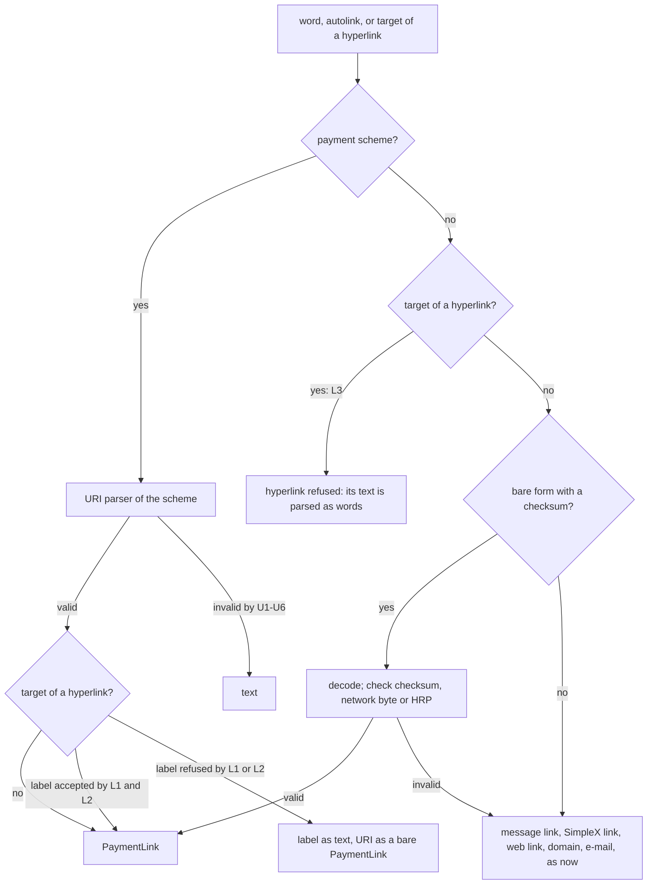
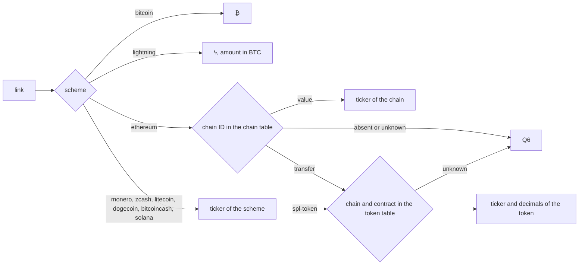
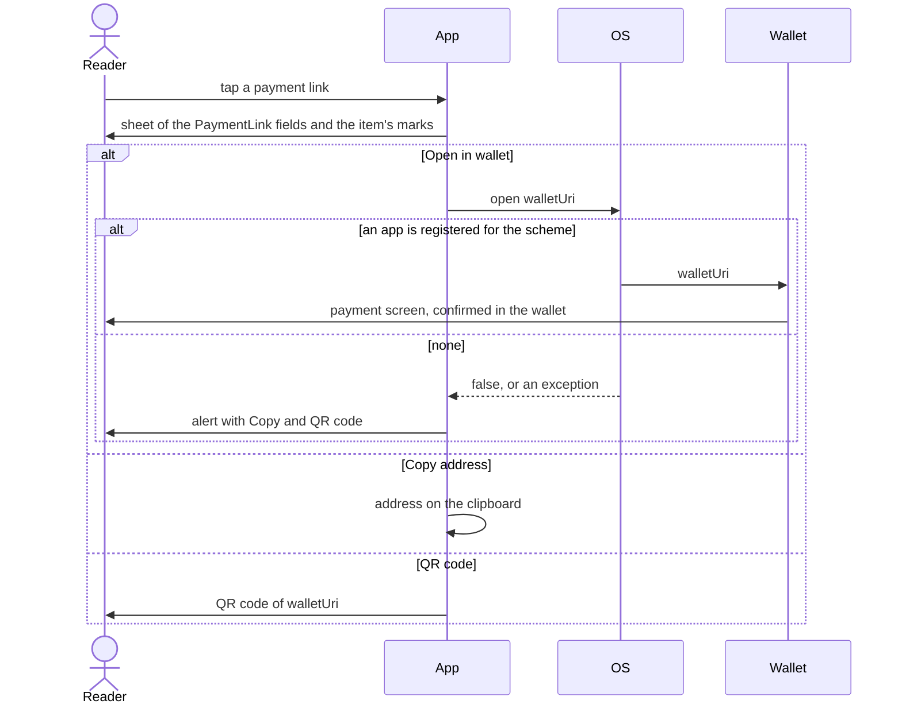
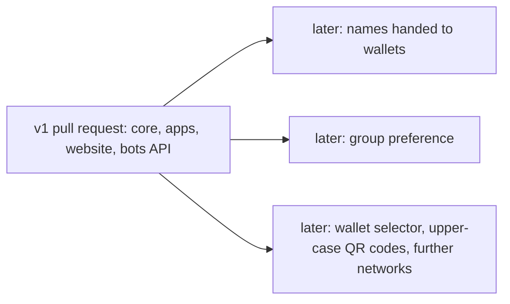

# Payment addresses in messages

Date: 2026-11-22. References are to master at 8f5dfa3d4. Haskell paths without a directory are in `src/Simplex/Chat/`. Sources are listed at the end as [S1]–[S36], read on 2026-11-22.

## Problem

A payment address or request in a message is plain text. A reader copies it into a wallet by hand, and the app shows neither its network nor the result of its checksum.

- `[address](bitcoin:address)`, the form of docs/DONATIONS.md:21-23, is shown as text with its brackets: only http and https targets are accepted by `hyperLinkFormat` (Markdown.hs:461-467, 873-882).
- A bare address, such as those of README.md:151-158, is shown as text (Markdown.hs:506-518).
- A Lightning Address `user@domain` is shown as an e-mail link, and a mail app is opened at a tap (Markdown.hs:514, 544; MsgContentView.swift:699-704; TextItemView.kt:424-430).

## Acceptance

| # | After the change | Before |
|---|---|---|
| A1 | a URI of the schemes of section Syntax, `[label](URI)`, `<URI>`, and a bare address or invoice whose format has a checksum, are shown as payment links | text |
| A2 | at a tap, the app opens a sheet with the network, the full address in groups of 4 characters, the amount, the label and message of the link as quoted text, the sender, and the marks Forwarded, Edited and Signed; the wallet is opened only from its button | — |
| A3 | at Open in wallet, the app hands a normalised URI to the OS; when no app opens it, an alert offers Copy and the QR code | — |
| A4 | an address with a wrong checksum, a testnet address, a wallet-restore URI (`monero-wallet:`), an EIP-681 call other than `transfer`, and a request to several recipients are shown as text | text |
| A5 | a hyperlink whose label contains a payment address other than its target is refused: the label is shown as text, the target as a bare payment link | text |
| A6 | the core and the apps send no request for a payment link: previews, DNS, ENS, LNURL and exchange rates are not requested | — |
| A7 | earlier apps show the text as now; the message protocol and the database are unchanged | — |

## Options

| Option | Cost |
|---|---|
| A. The core parses payment URIs and checksum-valid addresses into one `Format` constructor with a parsed request; the apps render its fields | a core module of codecs and parsers, a `Format` constructor with its JSON, the bots API types, one renderer and one sheet in each app |
| B. The core accepts payment schemes as `HyperLink` targets; each app parses the URI for its sheet | URI and checksum parsers written in Swift and in Kotlin, a third parser for bare addresses, results that can differ between platforms, a string only for bots |
| C. A message content type with a structured request, as `MCChat` (Protocol.hs:752) | a protocol type, a compose UI, a card UI, fallback text for earlier clients; addresses in texts, profile descriptions and channel posts are still shown as text |

A is chosen: the text is parsed once, where `formattedText` is produced (Messages.hs:633-640), and every text that the apps render with markdown is covered.

## Research

### Payment URI standards

| Scheme | Specification | Status, date | Payee | Amount | Other fields |
|---|---|---|---|---|---|
| `bitcoin:` | BIP-21 [S1], replaced by BIP-321 [S2] | BIP-21 Closed, assigned 2012-01-29; BIP-321 Complete, assigned 2024-11-15 | address; in BIP-321 optional when the query has a payment instruction | `amount`, decimal BTC, period separator | `label`, `message`; instructions `lightning` (BOLT 11), `lno` (BOLT 12), `sp`, `pay`; a URI with a `req-` key unknown to the client is invalid; scheme and keys are case-insensitive |
| `lightning:` | BOLT 11 [S4] | living specification | BOLT 11 invoice, HRP `lnbc` on mainnet | in the HRP, with the multipliers `m`, `u`, `n`, `p` | `d` description, `x` expiry (3600 s by default); "use 'lightning:' as a prefix before the BOLT-11 encoding (note: not 'lightning://')" |
| BOLT 12 offer | BOLT 12 [S5] | living specification | `lno1…` | `offer_amount` | "There is no checksum, unlike bech32m"; all lower or all upper case; `+` continuation; a URI scheme is left undefined |
| LNURL | LUD-01 [S6], LUD-17 [S7], a draft | — | bech32 `lnurl1…` of an https or onion URL; LUD-17: `lnurlp://` | — | LUD-01 is used "as a fallback inside of other URI schemes, with the key 'lightning'" |
| Lightning Address | LUD-16 [S8] | — | `user@domain`, user of `a-z0-9-_.` | — | resolved by GET `https://domain/.well-known/lnurlp/user`; a `lightning:` form is left undefined |
| `₿user@domain` | BIP-353 [S3] | Complete, assigned 2024-02-10 | DNSSEC TXT record at `user.user._bitcoin-payment.domain` with a `bitcoin:` URI | in that URI | "wallets SHOULD prefix it with ₿"; resolution over Tor or a VPN for privacy |
| `ethereum:` | EIP-681 [S9] | Final, created 2017-08-01 | `[pay-]0x…` or an ENS name, `@chain_id` | `value` in wei, scientific notation such as `2.014e18`, integer result | ERC-20: `0xtoken/transfer?address=0xpayee&uint256=n`; any function call can be encoded; without `chain_id` "the client's current network setting remains effective" |
| EIP-55 | EIP-55 [S10] | Final, created 2016-01-14 | the case of the hex letters, by Keccak-256 of the lower-case address | — | a mistyped address is accepted with probability 0.0247% |
| `solana:` | Solana Pay [S11] | SPEC.md at 25589fd3 (2025-05-05) | base58 public key; `solana:<https URL>` is a transaction request fetched by the wallet | `amount` in SOL or token units, at most 9 decimals for SOL | `spl-token`, `reference`, `label`, `message`, `memo` ("recorded by validators") |
| `monero:` | monero docs/URI_SCHEME.md [S12] | master | 95-character address; several separated by `;` | `tx_amount`, decimal | `recipient_name`, `tx_description`; `tx_payment_id` deprecated; `monero-wallet:` with `spend_key`, `view_key` and `seed` is defined in the same document |
| `zcash:` | ZIP-321 [S13] | Active, created 2020-08-28 | transparent, Sapling and Unified addresses | `amount`, at most 8 decimals | `memo`, base64url, at most 512 bytes, invalid with a transparent address; `label`, `message`; several payments by `paramindex`; the `req-` rule of BIP-321 |
| `litecoin:`, `dogecoin:` | the BIP-21 form of Litecoin Core and Dogecoin Core [S14] | master | address | `amount` | `label`, `message`; `dogecoin://` is rewritten as `dogecoin:` by Dogecoin Core |
| `bitcoincash:` | CashAddr [S15] | — | the prefix is part of the address and of its 40-bit checksum, and "may be omitted" when shown | `amount` | mixed case "must be rejected" |
| CAIP-10 | CAIP-10 [S16] | Final, created 2020-03-13 | `chain_id:account_address`, such as `eip155:1:0x…` | — | account identifiers, not a URI scheme |

### Wallets and operating systems

| Platform | Several apps for a scheme | No app for a scheme | Notes |
|---|---|---|---|
| iOS | "the app the system targets is undefined" [S17] | the completion handler of `open(_:options:completionHandler:)` is called with `false` [S18] | `canOpenURL` requires the scheme in `LSApplicationQueriesSchemes`, at most 50 entries, 25 from iOS 27; `open` is not constrained by it [S19]. Of the URL keys, only `CFBundleURLTypes` is declared (SimpleX--iOS--Info.plist:33-55) |
| Android | a chooser dialog, unless the user chose a default [S20] | `ActivityNotFoundException` [S20] | "scheme matching in the Android framework is case-sensitive, unlike the formal RFC" [S21]. Errors of `openUri` are caught in `safeOpenUri` (TextItemView.kt:729-738) |
| desktop | on Linux the last `xdg-mime default`, on Windows the default-app settings (plans/2026-09-28-desktop-deep-links-report.md:56) | errors of `openUri` are caught in `safeOpenUri`, as on Android | Electrum registers `x-scheme-handler/bitcoin` and `x-scheme-handler/lightning` [S22] |

Files that register each scheme, by GitHub code search of public repositories [S23]:

| Scheme | Android manifests | iOS Info.plist files | Open-source wallets among them |
|---|---|---|---|
| `bitcoin` | 234 | 519, many of them in forks of Bitcoin Core | Phoenix, BlueWallet, Zeus, Blockstream Green, Muun, Bitkit, Samourai, Mycelium, Nunchuk, Sparrow, Unstoppable, Cake Wallet [S24] |
| `lightning` | 108 | 100 | Phoenix, BlueWallet, Zeus, Blockstream Green, Muun, Bitkit, BitBox, Blixt |
| `ethereum` | 95 | 107 | MetaMask Mobile, Rainbow, AlphaWallet, WallETH, OneKey, Unstoppable, Tangem, Cake Wallet |
| `monero` | 36 | 19 | Monerujo, MyMonero, Feather, monero-gui, Unstoppable, Cake Wallet |
| `zcash` | 18 | 26 | Zashi, Zingo, YWallet, Edge, Unstoppable |
| `solana` | 20 | 9 | Unstoppable, BitPay, the Solana Mobile sample |
| `litecoin` | 47 | not searched | Litewallet, BitPay, Edge, Cake Wallet |
| `dogecoin` | 28 | not searched | BitPay, Cake Wallet |
| `bitcoincash` | 40 | not searched | Paytaca, BitPay, Edge, Cake Wallet |

- Apps other than wallets register the schemes too: all nine are registered by the Nostr client Amethyst.
- Cake Wallet registers `polygon`, `base`, `arbitrum` and `tron` beside `ethereum`, `solana-wallet` in place of `solana`, and `monero-wallet` [S24].
- Bitcoin Core compares the keys `label`, `message` and `amount` as written, so `AMOUNT=1` is ignored, and trims a final `/` that "may have been added by the OS" (src/qt/guiutil.cpp:157-197) [S14].

### Address formats

| Network | Bare form | Check | Probability that a random word of the form is accepted |
|---|---|---|---|
| Bitcoin | `bc1…` bech32 (v0) and bech32m (v1 and later); `1…`, `3…` Base58Check, versions 0x00, 0x05 | 30-bit BCH code [S25]; 32-bit double SHA-256 | 2^-30; 2^-32 |
| Lightning | `lnbc…` invoice; `lnurl1…` | bech32 without the 90-character limit [S4] | 2^-30 |
| Ethereum and other EVM chains | `0x` and 40 hex digits | the EIP-55 case of the letters; an address in one case is unchecked | 2^-k for k letters, 15 on average |
| Monero | 95 characters, network byte 18 (`4…`) or 42 (`8…`); 106 characters, byte 19 | first 4 bytes of Keccak-256 [S26] | 2^-32 |
| Zcash | `t1`, `t3` Base58Check with 2-byte versions; `zs1` bech32; `u1` bech32m | as Bitcoin | 2^-32; 2^-30 |
| Litecoin | `ltc1…`; `L…` (48), `M…` (50); `3…` (5, also the Bitcoin version) [S14] | as Bitcoin | 2^-32; 2^-30 |
| Dogecoin | `D…` (30); `9…`, `A…` (22) [S14] | Base58Check | 2^-32 |
| Bitcoin Cash | `q…`, `p…`, with or without `bitcoincash:` | 40-bit BCH code over prefix and payload [S15] | 2^-40 |
| Solana | 32 to 44 base58 characters of a 32-byte key | unchecked | the word `ThereAreMany32ByteKeysHereButNoneAreChecked` is decoded as 32 bytes |

Each donation address of README.md:151-158 was checked by these rules before this plan was written: BTC bech32 v0, XMR network byte 42, BCH CashAddr, ETH EIP-55, ZEC `t1` (version 0x1CB8) and `u1` (bech32m, 106 characters), DOGE version 30, SOL 32 bytes. The tests of section Tests repeat these checks.

### Messaging apps

| App | Detected in message text | Source |
|---|---|---|
| Telegram | entity types made by the server: URLs, mentions, hashtags, cashtags, bot commands, e-mail, bank card numbers | [S27] |
| Element (Matrix) | `bitcoin:` URIs are linkified, as a permitted scheme beside `geo:`, `magnet:`, `tel:` and others; `lightning:`, `ethereum:`, `monero:` and bare addresses are text | [S28] |
| Signal Android | e-mail addresses, phone numbers and web URLs; payments are in-app, with MobileCoin | [S29] |
| Session Android | `scheme://` URLs and `www.` links, by autolink-java; `bitcoin:` URIs are text | [S30] |
| Briar Android | web URLs | [S31] |
| WhatsApp, Status | not checked | — |

### Risks

| Risk | Evidence | Mitigation in this plan |
|---|---|---|
| address substitution in the clipboard | Android/Clipper.C, found on Google Play in February 2019, replaced Bitcoin and Ethereum addresses copied by users [S32] | Open in wallet is the first action; the URI is passed to the wallet without the clipboard |
| look-alike addresses | "approximately 270 million attack attempts targeting 17 million victims" on Ethereum and BSC, July 2022 to June 2024; wallets show "the first and last few characters" [S33] | the full address is shown in the sheet in groups of 4, in a monospaced font, and in the bubble as written |
| a label that differs from its target | `[bc1qGOOD](bitcoin:bc1qEVIL)` is accepted by the punctuation rule of `sowLinkP` (Markdown.hs:453-454) | rule L2 of section Syntax |
| an address changed by an edit | messages are edited after they are read (`itemEdited`, Messages.hs:532) | the Edited mark in the sheet; the earlier versions are in the item info (Messages.hs:1388-1410) |
| a request forwarded by a person other than the payee | `itemForwarded` (Messages.hs:530) | the Forwarded mark and the source in the sheet |
| token approvals and contract calls | any function call can be encoded in EIP-681 [S9] | only `transfer` with `address` and `uint256` is parsed; other calls are text |
| a wallet restored with the keys of another party | `monero-wallet:` with `spend_key`, `view_key` or `seed` [S12], registered by Cake Wallet [S24] | the scheme is text |
| a payment on a wrong EVM chain | without `chain_id`, the current network of the wallet is used [S9]; one address is given for Ethereum and Arbitrum One (README.md:154) | the warning "Network not stated" in the sheet |
| requests by the wallet to third parties | LNURL and Solana transaction request URLs are fetched by the wallet [S6], [S11] | the LNURL host is named in the sheet; `solana:https…` is text |
| injection in descriptions, labels and messages | "Payment descriptions are user-defined and provide a potential avenue for injection attacks" [S4] | the apps render them as plain attributed text; in the website renderer, they are escaped by `escapeHtml` (website/src/js/simplex-lib.jsc:225-301) |
| invisible characters in the label or message | format characters are shown as `[U+XXXX]` in web links (CILinkView.swift:104-121) | the same markers in the sheet |

## Syntax

### Recognised forms

A payment link is one of:

1. a URI of a scheme below, written bare, in `<…>`, or as the target of `[label](…)`; the scheme and the parameter keys are matched in any case;
2. a bare address or invoice whose format has a checksum, on mainnet.

```
bitcoin:
  payee         bech32 bc1 v0
                bech32m bc1 v1 and later
                Base58Check version 0x00
                Base58Check version 0x05
                empty, when lightning or lno is present
  parameters    amount
                label
                message
                lightning: BOLT 11 invoice
                lno: BOLT 12 offer
lightning:
  payee         BOLT 11 invoice lnbc
                BOLT 12 offer lno1
                LUD-01 LNURL lnurl1
  read          invoice amount in the HRP
                invoice field d
                invoice timestamp and field x
                host of the decoded LNURL
ethereum:
  payee         [pay-]0x and 40 hex digits, EIP-55 when in mixed case
  parameters    @chain_id
                value
  token         0x token contract, then /transfer
  parameters    address
                uint256
monero:
  payee         95 characters, network byte 18
                95 characters, network byte 42
                106 characters, network byte 19
  parameters    tx_amount
                recipient_name
                tx_description
zcash:
  payee         t1
                t3
                zs1
                u1
  parameters    amount
                label
                message
                memo
solana:
  payee         base58 of 32 bytes
  parameters    amount
                spl-token
                label
                message
                memo
litecoin:
  payee         ltc1
                Base58Check version 48
                Base58Check version 50
                Base58Check version 5
  parameters    amount
                label
                message
dogecoin:
  payee         Base58Check version 30
                Base58Check version 22
  parameters    amount
                label
                message
bitcoincash:
  payee         CashAddr q
                CashAddr p
  parameters    amount
                label
                message
```

```
bare form       network
bc1             Bitcoin
1               Bitcoin
3               Bitcoin
lnbc            Lightning
lnurl1          Lightning
0x, EIP-55      Ethereum, chain not stated
4               Monero
8               Monero
t1              Zcash
t3              Zcash
zs1             Zcash
u1              Zcash
ltc1            Litecoin
L               Litecoin
M               Litecoin
D               Dogecoin
9               Dogecoin
A               Dogecoin
q               Bitcoin Cash, checked with the prefix bitcoincash
p               Bitcoin Cash, checked with the prefix bitcoincash
```

Examples:

```
bc1q2gy6f02nn6vvcxs0pnu29tpnpyz0qf66505d4u
bitcoin:bc1q2gy6f02nn6vvcxs0pnu29tpnpyz0qf66505d4u?amount=0.001&label=SimpleX
[Donate](monero:8A3ZWAXrrQddvnT1fPrtbK86ZAoM4nai3Gjg1LEow3JWcryJtovMnHYZnxTJpCLmAbfWbnPMeTzPmMBjAhyd4xoM89hYq1c)
ethereum:0xD7047Fe3Eecb2f2FF78d839dD927Be27Bc12c86a@42161?value=1e16
ethereum:0xdAC17F958D2ee523a2206206994597C13D831ec7@1/transfer?address=0xD7047Fe3Eecb2f2FF78d839dD927Be27Bc12c86a&uint256=5000000
lightning:lnbc2500u1pvjluezsp5zyg3…fna3rh
solana:7JCf5m3TiHmYKZVr6jCu1KeZVtb9Y1jRMQDU69p5ARnu?amount=0.5
<zcash:u16rnvkflumf5uw9frngc2lymvmzgdr2mmc9unyu0l44unwfmdcpfm0axujd2w34ct3ye709azxsqge45705lpvvqu264ltzvfay55ygyq?amount=0.1>
```

### Rules

```
U1  a URI is text when
      its payee is rejected by its check
      its network is a testnet
      a known key other than lightning and lno is repeated
      a req- key is unknown
      its amount has more decimals than the coin:
        BTC 8
        LTC 8
        DOGE 8
        BCH 8
        ZEC 8
        XMR 12
        SOL 9, without spl-token
      an EIP-681 value or uint256 is not an integer
U2  unknown keys without req- are kept in the wallet URI and not shown
U3  ethereum: function calls other than transfer are text
    ethereum: transfer with a value is text
    ethereum: ENS names are text
U4  monero: with ";" is text: several recipients
    zcash: with a paramindex is text: several payments
U5  zcash: memo with a transparent address is text, as ZIP-321 requires
U6  solana: with an https link, a transaction request, is text
L1  [label](URI): the punctuation rule of web hyperlinks is applied (Markdown.hs:453-454)
L2  [label](URI): each alphanumeric run of the label that is an address of the nine forms,
    with or without a checksum, equals the payee, an alternative or the token,
    or the hyperlink is refused: the label is text, the URI a bare payment link;
    an autolink <URI>, whose label is its URI, is not checked
L3  a hyperlink target without a scheme is not a payment link:
      [label](address) is the text [label]( , a bare payment link, and )
      <address> is text
B1  bare forms without a checksum are text:
      Solana
      an EVM address in one case
      BOLT 12 offers
B2  a Lightning Address user@domain is an e-mail link, as now
B3  code spans and code blocks are text, as for links
```



## Types

`Payments.hs`, a new module:

```haskell
data PaymentRequest = PaymentRequest
  { payee :: PaymentPayee,
    alternatives :: [LightningPayee], -- lightning= and lno= beside a bitcoin: address
    amount :: Maybe Text, -- decimal: coins of the network, or base units of the token
    token :: Maybe PaymentToken, -- ERC-20 contract or SPL mint
    label :: Maybe Text, -- recipient in the link
    message :: Maybe Text, -- description in the link
    walletUri :: Text -- handed to the OS
  }

data PaymentPayee
  = PPAddress {network :: PaymentNetwork, address :: Text, checksum :: AddressChecksum}
  | PPLightning {lightning :: LightningPayee}

data PaymentNetwork
  = PNBitcoin
  | PNEthereum {chainId :: Maybe Int64} -- Nothing: chain not stated
  | PNMonero
  | PNZcash
  | PNSolana
  | PNLitecoin
  | PNDogecoin
  | PNBitcoinCash

data LightningPayee
  = LPInvoice {invoice :: Text, description :: Maybe Text, expiresAt :: UTCTime} -- BOLT 11
  | LPOffer {offer :: Text} -- BOLT 12
  | LPLnurl {lnurl :: Text, host :: Text} -- LUD-01

data PaymentToken = PaymentToken {address :: Text, checksum :: AddressChecksum}

data AddressChecksum = ACVerified | ACUnchecked -- ACUnchecked: Solana, or an EVM address in one case

instance StrEncoding PaymentRequest -- strDecode: a URI or a bare word; strEncode: walletUri; strDecode . strEncode = Right

hasOtherAddress :: PaymentRequest -> Text -> Bool -- rule L2
```

Markdown.hs:

```haskell
data Format
  = ...
  | PaymentLink {showText :: Maybe Text, payment :: PaymentRequest}
```

- JSON: `sumTypeJSON fstToLower` for the sums and `defaultJSON` for the records, as for `Format` (Markdown.hs:1040-1043); in a core of an earlier version, the constructor is decoded as `Unknown` (Markdown.hs:1042-1043).
- `message` is set from `message`, `tx_description`, the Solana `memo`, or the Zcash `memo` when it is UTF-8; `label` from `label` or `recipient_name`.
- `address`: bech32, bech32m and CashAddr in lower case, an EVM address in its EIP-55 case, other forms as written; rule L2 compares these forms.
- Amounts: `1*DIGIT ["." 1*DIGIT]`, the grammar of ZIP-321, for every scheme but `ethereum:`.
- Codecs in `Payments.hs`: Base58 and Base58Check; the Monero block variant, 8 bytes in 11 characters; bech32 and bech32m without a length limit; CashAddr; the BOLT 11 fields `d` and `x`. Hashes: `sha256Hash` and `keccak256` (simplexmq Crypto.hs:1035-1057); the EIP-55 check of `strP` of `Simplex.Messaging.Eth.Address` (simplexmq Eth/Address.hs:40-48) [S36].
- Chain names and coin symbols, in the apps, for `chainId` 1, 10, 56, 137, 8453 and 42161: Ethereum, OP Mainnet, BNB Smart Chain, Polygon, Base, Arbitrum One; ETH, BNB, POL [S34]. Another chain is shown by its number.
- Each word is tested for the prefixes of the bech32, Lightning and `0x` forms, and for the lengths of the Base58, CashAddr and Monero forms, before it is decoded.
- The schemes and their parsers are one list, `schemeRequests`: a URI is parsed by the parser of its scheme, and a bare word by each parser in the order of the list, so Bitcoin is tried before Litecoin for a `3…` address.

## Parser changes

```
fragmentP     digit branch: a word with a PaymentLink, then phoneP, then wordP (Markdown.hs:363)
linkMD        after the web URI branch, before isDomain: paymentLink of the link text (Markdown.hs:506-518)
hyperLinkFormat
              after the SimpleX link branch, before parseUri: paymentLink of the target,
              with the label rules L1, L2 and L3 (Markdown.hs:450-467)
isLink        PaymentLink, as decided in Q5 (Markdown.hs:320-326)
markdownText  PaymentLink -> the source text (Markdown.hs:965-986)
```

- For a word that starts with a digit, `phoneP` is tried before `wordP`, and a Base58 or Monero address that starts with 7 or more digits is split by it (Markdown.hs:363, 484-494); the payment word is tried before both.
- `<URI>` is parsed by `hyperLinkFormat` with the URI as its label (Markdown.hs:457-460), as now.

## Wallet URI

`walletUri` is the URI of Open in wallet and of the QR code:

```
written          walletUri
bare Bitcoin     bitcoin:<address>
bare Lightning   lightning:<invoice or LNURL>
bare EVM         ethereum:<address>
bare Monero      monero:<address>
bare Zcash       zcash:<address>
bare Litecoin    litecoin:<address>
bare Dogecoin    dogecoin:<address>
bare CashAddr    bitcoincash:<address>
URI              as written, with
                   the scheme in lower case
                   "//" after the scheme removed
                   the keys read by the parser in lower case
                   values and unknown keys unchanged
```

- The scheme in lower case: Android matches schemes case-sensitively [S21]; QR codes are often written in upper case [S2].
- The keys in lower case: Bitcoin Core compares them as written [S14].
- `//` removed: BOLT 11 [S4]; `dogecoin://` is rewritten by Dogecoin Core [S14].
- The wallet URI is encoded in the QR code without the app logo (`withLogo: false`, QRCode.swift:60-108, QRCode.kt:66-72).

## Apps

### Link text

The text of a payment link in the bubble, in link style; addresses are shortened to 6 and 4 characters.

| Link | Text |
|---|---|
| `bitcoin:bc1qar0s…5mdq?amount=0.0012` | ₿0.0012 |
| `bitcoin:bc1qar0s…5mdq` | ₿bc1qar…5mdq |
| `lightning:lnbc12u1p…` | ϟ0.000012 |
| `monero:4AdUnd…mRVj?tx_amount=0.25` | XMR 0.25 |
| `monero:4AdUnd…mRVj` | XMR 4AdUnd…mRVj |
| `litecoin:ltc1q…?amount=0.1` | LTC 0.1 |
| `bitcoincash:qp3w…?amount=0.01` | BCH 0.01 |
| `solana:7xKX…?amount=10&spl-token=EPjFWdd5AufqSSqeM2qN1xzybapC8G4wEGGkZwyTDt1v` | USDC 10 · Solana |
| `ethereum:0xfb69…d359@1?value=1e16` | ETH 0.01 |
| `ethereum:0xfb69…d359@42161?value=1e16` | ETH 0.01 · Arbitrum |
| `ethereum:0xfb69…d359@137?value=5e18` | POL 5 · Polygon |
| `ethereum:0xc2132D05D31c914a87C6611C10748AEb04B58e8F@137/transfer?address=0xfb69…d359&uint256=10000000` | USDT 10 · Polygon |
| `ethereum:0xfb69…d359@99999?value=1e16` | Q6 |
| `ethereum:0xfb69…d359?value=1e16` | Q6 |



Tickers of the schemes, by SLIP-44 [S37]:

| Scheme | Text |
|---|---|
| `bitcoin` | ₿ |
| `lightning` | ϟ |
| `monero` | XMR |
| `zcash` | ZEC |
| `litecoin` | LTC |
| `dogecoin` | DOGE |
| `bitcoincash` | BCH |
| `solana` | SOL |
| `ethereum` | the chain table |

Chains, by ethereum-lists/chains [S34]; the name follows ` · `, except for chain 1:

| Chain ID | Name | Ticker |
|---|---|---|
| 1 | Ethereum | ETH |
| 10 | OP Mainnet | ETH |
| 56 | BNB Smart Chain | BNB |
| 137 | Polygon | POL |
| 8453 | Base | ETH |
| 42161 | Arbitrum | ETH |

Tokens, by the Uniswap token list [S38] and the Solana token list [S39]; an ERC-20 `uint256` is divided by 10^decimals:

| Chain | Contract | Ticker | Decimals |
|---|---|---|---|
| 1 | `0xdAC17F958D2ee523a2206206994597C13D831ec7` | USDT | 6 |
| 1 | `0xA0b86991c6218b36c1d19D4a2e9Eb0cE3606eB48` | USDC | 6 |
| 10 | `0x94b008aA00579c1307B0EF2c499aD98a8ce58e58` | USDT | 6 |
| 10 | `0x0b2C639c533813f4Aa9D7837CAf62653d097Ff85` | USDC | 6 |
| 56 | `0x55d398326f99059fF775485246999027B3197955` | USDT | 18 |
| 56 | `0x8AC76a51cc950d9822D68b83fE1Ad97B32Cd580d` | USDC | 18 |
| 137 | `0xc2132D05D31c914a87C6611C10748AEb04B58e8F` | USDT | 6 |
| 137 | `0x3c499c542cEF5E3811e1192ce70d8cC03d5c3359` | USDC | 6 |
| 8453 | `0xfde4C96c8593536E31F229EA8f37b2ADa2699bb2` | USDT | 6 |
| 8453 | `0x833589fCD6eDb6E08f4c7C32D4f71b54bdA02913` | USDC | 6 |
| 42161 | `0xFd086bC7CD5C481DCC9C85ebE478A1C0b69FCbb9` | USDT0 | 6 |
| 42161 | `0xaf88d065e77c8cC2239327C5EDb3A432268e5831` | USDC | 6 |
| Solana | `Es9vMFrzaCERmJfrF4H2FYD4KCoNkY11McCe8BenwNYB` | USDT | 6 |
| Solana | `EPjFWdd5AufqSSqeM2qN1xzybapC8G4wEGGkZwyTDt1v` | USDC | 6 |

### Presentation

| Element | Proposal |
|---|---|
| bubble, address or URI | section Link text |
| bubble, `[label](URI)` | the label and the network in italics, `Donate (Monero)`, as `(via host)` of SimpleX links (MsgContentView.swift:653-665, TextItemView.kt:401-416) |
| tap | the sheet; the wallet is opened only from its button |
| sheet title | by the payee: `Bitcoin address`, `Lightning invoice`, `Ethereum token transfer` |
| sheet line 2 | `From alice`, then the marks `Forwarded`, `Edited` and `Signed` of the item (Messages.hs:530-541) |
| address | full, in groups of 4, monospaced, selectable |
| amount | `0.001 BTC`; a token: `5000000 units` and the full token contract; none: `Not specified` |
| alternatives | a `bitcoin:` URI with `lightning=` or `lno=`: `Lightning is offered too.` |
| label and message | under `In the link`, in quotes, with `[U+XXXX]` for format characters |
| warnings, at most 2 lines | `Network not stated. Your wallet will use its current network.`; `This address has no checksum.`; `Your wallet will contact host.`; `This invoice expired.` |
| buttons | **Open in wallet**; Copy address; QR code, shown open on desktop |
| no app | alert `No wallet app`, text `Copy the address or scan the QR code with a wallet.`, buttons Copy, QR code, Cancel |

```
┌──────────────────────────────────────┐
│ Bitcoin address                      │
│ From alice · Forwarded               │
│                                      │
│ bc1q 2gy6 f02n n6vv cxs0 pnu2        │
│ 9tpn pyz0 qf66 505d 4u               │
│ Amount        0.001 BTC              │
│ In the link   "SimpleX"              │
│                                      │
│ [         Open in wallet         ]   │
│ [ Copy address ]   [ QR code ]       │
└──────────────────────────────────────┘
```



### Parts

| Part | iOS | Android and desktop |
|---|---|---|
| types | `Format.paymentLink` and the types above, SimpleXChat/ChatTypes.swift:6008-6027 | `Format.PaymentLink`, ChatModel.kt:5382-5412, style `linkStyle` |
| rendering | a branch in `appendSegments` with an attribute key for the payment (MsgContentView.swift:595-722) | the annotation `PAYMENT` (TextItemView.kt:336-452); the same text in `segmentDisplayText` (TextItemView.kt:112-134) |
| tap | the sheet is opened from `attributedStringLink` for the key, before the URL branch in which `mailto:` and `tel:` are opened directly (MsgContentView.swift:300-344) | `PAYMENT` is handled in `onClick`, `onHover` and `shouldConsumeEvent` (TextItemView.kt:489-534) |
| sheet | `appSheet`, as for the profile description (MsgContentView.swift:393) | `ModalManager.center` (ModalView.kt:267) |
| open | `UIApplication.shared.open(url) { success in … }`; the alert when `success` is false [S18] | `uriHandler.openUri` in `try`; the alert on an exception (TextItemView.kt:729-738) |
| previews | `linkUri` is unchanged, so a payment link is never previewed (ChatTypes.swift:5883-5889, ComposeView.swift:1929-1939) | the same (ChatModel.kt:5369-5374, ComposeView.kt:472-482) |

- Remote desktop: an app of an earlier version fails to decode the new `Format`; `minRemoteCtrlVersion` and `minRemoteHostVersion` (Remote.hs:77-82) are raised to the release version by the release commit, as by `d7d180a42 core: 7.1.0.16`.
- Website: the payment schemes are added to `SAFE_URI_SCHEME` (website/src/js/simplex-lib.jsc:26), and `paymentLink` is rendered as a link to `walletUri` in `renderSegments` (simplex-lib.jsc:225-301).
- CLI: the text is printed as now (Styled.hs:71-79).
- Bots API: `PaymentLink` and its types are added in bots/src/API/Docs/Types.hs:298; bots/api and the TypeScript and Python types are generated again.

## Privacy

- A payment link is sent as message text and parsed by each recipient's core when the item is read (Store/Messages.hs:2338-2340, 2432-2434).
- The core and the apps send no request for a payment link; names (BIP-353, Lightning Address, ENS), LNURL and the tokens outside the token table are resolved only by the wallet.
- At Open in wallet, the app passes the address, amount, label and message to the app that the OS chooses; on iOS, that app is undefined among several [S17].
- At Copy, the address is placed on the clipboard, where other apps can read it [S32].

## Tests

Each test that expects a payment link fails on master.

| File | Test |
|---|---|
| tests/MarkdownTests.hs | `bc1q2gy6…505d4u` and its upper-case form are parsed as `PaymentLink` with `walletUri` `bitcoin:` and the address; the address with its last character changed is text |
| | `BITCOIN:BC1Q2GY6…?AMOUNT=0.001` is parsed with `walletUri` `bitcoin:BC1Q2GY6…?amount=0.001`; `amount=0.000000001` and `amount=1,000` are text |
| | `37116639cErLzxER6tL3a6EH2DbdETwTxd`, a P2SH address made for the test from random bytes, which starts with 8 digits, is one `PaymentLink`; on master it is split by `phoneP` (Markdown.hs:363, 484-494) |
| | the README.md:151-158 addresses, bare and as URIs: Monero byte 42, CashAddr with and without its prefix, EIP-55, `t1`, `u1`, Dogecoin; `solana:7JCf…ARnu?amount=0.5`; with `spl-token`, a token without a checksum |
| | `strDecode (strEncode r) == Right r` for each request of these tests |
| | the BOLT 11 example "Please send $3 for a cup of coffee to the same peer, within one minute" [S4]: amount 0.0025 BTC, description `1 cup coffee`, `expiresAt` 2017-06-01T10:58:38Z; its example "Bech32 checksum is invalid" is text |
| | `ethereum:0xD704…c86a@42161?value=1e16`: chain 42161, amount 0.01; the USDT `transfer` example: token with its checksum, payee, `5000000`; the same with the token contract in lower case: a token without a checksum; `/approve?…` and a `transfer` with `value` are text; the address with the case of one letter changed is text |
| | `[Donate](monero:8A3Z…q1c)` is parsed as `PaymentLink (Just "Donate")`; `[bc1qw508d6qejxtdg4y5r3zarvary0c5xw7kv8f3t4](bitcoin:bc1q2gy6…)`, a valid address of BIP-173 as the label, is parsed as label text and a bare `PaymentLink` (L2); `[Donate](bc1q2gy6…)` is parsed as text and a bare `PaymentLink`, and `<bc1q2gy6…>` as text (L3) |
| | text: `ThereAreMany32ByteKeysHereButNoneAreChecked`; `0xd7047fe3eecb2f2ff78d839dd927be27bc12c86a` bare; `tb1…`; `monero-wallet:…?spend_key=…`; `monero:A;B?tx_amount=1;2`; `zcash:t1fwj…?memo=…`; `` `bc1q2gy6…` ``; `alice@getalby.com` as e-mail |
| | `hasLinks` of a payment link, as decided in Q5; linear time: 10000 words of 34 Base58 characters |
| tests/JSONTests.hs | the JSON of a `bitcoin:` URI with `lightning=`, an `ethereum:` URI with a chain and a token transfer is decoded to the same value |
| tests/ChatTests/Direct.hs | `filter chat by link content`: a message with a bare address is in the Links filter, as decided in Q5 |
| tests/ChatTests/Direct.hs | `payment links in a received message`: alice sends a bare address, `[Donate](monero:…)` and a bare invoice; `apiFixture` (tests/ChatTests/Utils.hs:999-1004) records bob's `/_get chat @2 count=1`, whose item has `PaymentLink` in `formattedText`, and the markdown of each payee kind, to tests/fixtures/api/payments/links.json; its pattern is in "App test fixtures" (scripts/ci/README.md:51) |
| tests/APIDocs.hs | the bots API files, generated again with the new types |
| app tests on tests/fixtures/api/payments/links.json | `Format.paymentLink` is decoded; each payee kind is mapped to its sheet title, grouped address, amount, warnings and marks; a mocked open failure is followed by the alert |

## Stages

| Part | Stage |
|---|---|
| core: `Payments.hs`, `Format.PaymentLink`, parser changes, `walletUri`, tests, bots API types, fixtures | v1 |
| iOS, Android, desktop: rendering, sheet, open, alert, QR code, app tests | v1, in the same pull request |
| remote versions | the release commit |
| website renderer | v1 |
| names: `₿user@domain`, Lightning Address, ENS, handed to the wallet | later, once wallets accept a URI form for them |
| a group preference that prohibits payment links | later, a protocol preference (Types/Preferences.hs:206-218) |
| a wallet selector with schemes of individual wallets [S35] | later |
| QR codes in upper case for bech32-only URIs [S25] | later |
| further networks, each a constructor of `PaymentNetwork` and its parser | later |



- `Format`, `isLink`, `linkMD` and `hyperLinkFormat` are changed in the message-references plan too (branch ep/message-references, plans/2026-11-22-message-references.md). The pull request merged second is rebased; in `hyperLinkFormat`, message links are tried first, then SimpleX links, payment links and web links.
- A network is added by a constructor and a parser; message texts are unchanged, and earlier clients show them as text.

## Questions

Each question is a principle with its consequences; the recommended option is in bold.

| ID | Principle | Options and consequences | Recommendation |
|---|---|---|---|
| Q1 | What is shown as a payment link | a. URIs of the nine schemes, their hyperlinks and autolinks, and bare forms with a checksum on mainnet: a random word is shown as a link with probability 2^-30 or less for Base58Check, bech32 and CashAddr forms, about 2^-15 for a mixed-case `0x` word; Solana and one-case EVM addresses only in URIs; a Lightning Address stays an e-mail link<br>b. URIs, hyperlinks and autolinks only: the bare addresses of README.md:151-158 are text<br>c. a, and bare forms without a checksum: `ThereAreMany32ByteKeysHereButNoneAreChecked` is shown as a Solana link | **a** |
| Q2 | What a tap shows | a. the sheet of section Apps: full grouped address, network, amount, quoted label and message, marks, warnings; Open in wallet first; bare invoices shown by their amount in the bubble<br>b. a, with Copy and QR code only for an EVM address without a chain<br>c. the "Open link?" alert of web links (CILinkView.swift:52-89) with the URI: less code; the address ungrouped, without network or checksum state | **a** |
| Q3 | What the app requests | a. nothing: names are not recognised in v1, LNURL is resolved by the wallet, and its host is named in the sheet<br>b. a, and names handed to wallets as `lightning:user@domain`, a form left undefined by LUD-16 [S8] | **a** |
| Q4 | Networks in v1 | a. Bitcoin, Lightning, Ethereum with the other EVM chains, Monero, Zcash, Solana, Litecoin, Dogecoin, Bitcoin Cash: the networks of README.md:151-158, Lightning and Litecoin<br>b. Bitcoin, Lightning and Monero: a smaller parser and fewer tests; other addresses are text | **a** |
| Q5 | Whether payment links are links | a. yes: new items with a payment link are in the Links filter (ChatView.swift:3410-3436, Store/Messages.hs:1551-1578); groups get no new preference in v1<br>b. no, as e-mail addresses and phone numbers (Markdown.hs:320-326)<br>c. a, and a group preference that prohibits them, a protocol change | **a** |
| Q6 | Text of a link outside the tables: an unknown chain ID or token, or an `ethereum:` link without a chain ID, in which the wallet's current chain is used [S9] | a. the shortened address and ` · chain 99999` or ` · token`, without a ticker or an amount: nothing is shown that the link does not state<br>b. as a, and `ETH` for a link without a chain ID: the amount is shown, the currency may be wrong | **a** |

## Sources

| ID | Source |
|---|---|
| S1 | BIP-21, https://github.com/bitcoin/bips/blob/master/bip-0021.mediawiki |
| S2 | BIP-321, https://github.com/bitcoin/bips/blob/master/bip-0321.mediawiki, sections "General Format", "Query Keys", "Examples" |
| S3 | BIP-353, https://github.com/bitcoin/bips/blob/master/bip-0353.mediawiki |
| S4 | BOLT 11, https://github.com/lightning/bolts/blob/master/11-payment-encoding.md, sections "Encoding Overview", "Human-Readable Part", "Security Considerations for Payment Descriptions", "Examples", "Examples of Invalid Invoices" |
| S5 | BOLT 12, https://github.com/lightning/bolts/blob/master/12-offer-encoding.md |
| S6 | LUD-01, https://github.com/lnurl/luds/blob/luds/01.md |
| S7 | LUD-17, https://github.com/lnurl/luds/blob/luds/17.md |
| S8 | LUD-16, https://github.com/lnurl/luds/blob/luds/16.md |
| S9 | EIP-681, https://eips.ethereum.org/EIPS/eip-681 |
| S10 | EIP-55, https://eips.ethereum.org/EIPS/eip-55 |
| S11 | Solana Pay, https://github.com/solana-foundation/pay/blob/25589fd383c02ed997447565e1cba67aa27d24dc/SPEC.md, sections "Specification: Transfer Request", "Specification: Transaction Request" |
| S12 | Monero, https://github.com/monero-project/monero/blob/master/docs/URI_SCHEME.md |
| S13 | ZIP-321, https://zips.z.cash/zip-0321 |
| S14 | master branches: Bitcoin Core src/qt/guiutil.cpp:149-234 (github.com/bitcoin/bitcoin); Litecoin src/chainparams.cpp:145-152 and src/qt/guiutil.cpp:117-181 (github.com/litecoin-project/litecoin); Dogecoin src/chainparams.cpp:167-168 and src/qt/guiutil.cpp:146-217 (github.com/dogecoin/dogecoin) |
| S15 | CashAddr, https://github.com/bitcoincashorg/bitcoincash.org/blob/master/spec/cashaddr.md |
| S16 | CAIP-10, https://github.com/ChainAgnostic/CAIPs/blob/main/CAIPs/caip-10.md |
| S17 | Apple, "Defining a custom URL scheme for your app", https://developer.apple.com/documentation/xcode/defining-a-custom-url-scheme-for-your-app |
| S18 | Apple, `open(_:options:completionHandler:)`, https://developer.apple.com/documentation/uikit/uiapplication/open(_:options:completionhandler:) |
| S19 | Apple, `canOpenURL(_:)`, https://developer.apple.com/documentation/uikit/uiapplication/canopenurl(_:) |
| S20 | Android, "Intents and intent filters", https://developer.android.com/guide/components/intents-filters, sections "Example implicit intent", "Forcing an app chooser" |
| S21 | Android, `Intent.setData(Uri)`, https://developer.android.com/reference/android/content/Intent#setData(android.net.Uri) |
| S22 | Electrum, https://github.com/spesmilo/electrum/blob/master/electrum.desktop, line 18 |
| S23 | GitHub code search on 2026-11-22: `"android:scheme=\"<scheme>\"" filename:AndroidManifest.xml` and `"<string><scheme></string>" CFBundleURLSchemes filename:Info.plist` |
| S24 | Cake Wallet, https://github.com/cake-tech/cake_wallet/blob/main/android/app/src/main/AndroidManifestBase.xml |
| S25 | BIP-173, https://github.com/bitcoin/bips/blob/master/bip-0173.mediawiki |
| S26 | Monero, "Standard address", https://docs.getmonero.org/public-address/standard-address/, and "Integrated address", https://docs.getmonero.org/public-address/integrated-address/ |
| S27 | Telegram, "Styled text with message entities", https://core.telegram.org/api/entities |
| S28 | Element, https://github.com/element-hq/element-web: packages/shared-components/src/core/utils/linkify.ts:24-49 at b51c5ed8 (2026-07-17), packages/shared-utils/src/html/isUrlPermitted.ts:9-29 at a3dad015 (2026-09-09) |
| S29 | Signal Android, https://github.com/signalapp/Signal-Android: app/src/main/java/org/thoughtcrime/securesms/conversation/v2/items/V2ConversationItemUtils.kt:37-59, core/util/src/main/java/org/signal/core/util/LinkifierSpannableExtensions.kt:13-28; "Help us test payments in Signal", https://signal.org/blog/help-us-test-payments-in-signal/ (April 2021) |
| S30 | Session Android, https://github.com/session-foundation/session-android: app/src/main/java/org/thoughtcrime/securesms/conversation/v2/Util.kt:29-30, 46-68; autolink-java, https://github.com/robinst/autolink-java |
| S31 | Briar, https://github.com/briar/briar: briar-android/src/main/java/org/briarproject/briar/android/conversation/ConversationItemViewHolder.java:63-64 |
| S32 | ESET, "First clipper malware discovered on Google Play", https://www.welivesecurity.com/2019/02/08/first-clipper-malware-google-play/ (2019-02-08) |
| S33 | T. Tsuchiya, J.-D. Dong, K. Soska, N. Christin, "Blockchain Address Poisoning", USENIX Security 2025, https://www.usenix.org/conference/usenixsecurity25/presentation/tsuchiya; CyLab, https://cylab.cmu.edu/news/2026/01/07-blockchain-address-poisoning.html (2026-01-07) |
| S34 | ethereum-lists/chains, `_data/chains/eip155-<id>.json`, https://github.com/ethereum-lists/chains |
| S35 | Bitcoin Design Guide, "Wallet selector", https://bitcoin.design/guide/how-it-works/wallet-selector/ |
| S36 | simplexmq at d38bcf50131d59f027d170731e4ea22031650611, the commit of cabal.project:24: src/Simplex/Messaging/Eth/Address.hs:40-48, src/Simplex/Messaging/Crypto.hs:1035-1057 |
| S37 | SLIP-44, https://github.com/satoshilabs/slips/blob/master/slip-0044.md |
| S38 | Uniswap token list, https://tokens.uniswap.org, schema https://github.com/Uniswap/token-lists/blob/main/src/tokenlist.schema.json, read on 2026-11-26 |
| S39 | Solana token list, https://github.com/solana-labs/token-list/blob/main/src/tokens/solana.tokenlist.json |
