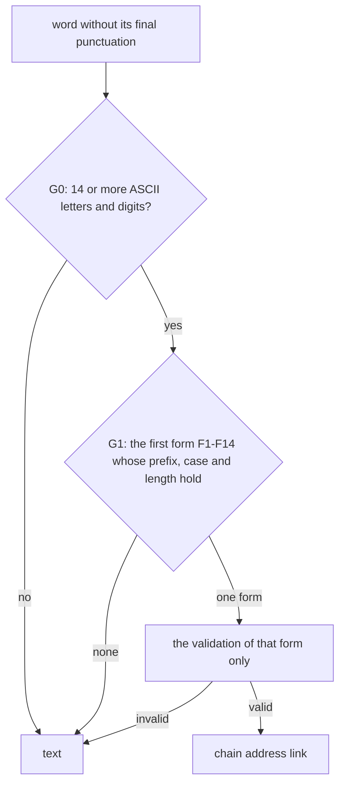
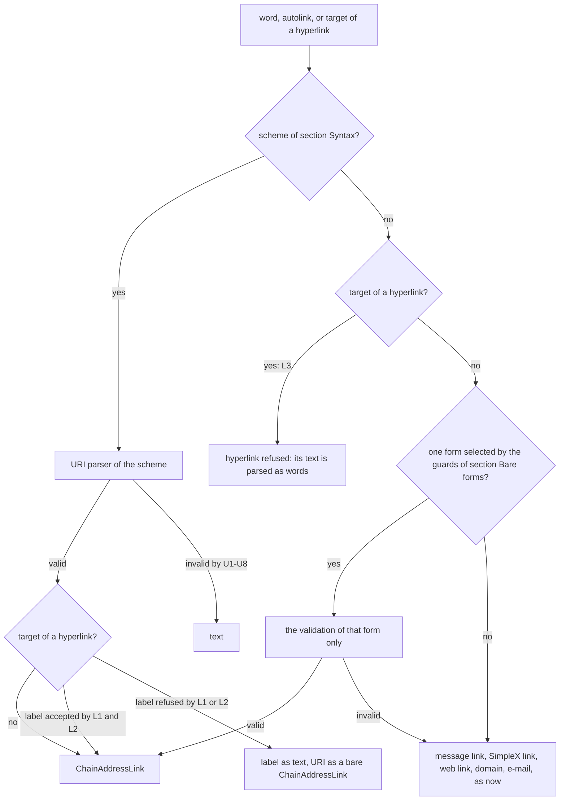
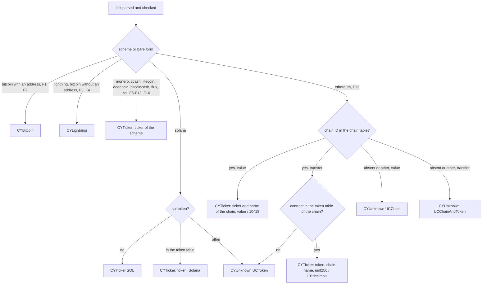
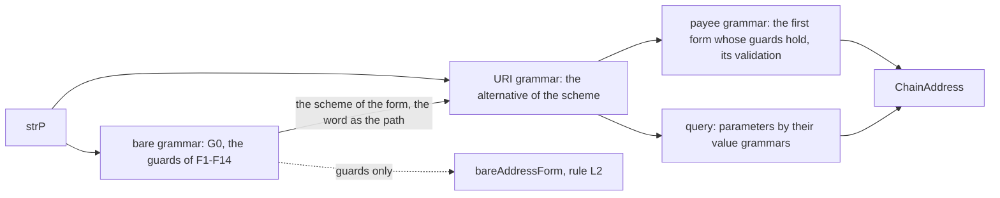
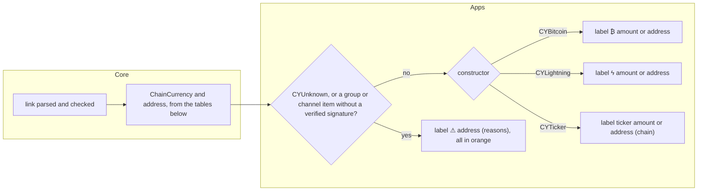
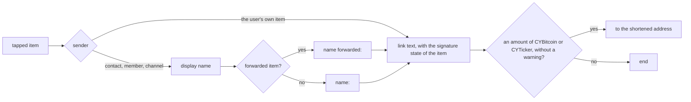
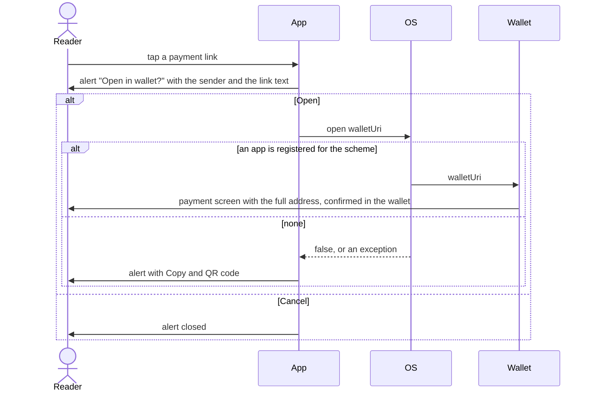
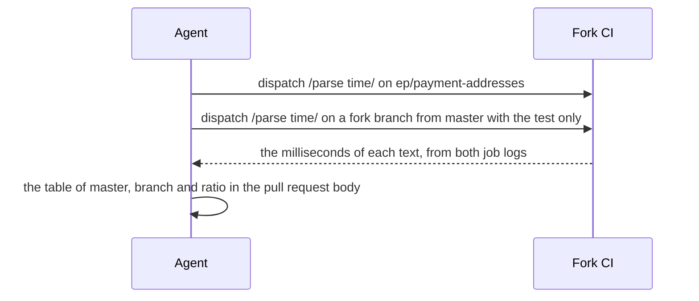
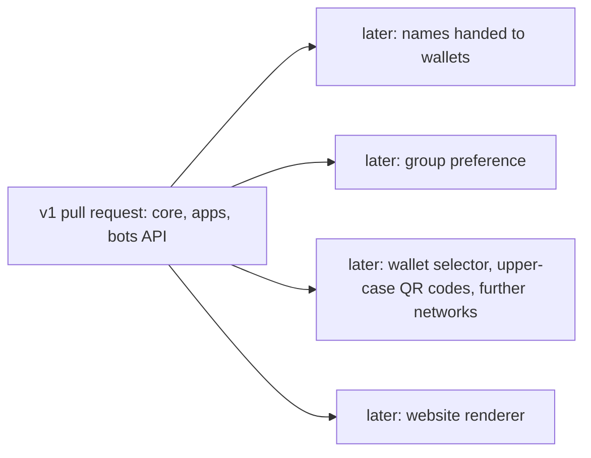

# Payment addresses in messages

Date: 2026-11-22, revised 2026-11-26. References are to master at 8f5dfa3d4; those of sections Bare forms and Groups and of the alert rows of sections Presentation and Parts are to master at 94e9d08f5. Haskell paths without a directory are in `src/Simplex/Chat/`. Sources are listed at the end as [S1]–[S43], read on 2026-11-22 and 2026-11-26.

## Problem

A payment address or request in a message is plain text. A reader copies it into a wallet by hand, and the app shows neither its network nor the result of its checksum.

- `[address](bitcoin:address)`, the form of docs/DONATIONS.md:21-23, is shown as text with its brackets: only http and https targets are accepted by `hyperLinkFormat` (Markdown.hs:461-467, 873-882).
- A bare address, such as those of README.md:151-158, is shown as text (Markdown.hs:506-518).
- A Lightning Address `user@domain` is shown as an e-mail link, and a mail app is opened at a tap (Markdown.hs:514, 544; MsgContentView.swift:699-704; TextItemView.kt:424-430).

## Acceptance

| # | After the change | Before |
|---|---|---|
| A1 | a URI of the schemes of section Syntax, `[label](URI)`, `<URI>`, and a bare address or invoice whose format has a checksum, are shown as payment links in chat items and in the chat list; elsewhere, such as in descriptions, welcome messages, quotes and item info, as their text | text |
| A2 | at a tap, the app shows the alert `Open in wallet?` with the sender of another person's item and the link text, and after an amount of a ₿ or ticker link, the shortened address; the wallet is opened only from Open | — |
| A3 | at Open, the app hands a normalised URI to the OS; when no app opens it, an alert offers Copy of the link and the QR code | — |
| A4 | an address with a wrong checksum, a testnet address, a wallet-restore URI (`monero-wallet:`), an EIP-681 call other than `transfer`, and a request to several recipients are shown as text | text |
| A5 | a hyperlink whose label contains a payment address other than its target is refused: the label is shown as text, the target as a bare payment link | text |
| A6 | the core and the apps send no request for a payment link: previews, DNS, ENS, LNURL and exchange rates are not requested | — |
| A7 | earlier apps show the text as now; the message protocol and the database are unchanged | — |
| A8 | a bare word is validated at most once, by the form that its prefix, case and length select; a word that no form selects is text without a checksum computed; the parse time of section Timing is reported | — |
| A9 | a link whose chain or token is outside the tables of section Link text, and an EVM link without a chain ID, are shown in orange as the label, when present, ⚠, the shortened address and `(unknown chain)`, `(unknown token)` or `(unknown chain and token)`, without an amount | — |
| A10 | in a group, a message with a chain address is signed with the sender's member key; a group or channel item without a verified signature shows its chain addresses as the orange link `(not signed)`, in the bubble and in the alert text (Q7 c) | — |

## Options

| Option | Cost |
|---|---|
| A. The core parses payment URIs and checksum-valid addresses into one `Format` constructor, `ChainAddressLink`, with the currency resolved from the core's tables; the apps render its fields | a core module of codecs, parsers and tables, a `Format` constructor with its JSON, the bots API types, one renderer and one alert in each app |
| B. The core accepts payment schemes as `HyperLink` targets; each app parses the URI for its link text | URI and checksum parsers written in Swift and in Kotlin, a third parser for bare addresses, results that can differ between platforms, a string only for bots |
| C. A message content type with a structured request, as `MCChat` (Protocol.hs:752) | a protocol type, a compose UI, a card UI, fallback text for earlier clients; addresses in texts, profile descriptions and channel posts are still shown as text |

A is chosen: the text is parsed once, where `formattedText` is produced (Messages.hs:633-640), and every text that the apps render with markdown is covered.

## Research

### Payment URI standards

| Scheme | Specification | Status, date | Payee | Amount | Other fields |
|---|---|---|---|---|---|
| `bitcoin:` | BIP-21 [S1], replaced by BIP-321 [S2] | BIP-21 Closed, assigned 2012-01-29; BIP-321 Complete, assigned 2024-11-15 | address; in BIP-321 optional when the query has a payment instruction | `amount`, decimal BTC, period separator | `label`, `message`; instructions `lightning` (BOLT 11), `lno` (BOLT 12), `sp`, `pay`; a URI with a `req-` key unknown to the client is invalid; scheme and keys are case-insensitive |
| `lightning:` | BOLT 11 [S4] | living specification | BOLT 11 invoice, HRP `lnbc` on mainnet | in the HRP, with the multipliers `m`, `u`, `n`, `p` | `d` description, `x` expiry (3600 s by default); "use 'lightning:' as a prefix before the BOLT-11 encoding (note: not 'lightning://')" |
| BOLT 12 offer | BOLT 12 [S5] | living specification | `lno1…` | `offer_amount` | "There is no checksum, unlike bech32m"; all lower or all upper case; `+` continuation; a URI scheme is left undefined |
| LNURL | LUD-01 [S6], LUD-17 [S7], a draft | — | bech32 `lnurl1…` of an https or onion URL; LUD-17: `lnurlp://` | — | LUD-01 is used "as a fallback inside of other URI schemes, with the key 'lightning'" |
| Lightning Address | LUD-16 [S8] | — | `user@domain`, user of `a-z0-9-_.` | — | resolved by GET `https://domain/.well-known/lnurlp/user`; a `lightning:` form is left undefined |
| `₿user@domain` | BIP-353 [S3] | Complete, assigned 2024-02-10 | DNSSEC TXT record at `user.user._bitcoin-payment.domain` with a `bitcoin:` URI | in that URI | "wallets SHOULD prefix it with ₿"; resolution over Tor or a VPN for privacy |
| `ethereum:` | EIP-681 [S9] | Final, created 2017-08-01 | `[pay-]0x…` or an ENS name, `@chain_id` | `value` in wei, scientific notation such as `2.014e18`, integer result | ERC-20: `0xtoken/transfer?address=0xpayee&uint256=n`; any function call can be encoded; without `chain_id` "the client's current network setting remains effective" |
| EIP-55 | EIP-55 [S10] | Final, created 2016-01-14 | the case of the hex letters, by Keccak-256 of the lower-case address | — | a mistyped address is accepted with probability 0.0247% |
| `solana:` | Solana Pay [S11] | SPEC.md at 25589fd3 (2025-05-05) | base58 public key; `solana:<https URL>` is a transaction request fetched by the wallet | `amount` in SOL or token units, at most 9 decimals for SOL | `spl-token`, `reference`, `label`, `message`, `memo` ("recorded by validators") |
| `monero:` | monero docs/URI_SCHEME.md [S12] | master | 95-character address; several separated by `;` | `tx_amount`, decimal | `recipient_name`, `tx_description`; `tx_payment_id` deprecated; `monero-wallet:` with `spend_key`, `view_key` and `seed` is defined in the same document |
| `zcash:` | ZIP-321 [S13] | Active, created 2020-08-28 | transparent, Sapling and Unified addresses | `amount`, at most 8 decimals | `memo`, base64url, at most 512 bytes, invalid with a transparent address; `label`, `message`; several payments by `paramindex`; the `req-` rule of BIP-321 |
| `litecoin:`, `dogecoin:` | the BIP-21 form of Litecoin Core and Dogecoin Core [S14] | master | address | `amount` | `label`, `message`; `dogecoin://` is rewritten as `dogecoin:` by Dogecoin Core |
| `bitcoincash:` | CashAddr [S15] | — | the prefix is part of the address and of its 40-bit checksum, and "may be omitted" when shown | `amount` | mixed case "must be rejected" |
| CAIP-10 | CAIP-10 [S16] | Final, created 2020-03-13 | `chain_id:account_address`, such as `eip155:1:0x…` | — | account identifiers, not a URI scheme |
| `flux:` | the BIP-21 form built by RunOnFlux's CumulusVPN [S42]; ZIP-321, as `zcash:`, by the Flux team's answer (item 11796, "flux wallets support it all") | — | Flux transparent address, versions 0x1CB8 (`t1`) and 0x1CBD (`t3`), the Zcash versions [S40]; Sapling address, HRP `za` (fluxd chainparams.cpp:215) | `amount`, 8 decimals [S40] | `message` [S42]; `label`, `memo` with a Sapling address, `address` (ZIP-321); SSP Wallet reads only the address of a scanned URI [S43] |
| `zel:` | Zelcore's "Zel protocol specifications" [S41] | — | `address` parameter of the action `pay`, the default action; `coin` names the asset, Bitcoin by default, and `flux`, `zelcash` and `zel` name Flux [S41] | `amount` | `message`; the actions `sign` and `getaddress` post a signature or the user's address to a `callback` URL [S41] |

### Wallets and operating systems

| Platform | Several apps for a scheme | No app for a scheme | Notes |
|---|---|---|---|
| iOS | "the app the system targets is undefined" [S17] | the completion handler of `open(_:options:completionHandler:)` is called with `false` [S18] | `canOpenURL` requires the scheme in `LSApplicationQueriesSchemes`, at most 50 entries, 25 from iOS 27; `open` is not constrained by it [S19]. Of the URL keys, only `CFBundleURLTypes` is declared (SimpleX--iOS--Info.plist:33-55) |
| Android | a chooser dialog, unless the user chose a default [S20] | `ActivityNotFoundException` [S20] | "scheme matching in the Android framework is case-sensitive, unlike the formal RFC" [S21]. Errors of `openUri` are caught in `safeOpenUri` (TextItemView.kt:729-738) |
| desktop | on Linux the last `xdg-mime default`, on Windows the default-app settings (plans/2026-09-28-desktop-deep-links-report.md:56) | errors of `openUri` are caught in `safeOpenUri`, as on Android | Electrum registers `x-scheme-handler/bitcoin` and `x-scheme-handler/lightning` [S22] |

Files that register each scheme, by GitHub code search of public repositories [S23]:

| Scheme | Android manifests | iOS Info.plist files | Open-source wallets among them |
|---|---|---|---|
| `bitcoin` | 234 | 519, many of them in forks of Bitcoin Core | Phoenix, BlueWallet, Zeus, Blockstream Green, Muun, Bitkit, Samourai, Mycelium, Nunchuk, Sparrow, Unstoppable, Cake Wallet [S24] |
| `lightning` | 108 | 100 | Phoenix, BlueWallet, Zeus, Blockstream Green, Muun, Bitkit, BitBox, Blixt |
| `ethereum` | 95 | 107 | MetaMask Mobile, Rainbow, AlphaWallet, WallETH, OneKey, Unstoppable, Tangem, Cake Wallet |
| `monero` | 36 | 19 | Monerujo, MyMonero, Feather, monero-gui, Unstoppable, Cake Wallet |
| `zcash` | 18 | 26 | Zashi, Zingo, YWallet, Edge, Unstoppable |
| `solana` | 20 | 9 | Unstoppable, BitPay, the Solana Mobile sample |
| `litecoin` | 47 | not searched | Litewallet, BitPay, Edge, Cake Wallet |
| `dogecoin` | 28 | not searched | BitPay, Cake Wallet |
| `bitcoincash` | 40 | not searched | Paytaca, BitPay, Edge, Cake Wallet |

- Apps other than wallets register the schemes too: all nine are registered by the Nostr client Amethyst.
- Cake Wallet registers `polygon`, `base`, `arbitrum` and `tron` beside `ethereum`, `solana-wallet` in place of `solana`, and `monero-wallet` [S24].
- Bitcoin Core compares the keys `label`, `message` and `amount` as written, so `AMOUNT=1` is ignored, and trims a final `/` that "may have been added by the OS" (src/qt/guiutil.cpp:157-197) [S14].

### Address formats

| Network | Bare form | Check | Probability that a random word of the form is accepted |
|---|---|---|---|
| Bitcoin | `bc1…` bech32 (v0) and bech32m (v1 and later); `1…`, `3…` Base58Check, versions 0x00, 0x05 | 30-bit BCH code [S25]; 32-bit double SHA-256 | 2^-30; 2^-32 |
| Lightning | `lnbc…` invoice; `lnurl1…` | bech32 without the 90-character limit [S4] | 2^-30 |
| Ethereum and other EVM chains | `0x` and 40 hex digits | the EIP-55 case of the letters; an address in one case is unchecked | 2^-k for k letters, 15 on average |
| Monero | 95 characters, network byte 18 (`4…`) or 42 (`8…`); 106 characters, byte 19 | first 4 bytes of Keccak-256 [S26] | 2^-32 |
| Zcash | `t1`, `t3` Base58Check with 2-byte versions; `zs1` bech32; `u1` bech32m | as Bitcoin | 2^-32; 2^-30 |
| Litecoin | `ltc1…`; `L…` (48), `M…` (50); `3…` (5, also the Bitcoin version) [S14] | as Bitcoin | 2^-32; 2^-30 |
| Dogecoin | `D…` (30); `9…`, `A…` (22) [S14] | Base58Check | 2^-32 |
| Bitcoin Cash | `q…`, `p…`, with or without `bitcoincash:` | 40-bit BCH code over prefix and payload [S15] | 2^-40 |
| Solana | 32 to 44 base58 characters of a 32-byte key | unchecked | the word `ThereAreMany32ByteKeysHereButNoneAreChecked` is decoded as 32 bytes |

Each donation address of README.md:151-158 was checked by these rules before this plan was written: BTC bech32 v0, XMR network byte 42, BCH CashAddr, ETH EIP-55, ZEC `t1` (version 0x1CB8) and `u1` (bech32m, 106 characters), DOGE version 30, SOL 32 bytes. The tests of section Tests repeat these checks.

### Messaging apps

| App | Detected in message text | Source |
|---|---|---|
| Telegram | entity types made by the server: URLs, mentions, hashtags, cashtags, bot commands, e-mail, bank card numbers | [S27] |
| Element (Matrix) | `bitcoin:` URIs are linkified, as a permitted scheme beside `geo:`, `magnet:`, `tel:` and others; `lightning:`, `ethereum:`, `monero:` and bare addresses are text | [S28] |
| Signal Android | e-mail addresses, phone numbers and web URLs; payments are in-app, with MobileCoin | [S29] |
| Session Android | `scheme://` URLs and `www.` links, by autolink-java; `bitcoin:` URIs are text | [S30] |
| Briar Android | web URLs | [S31] |
| WhatsApp, Status | not checked | — |

### Behaviours

- The alert `Open in wallet?` has the buttons Cancel and Open; Open passes the wallet URI to the OS.
- The alert names the sender of another person's link; for a forwarded item, its text starts with `<name> forwarded:`.
- A hyperlink label with an address-like run other than the addresses of the link is shown as text, and the URI as a bare link (rule L2).
- An edited item has the edited mark, and its earlier versions are in the item info (Messages.hs:1388-1410).
- Of `ethereum:` function calls, only `transfer` with `address` and `uint256` is parsed; other calls are text (rule U3).
- `monero-wallet:` URIs are text.
- An `ethereum:` link without a chain ID, or with a chain outside the table, is the orange `(unknown chain)` link without an amount (Q6).
- The wallet is opened only from Open; a `solana:` transaction request, `solana:https…`, is text (rule U6).
- The hyperlink text is shown as literal text; the label and the message of a URI are not shown.

## Syntax

### Recognised forms

A payment link is one of:

1. a URI of a scheme below, written bare, in `<…>`, or as the target of `[label](…)`; the scheme and the parameter keys are matched in any case;
2. a bare address or invoice whose format has a checksum, on mainnet.

```
bitcoin:
  payee         bech32 bc1 v0
                bech32m bc1 v1 and later
                Base58Check version 0x00
                Base58Check version 0x05
                empty, when lightning or lno is present
  parameters    amount
                label
                message
                lightning: BOLT 11 invoice
                lno: BOLT 12 offer
lightning:
  payee         BOLT 11 invoice lnbc
                BOLT 12 offer lno1
                LUD-01 LNURL lnurl1
  read          invoice amount in the HRP
  checked       the decoded LNURL is an https URL, or an http URL of an onion host
ethereum:
  payee         [pay-]0x and 40 hex digits, EIP-55 when in mixed case
  parameters    @chain_id
                value
  token         0x token contract, then /transfer
  parameters    address
                uint256
monero:
  payee         95 characters, network byte 18
                95 characters, network byte 42
                106 characters, network byte 19
  parameters    tx_amount
                recipient_name
                tx_description
zcash:
  payee         t1
                t3
                zs1
                u1
  parameters    amount
                label
                message
                memo
solana:
  payee         base58 of 32 bytes
  parameters    amount
                spl-token
                label
                message
                memo
litecoin:
  payee         ltc1
                Base58Check version 48
                Base58Check version 50
                Base58Check version 5
  parameters    amount
                label
                message
dogecoin:
  payee         Base58Check version 30
                Base58Check version 22
  parameters    amount
                label
                message
bitcoincash:
  payee         CashAddr q
                CashAddr p
  parameters    amount
                label
                message
flux:
zel:
  payee         Base58Check version 0x1CB8, t1
                Base58Check version 0x1CBD, t3
                bech32 za, 43 bytes: Sapling
                empty, with an address parameter
  parameters    amount
                label
                message
                memo, with a Sapling address only
                address
                action: absent or pay
                coin: flux, zelcash or zel; absent only in flux: or with an address in the path
```

Examples:

```
bc1q2gy6f02nn6vvcxs0pnu29tpnpyz0qf66505d4u
bitcoin:bc1q2gy6f02nn6vvcxs0pnu29tpnpyz0qf66505d4u?amount=0.001&label=SimpleX
[Donate](monero:8A3ZWAXrrQddvnT1fPrtbK86ZAoM4nai3Gjg1LEow3JWcryJtovMnHYZnxTJpCLmAbfWbnPMeTzPmMBjAhyd4xoM89hYq1c)
ethereum:0xD7047Fe3Eecb2f2FF78d839dD927Be27Bc12c86a@42161?value=1e16
ethereum:0xdAC17F958D2ee523a2206206994597C13D831ec7@1/transfer?address=0xD7047Fe3Eecb2f2FF78d839dD927Be27Bc12c86a&uint256=5000000
lightning:lnbc2500u1pvjluezsp5zyg3…fna3rh
solana:7JCf5m3TiHmYKZVr6jCu1KeZVtb9Y1jRMQDU69p5ARnu?amount=0.5
<zcash:u16rnvkflumf5uw9frngc2lymvmzgdr2mmc9unyu0l44unwfmdcpfm0axujd2w34ct3ye709azxsqge45705lpvvqu264ltzvfay55ygyq?amount=0.1>
```

### Bare forms

A bare word is recognised by a sequence of guards and one validation: the guards select at most one form, and only the checksum of that form is computed.

```
G0    the word without its final punctuation
        14 or more characters
        ASCII letters and digits only
G1    the first form whose prefix, case and length hold

form  prefix                     case      length       network        validation
F1    bc1                        one case  14-90        Bitcoin        bech32 v0, bech32m v1-16
F2    1, 3                       -         25-36        Bitcoin        Base58Check, version 0x00 or 0x05
F3    lnbc                       one case  37 or more   Lightning      BOLT 11 bech32, HRP amount
F4    lnurl1                     one case  any          Lightning      bech32 of an https or onion URL
F5    4, 8                       -         95           Monero         Keccak-256 check, network byte 18 or 42
      4                          -         106          Monero         Keccak-256 check, network byte 19
F6    t1, t3                     -         25-36        Zcash          Base58Check, version 0x1CB8 or 0x1CBD
F7    zs1                        one case  78           Zcash          bech32, 43 bytes
F8    u1                         one case  any          Zcash          bech32m
F9    ltc1                       one case  14-90        Litecoin       bech32 v0, bech32m v1-16
F10   L, M                       -         25-36        Litecoin       Base58Check, version 48 or 50
F11   D, 9, A                    -         25-36        Dogecoin       Base58Check, version 30 or 22
F12   q, p                       one case  42           Bitcoin Cash   CashAddr with the prefix bitcoincash
F13   0x and 40 hex digits       mixed     42           EVM            EIP-55
F14   za1                        one case  78           Flux           bech32, 43 bytes
none                                                                   text, without a validation
```

- A prefix of a one-case form is matched in lower or upper case, as bech32 and CashAddr require; a mixed-case word is not tried.
- F3, F4 and F9 precede F10, so `LNBC…`, `LNURL1…` and `LTC1…` are never decoded as Base58; F3 starts at 37 characters, one more than the longest Base58 form, so a Litecoin address that starts with `LNBC` is decoded by F10.
- `3…` is Bitcoin only (F2); `litecoin:` URIs accept version 5 as well (section Syntax).
- Flux transparent addresses have the Zcash versions 0x1CB8 and 0x1CBD (fluxd src/chainparams.cpp:200-202 [S40]): a bare `t1…` or `t3…` is Zcash (F6). A bare Flux Sapling address, HRP `za` (chainparams.cpp:215), is Flux (F14).
- An EVM address in one case matches no form and is text, as now (rule B1).
- A URI is not a bare word: its scheme selects the network, and the prefixes and lengths of this table select one address form of that network.



### Rules

```
U1  a URI is text when
      its payee is rejected by its check
      its network is a testnet
      a known key other than lightning and lno is repeated
      a req- key is unknown
      its amount has more decimals than the coin:
        BTC 8
        LTC 8
        DOGE 8
        BCH 8
        ZEC 8
        FLUX 8
        XMR 12
        SOL 9, without spl-token
        the decimals of the token table, with an spl-token of the table
      an EIP-681 value or uint256 is not an integer
U2  unknown keys without req- are kept in the wallet URI and not shown
U3  ethereum: function calls other than transfer are text
    ethereum: transfer with a value is text
    ethereum: ENS names are text
U4  monero: with ";" is text: several recipients
    zcash: with a paramindex is text: several payments
U5  zcash:, flux: and zel: memo with a transparent address is text, as ZIP-321 requires
U6  solana: with an https link, a transaction request, is text
U7  flux: and zel: are parsed by ZIP-321, as zcash:, with Flux addresses; a URI is text when
      its action is not pay
      it has a callback
      its coin is not flux, zelcash or zel
      it is zel: with the address in a parameter and without a coin, Bitcoin in Zelcore (Q9)
U8  a URI is text when its label or message has an address-like run other than
      its payee, an alternative or the token
L1  [label](URI): the punctuation rule of web hyperlinks is applied (Markdown.hs:453-454)
L2  [label](URI): each address-like run of the label equals the payee, an alternative or the token,
    or the hyperlink is refused: the label is text, the URI a bare chain address link;
    a label that contains an address of the link is not shown;
    an autolink <URI>, whose label is its URI, is not checked
    address-like run: a run of ASCII letters and digits that the guards G0 and G1 of a form
      select, without its validation; the forms are F1-F14 and those without a checksum:
        32-44 Base58 characters (Solana)
        0x and 40 hex digits in any case
        lno1, one case (BOLT 12)
      runs are compared with the link's addresses in any case
L3  a hyperlink target without a scheme is not a chain address link:
      hyperlinkAddress returns Nothing, and parseUri accepts only http and https (Markdown.hs:896-905)
      [label](address) is the text [label]( , a bare chain address link, and )
      <address> is text
B1  bare forms without a checksum are text:
      Solana
      an EVM address in one case
      BOLT 12 offers
B2  a Lightning Address user@domain is an e-mail link, as now
B3  code spans and code blocks are text, as for links
```



## Types

`ChainAddress.hs`, module `Simplex.Chat.ChainAddress`, renamed from `Payments.hs`. No type, constructor, field, module or JSON tag contains "payment" or "pay" (item 11737).

```haskell
data ChainAddress = ChainAddress
  { currency :: ChainCurrency,
    address :: Text,
    walletUri :: Text
  }

data ChainCurrency
  = CYBitcoin {amount :: Maybe Text}
  | CYLightning {amount :: Maybe Text}
  | CYTicker {ticker :: Text, chainName :: Maybe Text, amount :: Maybe Text}
  | CYUnknown {unknown :: UnknownCurrency}

data UnknownCurrency = UCChain | UCToken | UCChainAndToken

instance StrEncoding ChainAddress

bareAddressForm :: ByteString -> Bool

hyperlinkAddress :: Text -> Text -> Either String (Maybe Text, ChainAddress)
```

```
ChainAddress
  currency            what the link text names, resolved by the core from the tables of section Link text
  address             the payee: an address, or the Lightning invoice, offer or LNURL
  walletUri           section Wallet URI
ChainCurrency
  CYBitcoin           ₿, the amount in BTC
  CYLightning         ϟ, the amount of the invoice in BTC
  CYTicker            the ticker, the chain name, the amount in units of the ticker
  CYUnknown           a chain or token outside the tables, without an amount
strP                  a URI of a scheme of section Syntax, or a bare word by section Bare forms
strEncode             walletUri; strDecode . strEncode = Right
bareAddressForm       G0 and G1 of section Bare forms, without a validation
hyperlinkAddress t l  Left: l is not a valid URI of section Syntax, or t is refused by L2
                      Right: the text to show, Nothing when t == l or t contains an address of the link
```

- Names: `CYUnknown` and `UnknownCurrency` (item 12197); `UC` is also the prefix of `Uncreditable` of the store service (apps/simplex-store-service/src/StoreService/Providers.hs:177), and `unknown` is also the tag of `Format.Unknown`, both in other types.
- `CryptoCurrency` and `ServicePaymentDestination.SPDCrypto` (PaymentService/Types.hs:89, 127-131) are the currencies and the invoice destination of the store service, stored in its database; `ChainAddress` is a link in a message text, resolved for display. They have no common producer or consumer, so they stay separate types.
- The label and the message of a URI (label, recipient_name, message, tx_description, a Solana or Zcash memo) are not fields: a link shows only the hyperlink text of `[text](URI)` (item 15005). They are decoded for rule U8 only.

Markdown.hs:

```haskell
data Format
  = ...
  | ChainAddressLink {showText :: Maybe Text, chainAddress :: ChainAddress}
```

The core resolves each link into `ChainCurrency` and `address`:

```
link                                            currency                                    address
bitcoin: with an address; F1, F2                CYBitcoin                                   the address
lightning:; bitcoin: without an address; F3, F4 CYLightning, the amount of the invoice      the invoice, offer or LNURL
monero: zcash: litecoin: dogecoin:              CYTicker, the ticker of the scheme          the address
  bitcoincash: flux: zel:; F5-F12, F14
solana: without spl-token                       CYTicker SOL                                the address
solana: spl-token of the token table            CYTicker, the token, chain name Solana      the address
solana: another spl-token                       CYUnknown UCToken                           the address
ethereum: value; chain of the chain table       CYTicker, the chain's ticker and name,      the address
                                                  value / 10^18
ethereum: value; chain absent or another; F13   CYUnknown UCChain                           the address
ethereum: transfer; chain and contract of the   CYTicker, the token, the chain name,        the address parameter
  token table                                     uint256 / 10^decimals
ethereum: transfer; chain of the chain table,   CYUnknown UCToken                           the address parameter
  another contract
ethereum: transfer; chain absent or another     CYUnknown UCChainAndToken                   the address parameter
```



- The tables of section Link text are in ChainAddress.hs, the one source of tickers, chain names and token decimals; the apps contain the signs ₿ and ϟ, the shortening of addresses and the localized words of `CYUnknown`.
- Tokens are matched by the EVM contract in its EIP-55 form with its chain, and by the Solana mint as written; an EVM address is decoded in any case and kept in its EIP-55 form.
- The tables are rows of `evmChains`, a `ChainInfo` by chain ID (the chain name shown in parentheses, the coin ticker and the tokens), and of `solanaTokens`, a `ChainToken` by mint (ticker, decimals); `ChainInfo` and `ChainToken` are the rows of the tables, inside the module (item 12212).
- Amounts: `1*DIGIT ["." 1*DIGIT]`, the grammar of ZIP-321, as written in the URI for every scheme but `ethereum:`; an `ethereum:` value or `uint256` divided by 10^18 or 10^decimals, as decimal text; a Solana token amount has at most the decimals of its token (rule U1).
- The parser keeps what it checks inside the module: rule L2 compares the label with the payee, the Lightning alternatives and the token contract, so these are not fields of `ChainAddress`.
- `address`: bech32, bech32m and CashAddr in lower case, an EVM address in its EIP-55 case, other forms as written; rule L2 compares these forms.
- JSON: `sumTypeJSON` with the prefix `CY` dropped, `enumJSON` with `UC` dropped, `defaultJSON` for `ChainAddress`, as for `Format` (Markdown.hs:1040-1043); in a core of an earlier version, the constructor is decoded as `Unknown` (Markdown.hs:1042-1043). Example: `{"type":"chainAddressLink","chainAddress":{"currency":{"type":"ticker","ticker":"ETH","chainName":"Arbitrum One","amount":"0.01"},"address":"0xD7047Fe3Eecb2f2FF78d839dD927Be27Bc12c86a","walletUri":"ethereum:0xD7047Fe3Eecb2f2FF78d839dD927Be27Bc12c86a@42161?value=1e16"}}`; an unknown chain: `"currency":{"type":"unknown","unknown":"chain"}`.
- Removed: `PaymentRequest`, `PaymentPayee`, `PaymentNetwork`, `LightningPayee`, `PaymentToken`, `AddressChecksum`, and the exports `hasOtherAddress` and `hasRequestAddress`, which `hyperlinkAddress` replaces; `BareForm`, `UriAddress` and the alias `SchemeParser`, which the grammars replace (items 12245, 12274).
- `hasChainAddress :: MarkdownList -> Bool` in Markdown.hs, beside `hasLinks`, for section Groups.
- Codecs in `ChainAddress.hs`, as folds: Base58 and Base58Check; the Monero block variant, 8 bytes in 11 characters; bech32 and bech32m without a length limit; CashAddr. The BOLT 11 fields `d` and `x` are not read: no field shows them; the LNURL host is read for the onion rule only. Hashes: `sha256Hash` and `keccak256` (simplexmq Crypto.hs:1035-1057); the EIP-55 check of `strP` of `Simplex.Messaging.Eth.Address` (simplexmq Eth/Address.hs:40-48) [S36].
- Every parser of `ChainAddress.hs` is an attoparsec grammar (items 12245, 12259):

```
strP              the URI grammar, or the bare grammar
URI grammar       letters and ":" at the start, checked once before the alternatives
                  one alternative per scheme of section Syntax:
                    the scheme in any case
                    ":"
                    "//" when written
                    the path
                    the query
path              the payee grammar of the scheme
                  ethereum: the target, "@" and the chain ID, "/transfer"
query             key or key=value, joined by "&"; keys of letters, digits and -._~, values of RFC 3986 query characters;
                    a req- key is rejected;
                    the keys read by the scheme in lower case, the values as written;
                    the result is QueryStringParams of simplexmq without escaping (item 15005)
parameter         read by its key with queryParamParser and queryParamStr, parsed by its value grammar:
                    amount
                    percent-encoded text
                    ZIP-321 memo
                    EIP-681 integer
                    an address form
                  a read key that is repeated is rejected
form              the grammar of a word: its prefix, case and length, the guards of section Bare forms
                  its result: the validation of the word, computed only when the address is used
payee grammar     the first form whose guards hold, then its validation
bare grammar      G0, then the first of F1-F14 whose guards hold;
                    the word is parsed as the wallet URI of the scheme of that form
BOLT 11 HRP       "lnbc", then the amount: digits and a multiplier
guards only       bareAddressForm
                  the address-like runs of rule L2
```



## Parser changes

```
fragmentP     digit branch: a word that a form of section Bare forms selects, then phoneP, then wordP (Markdown.hs:363)
linkMD        after the web URI branch, before isDomain: the one validation of the link text (Markdown.hs:506-518)
hyperLinkFormat
              after the SimpleX link branch, before parseUri: hyperlinkAddress of the label and the target,
              with the label rule L2; L1 stays in sowLinkP (Markdown.hs:450-467)
isLink        unchanged: a ChainAddressLink does not make an item a link (Q5 b, Markdown.hs:320-326)
markdownText  ChainAddressLink -> the source text (Markdown.hs:965-986)
```

- For a word that starts with a digit, `phoneP` is tried before `wordP`, and a Base58 or Monero address that starts with 7 or more digits is split by it (Markdown.hs:363, 484-494). A word that a form selects is taken whole before both, by the guards only; `linkMD` then makes its one validation. A selected digit word is 25 or more letters and digits without separators, and `phoneP` accepts at most 22 (Markdown.hs:489), so no phone number is lost.
- `<URI>` is parsed by `hyperLinkFormat` with the URI as its label (Markdown.hs:457-460), as now.

## Wallet URI

`walletUri` is the URI of Open and of the QR code:

```
written          walletUri
bare Bitcoin     bitcoin:<address>
bare Lightning   lightning:<invoice or LNURL>
bare EVM         ethereum:<address>
bare Monero      monero:<address>
bare Zcash       zcash:<address>
bare Litecoin    litecoin:<address>
bare Dogecoin    dogecoin:<address>
bare CashAddr    bitcoincash:<address>
bare Flux        flux:<address>
URI              as written, with
                   the scheme in lower case
                   "//" after the scheme removed
                   the keys read by the parser in lower case
                   other keys and values unchanged
                   a key without a value followed by "="
```

- The scheme in lower case: Android matches schemes case-sensitively [S21]; QR codes are often written in upper case [S2].
- The keys in lower case: Bitcoin Core compares them as written [S14].
- `//` removed: BOLT 11 [S4]; `dogecoin://` is rewritten by Dogecoin Core [S14].
- `zel:` stays `zel:` and `flux:` stays `flux:`: each opens the wallets that register it.
- The query is written by `strEncode` of `QueryStringParams` without escaping (simplexmq Agent/QueryString.hs), which writes the keys and the values as they are; the module's own `strP` is not used: it splits on ";" too, so rule U4 could not see ";", and it decodes the values, so the wallet URI would be written again with other escapes.
- The wallet URI is encoded in the QR code without the app logo (`withLogo: false`, QRCode.swift:60-108, QRCode.kt:66-72).

## Apps

### Link text

The text of a payment link in chat items, in the chat list and in the alert, by the rule `[label] [sign or ticker] [amount or address] [(chain)]` (item 12004). `linkText` of `ChainAddress` (ChatTypes.swift, ChatModel.kt) composes it from `ChainCurrency`, `address`, the shown label and the signature state of the item (section Groups):

```
label           showText of the hyperlink (item 15005); a space after it
sign or ticker  ₿ for CYBitcoin, ϟ for CYLightning, the ticker for CYTicker; a no-break space after it
amount          the amount, else the shortened address
                  an address of more than 10 characters: its first 6 and last 4 characters, joined by "…"
chain           chainName of CYTicker, in parentheses and in italic, after a space
warning         CYUnknown, or a group or channel item without a verified signature:
                  the label, ⚠, the shortened address and the reasons in parentheses, joined by ", ":
                    unknown chain, unknown token or unknown chain and token, for CYUnknown
                    not signed, for the item without a verified signature
                  without an amount or a chain name; the whole link in orange
style           the link colour, underlined; the sign or ⚠ in semibold;
                  a sign or ⚠ that starts the link is outside the underline, after a label it is underlined
```

The texts of the app tests (ChainAddressesTests.swift, ChainAddressesTest.kt):

| Link | Text |
|---|---|
| `bc1q2gy6…505d4u` | ₿ bc1q2g…5d4u |
| `[bc1q2gy6…505d4u](bitcoin:bc1q2gy6…505d4u)` | ₿ bc1q2g…5d4u |
| `bitcoin:bc1q2gy6…505d4u?amount=0.001&label=SimpleX`, also in `<…>` and with `&message=Thank%20you` | ₿ 0.001 |
| `lnbc2500u1pvjlue…fna3rh` | ϟ 0.0025 |
| `lightning:LNURL1DP68…XFQ5FNS` | ϟ lnurl1…5fns |
| `lightning:lno1pgx9…sd5xvxg` | ϟ lno1pg…xvxg |
| `[Donate](monero:8A3ZWA…Yq1c)` | Donate XMR 8A3ZWA…Yq1c |
| `monero:8A3ZWA…Yq1c?tx_amount=0.25&recipient_name=SimpleX` | XMR 0.25 |
| `t1fwjQ…S5Jg`, `ltc1q2g…wfdv`, `D99pV4…BxPf`, `qq6c8v…lqcg`, `solana:7JCf5m…ARnu` | ZEC t1fwjQ…S5Jg, LTC ltc1q2…wfdv, DOGE D99pV4…BxPf, BCH qq6c8v…lqcg, SOL 7JCf5m…ARnu |
| `solana:7JCf5m…ARnu?amount=0.5` | SOL 0.5 |
| `solana:7JCf5m…ARnu?amount=10&spl-token=EPjFWd…Dt1v`, the USDC mint | USDC 10 (Solana) |
| `flux:t1fwjQ…S5Jg?amount=5&message=Thanks`, `zel:t1fwjQ…S5Jg?amount=5` | FLUX 5 |
| `za19w5…3pj3` | FLUX za19w5…3pj3 |
| `ethereum:0xD704…c86a@42161?value=1e16` | ETH 0.01 (Arbitrum One) |
| `ethereum:0xdAC1…1ec7@1/transfer?address=0xD704…c86a&uint256=5000000`, USDT on chain 1 | USDT 5 |
| `ethereum:0xc213…8e8F@137/transfer?address=0xD704…c86a&uint256=10000000`, USDT on chain 137 | USDT 10 (Polygon) |
| `[Dinner](ethereum:0xc213…8e8F@137/transfer?address=0xD704…c86a&uint256=10000000)` | Dinner USDT 10 (Polygon) |
| the bare `0xD704…c86a` in mixed case, `ethereum:0xd704…c86a`, `ethereum:0xD704…c86a@100?value=1e16` | ⚠ 0xD704…c86a (unknown chain), in orange |
| `[Donate](ethereum:0xD704…c86a@99999)` | Donate ⚠ 0xD704…c86a (unknown chain), in orange |
| `ethereum:0x1111…1111@137/transfer?address=0xD704…c86a&uint256=10000000` | ⚠ 0xD704…c86a (unknown token), in orange |
| `ethereum:0xdAC1…1ec7@99999/transfer?address=0xD704…c86a&uint256=10000000` | ⚠ 0xD704…c86a (unknown chain and token), in orange |
| `[Dinner](ethereum:0xc213…8e8F@137/transfer?address=0xD704…c86a&uint256=10000000)` in a group item without a verified signature | Dinner ⚠ 0xD704…c86a (not signed), in orange |
| `ethereum:0xD704…c86a@100?value=1e16` in a group item without a verified signature | ⚠ 0xD704…c86a (unknown chain, not signed), in orange |



- Orange: `WarningOrange` (Color.kt:30) on Android and desktop, the system orange on iOS; the label, ⚠, the address and the reasons, in place of the link colour (items 11664, 11667).
- The reasons are localized strings of each app; the core sends only `UnknownCurrency`, and the signature state is part of the item (section Groups).

Tickers of the schemes, by SLIP-44 [S37]; the apps draw the signs ₿ and ϟ, and the core sends the tickers:

| Scheme | Text |
|---|---|
| `bitcoin` | ₿ |
| `lightning` | ϟ |
| `monero` | XMR |
| `zcash` | ZEC |
| `litecoin` | LTC |
| `dogecoin` | DOGE |
| `bitcoincash` | BCH |
| `solana` | SOL |
| `flux`, `zel` | FLUX |
| `ethereum` | the chain table |

Chains, by ethereum-lists/chains [S34]; the name is shown in parentheses, except for chain 1:

| Chain ID | Name | Ticker |
|---|---|---|
| 1 | Ethereum | ETH |
| 10 | OP Mainnet | ETH |
| 56 | BNB Smart Chain | BNB |
| 137 | Polygon | POL |
| 8453 | Base | ETH |
| 42161 | Arbitrum One | ETH |

Tokens, by the Uniswap token list [S38] and the Solana token list [S39]; an ERC-20 `uint256` is divided by 10^decimals:

| Chain | Contract | Ticker | Decimals |
|---|---|---|---|
| 1 | `0xdAC17F958D2ee523a2206206994597C13D831ec7` | USDT | 6 |
| 1 | `0xA0b86991c6218b36c1d19D4a2e9Eb0cE3606eB48` | USDC | 6 |
| 10 | `0x94b008aA00579c1307B0EF2c499aD98a8ce58e58` | USDT | 6 |
| 10 | `0x0b2C639c533813f4Aa9D7837CAf62653d097Ff85` | USDC | 6 |
| 56 | `0x55d398326f99059fF775485246999027B3197955` | USDT | 18 |
| 56 | `0x8AC76a51cc950d9822D68b83fE1Ad97B32Cd580d` | USDC | 18 |
| 137 | `0xc2132D05D31c914a87C6611C10748AEb04B58e8F` | USDT | 6 |
| 137 | `0x3c499c542cEF5E3811e1192ce70d8cC03d5c3359` | USDC | 6 |
| 8453 | `0xfde4C96c8593536E31F229EA8f37b2ADa2699bb2` | USDT | 6 |
| 8453 | `0x833589fCD6eDb6E08f4c7C32D4f71b54bdA02913` | USDC | 6 |
| 42161 | `0xFd086bC7CD5C481DCC9C85ebE478A1C0b69FCbb9` | USDT | 6 |
| 42161 | `0xaf88d065e77c8cC2239327C5EDb3A432268e5831` | USDC | 6 |
| Solana | `Es9vMFrzaCERmJfrF4H2FYD4KCoNkY11McCe8BenwNYB` | USDT | 6 |
| Solana | `EPjFWdd5AufqSSqeM2qN1xzybapC8G4wEGGkZwyTDt1v` | USDC | 6 |

### Presentation

| Element | Behaviour |
|---|---|
| chat item and chat list, address or URI | section Link text |
| chat item and chat list, `[label](URI)` | the hyperlink text is the label of section Link text: `[Donate](monero:8A3ZWA…Yq1c)` is `Donate XMR 8A3ZWA…Yq1c`; a hyperlink text that contains an address of the link is not shown: `[bc1q2gy6…505d4u](bitcoin:bc1q2gy6…505d4u)` is `₿ bc1q2g…5d4u` |
| profile and group descriptions, welcome messages, quotes, item info, the item above the message field | the text as written, as on master |
| tap in a chat item | alert `Open in wallet?`; the wallet is opened only from Open |
| alert text | `<name>: <link text>`, then ` to <address>` after an amount of `CYBitcoin` or `CYTicker`; the link text has the signature state of the item, so a group or channel item without a verified signature shows the warning of section Link text |
| alert text, forwarded item | `<name> forwarded: <link text>`, then ` to <address>` as above |
| alert text, the user's own item | `<link text>`, then ` to <address>` as above, without a name: sent direct and group items, items sent as the channel, notes (item 15005) |
| `<name>` | the display name of: the contact, for a received direct item; the member, for a received group item; the channel, for a received channel item; bold on Android and desktop; plain on iOS, where the alert text is a string (ShareSheet.swift:38-55) |
| `<address>` | shortened as in section Link text; the full address is shown by the wallet |
| buttons | Cancel; Open |
| no app | alert `No wallet app`, text `Copy the link or scan the QR code with a wallet.`, buttons Copy, QR code, Cancel; Copy copies `walletUri` (item 15005) |

Alert texts of the app tests:

| Item | Text |
|---|---|
| from alice, `bc1q2gy6…505d4u` | alice: ₿ bc1q2g…5d4u |
| from alice, `[Donate](monero:8A3ZWA…Yq1c)` | alice: Donate XMR 8A3ZWA…Yq1c |
| from alice, `lnbc2500u1pvjlue…fna3rh` | alice: ϟ 0.0025 |
| from alice, `<bitcoin:bc1q2gy6…505d4u?amount=0.001&label=SimpleX>` | alice: ₿ 0.001 to bc1q2g…5d4u |
| forwarded by alice, the same link | alice forwarded: ₿ 0.001 to bc1q2g…5d4u |
| from alice, the USDT `transfer` on chain 137 | alice: USDT 10 (Polygon) to 0xD704…c86a |
| from alice, `ethereum:0xD704…c86a@100?value=1e16` | alice: ⚠ 0xD704…c86a (unknown chain) |
| from alice, `lightning:LNURL1DP68…XFQ5FNS` | alice: ϟ lnurl1…5fns |
| from alice in a group, `ltc1q2gy6…snwfdv` without a verified signature | alice: ⚠ ltc1q2…wfdv (not signed) |
| sent by the user, `bc1q2gy6…505d4u` | ₿ bc1q2g…5d4u |



```
┌──────────────────────────────────┐
│         Open in wallet?          │
│  Tom: ₿ 0.0012 to bc1q2g…5d4u    │
├─────────────────┬────────────────┤
│     Cancel      │      Open      │
└─────────────────┴────────────────┘
```



### Parts

| Part | iOS | Android and desktop |
|---|---|---|
| types | `Format.chainAddressLink`, `ChainAddress`, `ChainCurrency`, `UnknownCurrency` in SimpleXChat/ChatTypes.swift, in place of `PaymentRequest` and its types of this branch (ChatTypes.swift:6046, 6069-6167) | `Format.ChainAddressLink` and the same three types in ChatModel.kt, in place of ChatModel.kt:5412, 5457-5527; style `linkStyle` |
| link text | one function of `ChainAddress`, the shown label and the signature state of the item, section Link text, used by the bubble and the alert; the chain table and the token table of this branch are removed from the app | the same |
| rendering | a branch in `appendSegments` with an attribute key for the chain address (MsgContentView.swift:595-722) | the annotation `CHAIN_ADDRESS` (TextItemView.kt:336-452); the same text in `segmentDisplayText` (TextItemView.kt:112-134) |
| tap | the alert is shown from `attributedStringLink` for the key, before the URL branch in which `mailto:` and `tel:` are opened directly (MsgContentView.swift:300-344) | `CHAIN_ADDRESS` is handled in `onClick`, `onHover` and `shouldConsumeEvent` (TextItemView.kt:489-534) |
| alert | `showAlert(title:message:buttonTitle:buttonAction:cancelButton:)` with Open and Cancel (ShareSheet.swift:38-55) | `AlertManager.shared.showAlertDialogButtonsColumn` with `text: AnnotatedString` (AlertManager.kt:105-124) and a row of Cancel and Open; the text is built by `formatWithBoldName` (Utils.kt:119-124), so the name is bold and the name and the label are shown as literal text, as AlertManager.kt:81 and :135 require for user-controlled text |
| open | `UIApplication.shared.open(url) { success in … }`; the alert when `success` is false [S18] | `uriHandler.openUri` in `try`; the alert on an exception (TextItemView.kt:729-738) |
| previews | `linkUri` is unchanged, so a payment link is never previewed (ChatTypes.swift:5883-5889, ComposeView.swift:1929-1939) | the same (ChatModel.kt:5369-5374, ComposeView.kt:472-482) |

- Remote desktop: an app of an earlier version fails to decode the new `Format`; `minRemoteCtrlVersion` and `minRemoteHostVersion` (Remote.hs:77-82) are raised to the release version by the release commit, as by `d7d180a42 core: 7.1.0.16`.
- Website: unchanged; `renderSegments` of website/src/js/simplex-lib.jsc shows a `chainAddressLink` segment as its escaped text, by its default branch. Its rendering as a link is later (section Stages).
- CLI: the text is printed as now (Styled.hs:71-79).
- Bots API: `ChainAddressLink`, `ChainAddress`, `ChainCurrency` and `UnknownCurrency` in bots/src/API/Docs/Types.hs, in place of the six types of this branch; bots/api and the TypeScript and Python types are generated again.
- Renamed with the types: the fixture tests/fixtures/api/payments/links.json to tests/fixtures/api/chain-addresses/links.json, the test `payment links in a received message` to `chain addresses in a received message` with its line in scripts/ci/README.md, the app tests PaymentLinksTests.swift and PaymentLinksTest.kt, the snapshots `ClassicPaymentLinks`, `TerminalPaymentLinks` and `PaymentLinks.Messages`, and the `ci-tests` block of the pull request body. The string `payment_link_chain` and the iOS string `chain %lld` are removed: a chain outside the table is shown as Q6 decides.

## Groups

In groups, a message with a chain address is signed with the member key, and the signature is required (item 9544). Master's signing and verification are used as they are: the message protocol is unchanged.

```
send      sendGroupContentMessages_ sets signMsgs also when a composed message has a ChainAddressLink,
            by hasChainAddress (Commands.hs:5120); the batch of the command is signed
            groupMsgSigning then signs its XMsgNew with the member key (Internal.hs:2417-2429)
            edits keep reuseSign (Commands.hs:872): an edit of an unsigned item stays unsigned
receive   withVerifiedMsg verifies the signature, as now (Subscriber.hs:4148-4167)
            the item stores msgVerified (Internal.hs:3120, Store/Messages.hs:576)
            the apps receive it as meta.msgVerified: absent when unsigned, signed with sigStatus
              verified or signedNoKey, or sigMissing where signing is required (Types/Shared.hs:134, 152-172)
            hasLink is false for a chain address (Q5 b)
show      Q7 c: a chain address of a group or channel item whose meta.msgVerified is not signed and verified
            is the orange link "(not signed)" of section Link text, in the bubble and in the alert text
direct    unchanged: direct chats and local notes
```

- Built in the core stage: send, and the recorded state. Test `chain addresses in group messages are signed` (tests/ChatTests/Groups.hs): in a group without the signing preference, the item with a bare address is shown as `(signed)` to the sender and both members; a plain message is not signed; its edit that adds an address stays unsigned (`reuseSign`); bob's two items are recorded to tests/fixtures/api/chain-addresses/group.json, one with `msgVerified` verified and one without it.

- XMsgNew is a content event that a member may sign (`signableContent`, Protocol.hs:1403-1408); `requiresSignature` lists events by tag in relay groups (Protocol.hs:1386-1400, Subscriber.hs:4167) and is not changed, as a requirement on the content of XMsgNew is a rule of the receiving app.
- A sent item is verified when it is signed (Internal.hs:3085), so the sender sees the link.
- A post shown as the channel is signed by an owner with the group binding (Internal.hs:2419) and verified with the owner's key.
- Signatures are not sent in JSON batches, to members below version 18 (Batch.hs:70, Internal.hs:2892-2895); member keys of p2p groups are distributed from version 20 (`groupMemberKeyVersion`, Protocol.hs:143-145), and a signed message of a member whose key is unknown is stored as signed without a key (Subscriber.hs:4161). Such items show chain addresses as Q7 decides.
- The apps pass the condition to `messageText` (MsgContentView.swift:504) and `MarkdownText` (TextItemView.kt) as one parameter.

```mermaid
sequenceDiagram
  participant S as Sender core
  participant R as Recipient core
  participant A as Recipient app
  S->>S: a composed group message has a ChainAddressLink: signMsgs
  S->>R: XMsgNew signed with the member key
  R->>R: withVerifiedMsg; msgVerified stored with the item
  R->>A: item with formattedText and meta.msgVerified
  alt msgVerified verified
    A->>A: the chain address is a link
  else unsigned, no key, or missing
    A->>A: as Q7 decides
  end
```

## Privacy

- A payment link is sent as message text and parsed by each recipient's core when the item is read (Store/Messages.hs:2338-2340, 2432-2434).
- The core and the apps send no request for a payment link; names (BIP-353, Lightning Address, ENS), LNURL and the tokens outside the token table are resolved only by the wallet.
- At Open, the app passes the address, amount, label and message to the app that the OS chooses; on iOS, that app is undefined among several [S17].

## Tests

Each test that expects a payment link fails on master.

| File | Test |
|---|---|
| tests/MarkdownTests.hs | `bc1q2gy6…505d4u` and its upper-case form are parsed as `ChainAddressLink` with `CYBitcoin Nothing`, the address in lower case and `walletUri` `bitcoin:` and the address; the address with its last character changed is text; the BIP-350 Taproot address `bc1p0xlx…zk5jj0` is a link, and the same program with a bech32 checksum, `bc1p0xlx…h2y7hd`, is text |
| | `BITCOIN:BC1Q2GY6…?AMOUNT=0.001` is parsed with `walletUri` `bitcoin:BC1Q2GY6…?amount=0.001`; `amount=0.000000001` and `amount=1,000` are text; so are the keys `x%41` and `a:b` |
| | `37116639cErLzxER6tL3a6EH2DbdETwTxd`, a P2SH address made for the test from random bytes, which starts with 8 digits, is one `ChainAddressLink`, also before a final dot; on master it is split by `phoneP` (Markdown.hs:363, 484-494) |
| | the README.md:151-158 addresses, bare and as URIs: Monero byte 42 as `CYTicker "XMR"`, CashAddr with and without its prefix as `BCH`, EIP-55 as `CYUnknown UCChain`, `t1` and `u1` as `ZEC`, Dogecoin as `DOGE`; `solana:7JCf…ARnu?amount=0.5` as `CYTicker "SOL" Nothing (Just "0.5")`; with the USDC mint of the token table, `CYTicker "USDC" (Just "Solana")`; with another mint, `CYUnknown UCToken` |
| | `flux:t1fwj…S5Jg?amount=5&message=Thanks` and `zel:t1fwj…S5Jg?amount=5` as `CYTicker "FLUX" Nothing (Just "5")`, with `walletUri` in their own schemes; `flux:za19w5…pj3?amount=1&memo=…`, a Flux Sapling address made for the test from random bytes, and the bare `za19w5…pj3` as `FLUX`; `zel:?action=pay&coin=flux&address=t1fwj…S5Jg&amount=3` as `FLUX`; the bare `t1fwj…S5Jg` as `ZEC`; text (U5, U7): `flux:` with a Zcash `zs1…` or `u1…` address or with a memo and a transparent address, `zcash:za1…`, the `sign` and `getaddress` actions, the coin `bitcoin`, and a `callback` |
| | `strDecode (strEncode a) == Right a` for each chain address of these tests |
| | the BOLT 11 example "Please send $3 for a cup of coffee to the same peer, within one minute" [S4]: `CYLightning (Just "0.0025")`; its example "Bech32 checksum is invalid" is text |
| | `ethereum:0xD704…c86a@42161?value=1e16`: `CYTicker "ETH" (Just "Arbitrum One") (Just "0.01")`; `@1`: chain name `Nothing`; `@137?value=5e18`: `CYTicker "POL" (Just "Polygon") (Just "5")`; `@99999` and no chain ID: `CYUnknown UCChain`; the USDT `transfer` example on chain 1: `CYTicker "USDT" Nothing (Just "5")` with the payee as `address`; the same with the token contract in lower case: the same value; USDT on chain 137 and on chain 56 (18 decimals): `CYTicker "USDT" (Just "Polygon") (Just "10")`, `CYTicker "USDT" (Just "BNB Smart Chain") (Just "1.5")`; another contract on chain 137: `UCToken`; on chain 99999 and without a chain: `UCChainAndToken`; `/approve?…` and a `transfer` with `value` are text; the address with the case of one letter changed is text |
| | `[Donate](monero:8A3Z…q1c)` is parsed as `ChainAddressLink (Just "Donate")`; `[bc1qw508d6qejxtdg4y5r3zarvary0c5xw7kv8f3t4](bitcoin:bc1q2gy6…)`, a valid address of BIP-173 as the label, `[Pay 1Hk7…uKe](bitcoin:…)`, a Base58 word with a wrong checksum as the label, and a one-case EVM address as the label of another EVM address, are parsed as label text and a bare `ChainAddressLink` (L2); `[Donate](bc1q2gy6…)` is parsed as text and a bare `ChainAddressLink`, and `<bc1q2gy6…>` as text (L3); a URI with a message `Pay to 1Hk7…uKe` is text (U8) |
| | text: `ThereAreMany32ByteKeysHereButNoneAreChecked`; `0xd7047fe3eecb2f2ff78d839dd927be27bc12c86a` bare; `tb1…`; `monero-wallet:…?spend_key=…`; `monero:A;B?tx_amount=1;2`; `monero:A?tx_description=a;b`; `zcash:t1fwj…?memo=…`; `` `bc1q2gy6…` ``; `alice@getalby.com` as e-mail |
| | `hasLinks` of a chain address link is false (Q5 b); linear time: 10000 words of 34 Base58 characters |
| | the guards: `bareAddressForm` holds for a word of each form F1-F12 and F14 and for 34 Base58 characters after each of `1`, `3`, `L`, `M`, `D`, `9`, `A`, and these words with one character changed, or with a wrong checksum, are text; it fails for `Bc1q…` in mixed case, a one-case EVM address, a Solana key and a long English word; `LTC1…` in upper case is a Litecoin bech32 address |
| | `parse time`, section Timing |
| tests/JSONTests.hs | the JSON of a `bitcoin:` URI with `lightning=`, an `ethereum:` URI with a chain, a token transfer, a transfer on an unknown chain and a hyperlink is decoded to the same value |
| tests/ChatTests/Direct.hs | `filter chat by link content`: a message with a bare address is not in the Links filter (Q5 b) |
| tests/ChatTests/Direct.hs | `chain addresses in a received message`: alice sends a bare address, `[Donate](monero:…)` and a bare invoice; `apiFixture` (tests/ChatTests/Utils.hs:1015-1030) records bob's `/_get chat @2 count=1`, whose item has `ChainAddressLink` in `formattedText`, and the markdown of each `ChainCurrency` constructor and `UnknownCurrency` value, to tests/fixtures/api/chain-addresses/links.json, and alice's `/_get chat @2 count=1`, the sent item, to tests/fixtures/api/chain-addresses/sent.json; its pattern is in "App test fixtures" (scripts/ci/README.md:51) |
| tests/APIDocs.hs | the bots API files, generated again with the new types |
| app tests on tests/fixtures/api/chain-addresses/links.json | `Format.chainAddressLink` is decoded; each `ChainCurrency` constructor is mapped to its link text and alert text; a mocked open failure is followed by the alert `No wallet app`, whose Copy copies the link and whose QR code shows the QR code; an address in a profile description is its text |
| app tests on tests/fixtures/api/chain-addresses/sent.json | the alert of the user's own item has no name |
| tests/ChatTests/Groups.hs | `chain addresses in group messages are signed`: alice sends a bare address to a group without the signing preference; the item is `(signed)` for alice, bob and cath; a plain message after it is not signed, and its edit that adds a Litecoin address stays unsigned; `apiFixture` records bob's `/_get chat #1 count=2` to tests/fixtures/api/chain-addresses/group.json |
| app tests on tests/fixtures/api/chain-addresses/group.json | the chain address of the verified item is a link; that of the unsigned item is the orange link `(not signed)`, and its alert text has the same warning (Q7 c) |

### Timing

The cost of the guards is measured before review, on the branch and on master.

```
texts         10,000 words each, separated by spaces
                ordinary words, cycled from one fixed English sentence pair
                each form F1-F14, valid
                34 Base58 characters with a wrong checksum, after each of 1, 3, L, M, D, 9, A, cycled
                a valid URI of each scheme, cycled
test          parse time, tests/MarkdownTests.hs
                parseMaybeMarkdownList of each text, forced by the count of its segments
                milliseconds by getMonotonicTime, printed per text
                no assertion on the segments, so the test compiles and runs on master
runs          the reduced build, TESTS='/parse time/', -O0 as in CI
                ep/payment-addresses
                a fork branch from master with only this test
result        the pull request body: text, master ms, branch ms, ratio
```



## Stages

| Part | Stage |
|---|---|
| core: `ChainAddress.hs` with its tables, `Format.ChainAddressLink`, parser changes, `walletUri`, tests, bots API types, fixtures | v1 |
| iOS, Android, desktop: rendering, alerts, open, QR code, app tests | v1, in the same pull request |
| remote versions | the release commit |
| website renderer: `chainAddressLink` as a link to `walletUri`, with the schemes of section Syntax in `SAFE_URI_SCHEME` (website/src/js/simplex-lib.jsc) | later |
| names: `₿user@domain`, Lightning Address, ENS, handed to the wallet | later, once wallets accept a URI form for them |
| a group preference that prohibits payment links | later, a protocol preference (Types/Preferences.hs:206-218) |
| a wallet selector with schemes of individual wallets [S35] | later |
| QR codes in upper case for bech32-only URIs [S25] | later |
| further networks, each a row of the scheme table with its parser, and further chains and tokens, rows of their tables | later |



- `Format`, `isLink`, `linkMD` and `hyperLinkFormat` are changed in the message-references plan too (branch ep/message-references, plans/2026-11-22-message-references.md). The pull request merged second is rebased; in `hyperLinkFormat`, message links are tried first, then SimpleX links, payment links and web links.
- A network is added by a row of the scheme table and a parser, a chain or token by a row of its table; message texts are unchanged, and earlier clients show them as text.

## Questions

Each question is a principle with its consequences; the recommended option is in bold.

| ID | Principle | Options and consequences | Recommendation |
|---|---|---|---|
| Q1 | What is shown as a payment link | decided (items 11717-11723): a, with bare forms recognised by the guards of section Bare forms and one validation per word; the cost is measured as section Timing states<br>a. URIs of the schemes of section Syntax, their hyperlinks and autolinks, and bare forms with a checksum on mainnet: a random word is shown as a link with probability 2^-30 or less for Base58Check, bech32 and CashAddr forms, about 2^-15 for a mixed-case `0x` word; Solana and one-case EVM addresses only in URIs; a Lightning Address stays an e-mail link<br>b. URIs, hyperlinks and autolinks only: the bare addresses of README.md:151-158 are text<br>c. a, and bare forms without a checksum: `ThereAreMany32ByteKeysHereButNoneAreChecked` is shown as a Solana link | — |
| Q2 | What a tap shows | decided: the alert `Open in wallet?` of section Presentation | — |
| Q3 | What the app requests | a. nothing: names are not recognised in v1, LNURL is resolved by the wallet<br>b. a, and names handed to wallets as `lightning:user@domain`, a form left undefined by LUD-16 [S8] | **a** |
| Q4 | Networks in v1 | decided (items 11702, 11737, 11754): a, and Flux in `flux:` and `zel:` URIs<br>a. Bitcoin, Lightning, Ethereum with the other EVM chains, Monero, Zcash, Solana, Litecoin, Dogecoin, Bitcoin Cash: the networks of README.md:151-158, Lightning and Litecoin<br>b. Bitcoin, Lightning and Monero: a smaller parser and fewer tests; other addresses are text | — |
| Q5 | Whether payment links are links | decided (item 15005): b<br>a. yes: new items with a payment link are in the Links filter (ChatView.swift:3410-3436, Store/Messages.hs:1551-1578); groups get no new preference in v1<br>b. no, as e-mail addresses and phone numbers (Markdown.hs:320-326)<br>c. a, and a group preference that prohibits them, a protocol change | — |
| Q6 | Text of a link outside the tables: an unknown chain ID or token, or an `ethereum:` link without a chain ID, in which the wallet's current chain is used [S9] | decided (items 11664, 11667): an orange ⚠, the shortened address and `(unknown chain)`, `(unknown token)` or `(unknown chain and token)`, without an amount; the whole link in orange (section Link text) | — |
| Q7 | What a group item shows when its message has a chain address and no verified signature: unsigned, signed by a member whose key is unknown, or from a member below version 20 (section Groups) | decided (item 11878): c, with a warning in the alert, its text the warning link text of section Link text; a message with an address is signed, and the sender is warned before sending (the warning to the sender is designed separately)<br>a. the chain address as text, as now; the rest of the message as usual<br>b. the message replaced by the event "bad signature", as for an unsigned edit of a signed item (Subscriber.hs:2431): the whole message is lost<br>c. the link drawn as for Q6, with `(not signed)`, and the alert as usual: a tap still opens the wallet | — |
| Q8 | Text of a link with a label, a sign or ticker, an amount or address, and a chain name | decided (items 11878, 11924, 11933, 11941, 11964, 11975, 12004, 12033): `[label] [sign or ticker] [amount or address] [(chain)]`, the chain name in italic parentheses, the sign or ticker never split from what follows it, and rule L2 stays: `Dinner USDT 10 (Polygon)`, `Donate XMR 8A3ZWA…Yq1c`, `Donate ⚠ 0xD704…c86a (unknown chain)` (section Link text). The label is only the hyperlink text (`showText`) of `[text](URI)`; the label parameters of a URI are not shown (item 15005) | — |
| Q9 | Which `zel:` links are Flux links. Zelcore's specification defines `zel:` as actions with the address in a parameter, `zel:?action=pay&coin=zelcash&address=t1…&amount=3`, where an absent `coin` is Bitcoin [S41]; four RunOnFlux apps build this form, and CumulusVPN states that Zelcore registers it with the OS [S42]; none of the four builds `zel:t1…?amount=`. With ZIP-321 parsing (item 11796), the `address` parameter is read, so the pay action is a FLUX link | decided (item 11878): b<br>a. ZIP-321 only: `zel:?action=sign&address=t1…&callback=…` is a FLUX link too, and Open passes the sign action to the wallet<br>b. ZIP-321, and a URI with an action other than `pay`, a `callback`, a coin other than `flux`, `zelcash` and `zel`, or `zel:` with the address in a parameter and no coin, is text (U7) | — |
| Q10 | Keys of `flux:` and `zel:` links | decided (items 11796, 11878): `amount`, `label` and `message`, with `address` and `memo` of ZIP-321 | — |

## Sources

| ID | Source |
|---|---|
| S1 | BIP-21, https://github.com/bitcoin/bips/blob/master/bip-0021.mediawiki |
| S2 | BIP-321, https://github.com/bitcoin/bips/blob/master/bip-0321.mediawiki, sections "General Format", "Query Keys", "Examples" |
| S3 | BIP-353, https://github.com/bitcoin/bips/blob/master/bip-0353.mediawiki |
| S4 | BOLT 11, https://github.com/lightning/bolts/blob/master/11-payment-encoding.md, sections "Encoding Overview", "Human-Readable Part", "Examples", "Examples of Invalid Invoices" |
| S5 | BOLT 12, https://github.com/lightning/bolts/blob/master/12-offer-encoding.md |
| S6 | LUD-01, https://github.com/lnurl/luds/blob/luds/01.md |
| S7 | LUD-17, https://github.com/lnurl/luds/blob/luds/17.md |
| S8 | LUD-16, https://github.com/lnurl/luds/blob/luds/16.md |
| S9 | EIP-681, https://eips.ethereum.org/EIPS/eip-681 |
| S10 | EIP-55, https://eips.ethereum.org/EIPS/eip-55 |
| S11 | Solana Pay, https://github.com/solana-foundation/pay/blob/25589fd383c02ed997447565e1cba67aa27d24dc/SPEC.md, sections "Specification: Transfer Request", "Specification: Transaction Request" |
| S12 | Monero, https://github.com/monero-project/monero/blob/master/docs/URI_SCHEME.md |
| S13 | ZIP-321, https://zips.z.cash/zip-0321 |
| S14 | master branches: Bitcoin Core src/qt/guiutil.cpp:149-234 (github.com/bitcoin/bitcoin); Litecoin src/chainparams.cpp:145-152 and src/qt/guiutil.cpp:117-181 (github.com/litecoin-project/litecoin); Dogecoin src/chainparams.cpp:167-168 and src/qt/guiutil.cpp:146-217 (github.com/dogecoin/dogecoin) |
| S15 | CashAddr, https://github.com/bitcoincashorg/bitcoincash.org/blob/master/spec/cashaddr.md |
| S16 | CAIP-10, https://github.com/ChainAgnostic/CAIPs/blob/main/CAIPs/caip-10.md |
| S17 | Apple, "Defining a custom URL scheme for your app", https://developer.apple.com/documentation/xcode/defining-a-custom-url-scheme-for-your-app |
| S18 | Apple, `open(_:options:completionHandler:)`, https://developer.apple.com/documentation/uikit/uiapplication/open(_:options:completionhandler:) |
| S19 | Apple, `canOpenURL(_:)`, https://developer.apple.com/documentation/uikit/uiapplication/canopenurl(_:) |
| S20 | Android, "Intents and intent filters", https://developer.android.com/guide/components/intents-filters, sections "Example implicit intent", "Forcing an app chooser" |
| S21 | Android, `Intent.setData(Uri)`, https://developer.android.com/reference/android/content/Intent#setData(android.net.Uri) |
| S22 | Electrum, https://github.com/spesmilo/electrum/blob/master/electrum.desktop, line 18 |
| S23 | GitHub code search on 2026-11-22: `"android:scheme=\"<scheme>\"" filename:AndroidManifest.xml` and `"<string><scheme></string>" CFBundleURLSchemes filename:Info.plist` |
| S24 | Cake Wallet, https://github.com/cake-tech/cake_wallet/blob/main/android/app/src/main/AndroidManifestBase.xml |
| S25 | BIP-173, https://github.com/bitcoin/bips/blob/master/bip-0173.mediawiki |
| S26 | Monero, "Standard address", https://docs.getmonero.org/public-address/standard-address/, and "Integrated address", https://docs.getmonero.org/public-address/integrated-address/ |
| S27 | Telegram, "Styled text with message entities", https://core.telegram.org/api/entities |
| S28 | Element, https://github.com/element-hq/element-web: packages/shared-components/src/core/utils/linkify.ts:24-49 at b51c5ed8 (2026-07-17), packages/shared-utils/src/html/isUrlPermitted.ts:9-29 at a3dad015 (2026-09-09) |
| S29 | Signal Android, https://github.com/signalapp/Signal-Android: app/src/main/java/org/thoughtcrime/securesms/conversation/v2/items/V2ConversationItemUtils.kt:37-59, core/util/src/main/java/org/signal/core/util/LinkifierSpannableExtensions.kt:13-28; "Help us test payments in Signal", https://signal.org/blog/help-us-test-payments-in-signal/ (April 2021) |
| S30 | Session Android, https://github.com/session-foundation/session-android: app/src/main/java/org/thoughtcrime/securesms/conversation/v2/Util.kt:29-30, 46-68; autolink-java, https://github.com/robinst/autolink-java |
| S31 | Briar, https://github.com/briar/briar: briar-android/src/main/java/org/briarproject/briar/android/conversation/ConversationItemViewHolder.java:63-64 |
| S34 | ethereum-lists/chains, `_data/chains/eip155-<id>.json`, https://github.com/ethereum-lists/chains |
| S35 | Bitcoin Design Guide, "Wallet selector", https://bitcoin.design/guide/how-it-works/wallet-selector/ |
| S36 | simplexmq at d38bcf50131d59f027d170731e4ea22031650611, the commit of cabal.project:24: src/Simplex/Messaging/Eth/Address.hs:40-48, src/Simplex/Messaging/Crypto.hs:1035-1057 |
| S37 | SLIP-44, https://github.com/satoshilabs/slips/blob/master/slip-0044.md |
| S38 | Uniswap token list, https://tokens.uniswap.org, schema https://github.com/Uniswap/token-lists/blob/main/src/tokenlist.schema.json, read on 2026-11-26 |
| S39 | Solana token list, https://github.com/solana-labs/token-list/blob/main/src/tokens/solana.tokenlist.json |
| S40 | fluxd, https://github.com/RunOnFlux/fluxd, default branch on 2026-11-26: src/chainparams.cpp:200-202, `{0x1C,0xB8}` and `{0x1C,0xBD}`, last changed in ecd71624f; src/amount.h:17, `COIN = 100000000` |
| S41 | Zelcore, https://github.com/ZelCore-io/Zelcore at a3ce1645: ZelProtocolSpecifications.md, sections "Basic protocol scheme", "Pay action", "Sign action", "GetAddress Action"; coinsSimple.js:16-25, Flux with `uri: ["flux", "zelcash", "zel"]`, `pubKeyHash: "1cb8"`, `scriptHash: "1cbd"`, `unit: "FLUX"` |
| S42 | RunOnFlux apps: CumulusVPN, https://github.com/RunOnFlux/cumulusvpn at 13fc543c, clients/core-ts/src/paymentCode.ts:88-144, `zel:?action=pay&coin=flux&address=…&amount=…&message=…` and `flux:<address>?amount=…&message=…`; FluxOS frontend, https://github.com/RunOnFlux/fluxos-frontend at 68937d67, src/utils/walletService.js:1019; Deploy with Git, https://github.com/RunOnFlux/deploy-with-git-frontend at b11361db, src/components/wizard/Step6Payment.jsx:254; Palworld server website, https://github.com/RunOnFlux/palworld-server-website at 57b13ea6, src/services/walletService.js:176, with `icon` and `callback` in the pay action |
| S43 | SSP Wallet, https://github.com/RunOnFlux/ssp-wallet at af53d58d: src/pages/SendFlow/SendFlow.tsx:1193-1201, the address portion of a scanned `<scheme>:` URI |
