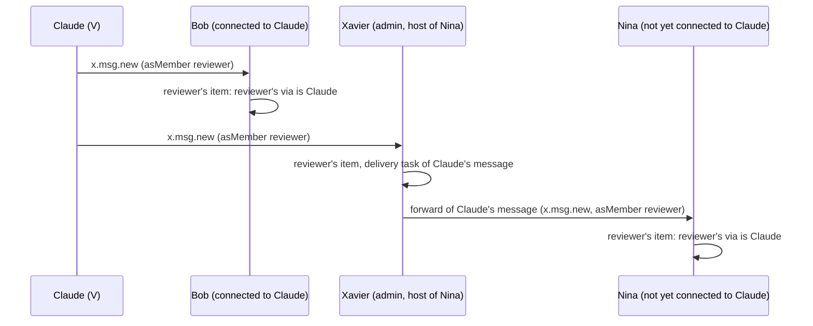
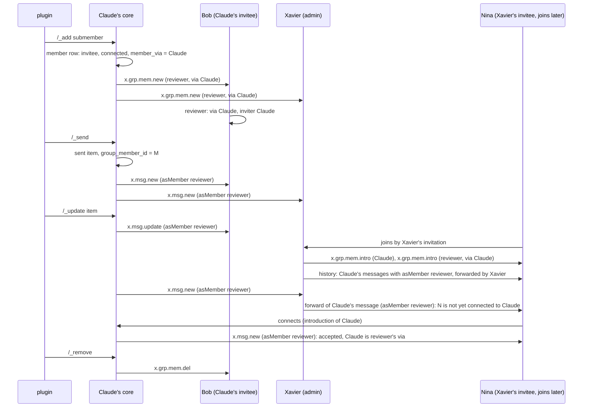
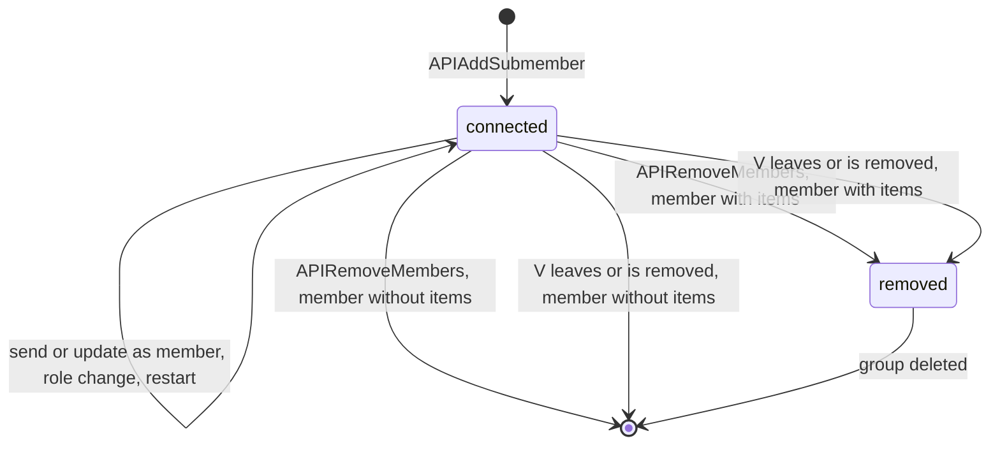
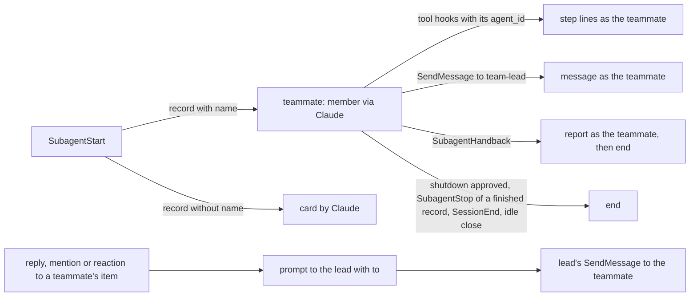

# Submembers: teammates as group members without connections

Status: plan only. Code references: master `dbd3fd7ca`, by file and line. Nothing of this plan is in the release of 2026-11-23. Decided by the maintainer on 2026-11-22:
- design A only: a member is in the group only via another member, not directly; the representation is permanent, stored and shown on every member's side;
- the MemberInfo field `via` names the member it is via; x.grp.mem.new with `via` may be forwarded;
- later joiners get x.grp.mem.intro with `via`, without a "joined" or "added" item;
- `SendAs` is parameterized; the parser accepts `(as_group=on)` as today;
- one pull request with the three plugin stages; reactions as a member are excluded;
- chat version 23; Q1 A and Q4 A;
- a member via V has any role up to V's role, as the author of a commit made by its committer; introductions put each member via another member after that member;
- a teammate ends by the existing removal: "Claude removed reviewer" (Q3 A);
- the host of a member forwards V's messages sent as a submember to it until it connects to V (Q5 B);
- how apps show `via` (Q2), from renders: variant C, "via <name of V>" in italics after the member's name in message headers and quotes, in place of its status in the member list, and in a row Via of member info.

Decided by the maintainer on 2026-11-26 (in conversation): "Yes, switching is a no-brainer, it simplifies things which I could sense even before looking at code. [ab]using forward for it was a bad idea."
- a message or update sent as a submember of V is V's own x.msg.new or x.msg.update with the field `asMember`, as `asGroup` of send as group; forwards of it are forwards of V's message (4.4);
- `asMember` holds the submember's member ID and display name, as the forward header holds them (Q2 of 2026-11-26: "also probably ok");
- V does not announce submembers to members before chat version 24, and hosts do not introduce them to such joiners: these members see V's messages (Q1 of 2026-11-26: "agreed. we will only ship it in plugin, and its users would use beta version.");
- the messages of a submember blocked by an admin are delivered to moderators only, without notifications (Q4 of 2026-11-26: "ok");
- with "sign messages" on, V signs its messages sent as a submember as its own messages, and receivers verify them with V's key;
- a message of a submember is direct, so it is shown without the forward mark "[>>]" (Q3 of 2026-11-26: "I don't think we want >> mark, as it's about transport. These messages are direct.").

Decided by the maintainer on 2026-11-27 (in conversation):
- the iOS notification service matches an item of a submember to the connection of the member it is via, found by group and member ID among the connections it was woken for; a forward is matched to the forwarder first (Q7 D);
- while V is blocked by an admin, V's messages sent as a submember are V's own blocked messages ("yes, it makes sense");
- when V leaves or is removed, its submembers are removed with it ("ok").

Facts about Claude Code are those recorded in `plans/2026-11-14-mcp-teammate-profiles.md` (branch `ep/mcp-teammate-profiles`, facts 1 to 9, F1 and F2).

Terms: a submember of V, "a member via V" below, is a member whose messages are sent only by V, as V's own messages with `asMember`; V is "the member it is via". In this plan V is Claude and its submember is a teammate.

## 1. Goal

The maintainer, 2026-11-22: "claude sends "new member" message with a flag "no connection needed", intro protocol doesn't run, all messages are "forwarded" from these members without ever creating them. Claude is host anyway, it can do it anyway, so we're not changing threat model, we're simply creating an API for it." And: "We already have "send as group", so we may as well have "send as member"."

Outcome:
- Claude's core adds each named teammate of a session to the session group as a member via Claude, with its own profile; the introduction protocol ends at the announcement.
- The teammate's messages, reports and tool steps are sent by Claude's core as Claude's messages naming that member in `asMember`; its step lines are edited in place under its profile.
- A person replies to, mentions or reacts to a teammate's message, and the lead forwards it to that teammate.
- The teammate leaves the group when it ends.

## 2. What users see

```
moment                              today (master)                          after
the lead starts teammate reviewer   Claude's step line: 🤖 Agent: TASK       Claude added reviewer (agent avatar, TASK as bio)
reviewer runs a tool                nothing                                 reviewer's step line in small print, edited until done
reviewer sends to the lead          Claude: ✉️ Message from reviewer: …      reviewer: the whole message
the lead sends to reviewer          Claude's step line: 🔧 SendMessage       Claude: @reviewer and the message
a person replies to, mentions or    a prompt to the lead                    a prompt to the lead with to=reviewer; the lead
reacts to reviewer's message                                                forwards it; reviewer's answer is shown under reviewer
reviewer's final report             Claude: 📋 Report from subagent …        reviewer: the report
reviewer ends, or the session ends  nothing                                 Claude removed reviewer
an unnamed subagent                 Claude's 🤖 card in small print          unchanged
member list and member info         people, Claude, User                    also reviewer, "via Claude" (Q2)
a person who joins later            -                                       reviewer listed via Claude, history under reviewer
```

## 3. Design

Options:
```
option                                   cost per teammate
A. members via Claude (this plan)        one member record on the host and one x.grp.mem.new to each member; each post is one message per member, as Claude's own posts
B. teammate users in Claude's core       one user, one contact, one group join, and one connection with every member; every command names or switches the user; per-session ownership of users
C. one more core per session (#8209)     as B, plus a second database and agent per session (teammates.ts of ep/mcp-teammate-steps: apiCreateActiveUser, APIAddContact, apiConnect, apiAddMember, apiJoinGroup)
```

B and C, the costs that exclude them: each teammate joins as a full member, so the introduction protocol connects it with every member (x.grp.mem.intro per member, Internal.hs:1242-1295; the joiner creates a connection per intro, Subscriber.hs:3358-3369; the existing member joins it, Subscriber.hs:3388-3423). The maintainer rejected C as bad design; B requires the ownership of users per session, which the maintainer called messy.

## 4. Protocol

New chat version 24, `submemberVersion` (Protocol.hs:97-150): members via another member.

### 4.1 MemberInfo.via

```
MemberInfo (Types.hs:1123-1130)
  memberId     unchanged
  memberRole   unchanged
  v            unchanged; for a member via V, the chat version range of V's core
  profile      unchanged
  memberKey    unchanged; omitted for a member via V
  via          new, optional: the member ID of V
```

Encoded by the derived JSON instance (Types.hs:2414); clients before version 24 ignore the field. The positional MemberInfo patterns (7 sites) get the field.

### 4.2 Creation: x.grp.mem.new with via

V sends `x.grp.mem.new` with `via` = V's own member ID to its current members, once, when it creates the member.

The receiver (xGrpMemNew, Subscriber.hs:3254-3335):
- checks V's role as for any announcer: admin or higher, and not lower than the member's role (checkHostRole, Subscriber.hs:3256 and 3715-3717);
- version 24: checks `via` = the announcer's member ID, else rejects the event;
- creates the member with category post, V as its inviter (createNewGroupMember, Store/Groups.hs:2498), `member_via` = V's member ID, and status connected (version 24) or announced (older clients, Subscriber.hs:3313-3315);
- saves the item "Claude added reviewer" (Subscriber.hs:3320-3330).

A member that receives x.grp.mem.new creates a connection for the announced member only on x.grp.mem.fwd (Subscriber.hs:3388-3423). The host sends x.grp.mem.fwd only on x.grp.mem.inv (Subscriber.hs:3379-3386), which is sent only by the joining member's own client (Subscriber.hs:3372-3377). For a member via V, the introduction therefore ends at the announcement.

Forwarding of the announcement, unchanged: an admin that receives x.grp.mem.new from V forwards it to its members that are introduced to V and not yet connected (xGrpMemNew returns DJSGroup, Subscriber.hs:3316-3319; delivery job by V's relation vector, Subscriber.hs:4476-4494). Such a member processes it attributed to V (Subscriber.hs:4083), so `via` = the author's member ID holds.

### 4.3 Later joiners: x.grp.mem.intro with via

The joiner's host introduces a member via V in the batch of introductions (memberIntroEvt, Internal.hs:1291-1295, used by introduceMember, 1260-1289, for introduceToAll, introduceToRemaining and introduceToModerators):
- joiners of version 24: x.grp.mem.intro with `via`;
- older joiners: the submember is not introduced; they show V's messages under V (4.7).

The receiver of x.grp.mem.intro with `via` (xGrpMemIntro, Subscriber.hs:3337-3370):
- checks the sender as today: the receiver's host, admin or higher;
- checks V: a member of the group, admin or higher, not lower than the member's role; else rejects the event;
- creates the member with category pre, V as its inviter, `member_via` = V's member ID, status connected; creates no connection and sends no x.grp.mem.inv;
- saves no chat item, as for any introduction today.

V is introduced before the member via V in the same batch: the members via another member follow all other members in the batch (introduceMember). A member via V cannot itself be V: receivers reject x.grp.mem.new from a member via another member, and x.grp.mem.intro whose `via` is a member via another member.

History is sent after the introductions on the same connection (Subscriber.hs:988-992; APIAcceptMember, Commands.hs:2980-2981 and 3004-3005); items of a submember are sent as V's messages with `asMember` (4.5).

### 4.4 Messages

A message or update sent as a submember of V is V's own message, with the field `asMember` naming the submember:
```
x.msg.new                    sent by V to its members, as any message of V
  container
    asMember                 new, optional
      memberId               the submember's member ID
      memberName             its display name, shortened (memberShortenedName)
    asGroup                  unchanged; absent with asMember
    other fields             unchanged
x.msg.update                 sent by V
  asMember                   new, optional, as in x.msg.new
  other fields               unchanged
```

Both are encoded as the optional key `asGroup` is (MsgContainer, Protocol.hs:766-790; XMsgUpdate, Protocol.hs:494, 1516, 1606); parsers before version 24 ignore the key.

The receiver of x.msg.new or x.msg.update (Subscriber.hs:1093-1103), and of the same message in a forward (processForwardedMsg):
```
asMember                                    result
absent                                      the sender's message, unchanged
present, sender blocked by an admin         the sender's message, blocked as its other messages (checkSendAsMember)
present, group with relays                  rejected: "member is not allowed to send as member"
present, sender below admin or a submember  rejected: "member is not allowed to send as member"
present, M = the member with memberId:
  M absent                                  M created as an unknown member named memberName, member_via = the sender's member ID
  M's member_via /= the sender's member ID  rejected: "member is not a submember of the sender"
  M removed                                 ignored
  otherwise                                 processed as M's message: M's role, block, moderation, edit window and priority
    M blocked by an admin                   delivered to moderators only, without notifications (moderatorsContext, Delivery.hs)
```
The sender is V when the message is received from V, and the member named by the forward header when it is forwarded. The item is saved as received from M; it has the forward mark only when V's message arrives in a forward, from a host or in history. A forward attributed to M itself is rejected: M's content is only V's messages.

Forwarding, by the rules of every message of V: an admin creates delivery tasks for V's message (Subscriber.hs:1033-1039); the delivery job sends it to its members introduced to V and not yet connected to V (MRIntroduced in V's relation vector) as a forward of V's message, with `asMember` in the inner message (Q5 B).



Signing: V signs a message sent as a submember as its own message (groupMsgSigning, with V's member ID in the binding); the signed body contains `asMember`, and receivers verify it with V's key. Pending messages are stored and sent with their signature, as V's other messages.

Notifications and delivery receipts: those of x.msg.new and x.msg.update (hasNotification, hasDeliveryReceipt).

Notifications on iOS (Q7 D): the notification service matches each received item to the connection it was received on (itemNtfEntityId, NotificationService.swift):
```
item                       entity
forwarded                  the forwarder (forwardedByMember)
of a submember             the member it is via: the connection entity of the same group whose member ID is the submember's memberVia, among the entities of the active service instances (NSEThreads.connEntities)
other                      the author
```

### 4.5 Updates, history, end

- Update: x.msg.update with `asMember`; the receiver applies it to M's item, found by M's member ID and the shared message ID (groupMessageUpdate), live flag included. While V is blocked by an admin, the update is V's own (checkSendAsMember): receivers of moderator role or higher save it as V's new blocked item, other receivers drop it, and the host forwards it to moderators only.
- History: V sends items sent as a submember as its own messages with `asMember` (sendHistory); another admin forwards a received item of a submember as a forward of V's message, with `asMember`; signed items are sent with their stored bytes, signed by V. Items of a submember are skipped while V is not a current member (Q9 A) or is blocked by an admin.
- End: `x.grp.mem.del` from V, by the existing removal (APIRemoveMembers; xGrpMemDel): "Claude removed reviewer".
- End with V: when V leaves or is removed, every member removes V's submembers with it, without items of their own; a record is kept, with status removed, while it has items, as for other removed members. In removeSubmembers (Internal.hs), deleteOrUpdateMemberRecordIO is applied to the members of getSubmembers (by group and member_via), at each place where the leave or removal is recorded:
  ```
  event                            side                 function
  V leaves                         other members        xGrpLeave
  V is removed                     other members        xGrpMemDel
  the user removes V               the user             APIRemoveMembers
  the user is V and leaves         V                    APILeaveGroup
  the user is V and is removed     V                    xGrpMemDel, the removal of the user
  ```
  As removed members, they are excluded from introductions (shouldIntroduce, Internal.hs). A silent removal of an admin user is processed as a removal (isUserGrpFwdRelay in xGrpMemDel), so the user's submembers are removed; on a silent removal of a user below admin, the user's status and the user's submembers are kept. A removal of V with messages deletes or marks deleted the items of V's submembers with V's items, before their records are removed (deleteMessages in xGrpMemDel and APIRemoveMembers, Q10 A); submembers are found by getSubmembers, by the partial index idx_group_members_member_via (5.7, Q11 A).
  Transactions: V's record and the records of its submembers are updated in one transaction in xGrpLeave, in xGrpMemDel for another member, in APIRemoveMembers (delMember) and in APILeaveGroup. In the removal of the user (xGrpMemDel), the user's status is updated, then deleteMessages runs, then the submembers' records are updated.
  Apps: the events leftMember, deletedMember and deletedMemberUser and the response of apiRemoveMembers mark the loaded submembers of the member removed (removeSubmembers, ChatModel.swift and ChatModel.kt); with messages, the loaded items of its submembers are marked deleted or deleted with its items (removeMemberItems).
- History items of a removed submember: `asMember` holds its name, so a joining member creates it as an unknown member with that name and member_via = V (4.4).

### 4.6 Scope

- Groups without relays only. In channels only relays forward (isMemberGrpFwdRelay, Subscriber.hs:3835), so the owner cannot post as a member; the API refuses members via the user in channels. Relays forwarding x.grp.mem.new with `via` is outside this plan.
- Groups with "sign messages" on: V signs its messages sent as a submember as its own (4.4); receivers verify them with V's key and show them as verified.

### 4.7 Older clients

- V sends x.grp.mem.new with `via` only to members of version 24 (APIAddSubmember), and hosts introduce submembers only to joiners of version 24 (4.3). A host forwards V's x.grp.mem.new to the members it introduced and that are not yet connected to V, of any version, as V's other messages (4.2); members before version 24 ignore `via` and list the submember as connecting. Members before version 24 ignore `asMember` and show V's messages under V.
- An admin before version 24 knows no submembers, so it introduces none. Its joiners of version 24 create a submember from the first message with `asMember` (4.4).
- A host before version 24 forwards V's messages by its delivery tasks. A signed message keeps its bytes, `asMember` included. An unsigned one is encoded again from the parsed message, without `asMember`, so its recipients show it under V.
- Members before version 24 show V's messages sent as a submember under V, so they are blocked as V's other messages.
- Members before version 24 keep a submember that they list as connecting when V leaves or is removed.

### 4.8 Threat model

A host in a group without relays can today:
1. announce a member with any member ID, any profile and a role up to its own (Subscriber.hs:3256, 3301-3311), whether or not a client of that member exists;
2. forward to the members it invited content attributed to any member, and to every member content attributed to a member it announced or to an unknown member ID, which receivers then create (Subscriber.hs:4040-4064);
3. send that content unsigned (Subscriber.hs:4115-4118).

Submembers of V are a composition of 1 and the messages of V. A message with `asMember` is accepted only from the member recorded as the submember's `via` (4.4), signed with V's key when "sign messages" is on. x.grp.mem.intro with `via` is accepted only from the joiner's host, as any introduction. With the API, the user posts as its own submembers through a supported command; posting as any other member is refused (6.3), so connected members cannot be posted as. Receivers store and show `via`. Q1.



## 5. Persistence and views

### 5.1 Member record

`group_members` gets one column, `member_via` (BLOB in SQLite, BYTEA in Postgres), the member ID of the member it is via. GroupMember gets `memberVia :: Maybe MemberId`. The column is added to groupMemberQuery and the 8 member column lists (Store/Shared.hs:782, 812, 859; Store/Messages.hs:734, 3142, 3151, 3158; Store/Connections.hs:172, 178), as `member_security_code` was (M20260714_member_security_code). The categories are unchanged (GroupMemberCategory, Types.hs:1404-1436), so older cores parse every row.

```
group_members, on V's side (created by APIAddSubmember)
  member_id                   12 random bytes (createWithRandomId', Store/Shared.hs:641-642)
  member_role                 the API's role, up to the user's role
  member_category             invitee
  member_status               connected
  member_via                  the user's member ID
  invited_by                  the user's contact (IBUser), as for invitees (Store/Groups.hs:1456)
  invited_by_group_member_id  the user's membership, as for invitees (Store/Groups.hs:1412)
  contact_id                  NULL
  contact_profile_id          a new contact_profiles row with the API's profile (createNewMemberProfile_, Store/Groups.hs:2505-2514)
  local_display_name          the profile's display name, made unique for the user (withLocalDisplayName)
  peer_chat_min_version       V's chat version range at creation
  peer_chat_max_version       V's chat version range at creation
  member_pub_key              NULL
connections                   (not created)

group_members, on another member's side
  member_category             post (4.2) or pre (4.3)
  member_status               connected (version 24), announced (older, 4.2)
  member_via                  V's member ID
  invited_by_group_member_id  V's record
  peer_chat_min_version       MemberInfo.v
  peer_chat_max_version       MemberInfo.v
connections                   (not created)
```

### 5.2 Items sent as a member via the user

```
chat_items, on V's side
  item_sent              1
  group_member_id        the member via V (NULL for every other sent item: idsRow, Store/Messages.hs:631)
  shared_msg_id          the inner msgId of 4.4
  show_group_as_sender   0
  include_in_history     1 (main scope)
```

Existing queries by group_member_id then select these items:
- quotes in replies of others resolve to them (getGroupChatItemQuote_, Store/Messages.hs:721-748), so a reply's quotedItem has the item ID and the direction groupRcv of the member;
- reactions and moderation by others find them (getGroupMemberCIBySharedMsgId, Store/Messages.hs:3092-3110);
- the user's own items exclude them (`group_member_id IS NULL`, Store/Messages.hs:226, 712, 2939, 3008, 3102);
- the member record is kept on removal while it has items (checkGroupMemberHasItems in deleteOrUpdateMemberRecordIO, Internal.hs:2254-2265).

Reading: for sent items, toGroupChatItem discards the member row today (Store/Messages.hs:2405-2409); with this change it sets `CIMeta.sentAsMember` from that row.

### 5.3 Ownership

```
owner          recorded in
user           member_via = the user's member ID in that group
session        the session group: groups.custom_data.simplexMcpSession (hub.ts:1446-1453, 1632-1634)
teammate       the member's profile display name within the session group
```

The core records only which member a member is via. The plugin keeps a map from teammate name to group member ID per session, rebuilt from APIListMembers (current members via the user) when the session is loaded (Hub.session, hub.ts:1341-1359).

### 5.4 Lifetime



- V leaves or is removed: its submembers are removed with it on every member's side, without items of their own (4.5).
- Restart of V's core: rows and items persist in the database, the core's only state of these members; the plugin re-adopts current members via the user by name (5.3).
- Teammate end (7.1): the plugin removes the member; a later teammate with the same name gets a new member.
- Sessions that do not attach within the idle-close interval after a service start (10 minutes, service.ts:20 and 473-484) remove their members.

### 5.5 Code paths for a member without a connection

```
path                               file:line                       change
memberSendAction                   Internal.hs:2899-2936           a member with memberVia -> Nothing, before the category dispatch (both sides)
sends as a member, unready members Internal.hs:2917-2936           as V's own messages: pending, or forwarded by the host
recipients                         Internal.hs:1999-2008           unchanged: current members, members via V filtered by memberSendAction
introductions                      Internal.hs:1291-1295           memberIntroEvt: x.grp.mem.intro with via to joiners of version 24, after the other members; skipped for older joiners
memberInfo                         Internal.hs:1356-1366           via = memberVia
x.grp.mem.new                      Subscriber.hs:3254-3335         via = announcer check; announcer not via another member; member_via; status connected
x.grp.mem.intro                    Subscriber.hs:3337-3370         via branch of 4.3: record without connection; V not via another member
x.grp.mem.inv, x.grp.mem.fwd       Subscriber.hs:3379-3423         rejected for a member with memberVia
x.msg.new, x.msg.update            Subscriber.hs:1093-1103         asMember: author M when M's member_via is the sender, the sender while it is blocked by an admin; also for a forwarded message (4.4)
sends as a member                  prepareGroupMsg                 asMember in x.msg.new; x.msg.update with asMember
signing                            groupMsgSigning                 unchanged: V's binding and key
history                            sendHistory                     items of a submember sent as V's messages with asMember (4.5)
quote by the user                  Internal.hs:235-242             quoteData: an item sent as member M -> CIQGroupRcv M, sent = False, memberId M
item author                        Messages.hs:374-380             chatItemMember: CIGroupSnd with sentAsMember M -> M
forwarding by admins               Subscriber.hs:4476-4503         unchanged: readyMemberConn excludes members via V
role change                        Commands.hs:3033-3122           unchanged: x.grp.mem.role from the user
removal                            Commands.hs:3241-3279           unchanged for a submember; the submembers of a removed or leaving member removed with it (4.5)
broadcast delete of its item       Commands.hs:928-940             refused for items sent as a member
member list text                   View.hs:1463-1467               "via <name>" or "via you" in place of the category text
announcement text                  View.hs:1403                    "added NAME to the group (via V)" in place of "(connecting...)"
```

### 5.6 Views and counts

```
view                               member via V
APIListMembers                     listed with memberVia (both sides)
groupSummary.currentMembers        counted: the trigger counts by status (chat_schema.sql:1594-1625)
delivery receipts limit            counted toward 20 current members (smallGroupsRcptsMemLimit, Subscriber.hs:114-115, 1156-1161)
V's chat items                     sent items with sentAsMember
unread counts                      unchanged: V's items are sent items
V's item delivery statuses         per member, from the delivery receipts of x.msg.new
apps                               memberVia decoded and shown as stated in Q2 C; the optional field is ignored by earlier app versions
```

### 5.7 Migration

In `M20261113_item_priority` (SQLite and Postgres; chat_schema.sql updated).

Up:
```sql
ALTER TABLE group_members ADD COLUMN member_via BLOB;
CREATE INDEX idx_group_members_member_via ON group_members(user_id, group_id, member_via) WHERE member_via IS NOT NULL;
```

Down, so that an older core reads and processes the rows as it would have created them:
```sql
-- members via the user: an older core cannot send as them
UPDATE group_members SET member_status = 'removed'
WHERE member_via IS NOT NULL
  AND EXISTS (SELECT 1 FROM group_members u WHERE u.group_id = group_members.group_id AND u.member_id = group_members.member_via AND u.member_category = 'user');
-- members via another member: as an older core records them from x.grp.mem.new
UPDATE group_members SET member_status = 'announced'
WHERE member_via IS NOT NULL AND member_status = 'connected';
-- sent items: an older core assumes NULL (Store/Messages.hs:712)
UPDATE chat_items SET group_member_id = NULL WHERE item_sent = 1 AND group_member_id IS NOT NULL;
DROP INDEX idx_group_members_member_via;
ALTER TABLE group_members DROP COLUMN member_via;
```

## 6. API

### 6.1 Types

```haskell
-- Types.hs:1123-1130, MemberInfo; proposed comment: "member via which the member is in the group"
via :: Maybe MemberId

-- Types.hs, GroupMember; proposed comment: "member via which this member is in the group: its messages are sent by that member"
memberVia :: Maybe MemberId

-- Messages.hs, replaces the ShowGroupAsSender (Bool, Messages.hs:547) parameters of the send and save chain
data SendAs m = SAUser | SAGroup | SAMember m
  deriving (Eq, Show, Functor, Foldable, Traversable)

-- Controller.hs:1145-1148
data SendRef
  = SRDirect ContactId
  | SRGroup GroupId (Maybe GroupChatScope) (SendAs GroupMemberId)

-- Controller.hs, new command and response
APIAddSubmember {groupId :: GroupId, memberRole :: GroupMemberRole, profile :: Profile}
CRSubmemberAdded {user :: User, groupInfo :: GroupInfo, member :: GroupMember}

-- Messages.hs:523-547, CIMeta: showGroupAsSender stays for the apps' JSON
sentAsMember :: Maybe GroupMember
```

- The command handler traverses `SendAs GroupMemberId` into `SendAs GroupMember`, checking 6.3.
- `SendAs GroupMember` replaces the Bool parameter of sendGroupContentMessages, sendGroupContentMessages_ (Commands.hs:5044-5116), sendGroupMessages, sendGroupSignedMessages, sendGroupProfileUpdate (Internal.hs:2761-2794), prepareGroupMsg (Internal.hs:214-233, asGroup only for SAGroup), saveSndChatItems, createNewSndChatItem, createNewChatItem_ (group_member_id for SAMember), mkChatItem_ and mkCIMeta, which sets both CIMeta fields.
- sendAsGroup' (Messages.hs:122-125) returns `SendAs a`; APIForwardChatItems keeps its Bool (Controller.hs:436).
- prepareGroupMsg sets `asMember` for an SAMember send and `asGroup` for SAGroup; APIUpdateChatItem sends x.msg.update with `asMember` of the item's sentAsMember (4.4).

### 6.2 Commands

```
/_add submember #<groupId> <role> json <profile>               APIAddSubmember -> CRSubmemberAdded
/_send #<groupId>(as_member=<groupMemberId>) [live=on] json [...]
/_send #<groupId>(as_group=on) json [...]                 unchanged syntax, SAGroup
/_update item #<groupId> <itemId> [live=on] json {...}    unchanged syntax; the sender is the item's
/_remove #<groupId> <groupMemberId>                       unchanged syntax
```

Parser (Commands.hs:7366-7370):
```haskell
sendRefP = (A.char '@' $> SRDirect <*> A.decimal) <|> (A.char '#' $> SRGroup <*> A.decimal <*> optional gcScopeP <*> sendAsP)
sendAsP = ("(as_group=" *> (bool SAUser SAGroup <$> onOffP) <* A.char ')') <|> ("(as_member=" *> (SAMember <$> A.decimal) <* A.char ')') <|> pure SAUser
```

### 6.3 Checks

```
command               condition                                        error
APIAddSubmember       group with relays                                 "submembers are not supported in channels"
APIAddSubmember       user role below admin or below the member's role  CEGroupUserRole (assertUserGroupRole gInfo (max GRAdmin role), as APIAddMember, Commands.hs:2887)
APIAddSubmember       incognito membership                              CEGroupIncognitoCantInvite (as Commands.hs:2873)
send as member        member of another group or unknown                SEGroupMemberNotFound
send as member        memberVia other than the user's member ID         "member is not your submember"
send as member        member not current                                CEGroupMemberNotActive
send as member        member role observer                              "member is not allowed to send messages" (receivers' memberCanSend, Subscriber.hs:1771-1773)
send as member        chat scope set                                    "cannot send as member in support scope" (as as_group, Commands.hs:782)
send as member        a file, or a quoted item                          "files and quotes cannot be sent as member"
send as member        group with relays                                 as APIAddSubmember
update of its item    member not current                                CEGroupMemberNotActive
delete of its item    broadcast or history mode                         CEInvalidChatItemDelete
```

### 6.4 Operations of the plugin stages

```
operation                       stage      core
add a member via the user       1          APIAddSubmember (new)
send as member                  1, 2       APISendMessages with SAMember; live=on for step lines
update its item                 2          APIUpdateChatItem: the item's sentAsMember selects the envelope (Commands.hs:850-885)
remove                          1          APIRemoveMembers
replies, mentions, reactions    3          existing resolution (5.2); CIMention by member ID (Store/Groups.hs:1182-1185)
```

Excluded: reactions as a member (the plugin's tools are connect, send, receive, download, list, leave and reply, tools.ts:161, and the plugin calls no reaction API); deletes as a member (the plugin finalizes lines by update, hub.ts:1155-1161); renaming (x.info as the member).

### 6.5 Bot API docs and clients

Generated by tests/APIDocs.hs: bots/api/COMMANDS.md, TYPES.md, packages/simplex-chat-client/types/typescript/src, packages/simplex-chat-python/src/simplex_chat/types.
- APIAddSubmember and CRSubmemberAdded documented (bots/src/API/Docs/Commands.hs, Responses.hs).
- SendRef documented as a record of chatType, chatId, chatScope and sendAs (bots/src/API/TypeInfo.hs:189 maps it to ChatRef today), with syntax `<chatType><chatId>[<chatScope>][<sendAs>]`.
- SendAs: `Choice` syntax, as ChatDeleteMode (bots/src/API/Docs/Types.hs:238): group `(as_group=on)`, member `(as_member=<groupMemberId>)`.
- GroupMember gets memberVia; CIMeta gets sentAsMember.
- simplex-chat-nodejs: apiSendMessages accepts the SendRef with sendAs (api.ts:448-462); new apiAddSubmember.

## 7. Plugin

One pull request with three stages. Unnamed subagents keep their cards (agents.ts; hub.ts:430-455).



### 7.1 Stage 1: profiles, messages, reports, end

```
Claude Code event                                   service                                      core
SubagentStart, record with name (fact 3, F1)        Teammates.start(agent ID, name, description)  /_add submember #G member json PROFILE
teammate's PostToolUse SendMessage to team-lead     post as the teammate                          /_send #G(as_member=M) json [...]
teammate's SubagentHandback (F2)                    report as the teammate, then end              /_send #G(as_member=M) json [...]
lead's copy of a teammate's message or report       dropped for a started teammate                -
lead's SendMessage to a teammate                    Claude: @NAME TEXT, mention of M              /_send #G json [{mentions: {NAME: M}}]
approved shutdown, SubagentStop of a finished       end                                           /_remove #G M
record (F1, F2), SessionEnd, idle close
member not created, or 20 teammates                 Claude's notes, as on master                   -
```

- hook.ts: agentStart (hook.ts:610-623) reads `name` of the record; a record with a name becomes a teammate start, a record without one a card (today records with taskKind are skipped, hook.ts:616). agentStep (hook.ts:626-630) reports a successful PostToolUse of SendMessage to team-lead as the agent's message. SessionEnd is registered (hooks/hooks.json).
- protocol.ts: AgentStart gets `name`; AgentEvent gets `{message: string}`.
- teammates.ts: one class over Claude's ChatApi: start, post, step, end, adopt; it replaces the core, the users, the contacts and the join of ep/mcp-teammate-steps.
- profile: display name validName(name) (messages.ts), peer type agent, shortDescr the record's description, at most 160 characters.
- message size: posts as a member add about 30 bytes to messageEnvelope (tools.ts:175, fitsMessage 1730-1733) for the `asMember` field.

### 7.2 Stage 2: step lines

- The teammate's tool hooks (agent_id, F1) become steps of its teammate (onAgents, hub.ts:390-402, routes by agent ID).
- A step is a small-print line sent as the teammate with live=on and finalized by an update with live=off, with outcome and duration, as Claude's steps (stepOf, hook.ts:600-607; finalize, hub.ts:1155-1161); lines older than 23 hours are finalized (liveLineMs).

### 7.3 Stage 3: addressing

- A message that replies to an item of a teammate (quotedItem with direction groupRcv of a member via Claude, 5.2), mentions a teammate (CIMention with its group member ID) or reacts to its item gets `to: NAME` in the prompt (AttachLine, protocol.ts:180-185; deliver, hub.ts:797-815) and the channel meta `to` (session.ts:236).
- Channel instructions (session.ts:25) add: "A message with to is for that teammate: forward it unchanged with SendMessage."
- itemSender (messages.ts:320-333) names the member for sent items with sentAsMember, so history (receive with history, tools.ts:1379-1383) and replies name the teammate.

### 7.4 Removed from the plugin

The separate core, its folder `ROOT/_sessions/ID/agents`, the per-teammate users, contacts and invitations, removeStale by contact custom data, and isOwnProfile for teammates of ep/mcp-teammate-steps; items sent as a member are sent items, and Session.onMessage handles received items only (hub.ts:495-501).

## 8. Acceptance and tests

Each core test fails on master, where the commands do not parse; each plugin test fails on master, where the teammate routes are absent.

With `asMember` (4.4): `testGroupMsgForwardViaRejected` and `testSubmemberSignedPrevVersion` are removed; the submember tests send or expect x.msg.new and x.msg.update with `asMember`; a message received from V has no forward mark, and a message forwarded by another member or in history has it; new: `asMember` round trips in ProtocolTests, and refusals of `asMember` naming a member whose via is not the sender and a removed submember. A group with relays is refused by the sender's API (`testSubmemberRefusedChannel`); its receiver rule has no test.

Core, tests/ChatTests/Groups.hs, `describe "submembers"`, groups of alice, bob and cath (createGroup3):
- `testSubmemberMessages`: `/_add submember #1 member json {...reviewer...}`; bob and cath see `#team: alice added reviewer to the group (via alice)`; `/_send #1(as_member=M) text hi` → `#team reviewer> hi` for bob and cath; `/ms team` of bob lists reviewer via alice.
- `testSubmemberUpdate`: an update of the message sent as member → bob and cath see `#team reviewer> [edited] hello`.
- `testSubmemberLaterJoiner`: dan joins by alice's invitation after the message → dan's output has no "added" or "unknown member" line for reviewer, has `#team reviewer> hi [>>]` from history, and `/ms team` lists reviewer via alice; the next message as reviewer reaches dan without the forward mark.
- `testSubmemberOtherAdmin`: cath is bob's invitee, not connected to alice → bob receives reviewer's message from alice and forwards it and its update to cath, who shows it with the forward mark; cath's members and last two items, reviewer's forwarded item and bob's message, are recorded as `submembers/forwarded`.
- `testSubmemberBlockedToModerators`: bob blocks reviewer → bob forwards reviewer's messages to moderators only, without notifications.
- `testSubmemberViaBlocked`: bob (admin) adds reviewer and sends a message as reviewer; cath is alice's invitee, not connected to bob; alice (owner) blocks bob → bob's message as reviewer is shown to alice as bob's, blocked; alice forwards it to moderators only; after cath is made a moderator, cath shows it as bob's, blocked, with the forward mark; bob's edit of the earlier message as reviewer is shown to alice and cath as bob's new blocked message.
- `testSubmemberViaBlockedHistory`: bob adds reviewer and sends a message as reviewer; alice blocks bob; dan joins as a moderator by alice's invitation → dan receives no item of reviewer's message in history.
- `testSubmemberViaBlockedMember`: cath (member) is connected to bob; alice blocks bob → bob's message as reviewer is shown to alice as bob's, blocked; cath shows nothing.
- `testSubmemberViaLeft`: bob adds reviewer, sends a message as reviewer and leaves → `/ms team` of alice and of bob prints alice and cath only; dan joins by alice's invitation → dan's client prints "you joined the group" and "member cath (Catherine) is connected" only, and `/ms team` of dan prints dan, alice and cath.
- `testSubmemberViaRemoved`: bob adds reviewer and sends a message as reviewer; cath removes bob → reviewer's record is kept with status removed on the sides of alice, bob and cath.
- `testSubmemberViaRemovedWithMessages`: bob adds reviewer and sends a message as reviewer; cath removes bob with messages → reviewer's message is marked deleted by cath on the sides of alice, bob and cath; alice's events of the message and of the removal are recorded as `submembers/via-removed`.
- `testSubmemberViaRemovedFullDelete`: full deletion on; bob adds reviewer and sends a message as reviewer; cath removes bob with messages → reviewer's message and record are deleted on the sides of alice, bob and cath.
- `testSubmemberIntroOrder`: bob adds assistant (admin) via bob; dan joins by alice's invitation → dan records assistant via bob.
- `testSubmemberPrevVersionJoiner`: dan with chat version range up to 23 joins → reviewer is not introduced; dan creates it as an unknown member from history.
- `testSubmemberPrevVersionMember`: bob with chat version range up to 23 → reviewer is not announced to bob; bob creates it as an unknown member from its first message.
- `testSubmemberReply`: bob replies to reviewer's message and mentions @reviewer → on alice and cath, the item's quotedItem has the item ID of reviewer's item and direction groupRcv reviewer, and its mention has reviewer's group member ID.
- `testSubmemberRoleRules`: reviewer is a member, owners are exempt from the edit window → alice's priority 1 as reviewer is stored normal; bob drops alice's edit of the item aged 79 hours on bob ("edit too late"); alice cannot edit the item aged 100 hours on alice; a priority 1 that alice sends as reviewer arrives normal at bob.
- `testSubmemberRemove`: `/_remove #1 M` → bob and cath see "alice removed reviewer".
- `testSubmemberRemoveByAdmin`: bob removes reviewer → alice and cath see "bob removed reviewer"; alice's send as reviewer → "not active yet"; a message that alice sends as reviewer after that is ignored by bob and cath.
- `testSubmemberRefused`: bob (admin) adds an owner via bob → refused; send as bob's group member ID → "member is not your submember"; cath (member) adds → refused; alice adds in an incognito group → refused.
- `testSubmemberRefusedChannel`: in a channel → refused.
- `testSubmemberAnnounceRefused`: x.grp.mem.new with via of another member → refused; forwards of x.grp.mem.new and x.msg.new attributed to reviewer → refused; cath's message as reviewer → bob refuses it, "member is not a submember of the sender"; after cath is made a member, the same → "member is not allowed to send as member".
- `testSubmemberOtherHostHistory`: dan joins by bob's invitation after reviewer's message → bob's history sends it as alice's message with `asMember`, and dan shows it from reviewer.
- `testSubmemberIntroRefused`: x.grp.mem.intro with via naming the user, reviewer, an owner role above cath's, an unknown member, and from a host demoted to member → refused.
- `testSubmemberSendRefused`: send as reviewer in a support scope, with a file, with a quote, and its broadcast delete → refused; bob's moderation → alice sees "[marked deleted by bob]"; alice's moderation → bob and cath see "[marked deleted by alice]".
- `testSubmemberSigned`: "sign messages" on → bob shows reviewer's message and its update signed; a message as reviewer signed by another key → bad signature.
- `testSubmemberSignedPending`: bob's connection inactive → reviewer's message is sent as pending and arrives signed.
- `testSubmemberSignedHistory`: reviewer removed; dan joins → dan creates reviewer from history with via alice and shows the item signed.
- Migrations: tests/MigrationTests up and down with the schema dump; down of a database with members via the user and via another member.
- API docs: tests/APIDocs.hs regenerates the files of 6.5.

iOS, SimpleX Unit Tests, SubmemberTests.swift, itemNtfEntityId with the connection entities of the recorded members (4.4, Q7 D):
- `testSubmemberItemIsMatchedToViaMemberConnection`: `submembers/received`, reviewer's item received from alice → alice's entity.
- `testForwardedItemIsMatchedToForwarderConnection`: `submembers/forwarded`, reviewer's item forwarded by bob, with the entities of alice and bob → bob's entity.
- `testMemberItemIsMatchedToMemberConnection`: `submembers/forwarded`, bob's item → bob's entity.

Apps, on the recorded events `submembers/via-removed` (iOS SubmemberTests.swift; desktop SubmemberTest.kt), with reviewer loaded in the member list and the chat open:
- `testItemOfSubmemberIsMarkedDeletedWithItsViaMember`, `itemOfSubmemberIsMarkedDeletedWithItsViaMember`: reviewer's item, then bob's removal with messages → reviewer's item is marked deleted by cath.
- `testSubmemberIsRemovedWithItsViaMember`, `submemberIsRemovedWithItsViaMember`: the same events → reviewer's status in the member list is removed.

Plugin:
- unit, teammates.test.ts: start, post, step (send with live=on, update), end and adopt make the commands of 7.1 and 7.2.
- unit, hook.test.ts: SubagentStart with a named record → teammate start; without a name → card; SendMessage to team-lead → message.
- unit, sessions.test.ts: a reply, a mention and a reaction to an item of a teammate → prompt with `to`.
- end-to-end, service.test.ts: a teammate's message and step line are received by a second core as reviewer's items; its end is shown.

CI: scope mcp runs with the branch's libsimplex (SIMPLEX_LIBS_DIR) and the branch's simplex-chat and @simplex-chat/types packages when core sources change (scripts/ci/scope-tests.sh:17-24; scripts/ci/README.md "mcp", lines 152-162 state the published packages today).

By hand (TESTING): the previous app releases of iOS and Android in a session group show reviewer's messages and the announcement.

## 9. Questions for the maintainer

Decided on 2026-11-22: Q1 A, Q3 A, Q4 A, Q5 B, Q6 D (V signs; added below), Q2 C (from renders; added below).

Q1. Threat model: receivers' acceptance rules are unchanged; on the wire, no party gets a new capability; the API posts only as members via the user (4.8).
- A, recommended: confirm.
- B: restrict further, for example to agent profiles.

Q2. How apps show `via` (renders for approval before the UI is built).
- A, recommended: member list: "via Claude" in place of the connection status; member info: a row "Via: Claude", and the connection and verification rows omitted.
- B: member info only.
- C, decided from renders: "via Claude" in italics after the member's name in message headers and quotes, in place of its status in the member list, and in a row Via of member info.

Q3. What users see when a teammate ends.
- A: "Claude removed reviewer": the existing removal, no code.
- B, recommended: "reviewer left": removal of a member via the user sends x.grp.leave as the member (4.5). About 15 lines.
- C: it stays a member until the group is deleted.

Q4. How a person's message is delivered to a teammate: Claude Code delivers messages to a teammate only through its team's mailbox (facts 6 and 7).
- A, recommended: through the lead, with `to` (7.3).
- B: the service writes into the mailbox file, which Claude Code writes under its own lock and schema checks.

Q5. Members invited by another admin get the member via Claude in their introductions (4.3) and accept Claude's forwards by the inviter rule (4.4). Two cases remain: their messages sent while they are not yet connected to Claude, and introductions by admins before version 24 (4.7).
- A, recommended: accept both in this pull request; session members are invited by Claude.
- B: their host also forwards a member's messages to its invitees not yet connected to the member it is via, as it forwards that member's own messages today (delivery task with V's relation vector and the member as fwdSender; a delivery_tasks column). About 30 lines.

Q6. Groups with "sign messages" on.
- A, recommended: members via another member are refused there (6.3).
- B: posted unsigned and shown as "signature missing".
- C: V keeps a key per member and signs as it; key storage on V's side.
- D, decided, as changed on 2026-11-26: V signs its messages sent as a submember as its own messages; receivers verify them with V's key (4.4).

Q7. Notifications on iOS for a message of a submember. The notification service routes a received item to the service instance that expects a message on the item's connection, named by `cItem.meta.forwardedByMember ?? cItem.chatDir.groupMemberId` (NotificationService.swift:1092-1098); an item on a connection that no instance expects is dropped (NotificationService.swift:185-201). A submember has no connection, and its message arrives on V's connection; forwardedByMember is set only for forwards (Internal.hs, saveGroupFwdRcvMsg). The apps do not show forwardedByMember; the terminal view shows it as "[>>]" (View.hs:787-789). Android shows notifications from received items without routing (SimpleXAPI.kt:3147, 3885). Decided: no forward mark (2026-11-26).
- A: the core sets forwardedByMember = V on these items: one line in the core, no change in the apps; the terminal view shows "[>>]", and the stored item names V as the member that forwarded a direct message.
- B: the apps receive, with a submember, the local group member ID of the member it is via, and the notification service routes by it: a new field in the core and in the apps.
- C: the core reports, with each received item, the member whose connection delivered it: a new field in the core and in the apps.
- D, decided on 2026-11-27: the notification service routes an item of a submember to the connection of the member it is via, which it finds among the connections it receives messages on by the submember's `memberVia` (ChatTypes.swift:3496, in the JSON today); a forward is routed to the forwarder first (4.4). The core and the API are unchanged.

Q8. Names of the new field and its type.
- A, decided on 2026-11-27 ("yes, ok"): field `asMember`, as `asGroup`; type `MemberRef {memberId :: MemberId, memberName :: ContactName}`, a reference to a member by its ID and display name.
- B: other names.

Q9. History of a removed submember after V left or was removed. V's record is kept (xGrpLeave; xGrpMemDel while V has items), so a host sends the submember's items as V's messages with `asMember` (sendHistory, Internal.hs:1470-1473); the joiner records V as an unknown member with role author and refuses them: "member is not allowed to send as member" (checkSendAsMember).
- A, decided on 2026-11-27: these items are skipped in sendHistory when V is not a current member, as they are when V's record is deleted.
- B: these items are sent; the joiner shows the error and no item.

Q10. Removal of V with messages: V's own items are deleted or marked deleted (deleteMessages in xGrpMemDel and APIRemoveMembers).
- A, built on 2026-11-27 from the decision on blocked via members, to be confirmed: the items of V's submembers are deleted or marked deleted with V's, as V's messages.
- B: the items of V's submembers are kept.

Q11. At each leave and removal, the member rows of the group are read in getSubmembers, also in channels.
- A, decided on 2026-11-27: a partial index on group_members (user_id, group_id, member_via) WHERE member_via IS NOT NULL, in M20261113_item_priority (5.7).
- B: the rows are read by idx_group_members_group_id.

## 10. Changes by file

```
file                                                  change
src/Simplex/Chat/Protocol.hs                          submemberVersion 24
src/Simplex/Chat/Types.hs                             MemberInfo.via; GroupMember.memberVia
src/Simplex/Chat/Messages.hs                          SendAs; CIMeta.sentAsMember; mkCIMeta; chatItemMember; sendAsGroup'
src/Simplex/Chat/Controller.hs                        SendRef; APIAddSubmember; CRSubmemberAdded
src/Simplex/Chat/Library/Commands.hs                  command, checks, send and update as member, delete refusal, parsers; removeSubmembers in APIRemoveMembers and APILeaveGroup
src/Simplex/Chat/Library/Internal.hs                  memberSendAction, memberIntroEvt, memberInfo, sendHistory, quoteData, createSndMessages, send chain; removeSubmembers; updateMemberRecordDeletedIO
src/Simplex/Chat/Library/Subscriber.hs                xGrpMemNew, xGrpMemIntro, xGrpMemInv and xGrpMemFwd for members via V; checkSendAsMember; removeSubmembers in xGrpLeave and xGrpMemDel
src/Simplex/Chat/Store/Groups.hs                      createSubmember; member_via in member creation; getSubmembers
src/Simplex/Chat/Store/{Shared,Messages,Connections}.hs   member_via in the member column lists; createNewChatItem_ group_member_id; toGroupChatItem sentAsMember
src/Simplex/Chat/Store/{SQLite,Postgres}/Migrations   M20261113_item_priority: member_via, idx_group_members_member_via; chat_schema.sql
src/Simplex/Chat/View.hs                              "via <name>"; CRSubmemberAdded
bots/src/API/{TypeInfo.hs,Docs/*.hs}                  6.5
bots/api/*, packages/simplex-chat-client, packages/simplex-chat-python, packages/simplex-chat-nodejs/src/api.ts   generated, apiAddSubmember
docs/protocol/simplex-chat.md                         members via another member
tests/ChatTests/Groups.hs, ChatRelays.hs, MigrationTests   section 8
packages/simplex-chat-mcp: src/teammates.ts (new), hook.ts, hub.ts, protocol.ts, session.ts, messages.ts, service.ts, tools.ts, hooks/hooks.json, test/, spec/, README.md, REFERENCE.md, TESTING.md
scripts/ci/scope-tests.sh, scripts/ci/README.md       mcp with the branch's core
```

Apps: `via` is shown as stated in Q2 C. iOS notification service (apps/ios/SimpleX NSE/NotificationService.swift): itemNtfEntityId and NSEThreads.connEntities (Q7 D). Removal with V (4.5): removeSubmembers and removeMemberItems in ChatModel.swift and ChatModel.kt, called from the event handlers (SimpleXAPI.swift, SimpleXAPI.kt) and after apiRemoveMembers (GroupChatInfoView.swift, GroupChatInfoView.kt, GroupMemberInfoView.kt).

## 11. Estimate

About 500 changed lines of Haskell and 350 of core tests; about 450 lines of the plugin and 500 of its tests; generated docs; 3 reduced builds.

## 12. Implementation compared with this plan

Accepted by the maintainer, 2026-11-22.

```
area                       implementation
send chain (6.1)           sendGroupMessages keeps the Bool showGroupAsSender; a pending profile update may be sent with a message sent as a member
MemberInfo.v (5.5)         x.grp.mem.new of a member via V omits v: memberInfo takes v from the connection
bot API (6.5)              SendRef is documented as before; nodejs and python helpers for sendAs and apiAddSubmember are absent
send and update as member  require the user to be admin; files and quotes as a member are refused
receivers                  refuse via in channels, an x.grp.mem.intro whose via is the receiver, and x.grp.mem.fwd of a member via another member
restrictions               restrictions of x.grp.mem.intro are stored for a member via another member
moderation                 deletion of an item sent as a member, by a moderator, is attributed to the member via V on V's side; V's moderation of it names that member
adding                     no chat item on V's side, as APIAddMember creates none in the group (only the invitation item in the direct chat)
forwarding by the host     by the delivery tasks of V's messages (4.4), as decided on 2026-11-26
```

## 13. State: core and iOS notifications done, plugin next

The core part is on `ep/omnibus` (#8314). Messages of submembers are V's messages with `asMember` (4.4, 4.5); while V is blocked by an admin, they are V's own blocked messages (4.4) and are excluded from history (4.5); when V leaves or is removed, its submembers are removed with it, also in the apps (4.5). On iOS, their notifications are matched to the connection of V, or of the member that forwarded them (Q7 D). The plugin stages (section 7) use these commands.

```
operation                  command                                                                                         response
add a teammate             /_add submember #<groupId> <role> json <profile>                                                      submemberAdded: member.groupMemberId = M
post as the teammate       /_send #<groupId>(as_member=<M>)[ live=on][ ttl=<seconds>][ sign=on] json [<composedMessage>]   newChatItems: sent items, meta.sentAsMember = the member M
edit its item              /_update item #<groupId> <itemId>[ live=on][ as_new=on] json <updatedMessage>                   chatItemUpdated: sent as M, the item's meta.sentAsMember
end the teammate           /_remove #<groupId> <M>                                                                         userDeletedMembers; members see "<user> removed <name>"
re-adopt after a restart   /_members #<groupId>                                                                            groupMembers: members with memberVia = membership.memberId, status connected
```

```
parameter          value
role               observer | author | member | moderator | admin | owner, up to the user's role
profile            {"displayName": "<name>", "fullName": "", "shortDescr": "<task>", "peerType": "agent"}
composedMessage    {"msgContent": {...}, "mentions": {...}, "priority": <n>}; filePath and quotedItemId refused
updatedMessage     {"msgContent": {...}, "mentions": {...}, "priority": <n>}
```

- Errors: section 6.3.
- With "sign messages" on, the core signs each message sent as the member as the user's own message, with the user's key; `sign=on` is not needed.
- Priority and the edit window of a message sent as the member follow the member's role, as at the receivers.
- Excluded: deletes as the member (broadcast delete of its item: CEInvalidChatItemDelete) and reactions as the member (APIChatItemReaction reacts as the user).
- Replies to and mentions of a teammate (stage 3): a received item's quotedItem has the item ID of the item sent as M and direction groupRcv of M; mentions have M's group member ID (5.2; testSubmemberReply).
- Display of `via` in the apps: Q2 C, with app tests on the recorded fixture `submembers/received` and snapshot references of both apps.
