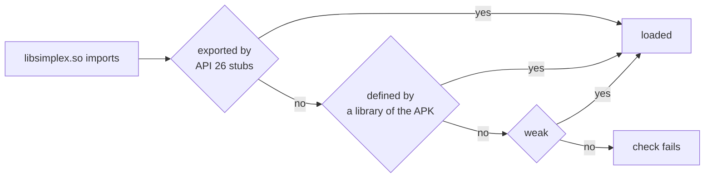

# Android 8: the 64-bit core loads

Repository: simplex-chat/simplex-chat.
Branch: `ep/android-8-arm64`, from `master`; the same flake.nix change for `stable` from `stable`.

## Problem

The arm64 `libsimplex.so` of v7.1.4 imports 12 functions that Android exports from API level 28 (Android 9): `getentropy`, `getrandom` and ten `posix_spawn*`. No library of the app defines them, and the Android linker resolves every import at load, so the core library is not loaded on 64-bit Android 8 devices. The armv7a core has no such imports.

| Import | Package | Object | Condition |
|---|---|---|---|
| `posix_spawnp`, `posix_spawn_file_actions_*`, `posix_spawnattr_*` | process 1.6.17.0 | `posix_spawn.o` | configure finds `posix_spawnp`: `USE_POSIX_SPAWN` |
| `getrandom` | entropy 0.4.1.10 | `getrandom.o` | Setup.hs links a test of libc `getrandom`: `HAVE_LIBC_GETRANDOM` |
| `getentropy` | entropy 0.4.1.10 | `random_initialized.o` | Setup.hs links a test of `getentropy`: `HAVE_GETENTROPY` |

The arm64 toolchain links these tests against the NDK r23 `libc.a`, which defines all three. OpenSSL's `getentropy` import is weak, resolved to null when absent.

## Decisions

- aarch64-android build of `lib:simplex-chat` in flake.nix:
  - `packages.process.configureFlags`: `--configure-option=ac_cv_func_posix_spawnp=no`; `do_spawn_posix` is the stub that returns -2, and processes are created by fork and exec.
  - `packages.entropy.package.buildType`: `Simple`; haskell.nix uses its default Setup, entropy's Setup.hs and its tests do not run, and entropy reads `/dev/urandom` after `/dev/random` is readable.
- armv7a build: unchanged.
- `scripts/ci/android/check-imports.py <apk> <abi> <stubs dir>`: fails when `libsimplex.so` or `libsupport.so` of the APK has a global undefined symbol that neither the API 26 stubs of the NDK (`libc.so`, `libm.so`, `libdl.so`) nor a library of the APK defines.
- android-emu: `app` checks the arm64 APK against `$ANDROID_NDK_LATEST_HOME/toolchains/llvm/prebuilt/linux-x86_64/sysroot/usr/lib/aarch64-linux-android/26`; the armeabi-v7a APK is checked once android-emu builds it (#8320).

## Tests

- android-emu with `armv7a`: both cores built, the import check of the arm64 APK passes, the arm64 smoke test passes.
- check-imports.py fails on the v7.1.4 arm64 APK, listing the 12 imports, and passes on the v7.1.4 armeabi-v7a APK except `getentropy`.
