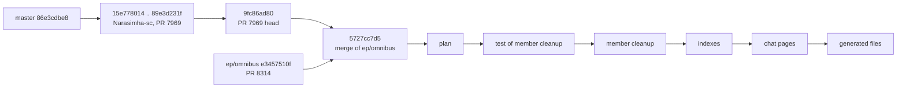
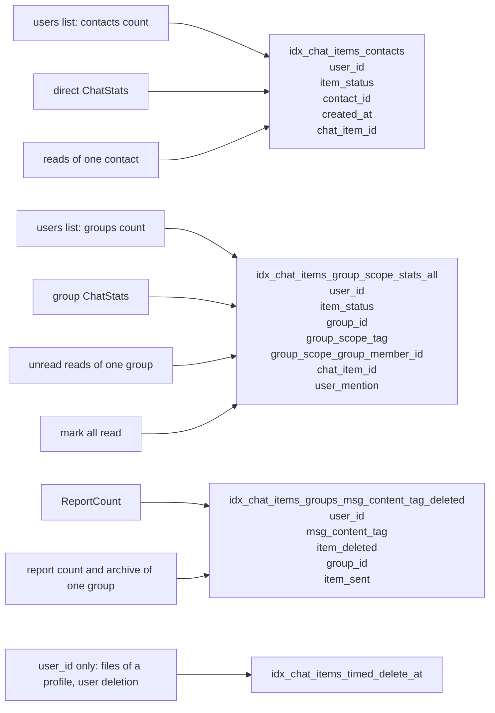
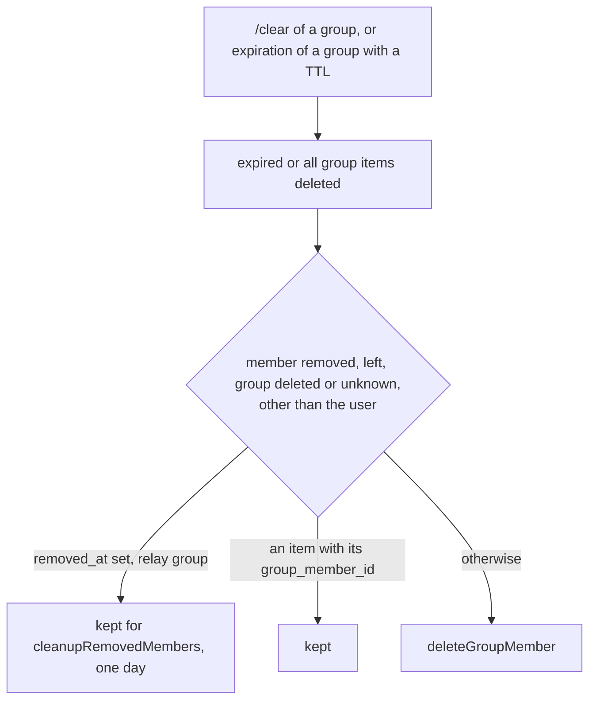
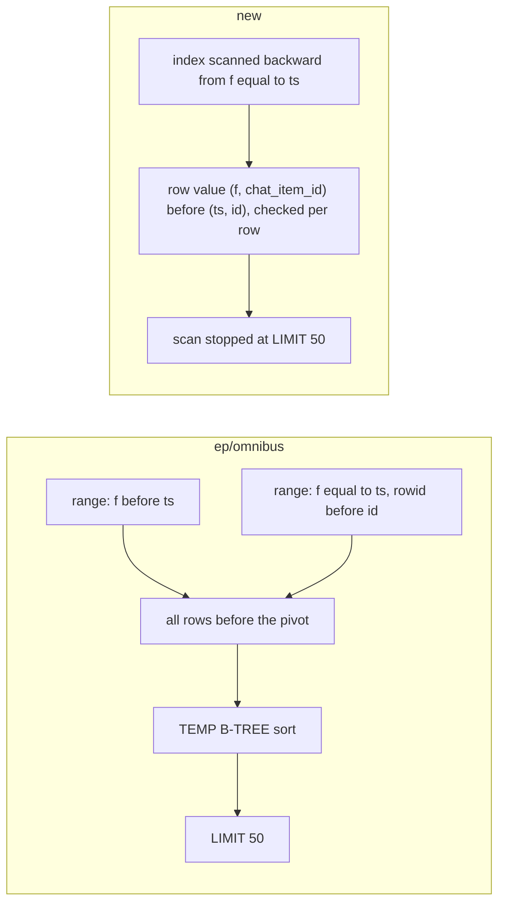
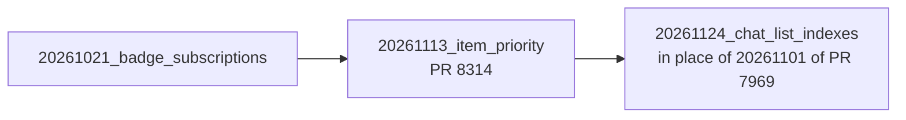
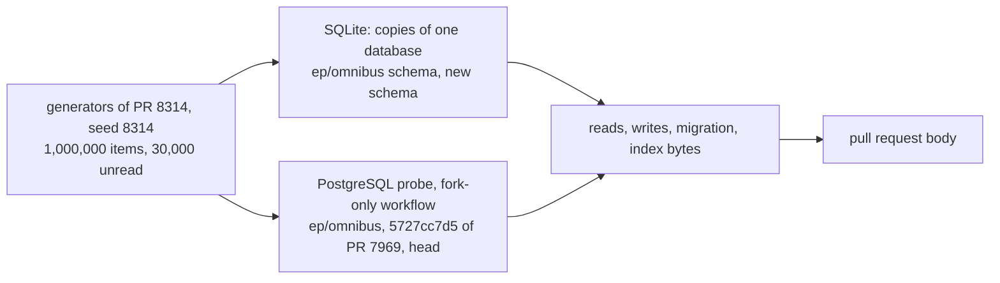

# Chat list, profile switch, member cleanup and chat pages on SQLite and PostgreSQL

Status: implemented on `ep/chat-list-queries`, code at 99e84da96; results in section 7. Branch `ep/chat-list-queries`, stacked on #8314 (`ep/omnibus` e3457510f); #7969 by Narasimha-sc is adopted. Problems of q29 in the review of #8314, decided by the maintainer: "q29 - yes, and also adopt the PR by narasimha-sc that makes loading chat list faster - it improved sqlite but not postgres, need to work on both."

Code references: this branch at 5727cc7d5, by file and line. SQLite plans: `chat_query_plans.txt`, and `EXPLAIN QUERY PLAN` of SQLite 3.45.1 on empty databases of each schema. PostgreSQL plans: probe runs of #8314, PostgreSQL 15.20, 1,000,000 chat items: review run https://github.com/evgeny-simplex/simplex-chat/actions/runs/45197482204 (schema ce3673792) and fixes run https://github.com/evgeny-simplex/simplex-chat/actions/runs/45229293446 (schema 582d0058d, equal to `ep/omnibus`); pg-plans run of #7969 https://github.com/Narasimha-sc/simplex-chat/actions/runs/41325761174.

## 1. Problems

1. With 1,000,000 messages, 290 ms on SQLite and 65 ms on PostgreSQL are spent in the contact and group queries of the chat list.
2. On each profile switch, 240 ms per profile are spent on SQLite in the unread counts of the users list.
3. Members who left or were removed are kept after the expiration of their messages or the clearing of the chat.
4. The time of each page of a long chat, and of each opening of a chat at its first unread message, is proportional to the number of messages before or after the page.

## 2. Branch



- `ep/chat-list-queries` is created from #7969's branch `nd/profile-switch-unread-count`; the authorship of Narasimha-sc's commits is kept.
- `ep/omnibus` is merged in 5727cc7d5 with conflict resolutions only:
  - migration lists and cabal modules: both entries, in ascending order;
  - imports of `tests/ChatTests/Direct.hs`: both sides;
  - SQLite schema: #7969's index before the partial indexes of #8314, in migration order;
  - 11 direct chat list plans: #7969's ChatStats line with the SilentStats lines of #8314, as SQLite reports them for the merged schema;
  - the plan of the replaced `getContactUnreadCount_` text: removed, as in `ep/omnibus`.

## 3. #7969

Changes:
- `M20261101_chat_items_unread_index`, both backends: `idx_chat_items_user_id_item_status` is recreated with more columns.

  | # | before | #7969 |
  |---|---|---|
  | 1 | user_id | user_id |
  | 2 | item_status | item_status |
  | 3 | | contact_id |
  | 4 | | group_id |
  | 5 | | user_mention |

- `getFirstUnreadItemId_` (Messages.hs:2549): `GROUP BY user_id` is appended on SQLite.
- `testUsersUnreadCountQueryPlans` (tests/ChatTests/Direct.hs): plans of the two users list counts and of the first unread lookup, SQLite.

Effect, as measured by Narasimha-sc:

| read | SQLite | PostgreSQL |
|---|---|---|
| users list counts | 0.52 s to 4.4 ms, 2,000,000 messages | 16.9 to 1.9 ms and 7.6 to 2.9 ms, Index Only Scan of the new index |
| direct ChatStats | 77 to 16 ms | the plan of master: Index Scan of `idx_chat_items_item_status`, rows filtered in the heap, 4.4 to 4.9 ms |
| group ChatStats | the plan of master | the plan of master |

On PostgreSQL, the plans of master are kept for the chat list:
- An SQLite index entry consists of its columns and the rowid. `chat_item_id` is the rowid of `chat_items` (shown as `rowid` in `chat_query_plans.txt`), so `MIN(chat_item_id)` of the direct ChatStats is read from #7969's index.
- A PostgreSQL btree entry consists of its columns and a pointer to the heap tuple. With #7969's index, `chat_item_id` of each unread row is read from the heap, so the planner keeps the plan of master, estimated cheaper.
- The group ChatStats has conditions on `group_scope_tag` and `group_scope_group_member_id`. With #7969's index, PostgreSQL reads them from the heap, and SQLite keeps `idx_chat_items_group_scope_stats_all (user_id=? AND group_id>?)`.

## 4. Causes

### 4.1 Chat list

In `findDirectChatPreviews_` (Messages.hs:803) and `findGroupChatPreviews_` (Messages.hs:912), the statistics of all chats of the profile are computed in subqueries and joined to the chats.

| subquery | SQLite | PostgreSQL |
|---|---|---|
| group ChatStats | `idx_chat_items_group_scope_stats_all (user_id=? AND group_id>?)`: every group item of the profile is read, 136 ms | Index Scan of `idx_chat_items_user_id_item_status (user_id, item_status)`; group_id, scope, user_mention and chat_item_id of 29,225 rows are read from the heap (11,529 pages), 40.9 of 50.5 ms |
| group ReportCount | `idx_chat_items_groups_msg_content_tag_deleted (user_id=? AND group_id>?)`: every group item of the profile is read, 101 ms | Index Only Scan of the same index over the range `group_id IS NOT NULL` (1,024 pages), 3.2 ms |
| direct ChatStats | `idx_chat_items_contacts (user_id=? AND contact_id>?)`: every direct item of the profile is read, 12 ms | BitmapAnd of `idx_chat_items_item_status` (30,000 entries) and `idx_chat_items_contact_id` (99,500 entries), 724 heap rows, 10.4 of 14.1 ms |

ReportCount was found in this analysis: with ChatStats changed alone, 117 ms are spent in the group chat list on SQLite.

### 4.2 Users list

In `getUsersInfo` (Profiles.hs:176), three counts per profile are run on each `/users`.

| count | SQLite | PostgreSQL |
|---|---|---|
| contacts | `idx_chat_items_contacts (user_id=?)`: every item of the profile is read, 118 ms | Index Scan of `idx_chat_items_item_status`; user_id of the unread rows of all profiles is read from the heap, 16.9 ms (#7969 run: 2,000,000 items, 10,000 unread in the profile) |
| groups | `idx_chat_items_group_scope_stats_all (user_id=?)`: every item of the profile is read, 120 ms | as contacts, 7.6 ms (#7969 run) |
| silent (#8314) | partial indexes, 3.1 ms | partial indexes, 3.1 ms |

In the #8314 measurement, the first two counts took 145-155 and 126-129 ms on SQLite.

### 4.3 Member cleanup

In `getGroupMembersForExpiration` (Groups.hs:1367), members are selected with `m.group_member_id NOT IN (SELECT DISTINCT group_member_id FROM chat_items)`. `chat_items.group_member_id` is NULL for direct items, notes, channel items and the items sent by the user, except those sent as a member (#8314). With a NULL in the list, `NOT IN` is NULL for every member, so 0 rows are selected on both backends, and members are never deleted by `APIClearChat` (Commands.hs:1473) and `expireGroupChatItems` (Commands.hs:6810).

| | SQLite | PostgreSQL |
|---|---|---|
| plan | `LIST SUBQUERY`, `SCAN chat_items USING COVERING INDEX idx_chat_items_group_member_id` | Parallel Index Only Scan of `idx_chat_items_group_member_id`, 1,000,000 entries |
| time, rows | 46 ms, 0 rows | 68 ms, 0 rows |

### 4.4 Chat pages

In `getChatItemIDs` (Messages.hs:1559), the `CRBefore` page is selected by `((c AND f < ?) OR (c AND f = ? AND chat_item_id < ?)) ORDER BY f DESC, chat_item_id DESC LIMIT ?`, and the `CRAfter` page by its mirror. Both directions are read in `getDirectChatAround'` (Messages.hs:1361), `getGroupChatAround'` (Messages.hs:1708) and `getLocalChatAround'` (Messages.hs:1932), so both texts are executed on each opening of a chat at its first unread message.

| | SQLite | PostgreSQL |
|---|---|---|
| plan | `MULTI-INDEX OR` of two ranges of `idx_chat_items_group_scope_item_ts`, then `USE TEMP B-TREE FOR ORDER BY`: every item before (after) the pivot is read and sorted before `LIMIT` | measured by the probe of section 7 |
| group of 20,000 items | 11.5 ms for the page before the newest item, 5.4 ms for the page after the oldest | |

The same construction is used for direct chats, notes, the member support scope and the content filters: 10 conditions, 2 directions each.

## 5. Changes

### 5.1 Indexes: migration `20261124_chat_list_indexes`

#7969's modules `M20261101_chat_items_unread_index` are renamed to `M20261124_chat_list_indexes` on both backends, in `simplex-chat.cabal` and after `20261113_item_priority` in both `schemaMigrations` lists, with this text:

```sql
DROP INDEX idx_chat_items_user_id_item_status;
DROP INDEX idx_chat_items_contacts;
CREATE INDEX idx_chat_items_contacts ON chat_items(user_id, item_status, contact_id, created_at, chat_item_id);
DROP INDEX idx_chat_items_group_scope_stats_all;
CREATE INDEX idx_chat_items_group_scope_stats_all ON chat_items(user_id, item_status, group_id, group_scope_tag, group_scope_group_member_id, chat_item_id, user_mention);
DROP INDEX idx_chat_items_groups_msg_content_tag_deleted;
CREATE INDEX idx_chat_items_groups_msg_content_tag_deleted ON chat_items(user_id, msg_content_tag, item_deleted, group_id, item_sent);
```

Down migration, the definitions of `ep/omnibus`:

```sql
DROP INDEX idx_chat_items_groups_msg_content_tag_deleted;
CREATE INDEX idx_chat_items_groups_msg_content_tag_deleted ON chat_items(user_id, group_id, msg_content_tag, item_deleted, item_sent);
DROP INDEX idx_chat_items_group_scope_stats_all;
CREATE INDEX idx_chat_items_group_scope_stats_all ON chat_items(user_id, group_id, group_scope_tag, group_scope_group_member_id, item_status, chat_item_id, user_mention);
DROP INDEX idx_chat_items_contacts;
CREATE INDEX idx_chat_items_contacts ON chat_items(user_id, contact_id, item_status, created_at);
CREATE INDEX idx_chat_items_user_id_item_status ON chat_items(user_id, item_status);
```

`idx_chat_items_contacts`

| # | ep/omnibus | new |
|---|---|---|
| 1 | user_id | user_id |
| 2 | contact_id | item_status |
| 3 | item_status | contact_id |
| 4 | created_at | created_at |
| 5 | | chat_item_id |

`idx_chat_items_group_scope_stats_all`

| # | ep/omnibus | new |
|---|---|---|
| 1 | user_id | user_id |
| 2 | group_id | item_status |
| 3 | group_scope_tag | group_id |
| 4 | group_scope_group_member_id | group_scope_tag |
| 5 | item_status | group_scope_group_member_id |
| 6 | chat_item_id | chat_item_id |
| 7 | user_mention | user_mention |

`idx_chat_items_groups_msg_content_tag_deleted`

| # | ep/omnibus | new |
|---|---|---|
| 1 | user_id | user_id |
| 2 | group_id | msg_content_tag |
| 3 | msg_content_tag | item_deleted |
| 4 | item_deleted | group_id |
| 5 | item_sent | item_sent |

`idx_chat_items_user_id_item_status`: dropped.

Indexes of `chat_items` in this change: 4 before, 3 after. Their SQLite bytes at 1,000,000 items: 114.4 MB before, 99.2 MB after.



Search keys on SQLite:

| read | ep/omnibus | new |
|---|---|---|
| users list, contacts count | `idx_chat_items_contacts (user_id=?)` | `idx_chat_items_contacts (user_id=? AND item_status=?)` |
| users list, groups count | `idx_chat_items_group_scope_stats_all (user_id=?)` | `idx_chat_items_group_scope_stats_all (user_id=? AND item_status=?)` |
| direct ChatStats, 15 texts | `idx_chat_items_contacts (user_id=? AND contact_id>?)` | `idx_chat_items_contacts (user_id=? AND item_status=? AND contact_id>?)` |
| group ChatStats, 15 texts | `idx_chat_items_group_scope_stats_all (user_id=? AND group_id>?)` | `idx_chat_items_group_scope_stats_all (user_id=? AND item_status=? AND group_id>?)` |
| ReportCount, 15 texts | `idx_chat_items_groups_msg_content_tag_deleted (user_id=? AND group_id>?)` | `idx_chat_items_groups_msg_content_tag_deleted (user_id=? AND msg_content_tag=? AND item_deleted=? AND group_id>?)` |

On PostgreSQL each read of this table is expected as an Index Only Scan whose Index Cond includes `item_status` (ReportCount: `msg_content_tag` and `item_deleted`), with `chat_item_id` and `user_mention` read from the index.

Every user of the four indexes: the SQLite plan changes for 77 of 1,011 statements (949 saved in `chat_query_plans.txt`; 62 generated: the 30 chat list texts, the first unread lookup, the page and cleanup texts); the plans of the other 934 are unchanged.

| statements | new plan |
|---|---|
| 2 users list counts, 52 chat list texts | the keys of the table above |
| 14 reads of one chat: unread counts of a contact and of a group (3), first unread of a contact, navigation count of a contact, mark read of a contact and of a group (3), unread timed items (3), report count and archive (3) | the same equality columns, in the order of the new index |
| 5 reads by `user_id` only: message search (3), files of a profile, user deletion | another index keyed by `user_id` |
| mark all read (Store/Direct.hs:694) | `idx_chat_items_group_scope_stats_all (user_id=? AND item_status=?)` |
| `SELECT DISTINCT msg_content_tag` of a group | `idx_chat_items_groups_msg_content_tag_item_ts`, the same key |
| `getFirstUnreadItemId_`, SQLite text with #7969's `GROUP BY user_id` | `idx_chat_items_group_scope_stats_all (user_id=? AND item_status=?)`: the unread entries of the profile are read in place of one entry; of the clients, only the CLI sends `/_get items initial=` (Commands.hs:6904) |
| `getFirstUnreadItemId_`, PostgreSQL text | measured by the probe |

Adopted parts of #7969:
- `GROUP BY user_id` of `getFirstUnreadItemId_` on SQLite: kept.
- `testUsersUnreadCountQueryPlans`: the expected plans of the tables above; the silent count of #8314 (its text contains `item_priority`) is excluded from the recorded queries of the test.
- `skipComparisonForDownMigrations` (SchemaDump.hs): `20261124_chat_list_indexes` in place of `20261101_chat_items_unread_index`.
- `plans/2026-11-01-profile-switch-unread-counts*.md`: kept; their sections Fix and Scope are superseded by this plan.

### 5.2 Member cleanup

`getGroupMembersForExpiration` (Groups.hs:1376-1380):

```sql
WHERE m.group_id = ? AND m.user_id = ? AND (m.contact_id IS NULL OR m.contact_id != ?)
  AND m.member_status IN (?, ?, ?, ?)
  AND m.removed_at IS NULL
  AND NOT EXISTS (SELECT 1 FROM chat_items i WHERE i.group_member_id = m.group_member_id)
```

- `NOT EXISTS` is the condition of `checkGroupMemberHasItems` (Groups.hs:2615), by which deletion is decided at removal (Internal.hs:2281).
- With `m.removed_at IS NULL`, the members of relay groups marked by `updateGroupMemberRemovedAt` (Groups.hs:2421, called at Internal.hs:2284) are deleted by `cleanupRemovedMembers` (Commands.hs:6687) one day after removal, as today, so that forwarded messages of a removed member are ignored in that day (Subscriber.hs:4093, #7010).
- Plans: SQLite `CORRELATED SCALAR SUBQUERY`, `SEARCH i USING COVERING INDEX idx_chat_items_group_member_id (group_member_id=?)`; PostgreSQL: an anti join over `idx_chat_items_group_member_id`, measured by the probe.
- Each selected member is deleted by `deleteGroupMember` (Groups.hs:2619). By the `ON DELETE` rules of `chat_schema.sql`, the member's id is set to NULL in `chat_items`, `messages`, `chat_item_reactions`, `contacts` and `group_members`, and the rows with the member's id in tables with `ON DELETE CASCADE` are deleted, among them `chat_item_moderations`, `group_member_intros`, `group_snd_item_statuses` and `delivery_tasks`; the items of the member's support chat are deleted earlier, at leave and at removal (`deleteSupportChatIfExists`).
- Cleanup is run on `/clear` of a group and on expiration of a group whose TTL is positive (`withExpirationDate`, Commands.hs:6813).



Test, in `tests/ChatTests/Groups.hs`, run on both backends: alice, bob and cath are in #team (`createGroup3`); alice and bob send direct messages, so items with NULL `group_member_id` exist; cath leaves #team; alice clears #team; the member row of cath in alice's database is expected to be deleted (`withCCTransaction`). On `ep/omnibus` the row is kept.

### 5.3 Chat pages

`idsQuery` of `getChatItemIDs` (Messages.hs:1607-1626):

```haskell
      CRAfter ts itemId ->
        rangeQuery (c <> " AND (" <> f <> ", chat_item_id) > (?, ?) ") (p :. (ts, itemId)) (" ORDER BY " <> f <> " ASC, chat_item_id ASC ")
      CRBefore ts itemId ->
        rangeQuery (c <> " AND (" <> f <> ", chat_item_id) < (?, ?) ") (p :. (ts, itemId)) (" ORDER BY " <> f <> " DESC, chat_item_id DESC ")
```

`orCond`, `orParams` and their comment are removed. The saved plans of the OR texts are removed from `chat_query_plans.txt`.



SQLite plan: `SEARCH chat_items USING COVERING INDEX idx_chat_items_group_scope_item_ts (user_id=? AND group_id=? AND group_scope_tag=? AND group_scope_group_member_id=? AND item_ts<?)`, without `TEMP B-TREE`; one ordered range of its index for each of the 10 conditions in both directions. The rows of the two texts were equal for 3,200 pages over 5,000 rows with 21 distinct timestamps (SQLite 3.45.1). PostgreSQL is expected to use the row comparison, whose second column is outside the index, as the bound `f <= ts` with the full comparison as a filter; measured by the probe.

## 6. Migration order



Databases with `20261101_chat_items_unread_index` applied exist only from builds of #7969's branch.

The iOS notification service applies up-migrations (NotificationService.swift:888 with `defaultMigrationConfirmation`, API.swift:374). Three indexes of `chat_items` are built in this migration; two were built in `M20260403_item_viewed`.

## 7. Measurement



SQLite: the database of the #8314 measurement (its generator, seed 8314), the pragmas of the app (busy_timeout 100, foreign_keys ON, secure_delete ON, auto_vacuum FULL), statements prepared per call, without `sqlite_stat1`; one cold run after the pages of the file are dropped from the OS cache, then 15 warm runs alternating the databases; rows compared by digest. The plans of the bundled SQLite 3.39.2 are those of `chat_query_plans.txt` written in CI ("verify and overwrite query plans").

PostgreSQL: a fork-only workflow on the model of `pg-probe-8314`, PostgreSQL 15 service container; `gen_data.py` seed 8314 loaded into three databases with the schemas of `ep/omnibus`, of 5727cc7d5 (#7969) and of the head; `VACUUM (ANALYZE)`; reads: 2 warm-up runs, then 10 runs of `EXPLAIN (ANALYZE, BUFFERS)` alternating the databases; writes: rolled back, with WAL bytes; the branch is deleted after the run.

Statements:
- the 3 users list counts;
- the 30 chat list texts;
- every statement of section 5.1 with a changed SQLite plan, in its PostgreSQL text;
- `getFirstUnreadItemId_`, both texts;
- pages, old and new text: main scope and member support scope of group 17 (20,000 items), contact 42 (5,000 items) and the notes, before and after, at the newest, a middle and the oldest item;
- member cleanup, old and new text, groups 17 and 61;
- writes: chat item insert, mark read of a contact, of a group and of all chats, TTL deletion;
- migration up and down: time per statement, on a copy of the `ep/omnibus` database;
- bytes of the four indexes.

Acceptance:
- the users list counts, ChatStats and ReportCount use the keys of section 5.1 on SQLite, and Index Only Scans with `item_status` (`msg_content_tag`) in Index Cond on PostgreSQL;
- other statements are at most 20% or 2 ms slower than on `ep/omnibus`, on either backend; the migration time is reported;
- the page rows equal those of the OR text at every pivot;
- the cleanup test fails on the commit of the test and passes on the head, on SQLite and PostgreSQL.

Results on SQLite 3.45.1, measured for this plan: copies of the #8314 database with the `ep/omnibus` schema and with the indexes of section 5.1; warm medians of 15 runs, in ms. For pages and member cleanup, the columns are the old and the new text on one database.

| read | ep/omnibus | new |
|---|---|---|
| users list, contacts count | 118.5 | 3.5 |
| users list, groups count | 120.0 | 5.3 |
| direct ChatStats | 12.1 | 0.66 |
| group ChatStats | 136.2 | 7.2 |
| ReportCount | 101.3 | 0.63 |
| direct chat list, all chats | 27.7, cold 258 | 5.1, cold 212 |
| group chat list, all chats | 266.3, cold 810 | 14.3, cold 282 |
| unread count of group 17 | 0.24 | 0.24 |
| first unread lookup with `GROUP BY user_id` | 4.3 | 4.5 |
| page before the newest item of group 17 | 11.5 | 0.10 |
| page after the oldest item of group 17 | 5.4 | 0.09 |
| member cleanup of group 61 | 46.1, 0 rows | 0.41, 7 rows |

Migration on the same database: 16.1 s for the up text, in two runs of its statements with the first statement of each run cold; quick_check ok.

Results on PostgreSQL 15.20: probe run https://github.com/evgeny-simplex/simplex-chat/actions/runs/45296525730 (schema of d27b96924 as new), 1,000,000 items, 30,000 unread, data digests equal in the three databases; medians of 10 runs of planning and execution, in ms.

| read | ep/omnibus | 5727cc7d5 (#7969) | new | new plan |
|---|---|---|---|---|
| users list, contacts count | 1.22 | 0.51 | 0.55 | Index Only Scan `idx_chat_items_contacts` (user_id, item_status) |
| users list, groups count | 4.51 | 5.82 | 4.54 | nested loop over groups, Index Only Scan `idx_chat_items_groups_user_mention`, as on `ep/omnibus` |
| users list, silent count | 2.35 | 2.35 | 2.35 | partial indexes of #8314 |
| first unread lookup | 5.16 | 5.20 | 5.14 | `chat_items_pkey`, as on `ep/omnibus` |
| direct ChatStats | 8.63 | 0.49 | 0.30 | Index Only Scan `idx_chat_items_contacts` (user_id, item_status, contact_id) |
| group ChatStats | 27.34 | 27.03 | 5.50 | Index Only Scan `idx_chat_items_group_scope_stats_all`, all 5 conditions in Index Cond |
| ReportCount | 1.06 | 1.05 | 0.25 | Index Only Scan `idx_chat_items_groups_msg_content_tag_deleted`, all 5 conditions in Index Cond |
| 15 direct chat list texts | 9.04-10.87 | 0.97-2.81 | 0.75-2.65 | |
| 15 group chat list texts | 31.74-35.48 | 32.56-37.24 | 7.21-11.83 | |
| content tags of group 17 | 29.80 | 31.29 | 31.95 | `idx_chat_items_groups_user_mention` in place of `idx_chat_items_groups_msg_content_tag_deleted` |

Old and new text on the new database:

| read | old text | new text |
|---|---|---|
| page before the middle item of group 17, 19,782 items | 3.69 | 0.22 |
| page after the middle item of group 17 | 3.34 | 0.22 |
| page before the middle item of contact 42, 20,000 items | 3.16 | 0.21 |
| member cleanup of group 17 | 51.34, 0 rows | 0.67, 5 rows |
| member cleanup of group 61 | 50.88, 0 rows | 0.56, 0 rows |

- New page text: Index Scan Backward of `idx_chat_items_groups_item_ts` with `item_ts <= ts` in Index Cond and the row comparison as Filter, then Incremental Sort and Limit; with the old text, the same index is read from the newest item of the group, and 9,986 rows are removed by Filter (8,913 buffers against 44).
- New cleanup text: Nested Loop Anti Join over `idx_chat_items_group_member_id`.
- Page rows of the two texts are equal in the 24 measured pages and in 2,698 more pages of the four chats.
- Writes on `ep/omnibus`, 5727cc7d5 and new, execution in ms, rolled back: mark all chats read 7,872, 8,267, 7,901; mark group 17 read 209, 197, 195; TTL deletion of group 17 270, 250, 245; insert of 1,000 items of group 17 118, 115, 114.
- Bytes of the four indexes: 251.6 MB on `ep/omnibus`, 262.8 MB on the new schema; `chat_item_id` is stored in `idx_chat_items_contacts`, as a btree entry of PostgreSQL references the heap tuple.
- Migration: 4.9 s up, 4.9 s down.

CI of the reduced build: the cleanup test fails on 7ae07e459 on SQLite and PostgreSQL (https://github.com/evgeny-simplex/simplex-chat/actions/runs/45293671447); the tests of section 8 pass on d27b96924 except "verify and overwrite query plans" (https://github.com/evgeny-simplex/simplex-chat/actions/runs/45295704428), whose patch is commit 6.

## 8. Commits

1. `docs: plan for faster chat list and pages, member cleanup`
2. `tests: member cleanup after the chat is cleared`, failing on its own commit
3. `core: delete members without messages after expiration or clearing`
4. `core: faster chat list and profile switch on SQLite and PostgreSQL`
5. `core: faster pages of long chats`
6. `core: update query plans`, from the CI artifact of the generated files
7. `docs: PostgreSQL results of the chat list plan`

Tests of the reduced build:

```
/SimpleX chat client/direct tests/
/SimpleX chat client/group tests/
/SimpleX chat client/local chats tests/
/SimpleX chat client/chat list pagination tests/
/Schema dump/
/Postgres schema dump/
/Save query plans/
```
