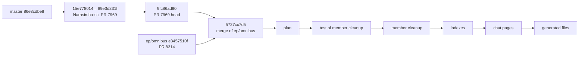
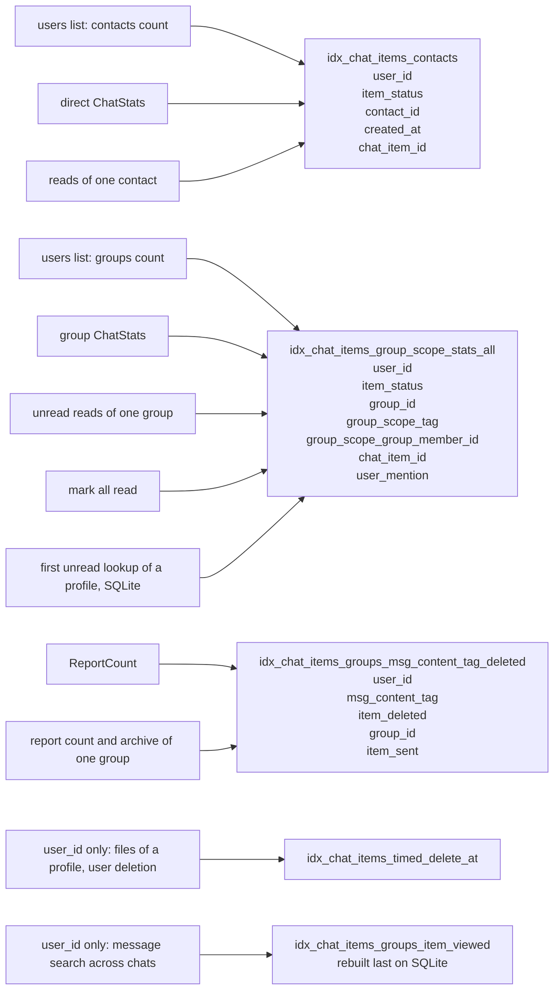
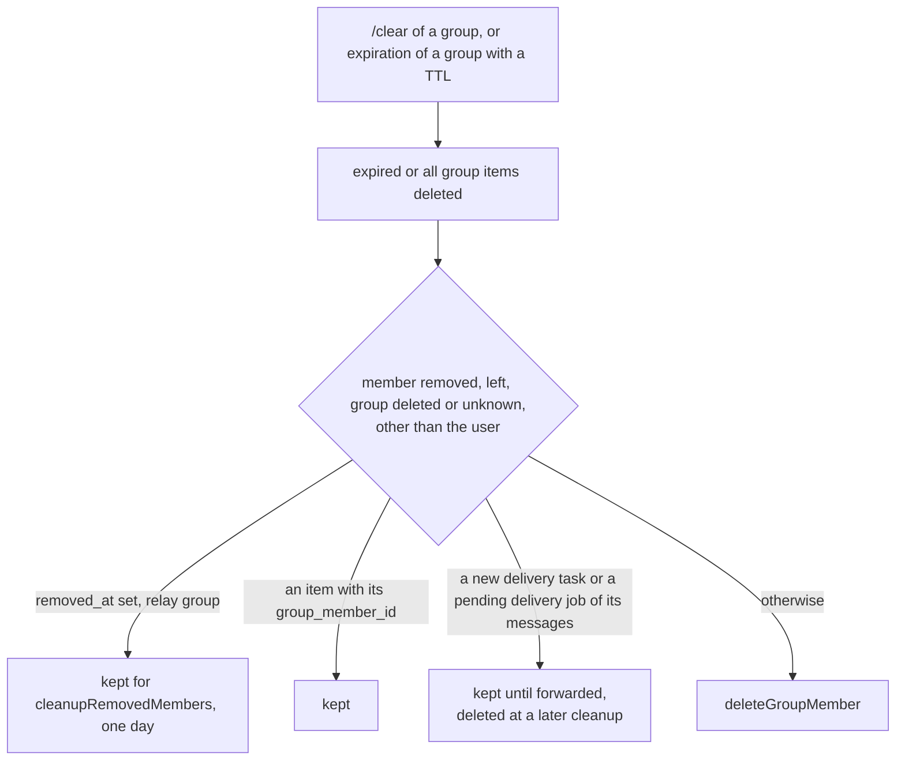
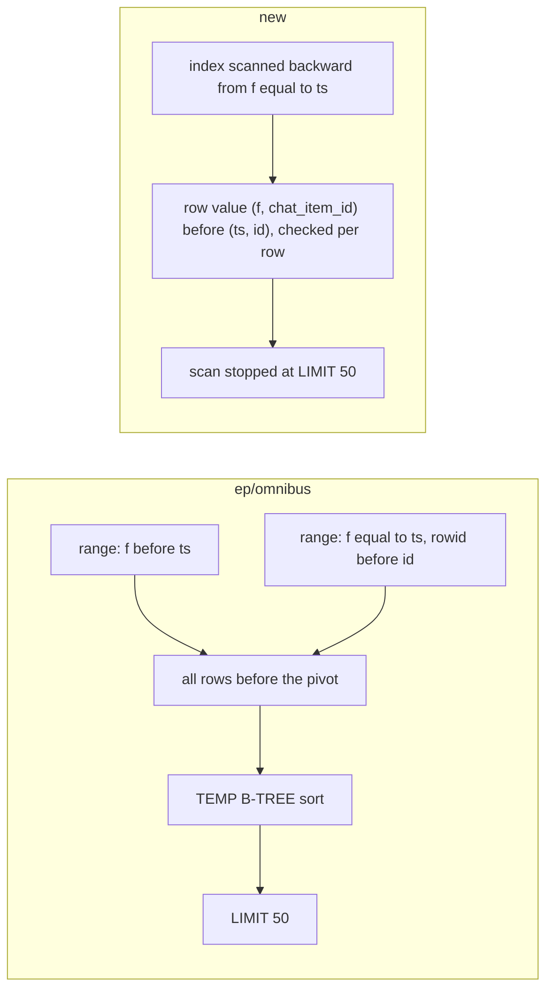
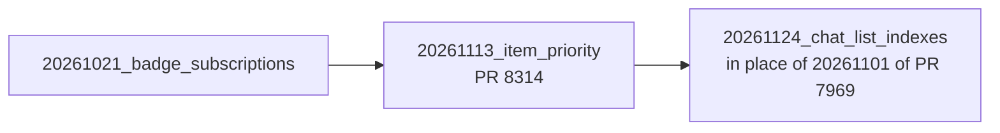
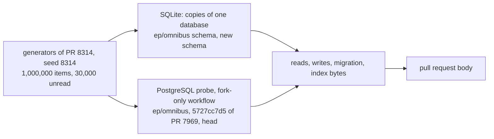
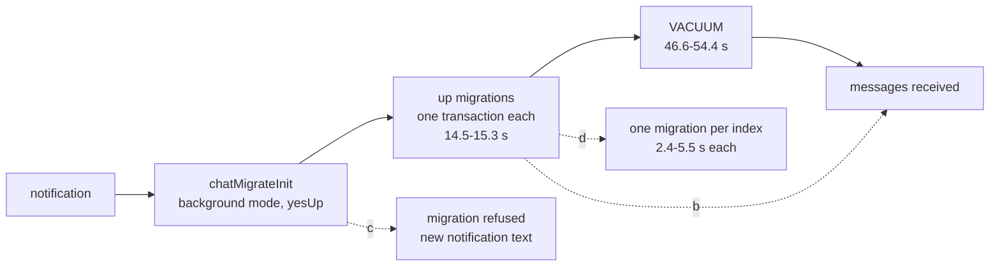

# Chat list, profile switch, member cleanup and chat pages on SQLite and PostgreSQL

Status: implemented on `ep/chat-list-queries`, code at 34371d80f; results in section 7; decisions in section 9. Branch `ep/chat-list-queries`, stacked on #8314 (`ep/omnibus` e3457510f); #7969 by Narasimha-sc is adopted. Problems of q29 in the review of #8314, decided by the maintainer: "q29 - yes, and also adopt the PR by narasimha-sc that makes loading chat list faster - it improved sqlite but not postgres, need to work on both."

Code references: this branch at 5727cc7d5, by file and line; the references added with the review fixes, at eeae6a446; the references added with the decisions of section 9, at 70ff83d12. SQLite plans: `chat_query_plans.txt`, and `EXPLAIN QUERY PLAN` of SQLite 3.45.1 on empty databases of each schema. PostgreSQL plans: probe runs of #8314, PostgreSQL 15.20, 1,000,000 chat items: review run https://github.com/evgeny-simplex/simplex-chat/actions/runs/45197482204 (schema ce3673792) and fixes run https://github.com/evgeny-simplex/simplex-chat/actions/runs/45229293446 (schema 582d0058d, equal to `ep/omnibus`); pg-plans run of #7969 https://github.com/Narasimha-sc/simplex-chat/actions/runs/41325761174.

## 1. Problems

1. With 1,000,000 messages, 290 ms on SQLite and 65 ms on PostgreSQL are spent in the contact and group queries of the chat list.
2. On each profile switch, 240 ms per profile are spent on SQLite in the unread counts of the users list.
3. Members who left or were removed are kept after the expiration of their messages or the clearing of the chat.
4. The time of each page of a long chat, and of each opening of a chat at its first unread message, is proportional to the number of messages before or after the page.

## 2. Branch



- `ep/chat-list-queries` is created from #7969's branch `nd/profile-switch-unread-count`; the authorship of Narasimha-sc's commits is kept.
- `ep/omnibus` is merged in 5727cc7d5 with conflict resolutions only:
  - migration lists and cabal modules: both entries, in ascending order;
  - imports of `tests/ChatTests/Direct.hs`: both sides;
  - SQLite schema: #7969's index before the partial indexes of #8314, in migration order;
  - 11 direct chat list plans: #7969's ChatStats line with the SilentStats lines of #8314, as SQLite reports them for the merged schema;
  - the plan of the replaced `getContactUnreadCount_` text: removed, as in `ep/omnibus`.

## 3. #7969

Changes:
- `M20261101_chat_items_unread_index`, both backends: `idx_chat_items_user_id_item_status` is recreated with more columns.

  | # | before | #7969 |
  |---|---|---|
  | 1 | user_id | user_id |
  | 2 | item_status | item_status |
  | 3 | | contact_id |
  | 4 | | group_id |
  | 5 | | user_mention |

- `getFirstUnreadItemId_` (Messages.hs:2549): `GROUP BY user_id` is appended on SQLite.
- `testUsersUnreadCountQueryPlans` (tests/ChatTests/Direct.hs): plans of the two users list counts and of the first unread lookup, SQLite.

Effect, as measured by Narasimha-sc:

| read | SQLite | PostgreSQL |
|---|---|---|
| users list counts | 0.52 s to 4.4 ms, 2,000,000 messages | 16.9 to 1.9 ms and 7.6 to 2.9 ms, Index Only Scan of the new index |
| direct ChatStats | 77 to 16 ms | the plan of master: Index Scan of `idx_chat_items_item_status`, rows filtered in the heap, 4.4 to 4.9 ms |
| group ChatStats | the plan of master | the plan of master |

On PostgreSQL, the plans of master are kept for the chat list:
- An SQLite index entry consists of its columns and the rowid. `chat_item_id` is the rowid of `chat_items` (shown as `rowid` in `chat_query_plans.txt`), so `MIN(chat_item_id)` of the direct ChatStats is read from #7969's index.
- A PostgreSQL btree entry consists of its columns and a pointer to the heap tuple. With #7969's index, `chat_item_id` of each unread row is read from the heap, so the planner keeps the plan of master, estimated cheaper.
- The group ChatStats has conditions on `group_scope_tag` and `group_scope_group_member_id`. With #7969's index, PostgreSQL reads them from the heap, and SQLite keeps `idx_chat_items_group_scope_stats_all (user_id=? AND group_id>?)`.

## 4. Causes

### 4.1 Chat list

In `findDirectChatPreviews_` (Messages.hs:803) and `findGroupChatPreviews_` (Messages.hs:912), the statistics of all chats of the profile are computed in subqueries and joined to the chats.

| subquery | SQLite | PostgreSQL |
|---|---|---|
| group ChatStats | `idx_chat_items_group_scope_stats_all (user_id=? AND group_id>?)`: every group item of the profile is read, 136 ms | Index Scan of `idx_chat_items_user_id_item_status (user_id, item_status)`; group_id, scope, user_mention and chat_item_id of 29,225 rows are read from the heap (11,529 pages), 40.9 of 50.5 ms |
| group ReportCount | `idx_chat_items_groups_msg_content_tag_deleted (user_id=? AND group_id>?)`: every group item of the profile is read, 101 ms | Index Only Scan of the same index over the range `group_id IS NOT NULL` (1,024 pages), 3.2 ms |
| direct ChatStats | `idx_chat_items_contacts (user_id=? AND contact_id>?)`: every direct item of the profile is read, 12 ms | BitmapAnd of `idx_chat_items_item_status` (30,000 entries) and `idx_chat_items_contact_id` (99,500 entries), 724 heap rows, 10.4 of 14.1 ms |

ReportCount was found in this analysis: with ChatStats changed alone, 117 ms are spent in the group chat list on SQLite.

### 4.2 Users list

In `getUsersInfo` (Profiles.hs:176), three counts per profile are run on each `/users`.

| count | SQLite | PostgreSQL |
|---|---|---|
| contacts | `idx_chat_items_contacts (user_id=?)`: every item of the profile is read, 118 ms | Index Scan of `idx_chat_items_item_status`; user_id of the unread rows of all profiles is read from the heap, 16.9 ms (#7969 run: 2,000,000 items, 10,000 unread in the profile) |
| groups | `idx_chat_items_group_scope_stats_all (user_id=?)`: every item of the profile is read, 120 ms | as contacts, 7.6 ms (#7969 run) |
| silent (#8314) | partial indexes, 3.1 ms | partial indexes, 3.1 ms |

In the #8314 measurement, the first two counts took 145-155 and 126-129 ms on SQLite.

### 4.3 Member cleanup

In `getGroupMembersForExpiration` (Groups.hs:1367), members are selected with `m.group_member_id NOT IN (SELECT DISTINCT group_member_id FROM chat_items)`. `chat_items.group_member_id` is NULL for direct items, notes, channel items and the items sent by the user, except those sent as a member (#8314). With a NULL in the list, `NOT IN` is NULL for every member, so 0 rows are selected on both backends, and members are never deleted by `APIClearChat` (Commands.hs:1473) and `expireGroupChatItems` (Commands.hs:6810).

| | SQLite | PostgreSQL |
|---|---|---|
| plan | `LIST SUBQUERY`, `SCAN chat_items USING COVERING INDEX idx_chat_items_group_member_id` | Parallel Index Only Scan of `idx_chat_items_group_member_id`, 1,000,000 entries |
| time, rows | 46 ms, 0 rows | 68 ms, 0 rows |

### 4.4 Chat pages

In `getChatItemIDs` (Messages.hs:1559), the `CRBefore` page is selected by `((c AND f < ?) OR (c AND f = ? AND chat_item_id < ?)) ORDER BY f DESC, chat_item_id DESC LIMIT ?`, and the `CRAfter` page by its mirror. Both directions are read in `getDirectChatAround'` (Messages.hs:1361), `getGroupChatAround'` (Messages.hs:1708) and `getLocalChatAround'` (Messages.hs:1932), so both texts are executed on each opening of a chat at its first unread message.

| | SQLite | PostgreSQL |
|---|---|---|
| plan | `MULTI-INDEX OR` of two ranges of `idx_chat_items_group_scope_item_ts`, then `USE TEMP B-TREE FOR ORDER BY`: every item before (after) the pivot is read and sorted before `LIMIT` | measured by the probe of section 7 |
| group of 20,000 items | 11.5 ms for the page before the newest item, 5.4 ms for the page after the oldest | |

The same construction is used for direct chats, notes, the member support scope and the content filters: 10 conditions, 2 directions each.

## 5. Changes

### 5.1 Indexes: migration `20261124_chat_list_indexes`

#7969's modules `M20261101_chat_items_unread_index` are renamed to `M20261124_chat_list_indexes` on both backends, in `simplex-chat.cabal` and after `20261113_item_priority` in both `schemaMigrations` lists, with this text:

```sql
DROP INDEX idx_chat_items_user_id_item_status;
DROP INDEX idx_chat_items_contacts;
CREATE INDEX idx_chat_items_contacts ON chat_items(user_id, item_status, contact_id, created_at, chat_item_id);
DROP INDEX idx_chat_items_group_scope_stats_all;
CREATE INDEX idx_chat_items_group_scope_stats_all ON chat_items(user_id, item_status, group_id, group_scope_tag, group_scope_group_member_id, chat_item_id, user_mention);
DROP INDEX idx_chat_items_groups_msg_content_tag_deleted;
CREATE INDEX idx_chat_items_groups_msg_content_tag_deleted ON chat_items(user_id, msg_content_tag, item_deleted, group_id, item_sent);
```

SQLite only, at the end of the up text, `idx_chat_items_groups_item_viewed` is rebuilt with its columns of `M20260403_item_viewed`:

```sql
DROP INDEX idx_chat_items_groups_item_viewed;
CREATE INDEX idx_chat_items_groups_item_viewed ON chat_items(user_id, group_id, item_viewed, item_ts);
```

Without `sqlite_stat1`, SQLite chooses among indexes of equal estimated cost by their order in the schema, the last created first: an index read from the schema is put first in the list of its table (sqlite3.c:119559 of 3.39.2), and a plan of equal or higher cost than a plan found earlier is discarded (`whereLoopFindLesser`, sqlite3.c:156353). The message search reads of `getAllChatItems` (`/search`, `/tail` and `/last_item_id` without a chat name, `/_get items`) are searched by `user_id` only; among the indexes led by `user_id`, the index created last is used: `idx_chat_items_groups_item_viewed` on `ep/omnibus`, `idx_chat_items_groups_msg_content_tag_deleted` without the rebuild, `idx_chat_items_groups_item_viewed` with it. The down text is unchanged. Open as D1 (section 9).

Down migration, the definitions of `ep/omnibus`:

```sql
DROP INDEX idx_chat_items_groups_msg_content_tag_deleted;
CREATE INDEX idx_chat_items_groups_msg_content_tag_deleted ON chat_items(user_id, group_id, msg_content_tag, item_deleted, item_sent);
DROP INDEX idx_chat_items_group_scope_stats_all;
CREATE INDEX idx_chat_items_group_scope_stats_all ON chat_items(user_id, group_id, group_scope_tag, group_scope_group_member_id, item_status, chat_item_id, user_mention);
DROP INDEX idx_chat_items_contacts;
CREATE INDEX idx_chat_items_contacts ON chat_items(user_id, contact_id, item_status, created_at);
CREATE INDEX idx_chat_items_user_id_item_status ON chat_items(user_id, item_status);
```

`idx_chat_items_contacts`

| # | ep/omnibus | new |
|---|---|---|
| 1 | user_id | user_id |
| 2 | contact_id | item_status |
| 3 | item_status | contact_id |
| 4 | created_at | created_at |
| 5 | | chat_item_id |

`idx_chat_items_group_scope_stats_all`

| # | ep/omnibus | new |
|---|---|---|
| 1 | user_id | user_id |
| 2 | group_id | item_status |
| 3 | group_scope_tag | group_id |
| 4 | group_scope_group_member_id | group_scope_tag |
| 5 | item_status | group_scope_group_member_id |
| 6 | chat_item_id | chat_item_id |
| 7 | user_mention | user_mention |

`idx_chat_items_groups_msg_content_tag_deleted`

| # | ep/omnibus | new |
|---|---|---|
| 1 | user_id | user_id |
| 2 | group_id | msg_content_tag |
| 3 | msg_content_tag | item_deleted |
| 4 | item_deleted | group_id |
| 5 | item_sent | item_sent |

`idx_chat_items_user_id_item_status`: dropped.

Indexes of `chat_items` in this change: 4 before, 3 after. Their SQLite bytes at 1,000,000 items: 114.4 MB before, 99.2 MB after. `idx_chat_items_groups_item_viewed` is rebuilt on SQLite with its columns.



Search keys on SQLite:

| read | ep/omnibus | new |
|---|---|---|
| users list, contacts count | `idx_chat_items_contacts (user_id=?)` | `idx_chat_items_contacts (user_id=? AND item_status=?)` |
| users list, groups count | `idx_chat_items_group_scope_stats_all (user_id=?)` | `idx_chat_items_group_scope_stats_all (user_id=? AND item_status=?)` |
| direct ChatStats, 15 texts | `idx_chat_items_contacts (user_id=? AND contact_id>?)` | `idx_chat_items_contacts (user_id=? AND item_status=? AND contact_id>?)` |
| group ChatStats, 15 texts | `idx_chat_items_group_scope_stats_all (user_id=? AND group_id>?)` | `idx_chat_items_group_scope_stats_all (user_id=? AND item_status=? AND group_id>?)` |
| ReportCount, 15 texts | `idx_chat_items_groups_msg_content_tag_deleted (user_id=? AND group_id>?)` | `idx_chat_items_groups_msg_content_tag_deleted (user_id=? AND msg_content_tag=? AND item_deleted=? AND group_id>?)` |
| message search across chats, 3 texts | `idx_chat_items_groups_item_viewed (user_id=?)` | `idx_chat_items_groups_item_viewed (user_id=?)` |

On PostgreSQL each read of this table is expected as an Index Only Scan whose Index Cond includes `item_status` (ReportCount: `msg_content_tag` and `item_deleted`), with `chat_item_id` and `user_mention` read from the index.

Every user of the four indexes: the SQLite plan changes for 74 of 1,011 statements (949 saved in `chat_query_plans.txt`; 62 generated: the 30 chat list texts, the first unread lookup, the page and cleanup texts); the plans of the other 937 are unchanged.

| statements | new plan |
|---|---|
| 2 users list counts, 52 chat list texts | the keys of the table above |
| 14 reads of one chat: unread counts of a contact and of a group (3), first unread of a contact, navigation count of a contact, mark read of a contact and of a group (3), unread timed items (3), report count and archive (3) | the same equality columns, in the order of the new index |
| 2 reads by `user_id` only: files of a profile, user deletion | `idx_chat_items_timed_delete_at (user_id=?)` |
| mark all read (Store/Direct.hs:694) | `idx_chat_items_group_scope_stats_all (user_id=? AND item_status=?)` |
| `SELECT DISTINCT msg_content_tag` of a group | `idx_chat_items_groups_msg_content_tag_item_ts`, the same key |
| `getFirstUnreadItemId_` on SQLite, with `GROUP BY user_id` of #7969 | `idx_chat_items_group_scope_stats_all (user_id=? AND item_status=?)`: the unread entries of the profile are read; of the clients, only the CLI sends `/_get items initial=` (Commands.hs:6904) |
| `getFirstUnreadItemId_` on PostgreSQL, the text of master | `chat_items_pkey`, as on `ep/omnibus` (section 7) |

Adopted parts of #7969:
- `GROUP BY user_id` of `getFirstUnreadItemId_` on SQLite: kept (D2, section 9); the text of master on PostgreSQL.
- `testUsersUnreadCountQueryPlans`: the expected plans of the tables above; the first unread lookup is recorded by its `GROUP BY user_id`, as in #7969; the silent count of #8314 (its text contains `item_priority`) is excluded from the recorded queries of the test.
- `skipComparisonForDownMigrations` (SchemaDump.hs): `20261124_chat_list_indexes` in place of `20261101_chat_items_unread_index`.
- `plans/2026-11-01-profile-switch-unread-counts*.md`: kept, with a first line that points to this section; their sections Fix and Scope are superseded by this plan.

### 5.2 Member cleanup

`getGroupMembersForExpiration` (Groups.hs:1377-1390):

```sql
WHERE m.group_id = ? AND m.user_id = ? AND (m.contact_id IS NULL OR m.contact_id != ?)
  AND m.member_status IN (?, ?, ?, ?)
  AND m.removed_at IS NULL
  AND NOT EXISTS (SELECT 1 FROM chat_items i WHERE i.group_member_id = m.group_member_id)
  AND NOT EXISTS (
    SELECT 1 FROM delivery_tasks t
    WHERE t.sender_group_member_id = m.group_member_id AND t.failed = 0 AND t.task_status = ?
  )
  AND NOT EXISTS (
    SELECT 1 FROM delivery_jobs j
    WHERE j.group_id = m.group_id AND j.worker_scope IN (?, ?) AND j.failed = 0 AND j.job_status = ?
      AND ',' || j.sender_group_member_ids || ',' LIKE '%,' || m.group_member_id || ',%'
  )
```

Parameters of the delivery conditions: `DTSNew`, `DWSGroup`, `DWSMemberSupport`, `DJSPending`.

- `NOT EXISTS` of `chat_items` is the condition of `checkGroupMemberHasItems` (Groups.hs:2624), by which deletion is decided at removal (Internal.hs:2281).
- With `m.removed_at IS NULL`, the members of relay groups marked by `updateGroupMemberRemovedAt` (Groups.hs:2430, called at Internal.hs:2284) are deleted by `cleanupRemovedMembers` (Commands.hs:6687) one day after removal, as today, so that forwarded messages of a removed member are ignored in that day (Subscriber.hs:4093, #7010).
- A member is kept while its messages are pending forwarding by the user: a task with the member as sender, selected by the task worker (`failed = 0 AND task_status = ?`, Store/Delivery.hs:129), or a job of the group whose `sender_group_member_ids` (comma-separated, Store/Delivery.hs:267-271) contains the member, selected by the job worker (`failed = 0 AND job_status = ?`, Store/Delivery.hs:300). Tasks are created by admins of groups without relays and by relays (Subscriber.hs:1033); a task is deleted with its sender and with its message (`ON DELETE CASCADE`, chat_schema.sql:791-792), and the job worker of a group without relays reads its sender with `getGroupMemberById` (Subscriber.hs:4556). On `/clear`, the messages of the group are deleted before the cleanup (`deleteGroupChatItemsMessages`, Messages.hs:240), and with them its tasks, so a member is kept by its pending jobs, whose bodies are stored in `delivery_jobs`; on expiration, the messages newer than the earlier of the TTL cut-off and the 12-hour cut-off are kept (`deleteGroupExpiredCIs`, Messages.hs:3701), and a member is also kept by its new tasks.
- `j.worker_scope IN (?, ?)` lists both worker scopes, so that only the pending jobs of the group are read: SQLite `SEARCH j USING INDEX idx_delivery_jobs_next (group_id=? AND worker_scope=? AND failed=? AND job_status=?)`; without it, `idx_delivery_jobs_group_id (group_id=?)` and every job of the group, kept 7 days after completion (`cleanupDeliveryJobs`, Commands.hs:6702).
- Plans: SQLite `CORRELATED SCALAR SUBQUERY` of each condition: `SEARCH i USING COVERING INDEX idx_chat_items_group_member_id (group_member_id=?)`, `SEARCH t USING INDEX idx_delivery_tasks_sender_group_member_id (sender_group_member_id=?)` and the jobs search above; PostgreSQL: measured by the probe of section 7.
- Each selected member is deleted by `deleteGroupMember` (Groups.hs:2628). By the `ON DELETE` rules of `chat_schema.sql`, the member's id is set to NULL in `chat_items`, `messages`, `chat_item_reactions`, `contacts` and `group_members`, and the rows with the member's id in tables with `ON DELETE CASCADE` are deleted, among them `chat_item_moderations`, `group_member_intros`, `group_snd_item_statuses` and `delivery_tasks`; the items of the member's support chat are deleted earlier, at leave and at removal (`deleteSupportChatIfExists`).
- Cleanup is run on `/clear` of a group and on expiration of a group whose TTL is positive (`withExpirationDate`, Commands.hs:6813).



Test, in `tests/ChatTests/Groups.hs`, run on both backends, with `deliveryWorkerDelay` of 3 s, so that the job that forwards the leave is pending for 3 s after its task is processed: alice is the owner of #team, bob and cath are members (`createGroup3'`); alice sends bob a direct message, so items with NULL `group_member_id` exist; cath leaves #team; when alice has one pending job, alice clears #team, and the member row of cath in alice's database is kept; bob, who forwards nothing, clears #team, and the row of cath in bob's database is deleted; when the job of alice is complete, alice clears #team again, and the row of cath is deleted. On `ep/omnibus` the rows are kept; before the delivery conditions, the row of cath in alice's database was deleted at the first clearing, and the forward of the leave was dropped (run https://github.com/evgeny-simplex/simplex-chat/actions/runs/45299780513: "chat db error: SEGroupMemberNotFound").

Test of expiration, in `tests/ChatTests/Groups.hs` (`testExpireChatKeepLeftMemberUntilForwarded`, line 2386), run on both backends, with `deliveryWorkerDelay` of 3 s, so that the task of the forward of the leave is new for 3 s: alice is the owner of #team, bob and cath are members; cath leaves #team; when alice has one new task, the items of cath in alice's database are set 2 days old; alice sets the TTL of #team to a day, and the member row of cath in alice's database is kept. The message of the task is newer than the cut-off of messages, the earlier of the TTL cut-off and the 12-hour cut-off (one day before the expiration in the test), and is kept with its task (`deleteGroupExpiredCIs`, Messages.hs:3705); the items of cath are deleted. Without the condition of `delivery_tasks`, the row of cath is deleted at this expiration (section 7).

### 5.3 Chat pages

`idsQuery` of `getChatItemIDs` (Messages.hs:1607-1626):

```haskell
      CRAfter ts itemId ->
        rangeQuery (c <> " AND (" <> f <> ", chat_item_id) > (?, ?) ") (p :. (ts, itemId)) (" ORDER BY " <> f <> " ASC, chat_item_id ASC ")
      CRBefore ts itemId ->
        rangeQuery (c <> " AND (" <> f <> ", chat_item_id) < (?, ?) ") (p :. (ts, itemId)) (" ORDER BY " <> f <> " DESC, chat_item_id DESC ")
```

`orCond`, `orParams` and their comment are removed. The saved plans of the OR texts are removed from `chat_query_plans.txt`.



SQLite plan: `SEARCH chat_items USING COVERING INDEX idx_chat_items_group_scope_item_ts (user_id=? AND group_id=? AND group_scope_tag=? AND group_scope_group_member_id=? AND item_ts<?)`, without `TEMP B-TREE`; one ordered range of its index for each of the 10 conditions in both directions. The rows of the two texts were equal for 3,200 pages over 5,000 rows with 21 distinct timestamps (SQLite 3.45.1). PostgreSQL is expected to use the row comparison, whose second column is outside the index, as the bound `f <= ts` with the full comparison as a filter; measured by the probe.

## 6. Migration order



Databases with `20261101_chat_items_unread_index` applied exist only from builds of #7969's branch.

The iOS notification service applies up-migrations (NotificationService.swift:888 with `defaultMigrationConfirmation`, API.swift:374). Four indexes of `chat_items` are built in this migration on SQLite, three on PostgreSQL; two were built in `M20260403_item_viewed`. Open as D3 (section 9).

## 7. Measurement



SQLite: the database of the #8314 measurement (its generator, seed 8314), the pragmas of the app (busy_timeout 100, foreign_keys ON, secure_delete ON, auto_vacuum FULL), statements prepared per call, without `sqlite_stat1`; one cold run after the pages of the file are dropped from the OS cache, then 15 warm runs alternating the databases; rows compared by digest. The plans of the bundled SQLite 3.39.2 are those of `chat_query_plans.txt` written in CI ("verify and overwrite query plans").

PostgreSQL: a fork-only workflow on the model of `pg-probe-8314`, PostgreSQL 15 service container; `gen_data.py` seed 8314 loaded into three databases with the schemas of `ep/omnibus`, of 5727cc7d5 (#7969) and of the head; `VACUUM (ANALYZE)`; reads: 2 warm-up runs, then 10 runs of `EXPLAIN (ANALYZE, BUFFERS)` alternating the databases; writes: rolled back, with WAL bytes; the branch is deleted after the run.

Statements:
- the 3 users list counts;
- the 30 chat list texts;
- every statement of section 5.1 with a changed SQLite plan, in its PostgreSQL text;
- `getFirstUnreadItemId_`, the text of master and the text of #7969, for a profile with 30,000 unread items and for a profile without unread items;
- reads by `user_id` only: the message search across chats of the CLI, 4 texts, and the files of a profile;
- pages, old and new text: main scope and member support scope of group 17 (20,000 items), contact 42 (5,000 items) and the notes, before and after, at the newest, a middle and the oldest item;
- member cleanup, old and new text, group 17 and another group with inactive members;
- writes: chat item insert, mark read of a contact, of a group and of all chats, TTL deletion;
- migration up and down: time per statement, on a copy of the `ep/omnibus` database;
- bytes of the four indexes.

Acceptance:
- the users list counts, ChatStats and ReportCount use the keys of section 5.1 on SQLite, and Index Only Scans with `item_status` (`msg_content_tag`) in Index Cond on PostgreSQL;
- other statements are at most 20% or 2 ms slower than on `ep/omnibus`, on either backend; the migration time is reported;
- the page rows equal those of the OR text at every pivot;
- the cleanup test fails on the commit of the test and passes on the head, on SQLite and PostgreSQL;
- the expiration test fails without the condition of `delivery_tasks` and passes on the head, on SQLite and PostgreSQL.

Results at 8f64fbc6c, the code of eeae6a446: `ep/omnibus` against the head, 111 statements on each backend. SQLite 3.45.1: two copies of the #8314 database, one with the `ep/omnibus` schema and one migrated by the up text of the head, both vacuumed; warm medians of 20 runs, 5 for reads with a cold run over 1 s; cold: one run, and the median of 3 cold runs for the first unread lookup and the message search. PostgreSQL 15.20: probe run https://github.com/evgeny-simplex/simplex-chat/actions/runs/45341717900, two databases, data digests equal, medians of 10 runs of planning and execution. In ms.

| read | SQLite ep/omnibus | SQLite head | PostgreSQL ep/omnibus | PostgreSQL head |
|---|---|---|---|---|
| users list, contacts count | 119.3 | 3.3 | 1.45 | 0.67 |
| users list, groups count | 205.0 | 8.6 | 5.69 | 5.72 |
| users list, silent count | 2.63 | 2.70 | 3.39 | 3.38 |
| direct chat list, all chats | 23.4, cold 252 | 4.1, cold 250 | 14.13 | 3.78 |
| 15 direct chat list texts | 11.9-23.4 | 1.0-4.1 | 11.24-14.13 | 1.00-3.78 |
| group chat list, all chats | 238.3, cold 634 | 14.1, cold 285 | 24.87 | 12.25 |
| group chat list texts: 14 on SQLite, 15 on PostgreSQL | 214.5-246.1 | 9.9-14.1 | 21.99-26.60 | 9.23-13.48 |
| unread count of group 17 | 0.24 | 0.22 | 0.49 | 0.51 |
| first unread lookup, profile with 30,000 unread items | 0.049, cold 2.9 | 4.36, cold 11.4 | 7.48 | 7.46 |
| first unread lookup, profile without unread items | 0.154, cold 2.8 | 0.042, cold 3.1 | 0.26 | 0.26 |
| message search, last 100 (`/search`) | 4,201, cold 9,026 | 4,304, cold 9,381 | 367.9 | 365.6 |
| message search, 100 after the middle item | 2,055, cold 5,342 | 2,002, cold 5,303 | 353.4 | 350.9 |
| message search, 100 before the middle item | 1,954, cold 4,054 | 2,043, cold 4,025 | 355.5 | 353.6 |
| last item, empty search (`/last_item_id`) | 3,830, cold 8,898 | 3,750, cold 8,789 | 460.8 | 458.5 |
| member cleanup of group 17 | 57.8, 0 rows | 0.65, 0 rows | 84.02, 0 rows | 1.82, 5 rows |
| member cleanup of group 89 on SQLite, 64 on PostgreSQL | 53.8, 0 rows | 0.60, 1 row | 83.83, 0 rows | 1.80, 2 rows |
| page before the newest item of group 17 | 19.1 | 0.29 | 0.33 | 0.31 |
| page after the oldest item of group 17 | 9.4 | 0.25 | 0.33 | 0.28 |
| page before the middle item of group 17 | 5.75 | 0.20 | 4.14 | 0.31 |
| pages around the newest viewed item of group 17, 75 each | 12.2 | 0.23 | 0.66 | 0.54 |
| pages around the middle item of group 17, 200 each | 11.5 | 0.46 | 10.25 | 0.75 |
| pages around the middle item of contact 42, 200 each | 2.9 | 0.35 | 7.70 | 0.67 |

- Plans changed since 37187229a, by the saved 3.39.2 plans and by SQLite 3.45.1: the first unread lookup, `idx_chat_items_item_status (item_status=?)` in place of `idx_chat_items_group_scope_stats_all (user_id=? AND item_status=?)`, and again `idx_chat_items_group_scope_stats_all (user_id=? AND item_status=?)` with the text of #7969 since 152c25a2f; the 3 message search texts, `idx_chat_items_groups_item_viewed (user_id=?)`, as on `ep/omnibus`; member cleanup, the two delivery conditions. On PostgreSQL, the cleanup plan alone, compared with run https://github.com/evgeny-simplex/simplex-chat/actions/runs/45314570894 of 37187229a: two Nested Loop Anti Joins added, tasks by Bitmap Index Scan of `idx_delivery_tasks_sender_group_member_id`, jobs by Seq Scan, as `delivery_jobs` is empty in the generated data; with 20,000 jobs, Index Scan of `idx_delivery_jobs_next` (https://github.com/evgeny-simplex/simplex-chat/actions/runs/45326908038).
- The SQLite head values of the first unread lookup are the text of #7969 (D2, section 9), measured in the same session on the head copy, one cold run each. The text of master on the head schema: 0.049 ms (cold 4.8) for the profile with 30,000 unread items, and 44.6 ms (cold 933) for the profile without unread items, as the unread entries of all profiles are read in `idx_chat_items_item_status` with their table rows.
- Slower than `ep/omnibus` by more than 20% and 2 ms: on SQLite, the first unread lookup of a profile with 30,000 unread items, 0.049 to 4.36 ms; the unread entries of the profile are read in `idx_chat_items_group_scope_stats_all` (D2).
- On PostgreSQL every statement is within the criterion; the largest relative increase is 24%, 0.10 ms: the page before the newest item of the member support scope, 0.43 to 0.53 ms.
- Rows are equal on both sides, except member cleanup and the files of a profile, whose text has no `ORDER BY`: equal as sets on SQLite, 136,175 rows; one plan on both PostgreSQL databases, with parallel workers.
- Subqueries of the chat list on SQLite, measured before the review fixes, with the search keys of the head: direct ChatStats 12.1 to 0.66 ms, group ChatStats 136.2 to 7.2 ms, ReportCount 101.3 to 0.63 ms.
- Writes, rolled back, SQLite and PostgreSQL: mark all chats read 4,445 to 4,386 and 5,906 to 4,657; TTL deletion of group 17 3,378 to 3,196 and 358 to 361; insert of 1,000 items of group 17 324 to 316 and 245 to 243.
- Migration on SQLite, the up text of the head on a copy of the `ep/omnibus` database, first statement cold: 15.3 s, commit 1.9 s included, then VACUUM 46.6 s (45.7 s on the `ep/omnibus` copy); quick_check ok; the file is 1,560,313,856 bytes after the migration and after VACUUM, as `auto_vacuum` is FULL. PostgreSQL: 5.4 s up, 5.4 s down.

Results on PostgreSQL 15.20: probe run https://github.com/evgeny-simplex/simplex-chat/actions/runs/45296525730 (schema of d27b96924 as new), 1,000,000 items, 30,000 unread, data digests equal in the three databases; medians of 10 runs of planning and execution, in ms.

| read | ep/omnibus | 5727cc7d5 (#7969) | new | new plan |
|---|---|---|---|---|
| users list, contacts count | 1.22 | 0.51 | 0.55 | Index Only Scan `idx_chat_items_contacts` (user_id, item_status) |
| users list, groups count | 4.51 | 5.82 | 4.54 | nested loop over groups, Index Only Scan `idx_chat_items_groups_user_mention`, as on `ep/omnibus` |
| users list, silent count | 2.35 | 2.35 | 2.35 | partial indexes of #8314 |
| first unread lookup | 5.16 | 5.20 | 5.14 | `chat_items_pkey`, as on `ep/omnibus` |
| direct ChatStats | 8.63 | 0.49 | 0.30 | Index Only Scan `idx_chat_items_contacts` (user_id, item_status, contact_id) |
| group ChatStats | 27.34 | 27.03 | 5.50 | Index Only Scan `idx_chat_items_group_scope_stats_all`, all 5 conditions in Index Cond |
| ReportCount | 1.06 | 1.05 | 0.25 | Index Only Scan `idx_chat_items_groups_msg_content_tag_deleted`, all 5 conditions in Index Cond |
| 15 direct chat list texts | 9.04-10.87 | 0.97-2.81 | 0.75-2.65 | |
| 15 group chat list texts | 31.74-35.48 | 32.56-37.24 | 7.21-11.83 | |
| content tags of group 17 | 29.80 | 31.29 | 31.95 | `idx_chat_items_groups_user_mention` in place of `idx_chat_items_groups_msg_content_tag_deleted` |

Old and new text on the new database:

| read | old text | new text |
|---|---|---|
| page before the middle item of group 17, 19,782 items | 3.69 | 0.22 |
| page after the middle item of group 17 | 3.34 | 0.22 |
| page before the middle item of contact 42, 20,000 items | 3.16 | 0.21 |
| member cleanup of group 17 | 51.34, 0 rows | 0.67, 5 rows |
| member cleanup of group 61 | 50.88, 0 rows | 0.56, 0 rows |

- New page text: Index Scan Backward of `idx_chat_items_groups_item_ts` with `item_ts <= ts` in Index Cond and the row comparison as Filter, then Incremental Sort and Limit; with the old text, the same index is read from the newest item of the group, and 9,986 rows are removed by Filter (8,913 buffers against 44).
- New cleanup text: Nested Loop Anti Join over `idx_chat_items_group_member_id`.
- Page rows of the two texts are equal in the 24 measured pages and in 2,698 more pages of the four chats.
- Writes on `ep/omnibus`, 5727cc7d5 and new, execution in ms, rolled back: mark all chats read 7,872, 8,267, 7,901; mark group 17 read 209, 197, 195; TTL deletion of group 17 270, 250, 245; insert of 1,000 items of group 17 118, 115, 114.
- Bytes of the four indexes: 251.6 MB on `ep/omnibus`, 262.8 MB on the new schema; `chat_item_id` is stored in `idx_chat_items_contacts`, as a btree entry of PostgreSQL references the heap tuple.
- Migration: 4.9 s up, 4.9 s down.

Results of the review fixes on SQLite 3.45.1, in one session: three copies of the #8314 database, with the `ep/omnibus` schema, migrated by the up text without the rebuild of `idx_chat_items_groups_item_viewed`, and migrated with it, both vacuumed; one cold run, then warm medians of 3 runs (message search) or 15 runs, in ms; rows equal in the three copies.

| read | ep/omnibus | without rebuild | with rebuild |
|---|---|---|---|
| message search, last 100 | 3,363, cold 9,031 | 3,884, cold 49,437 | 3,385, cold 8,957 |
| message search, 100 after the middle item | 1,695, cold 5,405 | 3,785, cold 49,065 | 1,735, cold 5,243 |
| message search, 100 before the middle item | 1,783, cold 3,766 | 3,630, cold 48,172 | 1,687, cold 3,796 |
| last item, empty search (`/last_item_id`) | 3,458, cold 8,641 | 4,077, cold 49,945 | 3,388, cold 9,846 |
| group chat list, all chats | 240.9, cold 441 | 13.83, cold 172 | 13.85, cold 168 |
| direct chat list, all chats | 14.31, cold 144 | 2.80, cold 115 | 2.85, cold 120 |
| users list, contacts count | 122.9 | 3.46 | 3.32 |
| users list, groups count | 121.7 | 5.50 | 5.64 |
| report count of group 17 | 0.04 | 0.04 | 0.04 |
| content tags of group 17 | 71.6 | 67.8 | 68.8 |
| first unread lookup, profile with 30,000 unread | 0.097, cold 2.8 | 0.098, cold 5.4 | 0.096, cold 5.1 |
| first unread lookup, profile without unread items, 30,000 unread in another profile | 0.193, cold 3.0 | 52.6, cold 943 | 58.2, cold 989 |

- The first unread lookup is the text of master; with `GROUP BY user_id` on the new schema: 5.21 ms (cold 17.5) and 0.04 ms (cold 3.3) for the two profiles.
- Migration, up text on copies of the `ep/omnibus` database, first statement cold: 14.4 s without the rebuild (commit 2.7 s), then VACUUM 57.3 s; 14.5 s with it (commit 1.7 s; the rebuild 0.39 s and 1.91 s), then VACUUM 54.4 s; quick_check ok. The review measurement of the up text without the rebuild: 19.5 s, then VACUUM 75.8 s.
- Member cleanup, on the copy migrated without the rebuild: group 61, 0.168 ms with the text of commit 3 and 0.258 ms with the delivery conditions, 7 rows each; after 20,000 completed jobs, a pending job with a candidate among its 3 senders and a new task of another candidate are added to group 61 (rolled back): 0.128 ms and 7 rows with the text of commit 3, 0.194 ms and 5 rows with the delivery conditions, 28.99 ms without `j.worker_scope IN (?, ?)`.

Member cleanup on PostgreSQL 15.20: probe run https://github.com/evgeny-simplex/simplex-chat/actions/runs/45326908038 (schema of f93a3156e, data of `gen_data.py` seed 8314); medians of 10 runs, planning and execution, in ms.

| read | text of commit 3 | with the delivery conditions |
|---|---|---|
| group 17 | 0.775, 5 rows | 1.612, 5 rows |
| group 61 | 0.571, 0 rows | 1.228, 0 rows |
| group 17, after 20,000 completed jobs, a pending job with a candidate among its 3 senders and a new task of another candidate | 0.721, 5 rows | 1.503, 3 rows |

- Plan: Nested Loop Anti Join; tasks by Bitmap Index Scan of `idx_delivery_tasks_sender_group_member_id`, one loop per candidate; jobs by one Index Scan of `idx_delivery_jobs_next` with `group_id`, `worker_scope = ANY`, `failed` and `job_status` in Index Cond. Execution 0.176 and 0.251 ms; planning 0.55 and 1.25 ms.
- Without `j.worker_scope IN (?, ?)`: Index Cond without `worker_scope`, 18 buffers against 5, execution 0.275 ms.

CI of the reduced build:
- the cleanup test, as alice clears the chat, fails on 7ae07e459 on SQLite and PostgreSQL (https://github.com/evgeny-simplex/simplex-chat/actions/runs/45293671447);
- the cleanup test, as bob clears the chat (commit 8), fails on 7ae07e459 on SQLite and PostgreSQL (https://github.com/evgeny-simplex/simplex-chat/actions/runs/45303423558, a temporary branch of 7ae07e459 and commit 8);
- the tests of section 8 pass on d27b96924 except "verify and overwrite query plans" (https://github.com/evgeny-simplex/simplex-chat/actions/runs/45295704428), whose patch is commit 6;
- with the test of commit 10, alice's database before and after the clearing: one task of cath with status `new` and no job before, no task and no row of cath after; the task is deleted with the messages of the group (https://github.com/evgeny-simplex/simplex-chat/actions/runs/45329677603, a temporary branch of commit 14 with the rows printed);
- the cleanup test of commit 15 fails without the delivery conditions, on SQLite and PostgreSQL, at the first clearing by alice, after the pending job is found (https://github.com/evgeny-simplex/simplex-chat/actions/runs/45331692413, a temporary branch of commit 10 and the test of commit 15);
- on commit 14, "verify and overwrite query plans" and the cleanup test of commit 10 fail (https://github.com/evgeny-simplex/simplex-chat/actions/runs/45326659814); the patch of the plans is commit 16;
- the tests of section 8 pass on commit 16 on PostgreSQL, and on SQLite except "verify and overwrite query plans" (https://github.com/evgeny-simplex/simplex-chat/actions/runs/45331833208), whose patch, the plan of the pending jobs count of the test, is commit 17;
- the expiration test of commit 21 fails without the condition of `delivery_tasks`, on SQLite and PostgreSQL: the row of cath is deleted at the expiration (https://github.com/evgeny-simplex/simplex-chat/actions/runs/45349877773, a temporary branch of commit 21 without the condition);
- on commit 21, the tests of section 8 pass on PostgreSQL, 486 examples, and on SQLite except "verify and overwrite query plans", 498 examples (https://github.com/evgeny-simplex/simplex-chat/actions/runs/45349740040); its patch, the plans of the 8 queries of group expiration and of the test, is commit 22;
- the tests of section 8 pass on commit 22, 498 examples on SQLite and 486 on PostgreSQL (https://github.com/evgeny-simplex/simplex-chat/actions/runs/45353654557); on PostgreSQL, the first attempt failed at "delete user", as "completed deleting user" (`DEL_USER` of the agent) was not shown within 20 s, and the re-run of the job passed; the test passed on commit 21.

## 8. Commits

1. `docs: plan for faster chat list and pages, member cleanup`
2. `tests: member cleanup after the chat is cleared`, failing on its own commit
3. `core: delete members without messages after expiration or clearing`
4. `core: faster chat list and profile switch on SQLite and PostgreSQL`
5. `core: faster pages of long chats`
6. `core: update query plans`, from the CI artifact of the generated files
7. `docs: PostgreSQL results of the chat list plan`
8. `tests: clear the chat as a member in the member cleanup test`
9. `docs: member cleanup test and delivery jobs in the chat list plan`
10. `tests: member cleanup while a forward of the member is pending`, failing on its own commit
11. `core: keep left members until their messages are forwarded`
12. `core: faster first unread message lookup on SQLite`
13. `core: faster search and tail across all chats on SQLite`
14. `docs: point the profile switch plans to the chat list plan`
15. `tests: wait for the pending forward in the member cleanup test`
16. `core: update query plans`, from the CI artifact of the generated files of commit 14, without the entries of the replaced texts of `getFirstUnreadItemId_` and `getGroupMembersForExpiration`
17. `core: update query plans`, from the CI artifact of the generated files of commit 16
18. `docs: review fixes in the chat list plan`
19. `docs: measurements of the chat list plan at the head`
20. `core: faster first unread lookup when other profiles have unread items`, the text of #7969 on SQLite, as before commit 12 (D2)
21. `tests: member expiration while a forward of the member is pending`
22. `core: update query plans`, from the CI artifact of the generated files of commit 21
23. `docs: decisions in the chat list plan`
24. `docs: cut-off of expired messages in the chat list plan`

Tests of the reduced build:

```
/SimpleX chat client/direct tests/
/SimpleX chat client/group tests/
/SimpleX chat client/local chats tests/
/SimpleX chat client/chat list pagination tests/
/Schema dump/
/Postgres schema dump/
/Save query plans/
```

## 9. Decisions

| ID | state | decision |
|---|---|---|
| D1 | open, for the maintainer | SQLite: `idx_chat_items_groups_item_viewed` rebuilt at the end of the up text (03c80b347) |
| D2 | decided | SQLite: `getFirstUnreadItemId_` with `GROUP BY user_id` of #7969 (152c25a2f) |
| D3 | open, for the maintainer | up-migration and VACUUM in the iOS notification service extension |

D1:
- Reads by `user_id` only (`/search`, `/tail` and `/last_item_id` without a chat name, `/_get items`): `idx_chat_items_groups_item_viewed (user_id=?)`, as on `ep/omnibus`; without the rebuild, `idx_chat_items_groups_msg_content_tag_deleted (user_id=?)`, the index created last by the up text (section 5.1).
- Last 100 messages (section 7, review fixes): 3,385 ms, cold 8,957 with the rebuild; 3,884 ms, cold 49,437 without it; 3,363 ms, cold 9,031 on `ep/omnibus`.
- Cost of the rebuild at 1,000,000 items: 2.4 s of the up text (drop 0.38 s, create 1.99 s).
- Code comment proposed above the rebuild in the SQLite up text, awaiting approval:
  ```sql
  -- rebuilt last: for reads by user_id, SQLite uses the last created of equal-cost indexes
  ```

D2:
- With `GROUP BY user_id`, worst case: 4.4-5.2 ms warm, 17.5 ms cold, a profile with 30,000 unread items.
- With the text of master: 44.6-58.2 ms warm, 933-989 ms cold, a profile without unread items while another profile has 30,000.
- Sent only by the CLI: `/_get items initial=` (Commands.hs:6904).
- PostgreSQL: the text of master, `chat_items_pkey`.

D3:
- The extension calls `chatMigrateInit` with `backgroundMode: true` and `defaultMigrationConfirmation()` (NotificationService.swift:888): `.yesUp`, unless the user confirms database upgrades (API.swift:374).
- `mobileDbOpts` sets `vacuumOnMigration = True` in every mode (Options/SQLite.hs:107).
- simplexmq b7339d94 applies each up migration in its own transaction, then VACUUM once; with no up migrations, VACUUM is not run (`run`, Migrations.hs:43-48).
- iOS gives the extension about 30 s.
- Measured on SQLite at 1,000,000 items on the desktop, the up text of the head (section 7): 14.5-15.3 s, then VACUUM 46.6-54.4 s; the file has the same size after the migration and after VACUUM, as `auto_vacuum` is FULL.



Options:
- a. accept: 62-69 s at 1,000,000 items on the desktop; an extension stopped during VACUUM leaves the migrations applied, and VACUUM is not repeated.
- b. recommended: VACUUM skipped in background mode, a separate core change, measured on a device: 14.5-15.3 s on the desktop; VACUUM is then not run for these migrations.
- c. the extension refuses migrations, with a new notification text, a UX decision: 0 s in the extension; the migration runs at the next app start.
- d. one migration per index, each committed: `idx_chat_items_contacts` with the drop of `idx_chat_items_user_id_item_status` 5.5 s, `idx_chat_items_group_scope_stats_all` 3.1 s, `idx_chat_items_groups_msg_content_tag_deleted` 2.4 s, `idx_chat_items_groups_item_viewed` 2.4 s; VACUUM still runs after all of them.
