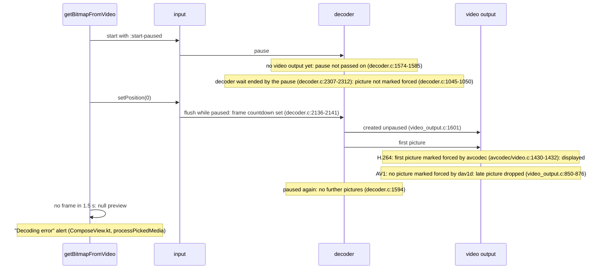

# Desktop: attach AV1 videos as videos

## 1. Problem

The desktop app rejects every AV1 video attached as a video with "Decoding error: The video cannot be decoded". H.264 videos attach.

## 2. Cause

libVLC 3.0.23 (simplex-chat/vlc v3.0.23-2, revision 92ddd6d); vlcj 4.8.3. In `getBitmapFromVideo` (VideoPlayer.desktop.kt), the preview player is started with `startPaused`, and one frame is awaited for 1.5 s. vlcj `startPaused` starts the media with `:start-paused`, then calls `setPosition(0)`.

The plugins and the code path are the same in the Linux, macOS and Windows builds of v3.0.23-2; the failure was reproduced on Linux only.

## 3. Change

`vlcPreviewFactory` (RecAndPlay.desktop.kt) is created with `--no-drop-late-frames`. The option is read only at video_output.c:1600 and used only at video_output.c:850 and 864.

Users of `vlcPreviewFactory`:

| Caller | Effect |
|---|---|
| `getBitmapFromVideo`, attaching a video | the first picture is passed to the callback |
| `getBitmapFromVideo`, received video previews | the first picture is passed to the callback |
| `hasVideoTrack` | none: parsing only, no video output |

`vlcFactory` is used for playback and is unchanged.

Unverified: on macOS, the videotoolbox decoder is not disabled by `--avcodec-hw=none` and marks no first picture forced (videotoolbox.m), so H.264 previews there may be dropped the same way; the change applies to them too.

## 4. Acceptance

| Check | Base | Change |
|---|---|---|
| AV1 1080x1920 + xHE-AAC, pasted into a chat | "Decoding error" | preview shown, sent as video |
| AV1 360x640 and 1080x1920, without audio | "Decoding error" | preview shown |
| H.264 1080x1920 | preview shown | preview shown |
