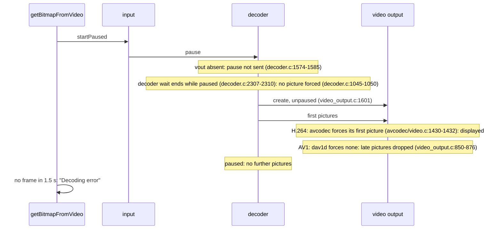

# Desktop: attach AV1 videos as videos

## 1. Problem

The desktop app rejects every AV1 video attached as a video with "Decoding error: The video cannot be decoded". H.264 videos attach.

## 2. Cause

libVLC 3.0.23 (simplex-chat/vlc v3.0.23-2, revision 92ddd6d). `getBitmapFromVideo` (VideoPlayer.desktop.kt) starts the preview player paused and waits 1.5 s for one frame.

## 3. Change

`vlcPreviewFactory` (RecAndPlay.desktop.kt) is created with `--no-drop-late-frames`. The option is read only at video_output.c:1600 and used only at video_output.c:850 and 864.

Users of `vlcPreviewFactory`:

| Caller | Effect |
|---|---|
| `getBitmapFromVideo`, attaching a video | the first picture reaches the callback |
| `getBitmapFromVideo`, received video previews | the first picture reaches the callback |
| `hasVideoTrack` | none: parsing only, no video output |

Playback uses `vlcFactory`, unchanged.

## 4. Acceptance

| Check | Base | Change |
|---|---|---|
| AV1 1080x1920 + xHE-AAC, pasted into a chat | "Decoding error" | preview shown, sent as video |
| AV1 360x640 and 1080x1920, without audio | "Decoding error" | preview shown |
| H.264 1080x1920 | preview shown | preview shown |
