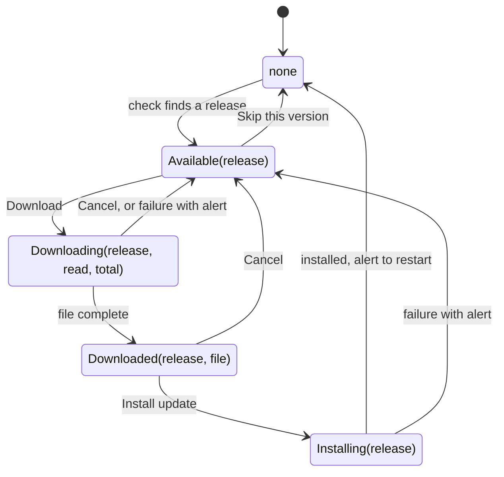
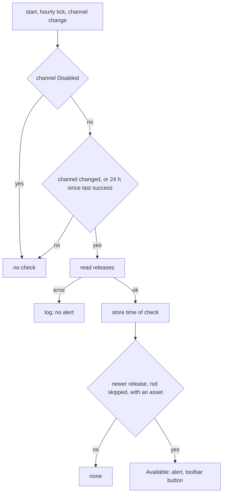

# Desktop: update reminders, download progress, install location

Branch: `sh/desktop-update-flow`.
Base: master `6edc16f7b`.

Citations: paths under `apps/multiplatform/common/src/` at the base; `AppUpdater.kt` is `desktopMain/kotlin/chat/simplex/common/views/helpers/AppUpdater.kt`.

## 1. Problems

1. After "Remind later", the alert of an available update returns only after 24 hours of running time, or at the next start of the app.
2. A started download is shown by a 2.5-second message and an unlabelled ring in the chat list toolbar; a failed download is shown nowhere.
3. After an update on macOS, the app can open with the database downgrade error.

Today, in code:

| Fact | Code |
|---|---|
| "Remind later" closes the alert only | AppUpdater.kt:252-256 |
| The next check is a `delay` of 24 hours after the previous one, on a monotonic clock | AppUpdater.kt:170-176 |
| The check runs at start and after a change of the channel | desktop Main.kt:40; SettingsView.desktop.kt:24 |
| The download start is a toast of 2.5 s at the bottom of the window | AppUpdater.kt:286; UI.kt:6; DesktopApp.kt:165-182 |
| The download progress is a 32sp ring without text in the toolbar; hover shows a cancel icon | commonMain ChatListView.kt:551-566; CIFileView.kt:371-383 |
| The progress is a `Float?`, with -1 for installing | ChatModel.kt:269; AppUpdater.kt:228, 291, 347 |
| A failed download is logged only, and the ring disappears | AppUpdater.kt:381-383, 233 |
| macOS install always replaces `/Applications/SimpleX.app`, wherever the running app is | AppUpdater.kt:474-475 |
| The result of the rename of the old bundle is ignored; `cp -R` then copies into the existing bundle | AppUpdater.kt:474-476 |
| The checker offers only releases newer than the installed version | AppUpdater.kt:194-195 |
| The chat and agent migrations of releases v7.0.0 to v7.1.4 only grow | Migrations.hs of each tag; agent App.hs of each pinned simplexmq commit |

From the last two facts, a downgrade error after an update requires an older app opening a database that a newer app migrated. The macOS install path leaves an older app in place when the running app is outside `/Applications/SimpleX.app`. Confirmation is requested from the reporter: the error screen lists the app version and the migrations (commonMain DatabaseErrorView.kt:120-143).

## 2. Behaviour

### Available update

- A check that finds a release shows the alert, as today, and sets the available update.
- While an update is available and not skipped, the chat list toolbar has the button "Update available"; a click opens the alert again.
- "Skip this version" clears the available update.

### Checks

- A check is due when 24 hours of wall-clock time passed since the last successful check.
- The checker evaluates "due" every hour and at start; the time of the last successful check is stored in the preferences.
- A check after a change of the channel runs at once, as today.

### Download

- During the download, a banner above the chat list shows the release name, the downloaded and total size, a progress bar and "Cancel".
- During the install, the banner shows "Installing" without "Cancel".
- A failed download shows the alert "Update not downloaded" with "Retry", "Open in browser" (the release page) and "Close".
- A download cancelled by the user shows no alert.
- A failed background check stays in the log only.

### Install on macOS

- The target is the `.app` bundle of the running app, the ancestor of `jpackage.app-path` with the extension `.app`.
- The rename of the old bundle and the copy are checked; on a failure, the old bundle is restored, the folder of the downloaded file is opened and the alert "Update not installed" is shown.

## 3. Types

`AppUpdate`, in ChatModel, replaces `updatingProgress` and `updatingRequest`:

| Constructor | Fields |
|---|---|
| Available | release |
| Downloading | release asset bytesRead contentLength cancel |
| Downloaded | release file |
| Installing | release |

ChatModel:

| Field | Type |
|---|---|
| appUpdate | MutableState&lt;AppUpdate?&gt; |

AppPreferences:

| Field | Type | Key | Default |
|---|---|---|---|
| appUpdateLastCheck | Long | AppUpdateLastCheck | 0 |

## 4. Changes

| File | Change |
|---|---|
| AppUpdater.kt | AppUpdate states; hourly due check; failure alert; macOS target from the running bundle, with checked rename and copy |
| ChatModel.kt | appUpdate in place of updatingProgress and updatingRequest |
| SimpleXAPI.kt | appUpdateLastCheck |
| ChatListView.kt | toolbar button "Update available"; download banner in place of the ring |
| SettingsView.kt | modal closed on the start of a download, as today, from appUpdate |
| base strings.xml | "Update available", banner, failure alerts |
| AppUpdaterTest.kt | due check, macOS bundle of an app path, state transitions |
| SnapshotTest.kt, desktopTest/snapshots | previews of the toolbar button and of the banner while downloading and installing |
| scripts/ci/desktop-linux | smoke case: toolbar button and banner from a local release list |
| docs/guide | update flow on desktop |

The code is built on #8242, which changes the release choice in AppUpdater.kt.

## 5. Tests

- desktopTest: `isCheckDue` for a last check of 0, 23 h and 25 h ago, and for a clock set back.
- desktopTest: the bundle of `/Applications/SimpleX.app/Contents/MacOS/SimpleX`, of `~/Applications/SimpleX.app/...`, and of a path without `.app`.
- desktopTest: each transition of the state diagram, cancel and failure included.
- SnapshotTest: the toolbar button, and the banner while downloading and installing, in the light and dark themes.
- desktop-linux smoke test: the toolbar button after "Remind later", the banner during a download from a local server.
- macOS, by hand: update of an app in `/Applications` and in `~/Applications`, and of a non-writable `/Applications`.

## 6. Open questions

Q1 to Q6 are decided at review of this plan.
