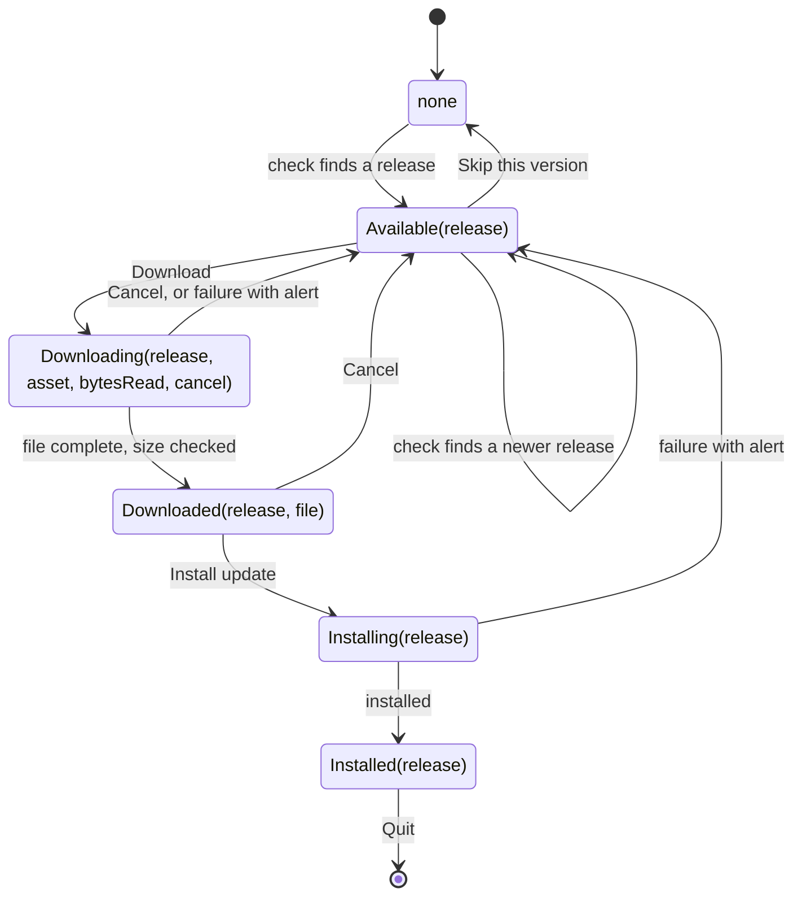
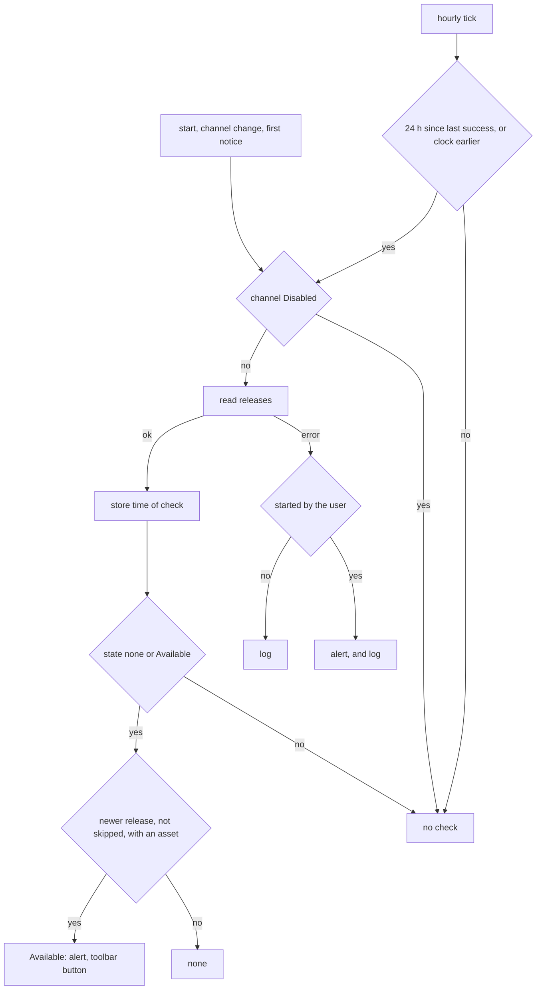

# Desktop: update reminders, download progress, install location

Branch: `sh/desktop-update-flow`.
Base: master `6edc16f7b`. The code is stacked on #8242 (`ep/desktop-internal-updates`, `d471e712a`) while #8242 is open; #8242 changes the release choice in AppUpdater.kt, adds the Internal channel and AppUpdaterTest.kt.

Citations: paths under `apps/multiplatform/common/src/` at the base; `AppUpdater.kt` is `desktopMain/kotlin/chat/simplex/common/views/helpers/AppUpdater.kt`.

## 1. Problems

1. After "Remind later", the alert of an available update returns only after 24 hours of running time, or at the next start of the app.
2. A started download is shown by a 2.5-second message and an unlabelled ring in the chat list toolbar; a failed download is shown nowhere, and a failed HTTP response is offered as the downloaded update.
3. After an update on macOS, the app can open with the database downgrade error.

Today, in code:

| Fact | Code |
|---|---|
| "Remind later" closes the alert only | AppUpdater.kt:252-256 |
| The next check is a `delay` of 24 hours after the previous one | AppUpdater.kt:170-176 |
| The check runs at start, after a change of the channel, and from the first notice | desktop Main.kt:40; SettingsView.desktop.kt:24; AppUpdater.kt:136, 144 |
| The download start is a toast of 2.5 s at the bottom of the window | AppUpdater.kt:286; UI.kt:6; DesktopApp.kt:165-182 |
| The download progress is a 32sp ring without text in the toolbar; hover shows a cancel icon | commonMain ChatListView.kt:551-566; CIFileView.kt:371-383 |
| The progress is a `Float?` in ChatModel, with -1 for installing | ChatModel.kt:269-270; AppUpdater.kt:228, 291, 347 |
| A failed download is logged only, and the ring disappears | AppUpdater.kt:381-383, 233 |
| The HTTP status of the download is not checked; an error body is saved as the update | AppUpdater.kt:316-335 |
| After the install, the old app keeps running; a second launch only signals it | AppUpdater.kt:482-485; SingleInstance.kt:49-61 |
| macOS install always replaces `/Applications/SimpleX.app`, wherever the running app is | AppUpdater.kt:474-475 |
| The result of the rename of the old bundle is ignored; `cp -R` then copies into the existing bundle | AppUpdater.kt:474-476 |
| `hdiutil mount` and `rm -rf` are run as single strings, split on spaces | AppUpdater.kt:460, 495 |
| `SimpleX-old.app` is deleted whether or not this install created it | AppUpdater.kt:492-496 |
| The checker offers only releases newer than the installed version | AppUpdater.kt:194-195 |
| The chat and agent migrations of releases v7.0.0 to v7.1.4 only grow | Migrations.hs of each tag; agent App.hs of each pinned simplexmq commit |
| Every copy of the app opens the same database | desktopMain Platform.desktop.kt:13-18 |
| The MSI version is the version name without its pre-release part: 7.1.0-beta.N and 7.1.0 are both 7.1.0 | desktop/build.gradle.kts:129-134 |

From the facts on releases and migrations, a downgrade error after an update requires an older app opening a database that a newer app migrated. The macOS install leaves an older app in place when the running app is outside `/Applications/SimpleX.app`, and that copy stays in Spotlight and Launchpad. Confirmation is requested from the reporter: the version and the migrations of the error screen (commonMain DatabaseErrorView.kt:120-143), and the list of copies of the app.

Inference, unverified: the 24-hour `delay` uses `System.nanoTime`, which on macOS stops during sleep.

## 2. Behaviour

### Checks

- At every start, a check runs, as today.
- One periodic loop, started once at start, evaluates every hour whether a check is due: 24 hours of wall-clock time passed since the last successful check, or the clock is earlier than that check.
- A change of the channel, and the first notice, run a check at once, as today.
- A check result is applied only when no update is in progress (state none or Available).
- A failed check started by the user, by a change of the channel or the first notice, shows the alert "Could not check for updates"; a failed check at start or from the loop is logged only.

### Available update

- A check that finds a release shows the alert, as today, and sets the state Available.
- In Available, the chat list toolbar has the button "Update available"; a click opens the alert again.
- "Skip this version" sets the state none.

### Download

- During the download, a banner beside the chat list toolbar shows the release name, the downloaded and total size, a progress bar and "Cancel": below the toolbar at the top, or above it in the one-hand layout.
- The total is the size of the release asset.
- A response other than 2xx, an interrupted transfer and a file of another size than the asset are failures.
- A failure shows the alert "Update not downloaded" with "Retry", "Open in browser" (the release page) and "Close".
- A download cancelled by the user shows no alert.
- In Downloaded, the alert "App update is downloaded" is shown, as today; after "Cancel", the state is Available.

### Install

- During the install, the banner shows "Installing" without "Cancel".
- After a successful install, the state is Installed: checks stop, and the toolbar button "Restart to update" opens the alert "Installed successfully" with "Quit" and "Later".
- On Windows, the install exits the app, as today.

### Install on macOS

- The target is the bundle of the running app, from `jpackage.app-path`.
- A bundle under `/AppTranslocation/` or on a read-only volume is replaced by `/Applications/<bundle name>`; the alert after the install asks to open SimpleX from Applications.
- An app without a bundle (`Unpackaged`) opens the folder of the downloaded file, without an install.
- A bundle in the disk image older than the running app is not installed.
- The old bundle is renamed to `<name>-old.app`; the rename and the copy are checked; on a failure, the old bundle is restored, the folder of the downloaded file is opened and the alert "Update not installed" is shown.
- Only the `-old` bundle renamed by this install is deleted.
- Every command takes its paths as separate arguments.

## 3. Types

`AppUpdate`, in AppUpdater.kt (desktopMain), with the GitHub release types:

| Constructor | Fields |
|---|---|
| Available | release |
| Downloading | release asset bytesRead cancel |
| Downloaded | release file |
| Installing | release |
| Installed | release |

AppUpdater.kt:

| Value | Type |
|---|---|
| appUpdate | MutableState&lt;AppUpdate?&gt; |

ChatModel: `updatingProgress` and `updatingRequest` removed.

PlatformInterface, commonMain Platform.kt, as `desktopShowAppUpdateNotice`:

| Function | Desktop |
|---|---|
| desktopAppUpdateToolbarButton | "Update available" or "Restart to update" |
| desktopAppUpdateBanner | the download and install banner |

AppPreferences:

| Field | Type | Key | Default |
|---|---|---|---|
| appUpdateLastCheck | Instant? | AppUpdateLastCheck | null |

`DesktopInstallation.MacBundle` (AppLinkScheme.desktop.kt:53) has the field `path`, the bundle.

## 4. Changes

| File | Change |
|---|---|
| AppUpdater.kt | AppUpdate states; check at start and an hourly due check; status and size of the download checked; failure alerts; macOS target from MacBundle, version of the disk image checked, rename and copy checked, commands with argument arrays |
| AppLinkScheme.desktop.kt | MacBundle(path) |
| ChatModel.kt | updatingProgress and updatingRequest removed |
| SimpleXAPI.kt | appUpdateLastCheck |
| Platform.kt, desktop Main.kt | desktopAppUpdateToolbarButton, desktopAppUpdateBanner |
| ChatListView.kt | the two hooks in place of the ring |
| SettingsView.kt | modal closed on the start of a download, from appUpdate |
| base strings.xml | "Update available", "Restart to update", banner, failure alerts, "Open SimpleX from Applications" |
| AppUpdaterTest.kt | due check, state transitions, download against a local HTTP server, bundle replacement in a temporary folder |
| AppLinkSchemeTest.kt | MacBundle with its path |
| SnapshotTest.kt, desktopTest/snapshots | previews of the toolbar buttons and of the banner while downloading and installing |
| spec/state.md, product/views/settings.md, docs/guide/app-settings.md | update state, toolbar buttons, banner |

#7512 adds an alert for a failed check and a failed download; this change includes the download alert, and the check alert for checks started by the user.

## 5. Tests

The interfaces of the due check, of the download and of the bundle replacement are committed first with their tests, which fail on them.

- `isCheckDue`: no last check; 23 h and 25 h ago; a clock earlier than the last check.
- State transitions: each arrow of the state diagram; a check result in Downloading, Downloaded, Installing and Installed is not applied.
- Download, against a local HTTP server (`com.sun.net.httpserver`): success; 404; a body shorter than the asset; Cancel.
- Bundle replacement, in a temporary folder: success; a missing source; a failed copy, with the old bundle restored; an existing `-old` bundle kept; paths with spaces.
- MacBundle: `/Applications/SimpleX.app/Contents/MacOS/SimpleX`, `~/Applications/SimpleX Chat.app/Contents/MacOS/SimpleX`, a translocated path.
- SnapshotTest: the toolbar buttons, and the banner while downloading and installing, in the light and dark themes.
- By hand, macOS: an app in `/Applications`, in `~/Applications`, translocated, and a non-writable `/Applications`.
- By hand, Windows: an update from 7.1.0-beta.10 to 7.1.0, both MSI version 7.1.0.

## 6. Threat model

- GitHub: the requests are those of today; a failed check is retried hourly instead of after 24 hours.
- Integrity of the update: HTTPS and the signature of the installer, as today; the size is checked against the release.
- Files: the install replaces only the bundle of the running app or `/Applications/<bundle name>`, and deletes only the bundle it renamed.
